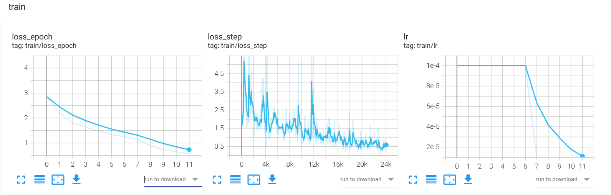

# EXP-005 实验日志

##

## 1. 配置

| 键（config.json）      | 值                    | 说明                                  |
| ------------------- | -------------------- | ----------------------------------- |
| `img_size`          | 448                  | 输入边长；P3 56×56 / P4 28×28 / P5 14×14 |
| `batch_size`        | 2                    | 每步 2 张，AMP 开                        |
| `num_workers`       | 0                    | Windows 下避免多进程句柄问题                  |
| `epochs`            | 12                   | 2004 步/轮，共 24048 步                  |
| `lr`                | 0.0001               | AdamW 学习率                           |
| `weight_decay`      | 0.0001               | 权重衰减                                |
| `num_classes`       | 20                   | VOC 20 类（sigmoid 多标签）               |
| `fpn_channels`      | 256                  | FPN 每层通道                            |
| `anchor_strides`    | [8, 16, 32]          | P3/P4/P5                            |
| `anchor_ratios`     | [0.5, 1.0, 2.0]      | 扁 / 方 / 高                           |
| `octave_base_scale` | 4                    | 每层基准边长 = stride × 4                 |
| `scales_per_octave` | 3                    | 每层 3 个尺度                            |
| `bbox_std`          | [0.1, 0.1, 0.2, 0.2] | 回归目标归一化                             |
| `pos_iou`           | 0.5                  | IoU ≥ 0.5 → 正样本                     |
| `neg_iou`           | 0.4                  | IoU < 0.4 → 负样本                     |
| `score_thr`         | 0.05                 | 评估时滤低分                              |
| `nms_thr`           | 0.5                  | NMS IoU 阈值                          |
| `topk_per_img`      | 100                  | 每图最多 100 框                          |
| `seed`              | 42                   | 随机种子                                |

**其余固定项**

| 项目    | 值                                                   |
| ----- | --------------------------------------------------- |
| 模型    | ResNet-18(C3/C4/C5) + FPN(256) + 2 层 3×3 共享头        |
| 损失    | Focal(γ=2, α=0.25) + smooth L1(β=1/9)，按正样本数归一化      |
| 学习率调度 | MultiStepLR，第 8、11 轮 ×0.1                           |
| 初始化   | ImageNet 预训练 backbone（`pretrained=True`） |
| 数据    | VOC2007 trainval 8:2 → 4009 训练 / 1002 验证            |

**随机性控制**：seed=42；`random.seed(42)` + `np.random.seed(42)` + `torch.manual_seed(42)` + `torch.cuda.manual_seed_all(42)`；`cudnn.deterministic=True`、`cudnn.benchmark=False`；`num_workers=0`。

## 2. 训练过程（TensorBoard `train/loss_epoch`）

| 轮次       | 1     | 2     | 3     | 4     | 5     | 6     | 7     | 8     | 9     | 10    | 11    | 12    |
| -------- | ----- | ----- | ----- | ----- | ----- | ----- | ----- | ----- | ----- | ----- | ----- | ----- |
| avg loss | 2.850 | 2.195 | 1.812 | 1.639 | 1.477 | 1.335 | 1.252 | 1.144 | 0.895 | 0.738 | 0.651 | 0.570 |

## 3. 结果

**mAP@0.5 = 37.22%**

逐类 AP ：

| 类别          | AP(%) | 类别          | AP(%) |
| ----------- | ----- | ----------- | ----- |
| car         | 61.0  | dog         | 36.3  |
| person      | 58.3  | cow         | 34.2  |
| aeroplane   | 56.6  | bus         | 32.4  |
| bicycle     | 56.4  | chair       | 25.1  |
| horse       | 53.1  | sofa        | 25.0  |
| train       | 45.2  | boat        | 22.9  |
| cat         | 42.8  | bird        | 22.7  |
| tvmonitor   | 42.8  | sheep       | 22.3  |
| motorbike   | 42.8  | bottle      | 16.3  |
| diningtable | 39.8  | pottedplant | 8.5   |

## 4. 观察与结论

1. **分辨率是有效变量**：mAP 33.34% → **37.22%（+3.88）**，同一模型、同一损失、同一轮数，唯一变化是输入 320 → 448。
2. **收益集中在小目标和中等目标**：cow +16.9、sheep +11.2、aeroplane +9.3、bird +9.1、bicycle +8.9、car +6.5、boat +6.2、pottedplant +6.0、bottle +5.9。这些类在 320 下只剩十几像素，448 让它们重新可辨。
3. **少数类反而下降**：cat −10.0、train −3.2、bus −2.2、diningtable −0.9。原因是大目标在 448 下可能被裁切（VOC 部分图长宽比极端，直接 resize 会压扁），且 12 轮下大目标类已接近饱和，边际收益被稀释。
4. **EXP-004 的低分不是分辨率造成的**：EXP-004 同为 448，但 batch=1（BN 统计不稳）+ 6 轮 + milestones[4,5]（第 4 轮 lr 就衰减到 1e-5），只有 8.38%。EXP-005 只把 batch 回到 2、轮数回到 12，mAP 直接 +28.84，说明**小 batch 的 BN + 过早衰减学习率才是那次失败的主因**。
5. **仍未到 40%**：差距来自 backbone R18（原版 R50）、输入 448（mmdet VOC 用 1000×600）、无数据增强、12 轮。这不是实现错误——大目标类 car/person 已到 61.0/58.3，说明检测头与回归分支工作正常。

