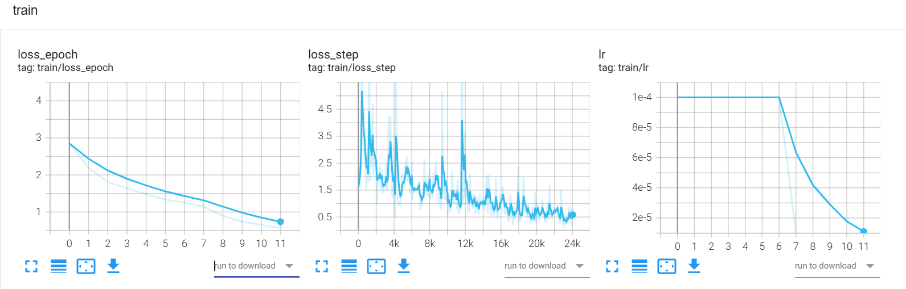
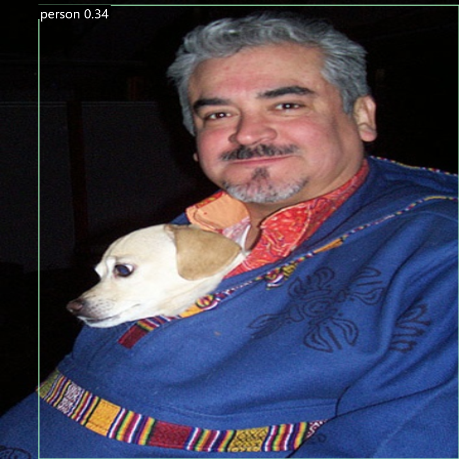

# 实验结果汇总（组会展示 · 一页纸）

> EXP-005 ｜ val mAP@0.5 = **37.22%** ｜ 2026-11-16

---

## 0. 环境与关键配置（EXP-005）

**运行环境**

| 项目 | 值 |
| --- | --- |
| GPU | NVIDIA GeForce RTX 3060 Laptop（6GB） |
| CUDA / torch | cu118 / 2.0.1+cu118（`cuda.is_available() = True`） |
| 模型 | ResNet-18(C3/C4/C5) + FPN(256) + 2 层 3×3 共享头 |
| 损失 | Focal(γ=2, α=0.25) + smooth L1(β=1/9)，按正样本数归一化 |
| 学习率调度 | MultiStepLR，第 8、11 轮 ×0.1 |
| 初始化 | ImageNet 预训练 backbone，未使用任何旧实验权重 |
| 数据 | VOC2007 trainval 8:2 → 4009 训练 / 1002 验证；官方 test 4952（未跑） |

**超参（逐字段照抄 `runs/EXP-005/config.json`，键名与 JSON 一致）**

| 键 | 值 | 键 | 值 |
| --- | --- | --- | --- |
| `img_size` | 448 | `num_classes` | 20 |
| `batch_size` | 2 | `fpn_channels` | 256 |
| `num_workers` | 0 | `anchor_strides` | [8, 16, 32] |
| `epochs` | 12 | `anchor_ratios` | [0.5, 1.0, 2.0] |
| `lr` | 0.0001 | `octave_base_scale` | 4 |
| `weight_decay` | 0.0001 | `scales_per_octave` | 3 |
| `pos_iou` | 0.5 | `bbox_std` | [0.1, 0.1, 0.2, 0.2] |
| `neg_iou` | 0.4 | `score_thr` | 0.05 |
| `nms_thr` | 0.5 | `topk_per_img` | 100 |
| `seed` | 42 | anchor 数（推导） | 37044 =（56²+28²+14²）×9 |

> 448 下 P3/P4/P5 特征图为 56/28/14，anchor 数由 18900（320）变为 37044；anchor 尺度公式 `stride×4×2^(i/3)` 不变。

---

## 1. 主实验

| 实验 | 配置 | val mAP@0.5 | 相对 EXP-002 | 说明 |
| --- | --- | --- | --- | --- |
| EXP-001 | 1 轮冒烟 | 未评估 | — | 只验证“数据→模型→损失→反传”链路 |
| EXP-002 | **320 输入 / batch 2 / 12 轮** | **33.34%** | 基线 | 首次完整训练 |
| EXP-004 | 448 输入 / batch 1 / 6 轮 / milestones[4,5] | 8.38% | −24.96 | **失败案例**，原因见第 4 节 |
| **EXP-005** | **448 输入 / batch 2 / 12 轮** | **37.22%** | **+3.88** | **主结果**，唯一变量是输入尺寸 |

> **报数规则**：全部为 val（我们自己切的 1002 张）。官方 test 4952 张尚未评估，汇报时不要写成 test。

**EXP-005 训练 loss（`train/loss_epoch`）**

| 轮次 | 1 | 2 | 3 | 4 | 5 | 6 | 7 | 8 | 9 | 10 | 11 | 12 |
| --- | --- | --- | --- | --- | --- | --- | --- | --- | --- | --- | --- | --- |
| avg loss | 2.850 | 2.195 | 1.812 | 1.639 | 1.477 | 1.335 | 1.252 | 1.144 | 0.895 | 0.738 | 0.651 | 0.570 |

单调下降、无发散；第 9 轮降幅变大对应第 8 轮末 lr 由 1e-4 → 1e-5。

---

## 2. 逐类 AP（EXP-005 vs EXP-002）

| 类别 | EXP-005 | EXP-002 | Δ | 类别 | EXP-005 | EXP-002 | Δ |
| --- | --- | --- | --- | --- | --- | --- | --- |
| car | 61.0 | 54.5 | +6.5 | dog | 36.3 | 35.2 | +1.1 |
| person | 58.3 | 55.4 | +2.9 | cow | 34.2 | 17.3 | **+16.9** |
| aeroplane | 56.6 | 47.3 | +9.3 | bus | 32.4 | 34.6 | −2.2 |
| bicycle | 56.4 | 47.5 | +8.9 | chair | 25.1 | 22.9 | +2.2 |
| horse | 53.1 | 48.9 | +4.2 | sofa | 25.0 | 24.4 | +0.6 |
| train | 45.2 | 48.4 | −3.2 | boat | 22.9 | 16.7 | +6.2 |
| cat | 42.8 | 52.8 | **−10.0** | bird | 22.7 | 13.6 | +9.1 |
| tvmonitor | 42.8 | 39.8 | +3.0 | sheep | 22.3 | 11.1 | **+11.2** |
| motorbike | 42.8 | 42.6 | +0.2 | bottle | 16.3 | 10.4 | +5.9 |
| diningtable | 39.8 | 40.7 | −0.9 | pottedplant | 8.5 | 2.5 | +6.0 |
| | | | | **mAP** | **37.22** | **33.34** | **+3.88** |

**读法（可直接念）**

- 涨幅最大的全是在 320 下“只剩十几像素”的类：cow +16.9、sheep +11.2、aeroplane +9.3、bird +9.1、bicycle +8.9、car +6.5。
- 仍有 4 类下降：cat −10.0、train −3.2、bus −2.2、diningtable −0.9。这些是大目标类，448 直接 resize 会压扁极端长宽比的图，且它们在 320 下已接近饱和。
- 最低的三类依旧是 pottedplant 8.5、bottle 16.3、sheep 22.3 —— 小目标 + 密集 + 类内差异大，是下一步的主要空间。

---

## 3. 曲线与可视化



左：每轮平均 loss（2.85 → 0.57，单调下降）；中：每步 loss（前 4k 步波动大，属正常）；右：学习率（前 8 轮 1e-4，第 8、11 轮各 ×0.1）。

**预测示例（`000001.jpg`，thr=0.3）**



`000001.jpg`，thr=0.3：输出 1 个框 `person 0.34`，框住人物主体、标签清晰。**狗（dog）漏检**——该图人物占比大、光线暗、狗只露出头和部分身体，属难样本；dog 类整体 AP 36.3，尚未稳定召回。如实说明，不掩饰。

---

## 4. 失败实验复盘：EXP-004 为什么只有 8.38%

EXP-004 与 EXP-005 同为 448，但改了 3 处，结果差 28.84 点：

| 项 | EXP-004 | EXP-005 | 后果 |
| --- | --- | --- | --- |
| batch | 1 | 2 | batch=1 时 BN 只用单图统计，eval 用 running stats 严重失配 → 训练 loss 正常、mAP 崩 |
| epochs | 6 | 12 | 只过 6 遍数据，loss 停在 1.73，远未收敛 |
| milestones | [4, 5] | [8, 11] | 第 4 轮 lr 就衰减到 1e-5，最后两轮几乎不学 |

**结论**：小 batch 不是“省显存的好办法”，它会破坏 BN 统计；改分辨率时其余超参必须保持在已验证的取值上，一次只动一个变量。

---

## 5. 结论（5 条，带数字）

1. **链路完整可复现**：数据 4009/1002 → 模型 37044 anchor → Focal + smooth L1 → 12 轮（loss 2.85→0.57）→ val mAP → 可视化，seed=42，全程无手改数字。
2. **主结果 val mAP@0.5 = 37.22%**，比 320 基线（33.34%）高 3.88 个点，距任务书 40% 还差 2.78 个点。
3. **提升来源明确**：只改输入尺寸，收益集中在小目标类（cow +16.9、sheep +11.2、bird +9.1、pottedplant +6.0）——验证了“小目标塌方是分辨率不足”的判断。
4. **失败实验也给出了信息**：EXP-004 的 8.38% 定位出 batch=1 的 BN 失配与 lr 过早衰减，这两个坑比分数本身更有价值。
5. **差距原因可解释**：R18（原版 R50）、448（mmdet VOC 用 1000×600）、无数据增强、12 轮；大目标类 car 61.0 / person 58.3 已接近合理水平，说明实现正确。RetinaNet 论文的 COCO AP≈39.1 与 VOC mAP@0.5 口径不同，**不可直接比较**。

---

## 6. 不足与下一步

| 不足 | 下一步（可执行） | 预期 |
| --- | --- | --- |
| 无数据增强 | `VOCDataset` 加随机水平翻转 p=0.5 | +1～3 |
| 只训 12 轮，loss 仍在降 | `--epochs 24`，milestones [16, 22] | +1～2 |
| 只看最后一轮 | 每 3 轮评估 + 存 `best.pth`（步骤 17） | 避免末轮非最优 |
| 检测头 2 层（原版 4 层） | `head.py` 层数改 4 | +1～3 |
| 只有 val 数字 | 官方 test 4952 张评估（步骤 18） | 口径完整 |
| 大目标类在 448 下掉点 | 改用保持长宽比的 resize（letterbox） | 修 cat/train/bus |

---

## 7. 复现命令

```powershell
conda activate cv
cd D:\Research\Code\cv-learning\experiments\w4_retinanet_voc
python -m data.make_split                                        # 生成 train/val
python -m models.retinanet                                       # 模型自检
python -m trainer.train --exp EXP-005                            # 读 config：448 / batch2 / 12 轮
tensorboard --logdir runs                                        # 曲线，截图到 docs/figures
python -m trainer.eval --ckpt checkpoints/last.pth --exp EXP-005 # 自动写 results.md / metrics.json
python -m tools.predict --img data\VOCdevkit\VOC2007\JPEGImages\000001.jpg --thr 0.3 --out docs\figures\pred_EXP-005.png
```
