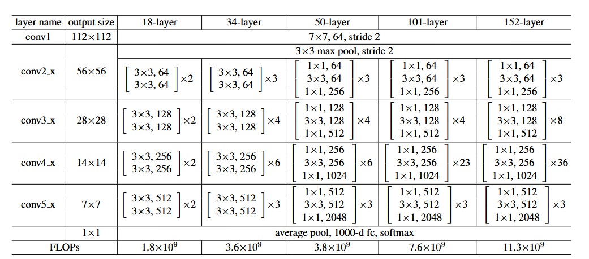
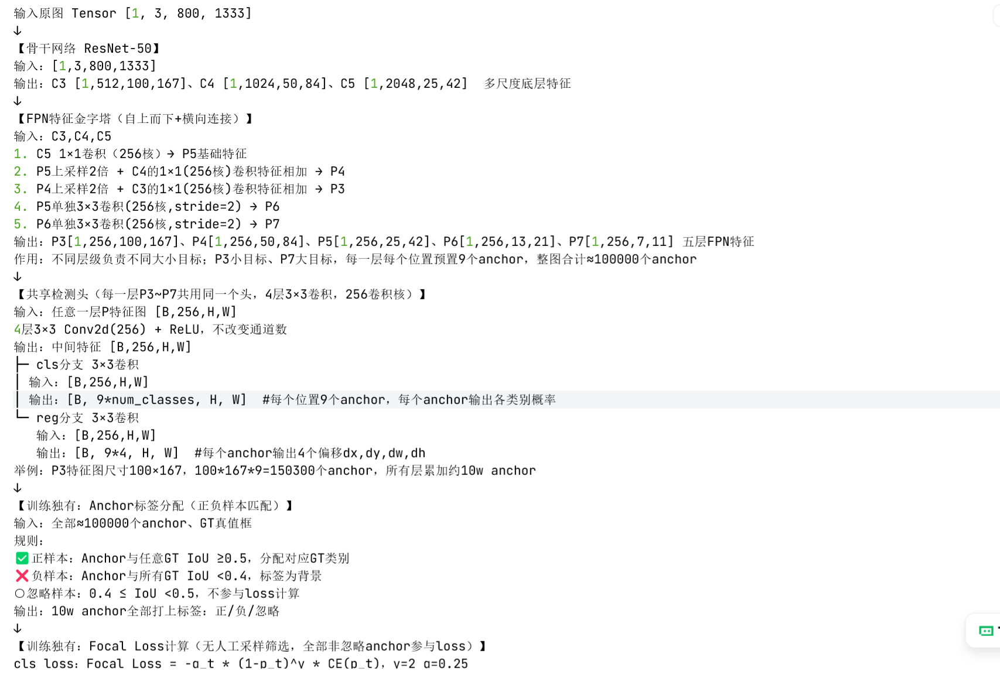
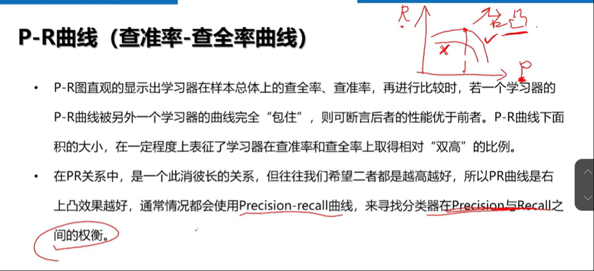
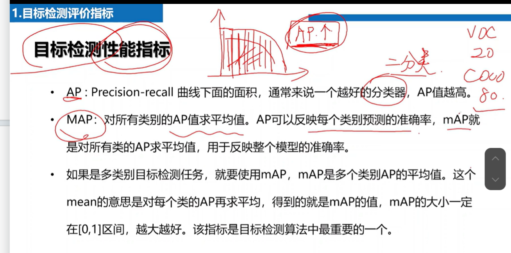
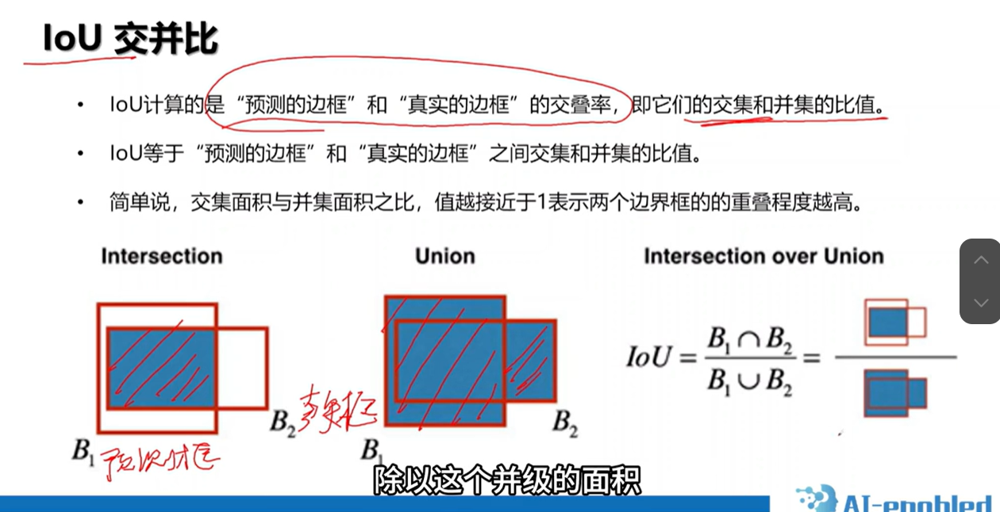

# 1.实验架构

# 2.PR曲线和AP，MAP

## 先把场景定好：小白版例子

假设你训练了一个模型：**找图片里的猫**

测试集一共：**10 只真猫**（标准答案）

模型会输出一堆框，每个框带一个【置信度】：比如 0.9（很确定是猫）、0.7、0.4……

> 置信度 = 模型觉得 “这个框是猫” 的把握

你可以设置一条分数线：**置信度高于这个数，我就认为它检出目标**

分数线调高 → 只保留模型很有把握的框；

分数线调低 → 把模棱两可的框也放进来。

> Precision（精确率 P）：你找出来的里面，真的是猫的比例（别瞎报）
>
> Recall（召回率 R）：全部真猫里面，被你找到的比例（别漏掉）

---

## 第一步：P 和 R 怎么算，拿数字举例

真实有 10 只猫

情况 1：分数线设很高，只保留置信度≥0.9 的框

模型检出 2 个框，2 个都是真猫

- P = 2/2 = 100%（挑出来的全对，没有谎报）
- R = 2/10 = 20%（只找到 2 只，漏了 8 只）

情况 2：分数线降到≥0.7

现在一共检出 6 个框：4 只真猫，2 个其实是狗（误检）

- P = 4/6 ≈ 66.7%（有谎报了）
- R = 4/10 = 40%（找到更多猫）

情况 3：分数线降到≥0.4

检出 15 个框：8 只真猫，7 个是别的东西

- P = 8/15 ≈ 53.3%
- R = 8/10 = 80%

✅ 规律：**你想找更多目标（R 变大），就更容易混入错的，P 一般会下降**

这就是 P 和 R 天生的矛盾。

---

## 第二步：PR 曲线是什么

把上面每一条分数线对应的 (R, P) 当成坐标点：

(0.2, 1.0)、(0.4, 0.667)、(0.8, 0.533)

把一堆点连起来 → **PR 曲线**

👉 怎么看 PR 曲线：

- 曲线越靠近**左上角**越好：左上角 = 召回很高（找到大部分目标），同时精确率很高（很少错报）
- 如果曲线贴着底边：找得到目标，但一堆错框，全是误检
- 如果曲线贴着左边：报出来的都对，但漏掉大量目标

> 对比 ROC 曲线：PR 更适合正负样本不均衡（检测任务基本都是这个情况），所以目标检测用 PR。

---

## 第三步：AP（Average Precision，单一类的分数）

AP 就是 **PR 曲线下面包围的面积**，范围 0~1。

还是刚才【检测猫】这一类：

- 如果曲线贴着左上角，面积接近 1 → AP 很高，这个类别检测效果很好
- 如果曲线塌下去，面积很小 → AP 差，这个类别经常漏或者错检

举直观对比：

- 猫类 AP=0.85：找猫这个任务做得不错
- 猫类 AP=0.2：经常找不到猫，或者把别的东西当成猫

⚠️ AP 不是一个固定 P 或者固定 R！它是把**所有置信度分数线下的表现一起打包成一个分数**，不用你纠结到底选哪个置信度阈值。

> 通俗一句话：AP = 这个类别，在各种松紧标准下，综合好不好。

---

## 第四步：mAP（mean AP，全部类别的平均分）

现在你的模型不只找猫，还要找狗、鸟：

- 猫 AP = 0.85
- 狗 AP = 0.72
- 鸟 AP = 0.40

mAP = (0.85 + 0.72 + 0.40) ÷ 3 ≈ 0.657

👉 mAP 就是所有类别 AP 直接求平均，是模型**整体打分**

怎么看：

- mAP 越高，模型整体越强
- 但 mAP 高不代表每一类都好！比如上面例子，鸟这个类别很差，拖后腿。调参的时候要看每个类单独的 AP，找到拉胯的类别。

---

## 再把 mAP@0.5 单独说清楚（你跑 YOLO 一定会看到）

前面我们没提 IoU，现在补上：

预测框和真实框重叠够不够多，才算 “找对了”。

mAP@0.5：重叠 IoU≥0.5 就算找对，标准松一点，分数一般偏高。

mAP@0.5:0.95：重叠要求从 0.5 一直严到 0.95，取平均；要求框位置卡得很准，分数通常更低，论文主指标。

举个大白话类比：

- IoU0.5：框大概圈住猫就行
- IoU0.9：框必须严丝合缝贴着猫的轮廓，歪一点都不算

---

# 极简总结串一遍（方便你记）

1. 改置信度分数线，会得到一组组 P、R；
2. 把这些 (R,P) 画出来 = PR 曲线；
3. PR 曲线下面积 = AP（这一类好不好）；
4. 所有类 AP 求平均 = mAP（整个模型好不好）；
5. 看曲线：越往左上越好；看 AP/mAP：数值越大越好。

---

## 一个小白常踩坑提醒

❌ 不是 R 越高越好！R=100% 代表把图里所有东西都报成猫，P 会极低，毫无意义。

❌ 不是 P 越高越好！P=100% 只输出一个很确定的猫，剩下 9 只全漏掉，也没用。

✅ AP 天然兼顾两者，所以检测任务用它。
