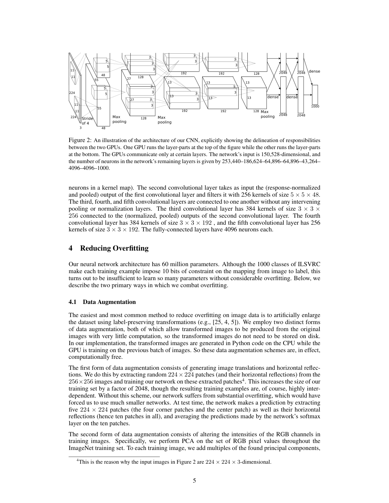
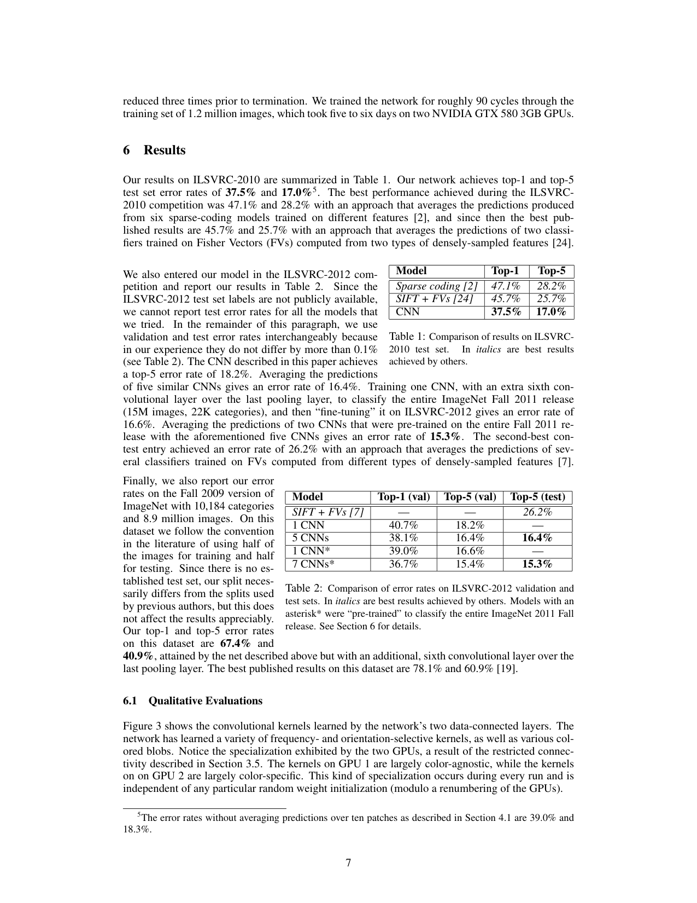

# AlexNet（2012）· 论文笔记

- **论文**：ImageNet Classification with Deep Convolutional Neural Networks（NIPS 2012）
- **BibTeX 键名**：`krizhevsky2012imagenet`（Zotero 导出后可直接用于 `\cite{}`）
- **出处**：NIPS 2012（无 arXiv 编号）；官方页：papers.nips.cc/paper/2012/hash/c399862d3b9d6b76c8436e924a68c45b
- **本地 PDF**：`3.科研基本任务/论文/Krizhevsky 等 - 2012 - ImageNet Classification with Deep Convolutional Neural Networks.pdf`
- **任务书条目**：第 2 周 #1｜🟢 AI 辅助读｜阅读要点：ReLU、Dropout、数据增强、历史意义
- **阅读日期**：2026-10-31
- **核对规则**：本文每个数字后面的「出处」都指回原 PDF 的章节/表号；笔记里的 ✅ 表示已回原文逐条查证（三色核对法，详见《科研入门任务书_详解版_v2.md》第 5 章）。

---

## 0. 术语表（零基础全能版 · 先看这一节再看正文）

> 读英文论文最先卡住的不是"思想"，是这些词。下面按「硬件 → 网络结构 → 训练 → 评估」分四组，每条都给大白话，并说明**它在这篇论文里具体指什么**。

### 0.1 硬件与工程（AlexNet 最容易被一句话带过、但最该搞懂的一组）

| 术语 | 大白话解释（在本篇里的含义） |
|---|---|
| **GPU（显卡）** | 显卡里塞了几千个"小算工"，每个只会做简单的加减乘；好处是**几千个能同时干同一件简单事**。深度学习 90% 的计算是"矩阵乘加"，正好是"同一件简单事重复几百万次"，所以 GPU 比 CPU 快几十倍。CPU 则是少数几个"全能大脑"，擅长复杂逻辑和调度。 |
| **显存（VRAM，3 GB）** | 显卡自己的内存，相当于显卡的"工作台"。**模型权重、每一层的特征图、一个 batch 的图片，都必须先搬进显存才能算**。GTX 580 只有 3 GB，AlexNet 一个模型装不下，作者才把它拆成两半放到两张卡上——这就是 §3.2 "Training on Multiple GPUs" 的真实原因。报错 `CUDA out of memory` 就是这张工作台放不下了。 |
| **CUDA** | NVIDIA 家的编程接口。有了它，程序员才能直接写"在 GPU 的几千个核上并行跑"的代码，而不是只能调用现成的画图/游戏接口。 |
| **"高度优化的 GPU 实现"**（原文 §1：a highly-optimized implementation of 2D convolution） | **这句话不是说"把模型放到 GPU 上跑"，而是说"卷积这个运算的代码被重写得特别快"。** ① 朴素写法：卷积核在图上逐点滑动、每个位置做乘加——GPU 的几千个核大部分时间在等数据，利用率极低。② 优化的核心思路：把卷积**改写成矩阵乘法**（im2col：把每个感受野里的像素拉成一列，整张图就变成一个大矩阵，卷积 = 大矩阵 × 卷积核矩阵），再调用 GPU 上已被调到极致的矩阵乘法例程（GEMM）。③ 再做两件配套的事：用**共享内存/寄存器复用**同一块数据，减少"显存↔计算单元"的搬运次数；把 batch 里的多张图、多个卷积核都并行切开。④ 结果：**同样的数学，快几十倍**，5–6 天训完才有可能。⑤ 历史细节：2012 年还没有 cuDNN（NVIDIA 的深度学习库是 2014 年才发布），所以这套程序是 Alex Krizhevsky 自己写的 CUDA 代码 `cuda-convnet`（论文脚注 1 给的链接）。 |
| **GEMM（通用矩阵乘法）** | "矩阵乘矩阵"的标准程序。GPU 厂商为它做了十几年优化，是所有深度学习框架的算力底座。卷积被改写成 GEMM，就能直接吃到这份优化。 |
| **im2col** | 把"滑窗取块"变成"矩阵展开"的技巧：每个 3×3（或 11×11）感受野内的像素按列排好，一次矩阵乘法就把整层卷积算完。代价是**多占内存**（展开后数据变几倍），换来的是极高的计算效率。 |
| **cuDNN** | NVIDIA 2014 年发布的深度学习加速库，把卷积的几种算法（implicit GEMM、Winograd、FFT）封装好并自动挑最快的。**AlexNet 时代没有它**，所以"自己写高度优化的实现"在当时是硬核贡献。 |
| **模型并行** | 把**同一个模型的不同部分**放到不同 GPU 上（AlexNet：一半卷积核放卡 1、一半放卡 2，只在第 3 层交换信息）。适合"模型大到单卡装不下"。 |
| **数据并行** | 每张卡放**一份完整模型**，各算 batch 的一部分，再把梯度平均。适合"模型装得下、但想更快"。VGG 用的就是这种。 |
| **GTX 580 / 5–6 天** | 2012 年的两块消费级显卡，每块 3 GB 显存；训练一个模型要 5–6 天。对比今天：一张 4090 跑同样模型是分钟级——**"算力"是这十年 CV 进步的最大推手之一**。 |

### 0.2 网络结构基础

| 术语 | 大白话解释 |
|---|---|
| **卷积（convolution）** | 拿一个小窗口（卷积核）在图上从左到右、从上到下滑动，每停一处就把窗口内的像素和窗口权重做"乘加"，得到一个数。整张图滑完就得到一张新的"特征图"。作用：提取局部特征（边缘→纹理→部件→物体）。 |
| **卷积核 / 滤波器（kernel / filter）** | 那个小窗口本身，里面的数字就是**要学习的权重**。11×11×3 表示"宽 11、高 11、厚 3（对应 RGB 三通道）"。 |
| **特征图（feature map）** | 一个卷积核扫完整张图得到的二维结果；96 个卷积核就得到 96 张特征图。 |
| **通道（channel）** | 特征图的"厚度"/张数。输入是 3 通道（RGB），conv1 输出 96 通道，conv2 输出 256 通道…… |
| **步长（stride）** | 卷积核每滑一次跨几个像素。AlexNet 第一层 stride=4（跳着扫，省算力），后面都是 1。 |
| **填充（padding）** | 在图像四周补一圈 0，让卷积后尺寸不缩小（VGG 全部用 padding=1 保持尺寸）。 |
| **池化（pooling）/ 最大池化** | 把一个小区域（如 3×3）压成一个数（取最大值），作用是**降分辨率、省算力、增加一点平移不变性**。 |
| **重叠池化** | 池化窗口 3×3、但步长只有 2 → 相邻窗口互相重叠（传统做法是窗口=步长=2，不重叠）。原文说这样能降 0.4%/0.3% 错误率。 |
| **全连接层（FC）** | 把前面所有特征"拉平"后接到每个神经元都互连的一层，参数量极大（4096×4096 就是 1600 万参数）。 |
| **感受野（receptive field）** | 一个神经元在**原图上**能"看到"的区域大小。层数越深、感受野越大（浅层看边缘，深层看整只狗）。 |
| **参数共享** | 同一个卷积核扫遍整张图，**权重只有一份**。这是 CNN 比全连接省参数的根本原因，也是"图像里同一物体出现在哪都应该被同样识别"的先验。 |
| **神经元（neuron）** | 网络里一个"计算点"。原文说 65 万个神经元，指的是各层输出元素的总数量级（卷积层每个位置、全连接层每个节点都算一个）。 |
| **softmax** | 把最后一层 1000 个得分变成"1000 类各自的概率"（都为正、加起来等于 1）。 |
| **多类逻辑回归（multinomial logistic regression）** | 论文用的损失函数：让"正确类别的预测概率"越大越好（等价于交叉熵）。 |
| **对数概率（log-probability）** | 概率取对数。取对数的好处：把"连乘很多概率"变成"连加"，数值更稳、梯度更好算。 |
| **6000 万参数** | 所有要学习的数字总数（卷积核权重 + 全连接权重 + 偏置）。**参数越多，越容易过拟合、越吃显存**。 |

### 0.3 训练相关

| 术语 | 大白话解释 |
|---|---|
| **前向传播 / 反向传播** | 前向：输入从第一层算到最后一层，得到预测；反向：从损失往回算"每个参数该往哪调、调多少"（链式法则）。 |
| **梯度** | 损失对某个参数的"斜率"：告诉这个参数往哪个方向改能让损失变小、改多少。 |
| **SGD（随机梯度下降）** | 最基础的训练方法：每次拿一小批数据算梯度，参数往梯度的反方向挪一步。 |
| **mini-batch / batch size** | 一次算梯度用多少张图。AlexNet 用 128。**batch 越大梯度越准但越吃显存**。 |
| **epoch / iteration / cycle** | 一个 epoch = 把 120 万张训练图完整过一遍；一次 iteration = 处理一个 batch。原文说训练了约 90 个 cycle（≈90 个 epoch）。 |
| **学习率（learning rate）** | 每一步挪多大。太大→震荡甚至发散；太小→训到天荒地老。AlexNet 从 0.01 开始，验证集不涨就除以 10，共降 3 次。 |
| **momentum（动量）** | 更新时保留上一步的一部分"惯性"，像小球下坡越滚越快，能冲过平坦/抖动区域。AlexNet 用 0.9。 |
| **weight decay（权重衰减）** | 每步让权重按比例缩小一点，防止权重变得过大。等价于 L2 正则。AlexNet 用 0.0005，原文特别说它"不只是正则，还能降低训练误差"。 |
| **权重初始化** | 训练开始时给权重什么初值。AlexNet 用"均值 0、标准差 0.01 的高斯分布"，部分层的偏置初始化为 1（为了让 ReLU 一开始就有正输入）。**初始化不好，深网络直接训不动**。 |
| **饱和（saturation）** | sigmoid/tanh 在输入很大或很小时，曲线几乎变平，导数≈0 → 梯度传不回去。 |
| **梯度消失** | 因为饱和/连乘小于 1 的数，梯度一层层往回传时越来越小，浅层几乎学不动。 |
| **ReLU** | `f(x)=max(0,x)`：负数归零、正数原样。正区间导数恒为 1，所以**不饱和、训练快**（原文 CIFAR-10 上快 6 倍）。 |
| **LRN（局部响应归一化）** | 让相邻的几个通道互相压制（模仿神经元的侧抑制），公式见正文 2.3。**它是 BN 的前辈，今天已被淘汰**。 |
| **Dropout** | 训练时随机让一部分神经元"失联"（概率 0.5），逼网络学冗余特征，防过拟合；测试时全部启用但输出乘 0.5。 |
| **过拟合** | 训练集上表现很好、新数据上很差——模型"背答案"而不是"学规律"。60 M 参数 + 120 万图，过拟合是 AlexNet 的头号敌人。 |
| **正则化** | 一切"防过拟合"的手段统称（Dropout、weight decay、数据增强都算）。 |
| **数据增强** | 用翻转/裁剪/颜色扰动"造"新样本出来，不增加真实数据，但等价于让模型见更多变化。 |
| **PCA（主成分分析）** | 一种找"数据变化最大的几个方向"的数学方法。AlexNet 用它找 RGB 像素变化最大的 3 个方向，然后沿这些方向随机加减一点颜色 → 模拟不同光照。 |
| **收敛（converge）** | 损失不再明显下降、精度稳定下来的状态。 |

### 0.4 评估与结果

| 术语 | 大白话解释 |
|---|---|
| **top-1 / top-5 错误率** | top-1：只看预测的第一名，错了就算错；top-5：正确答案不在预测的前 5 名里才算错。**数字一定要说清是哪一个**（AlexNet 的 15.3% 是 top-5）。 |
| **集成（ensemble）** | 训练多个模型，把它们的预测概率平均。通常能稳定降错误率（AlexNet 的 15.3% 就是 7 个模型的集成）。 |
| **推理（inference）** | 模型训练完之后"拿来用"的阶段（只前向、不反向、不更新参数）。这时 Dropout 要关掉、BN 要换成滑动平均统计量。 |

---

## 1. 一句话说清（解决什么问题？怎么解决的？）

**问题**：2012 年以前，图像分类靠人工设计特征（SIFT/HOG + SVM/Fisher Vector 编码），在 ImageNet 这种「1000 类、120 万张高分辨率图」的规模上错误率很高（ILSVRC-2010 当时最好 top-5 错误率 28.2%，见 §6 与 Table 1）。

**做法**：训练一个 **8 层、6000 万参数**的卷积神经网络，**端到端**直接从原始像素学特征（不再人工设计）；用 **ReLU** 让训练快数倍、用 **Dropout + 两种数据增强**压过拟合、用 **两块 GTX 580（各 3 GB 显存）**做模型并行把大模型拆开训练。

**结果**：ILSVRC-2010 测试集 **top-1 / top-5 错误率 = 37.5% / 17.0%**（Table 1，✅ 摘要与 §6 两处一致），比当时最好的传统方法（47.1%/28.2%）低约 10 个百分点；ILSVRC-2012 用 7 个 CNN 集成拿到 **top-5 错误率 15.3%**，第二名 26.2%（Table 2）。

> 一句话背下来：**AlexNet = 「深度 + GPU + ReLU + Dropout」第一次在 ImageNet 上把传统手工特征碾过去，是后面所有网络改动的原点。**

---

## 2. 核心图 / 公式

### 2.1 核心结构图（原文 Figure 2，PDF 第 5 页）



> 图里上下两块是「分别放在两张 GPU 上的那一半」，中间只在**第 3 层**交换信息。**这不是设计上的优雅，而是 2012 年单卡只有 3 GB 显存的妥协。**

### 2.2 逐层结构表（数据来自 §3.5 第 4–5 页正文，✅ 已核对）

| 层 | 类型 | 卷积核 / 通道 | 步长 | 输出（论文图示） | 说明 |
|---|---|---|---|---|---|
| 输入 | 图像 | 224×224×3 | — | — | 从 256×256 里随机裁 224×224（见 §4.1） |
| conv1 | 卷积 | 96 个 11×11×3 | 4 | 55×55×96 | 大核 + 大步长，省算力 |
| pool1 | 最大池化 | 3×3，步长 2 | 2 | 27×27×96 | **重叠池化**（s=2 < z=3） |
| conv2 | 卷积 | 256 个 5×5×48 | 1 | 27×27×256 | 只接同一条 GPU 的一半通道 |
| pool2 | 最大池化 | 3×3，步长 2 | 2 | 13×13×256 | 同上 |
| conv3 | 卷积 | 384 个 3×3×256 | 1 | 13×13×384 | **这一层跨 GPU 全连接**（唯一的信息交换层） |
| conv4 | 卷积 | 384 个 3×3×192 | 1 | 13×13×384 | 只接同卡 |
| conv5 | 卷积 | 256 个 3×3×192 | 1 | 13×13×256 | 只接同卡 |
| pool5 | 最大池化 | 3×3，步长 2 | 2 | 6×6×256 | — |
| fc6 | 全连接 | 4096 | — | 4096 | **Dropout 0.5**（§4.2） |
| fc7 | 全连接 | 4096 | — | 4096 | **Dropout 0.5** |
| fc8 | 全连接 | 1000 | — | 1000 | 接 softmax 输出 1000 类 |

- **LRN 的位置**：conv1、conv2 之后各一层（§3.5）。
- **ReLU 的位置**：每一个卷积层和全连接层的输出后都接 ReLU（§3.5）。
- **参数量大头**：6000 万参数里绝大部分在 fc6（§4 第一段只说总数 60 M、65 万神经元；具体分摊原文未列表，属【待核对原文】级别，不要在会上报具体百分比）。

> ⚠️ **自己读出来的一个不一致（值得记下来）**：正文写输入是 224×224，但 11×11 核、步长 4 在 224 上只能得到 54×54，图 2 标的却是 55×55（对应 227×227 输入）。这是因为当年 Caffe 实现实际用了 227。**读论文要敢抓这种对不上的地方，这是"AI 骨架 + 人工核对"最有价值的产出。**

### 2.3 四个核心公式 / 机制

**(1) ReLU（§3.1，PDF 第 3 页，Figure 1）**

```
f(x) = max(0, x)
```

- 大白话：负数直接归零，正数原样通过。
- 为什么快：sigmoid/tanh 在输入很大或很小时会「饱和」，导数趋近 0，参数几乎不动；ReLU 在正区间导数恒为 1，梯度不会衰减。
- 原文证据：CIFAR-10 上四层网络达到 **25% 训练错误率，ReLU 比 tanh 快 6 倍**（Figure 1 图注，✅）。

**(2) LRN 局部响应归一化（§3.3，PDF 第 4 页）**

```
b(i, x, y) = a(i, x, y) / ( k + α * Σ_{j=max(0,i-n/2)}^{min(N-1,i+n/2)} a(j, x, y)^2 )^β
```

- 符号：`a(i,x,y)` = 第 i 个卷积核在位置 (x,y) 的 ReLU 输出；`n` = 相邻通道数；`N` = 该层卷积核总数。
- 超参（原文给的）：`k=2, n=5, α=1e-4, β=0.75`（✅ §3.3）。
- 作用：让相邻通道「互相压制」，模仿生物神经元的侧抑制。
- 历史定位：**这是 BN 的前辈**，今天已被 BN 取代（VGG 论文的实验进一步证明它没收益，见 `02_VGG.md` Table 3 的 A vs A-LRN）。

**(3) Dropout（§4.2，PDF 第 6 页）**

- 训练时：每个隐层神经元以 **概率 0.5** 被随机置 0，被丢掉的神经元不参与前向和反向。
- 测试时：**用全部神经元，但输出乘 0.5**（原文明确写了这句，✅）。
- 目的：逼神经元学「不依赖特定伙伴」的冗余特征 → 抑制过拟合。
- 代价：原文说 **收敛所需迭代数大约翻倍**（✅）。

**(4) 训练超参（§5，PDF 第 6–7 页，✅）**

| 项目 | 数值 |
|---|---|
| 优化器 | SGD + momentum |
| batch size | 128 |
| momentum | 0.9 |
| weight decay | 0.0005 |
| 初始学习率 | 0.01 |
| 学习率策略 | 验证误差不降就把 lr 除以 10，共降 3 次（手动） |
| 训练轮数 | 约 90 个 epoch（原文写 roughly 90 cycles） |
| 硬件 / 耗时 | 2 张 GTX 580 3 GB，5–6 天 |

**(5) 两种数据增强（§4.1，PDF 第 5–6 页）**

| 方式 | 具体做法 | 效果（原文数字） |
|---|---|---|
| 随机裁剪 + 水平翻转 | 从 256×256 随机取 224×224（含翻转），训练集扩大 **2048 倍** | 不用就会严重过拟合 |
| PCA 颜色扰动 | 对 RGB 像素做 PCA，沿主成分方向加高斯扰动（σ=0.1） | top-1 错误率降 **1% 以上**（✅） |
| 测试时 | 取 4 角 + 中心共 5 块，各加翻转 = **10 块**，softmax 取平均 | 不做平均时 39.0%/18.3%，做了是 37.5%/17.0%（脚注 5，✅） |

---

## 3. 关键实验数据（每个数字都能指回原文表格）

### 3.1 主结果（Table 1 / Table 2，PDF 第 7 页）



| 实验 | 数据集 | 本方法 | 对比对象 | 出处 |
|---|---|---|---|---|
| 主结果（单模型） | ILSVRC-2010 测试集 | **top-1 37.5% / top-5 17.0%** | Sparse coding 47.1/28.2；SIFT+FVs 45.7/25.7 | **Table 1（p.7）** ✅ |
| 竞赛提交（7 CNN 集成） | ILSVRC-2012 测试集 | **top-5 15.3%** | 第二名 26.2% | **Table 2（p.7）、摘要** ✅ |
| 单模型 | ILSVRC-2012 验证集 | top-1 40.7% / top-5 18.2% | 5 CNN 集成 38.1/16.4 | **Table 2** ✅ |
| 另一数据集 | ImageNet Fall 2009（10184 类） | top-1 67.4% / top-5 40.9% | 已发表最好 78.1/60.9 | §6 末段（p.7）✅ |

> **易错点**：**15.3% 是 top-5 错误率，且是"预训练 + 7 个模型集成"的成绩，不是单模型**。单模型 ILSVRC-2012 的 top-5 是 18.2%。组会最爱在这两个数上挖坑。

### 3.2 消融 / 组件贡献（原文逐条给的数字）

| 去掉或改动什么 | 指标变化 | 出处 |
|---|---|---|
| ReLU → tanh（CIFAR-10 四层网） | 到 25% 训练误差慢 **6 倍** | Figure 1（p.3）✅ |
| 去掉 LRN | top-1 差 1.4%、top-5 差 1.2% | §3.3（p.4）✅ |
| 重叠池化（s=2,z=3）→ 不重叠（s=2,z=2） | 差 0.4% / 0.3% | §3.4（p.4）✅ |
| 双 GPU → 单 GPU（核数减半） | 差 1.7% / 1.2% | §3.2（p.3）✅ |
| 去掉 PCA 颜色扰动 | top-1 差 1% 以上 | §4.1（p.6）✅ |
| 去掉任意一个中间卷积层 | top-1 掉约 **2%** | §7（p.8）✅ |
| 去掉 Dropout | 严重过拟合；加上后收敛迭代数约翻倍 | §4.2（p.6）✅ |

### 3.3 关键的"结构深度"证据

- 原文 §1：**去掉任何一个卷积层都会变差**（每个卷积层参数不超过全模型的 1%）→ 直接论证「深度本身有价值」。
- 原文 §7：去掉中间层，top-1 掉约 2% → 为下一篇 VGG「深度优先」埋下伏笔。

---

## 4. 我的思考（🟢 篇目，2–3 句即可，但要是自己的判断）

1. **它的成功有很大一部分是"时代红利"**：GPU（两块 GTX 580）、120 万张标注图、ReLU + Dropout 这些零件都不是它发明的（ReLU 来自 Nair & Hinton 2010，Dropout 来自 Hinton 2012），它做对的是**把它们第一次规模化地拼在一起**。所以"AlexNet 发明了卷积"是错的（LeNet-5 早在 1998 就用卷积了）。
2. **结构本身没有设计原则**：11×11 大核、LRN、双 GPU 分组、两个 4096 全连接，全是"试出来的 + 显存逼出来的"。这正是 VGG 要回答的问题：**既然深有用，那结构该怎么搭才有原则？**
3. **局限 / 会在哪崩**：① 输入固定 224×224，不做多尺度；② 6000 万参数里 FC 层占大头，显存和部署都不友好；③ LRN 后来被证明无收益（VGG 的 A vs A-LRN 对照）；④ 只在 1000 类分类上验证，没碰检测/分割。
4. **如果让我改**：把 11×11 换成 3 个 3×3 堆叠（VGG 的答案）、把 FC 换成全局平均池化（省上千万参数）。**这两条正是后面两篇论文要做的事。**

---

## 5. 回原文核对记录（AI 骨架 → 人工查证）

| AI/骨架给出的说法 | 原文依据 | 判定 |
|---|---|---|
| "top-5 15.3%" | 摘要末句 + Table 2：7 CNNs* 15.3% | 🟩 正确，但必须补限定「7 模型集成 + 预训练」 |
| "ReLU 快 6 倍" | Figure 1 图注：six times faster（CIFAR-10，25% 训练误差） | 🟩 正确，限定条件是 CIFAR-10 四层网 |
| "Dropout 让训练变快" | §4.2：Dropout roughly doubles the number of iterations | 🟥 错，是变慢（迭代数翻倍），换来的是泛化 |
| "LRN 提升明显" | §3.3：top-1 1.4%、top-5 1.2% | 🟨 只能说"小幅提升"，且后来被 BN 取代 |
| "输入 224，conv1 输出 55×55" | §3.5 写 224；图 2 标 55 | 🟨 原文自相矛盾（实现用 227），笔记里两条都记 |

---

## 6. 本篇 3 个自测问题

1. ReLU 为什么比 tanh 训练快？这个证据在哪张图上（数据集是什么）？
2. Dropout 在训练和测试阶段分别怎么处理？为什么测试时要乘 0.5？
3. 15.3% 和 18.2% 分别是什么设置下的什么指标？（答不出说明没分清"集成 vs 单模型"）

