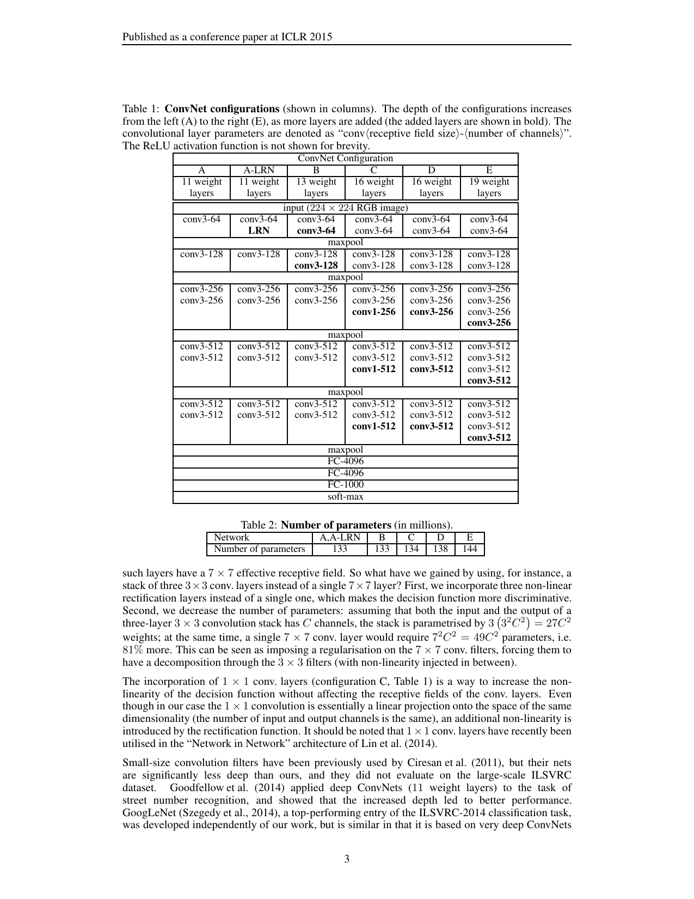
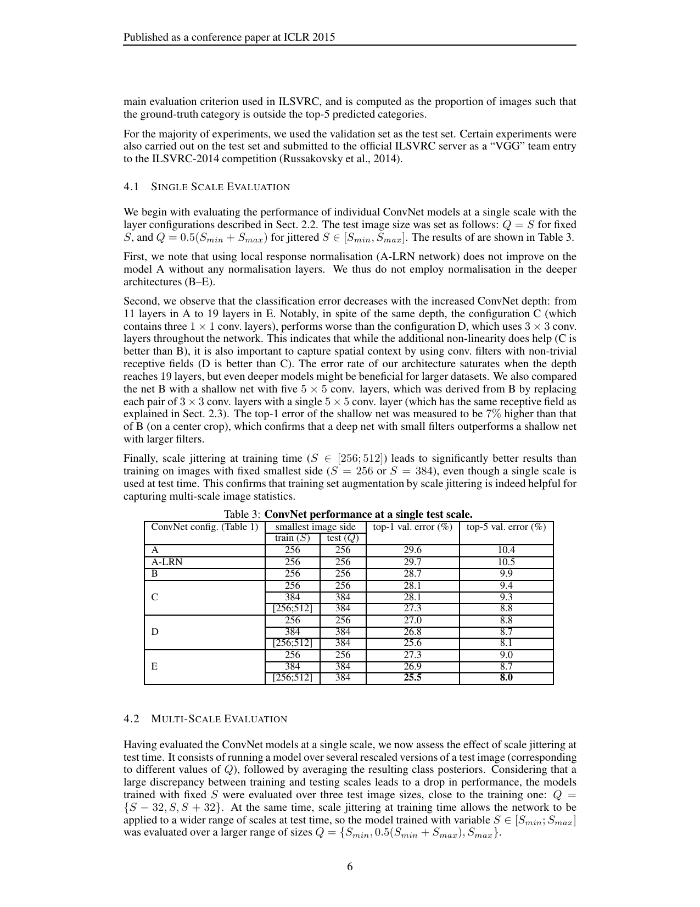

# VGG（2014/2015）· 论文笔记

- **论文**：Very Deep Convolutional Networks for Large-Scale Image Recognition（ICLR 2015，arXiv 2014-09）
- **BibTeX 键名**：`simonyan2014very`
- **出处**：arXiv:1409.1556（ICLR 2015）
- **本地 PDF**：`3.科研基本任务/论文/Simonyan和Zisserman - 2015 - Very Deep Convolutional Networks for Large-Scale Image Recognition.pdf`
- **任务书条目**：第 2 周 #2｜🟢 AI 辅助读｜阅读要点：小卷积核堆叠哲学，深度 vs 性能
- **阅读日期**：2026-10-31
- **核对规则**：数字后的「出处」指回原 PDF 章节/表号；✅ = 已回原文查证。

---

## 0. 术语表（零基础全能版 · 先看这一节再看正文）

> VGG 这篇的难点是「工程细节多」：尺度抖动、稠密评估、multi-crop、预初始化，这些词在中文教程里经常一句带过。下面按「结构 → 训练 → 测试评估 → 工程」分组，每条都说明**它在 VGG 里具体指什么**。

### 0.1 网络结构

| 术语 | 大白话解释（在本篇里的含义） |
|---|---|
| **3×3 卷积** | 窗口只有 3 像素宽高。原文反复强调它是"能捕捉左/右、上/下、中心的最小尺寸"。VGG 全网只用这一种尺寸（配置 D/E），这就是"小卷积核堆叠哲学"。 |
| **卷积核 / 滤波器** | 那个小窗口里的**可学习权重**。`conv3-64` 读作"3×3 卷积、输出 64 个通道"。 |
| **通道（channel）** | 特征图的张数/厚度。VGG 从 64 开始，**每次池化后翻倍**：64→128→256→512→512。 |
| **步长（stride）** | 卷积核每次滑几像素。VGG 的非池化层全部 stride=1（逐像素扫），池化层 stride=2（每次跨 2）。 |
| **padding=1** | 3×3 卷积前在四周补 1 圈 0，使输出尺寸与输入相同。**没有它，每卷积一次图像就缩 2 像素，堆 13 层就没了。** |
| **maxpool（2×2, stride 2）** | 每 2×2 的小块取最大值，把图像长宽各减半、通道数不变。VGG 一共 5 次池化：224→112→56→28→14→7。 |
| **block（阶段）** | 把"几个卷积 + 一次池化"看作一个阶段。VGG16 有 5 个 block，通道数在 block 之间翻倍。背结构时按 block 背最省事。 |
| **1×1 卷积** | 窗口只有 1 个像素，**不扩大感受野**，只做"跨通道的线性组合 + 一次 ReLU"。配置 C 用它，目的是**只加非线性、不加感受野**，用来分离这两个因素的作用。 |
| **全连接层（FC-4096 / FC-1000）** | 把 7×7×512 的特征拉平后接 4096 个神经元，再 4096，最后 1000（对应 1000 类）。**VGG 的参数量几乎全在这里**。 |
| **感受野（receptive field）** | 一个神经元在原图上能看到的范围。VGG 的核心推导：2 层 3×3 = 5×5，3 层 3×3 = 7×7。 |
| **参数共享** | 同一个卷积核扫整张图，权重只存一份——这是卷积层"层数多但参数不多"的原因。 |
| **"16 / 19 weight layers"（带权重层）** | **不是卷积层数**！16 = 13 个卷积 + 3 个全连接；19 = 16 个卷积 + 3 个全连接。池化层和 ReLU 不计入。 |
| **非线性（non-linearity）** | 卷积后面那一步"把线性结果掰弯"的函数（VGG 全部用 ReLU）。层数越多，非线性次数越多，模型表达力越强。 |
| **softmax** | 把 1000 个得分变成 1000 个概率（和为 1）。 |

### 0.2 训练

| 术语 | 大白话解释 |
|---|---|
| **mini-batch / batch size** | 一次算梯度用多少张图，VGG 用 256。batch 越大梯度越准但越吃显存。 |
| **momentum（动量）** | 参数更新时带上上一步的"惯性"，能冲过平坦区、抑制来回震荡。VGG 用 0.9。 |
| **weight decay / L2 正则** | 每步把权重往 0 缩一点，防止权重爆炸。VGG 用 5×10⁻⁴。 |
| **Dropout（0.5）** | 训练时随机丢掉一半神经元，防过拟合。VGG 只在前两个全连接层用。 |
| **学习率衰减** | 验证集精度不涨时把学习率除以 10。VGG 从 10⁻² 开始降了 3 次。 |
| **epoch / iteration** | 1 epoch = 训练集完整过一遍；1 iteration = 处理 1 个 batch。VGG 训了 370K 次迭代（74 epoch）。 |
| **随机初始化** | 训练开始时权重取随机数。**深网络用纯随机初始化会训不动**（梯度不稳），所以 VGG 才要"预初始化"。 |
| **预初始化（pre-initialisation）** | 先训一个浅网络（配置 A），再**把 A 的前 4 个卷积层和最后 3 个全连接层的权重复制给深网络**，中间层才随机初始化。这是 2014 年训练深网络的"拐杖"。 |
| **梯度不稳** | 深网络里梯度一层层连乘，容易变得过大（爆炸）或过小（消失），导致训练卡住。 |
| **隐式正则化** | 不是显式加了 L2/Dropout，而是结构本身（更深、更小的卷积核）让模型不容易过拟合。原文用它解释"为什么 VGG 反而收敛更快"。 |
| **数据增强（训练时）** | VGG 用三样：随机裁 224×224、随机水平翻转、随机 RGB 颜色偏移；再加"尺度抖动"（见 0.3）。 |
| **过拟合** | 训练集表现好、新数据差。VGG 参数 138 M，靠 Dropout + 数据增强 + 隐式正则压住。 |

### 0.3 测试与评估

| 术语 | 大白话解释 |
|---|---|
| **训练尺度 S / 测试尺度 Q** | S = 训练时把图片短边缩放到多大再裁 224（VGG 用 256 或 384）；Q = 测试时把图片短边缩放到多大。**Q 不必等于 S**，多试几个 Q 再平均会更好。 |
| **尺度抖动（scale jittering）** | 训练时每张图的 S 从 [256, 512] 里**随机抽一个**，让模型习惯"物体可大可小"。Table 3 显示这一步收益很大（D：27.0→25.6）。 |
| **全卷积稠密评估（dense evaluation）** | 把三个全连接层"翻译"成卷积层（FC-4096 → 7×7 卷积，后两个 → 1×1 卷积），这样网络能一次吃下整张图，输出一张"类别得分图"，再对空间求平均。**好处是不用重复算很多重叠的裁剪块**。 |
| **multi-crop** | 在图上按网格裁很多块（VGG 用 5×5 网格 × 2 次翻转 = 50 块/尺度，3 个尺度共 150 块），每块单独预测再平均。比稠密评估略好，两者还能互补。 |
| **softmax 后验（class posteriors）** | 网络输出的"每类概率"。集成就是把多个模型的这组概率相加取平均。 |
| **集成（ensemble）** | 多个模型预测取平均。VGG 7 模型 7.3%，2 模型 6.8%（Table 6）。 |
| **top-1 / top-5 错误率** | top-1 看第一名对错；top-5 看正确答案是否在前 5 名。ILSVRC 主指标是 top-5。 |
| **参数 M（million）** | 参数量的单位，1 M = 100 万个可学习数字。VGG16 是 138 M。 |

### 0.4 工程与硬件

| 术语 | 大白话解释 |
|---|---|
| **Caffe** | 2014 年伯克利出的深度学习框架（用配置文件定义网络），VGG 的官方实现就基于它。今天的等价物是 PyTorch。 |
| **Titan Black** | 2014 年的高端 NVIDIA 显卡（6 GB 显存），VGG 用 4 张训练，单模型要 2–3 周。 |
| **数据并行** | 每张卡放一份完整模型，各自算 batch 的一部分，再把梯度平均。**VGG 用 4 卡加速 3.75 倍**就是靠这个。 |
| **同步（synchronous）梯度** | 所有卡算完再统一平均梯度，结果与单卡训练**完全等价**（原文 §3.3 明确说了这点）。 |

---

## 1. 一句话说清

**问题**：AlexNet 之后大家拼命改结构（换卷积核大小、换步长、多尺度训练……），但没人说清**「深度」本身到底值多少**。而且 AlexNet 的 11×11 大核、LRN、不规则结构是手工试出来的，没有设计原则。

**做法**：**固定其它所有设计**，全网只用 **3×3 小卷积核**（步长 1、padding 1），只改一件事——**深度**，从 11 层（配置 A）一路加到 19 层（配置 E），做一组干净的对照实验。基础通道数从 64 起，**每过一个池化层翻倍**，到 512 为止。

**结果**：深度到 **16–19 层（VGG16 / VGG19）**时精度最好：ILSVRC-2012 单模型 **top-5 测试错误率 7.0%**，2 个模型集成 **6.8%**（Table 7）；ILSVRC-2014 拿**定位赛道第 1、分类赛道第 2**（摘要，输给 GoogLeNet 的 7 模型集成 6.7%）。代价是 **138 M 参数**（VGG16，Table 2）。

> 一句话：**VGG = 「别用大核，用一堆 3×3 堆起来」——CV 第一条可复制的结构设计原则。**，
我们没有在第一层卷积层使用相对较大的感受野例如在(Krizhevsky 等人,2012)
“小尺寸卷积滤波器曾被Ciresan等人(2011年)使用过,但他们的网络深度远小于我们，并且他 们没有在大型ILSVRC数据集上进行评估”


---

## 2. 核心图 / 公式

### 2.1 六种配置（原文 Table 1，PDF 第 3 页）



| 配置 | 带权重层数 | 卷积层数 | 和 D 的差别 |
|---|---|---|---|
| A | 11 | 8 | 最浅的基线 |
| A-LRN | 11 | 8 | 在 A 的第一个卷积后加 LRN，用来验证 LRN 有没有用 |
| B | 13 | 10 | 每个 block 多一层 3×3 |
| C | 16 | 13 | 部分 3×3 换成 1×1（只加非线性，不加感受野） |
| **D = VGG16** | **16** | **13** | 全部 3×3，最常用的版本 |
| **E = VGG19** | **19** | **16** | 再在 block3/4/5 各加一层 3×3 |

> 注意：**「16 层」不是 16 个卷积层**，是「16 个带权重的层」= 13 卷积 + 3 全连接。C 和 D 都是 16 层，差在 C 用了 1×1（Table 1 表头，✅）。

### 2.2 VGG16（配置 D）结构表（§2.2 + Table 1，✅）

| 阶段 | 层 | 输出通道 | 空间尺寸 |
|---|---|---|---|
| 输入 | 224×224 RGB | 3 | 224 |
| block1 | conv3-64 ×2 + maxpool 2×2/s2 | 64 | 224 → 112 |
| block2 | conv3-128 ×2 + maxpool | 128 | 112 → 56 |
| block3 | conv3-256 ×3 + maxpool | 256 | 56 → 28 |
| block4 | conv3-512 ×3 + maxpool | 512 | 28 → 14 |
| block5 | conv3-512 ×3 + maxpool | 512 | 14 → 7 |
| 分类头 | FC-4096 → FC-4096 → FC-1000 → softmax | — | — |

- 规律：**每次 maxpool，空间减半、通道翻倍**（64→128→256→512→512）——这是背 VGG 的口诀。
- VGG19（E）只是把 block3/4/5 的卷积从 3 层加到 4 层。

### 2.3 核心推导：为什么用 3×3 而不是 5×5 / 7×7（§2.3，PDF 第 2–3 页，✅）

```
感受野：
  2 个 3×3 堆叠  → 等效 1 个 5×5   （(3-1)*2 + 3 = 5）
  3 个 3×3 堆叠  → 等效 1 个 7×7   （(3-1)*3 + 3 = 7）

参数量（输入输出都是 C 通道）：
  3 个 3×3： 3 × (3×3×C×C) = 27 C²
  1 个 7×7：        7×7×C×C  = 49 C²
  → 7×7 比 3 层 3×3 多 81% 的参数
```

原文给的两个理由（✅ §2.3）：

1. **非线性更多**：3 层 = 3 次 ReLU，1 层 = 1 次 → 决策函数更有判别力。
2. **参数更少**：27C² < 49C²（少 44%，反过来说 7×7 多 81%）。
3. （原文的说法）可以看成对 7×7 滤波器施加了「分解成 3×3」的正则化。

> 这就是"小卷积核堆叠哲学"的全部数学，**两行公式就能推完，组会必考**。

### 2.4 关键训练 / 测试设置（§3，PDF 第 4–5 页，✅）

| 项目 | 设置 |
|---|---|
| batch size | 256 |
| momentum | 0.9 |
| weight decay（L2） | 5×10⁻⁴ |
| Dropout | 前两个全连接层，比例 0.5 |
| 初始学习率 | 10⁻²，验证集不涨就 ×0.1，共降 3 次 |
| 训练长度 | 370K 次迭代（74 个 epoch） |
| 硬件 / 耗时 | 4 张 Titan Black，单模型 2–3 周（多卡加速 3.75 倍） |
| 初始化技巧 | **先训浅的 A，再用 A 的前 4 个卷积层 + 后 3 个 FC 去初始化深网络**（否则深网随机初始化训不动） |
| 训练尺度 | 固定 S=256 或 S=384；或**多尺度抖动 S∈[256, 512]** |
| 测试技巧 | 把 FC 换成卷积（第一个 FC → 7×7 卷积，后两个 → 1×1）→ 全卷积稠密评估；再加**多尺度 Q** 和**水平翻转**；也可多裁剪（multi-crop） |

> **「先训浅网、再拿浅网权重初始化深网」这一条极其重要**：它说明 2014 年时**深网络靠随机初始化是训不动的**——这正是 BatchNorm 要解决的问题（见 `03_BatchNorm.md`）。

---

## 3. 关键实验数据

### 3.1 单尺度评估（Table 3，p.6，✅）



| 配置 | 训练 S | 测试 Q | top-1 val | top-5 val |
|---|---|---|---|---|
| A（11 层） | 256 | 256 | 29.6 | 10.4 |
| **A-LRN** | 256 | 256 | **29.7** | **10.5** |
| B（13 层） | 256 | 256 | 28.7 | 9.9 |
| C（16 层，含 1×1） | 256 | 256 | 28.1 | 9.4 |
| D（16 层，全 3×3） | 256 | 256 | **27.0** | **8.8** |
| D + 尺度抖动 | [256;512] | 384 | 25.6 | 8.1 |
| E（19 层） | 256 | 256 | 27.3 | 9.0 |
| E + 尺度抖动 | [256;512] | 384 | 25.5 | **8.0** |

**三个必须会讲的结论**：

1. **A-LRN 29.7/10.5 与 A 29.6/10.4 几乎一样 → LRN 没用**（作者因此后续配置全部不用 LRN，✅ §4.1）。
2. **深度从 11 → 16 层，错误率持续下降**（A 29.6 → D 27.0）。
3. **C（1×1）28.1 比 B 28.7 好，但比 D 27.0 差** → 光加非线性有用，但**空间上下文（3×3 感受野）更重要**。

### 3.2 多尺度 / 多裁剪 / 集成（Table 4–7，p.7–8，✅）

| 实验 | 结果（top-1 / top-5） | 出处 |
|---|---|---|
| 多尺度测试，D/E 单模型 | **val 24.8 / 7.5**（最佳单模型） | Table 4 |
| 单模型 E 在测试集 | top-5 **7.3%** | §4.2 |
| 稠密 + 多裁剪平均，E | val 24.4 / **7.1** | Table 5 |
| ILSVRC 提交（7 模型集成） | 24.7 / 7.5 / 测试 top-5 **7.3%** | Table 6 |
| 提交后（2 模型集成 D+E） | 23.7 / 6.8 / 测试 **6.8%** | Table 6 |
| 对比：GoogLeNet 单模型 | — / 7.9 | Table 7 |
| 对比：GoogLeNet 7 模型集成 | — / **6.7** | Table 7 |

> **谁是冠军**：ILSVRC-2014 分类冠军是 GoogLeNet（7 模型集成 6.7%），VGG 是亚军（7 模型 7.3%）；但**单模型对比 VGG 更强**（7.0% vs 7.9%）。

### 3.3 参数量证据（Table 2，p.3，✅）

| 网络 | A/A-LRN | B | C | D（VGG16） | E（VGG19） |
|---|---|---|---|---|---|
| 参数量 | 133 M | 133 M | 134 M | **138 M** | 144 M |

**参数都堆在哪（自己算一遍，✅ 可复算）**：

```
第一个 FC：输入 7×7×512 = 25088 维 → 4096 维
参数量 = 25088 × 4096 ≈ 1.028 亿 ≈ 102.8 M
占 138 M 的 约 74%
```

→ 结论：**VGG 的参数几乎全在两个 4096 全连接层里**，卷积层反而很省。这也解释了为什么 VGG 显存吃紧、部署不友好。

### 3.4 一条容易被忽略的对照（§4.1，p.6，✅）

作者把 B 的每两个 3×3 换成一个 5×5（理论感受野相同），得到的浅网络 top-1 比 B **高 7%**（中心裁剪）→ 直接证明「**深 + 小核 > 浅 + 大核**」，不是拍脑袋。

---

## 4. 我的思考

1. **它真正的贡献不是"更深"，而是"控制变量的实验方法"**：A→E 只动深度，其它（卷积核 3×3、步长 1、池化 2×2、通道翻倍）全部固定。这种"一次只改一个变量"的消融设计，比结论本身更值得学，写开题报告时直接照搬。
2. **消融表为什么只选这几个**：A-LRN 用来否掉 AlexNet 的 LRN；C 用来分离"加非线性"和"加感受野"两个因素；B 用来隔离"深度"；5×5 浅网用来隔离"核大小"。**每个配置都在回答一个具体问题，不是凑数。**
3. **它的边界 / 会在哪崩**：① 19 层之后误差饱和（§4.1 明确写 "error rate saturates when depth reaches 19"），再堆就训不动、也不涨点；② 138 M 参数、推理慢，现代几乎只当 backbone / 特征提取器；③ 全连接层强制固定 224 输入，不灵活。
4. **如果让我改**：把三个 FC 换成全局平均池化（GAP），参数能从 138 M 砍到约 15 M 量级；或者给每个卷积后加 BN。**这两条分别是 Network in Network / ResNet 和 BatchNorm 做的事。**
5. **它留给下一篇的问题**：VGG 证明"更深更好"，但也暴露"20 层以上靠随机初始化训不动、要靠浅网预训练"。→ 这正是 BN 的切入点。

---

## 5. 回原文核对记录

| 说法 | 原文依据 | 判定 |
|---|---|---|
| "VGG 是 ILSVRC-2014 分类冠军" | 摘要：localisation 第 1、classification 第 2；Table 7 GoogLeNet 6.7% | 🟥 错，是亚军 |
| "VGG16 有 16 个卷积层" | §2.2：16 weight layers = 13 conv + 3 FC | 🟥 错，是"带权重层数" |
| "2 个 3×3 = 1 个 5×5，参数更省" | §2.3：27C² vs 49C² | 🟩 正确 |
| "LRN 有提升" | Table 3：A 29.6/10.4 vs A-LRN 29.7/10.5 | 🟥 错，无提升 |
| "VGG 参数 138 M，主要在卷积层" | Table 2：138 M；FC1 约 102.8 M | 🟥 错，主要在 FC 层 |

