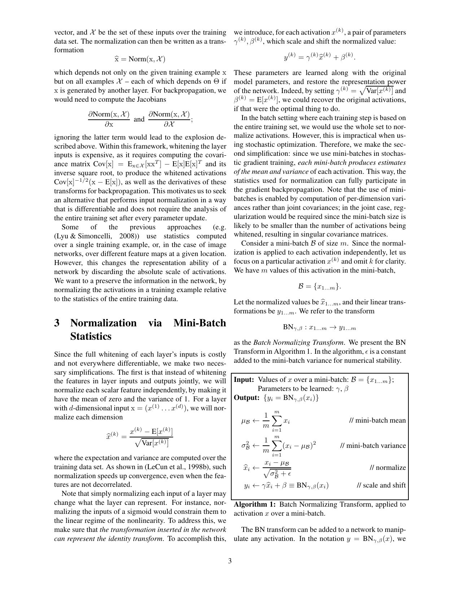
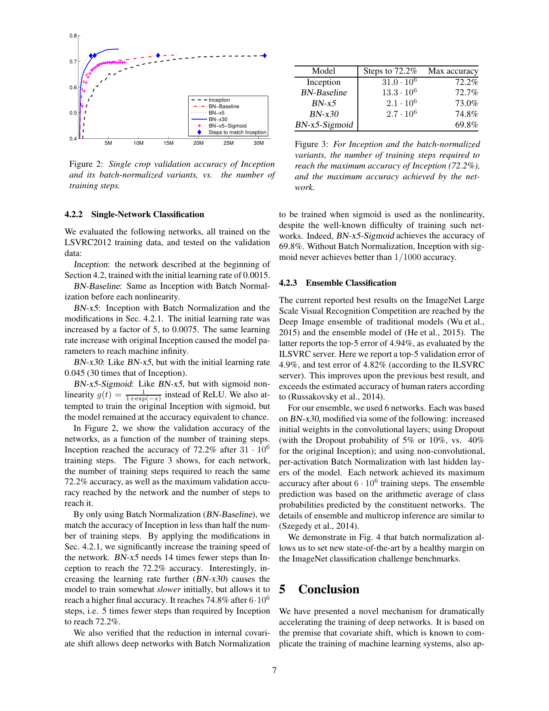

# Batch Normalization（2015）· 论文笔记

- **论文**：Batch Normalization: Accelerating Deep Network Training by Reducing Internal Covariate Shift（ICML 2015）
- **BibTeX 键名**：`ioffe2015batch`
- **出处**：arXiv:1502.03167（ICML 2015）
- **本地 PDF**：`3.科研基本任务/论文/Ioffe和Szegedy - 2015 - Batch Normalization Accelerating Deep Network Training by Reducing Internal Covariate Shift.pdf`
- **任务书条目**：第 2 周 #3｜🟢 AI 辅助读｜阅读要点：归一化原理、训练稳定性
- **阅读日期**：2026-10-31
- **核对规则**：数字后的「出处」指回原 PDF 章节/表号；✅ = 已回原文查证。

---

## 0. 术语表（零基础全能版 · 先看这一节再看正文）

> BN 这篇是"统计 + 优化"的混合体，术语密度最高。下面按「统计数学 → 要治的病 → BN 的零件 → 训练实验 → 延伸」分组，每条都尽量用生活化类比。

### 0.1 统计与数学基础（看懂 Algorithm 1 的前提）

| 术语 | 大白话解释 |
|---|---|
| **mini-batch（小批量）** | 一次前向/反向用的一小批样本（BN 用 32 或 60）。BN 的所有均值方差**都只在这批数据上算**，这是它和"用整个数据集统计"的根本区别。 |
| **均值（mean）** | 一组数的平均。`μ_B = (1/m)Σx_i`：这批数据在这个通道上的"中心位置"。 |
| **方差（variance）** | 一组数离均值有多散。`σ_B² = (1/m)Σ(x_i-μ_B)²`：数值就是"平均的平方偏差"。 |
| **标准差（standard deviation）** | 方差开根号，单位和原数据一致（方差是"平方单位"，不好直观比较）。归一化时除以的是标准差。 |
| **归一化 vs 标准化** | 日常口语里常混用。严格说：**标准化** = 减均值、除标准差（BN 做的是这个）；**归一化** = 把数值压到某个区间（如 0–1）。论文标题叫 Normalization，实际做的是标准化。 |
| **白化（whitening）** | 比标准化更狠：不仅让每个维度均值 0、方差 1，还要**去掉维度之间的相关性**（协方差矩阵变成单位矩阵）。计算量很大（要求协方差矩阵的逆），**BN 没做这一步**，只做了每个维度独立的标准化。 |
| **协方差 / 去相关** | 协方差衡量"两个维度是否一起变"。去相关 = 让任意两维度的协方差为 0。 |
| **无偏估计（unbiased estimate）** | 用样本算整体统计量时的一种修正。训练时 BN 除以 m；**推理时用训练累积的方差要做 `m/(m-1)` 修正**（Algorithm 2 说的 unbiased variance），因为样本方差天然偏小。 |
| **仿射变换（affine transform）** | "先缩放再平移"：`y = a·x + b`。BN 第 ④ 步 `y = γx̂ + β` 就是一个仿射变换，γ 缩放、β 平移。 |
| **链式法则** | 求复合函数导数的规则：`(f(g(x)))' = f'(g(x))·g'(x)`。反向传播全靠它，BN 能让梯度正确穿过"归一化"这一步也是靠它。 |
| **雅可比矩阵（Jacobian）** | 一个"向量→向量"函数的导数矩阵。原文 §3.3 推测 BN 让每层的雅可比矩阵**奇异值接近 1**，意思是"输入变一点，输出就变差不多同样多"，梯度不会爆炸或消失。 |
| **奇异值** | 矩阵"放大/缩小"能力的度量。奇异值都接近 1 → 信息传过去基本不变形。这一条是【原文的推测】，不是严格证明。 |

### 0.2 这篇要治的病

| 术语 | 大白话解释 |
|---|---|
| **协变量（covariate）** | 统计里指"输入变量/自变量"。放到网络里，就是"某一层的输入"。 |
| **协变量偏移（covariate shift）** | 训练集和测试集的输入分布不一致（比如训练都是白天照片、测试都是夜景）。经典机器学习问题。----每一层输出的均值/方差（特征分布）随着权重更新在变化 |
| **内部协变量偏移（internal covariate shift）** | 论文造的词：网络**内部**每一层的输入分布，会随着前面层参数不断更新而**一直漂移**。类比：你在学开车，但方向盘的角度定义每隔十分钟就变一次——后面层永远在追一个移动的目标。 |
| **分布漂移（distribution drift）** | 上面那件事的直观说法。Figure 1 就是把 sigmoid 输入的均值/方差随训练步数的变化画出来，**不加 BN 时会明显漂移**。 |
| **饱和（saturation）** | sigmoid/tanh 在输入很大或很小时曲线变平、导数≈0，梯度传不回去。BN 把输入拉回均值 0、方差 1，正好落在曲线的"敏感区"。 |
| **梯度消失** | 因为饱和 + 连乘小于 1 的导数，梯度往回传时越来越小，浅层学不动。 |
| **对初始化敏感** | 权重初始化稍大/稍小，深网络就训不动或直接发散。BN 让"权重放大 a 倍"的结果不变（见正文 2.4），所以对初始化不再敏感。 |
| **训练不稳定** | 损失突然变 NaN/inf、精度剧烈震荡。原 Inception 把学习率提到 0.0075 就会这样（原文 §4.2.1 明说）。 |

### 0.3 BN 自己的零件（必须能逐个指出来）

| 术语 | 大白话解释 |
|---|---|
| **γ（gamma，scale）** | BN 的可学习缩放参数，每个通道一个，初始化为 1。**没有它，网络会被强行限制在 sigmoid 的线性区，表达能力下降**。 |
| **β（beta，shift）** | BN 的可学习平移参数，每个通道一个，初始化为 0。它接管了原来卷积层偏置 b 的作用（所以卷积的 b 可以删掉）。 |
| **ε（epsilon）** | 加在方差上的极小常数，防止"方差≈0 时除以 0"。论文只说"for numerical stability"，**主文没给数值**；PyTorch 的 `nn.BatchNorm2d` 默认 `eps=1e-5`。 |
| **running_mean / running_var** | 训练时用**滑动平均**累积的统计量（每个 batch 更新一点点）。推理时用它代替 batch 统计量。 |
| **population statistics（总体统计量）** | 整个训练集上的真实均值和方差。我们没法一次算出来，所以用 running_mean/var 作为它的估计。 |
| **train 模式 / eval 模式** | `model.train()`：BN 用当前 batch 的均值方差，并更新 running 统计量；`model.eval()`：BN 用 running 统计量，不更新。**推理忘了切 eval 是最经典的 bug**。 |
| **卷积上的 BN（m' = m·p·q）** | 卷积层一个通道对应 p×q 个空间位置，所以 BN 的统计范围是"m 张图 × p×q 个位置"，等效样本数放大 p·q 倍，统计更稳。**每个通道一对 γ/β**，不是每个像素一对。 |
| **折叠（fold BN into conv）** | 推理时 BN 是一个线性变换（见正文 2.2），可以把它乘进前一个卷积层的权重和偏置，**部署时零额外计算**。PyTorch 里 `torch.nn.utils.fusion.fuse_conv_bn_eval` 就是干这个的。 |

### 0.4 训练与实验

| 术语 | 大白话解释 |
|---|---|
| **SGD + momentum** | 最基本的训练器：按梯度反方向走，并带上"惯性"。BN 论文没换优化器，**只改了超参**，所以提升全归功于 BN。 |
| **学习率（learning rate）** | 每步走多远。BN-x5 把它放大 5 倍（0.0015→0.0075），BN-x30 放大 30 倍（0.045），原网络用这个值会直接发散。 |
| **L2 正则 / weight decay** | 让权重别太大。BN 后原作者把它的系数**降到 1/5**，精度反而更好。 |
| **Dropout** | 训练时随机丢神经元防过拟合。有 BN 后原文把它**去掉或减小**（集成时从 40% 降到 5%–10%）。 |
| **学习率衰减（lr decay）** | 训练后期把学习率调小。BN 收敛快，所以衰减也加快 6 倍。 |
| **Inception** | Google 2014 年的网络（GoogLeNet 的核心模块）。BN 论文拿它当实验床：13.6 M 参数、无全连接层、batch 32、初始 lr 0.0015。 |
| **单裁剪（single crop）/ 多裁剪（144 crops）** | 测试时用一张中心裁剪，或按网格裁 144 块再平均。后者更准但更慢（Figure 4 两种都报了）。 |
| **集成（ensemble）** | 多个模型预测概率平均。BN-Inception 用 6 个模型拿到 4.9%/4.82%。 |
| **top-1 / top-5** | top-1 看第一名；top-5 看正确答案是否在前 5 名。 |
| **logits / 对数概率** | 网络最后一层的原始得分。原文训练时是"对数概率 + softmax"，和你写代码时的 `CrossEntropyLoss` 是一回事。 |

### 0.5 论文之外的延伸（组会可能问到，标注为【课外】）

| 术语 | 大白话解释 |
|---|---|
| **损失曲面（loss landscape）** | 把损失看成参数空间里的"地形图"。越平滑，越能用大步子（大学习率）走。 |
| **为什么 BN 有效（争议）** | 论文归因于"减少内部协变量偏移"；后续工作（Santurkar et al. 2018）实验认为真正原因是**让损失曲面更平滑**。**【课外，待核实原文】** |
| **GroupNorm / LayerNorm** | 不依赖 batch 的替代方案：GN 按通道分组做归一化（batch 很小时用），LN 对单个样本的所有通道做归一化（Transformer 用）。 |

---

## 1. 一句话说清

**问题**：深层网络里，每一层的输入分布会随着前面层参数的变化不断漂移（论文起名叫 **internal covariate shift，内部协变量偏移**）。后果是三连击：只能用**很小的学习率**、对**初始化极其敏感**、sigmoid/tanh 很容易卡在饱和区导致梯度消失、训练不动。

```
主要是不归一化的话，输入偏大时激活函数饱和，训练就变慢，只是其他人可以用过relu/小学习率来替代。但是我们使用BN。
考虑一个使用Sigmoid激活函数的层 z = g(W u + b),其中u是层输入,权重矩阵 W 和偏 置向量b是待学习的层参数, g(x) = 1  1+ exp(−x)。  当 |x|增加时, g′(x)趋于零。这意味着对于x = W u+ b中绝对值较大的所有维度,流向u的梯度将消失,模 型训练会缓慢。然而,由于x受W 、b以及下方所有层 参数的影响,训练过程中这些参数的变化可能会将x 的许多维度推入非线性函数的饱和区,从而减慢收敛 速度。随着网络深度的增加,这种效应会被放大。在 实际应用中,通常通过使用ReLU(Nair & Hinton, 2010) ReLU(x) = max(x, 0)、仔细初始 化(Bengio & Glorot, 2010; Saxe et al., 2013)和 小学习率来解决饱和问题以及由此产生的梯度消失问 题。但如果我们能确保非线性输入的分布在训练过程 中保持更稳定,那么优化器就不太可能陷入饱和区, 训练速度也会加快。
```

```
我们将深度网络内部节点的分布变化,在训练过 程中称为内部协变量偏移。消除它为更快的训练提供 了可能。我们提出了一种新的机制,称之为批量归一 化,它朝着减少内部协变量偏移迈出了一步,并在这 一过程中极大地加速了深度神经网络的训练。它通过 一个固定层输入均值和方差的归一化步骤来实现这一 点。批量归一化还对网络中的梯度流有有益的影响, 通过减少梯度对参数规模或初始值的依赖性。这使得 我们能够在没有发散风险的情况下使用更高的学习率。 此外,批量归一化正则化模型,并减少了Dropout (Srivastava等人,2014年)的需求。最后,批量归 一化使得使用**饱和非线性**成为可能,因为它防止了网 络陷入饱和模式。
```

```
1. 什么是白化？白化包含 3 件事：
中心化：均值 = 0：把数据整体平移，让所有数据的平均值变成 0；
缩放：方差 = 1：拉伸 / 压缩数据，让数据离散程度（方差）等于 1；
去相关：各个特征之间互相独立，没有线性关联。
举个简单例子：你的输入有 2 个特征，一个是 “身高”，一个 “体重”，身高和体重是强正相关。白化之后：
身高、体重各自均值为 0，方差为 1；
两个特征不再有线性相关性。
为什么白化原始网络输入能加速训练？
神经网络很怕输入特征尺度差异巨大。比如一个特征数值 0‑1000，另一个 0‑1，梯度下降很难调参、收敛慢。白化把原始输入处理成统一、互不干扰的分布，模型学起来轻松，收敛更快，这是很早就知道的结论（LeCun 等人）。2. 为什么想对每一层的输入都做白化？（关键！BN 论文的出发点）
普通神经网络：只有最开始的原始图片输入可以做白化；
但网络有很多层：第 2 层的输入 = 第 1 层的输出；第 3 层输入 = 第 2 层输出……


每一层的输入，都是上一层算出来的结果，不是原始数据。
训练的时候，上层的权重一直在更新，上层输出的数据分布就一直在变 → 内部协变量偏移 ICS：后面每一层拿到的输入分布不断改变，每一层都要不停适应新的数据分布，训练变慢、容易梯度消失。既然对最外层原始输入做白化能加速，那自然想到：
🤔那我把每一层接收到的输入，全都做一遍白化，让每一层看到的输入永远保持：均值 0，方差 1，特征去相关，固定不变的分布，那不就可以消除内部协变量偏移了吗？
这就是这段话表达的理想目标：把白化从网络最开头，复制到网络中间每一层，让每一层都拿到稳定白化后的输入。3. 但是！完整白化实际行不通（BN 为什么要做简化）理想很美，但对每一层做完整白化（均值 0 + 方差 1 + 去相关）工程代价巨大：
去相关需要计算协方差矩阵、求矩阵逆平方根；对于几百上千维特征，计算量爆炸；
这个变换要嵌入网络，还需要求导做反向传播，导数非常复杂；
mini‑batch 小样本场景，小批量算出来协方差矩阵容易奇异（矩阵不可逆）。
👉于是 Batch Normalization 做了两处重大简化，放弃完整白化：
只做逐维标准化：每个特征单独变成均值 0 方差 1，不做去相关（抛弃白化里 “去相关” 这一步）；
\(\hat{x}^{(k)}=\frac{x^{(k)}-E[x^{(k)}]}{\sqrt{Var[x^{(k)}]}}\)
不用整个数据集的统计量，改用每个 mini‑batch 小批量样本计算均值方差；
额外引入可学习参数\(\gamma\)、\(\beta\)做缩放平移，恢复网络表达能力，防止归一化把网络能力锁死。

完整白化是理论理想，BN 是工程可行的近似方案。BN 没有做到真正白化（没有去相关），但依然很大程度缓解内部协变量偏移。
4. 串联逻辑链（整段完整逻辑）
已知：网络原始输入白化（均值 0、方差 1、去相关），训练收敛更快✅
网络中间层的输入来自上一层输出，训练中分布不停漂移（内部协变量偏移）❌
猜想：如果中间每一层的输入也全部做白化，每层看到固定稳定分布，就能消除 ICS 的负面影响。
现实障碍：完整白化计算昂贵、求导困难、小批量下不稳定。
论文后续：BN 放弃去相关，只做逐维标准化，用 mini‑batch 统计，加上\(\gamma,\beta\)，得到可实际运行的方案。


BN 的来龙去脉（回答你的两个核心疑问）
BN 不是早就存在的现成算法；BN 就是这篇 2015 论文原创提出来的全新方法arXiv。
白化是老想法（90 年代就知道），论文是：先分析完整白化这个理想方案有什么坑，然后做妥协简化，从而发明 BN，不是拿现成 BN 拿来替换白化。
1、历史背景：白化是旧知识，没有 BN
白化（whitening）很早就知道：98 年 LeCun 就发现：对网络最原始输入做白化（均值 0、方差 1、去相关），训练收敛更快自动化学报。
后续不少工作尝试：想把白化搬到网络中间每一层，不是只处理输入层；但这些尝试都失败 / 不好用：

完整白化要算协方差矩阵、矩阵开逆平方根，计算量巨大；
如果把白化和梯度更新分开两步跑，会出现论文说的：参数无限增大、模型爆炸；
mini‑batch 小批量场景协方差矩阵奇异，没法求逆，工程上跑不通自动化学报。


也就是说：“中间层做白化” 只是理论构想，没有一个实用、嵌入网络、支持反向传播的实现。


2、论文的思考路径（原文第 2、3 节）
出发点：既然输入白化很好，那理想目标是网络每一层输入全部做完整白化，以此消除内部协变量偏移。
然后分析：完整白化现实中行不通（计算贵、求导麻烦、训练爆炸）。
⚡于是做两处关键妥协简化，由此发明 Batch Normalization（BN）：

放弃白化里最重要的去相关，只保留逐维标准化：每个特征单独变成均值 0 方差 1；
不用整个数据集统计量，改用mini‑batch 小批量样本算均值方差；
新增可学习参数\(\gamma,\beta\)缩放平移，防止归一化锁死网络表达能力；


同时设计：归一化运算嵌入网络计算图，参与反向传播求导（这是 BN 的关键创新点，之前那些白化尝试没有做到这点）arXiv。

逻辑不是：“已经有 BN 这个现成算法，发现白化不好用，那就直接用 BN 替换白化”
✅真实逻辑：“理想是每层做完整白化，但白化做不了，那我们做简化，搞出来 BN 这个新算法，用来近似白化想要达到的效果。”

```
**做法**：把「归一化」本身做成网络里的**一层**（Batch Normalizing Transform）：对一个 mini-batch 内**同一通道**的所有值减均值、除标准差，再乘可学习的 γ、加可学习的 β（保证网络仍能表示原来的分布）。关键是**这一步参与反向传播**，所以梯度会"知道"归一化的存在。

```
如  果梯度下降步骤忽略了 E[x] 对 b 的依赖,那么它将 更新 b ← b + ∆b,其中 ∆b ∝ −∂l/∂̂x。然后 u +  (b + ∆b) − E[u + (b + ∆b)] = u + b − E[u + b]。 因此,对 b 的更新以及随后的规范化变化导致层输 出没有变化,进而损失也没有变化。随着训练的进行, b 将无限增长,而损失保持固定。如果规范化不仅中 心化还缩放激活,这个问题可能会变得更糟。我们在 初始实验中已经通过经验观察到这一点,当规范化参 数在梯度下降步骤之外计算时,模型会爆炸。


在批处理设置中,每个训练步骤都基于整个训练 集,,我们会使用整个数据集来归一化激活值。然而, 在随机优化中使用这种方法是不切实际的。因此,我 们进行了第二次简化:由于我们在随机梯度训练中使 用小批量,每个小批量都会生成每个激活值的均值和 方差估计。这样,用于归一化的统计数据可以完全参 与梯度反向传播。
```


**结果**：在 Inception 上，只加 BN 就能用不到一半的步数追平原模型；再加学习率 ×5 等改动后，**达到同样 72.2% 精度只需 1/14 的训练步数**（BN-x5）；6 模型集成拿到 ImageNet **top-5 验证 4.9%、测试 4.82%**，**超过人类标注者的估计水平**（摘要 + Figure 4）。

> 一句话：**BN = 让每一层的输入"每步都被拉回均值 0、方差 1"，于是可以用大学习率、不怕初始化、还能少用/不用 Dropout。**

---

## 2. 核心图 / 公式

### 2.1 核心算法 Algorithm 1（PDF 第 3 页）



**逐符号解释**（输入是一个 mini-batch `B = {x₁...x_m}`，只针对某一个通道/某一维）：

| 步 | 公式 | 符号含义 |
|---|---|---|
| ① 算均值 | `μ_B = (1/m) Σ x_i` | m = batch size；μ_B = 这个 batch 在该通道上的均值 |
| ② 算方差 | `σ_B² = (1/m) Σ (x_i - μ_B)²` | 该通道在这个 batch 上的方差 |
| ③ 归一化 | `x̂_i = (x_i - μ_B) / sqrt(σ_B² + ε)` | ε = 防止分母为 0 的小常数（论文只说"for numerical stability"，**主文没给具体数值**；PyTorch 的 `nn.BatchNorm2d` 默认 `eps=1e-5`） |
| ④ 缩放平移 | `y_i = γ x̂_i + β` | γ、β 是**可学习参数**（每个通道一对），初始 γ=1、β=0 时就是恒等映射 |

**为什么必须有 ④**：如果只做 ③，把 sigmoid 的输入强行压到均值 0、方差 1，就限制在它的线性区，会**削弱网络的表达能力**。加上 γ、β 后，网络自己可以学回原来的分布（原文：取 γ=sqrt(Var[x])、β=E[x] 就能完全还原，✅ §3）。

```
很容易被忽略：训练阶段 vs 推理（测试）阶段 BN 行为完全不一样
训练：均值方差来自当前这一个 mini‑batch；一批样本互相影响。
推理（测试，经常单张图片输入，没有 batch）：不能用当前 batch 统计！没有 batch。
训练过程会维护滑动平均 running_mean、running_var，不断记录所有训练 batch 的均值、方差的期望；推理时直接用这组固定的全局统计量。


γ、β是 BN 层的可训练参数，反向传播计算梯度，SGD/Adam 更新；
running_mean /running_var 是统计量，滑动平均更新，不走反向传播，不是训练参数；
初始化 γ=1，β=0，训练中梯度会修改这两个值；
正是这一对参数，使得 BN 不是一个固定死的标准化操作，而是网络架构的一部分
```


### 2.2 训练 vs 推理：最容易搞混的一张表（§3.1 + Algorithm 2，✅）

| | 训练阶段 | 推理（测试）阶段 |
|---|---|---|
| 均值和方差从哪来 | **当前 mini-batch 现算**（μ_B、σ_B²） | 训练期间累积的**滑动平均**（population statistics） |
| 是否更新 running_mean / running_var | 是 | 否 |
| 输出是否依赖同 batch 的其他样本 | **是**（这是 BN 的正则化来源） | 否，完全确定 |
| 方差是否做无偏修正 | 否（除以 m） | 是（`m/(m-1)` 修正，✅ §3.1） |

推理时 BN 可以**折叠成一次线性变换**（Algorithm 2 第 11 行，✅）：

```
y = [γ / sqrt(Var[x] + ε)] * x + [β - γ E[x] / sqrt(Var[x] + ε)]
```

> 工程含义：**部署时可以把这个线性变换直接乘进前一个卷积层的权重里**，推理不增加任何计算。这是 BN 能大规模用在检测/部署里的原因之一。

### 2.3 卷积层上的 BN 怎么算（§3.2，✅）

- 卷积层的输入是 `x = W*u + b`，BN 加在**非线性之前**：`z = g(BN(Wu))`。
- **b 可以去掉**：因为后面要减均值，偏置会被抵消，它的作用由 β 接管。
- 卷积版 BN 的统计范围：一个 mini-batch 里 **m 张图 × 每个特征图的 p×q 个位置**，等效 batch 大小 `m' = m·p·q`；**每个特征图（通道）共用一对 γ、β**，而不是每个像素一对。

### 2.4 为什么 BN 能用大学习率（§3.3 的核心恒等式，✅）

```
BN(Wu) = BN((aW)u)          # 权重放大 a 倍，归一化后结果不变

∂BN((aW)u)/∂u   = ∂BN(Wu)/∂u          # 对输入的梯度不受权重尺度影响
∂BN((aW)u)/∂(aW) = (1/a) · ∂BN(Wu)/∂W # 权重越大，梯度越小 → 自动稳住参数增长
```

- 大白话：普通网络里权重一变大，梯度就爆炸；BN 把"尺度"这个自由度吃掉了，所以**学习率可以放大 5 倍、30 倍都不炸**。
- 原文还推测 BN 让每层雅可比矩阵的奇异值接近 1（梯度传播更稳），但明确说"**精确机理仍是待研究的问题**"（§3.3 末，✅）。**这句话很重要，后面"我的思考"要用。**

### 2.5 我代码里哪一行是 BN（理论对上代码）

```python
# 论文 Algorithm 1 的一行 PyTorch 等价物（以 2D 卷积后的 BN 为例）
bn = nn.BatchNorm2d(num_features=64)   # 64 = 通道数，对应论文里"每个特征图一对 γ、β"
y  = bn(x)                             # 训练时用当前 batch 统计量；eval 时用 running_mean/var
```

| 论文里的东西 | PyTorch 里的对应 |
|---|---|
| γ（scale） | `bn.weight`（可学习，初始化为 1） |
| β（shift） | `bn.bias`（可学习，初始化为 0） |
| μ_B / σ_B²（训练用当前 batch） | `model.train()` 时的行为，同时更新 `bn.running_mean` / `bn.running_var` |
| 推理用滑动平均 | `model.eval()` 时的行为 |
| ε | `bn.eps`（默认 1e-5） |

> ⚠️ **最常见的 bug**：推理时忘了 `model.eval()`，BN 会继续用当前 batch 的统计量，batch 小的时候结果会剧烈抖动。这不是"玄学"，就是这张表第一行和第二行的差别。

---

## 3. 关键实验数据

### 3.1 动机验证：MNIST 上的输入分布（§4.1 + Figure 1，p.5–6，✅）

- 网络：28×28 输入 → 3 个全连接隐层（每层 100 个单元，sigmoid）→ 10 类；训练 50000 步，batch 60。
- 结论：加 BN 的网络**测试精度更高、收敛更快**；Figure 1(b)(c) 显示 sigmoid 的输入分布在**不加 BN 时会随训练显著漂移（均值和方差都变），加 BN 后稳定**。
- 用途：这是"内部协变量偏移确实存在、BN 确实压住了它"的**直接可视化证据**。

### 3.2 ImageNet 主实验（Inception + BN，§4.2 + Figure 3，p.6–7，✅）



模型：Inception 变体（5×5 卷积换成两个 3×3、最多 128 个滤波器，13.6 M 参数，除 softmax 外没有全连接层），batch 32。

| 模型 | 达到 72.2% 所需步数 | 最高验证精度 | 说明 |
|---|---|---|---|
| Inception（原始） | **31.0×10⁶** | 72.2% | 初始 lr 0.0015 |
| BN-Baseline（只加 BN） | 13.3×10⁶ | 72.7% | 步数不到一半 |
| **BN-x5（BN + 学习率 ×5）** | **2.1×10⁶** | 73.0% | **约 1/14 步数**（31.0 / 2.1 ≈ 14.8） |
| BN-x30（学习率 ×30 = 0.045） | 2.7×10⁶ | **74.8%**（6×10⁶ 步达到） | 起步慢一点，但最终精度最高 |
| BN-x5-Sigmoid（把 ReLU 换回 sigmoid） | — | 69.8% | 原版 Inception + sigmoid **只等于瞎猜（1/1000）** |

> **这组数字的正确读法**：BN-Baseline 证明"**光加 BN**"就有效；BN-x5 / x30 证明"**BN 让学习率能放大**"是额外收益；BN-x5-Sigmoid 证明"**BN 能让饱和激活重新可用**"。三层证据分开摆，这是很好的实验设计。

### 3.3 集成结果与 SOTA 对比（§4.2.3 + Figure 4，p.7–8，✅）

| 模型 | 分辨率 | 裁剪 | 模型数 | top-1 | top-5 |
|---|---|---|---|---|---|
| BN-Inception 单裁剪单模型 | 224 | 1 | 1 | 25.2% | 7.82% |
| BN-Inception 多裁剪单模型 | 224 | 144 | 1 | 21.99% | 5.82% |
| **BN-Inception 集成** | 224 | 144 | 6 | 20.1% | **4.9%（验证）/ 4.82%（测试）** |
| 对比：GoogLeNet 集成 | 224 | 144 | 7 | — | 6.67% |
| 对比：Deep Image 集成 | 可变 | — | — | — | 5.98% |

### 3.4 BN 带来的一整套训练改动（§4.2.1，p.6，✅）

| 改动 | 具体做法 |
|---|---|
| 提高学习率 | ×5（0.0015 → 0.0075）；再试 ×30（0.045）。**同样的提高用在原 Inception 上会让参数变成 inf** |
| 去掉 Dropout | 不增加过拟合 |
| L2 正则权重 ×1/5 | 精度反而更好 |
| 学习率衰减加快 6 倍 | 因为收敛更快 |
| 去掉 LRN 局部响应归一化| 有 BN 后 LRN 不必要 |
| 打乱样本更彻底 | 验证精度约 +1%（印证 BN 的正则化作用） |
| 减弱光度畸变 | 每张图被看的次数变少，把预算留给"真实"图像 |

---

## 4. 我的思考

1. **最大的争议点：作者对"为什么有效"的解释可能不完整**。论文归因于"减少内部协变量偏移"，但作者自己在 §3.3 就写了"精确机理仍待研究"。后续有工作（Santurkar et al., *How Does Batch Normalization Help Optimization?*, NeurIPS 2018）用实验指出：**即使人为注入协变量偏移，BN 依然有效；真正原因更像是 BN 让损失曲面更平滑（Lipschitz 常数更小），因此能承受大学习率**。→ 这是组会极可能追问的点，**【论文外补充，待核实原文】**，笔记里要标清楚不是本篇结论。
2. **边界条件 / 会在哪崩**：
   - **batch 太小**：μ_B、σ_B² 噪声大，训练/推理统计量偏差大，性能明显掉。检测、分割任务 batch 常常只有 1–2，这是硬伤 → 实际工程里会**冻结 BN（用 `eval` 模式）或换成 GroupNorm**。
   - **训练/推理不一致**：忘了 `model.eval()` 是最经典的踩坑。
   - **序列模型（RNN/Transformer）**：变长序列的 batch 统计不可靠 → 一般改用 LayerNorm。
   - **对 batch 内样本的依赖**：同一个样本和不同样本组 batch，输出会不同（这既是正则化来源，也是不确定性来源）。
3. **消融实验为什么这样排**：Inception → BN-Baseline → BN-x5 → BN-x30 → BN-x5-Sigmoid，**每一步只加一个变量**（先只加 BN，再加学习率，再加大学习率，再换激活函数）。这样能把"BN 本身"和"BN 顺带允许的调参"分开。写论文时这套"阶梯式消融"可以直接借用。
4. **如果让我改 / 用在哪**：
   - 小 batch 场景（检测、分割、视频）→ GroupNorm 或 LayerNorm；
   - 部署 → 把 BN 折叠进卷积权重（见 2.2 的线性变换）；
   - 分类大 batch → 保持 conv → BN → ReLU 的标准顺序。

---

## 5. 回原文核对记录

| 说法 | 原文依据 | 判定 |
|---|---|---|
| "BN 让训练快 14 倍" | 摘要 + Figure 3：BN-x5 用 2.1×10⁶ 步 vs Inception 31.0×10⁶ | 🟩 正确，但限定"达到同一 72.2% 精度、且用了 lr ×5 等配套改动" |
| "BN 就是减均值除方差" | Algorithm 1 还有第 ④ 步 γ、β 仿射 | 🟨 不完整，漏了可学习的 scale/shift |
| "推理时用当前 batch 的均值方差" | §3.1 + Algorithm 2：推理用 population statistics（滑动平均） | 🟥 错，这是训练阶段的行为 |
| "BN 可以完全替代 Dropout" | 摘要写 "in some cases eliminating the need"；§3.4 写 "removed or reduced" | 🟨 是"某些情况下可去掉或减弱"，不是绝对 |
| "内部协变量偏移是唯一解释" | §3.3 自述"精确机理仍待研究" | 🟥 错，学界有争议 |

---

## 6. 本篇 3 个自测问题

1. 训练和推理时 BN 用的均值方差分别从哪里来？推理忘了 `model.eval()` 会发生什么？
2. γ 和 β 为什么必须有？只做"减均值除方差"会损失什么？
3. BN 为什么能把学习率放大 5–30 倍？原文给的解释和后续研究（Santurkar 2018）有什么分歧？

