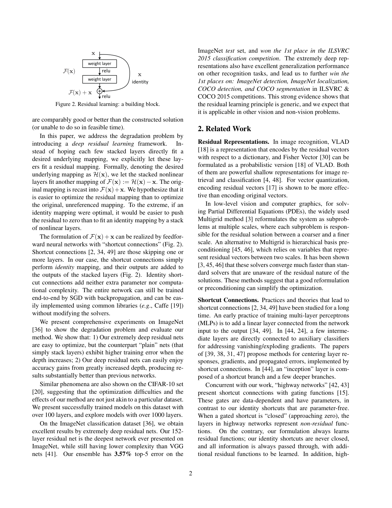
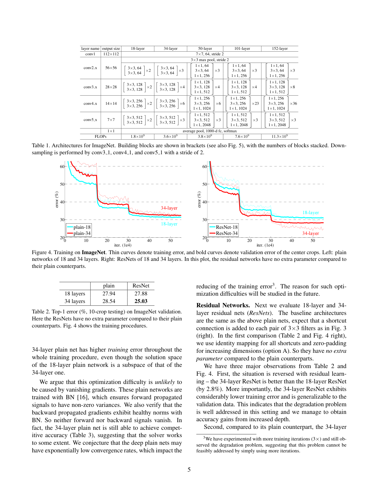

# ResNet（2015/2016）· 论文笔记

- **论文**：Deep Residual Learning for Image Recognition（He Kaiming、Zhang Xiangyu、Ren Shaoqing、Sun Jian，Microsoft Research）
- **BibTeX 键名**：`he2016deep`【课外补充·待核实：按 CVPR 2016 惯例命名，PDF 内未标会议】
- **出处**：arXiv:1512.03385v1（PDF 首页页脚印 "10 Dec 2015"）；CVPR 2016 正式版【课外补充·待核实】
- **本地 PDF**：`3.科研基本任务/论文/He 等 - 2015 - Deep Residual Learning for Image Recognition.pdf`（共 12 页，含 2 页附录）
- **任务书条目**：第 2 周 #4｜🔴 自精读｜阅读要点：退化问题（degradation）、残差学习、shortcut
- **阅读日期**：2026-10-31 
- **核对规则**：数字后的「出处」指回原 PDF 的 §章节 / Table n / Fig n / p.页码；✅ = 用 PyMuPDF 抽全文逐条查证过。

---

## 0. 术语表（零基础全能版 · 先看这一节再看正文）

> 这篇的难点不在公式（公式只有两行），而在**"为什么更深反而更差"这个反直觉现象**，以及 shortcut 的三种接法到底差在哪。下面按「结构 → 训练 → 评估 → 工程与指标」分组，工程类词一律写成「朴素做法 → 优化做法 → 为什么有效」。

### 0.1 网络结构

| 术语                                        | 大白话解释（在本篇里的含义）                                                                                                                                                                                                                                                                |
| ----------------------------------------- | ----------------------------------------------------------------------------------------------------------------------------------------------------------------------------------------------------------------------------------------------------------------------------- |
| **residual learning（残差学习）**               | 不让这几层直接拟合目标映射 H(x)，而让它们拟合差值 H(x)−x。这是全篇唯一的核心提法（§1、§3.1）。                                                                                                                                                                                                                      |
| **residual function F(x)**                | 残差块里那两三层真正输出的东西，F(x)=H(x)−x。学到的 F 越小，说明这一块越"接近什么都不做"。                                                                                                                                                                                                                         |
| **identity mapping（恒等映射）**                | 输出=输入、什么都不改的函数。**朴素做法**：让一堆非线性层自己去学"原样传下去"；**优化做法**：用一条权重恒为 1 的直连把 x 原样送到输出，只让主路学残差；**为什么有效**：需要"什么都不做"时，优化器只要把 F 的权重压到 0 就够，而不必用非线性层拼出一个恒等函数（§3.1 原话："it would be easier to push the residual to zero than to fit an identity mapping by a stack of nonlinear layers"）。      |
| **shortcut connection（跳线 / 捷径连接）**        | 跨过 1 层或多层的旁路。**朴素做法**：层必须严格串联，信息只能一层层往下传；**优化做法**：加一条旁路，把它的输出与主路输出**逐元素相加**（Fig 2）；**为什么有效**：① 零额外参数、零额外计算（§3.2），因此 plain 与 residual 可以在参数/深度/宽度/计算量上完全对等，消融才干净；② 给梯度一条"直通车道"，反传不必层层连乘；③ 解空间上，深层至少能"退化成"浅层（加恒等层即可），所以理论上不该更差（§1 的 construction 论证）。                           |
| **building block（残差块）**                   | 图 2 那个单元：两三层 + 一条恒等跳线 + 加法 + 加法后的 ReLU。ResNet-34 用 2 层 3×3；ResNet-50 起用 3 层 1×1/3×3/1×1（Fig 5, p.6）。                                                                                                                                                                          |
| **plain network（朴素网络）**                   | 就是"纯堆层"的 VGG 式网络，一根跳线都没有。它在本篇里的**唯一作用是对照组**：与 ResNet 同深度、同宽度、同参数量、同 FLOPs（§3.2 末、Fig 4 图注），从而把"深度的收益"和"跳线的收益"彻底分开。                                                                                                                                                            |
| **degradation problem（退化问题）**             | 深度增加后**训练误差**不降反升（注意：是训练误差，不是测试误差）。**朴素解释**：过拟合或梯度消失；**原文的处理**：先证明不是过拟合（Fig 1、Fig 6 左），再用 BN 保证前向信号非零方差、反向梯度范数健康，证明也不是梯度消失（§4.1），于是只剩"优化难度"这一个解释；**为什么重要**：它把"深度没用"和"深度难训"两件事拆开了——ResNet 的贡献是证明后者可解。                                                                          |
| **bottleneck（瓶颈块）**                       | 3 层：1×1 降维 → 3×3 在低维上卷积 → 1×1 升维。**朴素做法**：想更深就继续堆 2 层 3×3（34 层，3.6×10⁹ FLOPs）；**优化做法**：用 1×1 先把 256 维压到 64 维，再在 64 维上做 3×3（Fig 5 右）；**为什么有效**：50 层的 FLOPs 只有 3.8×10⁹，几乎等于 34 层的 3.6×10⁹（Table 1, p.5）——层数加了 16 层，算力几乎没涨。原文说得很直白：用 bottleneck 主要是"训练时间"的现实考虑（§3.3 与 p.6 脚注 4）。 |
| **projection shortcut（投影跳线）**             | 维度对不上时用 Ws（1×1 卷积）把 x 投到目标维度，即 Eqn (2)。**朴素做法**：维度不匹配直接报错；**三种做法**：A 零填充补维度、B 只在升维处投影、C 全部投影；**结论**：A/B/C 都远好于 plain，B 略好于 A，C 只"略"好于 B（多出的 13 条投影带来的参数），所以**投影不是解决退化的必要条件**（§4.1、Table 3, p.6）。                                                                              |
| **zero-padding shortcut（零填充跳线，option A）** | 升维时通道数不够就用 0 补齐，跳线仍零参数（§3.3、§4.1）。代价：补出来的那些通道"没有残差学习"，这就是 B 略好于 A 的原因（§4.1）。                                                                                                                                                                                                  |
| **1×1 convolution**                       | 只做跨通道线性组合，不扩感受野。本篇两个用途：投影跳线（Eqn 2）、bottleneck 的升降维。                                                                                                                                                                                                                           |
| **stride-2 convolution 下采样**              | 不用池化，直接用步长 2 的卷积把特征图长宽减半；Table 1 图注明确下采样发生在 conv3_1、conv4_1、conv5_1。                                                                                                                                                                                                          |
| **global average pooling（GAP）**           | 最后的 7×7 特征图按通道求平均 → 1000 维 → softmax（Table 1 末行 "average pool, 1000-d fc, softmax"）。相比 VGG 的三个 4096 全连接层，这里参数几乎为零。                                                                                                                                                            |
| **weighted layers（带权重层数）**                | 只数有参数的层（卷积 + FC）。"34-layer"= 33 个卷积 + 1 个 FC（按 Table 1 可复算）。                                                                                                                                                                                                                  |
| **VGG-19（参照系）**                           | 19 个带权重层、19.6×10⁹ FLOPs，本篇反复拿它当"又深又贵"的对照（Fig 3 左、§3.3）。                                                                                                                                                                                                                       |

### 0.2 训练

| 术语                                        | 大白话解释                                                                                                                                                                                                                                           |
| ----------------------------------------- | ----------------------------------------------------------------------------------------------------------------------------------------------------------------------------------------------------------------------------------------------- |
| **batch normalization（BN）在本篇的用法**         | **朴素做法**：靠小学习率 + 精心初始化硬训深网（VGG 时代还要"先训浅网再迁移"）；**优化做法**：每个卷积后、激活前，按 batch 统计量把该层输出归一化（§3.4 原话 "right after each convolution and before activation"）；**为什么在本篇特别关键**：它保证 plain-34 能"开始收敛"，作者才有资格说"退化不是梯度消失"（§4.1）。所以 ResNet 是"站在 BN 肩上"的论文，不是单打独斗。 |
| **SGD / momentum 0.9**                    | 随机梯度下降 + 动量；ImageNet 用 momentum 0.9（§3.4）。                                                                                                                                                                                                      |
| **weight decay 1×10⁻⁴**                   | L2 正则系数，ImageNet 与 CIFAR-10 都用 0.0001（§3.4、§4.2）。                                                                                                                                                                                               |
| **learning rate 0.1，plateau 时 ÷10**       | ImageNet 从 0.1 起，误差不降就除以 10，最多训 60×10⁴ 次迭代（§3.4）。                                                                                                                                                                                               |
| **mini-batch**                            | ImageNet 256（§3.4）；CIFAR-10 用 128、两张 GPU（§4.2）。                                                                                                                                                                                                 |
| **from scratch（从头训）**                     | 与 VGG 的"预初始化"相反，本篇所有 plain/residual 网络都从头训（§3.4）。这本身是 BN 带来的底气。                                                                                                                                                                                 |
| **warm-up（学习率预热）**                        | 110 层 ResNet 用 0.1 起步不收敛，先用 0.01 训到训练误差 <80%（约 400 次迭代）再回到 0.1（§4.2, p.7 与脚注 5）。                                                                                                                                                                |
| **scale / color augmentation（尺度 + 颜色增强）** | 短边在 [256, 480] **随机**取，再随机裁 224×224（或水平翻转），减每像素均值；颜色扰动沿用 AlexNet [21]（§3.4）。                                                                                                                                                                    |
| **initialization [13]**                   | 用 He 等 PReLU 论文（[13]）的初始化方法，即今天说的 "He/MSRA init"（§3.4）。                                                                                                                                                                                         |
| **no dropout**                            | 全篇不用 dropout（§3.4、§4.2 明确写 "no dropout"）。CIFAR 上靠"深而窄"的结构本身当正则。                                                                                                                                                                                 |
| **更多迭代实验（3×）**                            | 作者把训练加长到 3 倍，退化依旧存在 → 说明"不是训得不够久"（§4.1 脚注 3）。                                                                                                                                                                                                   |
| **convergence rate（收敛速率）**                | 作者提出的猜测：深 plain 网的收敛速率可能指数级地低（§4.1 末 "exponentially low convergence rates"），原因留待后续研究。                                                                                                                                                           |

### 0.3 评估

| 术语                                     | 大白话解释                                                                                                                                                                                                                                         |
| -------------------------------------- | --------------------------------------------------------------------------------------------------------------------------------------------------------------------------------------------------------------------------------------------- |
| **top-1 / top-5 error**                | top-1 看第一名对不对；top-5 看正确答案是否在前 5。**易误读**：本篇 3.57% 是 **top-5 且是集成**，不是单模型（Table 5）。                                                                                                                                                             |
| **10-crop testing**                    | **朴素做法**：整图一次前向；**优化做法**：在图上取 10 个裁剪（沿用 AlexNet [21] 的定义：4 角 + 中心，各含水平翻转）分别前向再平均；**为什么有效**：平均掉裁剪位置带来的方差，指标更稳、比单裁剪高。【课外补充·待核实：原文只写 "standard 10-crop testing [21]"，未展开定义】。本篇把 10-crop 作为**对比研究的统一口径**（Table 2、Table 3 表头都标 "10-crop testing"）。 |
| **fully-convolutional testing（全卷积测试）** | 把最后的 FC 看成 1×1 卷积，整图一次前向得到"类别得分图"再池化（VGG [41] 的做法）。本篇用它算"最佳结果"（§3.4）。                                                                                                                                                                         |
| **multi-scale testing**                | 短边取 {224, 256, 384, 480, 640} 五个尺度，各尺度得分平均（§3.4）。Table 4 就是这套口径。                                                                                                                                                                              |
| **center crop（中心裁剪）**                  | Fig 4 里**粗线**是"中心裁剪的验证误差"，**细线**是训练误差（Fig 4 图注）。                                                                                                                                                                                              |
| **validation vs test**                 | ImageNet：1.28 M 训练图 / 50k 验证图 / 100k 测试图（测试标签不公开，由服务器报）（§4.1）。                                                                                                                                                                                |
| **single-model vs ensemble**           | Table 4 全是**单模型**（val）；Table 5 全是**集成**（test）。两表不能横向比。                                                                                                                                                                                        |
| **std of layer responses（层响应标准差）**     | Fig 7：每个 3×3 层在 BN 之后、非线性之前的输出标准差。ResNet 普遍比 plain 小，且越深越小 → 支持"残差函数接近 0"的假设（§4.2）。                                                                                                                                                           |
| **mAP@.5 / mAP@[.5, .95]**             | 检测指标（IoU 阈值 0.5 / 0.5~0.95 平均），附录 Table 7、8、9。                                                                                                                                                                                                |

### 0.4 工程与指标

| 术语                           | 大白话解释                                                                                                                                                                                                      |
| ---------------------------- | ---------------------------------------------------------------------------------------------------------------------------------------------------------------------------------------------------------- |
| **FLOPs（multiply-adds）**     | 前向的乘加次数。**朴素做法**：用"参数量"当成本代理；**优化做法**：按每层 `输出尺寸 × 核面积 × 输入通道 × 输出通道` 累加乘加数；**为什么有效**：参数量 ≠ 计算量（VGG 参数几乎全在 FC，ResNet 参数几乎全在卷积），只有 FLOPs 才能公平比"深度/宽度"的代价。本篇正是用它证明"152 层比 VGG 便宜"：11.3×10⁹ vs 19.6×10⁹（§3.3）。 |
| **3.6 billion / 18%**        | 34 层基线 3.6×10⁹ FLOPs，只有 VGG-19 的 18%（§3.3、Fig 3 图注）。                                                                                                                                                       |
| **parameters（M，百万）**         | CIFAR 模型：ResNet-20 0.27 M → 1202 层 19.4 M（Table 6）。                                                                                                                                                        |
| **"8× deeper"**              | 152 层 vs VGG 的 19 层（摘要）。注意同时"更便宜"，两者不矛盾。                                                                                                                                                                   |
| **test server**              | ImageNet 测试集标签不公开，成绩由官方服务器返回（§4.1）。                                                                                                                                                                        |
| **Caffe**                    | 原文只说"可用常见库（如 Caffe [19]）实现、不必修改 solver"（§1），没有给代码细节。                                                                                                                                                       |
| **ILSVRC & COCO 2015**       | 摘要：分类第 1，并拿到 ImageNet 检测、ImageNet 定位、COCO 检测、COCO 分割 4 项第 1。                                                                                                                                               |
| **28% relative improvement** | COCO mAP@[.5,.95] 从 21.2 升到 27.2，**绝对 +6.0 点**，相对 +28%（§4.3、Table 8）。                                                                                                                                      |
| **memory/time complexity**   | 讨论 C 方案时提到"省内存/省时间/省模型大小"（§4.1）。                                                                                                                                                                           |

---

## 1. 一句话说清

**问题**：VGG 证明"更深更好"，但再往上堆层就撞墙——**20 层加到 56 层的 plain 网络，训练误差反而更高**（Fig 1, p.1），且不是过拟合。既然"深层解空间包含浅层解"（多出来的层学成恒等映射即可），深层就**不该**比浅层差；现实却是差，说明问题出在"优化器学不出恒等映射"，而不是"容量太大"。

**做法**：把每几层要学的东西从 H(x) 改成残差 F(x)=H(x)−x，输出写成 **y = F(x) + x**（Eqn 1），那条 x 直连就是 **identity shortcut**，**零参数零计算**（§3.2）。维度不匹配时才用 1×1 卷积投影（Eqn 2，option B）。深网用 **bottleneck**（1×1→3×3→1×1）把层数堆到 50/101/152 而算力几乎不涨（Table 1）。

**结果**：ImageNet 上 34 层 ResNet 比 34 层 plain 的 top-1（10-crop, val）从 **28.54% 降到 25.03%**（Table 2）；152 层单模型 top-5 val **4.49%**，超过所有前人的**集成**结果（Table 4）；6 模型集成在测试集 top-5 **3.57%**，拿下 ILSVRC 2015 分类第一（Table 5）；152 层（11.3 GFLOPs）比 VGG-19（19.6 GFLOPs）还便宜。

> 一句话：**ResNet = 让层只学"改动量"，把 x 原样加回去——深度从此不再是敌人，而是一个可以一直加下去的资源。**

---

## 2. 核心图 / 公式

### 2.1 必看的 2 张图 + 1 张表

| 位置               | 看什么                   | 要看出什么                                                                                                           |
| ---------------- | --------------------- | --------------------------------------------------------------------------------------------------------------- |
| **Fig 2（p.2）**   | 残差块结构图                | ① 主路是 weight layer→relu→weight layer；② 一条 "identity" 旁路把 x 直接送到加法处；③ 加法 **F(x)+x** 之后还有一次 ReLU；④ 旁路上**没有任何参数**。 |
| **Fig 4（p.5）**   | ImageNet 18/34 层训练曲线  | 左（plain）：34 层（红线）**从头到尾在 18 层之上**，训练误差就更高；右（ResNet）：34 层反而更低、收敛更快。细线=训练误差，粗线=中心裁剪验证误差。                          |
| **Table 1（p.5）** | 18/34/50/101/152 逐层结构 | ① 34 与 50 的**块数完全一样**（3+4+6+3=16），只是 50 的块变成 3 层 bottleneck；② FLOPs 1.8 / 3.6 / 3.8 / 7.6 / 11.3×10⁹。           |

### 2.2 公式（Eqn 1、Eqn 2，§3.2，p.3，✅）

$$\text{(1)}\quad y = \mathcal{F}(x,\{W_i\}) + x$$

$$\text{(2)}\quad y = \mathcal{F}(x,\{W_i\}) + W_s x$$

| 符号                       | 含义                      | 在本篇取什么                                         |
| ------------------------ | ----------------------- | ---------------------------------------------- |
| $x$                      | 这一组层的**输入**（特征图/向量）     | 如 56×56×64 的特征图                                |
| $y$                      | 这一组层的**输出**             | 与 x 同尺寸时，就是 x + 残差                             |
| $\mathcal{F}(x,\{W_i\})$ | 要学的**残差映射**             | 2 层时 $F=W_2\sigma(W_1x)$，$\sigma$=ReLU，bias 省略 |
| $\{W_i\}$                | 这组层所有可学习权重              | 卷积核                                            |
| $W_s$                    | 维度不匹配时的**线性投影**（1×1 卷积） | 只在升维处用（option B）                               |
| $+$                      | **逐元素、逐通道**相加           | 两张同尺寸特征图按通道相加（§3.2 末）                          |

三个要点（都能在 §3.2 原文找到）：

1. **加法后还要过一次非线性**：原文 "We adopt the second nonlinearity after the addition (i.e., σ(y))"。
2. **跳线不加参数、不加计算**：所以 Table 2 里 ResNet-34 与 plain-34 参数量完全相同，"对照"才成立。
3. **F 只有一层时没好处**：原文说 $y=W_1x+x$ "we have not observed advantages"，所以实际用 2 或 3 层。

**为什么有用**：若最优解接近恒等映射，"把 F 权重推向 0"比"用非线性层拼出恒等函数"容易得多；Fig 7 的层响应标准差（ResNet 普遍更小、越深越小）佐证了这点（§4.2）。

### 2.3 ResNet-34 / ResNet-50 逐层结构（Table 1，p.5，✅）----VGG网络基础上的层数叠加

| 阶段        | 输出尺寸    | ResNet-34                                 | ResNet-50 （主要是两层块替换为3层瓶颈块，这个地方就使得计算量更小）                     | 备注                                  |
| --------- | ------- | ----------------------------------------- | ------------------------------ | ----------------------------------- |
| conv1     | 112×112 | 7×7, 64, stride 2                         | 同左                             | 一次就下采样一半                            |
| conv2_x   | 56×56   | 3×3 max pool, stride 2；[3×3,64; 3×3,64]×3 | [1×1,64; 3×3,64; 1×1,256]×3    | 50 起改为 bottleneck                   |
| conv3_x   | 28×28   | [3×3,128; 3×3,128]×4                      | [1×1,128; 3×3,128; 1×1,512]×4  | 首块 stride 2 下采样                     |
| conv4_x   | 14×14   | [3×3,256; 3×3,256]×6                      | [1×1,256; 3×3,256; 1×1,1024]×6 | 同上                                  |
| conv5_x   | 7×7     | [3×3,512; 3×3,512]×3                      | [1×1,512; 3×3,512; 1×1,2048]×3 | 同上                                  |
| 分类头       | 1×1     | average pool, 1000-d fc, softmax          | 同左                             | GAP 替代 3 个 FC                       |
| **FLOPs** | —       | **3.6×10⁹**                               | **3.8×10⁹**                    | 18/101/152 层分别 1.8 / 7.6 / 11.3×10⁹ |

- 两块规律：**同尺寸内通道数不变；尺寸减半时通道翻倍**（§3.3 两条设计规则，抄自 VGG）。
- 可复算：34 层 = 1+6+8+12+6 个卷积 + 1 个 FC = 34；50 层 = 1+9+12+18+9 + 1 = 50；**两者块数都是 16 个**，只有 3 个块升维（conv3_1/4_1/5_1），所以 option C 会多出 **13 条**本不需要的投影（对应 §4.1 的 "thirteen projection shortcuts"）。
- 每个残差块的分支都接在"每两个 3×3 卷积"上（§4.1 原话 "a shortcut connection is added to each pair of 3×3 filters"，Fig 3 右）。

### 2.4 关键实现设置（§3.4，p.4，✅）

大部分网络基础操作都如此

| 项目        | 设置                                                                                             |
| --------- | ---------------------------------------------------------------------------------------------- |
| 输入        | 短边随机取 [256,480]，随机裁 224×224（或水平翻转），减每像素均值，加 AlexNet 颜色增强                                       |
| BN 位置     | **每个卷积之后、激活之前**                                                                                |
| 初始化       | 用 [13]（He init），全部从头训                                                                          |
| 优化        | SGD，batch 256，lr 0.1，plateau 时 ÷10，最多 60×10⁴ 次迭代，weight decay 1e-4，momentum 0.9，**不用 dropout** |
| 测试（对比用）   | 标准 10-crop                                                                                     |
| 测试（出最佳结果） | 全卷积 + 多尺度 {224,256,384,480,640} 得分平均                                                           |

> 记住这条对照关系：**Table 3 是 10-crop 口径，Table 4 是全卷积多尺度口径**。同一模型在两个表里数字不同（如 ResNet-152：21.43/5.71 vs 19.38/4.49），不是矛盾，是测试协议不同。

先把原图 resize（比如短边缩到 256）
裁 5 个位置：左上、右上、左下、右下、中心 → 5 张
把上面这 5 张全部水平翻转，又得到 5 张
👉 合计 10 个裁剪块，就是 10-crop

---

## 3. 关键实验数据

### 3.1 表 A｜ImageNet 主结果（val，10-crop 或全卷积多尺度，逐条标出处）

| 实验                          | 口径                          | 本方法                                        | 对比对象                                         | 出处                  |
| --------------------------- | --------------------------- | ------------------------------------------ | -------------------------------------------- | ------------------- |
| plain-18 vs plain-34        | 10-crop, val top-1          | **27.94 → 28.54（更深更差）**                    | —                                            | Table 2, p.5 ✅      |
| ResNet-18 vs ResNet-34      | 10-crop, val top-1          | 27.88 → **25.03**                          | plain 对应 27.94 / 28.54                       | Table 2 ✅           |
| 34 层 gain                   | 10-crop, val top-1          | 比 plain-34 低 **3.5 个点**（28.54→25.03）       | —                                            | §4.1 ✅              |
| 34 层 vs 18 层 ResNet         | 10-crop, val top-1          | 好 **2.8 个点**（27.88→25.03）                  | —                                            | §4.1 ✅              |
| ResNet-50 / 101 / 152       | 10-crop, val top-1 / top-5  | 22.85/6.71；21.75/6.05；**21.43/5.71**       | VGG-16 28.07/9.33；plain-34 28.54/10.02       | Table 3, p.6 ✅      |
| ResNet-152 单模型（最佳）          | 全卷积多尺度, val                 | **19.38 / 4.49**                           | PReLU-net 21.59/5.71；BN-inception 21.99/5.81 | Table 4, p.6 ✅      |
| ResNet 集成（6 模型，含 2 个 152 层） | **test** top-5              | **3.57**                                   | GoogLeNet 6.66；VGG 7.32；BN-inception 4.82    | Table 5, p.6 ✅      |
| 复杂度对比                       | FLOPs                       | 34 层 3.6×10⁹（=VGG-19 的 18%）；152 层 11.3×10⁹ | VGG-19 19.6×10⁹；VGG-16 15.3×10⁹              | §3.3、Fig 3、§4.1 ✅   |
| 检测迁移（Faster R-CNN 同一实现）     | VOC07 / VOC12 mAP           | ResNet-101 76.4 / 73.8                     | VGG-16 73.2 / 70.4                           | Table 7, p.8 ✅      |
| 检测迁移                        | COCO val mAP@.5 / @[.5,.95] | 48.4 / 27.2（+6.0 点，相对 +28%）                | VGG-16 41.5 / 21.2                           | Table 8, p.8；§4.3 ✅ |

### 3.2 表 B｜CIFAR-10 与 shortcut 消融（A/B/C）

| 实验                          | 设置                       | 本方法                                                                                       | 对比对象                                                         | 出处                  |
| --------------------------- | ------------------------ | ----------------------------------------------------------------------------------------- | ------------------------------------------------------------ | ------------------- |
| CIFAR-10 深度扫描               | 单视角 32×32 测试             | ResNet-20 **8.75%**；32 **7.51%**；44 **7.17%**；56 **6.97%**；110 **6.43%（5 次均值 6.61±0.16）** | FitNet-19 8.39%；Highway-19 7.54%（7.72±0.16）；Highway-32 8.80% | Table 6, p.7 ✅      |
| 参数量对照                       | 参数                       | 20 层 0.27M；56 层 0.85M；110 层 1.7M                                                          | Highway-19 **2.3M**；FitNet 2.5M                              | Table 6 ✅           |
| 1202 层                      | 同上                       | **19.4M 参数，误差 7.93%**（比 110 层的 6.43% 更差）                                                  | —                                                            | Table 6；§4.2 ✅      |
| plain 网络的退化                 | 训练曲线                     | **plain-110 误差 >60%，画不进图**                                                                | plain-20/32/44/56 逐层变差                                       | Fig 6 左 + 图注, p.8 ✅ |
| shortcut 方案 **A**（零填充，全零参数） | 10-crop, val top-1/top-5 | **25.03 / 7.76**                                                                          | plain-34 28.54/10.02                                         | Table 3 ✅           |
| shortcut 方案 **B**（只在升维处投影）  | 同上                       | **24.52 / 7.46**                                                                          | 同上                                                           | Table 3 ✅           |
| shortcut 方案 **C**（全部投影）     | 同上                       | **24.19 / 7.40**                                                                          | 同上                                                           | Table 3 ✅           |
| 层响应幅度                       | 标准差                      | ResNet 普遍小于 plain，且 110 < 56 < 20                                                         | —                                                            | Fig 7；§4.2 ✅        |

### 3.3 最容易被误读的数字（务必背下来）

1. **3.57% 是"集成 + test + top-5"**（Table 5），不是单模型；单模型最好是 152 层的 **4.49%（val, top-5）**，两者还不在同一数据划分上。
2. **Table 3 用 10-crop，Table 4 用全卷积多尺度**。所以同一个 ResNet-152 在 Table 3 是 21.43/5.71、在 Table 4 是 19.38/4.49。拿 Table 3 的数字去比 Table 5 的 3.57% 是错的。
3. **Table 3 里 VGG-16 的 28.07/9.33 是"作者自己复现测得"**（表注 "VGG-16 is based on our test"），不等于 VGG 论文里的数字。
4. **"2.8%" 和 "3.5%" 都是绝对百分点差**（27.88→25.03、28.54→25.03），不是相对提升率。
5. **152 层"更深但更便宜"**：11.3×10⁹ FLOPs < VGG-19 的 19.6×10⁹。深度与算力不是同一件事。
6. **1202 层（7.93%）比 110 层（6.43%）差，这不是退化**：两者训练误差都极低，作者归因于**过拟合**（19.4M 参数 vs 50k 训练图，§4.2）。
7. **CIFAR 的 110 层用了 warm-up**（0.01 训到误差<80% 约 400 iter），不是一路 0.1（§4.2 脚注 5）。

---

## 4. 我的思考（🔴 自精读 · 本节必须你自己写）

1. 为什么 56 层 plain 网络的**训练误差**反而高于 20 层？如果只是"参数更多"，该表现为测试误差差、训练误差好——那这里到底发生了什么？（先看 Fig 1 与 §1 的 "solution by construction" 论证，再自己给出解释）
2. 残差连接为什么能解决退化，而不是让模型"更容易过拟合"？"F 的权重推向 0"和"过拟合"是同一件事吗？两者分别体现在训练误差还是测试误差上？
3. shortcut 的 A/B/C 三种方案，差别到底在哪一层、哪几个块上？为什么原文最后选 B 而不是 C，又为什么在 CIFAR 上干脆全用 A？（提示：数一数 16 个块里有几个升维）
4. 如果让你改，你会动什么？（先想清楚"改结构""改优化""改正则"三类各有什么代价，再写你的方案和预期结果）

（以下空白，读完自己补）

---

## 5. 回原文核对记录

| 说法（含 AI 常见错误）                                 | 原文依据                                                                                                                             | 判定                            |
| --------------------------------------------- | -------------------------------------------------------------------------------------------------------------------------------- | ----------------------------- |
| "ResNet 靠 1×1 卷积投影 shortcut 解决退化"（**AI 最常犯**） | §4.1：A/B/C 三者差异很小，"projection shortcuts are not essential for addressing the degradation problem"；Table 3 中 A（全零参数）已是 25.03/7.76 | 🟥 错：恒等跳线（A）就足够，投影只用来补维度      |
| "ResNet-50/101/152 全都用 option C（全投影）"         | Table 3 表注："ResNet-50/101/152 are of option B that only uses projections for increasing dimensions"                              | 🟥 错：是 B                      |
| "ResNet 的 shortcut 增加了参数量和计算量"                | §1、§3.2：identity shortcut "add neither extra parameter nor computational complexity"；Table 2 表注也强调与 plain 同参数                    | 🟥 错：恒等跳线零参数                  |
| "152 层单模型 top-5 3.57%"                        | 摘要与 §4.1：3.57% 来自 6 模型集成、test 集；单模型 152 层是 Table 4 的 4.49%                                                                       | 🟥 错：集成 ≠ 单模型                 |
| "退化问题就是过拟合 / 梯度消失"                            | §1："such degradation is not caused by overfitting"；§4.1：有 BN，前向信号非零方差、反向梯度范数健康，故"unlikely to be caused by vanishing gradients"   | 🟥 错：两者都被原文排除                 |
| "34 层 ResNet 把 top-1 降低了 3.5%"                | Table 2：28.54 → 25.03；§4.1 写 "reduces the top-1 error by 3.5%"                                                                   | 🟩 正确（是绝对百分点）                 |
| "bottleneck 是为了提升精度"                          | p.6 脚注 4：用 bottleneck 主要是"经济性/训练时间"考虑，非 bottleneck 的深 ResNet 在 CIFAR 上同样涨点                                                       | 🟨 不完整：主因是省算力（3.8 vs 3.6×10⁹） |
| "CIFAR 上 1202 层效果最好"                          | Table 6：1202 层 7.93% 差于 110 层 6.43%；§4.2 归因过拟合                                                                                   | 🟥 错                          |
| "ResNet 训练时用了 dropout"                        | §3.4 "We do not use dropout"；§4.2 "no dropout"                                                                                   | 🟥 错                          |
| 原文内部不一致点：**"this 103-layer network"**         | p.8 §4.2 上一句刚说 n=200 → 1202 层，此处写 103 层；数字与上下文矛盾，应为笔误                                                                            | 🟨 原文笔误，笔记按 1202 层记           |

---

## 6. 本篇 3 个自测问题

1. 用一句话解释"深层网络的训练误差为什么可能比浅层更高"，并说明为什么这个解释**必须**排除过拟合和梯度消失（提示：BN 提供了什么证据）。
2. 写出 Eqn (1) 和 Eqn (2)，说明 Ws 在什么情况下才出现、为什么 A/B/C 的差距很小却仍选 B；再算一算 ResNet-50 相比 ResNet-34 多了多少 FLOPs，并解释为什么"多了 16 层却几乎不涨算力"。
3. 不看笔记，画出 Fig 2 的残差块（标明 ReLU 的位置），并说明如果最优解就是恒等映射，ResNet 需要把什么推向 0；再用 Fig 4 左右两张图说明"ResNet 修好了什么、没修好什么"。
