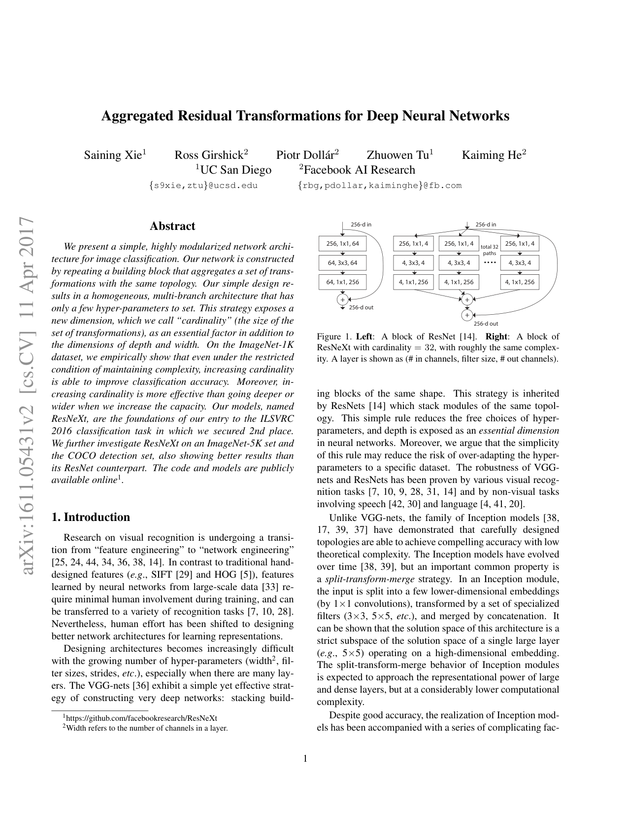
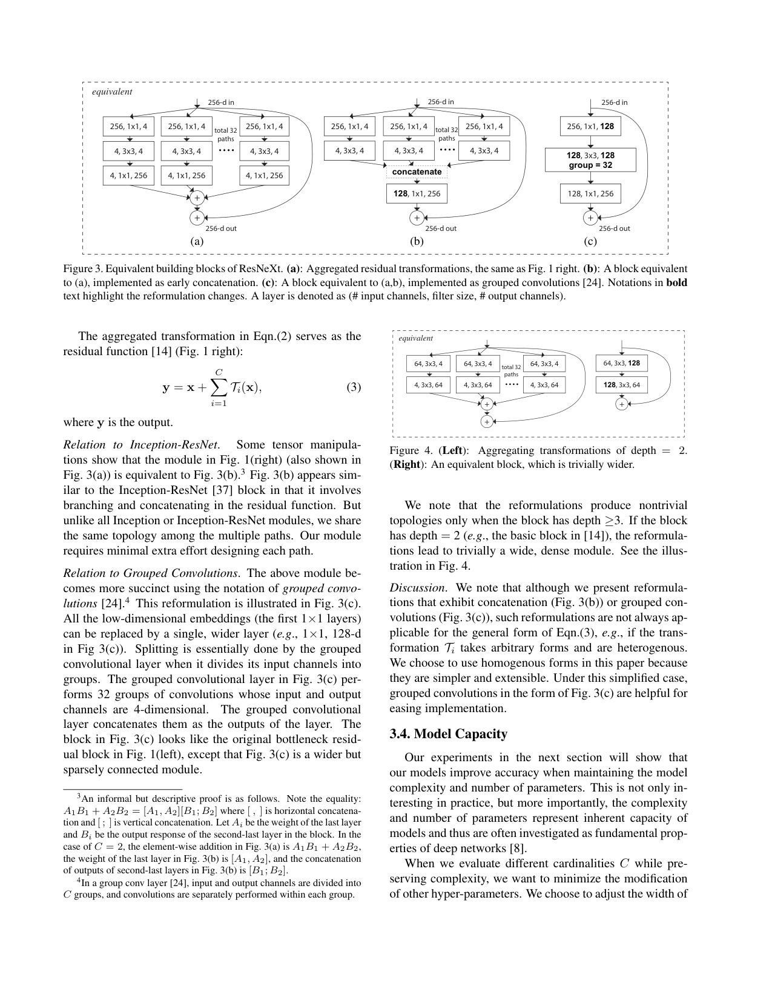

# ResNeXt（2016/2017）· 论文笔记

- **论文**：Aggregated Residual Transformations for Deep Neural Networks（Saining Xie, Ross Girshick, Piotr Dollár, Zhuowen Tu, Kaiming He）
- **BibTeX 键名**：`xie2017aggregated`
- **出处**：arXiv:1611.05431v2（PDF 首页角标 "11 Apr 2017"）；会议归属 CVPR 2017【待核对：PDF 内未印会议名】
- **本地 PDF**：`3.科研基本任务/论文/Xie 等 - 2017 - Aggregated Residual Transformations for Deep Neural Networks.pdf`（共 10 页）
- **任务书条目**：第 2 周 #5｜🟢 AI 辅助读｜阅读要点：cardinality 新维度、分组卷积与等价形式
- **阅读日期**：2026-10-31
- **核对规则**：数字后的「出处」指回原 PDF 章节/表号；✅ = 已回原文查证（本文所有页码按 PDF 物理页，非期刊页码）。

---

## 0. 术语表（零基础全能版 · 先看这一节再看正文）

> ResNeXt 这篇的坑不在数学，而在「**看起来像个普通 ResNet**」。下面按「结构概念 → 复杂度与实现 → 训练 → 评估」分组；凡是"实现/工程"类词，都写成"朴素做法 → 优化做法 → 为什么有效"三段式。

### 0.1 结构概念（本篇的骨架）

| 术语 | 大白话解释（在本篇里的含义） |
|---|---|
| **cardinality（基数 C）** | 一个 block 里并行放置的"同构变换"的条数。**朴素做法**：只调深度和宽度两个旋钮；**优化做法**：把 3×3 那层拆成 C 条很窄的路径，各自"降维→变换→升维"后相加；**为什么有效**：总 FLOPs/参数量不变时，C 越大每个子空间的变换越独立、连接越稀疏，多路径还自带"集成"味道——§1（p.1）称它为 depth、width 之外的第三个可测维度。 |
| **split-transform-merge（拆分-变换-合并）** | Inception 的核心套路：1×1 卷积分出几路低维嵌入（split），各自专用滤波器变换（transform），再拼接（merge）。§1（p.2）说 Inception 解空间是"一个大层解空间的真子集"，故能以低复杂度逼近大层。ResNeXt 保留这套语义，但**所有路径拓扑相同**。 |
| **aggregated transformations（聚合变换）** | 本篇的正式名字：把 C 个变换 `T_i(x)` 的输出直接**相加**（不是拼接）。对应 Eq.(2)/Eq.(3)。 |
| **residual block / bottleneck** | ResNet 的残差块。**bottleneck（瓶颈）**= "两头粗、中间细"的三层：1×1 降维 → 3×3 变换 → 1×1 升维，用低维中间层省算力。本篇每个 `T_i` 就是一个 bottleneck（Fig.1 右，p.1）。 |
| **width（宽度）** | 一层有多少个通道。原文脚注 2（p.1）明确："Width refers to the number of channels in a layer"。ResNeXt 的记号 `32×4d` 读作"32 条路径，每条瓶颈宽度 4"。 |
| **depth（深度）** | 堆叠的层/块数。ResNet-50/101 就是按深度命名。 |
| **grouped convolution（分组卷积）** | 把一个卷积层的输入/输出通道切成 C 组，**组内卷积、组间不通信**。**朴素做法**：128→128 的 3×3 稠密卷积，参数 9×128×128 = 147456；**优化做法**：分 32 组、每组 4 进 4 出，参数 9×4×4×32 = 4608（1/32），连接变稀疏；**为什么有效**：① 参数与乘加直接降 C 倍；② 组间可独立并行、显存按组切（正是 AlexNet 拆两块 GPU 的动机，§2 p.2）；③ 在 ResNeXt 里它等价于"多条同构路径求和"，所以稀疏换来的是多样性而不是掉点。 |
| **1×1 卷积** | 只看单个像素、跨通道做线性组合。在本篇里负责"降维/升维"（产生低维嵌入）与最后的升维回 256-d。 |
| **3×3 卷积** | 唯一做空间混合的层。在 Fig.3(c) 的形式里，它是**分组**的那一层（group=32）。 |
| **模板（template）模块** | 只设计一个 block 的形状，全网 block 由两条规则生成（§3.1，p.2）：同尺寸共用超参；尺寸减半时宽度翻倍。 |
| **stage（阶段）** | 特征图尺寸相同的一组 block。ResNet-50 有 conv2–conv5 四个 stage，块数 3/4/6/3（Table 1，p.3）。 |
| **等价重构（equivalent reformulation）** | Fig.3（p.4）的三种写法：(a) 32 条路径相加；(b) 先拼成 128-d 再接一个 1×1；(c) 1×1 + 分组 3×3 + 1×1。三者数学等价，§4（p.5）说三种都训过、结果一致。 |
| **求和聚合 vs 拼接聚合** | 求和（Fig.3a）与拼接（Fig.3b）在此等价，因为拼接后紧接一个线性层。**只在块深 ≥3 时非平凡**；深度 2 的 basic block 会被重构成又宽又密的普通模块（Fig.4，p.4）。 |
| **identity / projection shortcut** | 残差支路。维度不变用恒等映射；需升维/降采样时用 1×1 投影（原文用 ResNet type B，§4 p.5）。 |
| **稀疏连接（sparse connection）** | §3.3（p.4）对 Fig.3(c) 的描述："像原始 bottleneck，但更宽、且连接稀疏"。 |
| **homogeneous（同构）** | 所有 `T_i` 拓扑相同。这是把"路径数"单独拎出来当变量的前提；异构路径无法做这种消融（§3.3，p.4）。 |

### 0.2 复杂度与实现

| 术语 | 大白话解释 |
|---|---|
| **FLOPs** | 浮点运算次数，原文定义为**乘加次数**（§3.1，p.2）。**朴素做法**：只报参数量；**优化做法**：按 `参数量 × 输出面积` 估；**为什么有效**：参数相同≠算力相同——同一 block 在 56×56 与 14×14 上参数一样，乘加差 16 倍。Table 2 注释（p.5）给的就是 `#params × 56 × 56`。 |
| **#params（参数量）** | 可学习数字个数，单位 M（百万）。ResNet-50 25.5×10⁶，ResNeXt-50 (32×4d) 25.0×10⁶（Table 1，p.3）。 |
| **模型容量（model capacity）** | §3.4（p.4）指"参数量 + 复杂度"这对固有属性；本篇全部实验都在"容量近似不变"约束下做。 |
| **Torch grouped conv 实现** | 本篇直接用 Torch 自带分组卷积，§5.1（p.7）自述是"brute-force、对并行不友好"。**朴素做法**：调库直接跑；**优化做法（原文未做）**：写 CUDA kernel 或转批量化 GEMM；**代价**：ResNeXt-101 每 mini-batch 0.95 s，同 FLOPs 的 ResNet-101 为 0.70 s。 |
| **in-network feature reuse（网内特征复用）** | **朴素做法**：每层只吃上一层，浅层特征用完即丢；**优化做法**：用 shortcut/密集连接把浅层送到深层（ResNet 恒等支路是最简形式）；**为什么有效**：梯度有直通路径、浅层特征被多层复用。⚠️ **本篇未讨论此词**，仅通过"聚合变换 + shortcut"间接体现。【课外补充·待核实】 |
| **BN 位置** | 卷积后立刻 BN、再 ReLU；块输出处 ReLU 放在"相加之后"（§4，p.5）。脚注 6（p.6）：换成 Fig.3(a) 形式时 BN 要放在"聚合之后、相加之前"才保持等价。 |
| **im2col / GEMM** | 把卷积展开成矩阵乘的经典加速法。**本篇未提**；分组卷积用 im2col 会变成 C 个小 GEMM，并行度差——正是 p.7 那 0.25 s 溢价的来源。【课外补充·待核实】 |

### 0.3 训练设置

| 术语 | 大白话解释 |
|---|---|
| **SGD** | 随机梯度下降，本篇所有模型都用它（§4，p.5）。 |
| **mini-batch = 256 / 8 GPU** | 8 张卡、每卡 32 张图（§4，p.5）。 |
| **weight decay = 0.0001** | L2 正则强度（§4，p.5）。 |
| **momentum = 0.9** | 动量系数（§4，p.5）。 |
| **学习率调度** | 从 0.1 起，按 [11] 的 schedule 除 10 共三次（§4，p.5）。 |
| **He 初始化** | 引用 [13] 的初始化（针对 ReLU 的 fan-in 缩放），§4，p.5。 |
| **scale/aspect-ratio 数据增强** | 参照 Inception [38] 的随机尺度+长宽比扰动，再由 [11] 实现（§4，p.5）。 |
| **center crop（中心裁剪）** | 所有**消融实验**都只在"短边缩到 256 的图"上取**单个 224×224 中心裁剪**评估（§4，p.5）。**这是理解 Table 3/4 数字的关键前提。** |

### 0.4 评估与数据集

| 术语 | 大白话解释 |
|---|---|
| **ImageNet-1K** | 1000 类分类数据集（ILSVRC 用的那套），本篇主战场。 |
| **ImageNet-5K** | 作者自建的 5000 类子集（1K 的 1000 类 + 从 ImageNet-22K 里挑图最多的 4000 类），共 680 万张、约 1K 的 5 倍（§5.2，p.7）。 |
| **top-1 / top-5 error** | top-1 看第一名错没错；top-5 看正确答案是否在前 5。**为什么业界爱用 top-5**：1000 类里不少天生难分，top-5 能过滤"合理混淆"；但论文更看 top-1，因为它对模型差异更敏感。 |
| **single-crop** | 只裁一块图评估。本篇给 224×224 与 320×320 两种（后者跟 [15]，Table 5，p.7）。 |
| **ten-crop** | 常用测试增强：4 角 + 中心，各取原图与水平翻转 → 10 块，10 个 softmax 平均。**朴素做法**：只喂中心块；**优化做法**：十块平均；**为什么有效**：平均掉位置/翻转带来的方差，通常比单块高 1 点左右。⚠️ **本篇没用 ten-crop**：Table 5 全是单裁剪，只在提交 ILSVRC 时才用 multi-scale dense testing（p.7）。【本篇未出现，属通用术语】 |
| **multi-scale dense testing** | 多尺度 + 全卷积稠密测试（FC 换成卷积，一次吃整图），引用 [14] 的做法。本篇 ILSVRC 单模型 17.7%/3.7% 就是这套设置（p.7）。 |
| **ensemble（集成）** | 多模型 softmax 相加取平均。本篇 ILSVRC 集成 top-5 = 3.03%（p.7）。**最容易误读的数字**：它和多尺度单模型的 3.7% 不是一回事。 |
| **validation / test set** | val = 从训练集里留出的 5 万张，可反复调参；test = 官方服务器，一年只能提交有限次数。Table 3/4/5 都是 **val**；只有 ILSVRC 提交数字是 test。 |
| **AP / AP@0.5** | 检测指标。COCO 的 AP 是在 IoU 0.5:0.95 上取平均，AP@0.5 只算 IoU=0.5（Table 8，p.8）。 |
| **CIFAR-10 / 100** | 32×32 小图数据集，用来验证"不是只在 ImageNet 上好使"（§5.3，p.7-8）。 |
| **minival** | COCO 的 5k 张验证子集，检测实验在这上面评（§5.4，p.8）。 |

---

## 1. 一句话说清

**问题**：ResNet 之后想再涨点只有两条路——**加深**（200 层，收益递减且难训）或**加宽**（通道翻倍，参数爆炸）。Inception 靠人工定制分支拿到高效率，但每个 stage 的滤波器个数/尺寸都要人肉调，换数据集难以迁移（§1，p.2）。

**做法**：保留 Inception 的 split-transform-merge，把"每条路径长什么样"定死——**C 条完全同构的 bottleneck 路径，输出相加**，这个 C 就叫 cardinality。关键是**总复杂度不变**：C 从 1 加到 32 时瓶颈宽度 d 从 64 缩到 4（Table 2，p.5），才能与 ResNet 公平对比；且该模块有三种等价写法，其中一种是**分组卷积**（Fig.3，p.4）。

**结果**：ImageNet-1K 单裁剪 top-1：ResNeXt-50 (32×4d) **22.2%** vs ResNet-50 **23.9%**（Table 3，p.6）；ResNeXt-101 用 **~7.8 GFLOPs** 就到 **21.2%**，比 **~15 GFLOPs** 的 ResNet-200（21.7%）更准、算力只要一半（Table 4/5 + Fig.5 注，p.6-7）。是 ILSVRC 2016 分类赛道**第 2 名**（集成 top-5 3.03%，冠军 2.99%，p.7）。

> 背下来：**ResNeXt = 把「宽度」这一个旋钮，拆成「C 条同构路径」这 C 个旋钮；总算力不变，只改"怎么分"，就能白赚 1–2 个点。**

---

## 2. 核心图 / 公式

### 2.1 Fig.1（p.1）：左右两张图，复杂度几乎相同



| | 左：ResNet bottleneck | 右：ResNeXt（C=32） |
|---|---|---|
| 路径数 | 1 条 | 32 条（"total 32 paths"） |
| 每条路径 | 256→64 (1×1) → 64→64 (3×3) → 64→256 (1×1) | 256→4 (1×1) → 4→4 (3×3) → 4→256 (1×1) |
| 聚合方式 | 无（单路） | 32 路**逐元素相加**，再加 shortcut |
| 复杂度 | 基准 | 与左图"roughly the same complexity"（Fig.1 图注，p.1） |

> **要看出什么**：两张图的"总通道数"和"总乘加数"几乎一样，唯一差别是**中间那个 3×3 层被切成 32 份**。所以后面所有增益只能归因于"切法"，不能归因于"变大"。

### 2.2 Fig.3（p.4）：三种等价写法 + 等价性证明



```
(a) 32 条独立路径，各 256→4→4→4→256→…，最后相加
(b) 32 条路径只做到 4-d，拼成 128-d，再用一个 (128, 1×1, 256)
(c) 一个 (256, 1×1, 128) → 一个 3×3 分组卷积（group=32）→ 一个 (128, 1×1, 256)
```

原文脚注 3（p.4）给的证明只有一行：

$$
A_1B_1 + A_2B_2 = [A_1,\ A_2]\ [B_1;\ B_2]
$$

- `A_i`：第 i 条路径**最后一层**的权重（对应 (b) 里拼起来的 `[A_1, A_2]`）；
- `B_i`：第 i 条路径**倒数第二层**的输出（对应 (b) 里竖拼的 `[B_1; B_2]`）；
- `[ , ]` 水平拼接、`[ ; ]` 竖直拼接。

也就是说：**"先各自升维再相加" ≡ "先拼起来再一次升维"**；(c) 只是 (b) 的合并写法——分组卷积在切输入通道时"顺手"完成了 split。

⚠️ §3.3（p.4）强调：**这种等价只在块深 ≥3 时非平凡**；深度 2 的 basic block 会被重构成"又宽又密的普通模块"（Fig.4，p.4）。

### 2.3 公式 Eq.(1)–(3)（p.3）

$$ \sum_{i=1}^{D} w_i x_i \tag{1} $$

$$ \mathcal{F}(x) = \sum_{i=1}^{C} \mathcal{T}_i(x) \tag{2} $$

$$ y = x + \sum_{i=1}^{C} \mathcal{T}_i(x) \tag{3} $$

| 符号 | 含义 | 本篇取值 |
|---|---|---|
| `x` | 一个神经元的输入向量 / 一个 block 的输入张量 | 256 维（block 输入通道） |
| `x_i` | 第 i 个输入通道的值 | — |
| `w_i` | 第 i 个通道的权重 | — |
| `D` | 输入向量维数 | 256 |
| `C` | **cardinality**，被聚合的变换条数 | 1 / 2 / 4 / 8 / 32 / 64（Table 2、Table 4） |
| `T_i(·)` | 第 i 个变换函数（本身也可以是个小网络） | 一个 bottleneck：1×1 → 3×3 → 1×1 |
| `F(x)` | 聚合结果（残差支路的输出） | 256 维 |
| `y` | block 输出 | 256 维 |

**(1)→(2) 的关键解读**（§3.2–3.3，p.3）：一个普通神经元的内积，本身就可以拆成"split（取一个通道）→ transform（乘 w_i）→ aggregate（求和）"三步；ResNeXt 只是把"乘一个标量"换成"过一个小网络"，把"一个通道"换成"一个 4 维子空间"。这就是原文说的 **Network-in-Neuron**（区别于 Network-in-Network：后者加的是**深度**，前者加的是**新维度**）。

### 2.4 参数量对比（Eq.(4)，p.5 + 自己复算）

设瓶颈宽度 d、基数 C，则模板 block 的参数量为：

$$ \#\text{params} = C \cdot (256 \cdot d + 3 \cdot 3 \cdot d \cdot d + d \cdot 256) \tag{4} $$

逐符号：`256` = block 输入/输出通道；`d` = 每条路径的瓶颈宽度；`3·3·d·d` = 那条 3×3 层；外层 `C` = 路径数。

**复算（三个数都自己乘一遍，✅ 与原文 ≈70k 一致）**：

```
ResNet bottleneck (d=64, C=1):
  1×1 降维：256×64  = 16384
  3×3     ：9×64×64 = 36864
  1×1 升维：64×256  = 16384
  合计              = 69632  ≈ 70k        （原文 §3.4 p.4 给的 ≈70k，✅）

ResNeXt (C=32, d=4)，按 Fig.3(a) 逐路径数：
  单条：256×4 + 9×4×4 + 4×256 = 1024 + 144 + 1024 = 2192
  32 条：2192 × 32 = 70144 ≈ 70k          （Eq.(4) 代入 C=32,d=4，✅）

ResNeXt 按 Fig.3(c) 分组卷积数：
  1×1 256→128：256×128 = 32768
  3×3 分组(32组,每组4进4出)：9×4×4×32 = 4608
  1×1 128→256：128×256 = 32768
  合计 = 70144                            （与上面两条完全一致 → 等价性的"数"证据）
```

**"分组卷积省参数"的定量版**：用同样宽度 128 的稠密 3×3，参数 9×128×128 = **147456**，恰好是分组版的 **32 倍**（= C）。即在同一"名义宽度"下把 3×3 层连接砍到 1/32，但靠 32 条路径保住了表示多样性。

**Table 2（p.5）——"等复杂度"表是整个实验设计的地基**：

| cardinality C | 1 | 2 | 4 | 8 | 32 |
|---|---|---|---|---|---|
| 瓶颈宽度 d | 64 | 40 | 24 | 14 | 4 |
| 分组卷积宽度（= C·d） | 64 | 80 | 96 | 112 | 128 |

> Table 2 注释（p.5）：模板参数量都 ≈70k；FLOPs ≈0.22 G（按 `#params × 56 × 56`，conv2 的特征图是 56×56）。✅

### 2.5 Table 1（p.3）：逐层结构（ResNet-50 vs ResNeXt-50 32×4d）

| stage | 输出尺寸 | ResNet-50（块内形状） | ResNeXt-50 32×4d（块内形状） | 块数 |
|---|---|---|---|---|
| conv1 | 112×112 | 7×7, 64, stride 2 | 7×7, 64, stride 2 | 1 |
| conv2 | 56×56 | 3×3 max pool, stride 2 | 3×3 max pool, stride 2 | — |
| conv2 | 56×56 | [1×1,64; 3×3,64; 1×1,256] | [1×1,128; 3×3,128 **C=32**; 1×1,256] | 3 |
| conv3 | 28×28 | [1×1,128; 3×3,128; 1×1,512] | [1×1,256; 3×3,256 **C=32**; 1×1,512] | 4 |
| conv4 | 14×14 | [1×1,256; 3×3,256; 1×1,1024] | [1×1,512; 3×3,512 **C=32**; 1×1,1024] | 6 |
| conv5 | 7×7 | [1×1,512; 3×3,512; 1×1,2048] | [1×1,1024; 3×3,1024 **C=32**; 1×1,2048] | 3 |
| 分类头 | — | global avg pool + 1000-d fc + softmax | 同左 | — |
| 参数量 | — | **25.5×10⁶** | **25.0×10⁶** | — |
| FLOPs | — | **4.1×10⁹** | **4.2×10⁹** | — |

> ⚠️ Table 1 的 "C=32" 是**分组数**简写，表格按 Fig.3(c) 写法画（Table 1 表头，p.3）。**两栏参数量/FLOPs 并不严格相等**（脚注 5，p.5），差异来自"特征图尺寸变化的那几个 block"。

### 2.6 训练设置（§4，p.5，✅）

| 项目 | 设置 |
|---|---|
| 输入 | 从缩放后图像随机裁 224×224（尺度+长宽比增强，[38]/[11]） |
| shortcut | 维度不变用 identity，升维用 projection（ResNet type B） |
| 下采样 | conv3/4/5 第一个 block 的 3×3 层用 stride 2（[11]） |
| 优化器 | SGD，batch 256（8 GPU × 32） |
| weight decay / momentum | 0.0001 / 0.9 |
| 学习率 | 0.1 起，×0.1 共三次 |
| 初始化 | [13]（He init） |
| 消融评估方式 | **单张 224 中心裁剪**（短边缩到 256） |
| 实现形式 | Fig.3(c)（分组卷积），三种形式都训过、精度一致（§4 p.5） |

---

## 3. 关键实验数据

### 3.1 主结果（跨数据集）

| 实验 | 数据集/设置 | ResNeXt | 对比对象 | 出处 |
|---|---|---|---|---|
| 同复杂度 50 层 | ImageNet-1K val，单 224 裁剪，top-1 | 32×4d：**22.2%** | ResNet-50：**23.9%** | Table 3 (p.6) |
| 同复杂度 101 层 | 同上 | 32×4d：**21.2%** | ResNet-101：**22.0%** | Table 3 (p.6) |
| 2× 复杂度（~15 GFLOPs） | 同上 | 64×4d：**20.4 / 5.3** | 加深 ResNet-200：21.7 / 5.8；加宽 ResNet-101(1×100d)：21.3 / 5.7 | Table 4 (p.6) |
| 单裁剪 SOTA 对比 224 | ImageNet-1K val | ResNeXt-101 64×4d：**20.4 / 5.3** | Inception-v4：20.0 / 5.0（299×299）；Inception-ResNet-v2：19.9 / 4.9 | Table 5 (p.7) |
| 单裁剪 SOTA 对比 320 | ImageNet-1K val | ResNeXt-101 64×4d：**19.1 / 4.4** | ResNet-200：20.1 / 4.8 | Table 5 (p.7) |
| ImageNet-5K（5K 类） | 5K 训练，1K val，top-1/top-5 | 50 层：**42.3 / 16.8**；101 层：**40.1 / 15.1** | ResNet-50：45.5 / 19.4；ResNet-101：42.4 / 16.9 | Table 6 (p.7) |
| ImageNet-5K（1K 类） | 同上，只在 1K 上 softmax | 50 层：**24.4 / 6.6**；101 层：**22.2 / 5.7** | 27.1 / 8.2；24.2 / 6.8 | Table 6 (p.7) |
| CIFAR-10 / 100 | 10 次运行均值 | ResNeXt-29 16×64d：**3.58 / 17.31** | Wide ResNet（36.5M）：4.17 / 20.50 | Table 7 (p.8) |
| COCO 检测 | minival，Faster R-CNN | 50 层：**AP@0.5 49.7 / AP 27.5**；101 层：51.9 / 30.0 | ResNet-50：47.6 / 26.5；ResNet-101：51.1 / 29.8 | Table 8 (p.8) |
| ILSVRC 2016 单模型 | 多尺度稠密测试，test top-1/top-5 | **17.7 / 3.7** | Inception-ResNet-v2：17.8 / 3.7 | §5.1 (p.7) |
| ILSVRC 2016 集成 | test top-5 | **3.03** | 冠军 2.99；Inception-v4/IRv2 3.08 | §5.1 (p.7) |

**最容易被误读的数字（逐条看）**：

1. **22.2 vs 23.9 是"1.7 个百分点"**，原文写成 "1.7% lower"（p.6）。别说"提升 1.7%"，要说"绝对误差降 1.7 个点"。
2. **Table 3 只有 top-1、val、单 224 中心裁剪**（表注 p.6）；top-5 要到 Table 4 才有。
3. **Table 5 的 4.4% 是 320 裁剪的 top-5**，3.03% 是 test + 集成 + 多尺度，**不能并列**。
4. **Table 6 有两组列**："5K-way" 是"预测到额外 4000 类也算错"，"1K-way" 是只在 1K 上归一化。同一模型两列差 20 个点，极易抄错。
5. **CIFAR 的 3.58 是 10 次平均**（表注 p.8），非单次最优；**COCO 用 AP（IoU 0.5:0.95 平均），不是 VOC 的 mAP**。

### 3.2 消融实验（本篇最值钱）

**消融一：只换 cardinality，总复杂度不变（Table 3，p.6）**

| 设置 | 50 层 top-1 | 101 层 top-1 |
|---|---|---|
| ResNet 1×64d（基线） | 23.9 | 22.0 |
| C=2, d=40 | 23.0 | 21.7 |
| C=4, d=24 | 22.6 | 21.4 |
| C=8, d=14 | 22.3 | 21.3 |
| **C=32, d=4** | **22.2** | **21.2** |

读法：C 从 1→32 误差**单调下降**，但 8→32 只再降 0.1 → **宽度压太小就饱和**（§5.1 p.6-7："starts to show saturating accuracy"），故作者规定 d 不小于 4。原文还强调 ResNeXt 的**训练误差也更低**（p.6："gains are not from regularization but from stronger representations"）——反驳"多路径=正则化"的关键证据。

**消融二：2× 算力该花在哪（Table 4，p.6）**

| 花法 | 设置 | top-1 / top-5 | 相对 ResNet-101 的收益 |
|---|---|---|---|
| 1× 参照 | ResNet-101 | 22.0 / 6.0 | — |
| 1× 参照 | ResNeXt-101 32×4d（**算力只有一半**） | 21.2 / 5.6 | 已超过 2× 的 ResNet-200 |
| 2×：加深 | ResNet-200 | 21.7 / 5.8 | −0.3 |
| 2×：加宽 | ResNet-101, 1×100d | 21.3 / 5.7 | −0.7 |
| 2×：加 C（保宽度） | ResNeXt-101 2×64d | **20.7 / 5.5** | −1.3 |
| 2×：加 C（从 32×4d 翻倍） | ResNeXt-101 64×4d | **20.4 / 5.3** | −1.6 |

**这张表是论文的"立论"**：同样翻倍算力，加深赚 0.3、加宽赚 0.7、加 C 赚 1.3–1.6（p.6，✅）。

**消融三：残差连接到底在帮什么（p.6，未编号小表）**

| 设置 | 有 shortcut | 无 shortcut |
|---|---|---|
| ResNet-50 1×64d | 23.9 | **31.2** |
| ResNeXt-50 32×4d | 22.2 | **26.1** |

⚠️ **最反直觉的一条**：去掉 shortcut 后 ResNeXt 只掉 3.9 点（22.2→26.1），ResNet 掉 7.3 点（23.9→31.2）。原文结论（p.6-7）：**shortcut 帮的是"优化"，聚合变换给的是"更强表示"**——ResNeXt 对 shortcut 依赖反而更小；"残差对 ResNeXt 更重要"的说法正好说反。

---

## 4. 我的思考

1. **贡献的性质：不是发明新算子，而是"把已有零件拼成一个可测的新维度"**【原文结论 + 我的推断】。分组卷积是 AlexNet 为双 GPU 拆模型的工程妥协（§2 p.2："little evidence on exploiting grouped convolutions to improve accuracy"），多分支是 Inception 的；新的是 **cardinality 这个可单独拨动、又不改总复杂度的旋钮**，把"结构搜索"降级成"一个模板 + 两条缩放规则"（§3.1，p.2）。
2. **局限与边界**【原文结论 + 我的推断】：① ImageNet-1K 已饱和（p.7："many models start to get saturated"），50 层增益 1.7 点、101 层只剩 0.8 点，数据更多才拉开差距（5K 上 3.2 / 2.3 点，Table 6）。② d 压到 4 后就饱和，说明 C 与宽度是**兑换关系**，不是叠加关系。③ 分组卷积实现开销真实存在（0.95 s vs 0.70 s，p.7），部署侧未必划算。④ 等价性只对"同构 + 深度≥3"成立。
3. **消融为什么这样排**【我的推断】：Table 2**先立约束**（C 与 d 的兑换表），Table 3 **单变量扫描**（只动 C），Table 4 **预算分配**（2× 算力：加深/加宽/加 C），残差小表 **机制归因**（把"优化收益"与"表示收益"分开）。约束→扫描→竞争→归因，可直接照抄。
4. **如果让我改**【我的推断 + 课外补充·待核实】：① 分组 3×3 换成**深度可分离卷积**可再省一个量级乘加（后成 MobileNet/Xception）；② 分组切断跨组信息流，可在组间加轻量交互（后成 ResNeSt 的 split-attention，【待核实】）；③ p.7 自述实现是 brute-force，换按组排布的 kernel 或融合成一次大 GEMM，0.25 s 溢价大概能抹平；④ 最想补"**C 与 d 的二维扫描**"——原文只在等复杂度对角线上走。

---

## 5. 回原文核对记录

| 说法 | 原文依据 | 判定 |
|---|---|---|
| "ResNeXt 提出了分组卷积" | §2（p.2）分组卷积可追溯到 AlexNet [24]，动机是分到两块 GPU；§3.3（p.4）只是用分组写法让实现更简洁 | 🟥 错，是借用+重新解释 |
| "32×4d 与 ResNet-50 参数量、FLOPs 完全相同" | Table 1（p.3）：25.0M vs 25.5M、4.2G vs 4.1G；脚注 5（p.5）只说"近似保持" | 🟨 近似相等，参数反而略少 |
| "ResNeXt 是 ILSVRC 2016 分类冠军" | §5.1（p.7）集成 3.03% vs 冠军 2.99%；摘要 "secured 2nd place" | 🟥 错，是第 2 名 |
| "ResNeXt-101 比 ResNet-200 更准且算力只要一半" | 摘要/§1（p.1）+ Table 4/5：21.2 vs 21.7；Fig.5 注（p.6）：~7.8G vs ~15G | 🟩 正确 |
| "去掉 shortcut 后 ResNeXt 掉点更多" | p.6 小表：ResNeXt 22.2→26.1（−3.9），ResNet 23.9→31.2（−7.3） | 🟥 错，掉得**更少** |
| "C 越大越好" | §5.1（p.6-7）C=8→32 只再降 0.1，宽度太小时饱和，作者因此固定 d≥4 | 🟨 仅当"总复杂度固定 + 宽度不太小" |
| "≈70k 参数量没法验" | Eq.(4)（p.5）+ 复算：69632 / 70144 / 70144 | 🟩 可复算，三条路径一致 |

---

## 6. 本篇 3 个自测问题

1. **把 Fig.3 三种写法各算一遍参数量**：为什么 (a) 的"32 条各 2192"、(c) 的"32768+4608+32768"、Eq.(4) 代 (C=32, d=4) 都得 70144？若改成 C=8、d=14，三式还相等吗？（先算差值，再解释"为何只是近似"）
2. **同样 2× 算力，为什么"加 C"比"加深/加宽"划算？** 用 Table 4 的四个数字回答，并说明原文凭哪条断定"增益不是来自正则化"（提示：p.6 训练误差那句）。
3. **"分组卷积让连接变稀疏"像掉容量，为什么精度反而涨？** 从 Fig.3(a)↔(c) 的等价性出发，说明稀疏发生在**连接**还是**表示**上，并指出等价性何时失效（提示：块深=2，见 Fig.4）。
