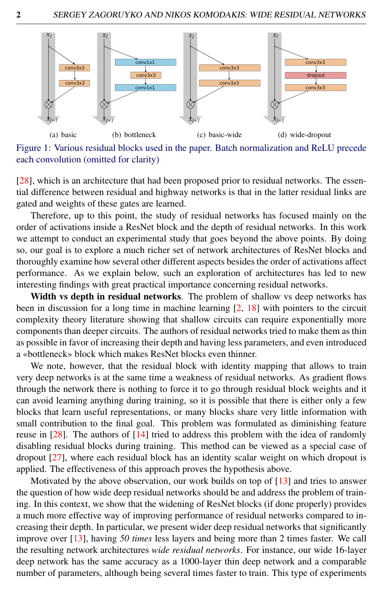
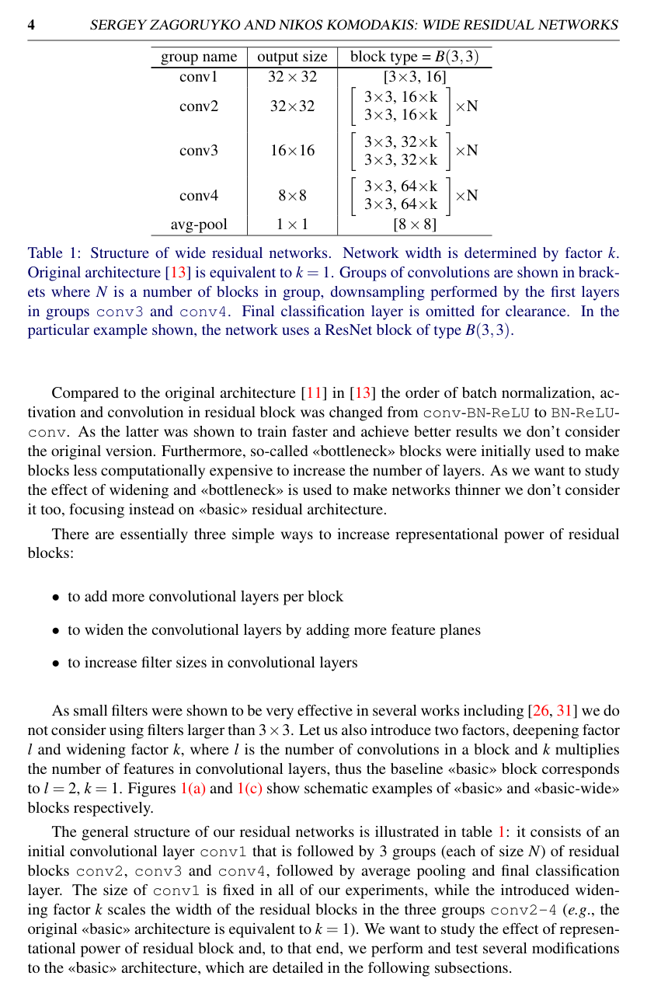
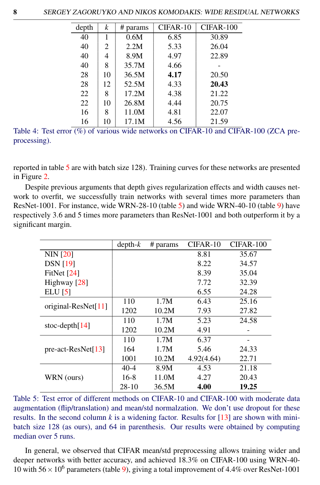

# Wide Residual Networks（2016/2017）· 论文笔记

- **论文**：Wide Residual Networks（Sergey Zagoruyko、Nikos Komodakis，Université Paris-Est, École des Ponts ParisTech，p.1）
- **BibTeX 键名**：`zagoruyko2016wide`【课外补充·待核实：按 arXiv 年份命名，PDF 内未标会议名】
- **出处**：arXiv:1605.07146v4 [cs.CV]（PDF 首页左侧竖排 "arXiv:1605.07146v4  [cs.CV]  14 Jun 2017"）；页脚 "©2016. The copyright of this document resides with its authors." 与双栏带页眉的版式符合 BMVC 2016 论文集格式【课外补充·待核实：PDF 内未印会议名】
- **本地 PDF**：`3.科研基本任务/论文/Zagoruyko和Komodakis - 2017 - Wide Residual Networks.pdf`（共 15 页，其中 p.13–15 为参考文献，正文到 p.12）
- **任务书条目**：第 2 周 #5｜ResNeXt / Wide ResNet｜🟢 AI 辅助读｜前置：第 4 篇 ResNet（`04_ResNet.md`）
- **阅读日期**：2026-11-01
- **核对规则**：数字后的「出处」指回原 PDF 的 §章节 / Table n / Fig n / p.页码；✅ = 用 PyMuPDF 抽全文逐条查证过；【待核对】= 原文没写或抽取不出可靠值；【自算】= 本笔记自己按结构复算、并与原文表格对得上。

> **阅读前提醒（3 句）**：这篇不是"又一个新的 SOTA 网络"，而是一篇**实验解剖报告**——它把 ResNet block 的 5 个可调旋钮（块里用什么卷积、块里有几层卷积、多宽、要不要 dropout、多深）挨个拧了一遍。所以你读的时候要把自己当成"要复现实验的人"，而不是"要背结构的人"。全篇最贵的一句话是 p.12 的结论：**"the main power of residual networks is in residual blocks, and not in extreme depth"**（残差网络的威力在残差块里，不在"极度深"上）。

---

## 0. 术语表（零基础全能版 · 先看这一节再看正文）

> 这篇的难点不在公式（全篇只有 1 条编号公式，就是 ResNet 的 Eqn (1)），而在于**它把"深度"这个大家默认的旋钮拆开，发现旁边那个"宽度"旋钮更值钱**。术语按「结构 → 训练 → 评估 → 工程与指标」分组，工程类词一律写成「朴素做法 → 优化做法 → 为什么有效」。

### 0.1 网络结构（WRN 的"零件"）

| 术语 | 大白话解释（在本篇里的含义） |
| --- | --- |
| **residual block（残差块）** | 图 1 那四种小单元：两三个卷积 + 一条把输入 $x_l$ 直接送到输出的旁路 + 加法。本篇**只研究块**，不研究整网——这是全文的方法论前提：p.3 把"块"当成可独立测量的变量。 |
| **identity shortcut（恒等跳线 / identity mapping）** | **朴素做法**：层层串联，信息只能一层层往下传；**优化做法**：把输入 $x_l$ 原样加到输出（零参数、零计算，Fig 1 里那条绕过左侧的线）；**为什么有效**：① 让极深网络可训（[13] 已证明）；② **但它同时是弱点**——原文 p.2 原话："the residual block with identity mapping that allows to train very deep networks is at the same time a weakness of residual networks"，因为梯度可以**完全绕开**块内权重，块就"可以什么都不学"。这句是本篇全部动机的来源。 |
| **pre-activation（预激活）** | 把 BN 和 ReLU 放到卷积**之前**：BN-ReLU-conv，而不是 ResNet 原始的 conv-BN-ReLU。出处 p.4："the order … was changed from conv-BN-ReLU to BN-ReLU-conv"。本篇所有 CIFAR/SVHN 实验都基于 [13] 的 pre-act 版本（p.7）；**但 ImageNet 例外**：p.7 说"少于 100 层时用 pre-act 没有显著差别，所以 ImageNet 用原始 ResNet 结构"。 |
| **basic block（B(3,3)）** | 图 1(a)：连续两个 3×3 卷积、通道数不变。**这是全篇最终选定的块**（p.7"B(3,3) turned out to be the best by a little margin"）。 |
| **B(M) 记号 / B(3×3)-B(3×3)** | **朴素做法**：用图片描述块的形状；**优化做法**：p.5 §2.1 定义 `B(M)`，M 是块内各卷积核尺寸的列表，如 `B(3,1)` = 3×3 后接 1×1，`B(3,1,3)` = 3×3→1×1→3×3；**为什么有用**：把"块长什么样"变成一个可枚举、可列表对比的符号，Table 2 才排得下 6 种块。本篇最终选 **B(3,3)（即两个 3×3，本笔记写作 B(3×3)-B(3×3)）**。 |
| **basic-wide block** | 图 1(c)：形状和 (a) 完全一样，只是**通道更宽**。"宽"不是加层、不是加大卷积核，是加通道数（feature planes）。 |
| **wide-dropout block** | 图 1(d)：在 (c) 的两个卷积**之间**插一层 dropout。位置极关键，见 §2.2 与 §4.3。 |
| **bottleneck（瓶颈块）** | 图 1(b)：conv1×1 → conv3×3 → conv1×1，用 1×1 先降维再升维，目的是**让块更"瘦"**、好堆更多层。本篇**在 CIFAR 主体实验里故意不用它**：p.4 原话"as we want to study the effect of widening and «bottleneck» is used to make networks thinner we don't consider it too"。只有 ImageNet 上做了一个 WRN-50-2-bottleneck。 |
| **widened basicblock / WRN-50-2-bottleneck** | ImageNet 专用：拿 ResNet-50 的 bottleneck 结构，把内部 3×3 层加宽（p.10："tried to make it wider by increasing inner 3×3 layer width"），加宽系数 2.0。注意：**加宽的是 bottleneck 内层，不是整个网络**。 |
| **grouped convolution（分组卷积）** | **朴素做法**：想把通道变多就整层变宽，参数按 $9c^2$ 平方涨；**优化做法**：把通道切成 g 组、组内各自卷积、再把结果拼回去，参数降到原来的 1/g；**为什么有效**：① 在"总参数量/FLOPs 固定"的前提下**白拿宽度**（名义宽度不变、实际连接变稀疏）；② 组内卷积天然形成多条并行路径，等价于"稀疏连接 + 集成"。**🟨 本篇没有用分组卷积**（全文未出现 "group convolution"），把宽度当成"整层加宽"来用——正因为它把"加宽"的代价写成了**k 的平方律**（§2.3），下一篇（`05_ResNeXt.md`）才顺着这条线索把宽度拆成 cardinality 个分组路径。**读本篇时把这条当"伏笔"记**，不要误以为 WRN 用了分组卷积。【课外补充·待核实：分组卷积的详细参数/FLOPs 换算需回 ResNeXt 原文】 |
| **widening factor k（加宽系数）** | **本篇的头号主角**。**朴素做法**：想变强就加层（深度）；**优化做法**：p.4 §2 把三个 group 的通道数写成 16k / 32k / 64k，只乘一个标量 k；**为什么有效**：① 参数量随 k **平方**增长（§2.3 p.5），所以 k=2 就等于"参数翻 4 倍"，容量涨得比加层快得多；② GPU 在大张量上并行效率极高，宽层比"几千个小卷积"更快（§2.3 p.5）；③ 每一层都变宽，等于**每层都在学更丰富的特征**，直接绕开了"很多块什么也没学"的问题。 |
| **deepening factor l（加深系数 / 块内卷积层数）** | 一个块里有几个卷积。baseline 是 l=2（即 B(3,3)）。Table 3 扫了 l=1,2,3,4。注意这个 l 是**块内**层数，不是全网深度（全网深度用 d 或 n），很容易混。 |
| **d（block 数量）/ n（总卷积层数）** | p.5 §2.2："d denotes the total number of blocks"；p.5 §2.3："WRN-n-k denotes a residual network that has a total number of convolutional layers n and a widening factor k"。例：**WRN-40-2 = 40 个卷积层 + k=2**。 |
| **thin / wide** | p.5 原文定义：k=1 叫 thin（就是原始 ResNet），k>1 叫 wide（WRN）。这两个词在本篇是**互斥的对照组**，全文的主结论就是"wide 比 thin 划算"。 |
| **group（conv2 / conv3 / conv4）** | Table 1 的三大段：conv2（32×32）、conv3（16×16）、conv4（8×8），每段 N 个块。 |
| **conv1（固定 16 通道）** | Table 1 第一行 `[3×3, 16]`，**唯一不受 k 影响的卷积**（p.4："The size of conv1 is fixed in all of our experiments"）。所以 CIFAR 上"宽度"只指 conv2-4。 |
| **downsampling in group's first layer** | 尺寸减半发生在 conv3、conv4 的**第一个块**（Table 1 表注："downsampling performed by the first layers in groups conv3 and conv4"）。此时通道同时翻倍，所以这些块需要 1×1 投影跳线（或零填充）。 |
| **avg-pool [8×8] → 1×1** | Table 1 末行 `avg-pool 1×1 [8×8]`：8×8 的特征图全局平均成 1×1，再接分类层（表注说"Final classification layer is omitted for clearance"）。**注意 Table 1 把最后的 FC 省略了**，算参数量时要自己补回去（见 §2.3 复算）。 |
| **Network-in-Network block（B(3,1,1)）** | p.5 §2.1 列举的第 6 种块，作者注明"similarto effective Network-in-Network [20] architecture"。实测 5.86%（Table 2），比 B(3,3) 差。 |
| **"straightened" bottleneck（B(1,3,1)）** | p.5 原文用词："with the same dimensionality of all convolutions, «straightened» bottleneck"——把瓶颈块的三层都改成同宽度，即"把瓶颈拉直"。实测 6.06%（Table 2），**是所有块里最差的**，但它是**最慢的**（85.8 s/epoch）也是最贵的（1.4M）。 |
| **diminishing feature reuse（特征复用衰减）** | 本篇的核心问题词。**朴素理解**："深了以后性能就该更好"；**原文的机制解释**（p.2）：梯度可以不经过块内权重，所以"要么只有少数块学到有用表示，要么很多块之间共享信息极少、对最终目标贡献很小"；原文注明这个概念"was formulated as diminishing feature reuse in [28]"（即 Highway Networks，**不是本文发明的词**）；**为什么重要**：它把"深度没用"从"玄学"变成了一个**有机制、有旁证**的论断，也是本文提出"加宽"的直接理由。 |
| **stochastic depth（随机深度）** | [14] 的做法：训练时随机把整个残差块"跳过"。p.2 把它解释成"dropout 的特例——每个块有一个恒等标量权重，对这个权重做 dropout"，并说"**The effectiveness of this approach proves the hypothesis above**"：既然随机扔掉一堆块还不掉点，说明那些块本来就没什么贡献。这是"特征复用衰减"最硬的一条旁证。 |
| **Highway networks** | [28]，比 ResNet 更早的跳线网络。p.2 明确两者差别："in the latter residual links are gated and weights of these gates are learned"——Highway 的跳线**带门控、要学**，ResNet 的跳线是**恒等、不学**。别把两者写成同一个东西。 |
| **VGG / Inception 作为"宽度参照系"** | p.5 §2.3 的一个论证："almost all architectures before residual networks, including the most successful Inception [30] and VGG [26], were much wider compared to [13]"，并举 WRN-22-8、WRN-16-10 与 VGG 在宽度/深度/参数量上相近。言下之意：**ResNet 是"异常地瘦"的那一个**。 |

### 0.2 训练（本篇自己的训练配方，很多细节和 ResNet 不一样）

| 术语 | 大白话解释 |
| --- | --- |
| **batch normalization（BN）** | **朴素做法**：靠小学习率 + 精细初始化硬训；**优化做法**：每个卷积前先按 batch 统计量归一化（本篇是 pre-act：BN-ReLU-conv）；**为什么在本篇特别重要**：① 它是**正则器**，所以本篇讨论"要不要再加 dropout"（p.5 §2.4："Residual networks already have batch normalization that provides a regularization effect"）；② 但它"需要重数据增强，而我们想避免"（同句）；③ 在 SVHN 上不用数据增强时**BN 会过拟合**（p.10"batch normalization overfits, so dropout adds a regularization effect"）——这是 dropout 在 SVHN 上收益最大的原因。 |
| **dropout in residual block（块内 dropout）** | **朴素做法 / 前人的做法**：[13] 把 dropout 放在 **identity 分支**上，结果有负面效果（p.3："dropout being inserted in the identity part of the block, and the authors showed negative effects of that"）；**优化做法**：放在**两个卷积之间、ReLU 之后**（图 1(d)），p.6 §2.4 原话"after ReLU to perturb batch normalization in the next residual block"；**为什么有效**：① 扰动的是"下一块的 BN 统计量"，逼每一块都学点不一样的东西 → 正对"特征复用衰减"；② 不动恒等路径，所以不破坏"梯度直通"。 |
| **dropout rate 0.3 / 0.4** | CIFAR 用 0.3、SVHN 用 0.4，靠交叉验证定的（p.9）。**注意：不用为了 dropout 延长训练轮数**（p.9："we didn't have to increase number of training epochs"）。 |
| **weight decay 0.0005** | p.12 §Implementation details。**和 ResNet 的 1×10⁻⁴（见 04 笔记 §3.4）差 5 倍**，对比阅读时别记混。 |
| **Nesterov momentum 0.9 / dampening 0** | p.12："SGD with Nesterov momentum and cross-entropy loss … dampening to 0, momentum to 0.9"。ResNet 只写"momentum 0.9"，本篇明确是 **Nesterov**。 |
| **learning rate schedule** | CIFAR：初始 0.1，在 60/120/160 epoch 各"drop by 0.2"，共训 200 epoch；SVHN：初始 0.01，在 80/120 epoch 各 drop by 0.1，共训 160 epoch（p.12）。🟨 **"dropped by 0.2"是"乘 0.2"还是"减 0.2"原文没写清**（【待核对】，按惯例应为乘 0.2，即 ÷5）。 |
| **minibatch 128** | p.12。**重要对照**：ResNet-1001 的 4.64% 是 batch 64 下得到的，本篇统一用 128（p.7 括号注明），所以**比数字时必须用 4.92% 那一个**。 |
| **"disturbing effect"（学习率下降后的震荡）** | p.9 原话："after the first learning rate drop when both loss and validation error suddenly start to go up and oscillate on high values until the next learning rate drop"，作者查明**是 weight decay 造成的**，但把 weight decay 调小又会掉点，而**dropout 能部分消除这个现象**（见 Fig 2、Fig 3）。这是"dropout 顺手修了个 bug"的少见记录。 |
| **ZCA whitening** | CIFAR 的一种白化预处理（去相关 + 归一化），本篇"除非特别说明"都按 [8] 的做法用 ZCA（p.7）。**Table 4 是 ZCA 口径**。 |
| **mean/std normalization（简单均值方差归一化）** | 只减均值除标准差。p.7 说"for some CIFAR experiments we instead use simple mean/std normalization such that we can directly compare with [13]"。**Table 5、Table 6 是 mean/std 口径**。同一个模型在两个口径下数字不同，这是本篇最大的误读陷阱。 |
| **data augmentation（本篇用的轻量增强）** | 只用水平翻转 + 在每边补 4 像素（用原图反射填充）后随机裁剪（p.6-7）。**明确不用** [9] 的重增强（Graham 的 fractional max-pooling 那一套）。这解释了为什么 dropout 在这里还有用武之地。 |
| **SVHN 的"零预处理"** | p.7："we don't do any image preprocessing, except dividing images by 255"。没有增强 → BN 过拟合 → dropout 收益最大（1.85%→1.64%，Table 6）。 |
| **median over 5 runs（5 次取中位数）** | 本篇 CIFAR 结果基本都是 5 次训练的中位数（Table 2/4/5/6 表注）。**只跑 1 次的数字（Table 9）作者自己标了 "single run results"**——对比时要看这一栏。 |

### 0.3 评估（数据集与指标）

| 术语 | 大白话解释 |
| --- | --- |
| **CIFAR-10** | 32×32 彩色图，10 类，50,000 训练 + 10,000 测试（p.6 引用 [17]）。本篇主战场。 |
| **CIFAR-100** | 同上但 100 类（p.6）。**同一个模型在 CIFAR-100 上误差天然更高**（例：WRN-40-4 是 4.53 / 21.18，Table 5），不能拿 10 类的数字和 100 类的数字比"谁强"。 |
| **SVHN** | Google 街景门牌号，约 60 万张数字图，真实世界问题、更难（p.6-7）。本篇在这里拿到 1.54%（Table 9）。 |
| **ImageNet / ILSVRC-2012** | Table 7、Table 8 的表头写 "ILSVRC-2012 validation error"（p.11），即 1000 类、50k 验证集。**本篇在 ImageNet 上只做了"加宽 ResNet-18/34/50"，没有做完整的 WRN 家族**。 |
| **COCO** | 检测/分割数据集；本篇用 WRN-34-2 + MultiPathNet[32] + LocNet[7] 参加 COCO 2016 检测挑战，35.2 mAP（Table 9，p.11）。 |
| **top-1 / top-5 error** | top-1 看第一名对不对，top-5 看正确答案是否在前 5。**易误读**：ImageNet 部分（Table 7、8）是 **single crop（单裁剪）**，而 ResNet 论文的 Table 4 是 10-crop + 多尺度，**两者不能直接横向对比**（见 §5 核对表）。 |
| **single crop（单裁剪）** | 整图（或中心裁剪）只前向一次。Table 7、8 的表注都写明 "single crop"（p.11）。这解释了为什么 WRN-50-2 的 21.9% 看起来"不如"ResNet 论文里的 19.38%（口径不同）。 |
| **test error (%)** | 本篇 CIFAR 表里的数字都是 **error（越低越好）**，而不是 accuracy（越高越好）。Table 4 表注："Test error (%)"。**别把 4.00 读成 4.00% 准确率**。 |
| **"best published result (non-ensemble)"** | Table 9 表注限定："using non-ensemble models"（p.11）。这是 2016 年的说法，**不是今天的 SOTA**，读的时候要加时间戳。 |
| **state-of-the-art（SOTA）** | 摘要与 §4 反复使用。它的含义是"在当时公开发表的结果里最好"，本篇限定在 CIFAR-10/100、SVHN、COCO 四个数据集（p.12）。 |

### 0.4 工程与指标（这一节是全篇最有"现场感"的部分）

| 术语 | 大白话解释（朴素做法 → 优化做法 → 为什么有效） |
| --- | --- |
| **parameters（参数量，M = 百万）** | CIFAR 模型从 0.6M（WRN-40-1）到 52.5M（WRN-28-12）（Table 4, p.8）；ImageNet 最大到 101.8M（WRN-18 width 3.0，Table 7）。**易误读**：8.9M（WRN-40-4）和 10.2M（ResNet-1001）几乎一样，但前者精度更高——这是全篇最重要的一个数字对（见 §3.3）。 |
| **参数效率（accuracy per parameter）** | **朴素做法**：拿"参数量更多"当"更强"的证据；**优化做法**：把参数量固定，比谁的误差低（本篇几乎所有表都这么设计：Table 2 特意让不同块型"参数量可比"，Table 4/5 直接列 #params 列）；**为什么有效**：参数量是**部署成本 + 过拟合风险**的统一货币，只有它固定了，"深度 vs 宽度"才是公平比较。本篇的实测结论：**同样 1.7M 参数，ResNet-164 是 5.46%，ResNet-110 是 6.37%**（Table 5）→ 参数一样时深度确实有用；但**同样约 10M 参数，WRN-16-8（4.27%）优于 ResNet-1001（4.92%）**→ 参数一样时"广度优先"更划算。两者不矛盾，共同说明"深度收益递减、宽度收益更线性"。 |
| **GPU 训练时间 / time per epoch** | **朴素做法**：按"层数"估训练成本（1 层 ≈ 1 份时间）；**优化做法**：实测**一个 epoch 的墙钟秒数**（Table 2 的 `time,s` 列）和**一个 minibatch 前向+反向的毫秒数**（Fig 4）；**为什么有效**：GPU 是"大张量并行"机器，**深而窄**的网络是**串行**的，一堆小卷积把 GPU 喂不饱（p.11 原话："Thin and deep residual networks with small kernels are against the nature of GPU computations because of their sequential structure"），而**宽层**是并行的大矩阵乘，能把 GPU 吃满。所以"参数一样多"的两个网络，宽的那个可能快 8 倍（WRN-40-4 vs ResNet-1001，p.7/p.12）。 |
| **cudnn v5 + Titan X（计时环境）** | p.12 明确写的测速条件：minibatch 32、前向+反向更新。**测的是训练速度，不是推理速度**；图注补了一句"Test time is a proportional fraction of these benchmarks"，即推理时间可按比例估计，但**没有实测**。 |
| **显存 / memory footprint** | 本篇用 [21]（optnet）来"reduce memory footprints of all our networks"（p.12）。这是"宽度换来的代价"的直接证据：宽网络激活值大，不加这个工具可能训不动。 |
| **8-GPU 的墙** | p.11："We didn't try to train bigger bottleneck networks as 8-GPU machines are needed for that." —— 说明 ImageNet 上的"更宽"实验是被**硬件**卡住的，不是作者不想做。这句是判断"结论适用范围"的关键（见 §4.2）。 |
| **FLOPs（乘加数）** | 本篇**没有系统性地报 FLOPs**（与 ResNet 论文不同），它用**实测时间**代替。🟨 这是一处方法论差异：FLOPs 是可移植的理论量，时间是"这台机器上的真实量"，后者更能反映"宽 vs 深"的工程差别。 |
| **参数量随 k 的平方增长** | §2.3 p.5 原话："While the number of parameters increases linearly with l (the deepening factor) and d (the number of ResNet blocks), number of parameters and computational complexity are quadratic in k." —— **一句话说清"为什么加宽很贵"**：k 翻倍 = 参数 ×4。这也是后来所有"宽度要克制"的设计（如 ResNeXt 的 cardinality）的出发点。 |
| **model size / 部署代价** | 本篇**基本没讨论**部署（没有移动端、没有推理延迟实测）。【我的推断】这是它作为 2016 年论文的时代局限：当时比的是"能不能在 8 卡上训出更好的精度"。 |
| **可复现性** | 代码与模型公开：`https://github.com/szagoruyko/wide-residual-networks`（p.1 摘要、p.12）。实现：CIFAR/SVHN 用 Torch[6]，ImageNet 用 fb.resnet.torch[10]（p.12）。 |
| **参数量复算（本笔记自算）** | 按 Table 1 逐层累加：每块 2 个 3×3（$2\times9c^2$，c 为该组通道数）+ 升维处一条 1×1 投影 + conv1（$9\times3\times16$）+ 末层 FC（$64k\times10$）。复算得 WRN-40-1 ≈ 0.56M、WRN-40-2 ≈ 2.24M、WRN-40-4 ≈ 8.96M、WRN-28-10 ≈ 36.6M，与 Table 4 的 **0.6 / 2.2 / 8.9 / 36.5M** 全部吻合【自算·✅】。 |

---

## 1. 一句话说清

### 1.0 先接上第 4 篇：ResNet 问"能不能更深"，WRN 问"是不是必须更深"

第 4 篇 ResNet 把"深度"这个旋钮从拧不动变成拧得动，结论是"越深越好，直到 152 层还在涨"。于是 2016 年整个领域顺着这条线冲到 1001 层、1202 层。**WRN 紧接着换了个问法：既然 1001 层只比 164 层好一点点（5.46%→4.92%，Table 5, p.8），而层数翻了 6 倍、训练慢好几倍，那"深度"到底买到了什么？** 作者的答案是"买到的东西很少，因为深 ResNet 有**特征复用衰减**（很多块其实没学到东西）"。**所以本篇的结论不是"深度没用"，而是"深度要配合宽度，一味加深是低效的"**——这是把 ResNet 的"深度崇拜"往下按了一格，为后面的 ResNeXt（换第三条轴）、DenseNet（换连接方式）留出了空间。

### 1.1 问题 → 做法 → 结果

**问题**：ResNet 能堆到上千层，但**收益极其昂贵**——摘要（p.1）原话："each fraction of a percent of improved accuracy costs nearly doubling the number of layers"，每提升零点几个百分点就要**翻倍**层数；同时训练极慢。作者把病因归为 **diminishing feature reuse**：恒等跳线让梯度可以绕开块内权重，块"可以什么都不学"（p.2）。

**做法**：做一次**系统的块级消融**，然后把"深度"换成"宽度"——
1. 块里用什么卷积：6 种 B(M) 全试，**B(3,3) 最好**（Table 2, p.6）；
2. 块里有几层卷积：l=1~4 全试，**l=2 最好**（Table 3, p.6）；
3. 多宽：把三个 group 的通道写成 **16k/32k/64k**，扫 k=1~12、深度 16~40（Table 1/Table 4）；
4. 正则：把 **dropout 放进块内两卷积之间**（图 1(d)），而不是放在恒等分支上；
5. 最后得到 **WRN-n-k** 家族。

**结果（关键数字，全部标出处）**：
- **16 层打败 1001 层**：WRN-16-8（11.0M 参数）CIFAR-10 **4.27%**、CIFAR-100 **20.43%**，而 pre-act ResNet-1001（10.2M）是 **4.92%(4.64%) / 22.71%**（Table 5, p.8）。摘要（p.1）也写"even a simple 16-layer-deep wide residual network outperforms … all previous deep residual networks, including thousand-layer-deep networks"。
- **40 层 ≈ 1001 层，但快 8 倍**：WRN-40-4（**8.9M**，4.53%/21.18%）与 ResNet-1001（**10.2M**，4.92%/22.71%）参数几乎相同、精度更好，**训练快 8 倍**（p.7 与 p.12）。
- **28 层比 1001 层好 0.92 / 3.46 个点**：WRN-28-10（36.5M，4.00%/19.25%）vs ResNet-1001，**层数少 36 倍**（p.7，4.92−4.00=0.92 ✅、22.71−19.25=3.46 ✅）。
- **CIFAR-100 首次逼近 20%**：WRN-28-10 + dropout 18.85%（Table 6, p.10），WRN-40-10 最终 18.3%（Table 9, p.11）。
- **SVHN**：WRN-16-4 + dropout 1.64%（摘要 p.1 与 Table 6）；WRN-16-8 + dropout **1.54%**（Table 9）。
- **ImageNet**：WRN-50-2-bottleneck（68.9M）**21.9/6.03**，超过 ResNet-152（22.16/6.16，60.2M，层数是它 3 倍）（Table 8, p.11）。
- **CIFAR 最终**：WRN-40-10 + dropout **3.8%**（Table 9）。

> **背下来**：**WRN = 把 ResNet 的"深度旋钮"换成"宽度旋钮"——40 层宽网 ≈ 1001 层窄网，参数一样（8.9M vs 10.2M）、精度更好（4.53 vs 4.92）、训练快 8 倍；因为深 ResNet 存在"特征复用衰减"，多出来的层很多在空转。**

---

## 2. 核心图 / 公式

### 2.1 为什么"深 ResNet"会出现特征复用衰减（作者的解释 + 4 条证据）

这是本篇唯一需要"想明白"的地方，其余都是实验。作者的解释集中在 **p.2 §1 "Width vs depth in residual networks"**，可以拆成 3 步：

| 步骤 | 原文说法（p.2，逐句对应） | 大白话 |
| --- | --- | --- |
| ① 前提 | "the residual block with identity mapping that allows to train very deep networks is **at the same time a weakness** of residual networks" | 恒等跳线是"能训深"的功臣，**同时也是祸根**。 |
| ② 机制 | "As gradient flows through the network there is nothing to force it to go through residual block weights and it **can avoid learning anything** during training" | 梯度有一条零成本的直通车道，**没有任何力量强迫它走块内权重**。于是块可以"摆烂"。 |
| ③ 后果 | "so it is possible that there is either **only a few blocks that learn useful representations**, or **many blocks share very little information** with small contribution to the final goal" | 两种坏死形态：要么只有少数块在干活，要么一堆块互不通信、各自贡献极小。 |
| ④ 命名 | "This problem was **formulated as diminishing feature reuse in [28]**" | 这个词是 Highway Networks [28] 提出的，**本文只是沿用**。 |

**4 条证据（作者给的，按硬度排序）**：

1. **【最硬·间接实验】随机丢块不掉点**：p.2 "The authors of [14] tried to address this problem with the idea of **randomly disabling residual blocks during training** … The **effectiveness of this approach proves the hypothesis above**". 逻辑：如果每个块都不可替代，随机扔掉一堆块必然崩；实验里不崩，说明**大量块本来就是冗余的**。
2. **【定量·表的证据】层数上去、精度不涨**：1001 层 vs 164 层只差 0.54 个点（4.92 vs 5.46，Table 5），而层数 ×6；更狠的是 **40 层反而打不过 28/22 层**：WRN-40-8（35.7M）4.66% **差于** WRN-22-8（17.2M）4.38%（Table 4, p.8；p.7 原话"when we further increase depth to 40 accuracy decreases (e.g., WRN-40-8 loses in accuracy to WRN-22-8)"）。**参数多一倍、层数多一倍，结果更差**——这是"空转"最直接的证据。
3. **【定量·摘要级】翻倍层数只买零点几个点**：摘要 p.1 "each fraction of a percent of improved accuracy costs nearly doubling the number of layers"。
4. **【曲线证据】宽网收敛更快**：Fig 2（p.9）把同一组超参下的两条训练曲线画在一起，图内标注 `ResNet-164(error 5.46%)` 与 `WRN-28-10(error 4.00%)`，直观呈现"28 层宽网 < 164 层窄网"。🟨 **注意**：图例只给了最终误差，**"收敛更快"这一点原文是在正文说的**（p.12"wide residual networks are several times faster to train"），不是这张图的图注原话。

> **批注（重要）**：这套论证是**"机制假说 + 间接旁证"**，不是"逐块测量"。原文**没有**做"把第 i 个块换掉、看精度掉多少"的实验，也没有测量每个块的输出幅度/梯度贡献。所以"特征复用衰减"在本篇里仍是一个**解释性假说**（虽然它的两个直接推论——"随机丢块有效"和"40 层不如 22 层"——是实测的）。这一点在 §4.2 里会展开成"局限"。

**一句话记法**：**恒等跳线让"什么都不做"成为最省力的选择 → 深层 ResNet 里很多块选择了什么都不做 → 深度买到的是"更多空转的块"，不是"更多有效的表示"。**

### 2.2 必看的 3 张图 + 表（标编号 + PDF 页码）

| 位置 | 看什么 | 要看出什么 |
| --- | --- | --- |
| **Fig 1（p.2）** | 四种块的示意图 (a)~(d) | ① (a) basic 与 (c) basic-wide **形状完全一样**，(c) 只是"画宽了"→ 宽度不是加层、不是加大核；② (b) bottleneck 是 1×1→3×3→1×1，本篇 CIFAR 不用；③ (d) wide-dropout 的 dropout **画在两个 conv 之间**（图里那个小方块的位置），**不在** $x_l\to x_{l+1}$ 那条旁路上；④ 图注："Batch normalization and ReLU precede each convolution (omitted for clarity)"——所有图都省略了 BN-ReLU，**但它们是有的，而且在卷积前面**。 |
| **Table 1（p.4）** | WRN 的整体结构 + **k 插在哪** | ① conv1 固定 `[3×3, 16]`，**不含 k**；② conv2/3/4 每组 N 个块，块内两个 `3×3` 的通道数分别是 **16k / 32k / 64k**；③ 表注："Network width is determined by factor k. Original architecture [13] is equivalent to k = 1"——**k=1 就是原版 ResNet**，这是全文所有对照的锚点；④ 输出的空间尺寸 32→32→16→8→1（CIFAR 输入 32×32）。 |
| **Table 4（p.8）** | 宽度扫描全表（k=1~12，深度 16~40），**CIFAR-10 与 CIFAR-100 双列** | ① k 从 1→12，误差**单调降**（6.85→5.33→4.97→4.66，40 层那一组）；② 但**深度反着来**：40-8（4.66）> 22-8（4.38），**加深度反而变差**；③ 参数从 0.6M 涨到 52.5M，**k 的平方律肉眼可见**（k 从 4→8 参数 8.9M→35.7M，正好 ×4）。 |







### 2.3 WRN 的基本块 B(3×3)-B(3×3) 与 widening factor 的位置（Table 1, p.4，✅）

把 Table 1 展开成"逐行读法"：

| group | 输出尺寸 | 块内容（k 为加宽系数，N 为块数） | 与 k 的关系 | 备注 |
| --- | --- | --- | --- | --- |
| conv1 | 32×32 | `[3×3, 16]` | **不受 k 影响** | 唯一固定宽度的层（p.4） |
| conv2 | 32×32 | `[3×3, 16k; 3×3, 16k]` × N | 通道 = 16k | 不下采样 |
| conv3 | 16×16 | `[3×3, 32k; 3×3, 32k]` × N | 通道 = 32k | **首块步长 2 下采样 + 通道翻倍**（需投影跳线） |
| conv4 | 8×8 | `[3×3, 64k; 3×3, 64k]` × N | 通道 = 64k | 同上 |
| avg-pool | 1×1 | `[8×8]` 全局平均 | — | 表注：最后的分类层**被省略了** |

**块内部（Fig 1(c)+(d) + p.4 文字）**：

```
输入 x_l (通道 c)
   │
   ├── 主路：BN → ReLU → 3×3 (c→c)  ──►  [dropout 插在这里，p.6]  ──►  BN → ReLU → 3×3 (c→c) ──┐
   │                                                                                        ├──► 相加 ──► x_{l+1}
   └── 旁路：恒等（尺寸/通道不变时原样加；通道翻倍时用 1×1 投影或零填充补齐）──────────────────┘
```

- **k 只插在"块内每个 3×3 的输出通道数"上**，且三个 group 用同一个 k 按 16/32/64 的比例缩放（p.4："the introduced widening factor k scales the width of the residual blocks in the three groups conv2-4"）。
- **块内通道数恒定**（因为不用 bottleneck）：p.5 §2.1 "as we do not consider «bottleneck» blocks …, the number of feature planes is always kept the same across the block"。所以 B(3×3)-B(3×3) 就是"两个同宽 3×3 并联一条恒等线"。
- **BN/ReLU 在卷积前**（pre-act）：p.4 "the order of batch normalization, activation and convolution … was changed from conv-BN-ReLU to BN-ReLU-conv"。

**参数量复算（【自算】，与 Table 4 对得上）**：块数 N=6（对应 WRN-40 家族）、k=4 时，逐层累加得
$$
P \approx \underbrace{9\cdot3\cdot16}_{\text{conv1}}+\underbrace{6\cdot 2\cdot 9\cdot(64)^2}_{\text{conv2}}+\underbrace{\left[9\cdot64\cdot128+9\cdot128^2+8192\right]+5\cdot 2\cdot9\cdot128^2}_{\text{conv3}}+\underbrace{\left[9\cdot128\cdot256+9\cdot256^2+32768\right]+5\cdot2\cdot9\cdot256^2}_{\text{conv4}}+\underbrace{256\cdot10}_{\text{FC}} \approx 8.96\text{M}
$$
与 Table 4 的 **8.9M** 吻合（差值是 1×1 投影是否计入、取整）。同理 k=1→0.56M（表 0.6M）、k=2→2.24M（表 2.2M）、WRN-28-10→36.6M（表 36.5M）。**结论：k 平方律是真的**——k 翻一倍，参数约 ×4（8.9M→35.7M 为 40-4→40-8，§Table 4 ✅）。

> 🟨 **批注**：原文 Table 1 只给"×N"，**没有给 n（总卷积层数）与 N 的换算公式**。"WRN-40 = 40 个卷积层"用 N=6 复算（1 + 6×6 = 37）对不上 40，说明作者对"层数"的记法是**名义值/含某些层的近似**【待核对：原文未解释】。所以**引用时照抄"WRN-40-4"这个名字，不要自己换算层数**。

### 2.4 "深度 vs 宽度"对照表（本篇最该背的一张表）

数据全部来自 Table 5（p.8）与正文 p.7 / p.12，同口径（CIFAR、mean/std 预处理、batch 128、无 dropout）：

| 模型 | 层数 | 参数 | CIFAR-10 | CIFAR-100 | 训练速度 | 出处 |
| --- | --- | --- | --- | --- | --- | --- |
| pre-act ResNet-1001 | **1001** | **10.2M** | **4.92（4.64）** | **22.71** | 基准（最慢） | Table 5, p.8 |
| **WRN-40-4** | **40** | **8.9M** | **4.53** | **21.18** | **8× 快于 1001** | Table 5, p.8；p.7；p.12 |
| WRN-16-8 | **16** | 11.0M | **4.27** | 20.43 | — | Table 5, p.8 |
| WRN-28-10 | 28 | 36.5M | **4.00** | **19.25** | **1.6× 快于 1001** | Table 5；p.12 |
| pre-act ResNet-164 | 164 | 1.7M | 5.46 | 24.33 | — | Table 5 |
| original ResNet-110 | 110 | 1.7M | 6.43 | 25.16 | — | Table 5 |
| original ResNet-1202 | **1202** | 10.2M | **7.93** | 27.82 | — | Table 5 |

**这张表读出来的三件事**：

1. **参数相同 → 宽的那个赢**：40 层（8.9M）4.53 < 1001 层（10.2M）4.92。所以原话 p.7："suggesting that **depth does not add regularization effects compared to width at this level**"。
2. **参数相同 → 层数可以砍 36 倍还不掉点**：WRN-28-10 比 1001 层好 0.92/3.46，**层数少 36 倍**（p.7；1001/28 ≈ 35.7 ✅）。
3. **深度超过某个点后是纯亏**：original ResNet-1202（10.2M）7.93% **比 110 层（1.7M）6.43% 更差**——同样 10M 参数，宁可给宽网，不要给 1202 层。

> **批注**：Table 5 里 ResNet-1001 的"4.92(4.64)"，括号里的 4.64 是**batch size 64** 下的结果（p.7 明确），而本篇统一 batch 128。所以**"0.92%"这个差是用 4.92−4.00 算的**（4.92−4.00=0.92 ✅）；如果有人用 4.64−4.00=0.64 来说"只差 0.64"，那是**换了口径**。这是本篇第 2 个最容易算错的地方。

### 2.5 唯一的编号公式（Eqn 1，p.3，✅）

$$\text{(1)}\qquad x_{l+1} = x_l + \mathcal{F}(x_l,\, W_l)$$

| 符号 | 含义 | 在本篇取什么 |
| --- | --- | --- |
| $x_l$ | 第 $l$ 个 block 的**输入** | 一张 32×32×16k 或 16×16×32k 的特征图 |
| $x_{l+1}$ | 第 $l$ 个 block 的**输出** | 与输入同尺寸（通道不变，因为不用 bottleneck） |
| $\mathcal{F}(x_l,W_l)$ | 块内那两层 3×3 学到的**残差函数** | B(3×3)-B(3×3)：两个 3×3，各自前面带 BN-ReLU |
| $W_l$ | 这个块的全部可学习权重 | 两个 3×3 卷积核（+ 升维时的 1×1 投影） |
| $+$ | **逐元素相加** | 恒等跳线，零参数 |

**原文对这条式子的三句限定**（p.3，逐句可用）：
1. "Residual block with identity mapping can be represented by the following formula" —— 这是**恒等跳线**版本的写法，**没有 $W_s$**（和 ResNet 论文的 Eqn 2 不同，本篇不需要讲投影方案）。
2. "Residual network consists of sequentially stacked residual blocks" —— 整网就是"块串联"，所以**研究块 = 研究整网**（这是它方法论上成立的前提）。
3. p.3 还给了全篇的块类型清单：basic = "two consecutive 3×3 convolutions with batch normalization and ReLU preceding convolution: conv3×3-conv3×3 Fig.1(a)"；bottleneck = "one 3×3 convolution surrounded by dimensionality reducing and expanding 1×1 convolution layers: conv1×1-conv3×3-conv1×1 Fig.1(b)"。**这两句是全篇结构的"母定义"，后面所有 B(M) 都是在这两句上做替换。**

**为什么"加宽"有效（从公式能看懂的那一半）**：这条式子里**没有任何一项和"宽度"绑定**——$x_l$ 的**通道数**是自由的。加宽 = 把 $x_l$ 和 $\mathcal{F}$ 的输出维度一起放大，**块的结构一字不改**。所以加宽是"零结构创新、纯容量扩张"的操作，这也是它后来被诟病"没讲清新机制"的原因（见 §4.1）。

---

## 3. 关键实验数据

### 3.1 表 A｜CIFAR 主结果（Table 4 / Table 5 / Table 6，全部标出处）

**A-1 宽度扫描（Table 4, p.8，ZCA 预处理，CIFAR-10 / CIFAR-100，test error %）**

| 深度 | k | 参数 | CIFAR-10 | CIFAR-100 | 读数 |
| --- | --- | --- | --- | --- | --- |
| 40 | 1 | 0.6M | 6.85 | 30.89 | **thin 基线**（= 原版 ResNet） |
| 40 | 2 | 2.2M | 5.33 | 26.04 | k 1→2：−1.52 |
| 40 | 4 | 8.9M | 4.97 | 22.89 | k 2→4：−0.36（收益在递减） |
| 40 | 8 | 35.7M | 4.66 | — | 参数 ×4，只买到 −0.31 |
| 28 | 10 | 36.5M | **4.17** | 20.50 | **同参数、更浅、更好** → 打脸"深度优先" |
| 28 | 12 | 52.5M | 4.33 | 20.43 | k 再大反而变差 |
| 22 | 8 | 17.2M | **4.38** | 21.22 | — |
| 22 | 10 | 26.8M | 4.44 | 20.75 | — |
| 16 | 8 | 11.0M | 4.81 | 22.07 | — |
| 16 | 10 | 17.1M | 4.56 | 21.59 | — |

**三条规律（原文 p.7 的总结 + 我的补充读数）**：
- ✅ **加宽一致有效**：p.7 "all networks with 40, 22 and 16 layers see consistent gains when width is increased by 1 to 12 times"。
- ✅ **深度有拐点**：固定 k=8/10 时，16→28 层变好，**28→40 层变差**（40-8 的 4.66 差于 22-8 的 4.38）——p.7 原话。
- 【自算读数】**收益递减很明显**：k 1→2 省 1.52 个点，k 2→4 只省 0.36 个点，而参数从 2.2M 涨到 8.9M（×4）。**所以在 2016 年的算力下，"WRN-28-10 (36.5M)" 已经是性价比拐点附近**。

**A-2 与各家方法的横向对比（Table 5, p.8，mean/std 预处理，无 dropout，5 次中位数）**

| 方法 | 层数 | 参数 | CIFAR-10 | CIFAR-100 | 备注 |
| --- | --- | --- | --- | --- | --- |
| NIN [20] | — | — | 8.81 | 35.67 | 老方法 |
| Highway [28] | — | — | 7.72 | 32.39 | **diminishing feature reuse 的提出者** |
| ELU [5] | — | — | 6.55 | 24.28 | — |
| original ResNet [11] | 110 / 1202 | 1.7M / 10.2M | 6.43 / **7.93** | 25.16 / 27.82 | **1202 层更差** |
| stoc-depth [14] | 110 / 1202 | 1.7M / 10.2M | 5.23 / 4.91 | 24.58 / — | 随机丢块，效果显著 |
| pre-act ResNet [13] | 164 / **1001** | 1.7M / **10.2M** | 5.46 / **4.92(4.64)** | 24.33 / **22.71** | 本篇的基线 |
| **WRN-40-4** | **40** | **8.9M** | **4.53** | 21.18 | 9.0M 级最佳之一 |
| **WRN-16-8** | **16** | 11.0M | **4.27** | 20.43 | **16 层 > 1001 层** |
| **WRN-28-10** | 28 | 36.5M | **4.00** | **19.25** | 本表最佳 |

**A-3 dropout 消融（Table 6, p.10，mean/std 预处理）**

| 深度 | k | dropout | CIFAR-10 | CIFAR-100 | SVHN |
| --- | --- | --- | --- | --- | --- |
| 16 | 4 | ✗ | 5.02 | 24.03 | 1.85 |
| 16 | 4 | ✓ | **5.24（更差！）** | 23.91 | **1.64** |
| 28 | 10 | ✗ | 4.00 | 19.25 | — |
| 28 | 10 | ✓ | **3.89** | **18.85** | — |
| 52 | 1（thin） | ✗ | 6.43 | 29.89 | 2.08 |
| 52 | 1 | ✓ | 6.28 | 29.78 | 1.70 |

- ✅ p.9："Dropout decreases test error on CIFAR-10 and CIFAR-100 by **0.11%** and **0.4%** … with WRN-28-10"（4.00−3.89=0.11 ✅；19.25−18.85=0.40 ✅）。
- ✅ p.9："There is only a slight drop in accuracy with WRN-16-4 on CIFAR-10 which we speculate is due to the relatively small number of parameters"（5.02→5.24 ✅）。
- **规律**：**网络越大，dropout 越有用；网络越小，dropout 反而伤**（16-4 是唯一掉点的 CIFAR-10 案例）。同时 **thin 的 52 层也受益**（6.43→6.28），说明 dropout 与"宽"是**互补**而非替代（p.10："complementary to it"）。
- **SVHN 收益最大**（1.85→1.64、2.08→1.70），原因是**没有数据增强 → BN 过拟合**（p.10）。

### 3.2 表 B｜ImageNet 与"块级消融"（Table 2/3/7/8/9，全部标出处）

**B-1 块类型消融（Table 2, p.6，k=2，CIFAR-10，5 次中位数）**

| 块类型 | 深度 | 参数 | 1 epoch 时间(s) | CIFAR-10 | 读数 |
| --- | --- | --- | --- | --- | --- |
| B(1,3,1) | 40 | 1.4M | **85.8（最慢）** | **6.06（最差）** | "拉直的瓶颈" |
| B(3,1) | 40 | 1.2M | 67.5 | **5.78** | 参数最少、精度并列第二 |
| B(1,3) | 40 | 1.3M | 72.2 | 6.42 | 交替 1×1/3×3，差 |
| B(3,1,1) | 40 | 1.3M | 82.2 | 5.86 | NIN 风格 |
| **B(3,3)** | 28 | 1.5M | 67.5 | **5.73（最好）** | **最终选用** |
| B(3,1,3) | 22 | **1.1M** | **59.9（最快）** | 5.78 | 层数最少还并列第二 |

- ✅ p.7 结论："Block **B(3,3) turned out to be the best by a little margin**, and B(3,1) with B(3,1,3) are very close to B(3,3) in accuracy having less parameters and less layers. B(3,1,3) is faster than others by a small margin."
- ✅ p.7 还有一句更狠的："**blocks with comparable number of parameters turned out to give more or less the same results**" —— 也就是说**块内部怎么设计，在参数可比时几乎不重要**；真正决定性能的是**参数量**（以及这些参数花在深度还是宽度上）。这句话是全篇的"灵魂"之一，但很容易被跳过。

**B-2 块内层数 l（Table 3, p.6，WRN-40-2 = 2.2M，CIFAR-10）**

| l | 块形状 | CIFAR-10 |
| --- | --- | --- |
| 1 | B(3) | 6.69 |
| **2** | **B(3,3)** | **5.43（最好）** |
| 3 | B(3,3,3) | 5.65 |
| 4 | B(3,3,3,3) | 5.93 |

- ✅ p.7："we took WRN-40-2 with 3×3 convolutions and trained several networks with different deepening factor l ∈ [1,2,3,4], **same number of parameters (2.2×10⁶)** and same number of convolutional layers"。
- ✅ 作者对 l=3、l=4 变差的猜测："probably due to the **increased difficulty in optimization as a result of the decreased number of residual connections** in the last two cases"——**块内层数多了，跳线密度就稀了**，这正好又回到"恒等跳线是命脉"的主题。

**B-3 ImageNet 加宽（Table 7, p.11，single crop，val top-1/top-5）**

| 模型 | width 1.0 | 1.5 | 2.0 | 3.0 |
| --- | --- | --- | --- | --- |
| WRN-18 (top1, top5) | 30.4, 10.93 | 27.06, 9.0 | 25.58, 8.06 | 24.06, 7.33 |
| WRN-18 参数 | 11.7M | 25.9M | 45.6M | **101.8M** |
| WRN-34 (top1, top5) | 26.77, 8.67 | 24.5, 7.58 | 23.39, 7.00 | **（表里缺这一列）** |
| WRN-34 参数 | 21.8M | 48.6M | 86.0M | — |

- ✅ 表注："Networks with a comparable number of parameters achieve similar accuracy, despite having 2 times less layers"（WRN-18 w=2.0 是 45.6M/25.58，WRN-34 w=1.5 是 48.6M/24.5 → 34 层略好，但差距远小于层数差）。
- 🟨 **注意两件事**：① **Table 7 的 WRN-34 只测到 width 2.0**，width 3.0 那一格是空的（表格本身不全，不是漏抄）；② **WRN-18 width 3.0 用到 101.8M 参数，24.06/7.33 仍然不如 ResNet-50（25.6M，24.01/7.02）**——见 §4.2，"一味加宽"在 ImageNet 上会撞墙。

**B-4 ImageNet bottleneck 对比（Table 8, p.11，single crop）**

| 模型 | top-1 | top-5 | 参数 | 每 batch(16) 时间 |
| --- | --- | --- | --- | --- |
| ResNet-50 | 24.01 | 7.02 | 25.6M | 49 |
| ResNet-101 | 22.44 | 6.21 | 44.5M | 82 |
| ResNet-152 | 22.16 | 6.16 | 60.2M | 115 |
| **WRN-50-2-bottleneck** | **21.9** | **6.03** | 68.9M | **93** |
| pre-ResNet-200 | **21.66** | **5.79** | 64.7M | 154 |

- ✅ 表注："Faster WRN-50-2-bottleneck outperforms ResNet-152 having **3 times less layers**, and stands close to pre-ResNet-200"；正文 p.10-11 补一句"almost **2× faster** than … pre-activation ResNet-200, although having slightly more parameters"。
- **读法**：在 ImageNet 上，**"50 层 + 加宽"打赢 "152 层"，但打不过 "200 层 pre-act"**——即**宽度的收益在 ImageNet 上不如在 CIFAR 上那么一边倒**（p.11 原话："unlike CIFAR, ImageNet networks need **more width at the same depth** to achieve the same accuracy"，同时"it is unnecessary to have residual networks with more than 50 layers due to computational reasons"）。
- 🟨 **这两句话是同一段里的，看起来矛盾**（"需要更多宽度" vs "不需要超过 50 层"），实际意思是：**给定深度时宽度要够大才划算；但深度本身别超过 50 层**——即"50 层左右、尽量加宽"是最优点。

**B-5 各数据集最好成绩（Table 9, p.11，single run）**

| 数据集 | 模型 | dropout | 结果 |
| --- | --- | --- | --- |
| CIFAR-10 | WRN-40-10 | ✓ | **3.8%** |
| CIFAR-100 | WRN-40-10 | ✓ | **18.3%** |
| SVHN | WRN-16-8 | ✓ | **1.54%** |
| ImageNet（single crop） | WRN-50-2-bottleneck | — | 21.9% top-1 / 5.79% top-5 |
| COCO test-std | WRN-34-2 | — | **35.2 mAP** |

- ✅ p.8 补了 WRN-40-10 的参数量 **56×10⁶**，并说它相对 ResNet-1001"a total improvement of **4.4%**"（22.71−18.3=4.41 ✅）。

### 3.3 最容易被误读的 3 个数字（务必背下来）

1. **8.9M 的 WRN-40-4 vs 10.2M 的 ResNet-1001**——**这是"同一预算、两种花法"的对照**，不是"小模型打赢大模型"。
   - 两者参数几乎相同（8.9 vs 10.2，p.7），WRN-40-4 精度更好（4.53/21.18 vs 4.92/22.71），**且训练快 8 倍**（p.7、p.12）。
   - 误读方式：说成"WRN-40-4 参数更少所以更高效"——**不对**，参数基本一样，省的是**层数（40 vs 1001）和时间**，不是参数。
   - 正确说法：**"在相同参数量下，40 层的广度配置优于 1001 层的深度配置"**，p.7 的原话是"depth does not add regularization effects compared to width at this level"。

2. **dropout 只加在两处之间**——不是加在跳线上，也不是加在最后。
   - 位置：**块内两个 3×3 卷积之间、ReLU 之后**（图 1(d)、p.6 §2.4）。
   - 反例：**[13] 曾把 dropout 放在 identity 分支，效果是负面的**（p.3）。所以"dropout 在 ResNet 里没用"这个流行说法，**只在"[13] 的那种放法"下成立**。
   - 另一个坑：**WRN-16-4 加 dropout 后 CIFAR-10 反而从 5.02 变 5.24**（Table 6），作者归因于"参数太少"。所以"dropout 一定涨点"也是错的。

3. **两个预处理口径导致同一模型两个数字**——Table 4 是 **ZCA**，Table 5/6 是 **mean/std**。
   - 同一个 WRN-40-4：Table 4（ZCA）是 **4.97 / 22.89**，Table 5（mean/std）是 **4.53 / 21.18**。
   - 同一台机器的 WRN-28-10：Table 4（ZCA，无 dropout）**4.17 / 20.50**，Table 5（mean/std，无 dropout）**4.00 / 19.25**。
   - **绝不要跨表把 4.97 和 4.00 拿来算"宽度的增益"**。原文 p.7 明确两套预处理"for some CIFAR experiments we instead use simple mean/std normalization such that we can directly compare with [13]"。

**再加 2 条容易被"顺口说错"的**：
4. **ResNet-1001 的 4.92 后面括号里的 4.64 是 batch 64**，本篇是 batch 128（p.7）。算"0.92%"用的是 4.92。
5. **摘要里的"1.64% on SVHN"是 WRN-16-4 + dropout**（Table 6），**不是 WRN-16-8**；WRN-16-8 + dropout 是 **1.54%**（Table 9）。两个数字差 0.1，出处不同，混了就说不清。

---

## 4. 我的思考（🟢 AI 辅助读 · 4 点，每点都标性质）

### 4.1 贡献：它到底"贡献"了什么？（【原文结论】+【我的推断】）

**【原文结论】** 摘要 p.1 把贡献写成四条：① 对 ResNet 块结构做了细致实验研究；② 提出加宽的块（WRN）；③ 提出 dropout 在残差块内的新用法；④ 在多个数据集上 SOTA。p.3 的贡献列表措辞几乎相同。

**【我的推断】这四条里，只有第③条是"新机制"，第②条只是"新配比"，第①条是"新证据"。** 理由：
- **第②条（加宽）在结构上零创新**：图 1(a) 和 1(c) **画的是同一个结构**，只差通道数；Eqn (1) 一字未改。所以 WRN **没有提出新的计算单元**，它提出的是"参数该往哪个方向花"这个**经验法则**。
- **第①条（实验研究）才是真贡献**：Table 2（块类型）、Table 3（块内层数）、Table 4（宽度）、Table 6（dropout）**四张消融表**，把"块"这个黑箱的 4 个自由度都扫了一遍。特别是 p.7 那句"**blocks with comparable number of parameters turned out to give more or less the same results**"——它把"结构设计"的重要性往下调，把"参数量 + 参数分配方式"往上调。这是一个**方法论层面的结论**，比"WRN 涨了几个点"值钱。
- **第③条（dropout 位置）确实纠正了前人**：p.3 明确说 [13] 把 dropout 放 identity 分支有负面效果，本文放到两卷积之间才有效。这个"位置决定成败"的结论后来被广泛沿用。
- **【课外补充·待核实】** 正因为"零结构创新 + 强经验结论"，WRN 常被当成"调参文"而不是"结构文"；但**它给出的"深度/宽度兑换比"后来成了标准基线配置**（WRN-28-10 长期是 CIFAR 上的标配 backbone，在很多后续论文里作为 baseline 出现）。这一点我只有印象，**没有在本 PDF 内找到依据**，按规则标【待核实】。

**一句话**：**WRN 的贡献不是"造了个新网络"，而是"证明了 ResNet 的参数该花在宽度上，并给出了 40 层 / k=4~10 这个可复用的配方"。**

### 4.2 局限与边界：宽度换来的显存与部署代价（【原文结论】+【我的推断】+【课外补充·待核实】）

**【原文结论】** 作者自己承认的边界有 4 处：
1. **参数是平方代价**：§2.3 p.5 "number of parameters and computational complexity are **quadratic in k**"。所以加宽不是免费的，k 翻倍 = 参数 ×4（Table 4 里 8.9M→35.7M ✅）。
2. **ImageNet 上宽度撞墙**：WRN-18 width 3.0 用了 **101.8M 参数**，top-1 只有 **24.06%**，**仍不如 25.6M 的 ResNet-50（24.01%）**（Table 7、Table 8）。宽网在 ImageNet 上"越宽越贵、收益越薄"。
3. **硬件墙**：p.11 "We didn't try to train bigger bottleneck networks as **8-GPU machines** are needed for that"——ImageNet 侧的更宽实验**没做**，所以"ImageNet 上宽度的上限"这篇**没有回答**。
4. **宽度需要正则**：加宽后必须配 dropout（Table 6），且 dropout 在**小模型上会伤**（16-4：5.02→5.24）。也就是说**"加宽"不是一个可以无脑开的旋钮**，它和正则化强度是绑定的。

**【我的推断】原文没写、但读数据能推出来的部署代价**：
- **显存**：宽网络的**激活值**（不是参数）是显存主项，通道 ×k 意味着每个 block 的激活图大 k 倍。原文用 [21]（optnet）"reduce memory footprints of all our networks"（p.12），说明**不加这个工具可能训不动**——这是"宽度换显存"的直接证据。
- **推理延迟**：本篇只测了"训练时前向+反向"（Fig 4，p.12），**没有推理实测**（图注只说"Test time is a proportional fraction"）。而 WRN-28-10 是 36.5M 参数、WRN-40-10 是 56M——**在移动端/嵌入式上这基本不可用**。所以"WRN 高效"这句话**只在"训练吞吐"这个维度成立**，不能直接搬到部署语境。
- **精度-成本曲线是凹的**：Table 4 里 k 1→2 省 1.52 点，2→4 省 0.36 点，4→8 省 0.31 点，而参数 ×4 每次。**所以"最优 k"强烈依赖你的算力预算**，不存在"越宽越好"。

**【课外补充·待核实】** 后来的工作基本都沿着"**不增加参数的前提下增加有效宽度**"这条路走：ResNeXt 用 **cardinality**（分组）在不加参数的情况下增加"宽度维度的多样性"；DenseNet 用**特征复用**直接对抗"复用衰减"。这两条我都是从别的论文读来的印象，**本 PDF 没有涉及**，要引必须回原论文核对。

**一句话**：**宽度的边界 = 参数量平方增长 + 激活显存 + 推理延迟；本篇只证明了"在 8 卡训练场景下宽度更划算"，没有证明"宽度在任何场景都划算"。**

### 4.3 消融设计的逻辑：为什么"dropout 的位置"很关键？（【原文结论】+【我的推断】）

**【原文结论】** 三条事实摆在一起看，位置问题就清楚了：
1. **p.3**：[13] 把 dropout "inserted in the identity part of the block"，结果是 "**negative effects**"。
2. **p.6 §2.4**：本文把它放在"**between convolutions** … **after ReLU**"，理由是"to **perturb batch normalization in the next residual block** and prevent it from overfitting"。
3. **p.2**：恒等跳线是"能训深"的前提，**同时也是弱点**（梯度可绕开块内权重）。

**【我的推断】把这三条连起来，位置的逻辑是"**正则化要打在'该被打'的地方**"**：
- **打在 identity 分支上 = 打在"保命通道"上**。恒等路径是深网能训的**唯一生命线**；在上面加噪声（dropout 会缩放/置零），等于往生命线上扔沙子，**破坏的是"信息直通"这个根本机制**，所以 [13] 看到负面效果是合理的。
- **打在两个卷积之间 = 打在"学习通道"上**。噪声只进入主路，**恒等路径保持干净**；而且噪声**恰好落在下一个 block 的 BN 统计量之前**（这就是原文"perturb batch normalization in the next residual block"的意思）——让下一个 block 的 BN 看到"被打乱过的分布"，它就不能靠记住上一块的统计量偷懒，**必须学自己的东西**。
- **这正好对上了"特征复用衰减"**：既然病因是"块之间信息共享太少/块可以摆烂"，那么"在每个块入口处施加扰动"就是**对症下药**——逼每个块独立学到东西。这也是原文 p.6 那句"in very deep residual networks that should help deal with **diminishing feature reuse** problem **enforcing learning in different residual blocks**"的完整含义。

**【我的推断】另一个常被忽略的设计细节：dropout 在这里是"**与 BN 互补**"而不是"替代"**：
- BN 的正则效果是**隐式的、全局的**，而且原文 p.5 指出 BN"**requires heavy data augmentation**"，而本篇故意**不用重增强**（p.6-7："We don't use heavy data augmentation as proposed in [9]"）。**轻增强 + 强 BN = 过拟合**，这才是 dropout 有位置的原因。
- 最硬的证据是 **SVHN**：**完全不做增强**（只除以 255，p.7），于是"BN overfits"（p.10），dropout 一加就从 1.85%→1.64%、2.08%→1.70%（Table 6）。**如果做了重增强，dropout 的收益会小很多**——这是"dropout 与数据增强可互换"的一个活例子。

**【我的推断】还有一个"意外收获"值得记：dropout 顺手缓解了 **weight decay 引起的训练震荡**（p.9："after the first learning rate drop when both loss and validation error suddenly start to go up and oscillate … We found out that it is caused by weight decay … dropout partially removes this effect", 见 Fig 2/Fig 3）。这说明**"正则化手段之间会互相干扰"**，调一个旋钮可能修好另一个旋钮造成的毛病——这是做实验设计时值得记住的一条经验。

**一句话**：**dropout 该加在"学习通道"上，不该加在"保命通道"上；它不是替代 BN，而是补 BN 管不到的那部分（轻增强场景下的过拟合）。**

### 4.4 如果让我改（【我的推断】+【课外补充·待核实】）

我会做 3 件事，按"性价比"排序：

**改动 1（最想做）：直接测"特征复用衰减"，把假说变成测量。**
- 现在作者只能说"40 层反而比 22 层差"这种**间接证据**，没有测过"每个块到底贡献了多少"。
- 具体做法：训好一个 WRN-40-8 和 WRN-22-8 后，**逐个块做"置零/替换为恒等"的消融**，画一条"块序号 → 精度下降量"的曲线。如果假说成立，40 层的曲线应该在**中间某段接近 0**（那些块在空转），而 22 层的曲线应该更均匀。
- 预期结果：能看到"空转块"的分布，从而**直接给出"到底该堆多少层"的判据**，而不是靠试。
- 代价：训练成本 ×块数，只能在小数据集上做（CIFAR-10 可行）。
- 【我的推断】这一步原文**完全没做**，但它其实是本篇最关键的一块拼图。

**改动 2：把"宽度"和"深度"的兑换比做成一条可计算的曲线，而不是一张散点表。**
- Table 4 是"深度 × k × 参数 × 精度"的**散点**，读者得自己找规律。我会补一张"**参数量固定时，精度随 (深度, 宽度) 变化的响应面**"，把"等参数曲线"画出来（就像 ResNet 论文 Fig 3 那样）。
- 预期结果：能直接读出"给定 10M 参数，最优是 40 层 k≈4 还是 28 层 k≈5"，**把作者的定性结论变成可查表**。
- 代价：要补跑一批中间配置（比如 34 层 k=3.5），算力不小；或者用 Table 4 已有 10 个点做插值【我的推断：用插值可能掩盖真实拐点，需谨慎】。

**改动 3（工程向）：在"宽度"的代价里补上显存和推理延迟。**
- 现在"高效"只指训练吞吐（Fig 4 测的是 forward+backward，p.12）。我会**加一列"单张图推理延迟"和"峰值显存"**，让"WRN 高效"这句话有部署侧的依据。
- 预期结果：很可能发现 **WRN-28-10（36.5M）在推理上并不便宜**，从而给"什么场景该用 WRN"划出边界。
- 【课外补充·待核实】今天的做法一般用 **FLOPs/参数量/延迟三联表**评价效率；本篇只用了时间，属于时代局限（2016 年还没有 MobileNet 系列的效率讨论框架）。此说法需回 MobileNet 原文核对。

**我不会改的**：Eqn (1) 和"恒等跳线"。因为全篇的证据都建立在"跳线不动"这个前提下（dropout 放哪、块怎么设计，都是在不动跳线的前提下做的）。**动了跳线，这篇的所有结论都要重测**——这是读懂这篇之后应该有的"边界感"。

---

## 5. 回原文核对记录

| 说法（含 AI 常见错误） | 原文依据 | 判定 |
| --- | --- | --- |
| **"ResNet 越深越好，1001 层 > 164 层，所以 1202 层应该更好"**（AI 最常犯，也是本篇要纠偏的第 1 条） | Table 5（p.8）：pre-act-1001 **4.92** vs 164 **5.46**（深→好）；但 original-1202 **7.93** vs 110 **6.43**（深→**差**）；且 WRN-16-8 **4.27** < 1001 的 4.92 | 🟥 **错**：深度收益**递减且有拐点**；1202 层更差，16 层宽网就超过 1001 层。正确说法是"深度要配合宽度"（p.12 结论） |
| **"深 ResNet 的问题就是梯度消失/过拟合"**（本篇要纠偏的第 2 条） | p.2 给的是**第三个解释**：梯度"can avoid learning anything"，块可以空转 → diminishing feature reuse；且 p.2 用 stochastic depth [14] 有效作为**反证**（"The effectiveness of this approach proves the hypothesis above"） | 🟥 **错**：本篇的病因是**特征复用衰减**（块冗余），不是梯度消失，也不是过拟合 |
| **"diminishing feature reuse 是这篇论文提出的"** | p.2 原话："This problem was **formulated as** diminishing feature reuse **in [28]**"（[28] = Highway Networks） | 🟥 **错**：术语来自 [28]，本文是**沿用并用来解释 ResNet** |
| **"加宽会让网络过拟合"** | p.8："**Despite previous arguments** that depth gives regularization effects and width causes network to overfit, we successfully train networks with **several times more parameters** than ResNet-1001 … **both outperform it**"（WRN-28-10 是 3.6×、WRN-40-10 是 5×） | 🟥 **错**：宽网能承受数倍于 1001 层的参数；但**需要 dropout 配合**（Table 6），所以不是"无条件不拟合" |
| **"WRN 的 dropout 加在 shortcut（identity）上"** | p.3："[13] with dropout being inserted in the **identity part** … showed **negative effects**"；p.6 §2.4：本文加在"**between convolutions** … **after ReLU**"，图 1(d) | 🟥 **错**：本文的核心就是**换位置**，加在主路两卷积之间 |
| **"16 层 WRN 在所有数据集上都全面超过 1000 层网络"** | 摘要 p.1 与 p.2 的"16-layer … same accuracy as a 1000-layer thin deep network" 限定在 **CIFAR/SVHN**；ImageNet 上要靠 **50 层 + 加宽**（Table 8），且**仍不如 pre-ResNet-200**（21.9 vs 21.66） | 🟨 **不完整**：结论有数据集边界；ImageNet 上"50 层 > 152 层"成立，但"50 层 > 200 层"不成立 |
| **"WRN-40-4 比 ResNet-1001 快 8 倍"** | p.7："WRN-40-4 is **8 times faster to train**"；p.12 与 Fig 4 图注重复此说法，测法是 **cudnn v5 + Titan X、minibatch 32、forward+backward** | 🟩 **正确**（但注意：是**训练时间**，不是推理；Fig 4 图注只说推理时间"proportional fraction"，**未实测**） |
| **"WRN-40-4 有 8.9M 参数，ResNet-1001 有 10.2M，所以 WRN 更小更高效"** | p.7："**comparable number of parameters, 8.9×10⁶ and 10.2×10⁶**"；Table 4/5 的 #params 列 | 🟩 数字正确 / 🟨 **"更小"的说法不准确**：两者参数**几乎相同**，省下的是**层数（40 vs 1001）与训练时间**。作者用它来说"**深度不带来正则化收益**" |
| **"WRN-40-4 在 CIFAR-10 上是 4.97%" / "是 4.53%"** | 两个都对，但口径不同：Table 4（p.8）**ZCA** 口径 = **4.97/22.89**；Table 5（p.8）**mean/std** 口径 = **4.53/21.18** | 🟨 **必须标口径**，跨表比较会算错增益 |
| **"ResNet-1001 是 4.64%，所以 WRN-28-10 只赢 0.64 个点"** | p.7："The result of **4.64%** with ResNet-1001 was obtained with **batch size 64**, whereas we use a batch size 128"；正文说"outperforms … by **0.92%**（with the same mini-batch size）"= 4.92−4.00 | 🟥 **错**：同口径差值是用 **4.92** 算的 **0.92**；4.64 是另一 batch 口径 |
| **"WRN 在 ImageNet 上也用 pre-activation 结构"** | p.7："For ImageNet, we find that **using pre-activation in networks with less than 100 layers does not make any significant difference** and so we decide to use the **original ResNet architecture**" | 🟥 **错**：CIFAR/SVHN 用 pre-act（基于 [13]），**ImageNet 用原始 ResNet 结构** |
| **"CIFAR 里 40 层一定比 22 层好"** | p.7："when we further increase depth to **40 accuracy decreases**（e.g., **WRN-40-8 loses in accuracy to WRN-22-8**）"；Table 4：40-8 **4.66**（35.7M）vs 22-8 **4.38**（17.2M） | 🟥 **错**：**40 层反而更差**，参数还多一倍 |
| **"Table 7 里 WRN-34 width 3.0 的精度是多少"** | Table 7（p.11）WRN-34 只有 width 1.0/1.5/2.0 三列，**width 3.0 一列为空** | 🟨 **原文表格不全**，不能补数 |
| **"宽度是线性的代价"** | §2.3（p.5）："number of parameters increases **linearly** with l and d … number of parameters and computational complexity are **quadratic in k**"；本笔记复算 k=4→8 参数 8.9M→35.7M（×4） | 🟩 **正确**（是本篇最该记住的一句工程结论） |

---

## 6. 本篇 3 个自测问题

1. **【概念】用 3 句话说清"为什么深 ResNet 会出现特征复用衰减"，并指出作者用了哪些证据支持这个假说、哪些环节其实"没有实测"（提示：恒等跳线是双刃剑 → 梯度可绕开权重 → 块可以空转；证据：stochastic depth 有效、40-8 差于 22-8、1001 vs 164、摘要的"翻倍换零点几"；缺口：没有逐块测量贡献）。**

2. **【数字】不看笔记，报出这四个数字并说明各自口径：① WRN-40-4 的参数量；② ResNet-1001 的参数量；③ 两者在 CIFAR-10 上的误差（并说明是哪个预处理口径）；④ "快 8 倍"指的是什么时间。然后回答：为什么这两个网络参数量几乎相同，却说"深度不带来正则化收益"？（提示：8.9M / 10.2M / 4.53 vs 4.92(4.64) / mean-std / 训练时间 per-minibatch 32 的 forward+backward）**

3. **【设计】画出 WRN 的 B(3×3)-B(3×3) 块（标明 BN、ReLU、dropout、恒等跳线的位置），并回答：如果把 dropout 挪到恒等跳线上会发生什么、为什么（回看 [13] 的结果与 p.2 的"跳线是弱点"）；再说明 widening factor k 插在哪一层、为什么不插在 conv1，以及为什么 k 翻倍会让参数变 4 倍。**
