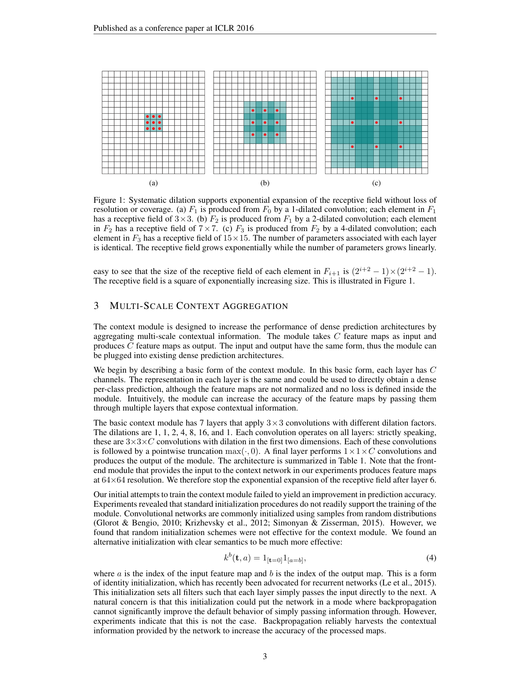
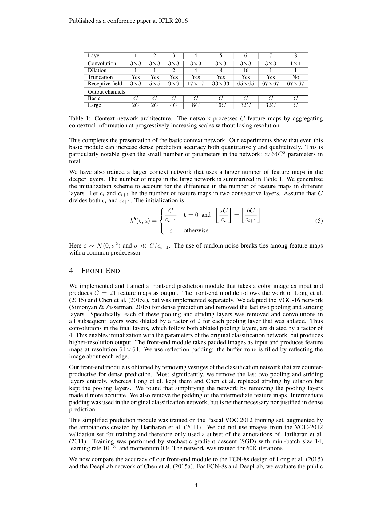

# Dilated Convolution（2016）· 论文笔记

- **论文**：Multi-Scale Context Aggregation by Dilated Convolutions（Fisher Yu, Vladlen Koltun）
- **BibTeX 键名**：`yu2016multi`
- **出处**：ICLR 2016；arXiv:1511.07122v3（首页角标 2016-04-30，页眉印 "Published as a conference paper at ICLR 2016"）
- **本地 PDF**：`3.科研基本任务/论文/Yu和Koltun - 2016 - Multi-Scale Context Aggregation by Dilated Convolutions.pdf`（13 页，含附录）
- **任务书条目**：第 2 周 #6｜🟢 AI 辅助读｜阅读要点：膨胀卷积扩感受野、dense prediction 结构
- **阅读日期**：2026-10-31
- **核对规则**：数字后的「出处」指回原 PDF 章节/表号；✅ = 已回原文查证。页码为 PDF 物理页（刊印页码 = 物理页 − 1）。

---

## 0. 术语表（零基础全能版 · 先看这一节再看正文）

> 这篇是"任务换了，骨架也得换"的典型：分类网络要**把图压小**，分割网络要**保住分辨率**。按「任务与评估 → 卷积算子 → 结构与训练 → 对比系统」分组；工程词一律"朴素做法 → 优化做法 → 为什么有效"。

### 0.1 任务与评估

| 术语 | 大白话解释（在本篇里的含义） |
|---|---|
| **dense prediction（稠密预测）** | 给图上**每个像素**都输出标签，而非整图一个标签；分割、光流、深度估计都属此类（§1，p.1）。 |
| **semantic segmentation（语义分割）** | 稠密预测的代表：每个像素分到 21 类之一（VOC 的 20 类 + 背景）。 |
| **classification vs dense prediction** | 分类靠**池化+下采样**压到 1×1 出全局预测；分割既要**多尺度上下文**又要**全分辨率输出**，两需求冲突（§1，p.1），全文出发点。 |
| **IoU（交并比）** | 某类：预测∩真实 / 两者并集，0–1，越大越好。 |
| **mIoU（mean IoU）** | 先算每类 IoU 再对类平均。**不用像素准确率**是因为背景常占 80% 以上，全预测背景也高分；mIoU 对小类公平。 |
| **Pascal VOC 2012** | 20 类 + 背景的标准分割集；train 1464 张 + Hariharan 标注，val 1449 张，test 由官方服务器评（§4，p.4-5）。 |
| **VOC-2012 val / test** | val 可本地反复评、用来调参（Table 3）；test 要提交服务器、次数有限（Table 4）。**两张表不能混着比。** |
| **leaderboard（排行榜）** | test 服务器公开排名。原文拿 67.6% 比 DeepLab+CRF 的 66.4%（§4，p.5）。 |
| **COCO** | 本篇只当**额外训练数据**（取含 VOC 类别的图，其他类算背景），不换评估集（§5，p.6）。 |
| **structured prediction（结构化预测）** | 逐像素分类后再加一层"照顾邻域一致性"的模块（CRF / CRF-RNN），抹平零散错误块。 |
| **CRF（条件随机场）** | **朴素做法**：每像素独立 softmax，边界毛糙、有孤立小块；**优化做法**：把"相邻且颜色相近的像素应同标签"写成能量函数，用平均场近似（[17] 的 dense CRF，参数在 val 网格搜索，§5 p.6）；**为什么有效**：把颜色/位置的低层相似性当先验，强制标签在物体内平滑、在边缘断开。 |
| **dense CRF** | 全连接 CRF：每像素与所有像素建边，靠特征空间高斯核近似才算得动。 |
| **CRF-RNN** | 把 dense CRF 的平均场迭代展成 RNN，从而端到端训练（[40]）。本篇 Table 3/4 的第三种结构预测方案。 |
| **unary classifier（一元分类器）** | 只输出每像素得分、不做结构化后处理的网络；本篇 front end+context 被后续工作当 unary 用（附录 A.1，p.11）。 |
| **CamVid / KITTI / Cityscapes** | 附录里三个城市街景数据集，验证方法不只对 VOC 有效（p.11-13）。 |

### 0.2 卷积算子（本篇理论核心）

| 术语 | 大白话解释 |
|---|---|
| **dilation factor（膨胀因子 l）** | 卷积核**采样点之间的间隔**。l=1 是普通卷积，l=2 表示相邻采样点空一格，l=4 空三格。本篇用 l 这个记号（DeepLab 里叫 dilation rate，同一个东西）。 |
| **l-dilated convolution** | 定义式 `(F *_l k)(p) = Σ_{s+lt=p} F(s)k(t)`（Eq.2）。**不是先造"膨胀核"再卷积**，而是把同一个 3×3 核的 9 个权重按间隔 l 撒开——参数仍是 9 个。§2（p.2）澄清 "no dilated filter is constructed"。 |
| **receptive field（感受野）** | 输出一个像素"看回输入"覆盖的区域。本篇核心结论：**膨胀卷积能让感受野指数增长，而参数只线性增长**。 |
| **exponential expansion** | 第 i 层用 dilation 2^i 时，感受野按 2^{i+2}−1 增长：3→7→15→…（Eq.3、Fig.1，p.2-3）。 |
| **resolution（分辨率）** | 特征图空间尺寸。膨胀卷积 stride=1，故分辨率**全程不变**（不同于池化每次减半）。 |
| **coverage（覆盖）** | 感受野内"是否每个像素都真被采到"。原话 "without loss of resolution **or coverage**"——膨胀看似留洞，但多层叠加后洞被填上（推导见 2.2）。 |
| **gridding artifact（网格伪影）** | ⚠️ **本篇未讨论此词**。连续多层用同一 dilation 时采样点落在稀疏网格，结果出现棋盘状伪影。**朴素做法**：全段统一 dilation 2；**优化做法**：各层 dilation 互质（如 1,2,5,9）或并行融合（ASPP）；**为什么有效**：打散采样网格，避免某些像素永远被跳过。→【课外补充·待核实，非本篇结论】 |
| **padding（填充）** | **朴素做法**：每层补 0 凑尺寸；**本篇做法**：① 输入端 **reflection padding**（沿边镜像，§4 p.4）；② **中间层不 padding**（§4 p.4）；③ context module 内每层 pad 到输入输出同尺寸（附录 A p.11）；**为什么有效**：补 0 在边界造出"假黑色"，镜像让边界有合理上下文；中间层不填则避免人工边界一路传下去。 |
| **same-size 条件（p = d）** | 3×3、stride 1 的膨胀卷积要保尺寸，必须 pad **d** 圈（不是 1 圈）。见 2.2 公式，这是实现最常见的错。 |
| **3×3×C 卷积** | 原文对 context module 内层的写法：空间 3×3、跨全部 C 个通道（§3，p.3）。 |
| **pointwise 1×1 卷积** | 只做跨通道线性组合，不扩感受野。context module 最后一层就是它（Table 1 第 8 列）。 |
| **truncation max(·,0)** | 就是 ReLU。原文故意写"截断"而非"ReLU"，强调作用是把负值砍掉，不强调稀疏性（§3，p.3）。 |
| **algorithme à trous** | 小波分解里的"带孔算法"（Holschneider 1987；Shensa 1992），最早用膨胀卷积。脚注 1（p.2）特意纠偏：**不能说"膨胀卷积就是 à trous"**——à trous 是用多尺度膨胀做信号分解的算法，膨胀卷积只是零件。 |

### 0.3 结构与训练

| 术语 | 大白话解释 |
|---|---|
| **context module（上下文模块）** | 本篇主角：**无池化、无下采样**的"长方体"卷积栈，输入 C 张特征图、输出 C 张，形状不变所以能插进任何网络（§3，p.3-4）。 |
| **basic / large** | basic：每层都 C 通道，共 ≈64C² 参数；large：深层 2C→4C→8C→16C→32C 再回 C（Table 1，p.4）。 |
| **front end（前端）** | **朴素做法**：直接拿 VGG-16 做分割（分辨率对不上）；**优化做法**：删最后两个 pooling+stride，**每删一个就把后面所有卷积的 dilation 乘 2**（删两个→最后 dilation 4），输出从 1/32 变成 **64×64**（§4，p.4）；**为什么有效**：保住预训练语义，分辨率抬 4 倍，且不引入新参数。 |
| **vestigial components（残留部件）** | §4（p.4）与 §6 指"为分类而生、对分割有害"的部件（下采样、中间 padding）。全文反直觉结论之一：**删掉它们精度反而涨**（Table 2，p.5）。 |
| **identity initialization（恒等初始化）** | **朴素做法**：随机初始化（Glorot / AlexNet 式）；**本篇做法**：把 3×3 核初始化成 `k_b(t,a)=1[t=0]1[a=b]`（Eq.4）——中心权重=1、其余=0，每层原样把输入传给下一层；**为什么有效**：§3（p.3）明说"最初的随机初始化尝试完全训不出提升"，恒等初始化让网络开机即恒等映射，再从这个正确起点引入上下文。这是残差思想在"层内"的版本（原文引 [22]）。 |
| **≈64C² 参数量** | 7 层 3×3（7×9C²=63C²）＋1 层 1×1（C²）＝64C²（§3 p.4 原话，✅ 可复算）。 |
| **SGD 设置** | batch 14，lr 10⁻³，momentum 0.9，60K 迭代（§4，p.4）。 |
| **joint training（联合训练）** | 前端与 context 一起训。⚠️ 原文说**没有显著提升**，故主实验是"先训前端，再把特征喂给 context 单独训"（§5，p.6）。 |
| **controlled experiment** | 固定其他条件（同一前端、同一训练数据、val 不参与训练），只切"有无 context""basic/large"，见 Table 3。 |

### 0.4 对比系统

| 术语 | 大白话解释 |
|---|---|
| **FCN-8s** | Long et al. 2015：FC 换成卷积 + 跨层跳接融合 8 倍上采样。本篇 62.2%（Table 2，p.5）。 |
| **DeepLab（LargeFOV）** | Chen et al. 2015a：stride 换成膨胀、保留 pooling，加大 FOV。62.1%（Table 2，p.5）。 |
| **DeepLab-MSc** | DeepLab 的多尺度（多列不同 dilation）版本，62.9%（Table 2，p.5）。 |
| **DeepLab++ / DeepLab-MSc++** | Table 4 表注（p.8）简写：DeepLab-CRF-COCO-LargeFOV 与 DeepLab-MSc-CRF-LargeFOV-COCO-CrossJoint，即"加 CRF + COCO 预训练"的加强版，72.7% / 73.9%。 |

---

## 1. 一句话说清

**问题**：当时最好的分割模型都是"改造分类网"——靠**池化+下采样**换感受野，再靠**上采样/多尺度输入**补分辨率。两笔账说不清：中间的重度下采样是否必要？把图缩成多尺度分别算是否必要？系统还越堆越复杂（结构化预测 + 多列 + 多数据集），看不清"核心预测模块"本身有多强（§1，p.1-2）。

**做法**：把"扩感受野"从**池化**换成**膨胀卷积**。膨胀卷积 stride=1，分辨率不掉；第 i 层用 dilation 2^i，感受野按 (2^{i+2}−1) 指数增长而参数线性增长（Eq.3、Fig.1）。用 7 层 3×3（dilation 1,1,2,4,8,16,1）搭一个无池化"长方体"——context module，插在任意分割网络后面即可（§3，p.3-4）。另把 VGG-16 改造成更简单的 front end：删掉最后两个 pooling/stride，后层 dilation 乘到 4。

**结果**：VOC-2012 test 上，仅"简化后的 front end"就到 **67.6% mIoU**，比 FCN-8s（62.2%）和 DeepLab（62.1%）高 5 个多点，**且不用 CRF** 就超过 DeepLab+CRF 的 66.4%（Table 2 + §4，p.5）；插上 large context 到 **73.5%**，再叠 CRF-RNN 到 **75.3%**（Table 4，p.8）。

> 背下来：**池化是"用分辨率换感受野"，膨胀卷积是"不换分辨率也能换感受野"，而且是指数级的——所以分割网络可以把池化整段删掉。**

---

## 2. 核心图 / 公式

### 2.1 Fig.1（p.3）：三级膨胀，感受野 3×3 → 7×7 → 15×15



| 子图 | 输入 | dilation | 该层之后感受野 | 参数量 |
|---|---|---|---|---|
| (a) | F0 → F1 | 1（普通 3×3） | 3×3 | 9 |
| (b) | F1 → F2 | 2 | **7×7** | 9（同 (a)） |
| (c) | F2 → F3 | 4 | **15×15** | 9（同 (a)） |

> **要看出什么**：核始终只有 9 个权重（图上 9 个彩点），但**撒开的范围**在变大。图注（p.3）：感受野指数增长、参数线性增长、分辨率与覆盖不损失。

### 2.2 公式、感受野与输出尺寸（必须自己推一遍）

**定义式（Eq.1，p.2，普通卷积）**

$$ (F * k)(p) = \sum_{s+t=p} F(s)\,k(t) \tag{1} $$

**定义式（Eq.2，p.2，l-膨胀卷积）**

$$ (F *_l k)(p) = \sum_{s+lt=p} F(s)\,k(t) \tag{2} $$

**递归式（Eq.3，p.2）**

$$ F_{i+1} = F_i *_{2^i} k_i,\qquad i = 0,1,\dots,n-2 \tag{3} $$

| 符号 | 含义 | 本篇取值 |
|---|---|---|
| `F` | 输入离散函数（一张特征图） | H×W |
| `k` | 滤波器，定义在 Ω_r=[−r,r]²∩Z² 上 | 3×3（r=1），9 个权重 |
| `p` / `s` | 输出 / 输入位置 | — |
| `t` | 滤波器内相对偏移 | (−1,0,1)² 中的 9 点 |
| `l` | **dilation factor** | 1, 1, 2, 4, 8, 16, 1（§3 p.3） |

差别只在一处：`s+lt=p` 里的 `lt`。l=1 就退化成 Eq.1（原文："The familiar discrete convolution ∗ is simply the 1-dilated convolution"，p.2）。

**感受野推导（本篇最该背的两行）**：

```
单层"等效核边长"： k_eff = d·(k−1) + 1     （k=3：d=1→3, d=2→5, d=4→9）
多层（stride 全 1）累加：RF = 1 + Σ_i d_i·(k_i − 1)

【理想序列】d_i = 2^i（Eq.3）：
  RF(F_{i+1}) = 1 + 2·Σ_{j=0}^{i} 2^j = 2^{i+2} − 1  → 3, 7, 15, 31, 63, 127 …（前三个与 Fig.1 对上 ✅）

【本篇实际序列】d = 1, 1, 2, 4, 8, 16, 1（§3 p.3），逐层累加：
  1+2(1+1)=5（第2层，不是 7）→ 9 → 17 → 33 → 65（第6层）→ +2=67（第7层 d 回到 1）→ +0=67（第8层 1×1）
  → 与 Table 1 的 3, 5, 9, 17, 33, 65, 67, 67 逐格一致 ✅（p.4）
```

⚠️ **陷阱**：`2^{i+2}-1` 只对**每层 dilation 都取 2^i** 的理想序列（3,7,15,31,63,127）成立；本篇头两层都是 1-dilated（先得到稠密 5×5 起点），实际是 3, 5, 9, 17, 33, **65**, 67。要背的是 `RF = 1 + Σ d_i(k_i−1)`，不是 `2^{i+2}-1`——最容易抄错的地方。

**输出尺寸公式（原文没写，但 §3/附录 A 的操作等价于此）**：

$$ H_{out} = \left\lfloor \frac{H_{in} + 2p - d\,(k-1) - 1}{s} \right\rfloor + 1 $$

保尺寸（s=1, k=3）需 `2p = d(k−1) = 2d`，即 **p = d**：dilation=16 那层要 pad 16 圈，dilation=4 的 pad 4 圈。附录 A（p.11）"每层都 pad 到输入输出同尺寸"即此。**代码里漏了这条，特征图会一层层缩，最后插不进网络。**

**为什么"不用池化也能扩感受野"（三条）**：

1. **池化的代价**：2×2/s2 一次分辨率减半、信息不可逆丢失，回全分辨率只能上采样，细节补不回——§1（p.1）质疑"重度中间下采样是否必要"。
2. **膨胀的做法**：stride 仍为 1，只把采样点**间距**拉开；每层参数还是 9C²，与普通 3×3 相同（Table 1 八列一致）。
3. **指数增益的来源**：多层膨胀是**相乘关系**——第 i 层步长 2^i，叠加后覆盖半径是等比级数求和；池化叠 k 次感受野也约 2^k，但**分辨率同时被牺牲**。同一份"扩张预算"，膨胀全花在感受野上。

补一个我自己推的点【我的推断】：**覆盖为什么不会漏**。第 3 层 dilation=2 时落点间距 2，但每个落点代表前两层的 5×5 稠密块，5 > 2 故相邻块必重叠、并集连续（与 Table 1 一致 ✅）；以后每层块边长都大于步长，永不漏洞。这正是 "without loss of coverage" 的机制，也解释了 gridding 只在某些 dilation 组合下出现。

### 2.3 Table 1（p.4）：context module 逐层结构



| Layer | 1 | 2 | 3 | 4 | 5 | 6 | 7 | 8 |
|---|---|---|---|---|---|---|---|---|
| Convolution | 3×3 | 3×3 | 3×3 | 3×3 | 3×3 | 3×3 | 3×3 | 1×1 |
| Dilation | 1 | 1 | 2 | 4 | 8 | 16 | 1 | 1 |
| Truncation | Yes | Yes | Yes | Yes | Yes | Yes | Yes | **No** |
| Receptive field | 3×3 | 5×5 | 9×9 | 17×17 | 33×33 | 65×65 | 67×67 | 67×67 |
| 通道（basic） | C | C | C | C | C | C | C | C |
| 通道（large） | 2C | 2C | 4C | 8C | 16C | 32C | 32C | C |

**三点必须注意**：

1. **第 6 层后停止指数扩张**：front end 输出只有 64×64，感受野 65 已超过整张图，再扩只让 pad 变大（§3，p.3-4）。
2. **最后一层 1×1 不加 ReLU**：它负责把 C 通道重组为输出，截断会砍掉负值信息（Table 1 末行 "No"）。
3. **参数 ≈64C²**：`7×9C²+C²=64C²`（§3 p.4，✅），C=21 约 2.8 万，比 VGG 前端小两个量级——插上就涨点很大程度因外挂成本极低。

### 2.4 初始化公式（Eq.4 / Eq.5，p.3-4）

$$ k_b(t,a) = \mathbf{1}[t=0]\,\mathbf{1}[a=b] \tag{4} $$

- `t`：滤波器内偏移（9 个位置之一），`t=0` 指**中心**；
- `a` / `b`：输入 / 输出特征图编号；
- `𝟙[·]`：条件成立取 1，否则取 0。

读法：**只有"中心位置 + 输入输出通道编号相同"的权重为 1，其余全 0** → 该层就是恒等映射。large 版用 Eq.5 推广：按 `⌊aC/c_i⌋ = ⌊bC/c_{i+1}⌋` 对齐，权重取 `C/c_{i+1}`，其余填极小噪声 `ε~N(0,σ²)`，作用是**打破多个输出通道共享同一输入的对称性**（§3 p.4）。

> **隐藏关键**：§3（p.3）明写"最初的训练尝试没能带来精度提升"——**没有 Eq.4/5，全文正结果都不存在**；只讲 dilation 不讲初始化，等于漏掉半个方法。

### 2.5 训练设置（§4–§5，p.4-6，✅）

| 阶段 | 设置 |
|---|---|
| front end 预训练 | VOC-2012 train + Hariharan 标注（**不用 val 图**）；batch 14，lr 10⁻³，momentum 0.9，60K 迭代（§4 p.4） |
| 加 COCO 的 front end | VOC+COCO 合训（100K@10⁻³ + 40K@10⁻⁴），再 VOC 微调 50K@10⁻⁵（§5 p.6） |
| context 训练 | 输入取自 front end 特征；lr 10⁻³；**与前端联合训练无显著提升**，故分开训（§5 p.6） |
| context 输入 padding | 感受野 67×67 → 四周各 pad 33；零填充与镜像填充结果相近（§5 p.6） |

---

## 3. 关键实验数据

### 3.1 主结果（VOC-2012，mIoU）

| 实验 | 数据集/设置 | 本方法 | 对比对象 | 出处 |
|---|---|---|---|---|
| 前端对比（无 CRF） | VOC-2012 **test** | 简化 front end **67.6** | FCN-8s 62.2；DeepLab 62.1；DeepLab-MSc 62.9 | Table 2 (p.5) |
| 同上 vs 带 CRF 系统 | VOC-2012 test | 67.6（**不用 CRF**） | DeepLab+CRF 排行榜 66.4 | §4 (p.5) |
| 加大数据后的前端 | VOC-2012 val / test | **69.8 / 71.3** | — | §5 (p.6) |
| large context 单独 | VOC-2012 test | **73.5** | DeepLab++ 72.7（带 CRF + COCO） | Table 4 (p.8) |
| context + dense CRF | VOC-2012 test | **74.7** | CRF-RNN 74.7（打平） | Table 4 (p.8) |
| context + CRF-RNN | VOC-2012 test | **75.3** | CRF-RNN 74.7；DeepLab-MSc++ 73.9 | Table 4 (p.8) |
| CamVid（附录） | test，11 类 | Dilation8 **65.3** | DeepLab-LFOV 61.6；SegNet 46.4；ALE 53.6 | Table 5 (p.11) |
| KITTI（附录） | test，11 类 | Dilation7 **59.2** | DeepLab-LFOV 54.2；Ros et al. 39.9 | Table 6 (p.12) |
| Cityscapes（附录） | val / test，19 类 | **68.7 / 67.1** | 原文自述优于当时所有已发表模型 | Table 7 (p.13) |

**最容易被误读的数字**：

1. **67.6 是 test、只用 VOC 训练**的 front end；69.8/71.3 是加 COCO 的版本（§5 p.6）。**两个 71.3 不是一回事**：Table 3 的是 **val**，Table 4 的是 **test**，数值巧合，别读成"context 没用"。
2. **67.6 vs 66.4 只说明"不用 CRF 也超过带 CRF 的 DeepLab"，不等于"CRF 没用"**（Table 3/4 显示还能再加 1–2 点）；对手只是同代改造版分类网（FCN-8s/DeepLab），不是后续 SOTA。
3. **Table 3 是 val、Table 4 是 test**：73.9（Front+Large+RNN）与 73.5（Context）不可直接比（前者叠了 CRF-RNN）。
4. **附录三个数据集的网络深度不同**：CamVid 8 层、KITTI 7 层（竖向 370 删第 6 层）、Cityscapes 10 层（加 dilation 32/64），数字不能跨数据集横比（p.11-13）。

### 3.2 消融实验（受控：固定前端，只换模块）

| 结构 | 无 context | +basic | +large | 出处 |
|---|---|---|---|---|
| front end 单干（无结构化预测） | 69.8 | **71.3** | **72.1** | Table 3 上段 (p.7) |
| front end + dense CRF | 71.6 | **72.7** | **73.3** | Table 3 中段 (p.7) |
| front end + CRF-RNN | 72.5 | **73.1** | **73.9** | Table 3 下段 (p.7) |

三条结论（§5 p.6-7，✅）：① 两种 context 在三种结构下都涨点，不依赖某种后处理；② large 比 basic 涨更多（+2.3 vs +1.5）→ 加宽通道收益成立；③ 二者"协同"而非"替代"：有 CRF 时仍能再加 1.1（71.6→72.7）。

**只有文字、没有表的关键对照（别自己编数字）**：

| 对照组 | 结论 | 出处 |
|---|---|---|
| 随机初始化 vs 恒等初始化 | 随机初始化"训不出提升"，恒等初始化才有效 | §3 (p.3)，**只有定性描述，无表**【待核对】 |
| 联合训练 vs 分开训练 | 联合训练"没有显著提升" | §5 (p.6)，同样无数字【待核对】 |

⚠️ 这两条是全文最关键的机制验证，却只有定性结论——本篇靠结构性论证 + 主表涨幅支撑，不是每个 claim 都有消融表。

---

## 4. 我的思考

1. **贡献性质：算子不是新的，"系统性用法 + 受控证据"是新的**【原文结论】。膨胀卷积源自 à trous（1987/1992），DeepLab（2015a）已用它替换 stride（§2 p.2 明写）。本篇加了三样：① 把 dilation 做成**指数序列 1,1,2,4,8,16** 并给出感受野公式；② 装成**形状不变、可插拔**的模块（C 进 C 出）；③ 用受控实验证明**删掉分类网残留部件也涨点**（67.6 vs 62.x），当年很不"合群"。
2. **局限与边界**【原文结论 + 我的推断】：① 感受野被特征图尺寸卡死：前端只有 64×64，到 67 就必须停（§3 p.4），不能靠堆层继续扩。② pad 33 是硬成本，边界 33 像素基本靠猜。③ 必须恒等初始化，否则训不动（§3 p.3），这是复现门槛。④ 联合训练无增益（§5 p.6），不是真端到端。⑤ 只在分割上验证，分类上 dilation 会破坏局部性。⑥ gridding 全文未提【课外补充·待核实】——恰是 2 的幂序列的软肋。
3. **消融设计逻辑**【我的推断】：Table 3 把"后处理"当**第二个自变量**：三行（无 / dense CRF / CRF-RNN）× 三列（无 / basic / large），一次回答"context 有用吗""加大有用吗""与结构化预测重复吗"——只做第一行，审稿人必问"增益会不会被 CRF 吃掉"；Table 2 则隔离出"删残留部件"一个变量。
4. **如果让我改**【我的推断 + 课外补充·待核实】：① 先换初始化：恒等初始化本质在替 BN 干活，加 BN/LayerNorm 后应能摆脱这个门槛；② 改掉 2 的幂序列，用互质序列（1,2,5,9）或 hybrid dilation 针对 gridding（【待核实】，DeepLab v3+ 路线）；③ 在多个分辨率上各放一个 context 模块，而非只在 64×64 做一次（ASPP + encoder-decoder，【待核实】）；④ pad 33 换成裁大图再裁回或 partial convolution，减少边缘瞎猜。

---

## 5. 回原文核对记录

| 说法 | 原文依据 | 判定 |
|---|---|---|
| "膨胀卷积是本文提出的" | §2（p.2）+ 脚注 1：源自 à trous（1987/1992），Chen et al. 2015a 已用它替换 stride | 🟥 错，是"系统化使用"，不是发明 |
| "context module 也用池化来扩感受野" | §1（p.2）"no pooling or subsampling"；Table 1（p.4）无池化层 | 🟥 错，零池化、零下采样 |
| "感受野按 2^{i+2}-1 增长，第 6 层 65×65" | Eq.3 与 p.3 的理想序列是 3/7/15；Table 1 实际序列（1,1,2,4,8,16）为 3/5/9/17/33/**65** | 🟩 结论对，但**不能直接代 2^{i+2}-1**（第 2 层是 5×5 不是 7×7） |
| "加了 context 就不需要 CRF 了" | Table 4（p.8）：Context 73.5 超 DeepLab++ 72.7；但 +CRF-RNN 仍到 75.3；§5 称二者 "synergistic" | 🟨 "可不用"成立，"不需要"不成立 |
| "context 参数多，涨点是靠容量" | §3（p.4）≈64C²；复算 7×9C²+C²=64C²，C=21 约 2.8 万 | 🟩 参数极少，涨点不能归因于容量 |

---

## 6. 本篇 3 个自测问题

1. **7 层 3×3、dilation = 1,1,2,4,8,16,1、stride 全 1，逐层算感受野**（写出 `RF = 1 + Σ d_i(k_i−1)` 的累加），并解释：为什么第 2 层是 5×5 而非 Eq.3 暗示的 7×7？第 7 层 dilation 回到 1 为何只多 2 像素？
2. **同样做到 65×65，"全用 3×3 普通卷积堆"与"膨胀序列"各需多少层、多少参数（C 通道）？** 与 64C² 对照，并说明池化路线（2×2/s2）达到同感受野时**额外损失了什么**。
3. **把 Eq.4 换成随机初始化会怎样？** 结合"§3 说随机初始化训不出提升"与"模块内无 BN、也非 loss 层"两点，解释它为何比普通网络更依赖初始化。
