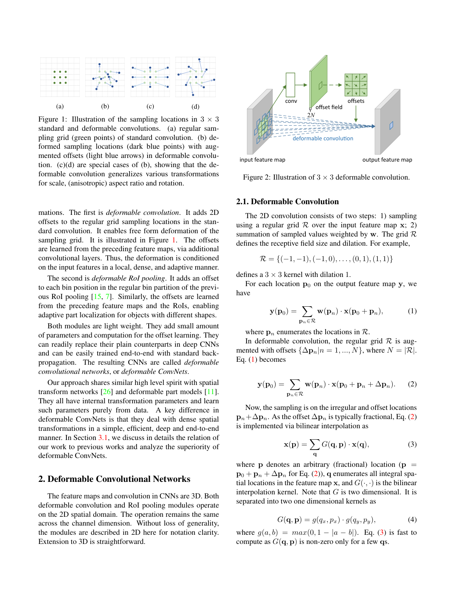
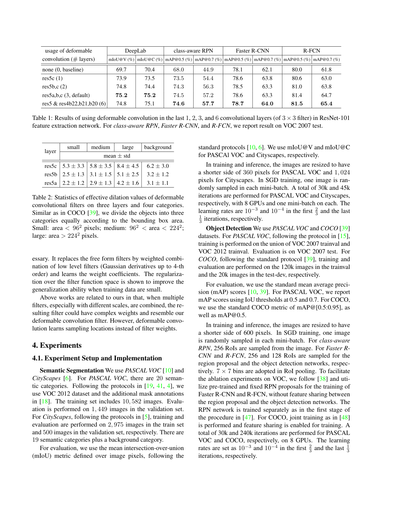

# Deformable ConvNets v1（2017）· 论文笔记

- **论文**：Deformable Convolutional Networks
- **BibTeX 键名**：`dai2017deformable`
- **出处**：arXiv:1703.06211v3（首页脚注 5 Jun 2017）；会议信息 PDF 内未见，通常记为 ICCV 2017，【待核对】
- **本地 PDF**：`3.科研基本任务/论文/Dai 等 - 2017 - Deformable Convolutional Networks.pdf`（12 页）
- **任务书条目**：第 2 周 #7｜🔴 自精读｜「我的思考」必须自己写
- **阅读日期**：2026-10-31
- **页码约定**：文中「p.n」= PDF 第 n 页，与论文印刷页码一致
- **核对规则**：数字后的出处指回 §/Table/Fig/页码；✅ = 已提全文 + 渲染该页逐字查证

---

## 0. 术语表（零基础版 · 先看这节）

> 本篇难点不是公式，而是「采样位置」怎么落成一个可训练张量。工程类词按「**朴素做法 → 优化做法 → 为什么有效**」三段写。

### 0.1 变形与采样机制

| 术语（英文原词） | 解释（在本篇指什么） |
|---|---|
| **采样位置（sampling location）** | 卷积核取数的坐标。朴素做法：写死成规则网格 `p0+pn`。优化做法：每点再加学出来的小数位移 `Δpn`，取数点变 `p0+pn+Δpn`（式(2)，p.2 ✅）。为什么有效：网络第一次自己决定"去哪取数"，不必靠数据增强覆盖所有形变。 |
| **规则网格（regular grid R）** | 一组写死的相对坐标；`R={(−1,−1),…,(1,1)}` 就是 3×3、dilation=1（p.2 ✅）。它定义感受野大小和空洞率。 |
| **空洞率（dilation）** | 网格点之间的像素间距；dilation=2 即相邻采样点中间空一格。 |
| **偏移场（offset field）** | 与输入同分辨率、通道数 = `2N` 的特征图，存 N 个 2D 偏移（N=9 时 18 通道）。朴素做法：偏移当固定模型参数、全图共享（Active Convolution，§3.1 p.6 ✅）。优化做法：由当前输入特征图过一层卷积即时算出，逐图逐位置都不同（Fig 2, p.2）。为什么有效：形变要看内容——背景要取大范围、小物体要取紧凑范围，写死的参数做不到（Table 2 p.7 就是证据）。 |
| **可变形卷积（deformable convolution）** | 式(1) 的规则采样换成式(2) 的带偏移采样。朴素做法：普通 conv。优化做法：多挂一路同尺寸 conv 出 2N 通道偏移，主卷积在 `p0+pn+Δpn` 处插值取值，两路同时训练（§2.1 p.3 ✅）。为什么有效：只多 `3×3×C×2N` 个参数，却把"几何不变性"从数据增强/手工特征变成可学能力。 |
| **分数偏移（fractional offset）** | `Δpn` 是实数，取数点落在像素之间（如 x=3.4），图上没有该点，必须插值（p.2 ✅）。 |
| **双线性插值（bilinear interpolation）** | 在少数坐标处估值。朴素做法：四舍五入到最近格点 → 采样抖动、梯度断掉、丢亚像素信息。优化做法：周围 4 个整点按距离加权（式(3)(4)）。为什么有效：取值是坐标的连续可微函数，所以能对 `Δpn` 求导（附录 A 式(7)）；且只有 4 项非零，开销极小。 |
| **双线性核 G** | `G(q,p)=g(qx,px)·g(qy,py)`，`g(a,b)=max(0,1−|a−b|)`（式(4)，p.2 ✅）：越近权重越大，超过 1 像素为 0，所以只有 4 个 q 非零。 |
| **可变形 RoI 池化** | 给 k×k 个 bin 的位置也加偏移 `Δpij`（式(6)，p.3 ✅）；偏移来自"普通池化 → fc → 归一化偏移 → 乘 RoI 宽高"。 |
| **PS RoI 池化** | R-FCN 的做法：先卷成 `k²(C+1)` 张分数图，第 (i,j) 格只从第 (i,j) 张图取（§2.2 p.3 ✅）。 |
| **有效空洞率（effective dilation）** | 一个核里所有相邻采样点对距离的平均值，粗测实际感受野（§4.2 p.8 ✅）。Table 2 用它证明"核跟着物体大小变"。 |
| **感受野 / 有效感受野** | 理论能看到的范围 vs 真正影响输出的一小块（引 [43]，§3.1 p.6 ✅）。后者只占理论值一小部分、且只随层数平方根增长——这就是"必须学自适应感受野"的理由。 |
| **空洞卷积（atrous / dilated conv）** | 核里插零把采样点撑开。朴素做法：换大核（参数按平方涨）。优化做法：核尺寸不变，只调 dilation。为什么有效：感受野与参数/算力解耦；但它只能均匀撑开、不能按内容变形，所以本篇把它当"必须打败的基线"（Table 3, p.8）。 |
| **STN（空间变换网络）** | 用全局仿射变换 warp 整张特征图（§3.1 p.5 ✅）。本篇的偏移学习被作者称为"极轻量的 STN"，但不做全局 warp。 |
| **DPM（可变形部件模型）** | 传统检测器，学"部件相对整体的位移"（§3.1 p.6 ✅）；浅模型、不能端到端、还要建模部件间关系。 |
| **Active Convolution** | 同期工作，也给采样点加偏移，但偏移全图共享、训练完固定（§3.1 p.6 ✅）。这是本篇与之最关键的区别。 |
| **调制标量（modulated）** | 本篇没有；v2 才引入：给每个采样项再乘一个学出来的 `[0,1]` 权重 `Δmk`，见 `07_DeformableConv_v2.md`。 |

### 0.2 检测 / 分割框架

| 术语（英文原词） | 解释 |
|---|---|
| **RoI** | 图上"候选物体所在的矩形框"，检测头只在框内提特征。 |
| **RoI 池化（RoI pooling）** | 把任意大小的框特征压成固定 7×7（§4.1 p.7 ✅）。朴素做法：按坐标硬切网格取平均（式(5)），边界不对齐。优化做法：先对齐（RoIAlign），再让 bin 位置带偏移（式(6)）。为什么有效：后面 fc 要求定长输入，池化是"框→向量"的唯一入口；bin 能偏，部件才能挪到物体上（Fig 7, p.5）。 |
| **RPN（Region Proposal Network）** | Faster R-CNN 第一级，撒锚框出候选。朴素做法：外部算法提候选（慢、不可训）。优化做法：卷在特征图上、与检测头共享主干。为什么有效：候选生成并进网络，速度精度同涨；本篇还把它改成 **(C+1) 类**的 category-aware RPN（§2.3 p.4 ✅）。 |
| **category-aware RPN** | 把 RPN 的二分类换成 (C+1) 类，原文称"SSD 的简化版"（§2.3 p.4 ✅）。 |
| **Faster R-CNN** | RPN + RoI 池化 + 2 fc。本篇把 RPN 挂 conv4、RoI 池化放**最后**、后接 2×fc-1024（原文自认"会略微掉点"，§2.3 p.4 ✅）。 |
| **R-FCN** | 全卷积检测器，用位置敏感分数图省掉逐 RoI 卷积（§2.3 p.4 ✅）。 |
| **DeepLab** | 分割框架：1×1 conv 出 (C+1) 张逐像素分数图 → softmax（§2.3 p.4 ✅）。 |
| **Aligned-Inception-ResNet** | 修过"特征错位"的 Inception-ResNet（原版 valid 卷积/池化导致特征与像素对不齐，对稠密预测有害，附录 B p.10 ✅）。 |
| **有效步长 16** | conv5 的 stride 2→1、该 block 核>1 的卷积 dilation 1→2，总下采样 32→16（§2.3 p.4 ✅）。 |
| **端到端训练** | 一个 loss 反传到所有层，偏移层不额外加监督。 |

### 0.3 评估指标

| 术语（英文原词） | 解释 |
|---|---|
| **IoU（Intersection over Union）** | 预测框与真值框交集/并集。朴素做法：比中心距离 → 尺度敏感。优化做法：面积比值。为什么有效：尺度无关，一个阈值管所有大小物体，也是 COCO 多阈值 AP 的基础。 |
| **mAP@0.5 / @0.7** | IoU 阈值 0.5 / 0.7 下的 mAP；**0.7 是"框得准不准"的严格指标**，本篇在 @0.7 上提升更大（§4.2 p.8 ✅）。 |
| **COCO mAP@[0.5:0.95]** | IoU 取 10 个阈值算 AP 再平均，比 VOC 单阈值严格得多。 |
| **AP_S / AP_M / AP_L** | 按框面积分小/中/大三组算 AP（Table 5, p.9 ✅）。 |
| **mIoU / mIoU@V / @C** | 分割指标：每类算像素交集/并集再平均；@V = VOC，@C = Cityscapes（§4.1 p.7 ✅）。 |
| **NMS（非极大值抑制）** | 重叠框去重。朴素做法：全留 → 同一物体几十个框。优化做法：按分数排序，与已留框 IoU 超阈值就删。为什么有效：用尺度无关的 IoU 做判据，一个阈值平衡漏检与重复；**它算在 runtime 里**（Table 4 p.8 注明含 NMS）。 |
| **AP** | precision-recall 曲线下面积。 |

### 0.4 工程实现与训练

| 术语（英文原词） | 解释 |
|---|---|
| **im2col** | 朴素做法：多重循环逐点乘加，用不上 BLAS。优化做法：把每个采样窗口摊成一列拼成大矩阵，一次 GEMM。为什么有效：交给高度优化的矩阵库，GPU 上快一到两个数量级；**但它的前提是采样点位置规则**，可变形卷积的坐标是小数，必须先插值再摆放，无法复用固定 stride 索引。 |
| **偏移层零初始化** | 开局把偏移层权重全置 0，`Δpn=0`，网络等价于普通 ConvNet（§2.3 p.4 ✅）。朴素做法：随机初始化 → 采样点乱跳、损失爆炸。优化做法：零初始化。为什么有效：从"已经能训的模型"出发，形变是增量学出来的。 |
| **学习率倍率 β / γ** | 偏移层 lr = β×已有层（β=1；Faster R-CNN 的 fc 用 0.01，§2.3 p.4 ✅）；RoI 池化另有标量 γ=0.1 压偏移幅度（p.3 ✅）。 |
| **归一化偏移** | 先预测"相对量"再乘 `(w,h)`：`Δpij=γ·Δb∘(w,h)`，让偏移学习与 RoI 大小无关（p.3 ✅）。 |
| **runtime（秒）** | Table 4 把"网络前向"与"含 resize+NMS 的总耗时"分列，硬件 E5-2650 v2 + K40（p.8 ✅）。 |
| **8 卡 SGD** | 分割 30k/45k 迭代，检测 30k（VOC）/240k（COCO），每卡 batch=1（§4.1 p.7 ✅）。 |

---

## 1. 一句话说清

**问题**：CNN 的几何建模能力被**固定结构**卡死——卷积只在规则网格采样、池化按固定比例降分辨率、RoI 池化把框切成固定格子，内部没有任何机制适应尺度/姿态/视角/部件形变。靠数据增强覆盖代价高，靠手工不变特征（SIFT 那路）遇未知形变就废。原文还点了两个病灶：同一层所有神经元感受野**完全相同**（对精细定位的分割不利）；检测全靠"矩形框提特征"，对非刚性物体显然次优（§1 p.1 ✅）。

**做法**：两个模块，同一个套路——**给空间采样位置加上"从任务里学出来的偏移"，不加额外监督**。① 可变形卷积：在 `p0+pn` 上加 `Δpn`，偏移由同一输入特征图过一层同尺寸卷积得到（2N 通道），小数坐标用双线性插值取值；② 可变形 RoI 池化：给 k×k 个 bin 位置加偏移，偏移由"池化→fc→乘宽高缩放"得到。两模块的输入输出与普通版**完全一致**，可原位替换、可端到端反传，额外参数算力很小。

**结果**：ResNet-101 上，VOC 2007 检测 R-FCN **80.0→81.4（@0.5）/ 61.8→64.7（@0.7）**；Faster R-CNN 两模块共用 **79.3 / 66.9**（Table 3, p.8 ✅）。分割 DeepLab VOC **69.7→75.3 mIoU**（Table 3, p.8 ✅）。COCO test-dev 上 Faster R-CNN **29.4→33.1**、R-FCN **30.8→34.5**，相对提升 11%–13%（Table 5, p.9 ✅）。代价：R-FCN 参数 47.1M→49.5M、总耗时 0.170→0.193s（Table 4, p.8 ✅）。

> 背下来：**可变形卷积 = 把卷积"取数坐标"从写死网格改成"由特征自己预测的小数偏移"，用双线性插值把梯度接回去，于是感受野能随物体形变自适应。**

---

## 2. 核心图 / 公式

### 2.1 必看两图 + 一表

**Figure 1（p.2）**：绿点 = 标准卷积规则网格；暗蓝点 = 被偏移推歪的采样点，浅蓝箭头 = 偏移；(c)(d) 说明尺度变化、各向异性长宽比、旋转都能当"网格变形"的特例（图注 ✅）。→ 要看出：不是新算子，是"同一套加权求和 + 会动的采样点"。

**Figure 2（p.2）**：输入分两路，上路普通 conv 出输出，下路同分辨率同 dilation 的 conv 出 `2N` 通道 offset field，拆成 N 个 2D 偏移。→ 要看出：**偏移不是参数表，是一张随位置变化的张量**。

**Table 1（p.7）**：0/1/2/3/6 层消融（见 3.2）。

### 2.2 四个公式（p.2，✅ 逐符号核对）

$$y(\mathbf{p}_0)=\sum_{\mathbf{p}_n\in\mathcal{R}} \mathbf{w}(\mathbf{p}_n)\cdot \mathbf{x}(\mathbf{p}_0+\mathbf{p}_n) \tag{1}$$

$$y(\mathbf{p}_0)=\sum_{\mathbf{p}_n\in\mathcal{R}} \mathbf{w}(\mathbf{p}_n)\cdot \mathbf{x}(\mathbf{p}_0+\mathbf{p}_n+\Delta\mathbf{p}_n) \tag{2}$$

$$\mathbf{x}(\mathbf{p})=\sum_{\mathbf{q}} G(\mathbf{q},\mathbf{p})\cdot \mathbf{x}(\mathbf{q}),\quad G(\mathbf{q},\mathbf{p})=g(q_x,p_x)\,g(q_y,p_y),\quad g(a,b)=\max(0,1-|a-b|) \tag{3,4}$$

| 符号 | 含义 | 本篇取值 |
|---|---|---|
| `p0` | 输出图上的当前位置 | 遍历所有整数坐标 |
| `pn` / `R` / `N` | 网格第 n 个相对位置 / 规则网格 / 点数 | 3×3 → 9 点，`{(−1,−1)…(1,1)}` |
| `Δpn` | 第 n 个点的可学习 2D 偏移（实数） | 由 offset field 的 2N 通道给出，无额外监督 |
| `w(pn)` | 卷积权重 | 可学习参数，与普通卷积相同 |
| `x(·)` | 输入特征图取值（通道维同操作） | 变形只作用于 2D 空间域 |
| `p = p0+pn+Δpn` | 实际取数坐标（**小数**） | 需要插值 |
| `q` | 特征图上所有**整数**坐标 | 只有 4 个使 G 非零 |
| `G` / `g` | 二维双线性核 / 一维三角核 | `g` 是分段线性，距离>1 时为 0 |

**为什么只有 4 项非零（可自验）**：取 `p=(3.4,2.7)`，只有 `a∈{3,4}`、`b∈{2,3}` 使 `1−|a−b|>0`，权重为 `0.4×0.7 / 0.4×0.3 / 0.6×0.7 / 0.6×0.3`，和恰为 1。→ 式(3) 只算 4 点，**所以不比普通卷积慢多少**（Table 4 印证）。

### 2.3 RoI 池化版本（p.3，✅）

$$y(i,j)=\sum_{\mathbf{p}\in\mathrm{bin}(i,j)}\mathbf{x}(\mathbf{p}_0+\mathbf{p})/n_{ij}\quad(5)\qquad\Longrightarrow\qquad y(i,j)=\sum_{\mathbf{p}\in\mathrm{bin}(i,j)}\mathbf{x}(\mathbf{p}_0+\mathbf{p}+\Delta\mathbf{p}_{ij})/n_{ij}\quad(6)$$

$$\Delta\mathbf{p}_{ij}=\gamma\cdot\Delta\hat{\mathbf{p}}_{ij}\circ(w,h),\qquad \gamma=0.1$$

`Δp̂ij` = fc 输出的归一化偏移，`∘` 逐元素乘，`(w,h)` = RoI 宽高，`γ` = 压幅度的标量（原文"经验上设 0.1"）。**必须归一化**的原因：同一个 fc 要处理各种大小的框，只有把偏移写成宽高的比例，学习才与尺度无关。

### 2.4 梯度怎么穿过插值（附录 A 式(7)，p.9 ✅）

$$\frac{\partial y(\mathbf{p}_0)}{\partial\Delta\mathbf{p}_n}=\sum_{\mathbf{p}_n\in\mathcal{R}}\left[\mathbf{w}(\mathbf{p}_n)\sum_{\mathbf{q}}\frac{\partial G(\mathbf{q},\mathbf{p}_0+\mathbf{p}_n+\Delta\mathbf{p}_n)}{\partial\Delta\mathbf{p}_n}\mathbf{x}(\mathbf{q})\right]$$

关键：式(4) 的 `g` 分段线性，斜率只有 ±1 或 0，所以 `∂G/∂Δpn` 可解析写出。【我的推导·可自验：`g(a,b)` 对 `b` 求导，`b>a` 时 −1、`b<a` 时 +1、超出 1 像素为 0】于是整个模块是"插值→加权求和"的可微组合，**标准反传就能训偏移**。

### 2.5 挂载位置（§2.3 p.4，✅）

| 项目 | 设置 |
|---|---|
| 主干 | ResNet-101 / Aligned-Inception-ResNet（ImageNet 预训练） |
| 去掉 | 主干 average pool + 1000 维 fc |
| 加 | 随机初始化 1×1 conv → 1024 通道 |
| 步长改造 | conv5 stride 2→1，该 block 核>1 卷积 dilation 1→2（有效步长 32→16） |
| 变形位置 | 默认**最后 3 个 3×3 卷积层**（res5a/b/c），原文称"不同任务上的好折中" |
| 偏移层 | 与当前层同分辨率同 dilation，输出 2N 通道，**权重零初始化**，lr=β×（β=1，Faster 的 fc 取 0.01） |
| 头 | DeepLab：1×1 conv → (C+1) 图 → softmax；Faster：RoI 池化 7×7 → 2×fc-1024；R-FCN：PS RoI 池化 |

---

## 3. 关键实验数据

### 3.1 主结果（Table 3 / Table 5，p.8–9，✅）

| 实验 | 数据集 / 设置 | 本方法 | 对比对象 | 出处 |
|---|---|---|---|---|
| DeepLab 分割 | VOC 2012 val | **75.3 / 75.2**（mIoU@V / @C） | 默认空洞(2,2,2) 69.7 / 70.4；最优空洞(6,6,6) 73.6 / 72.7 | Table 3, p.8 |
| class-aware RPN | VOC 2007 test | **74.5 / 57.2** | 68.0 / 44.9 | Table 3, p.8 |
| Faster R-CNN（只换卷积） | VOC 2007 test | 78.6 / 63.3 | 78.1 / 62.1 | Table 3, p.8 |
| Faster R-CNN（只换池化） | VOC 2007 test | 78.3 / **66.6** | 78.1 / 62.1 | Table 3, p.8 |
| Faster R-CNN（两个都换） | VOC 2007 test | **79.3 / 66.9** | 78.1 / 62.1 | Table 3, p.8 |
| R-FCN（只换卷积） | VOC 2007 test | 81.4 / 64.7 | 80.0 / 61.8 | Table 3, p.8 |
| R-FCN（只换 PS 池化） | VOC 2007 test | 81.2 / 65.0 | 80.0 / 61.8 | Table 3, p.8 |
| R-FCN（两个都换） | VOC 2007 test | **82.6 / 68.5** | 80.0 / 61.8 | Table 3, p.8 |
| class-aware RPN | COCO test-dev | 25.8 / 45.9 | 23.2 / 42.6 | Table 5, p.9 |
| Faster R-CNN | COCO test-dev | 33.1 / 50.3 | 29.4 / 48.0 | Table 5, p.9 |
| R-FCN | COCO test-dev | 34.5 / 55.0 | 30.8 / 52.6 | Table 5, p.9 |
| R-FCN 小 / 大物体 | COCO test-dev | 14.0 / 50.3（AP_S / AP_L） | 11.8 / 44.8 | Table 5, p.9 |
| R-FCN + AIR + 多尺度(M) + 框平均(B) | COCO test-dev | **37.5 / 58.0** | 35.5 / 55.6 | Table 5, p.9 |

> COCO 相对提升 11%/13%/12% 是**原文 §4.3 p.9 自己写的**，实算 11.2%、12.6%、12.0%，对得上 ✅。

### 3.2 消融（Table 1 / Table 2 / Table 3，✅）

| 消融问什么 | 设置 | 结果（DeepLab mIoU@V/@C；RPN、Faster、R-FCN 的 mAP@.5/@.7） | 出处 |
|---|---|---|---|
| **改几层** | 0 层 | 69.7/70.4；68.0/44.9；78.1/62.1；80.0/61.8 | Table 1, p.7 |
| | 1 层 res5c | 73.9/73.5；73.5/54.4；78.6/63.8；80.6/63.0 | Table 1 |
| | 2 层 res5b,c | 74.8/74.4；74.3/56.3；78.5/63.3；81.0/63.8 | Table 1 |
| | **3 层 res5a,b,c（默认）** | **75.2/75.2**；**74.5/57.2**；78.6/63.3；81.4/64.7 | Table 1 |
| | 6 层 | 74.8/75.1；74.6/57.7；**78.7/64.0**；**81.5/65.4** | Table 1 |
| **核变多大**（有效空洞率，mean±std） | res5c：small/medium/large/背景 | 5.3±3.3 / 5.8±3.5 / 8.4±4.5 / 6.2±3.0 | Table 2, p.7 |
| | res5a：small/medium/large/背景 | 2.2±1.2 / 2.9±1.3 / 4.2±1.6 / 3.1±1.1 | Table 2 |
| **对比空洞卷积** | 空洞(4,4,4) | 73.1/71.9；72.8/53.1；78.6/63.1；80.5/63.0 | Table 3, p.8 |
| | 空洞(8,8,8) | 73.2/72.4；73.2/55.1；77.8/61.8；80.3/63.2 | Table 3 |
| **代价** | DeepLab@V 参数 / 前向 / 总耗时 | 46.0M→46.1M；0.084→0.088s；0.094→0.098s | Table 4, p.8 |
| | Faster 参数 / 前向 / 总耗时 | 58.3M→59.9M；0.147→0.192s；0.190→0.234s | Table 4 |
| | R-FCN 参数 / 前向 / 总耗时 | 47.1M→49.5M；0.143→0.169s；0.170→0.193s | Table 4 |

**三条必讲结论**：

1. **层数不是越多越好**：DeepLab 3 层就饱和（75.2），RPN/Faster/R-FCN 到 6 层仍微涨（74.6 / 78.7 / 81.5）。原文："saturates when using 3 deformable layers for DeepLab, and 6 for others"，默认 3 是折中（§4.2 p.8 ✅）。
2. **有效空洞率证明"形变是学出来的"**：同层内物体越大、值越大（res5c：5.3→8.4）；**背景区 6.2 夹在 medium 与 large 之间**，原文解释"识别背景需要较大感受野"（§4.2 p.8 ✅）。
3. **打不过最优的固定空洞卷积**：空洞(6,6,6) 已把 DeepLab 拉到 73.6，可变形 75.3 只再赢 1.7 点；RPN 上差距最大（@0.7：55.2→57.2，+2.0）。价值集中在**高 IoU 阈值的定位精度**。

### 3.3 最易误读的四个数字

| 数字 | 常见误读 | 正确读法 |
|---|---|---|
| 75.3 vs 75.2 | 以为两次实验矛盾 | **Table 1 与 Table 3 内部不一致**（同为"3 层默认"，前者 75.2/75.2、后者 75.3/75.2），原文未说明，【原文不一致点】；引用统一写"约 75" |
| COCO 37.5 | 当成模块单独贡献 | 37.5 = **Aligned-Inception-ResNet + 多尺度(M) + 框平均(B)**；同骨架只用模块是 37.1，M+B 只再加 0.4（Table 5, p.9） |
| 0.234s | 以为可变形卷积慢 23% | 该列含 resize+前向+**NMS**；只看前向是 0.192 vs 0.147，多出来的主要是偏移卷积 |
| AP 11.8→14.0 | 以为各尺度收益一样 | 小物体 +2.2、大物体 +5.5：小物体的 3×3 网格本来就够用，没多少"可挪"余地 |

---

## 4. 我的思考（🔴 自精读 · 本节必须你自己写）

1. 为什么要让采样点"可学习偏移"，而不是固定网格？（提示：把"数据增强覆盖形变"和"网络内部学形变"两条路并排比；再想偏移为什么必须由**输入特征**算出来、不能是固定参数——§3.1 p.6 对 Active Convolution 的批评就是切口）
2. 偏移量是怎么训练出来的？梯度怎么穿过双线性插值？（提示：从式(3)(4) 到附录 A 式(7)，自己把 `∂G/∂Δpn` 手推一遍；再想"若改成最近邻取整，梯度会怎样"）
3. 它和空洞卷积、attention 有什么本质差别？（提示：空洞卷积是"均匀撑开、参数固定"，它是不均匀且逐位置动态；attention 是对**所有**位置加权求和，它只在 9 个位置上加权且位置还会动）
4. 如果让你改，你会动什么？（提示：偏移会不会"跑飞"？要不要约束幅度？层数、初始化、γ 哪个最值得动？——你的答案正好是 v2 要解决的问题）

（以下空白，读完自己补）

---

## 5. 回原文核对记录

| 说法 | 原文依据（§/Table/Fig/页码） | 判定 |
|---|---|---|
| "偏移需要额外监督（如关键点标注）" | 摘要 p.1："without additional supervision"；§2.1 p.3 "learned simultaneously" | 🟥 错，纯任务 loss 反传 |
| "偏移是固定参数、全图共用" | §3.1 p.6 对 Active Convolution 的描述；本篇是"dynamic model outputs that vary per image location" | 🟥 错，这是与同期工作的核心区别 |
| "默认在最后 3 个 3×3 卷积层加可变形卷积" | §2.3 p.4；Table 1 标注 "3, default" | 🟩 正确 |
| "RoI 偏移要乘宽高，γ=0.1" | §2.2 p.3 公式与"empirically set to γ = 0.1" | 🟩 正确 |
| "两个模块同上，Faster 达 79.3/66.9" | Table 3 p.8 对应行 | 🟩 正确 |
| "3 层 DeepLab 是 75.2" | Table 1 p.7 = 75.2；Table 3 p.8 = 75.3 | 🟨 原文两表不一致，只能给约数 |
| "可变形卷积比空洞卷积更快/更省参数" | Table 4 p.8：46.0M→46.1M（更多）、0.084→0.088s（更慢） | 🟥 错，是"几乎不加代价"，不是更省 |
| "COCO 上 R-FCN 是 37.5" | Table 5 p.9 该行带 M+B 且骨架换成 AIR | 🟨 不完整，不能记成模块本身 |

---

## 6. 本篇 3 个自测问题

1. 写出式(2) 并说明 `Δpn` 的来源：若把 offset field 通道数写成 9 而不是 18，会出什么问题？
2. 式(3) 的求和覆盖全图，实际只有 4 项非零——证明为什么是 4 项，并说明这对实现代价意味着什么。
3. Table 2 中"背景区有效空洞率介于 medium 与 large 之间"论证了什么？若背景区数值最小，你会怎么解释？
