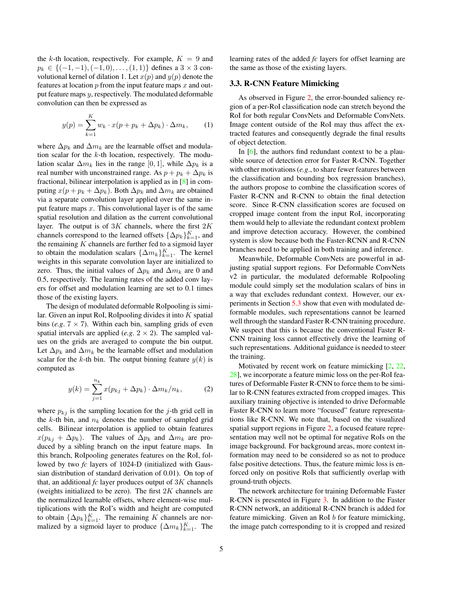
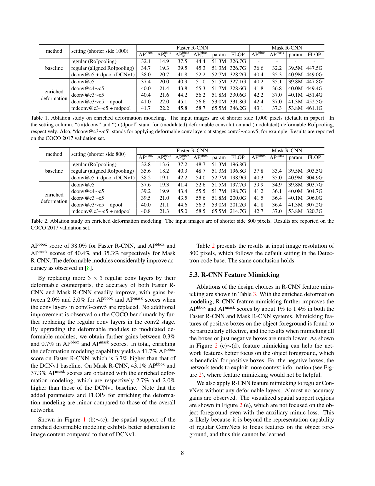

# Deformable ConvNets v2（2018）· 论文笔记

- **论文**：Deformable ConvNets v2: More Deformable, Better Results
- **BibTeX 键名**：`zhu2019deformablev2`
- **出处**：arXiv:1811.11168v2（首页脚注 28 Nov 2018）；会议信息 PDF 内未见，通常记为 CVPR 2019，【待核对】
- **本地 PDF**：`3.科研基本任务/论文/Zhu 等 - 2018 - Deformable ConvNets v2 More Deformable, Better Results.pdf`（13 页）
- **任务书条目**：第 2 周 #7｜🔴 自精读｜「我的思考」必须自己写
- **阅读日期**：2026-10-31
- **页码约定**：文中「p.n」= PDF 第 n 页，与论文印刷页码一致
- **核对规则**：数字后的出处指回 §/Table/Fig/页码；✅ = 已提全文 + 渲染该页逐字查证

---

## 0. 术语表（零基础版 · 先看这节）

> 本篇门槛不在公式，而在第 2 节那套"可视化诊断"：先证明 v1 采样点会跑到框外，再针对性加药。工程类词按「**朴素做法 → 优化做法 → 为什么有效**」三段写。

### 0.1 诊断工具（第 2 节全在讲这个）

| 术语（英文原词） | 解释（在本篇指什么） |
|---|---|
| **空间支撑（spatial support）** | 一个神经元"真正受哪块图像影响"。本篇把有效感受野、有效采样位置、误差有界显著区域统称为它的三种视角（§2.1 p.2 ✅）。 |
| **有效感受野（ERF）** | 输出对每个像素亮度扰动的梯度，即"哪个像素抖一下最影响它"（§2.1 p.2 ✅）。它看不出"整块区域的结构性影响"，原文自己点明了这个局限。 |
| **有效采样位置（effective sampling location）** | v1 只画采样点坐标本身（看不出谁重要）；v2 改成画**输出对采样位置的梯度**，用梯度大小表示贡献（§2.1 p.2 ✅）。这是对 v1 最锋利的一刀：v1 的偏移可视化会误导人。 |
| **误差有界显著区域（error-bounded saliency region）** | "最小的、删掉它才让输出变化超过 ε 的区域"。朴素做法：解 `min λ‖M‖₁+‖N(I)−N(I⊙M)‖²`（附录 A p.9）→ 只能在某个 λ 下求，**两个网络没法在同一误差下比**。优化做法：把误差当硬约束 `min‖M‖₁ s.t. L_rec<ε`（式(4)，p.9 ✅），用"矩形逐步放大 + 超像素贪心删除"两步近似。为什么有效：统一误差上限（ε=0.1，损失 = 1−余弦相似度）后，不同网络的支撑区域大小才可比——这就是"v1 越界"结论的证据来源。 |
| **超像素（super-pixel, SLIC）** | 把图预分割成同色同纹理的小片，把"删哪些像素"的组合爆炸降成"删哪个超像素"（附录 A p.9 ✅）。 |
| **掩码重建（I⊙M）** | 用二值掩码遮住图像一部分再喂网络，看输出变多少。 |

### 0.2 变形机制（本篇改了什么）

| 术语（英文原词） | 解释 |
|---|---|
| **采样位置（sampling location）** | 卷积核取数坐标。朴素做法：写死为 `p+p_k`。优化做法：加学出来的 `Δp_k`，变成 `p+p_k+Δp_k`（式(1)，p.5 ✅）。为什么有效：采样点能贴轮廓走，感受野从"固定方块"变成"跟形状走的形状"。 |
| **偏移场（offset field）** | 存偏移的特征图。朴素做法（v1）：`2K` 通道只存偏移。优化做法（v2）：`3K` 通道，前 `2K` 存偏移、后 `K` 过 sigmoid 变调制标量（§3.2 p.5 ✅）。为什么有效：同一路卷积顺手多算 K 个数，通道只涨 50%，网络就多一个"要不要听这个点"的自由度。 |
| **可变形卷积（deformable convolution）** | v1 的模块：规则网格 + 可学习偏移 + 双线性插值。v2 保留它，但用的地方从 3 层扩到 **12 层**（conv3–conv5 全部 3×3，§3.1 p.4 ✅）。 |
| **双线性插值（bilinear interpolation）** | 小数坐标处用周围 4 个整点按三角核加权。朴素做法：取整到最近格点 → 坐标不连续、梯度断、丢亚像素信息。优化做法：`G(q,p)=g(qx,px)·g(qy,py)`、`g(a,b)=max(0,1−|a−b|)`（沿用 v1，§3.2 p.5 ✅）。为什么有效：取值对坐标连续可微，偏移才训得动；且只有 4 项非零，FLOP 仅从 326.7G 到 331.8G（Table 1）。 |
| **调制可变形卷积（modulated deformable conv）** | v2 的核心新东西：每个采样项再乘一个学出来的 `Δm_k∈[0,1]`，即 `y(p)=Σ w_k·x(p+p_k+Δp_k)·Δm_k`（式(1)，p.5 ✅）。 |
| **调制标量（modulation scalar）** | 那个 `Δm_k`，本质是**逐采样点的音量旋钮**：取 0 就等于"这点根本不看"（§3.2 p.4 原话：setting its feature amplitude to zero）。它由第 `3K` 通道里后 `K` 个过 sigmoid 得到，天然落在 `[0,1]`。 |
| **调制可变形 RoI 池化** | 每个 bin 也带偏移 + 调制：`y(k)=Σ_j x(p_kj+Δp_k)·Δm_k/n_k`（式(2)，p.5 ✅）；参数由"RoI 池化→2×fc-1024→fc 出 3K 通道"的旁支给出。 |
| **堆叠更多层（stacking）** | v1 只改 conv5 的 3 层；v2 改 conv3/4/5 全部 12 层 3×3 卷积（§3.1 p.4 ✅）。 |
| **空洞卷积（atrous/dilated conv）** | 核里插零把采样点均匀撑开。朴素做法：换大核。优化做法：只调 dilation。为什么有效：感受野与参数解耦；但它**只能均匀撑开、不能按内容变**，且 pad 是人手挑的（v2 §4 p.7 拿它当"静态空间支撑"的反例）。 |

### 0.3 训练与蒸馏（R-CNN 特征模仿）

| 术语（英文原词） | 解释 |
|---|---|
| **特征模仿（feature mimicking）** | 让学生某层特征逼近老师同一层特征。朴素做法：只靠检测 loss → 学不出"只看框内"的特征（§3.3 p.5 明说标准训练学不到）。优化做法：加辅助 loss 拉近余弦相似度（式(3)）。为什么有效：检测 loss 只关心"框和类别对不对"，没有"别被框外内容干扰"这个信号；mimic loss 直接把这种偏好当监督灌进去。 |
| **知识蒸馏（knowledge distillation）** | 用 teacher 的输出/特征指导 student（§3.3 p.2 引 [2,22]）。注意本篇**不为压缩模型**：teacher 只当训练信号，推理时扔掉。 |
| **教师 / 学生** | teacher = R-CNN 分支（在**裁剪出的框内图**上跑，天生看不到框外）；student = Deformable Faster R-CNN。 |
| **R-CNN 分支** | 把 RoI 图块裁出、缩放到 224×224，过主干得 14×14 特征图，（调制）可变形池化时 RoI 覆盖整图 → 2×fc-1024 → `f_RCNN(b)` → (C+1) 类 softmax（§3.3 p.6 ✅）。**推理不跑**。 |
| **余弦相似度（cosine similarity）** | 两向量的夹角余弦，只看方向不看长度；mimic loss 就是 `1−cos(·)`。 |
| **正 / 负 RoI** | 与真值重叠够多的框为正。本篇**只对正 RoI 做 mimic**（§3.3 p.5、Table 3 p.9 ✅）：背景框反而需要更多上下文来避免误检。 |
| **零初始化** | 旁支卷积权重置 0 → 偏移初值 0、调制初值 **0.5**（sigmoid(0)），开局等价于普通卷积（§3.2 p.5 ✅）。为什么有效：从"已经能训好的模型"出发，形变增量学出来，不会一开局就崩。 |
| **学习率倍率 0.1×** | 新增偏移/调制**卷积层** lr = 0.1×；可变形池化那侧新增的 **fc 层** lr 与已有层**相同**（§3.2 p.5 ✅，两处不一样，别记混）。 |

### 0.4 检测框架与工程实现

| 术语（英文原词） | 解释 |
|---|---|
| **RoI 池化（RoI pooling）** | 把任意大小的框特征压成固定 k×k（本篇 7×7；Mask R-CNN 另有 14×14）。朴素做法：按框坐标硬切网格取平均（式(5)），格边界与特征图格子不对齐（量化误差）。优化做法：① 先对齐（aligned RoIpooling = RoIAlign，双线性重采样）；② 再让 bin 带偏移+调制（v2）。为什么有效：对齐消除系统性错位；可变形让每格挪到真正的部件上（Fig 2 p.4 显示可变形版覆盖前景的 bin 比例明显更高）。 |
| **RPN（Region Proposal Network）** | Faster R-CNN 第一级，撒锚框出候选。朴素做法：外部算法提候选（慢、不可训）。优化做法：卷在特征图上、与检测头共享主干、端到端训。为什么有效：提框与判类共用一套特征，速度精度同涨；本篇还把 RPN 的正样本拿来给 mimic 采样（每图 32 个，§3.3 p.6）。 |
| **Faster R-CNN / Mask R-CNN** | 前者 = RPN + RoI 池化 + 2fc（本篇 student）；后者再加一条 mask 分支（14×14 池化），用来验证实例分割。 |
| **Detectron** | Facebook 检测代码库；本篇"除图像分辨率外"超参全按它来（§5.1 p.7 ✅，其默认短边 800，本篇用 1000）。 |
| **锚框（anchor）** | RPN 预设的参考框（5 尺度 × 3 长宽比，§5.1 p.7 ✅）。 |
| **NMS（非极大值抑制）** | 重叠框去重。朴素做法：全留 → 同物体几十个框。优化做法：按分数排序，与已留框 IoU 超阈值就删。为什么有效：用尺度无关的 IoU 一个阈值就能平衡漏检与重复；本篇训练/推理 proposal 阈值都是 0.7（§5.1 p.7 ✅），ImageNet VID 推理用 0.3（p.12）。 |
| **im2col** | 朴素做法：多重循环逐点乘加，用不上 BLAS。优化做法：把采样窗口摊成列拼大矩阵，一次 GEMM。为什么有效：把循环交给高度优化的矩阵库，GPU 上快一到两个数量级；**但它的前提是采样位置规则**，可变形卷积坐标是小数，必须先插值取到值再摆放，没法复用固定 stride 索引，需单独写 CUDA。 |
| **多尺度测试** | 同模型在多个分辨率上前向再融合，本篇短边 400→1400、步长 200（附录 A2 p.11 ✅）。 |

### 0.5 评估指标

| 术语（英文原词） | 解释 |
|---|---|
| **IoU（Intersection over Union）** | 预测框与真值框交集/并集。朴素做法：比中心距离 → 尺度敏感。优化做法：面积比值。为什么有效：尺度无关，一个阈值管所有物体，也是 COCO 多阈值平均 AP 的基础。 |
| **AP** | precision-recall 曲线下面积；COCO 的 AP 在 IoU∈[0.5:0.95] 上取 10 个阈值再平均。 |
| **AP50 / AP75** | 阈值 0.5 / 0.75 时的 AP（Table 5 p.11 的 `AP^bbox_50 / AP^bbox_75`）。**AP75 是"框得准不准"的严格指标**：v2 从 42.4 涨到 48.8（+6.4），比 AP50（60.6→66.3，+5.7）涨得更多，说明收益主要来自定位精度。 |
| **AP_S / AP_M / AP_L** | 按 COCO 面积分小/中/大物体算 AP（Table 1 表头 ✅）。 |
| **mask AP（AP^mask）** | 实例分割的掩码 AP（Mask R-CNN 那几列）。 |
| **mIoU** | 分割指标（Table 7 的 VOC seg 列，p.12 ✅）。 |

---

## 1. 一句话说清

**问题**：v1 已能大幅提点，但作者用三种可视化把它的"空间支撑"摊开看，发现两个毛病：① **采样点会跑到框外**，特征被无关内容污染（COCO 上比 VOC 更严重，§2.2 p.2–3 ✅）；② v1 只在 conv5 的 3 层上做形变、且**只调位置不调权重**，建模能力到顶。另外 v1 那套"偏移可视化"本身会误导人：普通卷积采样点是死的，可它的有效支撑却能靠权重适应内容（§2.2 p.3 ✅）。

**做法**：三条互补改动。① **堆更多层**：conv3/4/5 全部 12 层 3×3 卷积换成可变形卷积（v1 只有 3 层）；② **加调制**：每个采样项乘一个 sigmoid 出来的 `Δm_k∈[0,1]`，等于允许网络把某个点静音（式(1)）；③ **加训练监督**：引入 R-CNN 教师分支，只对**正 RoI** 加 cosine 特征模仿损失（式(3)），逼 student 学出"只看框内"的特征；推理时教师分支**不参与**。

**结果**：COCO 2017 val（短边 1000），Faster R-CNN：基线 aligned-RoIpooling **34.7 → DCNv1 38.0 → DCNv2 41.7**，再加 mimic 到 **43.1 AP**（Table 1 p.8、Table 3 p.9 ✅）。Mask R-CNN：**36.6/32.2 → 40.4/35.3 → 43.1/37.3 → 44.3/38.3**（bbox / mask）。COCO test-dev：ResNet-50 **43.3**、ResNet-101 **44.8**、ResNeXt-101 **45.3**（Table 4 p.9 ✅），多尺度测试到 **46.0**（Table 5 p.11 ✅）。

> 背下来：**v1 只教网络"去哪看"，v2 又教它"看多重"（调制），还请了个 R-CNN 老师盯着它"别乱看框外"——三者叠起来才把 38.0 推到 43.1。**

---

## 2. 核心图 / 公式

### 2.1 必看两图 + 一表

**Figure 1（p.3）**：行 = 有效采样位置 / 有效感受野 / 误差有界显著区域；列 = 普通卷积 / DCNv1 / DCNv2；每图三个绿点在背景、小物体、大物体上。→ 要看出：DCNv1（中列）确实贴住物体，但**明显溢出框外**；DCNv2（右列）收得更紧。这幅图就是全文的"病历"。

**Figure 2（p.4）**：同样三种可视化，对象是每个 RoI 分类头的 2fc 节点，5 个子图（a 对齐池化+可变形卷积 / b 可变形池化(DCNv1) / c 调制版(DCNv2) / d c+mimic / e 普通卷积+mimic）。→ 要看出两件事：① 可变形池化让"覆盖前景的 bin"比例大增；② 普通卷积上单独加 mimic **几乎无效**（子图 e 依旧不聚焦），说明"能不能聚焦"是**表征能力**问题，不是监督问题。

**Figure 3（p.6）**：训练时的双分支（上：全图路径；下：裁剪 224×224 路径），两分支共享主干、共享池化、共享 2fc，只有分类头不共享。→ 要看出：下半部分只存在于训练图。

**Table 1（p.8）**：消融主线，本篇最该背的表（见 3.2）。

### 2.2 三个公式（p.5–6，✅ 逐符号核对）

$$y(\mathbf{p})=\sum_{k=1}^{K} w_k\cdot x(\mathbf{p}+\mathbf{p}_k+\Delta\mathbf{p}_k)\cdot\Delta m_k \tag{1}$$

$$y(k)=\sum_{j=1}^{n_k} x(\mathbf{p}_{kj}+\Delta\mathbf{p}_k)\cdot\Delta m_k\,/\,n_k \tag{2}$$

$$\mathcal{L}_{\mathrm{mimic}}=\sum_{b\in\Omega}\left[1-\cos\left(f_{\mathrm{RCNN}}(b),f_{\mathrm{FRCNN}}(b)\right)\right] \tag{3}$$

| 符号 | 含义 | 本篇取值 |
|---|---|---|
| `K` / `k` | 采样点个数 / 下标 | 3×3 → K=9 |
| `w_k` | 第 k 个采样点的卷积权重 | 可学习 |
| `p_k` | **写死**的相对位置 | `{(−1,−1)…(1,1)}`，dilation 1 |
| `Δp_k` | **学出来**的偏移（实数，范围不限） | 前 2K 通道 |
| `Δm_k` | **学出来**的调制标量 `∈[0,1]` | 后 K 通道过 sigmoid |
| `3K` | 旁支卷积输出通道 | 2K 偏移 + K 调制 |
| `p_kj` / `n_k` | 第 k 个 bin 内第 j 个采样格 / 格数 | 每 bin 内 2×2 均匀格，n_k=4（p.5 ✅） |
| `Ω` | 参与 mimic 的 RoI 集 | 每图随机抽 **32 个正 proposal**（p.6 ✅） |
| `f_RCNN` / `f_FRCNN` | 教师 / 学生的 1024 维 RoI 特征 | 各自 2×fc-1024 |

### 2.3 与 v1 的公式差异

| 项 | v1 | v2 |
|---|---|---|
| 采样项 | `w(pn)·x(p0+pn+Δpn)` | `w_k·x(p+p_k+Δp_k)·`**`Δm_k`**（多一个标量乘） |
| 旁支输出通道 | `2N` | `3K`（2K 偏移 + K 调制） |
| 旁支初始化 | 全 0 → `Δp=0` | 全 0 → `Δp=0`，`Δm=sigmoid(0)=` **0.5** |
| 旁支 lr | β=1（Faster 的 fc 0.01） | 卷积旁支 **0.1×**；池化侧 fc **1×** |

### 2.4 训练设置（§5.1 p.7 + §3.3 p.5–6，✅）

| 项目 | 设置 |
|---|---|
| 数据 | COCO 2017：train 118k / val 5k（消融）/ test-dev 20k |
| 输入 | 短边 **1000**（Detectron 默认 800，附录 A2 给了 800 的对照表）；Table 1 用 1000、Table 2 用 800 |
| 主干 | ImageNet 预训练 ResNet-50 |
| 变形位置 | conv3–conv5 全部 3×3 卷积（**12 层**）；Mask R-CNN 的 7×7 与 14×14 两个池化都换调制可变形版 |
| 锚框 / 候选 | 5 尺度 × 3 长宽比；训练 2k、推理 1k 个 proposal，NMS 0.7 |
| batch | 8 卡 × 2 图；256 个锚框（正负 1:1）+ 512 个 proposal（正负 1:3） |
| 训练 | 16 epoch；lr 0.02，第 10、14 epoch 各降 10 倍；wd 1e-4，momentum 0.9 |
| mimic | 教师图块 224×224、特征图 14×14、RoI 覆盖整图、2×fc-1024；**两个新 loss 权重为原 loss 的 0.1 倍**；只对正 RoI |

---

## 3. 关键实验数据

### 3.1 主结果（Table 4 / 5 / 6 / 7，✅）

| 实验 | 数据集 / 设置 | 本方法（DCNv2） | 对比对象 | 出处 |
|---|---|---|---|---|
| Faster R-CNN | COCO test-dev，ResNet-50 | **43.3** AP^bbox | 普通 35.1；DCNv1 38.4 | Table 4, p.9 |
| Mask R-CNN | COCO test-dev，ResNet-50 | **44.5 / 38.4**（bbox / mask） | 普通 37.0 / 32.4；DCNv1 40.7 / 35.5 | Table 4 |
| Faster R-CNN | COCO test-dev，ResNet-101 | **44.8** | 普通 39.2；DCNv1 41.4 | Table 4 |
| Mask R-CNN | COCO test-dev，ResNet-101 | **45.8 / 39.7** | 普通 40.9 / 35.3；DCNv1 42.9 / 37.1 | Table 4 |
| Faster R-CNN | COCO test-dev，ResNeXt-101 | **45.3** | 普通 40.1；DCNv1 41.7 | Table 4 |
| Mask R-CNN | COCO test-dev，ResNeXt-101 | **46.7 / 40.5** | 普通 41.7 / 36.2；DCNv1 43.4 / 37.7 | Table 4 |
| Faster R-CNN 单尺度 1000 | COCO test-dev，ResNet-101 | 44.8 / **66.3** / **48.8**（AP / AP50 / AP75） | 普通 39.2 / 60.6 / 42.4 | Table 5, p.11 |
| 同上 + 多尺度测试 | COCO test-dev，ResNet-101 | **46.0 / 67.9 / 50.8** | 普通多尺度 41.2 / 62.4 / 45.2 | Table 5 |
| 小 / 大物体 | COCO test-dev，ResNet-101 单尺度 | 24.4 / 59.6（AP_S / AP_L） | 21.6 / 51.3 | Table 5 |
| ImageNet 分类 | ResNet-50 val | 78.2 / 94.0（top-1 / top-5） | 普通 76.5 / 93.1；DCNv1 76.6 / 93.2 | Table 6, p.11 |
| VOC 检测（微调） | Faster R-CNN，ResNet-101 | **84.9 / 73.5**（AP50 / AP70） | 普通 81.9 / 68.2 | Table 7, p.12 |
| VOC 分割（微调） | DeepLab-v1，ResNet-101 | **78.3 mIoU** | 普通 72.0 | Table 7 |
| ImageNet VID 检测 | ResNet-101 | **80.7** AP^bbox | 普通 74.9 | Table 7 |

> Table 7 里 DCNv2 不做预训练时 COCO 是 44.8，做了是 44.9（+0.1）；作者自己说 COCO 上预训练收益 "minor"，因为 COCO 够大能从头学偏移（附录 A3 p.11 ✅）。VOC/VID 上收益大得多（检测 +1.2、分割 +2.2、VID +1.5）。

### 3.2 消融（Table 1 / Table 2 / Table 3，✅）

| 消融问什么 | 设置 | Faster R-CNN AP^bbox（/S /M /L） | Mask R-CNN AP^bbox / AP^mask | 出处 |
|---|---|---|---|---|
| 基线 | regular + RoIpooling | 32.1 / 14.9 / 37.5 / 44.4 | — | Table 1, p.8 |
| 基线（对齐池化） | regular + aligned RoIpooling | 34.7 / 19.3 / 39.5 / 45.3 | 36.6 / 32.2 | Table 1 |
| v1 复现 | dconv@c5 + dpool | 38.0 / 20.7 / 41.8 / 52.2 | 40.4 / 35.3 | Table 1 |
| **只堆层** | dconv@c5（不加池化） | 37.4 / 20.0 / 40.9 / 51.0 | 40.2 / 35.1 | Table 1 |
| | dconv@c4~c5 | 40.0 / 21.4 / 43.8 / 55.3 | 41.8 / 36.8 | Table 1 |
| | dconv@c3~c5（12 层） | 40.4 / 21.6 / 44.2 / 56.2 | 42.2 / 37.0 | Table 1 |
| | dconv@c3~c5 + dpool | 41.0 / 22.0 / 45.1 / 56.6 | 42.4 / 37.0 | Table 1 |
| **再加调制** | mdconv@c3~c5 + mdpool | **41.7** / 22.2 / 45.8 / 58.7 | 43.1 / 37.3 | Table 1 |
| **mimic 范围** | 不做 | 41.7 | 43.1 / 37.3 | Table 3, p.9 |
| | FG & BG | 42.1 | 43.4 / 37.6 | Table 3 |
| | 只 BG | 41.7 | 43.3 / 37.5 | Table 3 |
| | **只 FG** | **43.1** | **44.3 / 38.3** | Table 3 |
| mimic 用在普通卷积上 | regular + 只 FG | 35.0（基线 34.7，只 +0.3） | 36.8 / 32.3（基线 36.6 / 32.2） | Table 3 |
| 分辨率对照 800 / 1000 | mdconv + mdpool | 40.8 / **41.7** | 42.7 / 37.0 vs 43.1 / 37.3 | Table 2 p.8 / Table 1 p.8 |
| 模型代价 | mdconv 行参数 / FLOP | 65.5M（基线 51.3M）/ 346.2G（326.7G） | 53.8M / 461.1G | Table 1 |

**三条必讲结论**：

1. **收益拆得开**：38.0（v1）→ 41.7（堆层+调制，+3.7）→ 43.1（+mimic，+1.4）。原文 §5.2 p.8 说 "3.7% higher than ... DCNv1 baseline" ✅；§5.3 p.8 说 mimic 再涨 "about 1% to 1.4%" ✅。
2. **mimic 只对正样本有用，且只在有变形能力时有用**：只 BG = 41.7（等于没做），只 FG = 43.1；普通卷积上做 mimic 只到 35.0（+0.3）。原文解释：聚焦特征对背景框反而不利，背景需要更多上下文（§3.3 p.5 ✅）。
3. **不是靠加参数换分**：参数 51.3M→65.5M（+27%）、FLOP +6%，AP 却从 34.7 到 43.1（+8.4）。小物体只涨 2.9（19.3→22.2），大物体涨 13.4（45.3→58.7）——收益集中在**大物体/非刚性物体**。

### 3.3 最易误读的数字

| 数字 | 常见误读 | 正确读法 |
|---|---|---|
| 43.1 vs 43.3 | 以为矛盾 | 43.1 是 **val + mimic**（Table 3 p.9）；43.3 是 **test-dev + mimic**（Table 4 p.9）。两个数据集，不能混 |
| 41.7 | 当成 v2 最终成绩 | 那是**不含 mimic** 的 v2（Table 1 末行）；加了 mimic 才 43.1。报结果必须说清含不含 mimic |
| 34.7→38.0 | 当成 v2 相对 v1 的提升 | 这是 **v1 相对基线**；v2 相对 v1 是 38.0→43.1（+5.1），其中 3.7 来自堆层+调制、1.4 来自 mimic |
| 参数 +27% | 以为调制要一大坨参数 | 增量来自旁支通道 2K=18→3K=27（+50%）与池化侧 fc；整网只 +27%、FLOP +6% |
| 46.0 | 当单模型成绩宣传 | 46.0 = ResNet-101 + **多尺度测试（400–1400，步长 200）**；同模型单尺度 44.8，多尺度只 +1.2（Table 5, p.11 ✅） |
| Table 2(800) vs Table 1(1000) | 两表数字混着比 | 是**同一组实验在两个输入分辨率的两个版本**，结论一致、数值不同（40.8 vs 41.7） |

---

## 4. 我的思考（🔴 自精读 · 本节必须你自己写）

1. v1 的偏移为什么容易"越界 / 跑到无关区域"？（提示：偏移只有位置、没有权重，网络没有"闭嘴"的手段；再想 §2.2 里"COCO 上比 VOC 更严重"说明什么，以及 v1 的偏移可视化为什么"会误导人"）
2. modulated（调制）标量解决了什么？（提示：把 `Δm_k=0` 代进式(1) 看输出会怎样；再想它和"样本加权"、"attention 权重"是不是一回事，为什么只加 K 个通道就够）
3. R-CNN 特征融合（feature mimicry）为什么能提升？（提示：教师只看裁剪图，天生不知道框外有什么；再看 Table 3 "只 BG"与"只 FG"的巨大差异，以及"普通卷积 + mimic 几乎无效"这条反证）
4. 如果让你改，你会动什么？（提示：`Δm` 初值 0.5、偏移无上界、教师只有 R-CNN、mimic 只在正样本……哪个最值得改？这改动会不会和后来的可变形注意力/Transformer 撞上）

（以下空白，读完自己补）

---

## 5. 回原文核对记录

| 说法 | 原文依据（§/Table/Fig/页码） | 判定 |
|---|---|---|
| "DCNv2 只是给 v1 加了个 attention 权重" | §3.2 p.4–5：标量乘在**插值后的采样值**上；§4 p.6–7 作者自述是"a special attention mechanism where only a sparse set of elements have non-zero aggregation weights" | 🟨 不完整。是"稀疏 9 位置 + 位置可动 + 权重"三件套，不是全图 attention |
| "mimic 对所有 RoI 都施加" | §3.3 p.5："enforced only on positive RoIs"；Table 3 只 BG = 41.7（等于没做） | 🟥 错，只对正 RoI |
| "推理也要跑 R-CNN 分支，所以 v2 很慢" | §3.3 p.6："In inference, only the Faster R-CNN network is applied ... no additional computation" | 🟥 错，教师分支只在训练时存在 |
| "v2 把 conv5 的 3 层换成可变形卷积" | §3.1 p.4："all the 3 × 3 conv layers in stages conv3, conv4, and conv5 ... 12 layers" | 🟥 错（那是 v1 的设置） |
| "调制标量初值是 0" | §3.2 p.5：旁支零初始化 → `Δp=0`、`Δm=`**0.5**（sigmoid(0)） | 🟥 错，0 是偏移初值 |
| "COCO test-dev ResNet-101 是 44.8" | Table 4 p.9，Faster R-CNN / DCNv2 = 44.8 | 🟩 正确（但是 test-dev、单尺度、含 mimic） |
| "代价几乎可忽略" | Table 1 p.8：参数 51.8M→65.5M（+26%），FLOP 330.6G→346.2G（+5%） | 🟨 不完整。"可忽略"指相对整网；单看变形模块，通道涨一半（2K→3K） |
| "RPN 加在 ResNet-101 的 conv4 上"（原文自己写的） | §2.2 p.2 原文如此，但同段说基线是 **ResNet-50** | 🟨 **原文不一致点**，照抄会写错主干 |
| "堆层提升 2.0%–3.0%"（原文 §5.2 p.8） | 按 Table 1 实算：40.4 vs 38.0（+2.4）、42.2 vs 40.4（+1.8）、37.0 vs 35.3（+1.7） | 🟨 **原文不一致点**，实测区间 1.7–2.4，正文写宽了 |

---

## 6. 本篇 3 个自测问题

1. 把式(1) 的 `Δm_k` 全设为 1，网络退化成什么？全设为 0 呢？——用这个思想实验说明"调制"买到了什么自由度。
2. Table 3 里"只模仿前景 = 43.1、只模仿背景 = 41.7（等于不做）"，从"检测器在背景上需要什么信息"解释这个差异；再解释普通卷积上做 mimic 为何只有 35.0。
3. v2 的三个改动各贡献多少点（38.0 → 41.7 → 43.1）？只允许保留一个，你留哪个，为什么？
