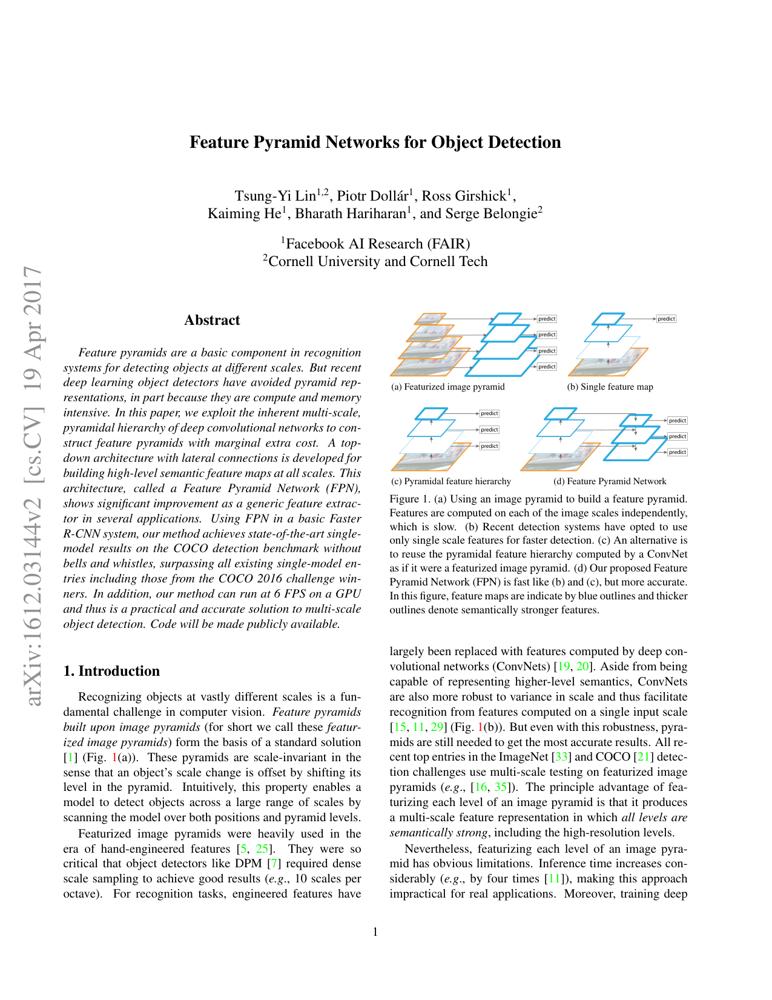
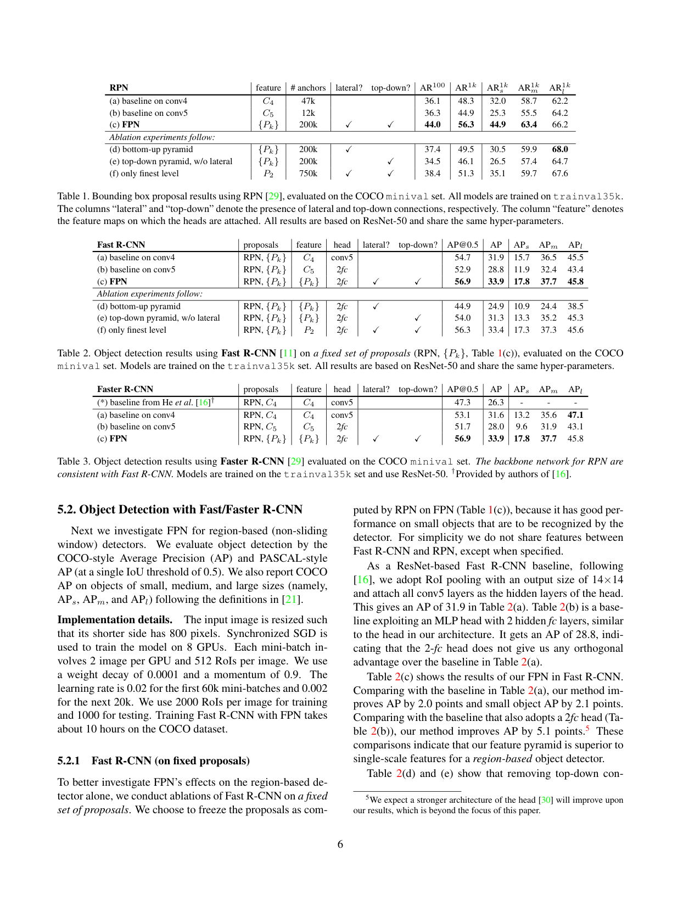

# FPN（2017）· 论文笔记

- **论文**：Feature Pyramid Networks for Object Detection（CVPR 2017；arXiv:1612.03144v2，2017-04-19）
- **作者/机构**：Tsung-Yi Lin、Piotr Dollár、Ross Girshick、Kaiming He、Bharath Hariharan、Serge Belongie（FAIR + Cornell）
- **BibTeX 键名**：`lin2017feature`
- **本地 PDF**：`3.科研基本任务/论文/Lin 等 - 2017 - Feature Pyramid Networks for Object Detection.pdf`（共 10 页）
- **任务书条目**：第 2 周 #8｜🟢 AI 辅助读｜阅读要点：多尺度特征融合，后续检测分割标配
- **阅读日期**：2026-10-31
- **核对规则**：数字后的「出处」指回原 PDF 的 §章节 / Table n / Fig n / p.页码；✅ = 已回原文查证。

---

## 0. 术语表（零基础全能版 · 先看这一节再看正文）

> 难词集中在"多尺度"和"检测系统"两处。按「多尺度概念 → FPN 零件 → 检测系统 → 评估指标 → 工程」分组，每条说清它**在这篇里具体指什么**。

### 0.1 多尺度与金字塔（问题的来源）

| 术语（英文原词） | 大白话解释（在本篇里的含义） |
|---|---|
| **feature pyramid（特征金字塔）** | 一组尺寸逐级减半、语义逐级变强的特征图。FPN 的目标是在**网络内部**造出它，而不是在图像层面造。 |
| **featurized image pyramid（特征化图像金字塔）** | Fig 1(a)。朴素做法：原图缩成 N 个尺寸，**每个尺寸完整跑一遍 CNN**。优化做法：不重跑网络，浅层共享计算、缺的尺度用插值补（Dollár 的稀疏金字塔）。为什么有效：每层语义都强（都是完整网络的输出）；代价是推理 **×4**（§1 p.1）、显存装不下端到端训练，只能测试时用，造成 train/test 不一致（§1 p.2）。 |
| **in-network feature hierarchy（网内特征层级）** | Fig 1(c)。CNN 前向自带的金字塔（conv2→conv5），**零额外算力**；但浅层语义太弱，层间有语义鸿沟。 |
| **semantic gap（语义鸿沟）** | 浅层只看到边缘/纹理，深层才认得"这是车"。层间语义强度差得太多，FPN 就是填这个鸿沟（§1 p.2）。 |
| **scale invariance（尺度不变性）** | 物体缩放后仍被同一套参数识别。图像金字塔靠"物体换尺度 = 换金字塔层"实现（§1 p.1）。 |
| **octave（倍频程）** | 尺度翻一倍。DPM "10 scales per octave"（§1 p.1）说明老方法对尺度采样有多密。 |
| **single-scale testing（单尺度测试）** | 测试时只缩到一个尺寸（本文短边 800 像素）。FPN 的最大卖点：**单尺度就打赢了用图像金字塔的对手**（§5.2.3 p.8）。 |
| **multi-scale testing（多尺度测试）** | 跑多个输入尺寸再融合：每个尺寸完整跑一遍网络，结果按框 NMS/平均。为什么有效：等价于图像金字塔，对小目标最有效；代价是时间线性增长。 |
| **scale-normalized（尺度归一化）** | R-CNN 老做法：候选框缩放到同一尺寸再分类（§2 p.3），慢且丢上下文。 |

### 0.2 FPN 的结构零件

| 术语（英文原词） | 大白话解释（在本篇里的含义） |
|---|---|
| **bottom-up pathway（自底向上路径）** | 就是 backbone（本文用 ResNet）的普通前向，产生 C2–C5。原文规定每 stage 取**最后一层**，因为那层最强（§3 p.3）。 |
| **stage（阶段）** | 输出尺寸相同的一组层。**一个 stage = 一个金字塔层**，stride 分别 4/8/16/32。 |
| **top-down pathway（自顶向下路径）** | 从最粗的 P5 起，**上采样 2 倍**再与浅层相加，把强语义逐级灌进高分辨率层。 |
| **lateral connection（横向连接）** | 把同尺寸的 C_l 用 **1×1 卷积**压到 d 通道再加过去。朴素做法：concat 或用 3×3 卷积对齐；优化做法：**只用 1×1，无 ReLU、无 BN**。为什么有效：1×1 步长 1、不改空间位置，能把"位置准"的浅层信息搬到上层，同时把 512/1024/2048 通道统一成 256，才可能四层共用同一个头（§3 p.3–4）。 |
| **1×1 conv（逐点卷积）** | 只看单个像素、跨通道线性组合。这里唯一作用是**改通道数**，不扩感受野；原文特意说明这些附加层**不加非线性**（§3 p.4）。 |
| **nearest neighbor upsampling（最近邻上采样）** | 2×2 的格子复制成 4×4。朴素做法：转置卷积（可学习、参数多）；优化做法：最近邻插值（**零参数**）。为什么有效：这里只需放大尺寸，细节由横向连接补，插值就够还更快。 |
| **aliasing effect（混叠）** | 上采样带来的棋盘式伪影。靠"融合后再过 3×3 卷积"抑制（§3 p.4，即 Fig 3 里的 3×3）。 |
| **C2 / C3 / C4 / C5** | 各 stage 末尾输出，stride 4/8/16/32。**C1 不进金字塔**（分辨率太高、显存吃不消，§3 p.3）。 |
| **P2 / P3 / P4 / P5 / P6** | 融合输出，尺寸与 C2–C5 相同，**通道全为 256**，所以能共用同一个头。P6 只是 P5 的 stride-2 下采样，**专为 512² 的锚存在**（脚注 1，p.4）。 |
| **d（feature dimension）** | 金字塔统一通道数，本文 **256**（§3 p.4）；分割提议实验里 128（§6 p.8）。 |
| **shared head（共享检测头）** | 所有层用同一套分类/回归参数。原文测过"不共享"，精度几乎一样（§4.1 p.4）——说明各层语义确实对齐了。 |

### 0.3 检测系统（这篇的两个宿主）

| 术语（英文原词） | 大白话解释（在本篇里的含义） |
|---|---|
| **RPN（Region Proposal Network，区域提议网络）** | Faster R-CNN 第一级：在特征图上滑 3×3 窗口，只判"前景/背景"并回归框，输出候选框。它是 **class-agnostic（不分类别）** 的（§4.1 p.4）。 |
| **Fast R-CNN** | 第二级：对每个候选框 RoI pooling 抠出固定尺寸特征再分类 + 回归。本文用它验证**区域型（非滑窗）** 检测器也能吃到金字塔的好处（§4.2 p.4）。 |
| **Faster R-CNN** | RPN + Fast R-CNN 合成一个网络、共享卷积特征；本文 Table 3 就是它。 |
| **Mask R-CNN** | FPN 的分割延伸。**本篇只在引用 [14] 出现一次**（§5.2.3 p.8 一句"FPN 已在 COCO 各赛道带来新成绩"），正文没有它的实验——别当成本篇内容。 |
| **anchor（锚框）** | 每个滑窗位置预置的"参考框"，网络只需回归真实框相对它的偏移。本文每层**只放一个尺度**的锚（32²/64²/128²/256²/512² 对应 P2–P6），每尺度 **3 个长宽比 {1:2,1:1,2:1}**，共 **15 个**（§4.1 p.4）。 |
| **aspect ratio（长宽比）** | 锚框的宽高比，覆盖高瘦/方/扁宽三类物体。 |
| **IoU（Intersection-over-Union，交并比）** | 两框交集面积 ÷ 并集面积。本文正负样本规则：IoU 最大或 **>0.7** 记正；与所有真值框 IoU **<0.3** 记负（§4.1 p.4，沿用 [29]）。 |
| **RoI pooling** | 把任意大小的候选区域用**最近邻量化**成 7×7 网格再池化。缺点：框边界和格子边界两次取整都丢精度。本文用的就是它（§4.2 p.5）。 |
| **RoIAlign** | 不量化、用**双线性插值**在浮点坐标上采样，是 **Mask R-CNN（2017）** 才提出的；**本篇没用**。很多综述把两者混说，这是常见误读（见 §5）。 |
| **network head（网络头）** | 接在特征图上的小网络。RPN 头 = 3×3 卷积 + 两个并列 1×1 卷积（分类 2k、回归 4k）；Fast R-CNN 头 = 7×7 RoI pooling + 两个 1024 维 FC（§4.1 p.4、§4.2 p.5）。 |
| **feature sharing（特征共享）** | RPN 与 Fast R-CNN 共用 backbone 特征，需 4-step 交替训练。实测 AP 33.9→34.3（R50），训练 ×1.5、测试更快（§5.2.2 p.7）。 |
| **NMS（Non-Maximum Suppression，非极大值抑制）** | 后处理：按分数从高到低，删掉与已选框 IoU 过高的重复框。朴素做法：每个框对全体线性扫，O(n²)；优化做法：先按分数排序再加阈值剪枝（或 soft-NMS）。为什么有效：检测器会在同一目标周围输出几十个框，NMS 只留最好的那个。**本文正文没给 NMS 阈值**，只在分割提议里明确"不做任何 NMS 或后处理"（附录 p.9）。 |
| **proposal（候选框）** | RPN 输出、尚未分类的框。评估用 AR（召回），最终检测用 AP。 |

### 0.4 评估指标（最容易读错的一组）

| 术语（英文原词） | 大白话解释（在本篇里的含义） |
|---|---|
| **AP（Average Precision，COCO 风格）** | COCO 主指标：在 **IoU = 0.50:0.05:0.95 共 10 个阈值**上各算 PR 面积再平均，数值天然偏低（本文最好也只有 36.2，Table 4）。 |
| **AP@0.5 / AP50（PASCAL 风格）** | 只在 **IoU=0.5** 上算的 AP。**和 COCO AP 不是一个量纲**：同一模型 56.9 vs 33.9（Table 3 p.6）。看到"AP 提升 3.8"必须先问是哪个。 |
| **APs / APm / APl** | 按物体面积分档的 AP（small/medium/large，划分按 [21]）。FPN 的卖点主要写在 APs 上（15.7→17.8，Table 2）。 |
| **AR（Average Recall）** | 只衡量"真物体被候选框覆盖多少"，不看分类。**AR 高 ≠ 检测准**：RPN 的 AR1k 是 56.3，最终 AP 只有 33.9。 |
| **AR100 / AR1k** | 每张图取分数最高的 100 / 1000 个提议时算的 AR。 |
| **ARs / ARm / ARl** | 小/中/大物体的 AR。Table 1 里最反直觉的一列是 ARl（见 §3.2）。 |
| **minival** | COCO val 中固定抽的 **5k 张**子集，全部消融都在它上面跑（§5 p.5）。 |
| **trainval35k** | 80k train + 35k val 子集（[2] 的划分），本文训练集（§5 p.5）。 |
| **test-dev / test-std** | COCO 两个标签不公开的测试划分，Table 4 同时报（p.7）；test-std 是最终榜单口径。 |
| **COCO vs PASCAL** | COCO 80 类、多阈值 + 面积分档；PASCAL VOC 20 类、只看 IoU=0.5。本文两套都报。 |

### 0.5 工程与训练

| 术语（英文原词） | 大白话解释 |
|---|---|
| **end-to-end training（端到端）** | 所有金字塔层一起反传，一次训完。原文强调"FPN 能端到端训练所有尺度，而图像金字塔显存做不到"（§1 p.2）。 |
| **synchronized SGD（同步 SGD）** | 8 张卡各算一部分梯度，**全部算完再平均**后更新。朴素做法：异步更新（各卡用旧权重，结果不可复现）；优化做法：同步 + 梯度平均。为什么有效：等价于大 batch 单机训练，结果可复现。 |
| **mini-batch / batch** | RPN 阶段每卡 2 张图、每图 256 个 anchor（§5.1 p.5）；检测阶段每卡 2 张图、每图 512 个 RoI（§5.2 p.6）。 |
| **weight decay / momentum** | 权重衰减 0.0001、动量 0.9（§5.1、§5.2）。 |
| **learning rate schedule（学习率计划）** | RPN：0.02 跑 30k 次迭代 → 0.002 跑 10k；检测：0.02 跑 60k → 0.002 跑 20k（§5.1 p.5、§5.2 p.6）。最朴素的步进衰减。 |
| **fully convolutional（全卷积）** | 不用全连接层，因此能吃任意尺寸输入、输出与输入成比例（§3 p.3）。 |
| **memory footprint（显存占用）** | 特征图占的显存。C1 分辨率太高，所以原文故意不把它放进金字塔（§3 p.3）。 |
| **FPS（frames per second）** | 摘要写 **6 FPS**（p.1）；正文单图推理 **0.148 s（R50）/ 0.172 s（R101）**，对比基线 **0.32 s**（§5.2.2 p.7）。6 FPS 对应分割提议模型（§6.1 p.8），**别混用**。 |
| **Caffe2 / M40 GPU** | 代码是 py-faster-rcnn 的 Caffe2 重写（§5 p.5）；测速用 Tesla M40（§5.2.2 脚注 6）。 |

---

## 1. 一句话说清

**问题**：CNN 天然有金字塔（浅层高分辨率语义弱、深层语义强分辨率低），但检测器为省算力只用**单层**（Fast/Faster R-CNN 用 C4）；想多尺度就得做**图像金字塔**，推理 ×4（§1 p.1），还装不进显存、只能测试时用。

**做法**：不缩图，在**网络内部**造金字塔——① 自底向上取每个 stage 最后一层 C2–C5；② 自顶向下把 P5 上采样 2 倍逐级灌语义；③ 横向连接用 1×1 卷积把同尺寸 C_l 压到 256 通道后**逐元素相加**；④ 每个融合图再过一个 3×3 卷积消混叠；⑤ 所有层共用同一个头，通道统一 d=256。

**结果**：单尺度输入、无花活，COCO test-dev **AP 36.2 / AP@0.5 59.1**，**超过 2016 冠军 G-RMI 单模型 34.7**（Table 4 p.7）；RPN 的 **AR1k 48.3→56.3（+8.0）**、小目标 **ARs 32.0→44.9（+12.9）**（Table 1 p.6）；推理 **0.148 s** 反而比单尺度基线 0.32 s **更快**（§5.2.2 p.7）。

> **背下来：FPN = 把深层的"语义"上采样灌进浅层的"位置"，一个 1×1 卷积 + 一个加号 + 一个 3×3 卷积，就让单尺度输入打赢图像金字塔。**

---

## 2. 核心图 / 公式

### 2.1 必看 Figure 1：四种做法一张图看懂（p.1）

要看出四件事：(a) 图像金字塔 4 条独立框栈，每层都是**粗线**（语义强）但贵；(b) 单尺度只留一张图，快但只有一层强；(c) 网内层级（SSD 路线）多尺度免费，但浅层是**细线**、层间不融合；(d) FPN 多尺度 + **每层都是粗线** + 只有一个输入尺度。

> 图注原文："thicker outlines denote semantically stronger features"（p.1）。**"让每一层都变成粗线"就是这篇的全部目标。**

### 2.2 必看 Figure 3 + 融合公式（p.3）

Fig 3（p.3 右下）画的就是一个融合单元：`2x up` + `1x1 conv` + `+` + `predict`。写成公式（§3 p.3–4）：

$$
P_l=\mathrm{Conv}_{3\times3}\!\left(\underbrace{\mathrm{Up}_{2\times}(P_{l+1})}_{\text{top-down}}+\underbrace{\mathrm{Conv}_{1\times1}(C_l)}_{\text{lateral}}\right),\quad l=2,3,4;\qquad
P_5=\mathrm{Conv}_{3\times3}\big(\mathrm{Conv}_{1\times1}(C_5)\big)
$$

| 符号 | 含义 | 本篇取值 |
|---|---|---|
| $C_l$ | 自底向上第 $l$ 个 stage 最后一层 | $l=2..5$，通道 256/512/1024/2048 |
| $P_l$ | 第 $l$ 层金字塔输出 | 空间尺寸与 $C_l$ 相同 |
| $\mathrm{Conv}_{1\times1}$ | 横向连接，只为改通道数，**无 ReLU** | 输出全 256 通道 |
| $\mathrm{Up}_{2\times}$ | 最近邻上采样 2 倍 | 零参数 |
| $+$ | 逐元素相加（**不是 concat**） | 要求尺寸、通道都对齐 |
| $\mathrm{Conv}_{3\times3}$ | 融合后平滑，抑制上采样混叠 | 256 通道 |

三个必须讲清的点：

- **为什么相加不 concat**：原文只说 "merged by element-wise addition"（Fig 3 图注），没解释取舍。**加法不增通道**，四层才能都维持 256、共用同一个头；concat 会让通道随层数变，头就共享不了——【我的推断】。
- **P5 是起点不是融合结果**："we simply attach a 1×1 convolutional layer on C5 to produce the coarsest resolution map"（§3 p.4），所以 P5 只过 1×1、不含加法。它是否也过最后的 3×3，原文写 "each merged map"，未明说【待核对】。
- **附加层不加非线性**：原文 "no non-linearities in these extra layers, which we have empirically found to have minor impacts"（§3 p.4），是"简单优先"的体现。

### 2.3 结构表（§3 + Fig 1(d)，p.3–4，✅）

| 层 | 来源 | 步长 | backbone 通道 | 输出通道 | 用途 |
|---|---|---|---|---|---|
| C1 | conv1 输出 | 2 | 64 | — | **不进金字塔**（显存太大） |
| C2 | conv2 stage 末尾 | 4 | 256 | P2=256 | 检测小目标 |
| C3 | conv3 stage 末尾 | 8 | 512 | P3=256 | — |
| C4 | conv4 stage 末尾 | 16 | 1024 | P4=256 | 单尺度 Faster R-CNN 的默认层 |
| C5 | conv5 stage 末尾 | 32 | 2048 | P5=256 | 检测大目标 |
| P6 | P5 做 stride-2 下采样 | 64 | — | 256（继承 P5） | 只为 512² 的锚，Fast R-CNN 不用（脚注 1 p.4） |

头：RPN = 3×3 卷积 + 两个并列 1×1（2k / 4k，k=3 个比例）；Fast R-CNN = RoI pooling **7×7** + 两个 **1024 维** FC（§4.2 p.5），原文说它比 [16] 的 9 层 conv5 头**更轻更快**。

### 2.4 为什么单尺度检测对小物体差（立论 + 数据）

1. **物体尺度变化 = 它在特征图上的像素数变化**。8×8 的小目标在 stride 32 的 C5 上不到 1 个格子，卷积核看不见它；在 stride 4 的 C2 上还有 2×2 个格子。
2. **浅层位置准但语义弱、深层语义强但位置粗**，单层只能二选一："The high-resolution maps have low-level features that harm their representational capacity"（§1 p.2）。
3. **实测**（Table 1 p.6）：只把检测层从 C4 换成更深的 C5，**AR1k_s 从 32.0 掉到 25.3（-6.7）**，整体 AR1k 从 48.3 掉到 44.9——**更深反而更差**，这就是"语义 vs 分辨率"权衡的实测版。

### 2.5 两套分配规则（问的不是同一个问题）

- **RPN 侧：锚按层分**。每层一个尺度 + 3 个比例 = **15 个**（§4.1 p.4）。理由：头在所有层稠密滑动，**层本身已经把尺度分好了**。
- **Fast R-CNN 侧：RoI 按尺寸算层号**（式 (1)，§4.2 p.4）：

$$
k=\left\lfloor k_0+\log_2\left(\frac{\sqrt{wh}}{224}\right)\right\rfloor
$$

| 符号 | 含义 | 取值 |
|---|---|---|
| $w,h$ | **输入图像坐标系**下 RoI 的宽、高 | 像素 |
| $\sqrt{wh}$ | 等效边长（几何平均尺度） | 像素 |
| 224 | ImageNet 预训练规范尺寸 | 224 |
| $k_0$ | 224×224 的 RoI 落到哪层 | **4**（对齐 [16] 用 C4） |
| $k$ | 分配到的层号 | 2..5 |

直觉：RoI 缩一半 → $\log_2$ 项 −1 → 落到更细的一层（k=3），让每个 RoI 在"与自己尺度匹配的分辨率"上抠特征。

---

## 3. 关键实验数据

### 3.1 主结果：COCO 单模型对比（Table 4，p.7，✅）

| 方法 | backbone | 用图像金字塔 | AP@0.5 | AP | APs | APm | APl | 口径 |
|---|---|---|---|---|---|---|---|---|
| **FPN + Faster R-CNN（本文）** | ResNet-101 | ✗ | **59.1** | **36.2** | **18.2** | **39.0** | 48.2 | test-dev |
| 同上 | ResNet-101 | ✗ | 58.5 | 35.8 | 17.5 | 38.7 | 47.8 | test-std |
| G-RMI（2016 冠军） | Inception-ResNet | ✗ | — | 34.7 | — | — | — | test-dev |
| AttractioNet‡（2016） | VGG16 + Wide ResNet§ | ✓ | 53.4 | 35.7 | 15.6 | 38.0 | **52.7** | test-dev |
| Faster R-CNN +++ [16] | ResNet-101 | ✓ | 55.7 | 34.9 | 15.6 | 38.7 | 50.9 | test-dev |
| ION‡ | VGG-16 | ✓ | 53.4 | 31.2 | 12.8 | 32.9 | 45.2 | test-dev |

> **三个最易误读的数**：① **AP 36.2 与 AP@0.5 59.1** 是同一模型的两个口径，差 23 个点，不是"提升"；② AttractioNet 的 **APl 52.7 > 本文 48.2**，它靠图像金字塔在大目标上更强，本文赢在 **APs** 和**速度**；③ 脚注 § 明说 AttractioNet **不是严格单模型**（提议 VGG-16 + 检测 Wide ResNet），所以"超过所有单模型"要带着这条脚注读。

### 3.2 消融：每个零件值多少（Table 1 / 2 / 3，p.6，✅）

**RPN 侧（Table 1，minival，ResNet-50）**

| 编号 | 配置 | 横向 | 自顶向下 | #anchors | AR100 | AR1k | AR1k_s | AR1k_m | AR1k_l |
|---|---|---|---|---|---|---|---|---|---|
| (a) | 单层 C4 基线 | ✗ | ✗ | 47k | 36.1 | 48.3 | 32.0 | 58.7 | 62.2 |
| (b) | 单层 C5 基线 | ✗ | ✗ | 12k | 36.3 | 44.9 | 25.3 | 55.5 | **64.2** |
| **(c)** | **FPN** | ✓ | ✓ | 200k | **44.0** | **56.3** | **44.9** | **63.4** | 66.2 |
| (d) | 去自顶向下 | ✓ | ✗ | 200k | 37.4 | 49.5 | 30.5 | 59.9 | **68.0** |
| (e) | 去横向连接 | ✗ | ✓ | 200k | 34.5 | 46.1 | 26.5 | 57.4 | 64.7 |
| (f) | 只用最细层 P2 | ✓ | ✓ | **750k** | 38.4 | 51.3 | 35.1 | 59.7 | 67.6 |

**检测侧（Table 2 固定提议 / Table 3 一致 backbone，minival，ResNet-50）**

| 编号 | 配置 | 头 | AP@0.5 | AP | APs | APm | APl |
|---|---|---|---|---|---|---|---|
| 2(a) | 单层 C4 基线 | conv5 | 54.7 | 31.9 | 15.7 | 36.5 | 45.5 |
| 2(b) | 单层 C5 基线 | 2fc | 52.9 | 28.8 | 11.9 | 32.4 | 43.4 |
| **2(c)=3(c)** | **FPN** | 2fc | **56.9** | **33.9** | **17.8** | **37.7** | **45.8** |
| 2(d) | 去自顶向下 | 2fc | 44.9 | 24.9 | 10.9 | 24.4 | 38.5 |
| 2(e) | 去横向连接 | 2fc | 54.0 | 31.3 | 13.3 | 35.2 | 45.3 |
| 2(f) | 只用最细层 P2 | 2fc | 56.3 | 33.4 | 17.3 | 37.3 | 45.6 |
| 3(a) | 同超参 Faster R-CNN 基线 | conv5 | 53.1 | 31.6 | 13.2 | 35.6 | 47.1 |
| 3(*) | He et al. [16] 原基线 | conv5 | 47.3 | 26.3 | — | — | — |

**四条最值钱的读数**：

1. **对 3(a) 是 AP +2.3、AP@0.5 +3.8**（摘要与 §5.2.2 引用的就是这一对，p.6）；**对 2(a) 只有 +2.0/+2.2**。同一篇里"2.3"和"2.0"都对，**只是基线不同**。
2. **去自顶向下：RPN 只掉 6.8（56.3→49.5），Fast R-CNN 崩 9.0（33.9→24.9）**。原文："Fast R-CNN suffers from using the low-level features at the high-resolution maps"（p.7）→ **区域型比滑窗型更依赖语义**。
3. **去横向连接：RPN 掉 10.2（56.3→46.1）**，原文原话 "10 points higher"（p.5）。原因：上采样多次后位置不准，横向连接恰好传"少下采样的精确位置"。
4. **ARl 反着走**：FPN 66.2，但 **(d) bottom-up 金字塔 68.0 最高**，比 FPN 高 1.8 → 大目标不需要 top-down，"FPN 全面更好"是误读。

### 3.3 速度与共享特征（Table 5 + §5.2.2，p.7，✅）

| 设置 | AP@0.5 | AP | 说明 |
|---|---|---|---|
| R50 不共享 | 56.9 | 33.9 | 默认 |
| R50 共享 | 57.2 | 34.3 | 4-step 训练，训练 ×1.5，测试更快 |
| R101 不共享 | 58.0 | 35.0 | — |
| R101 共享 | 58.2 | 35.2 | — |

推理：**0.148 s（R50）/ 0.172 s（R101）** vs 单尺度基线 **0.32 s**（§5.2.2 p.7）→ **加了金字塔反而快约 2.2 倍**，因为头从"9 层 conv5"换成了"2 层 FC"。这是最容易被忘掉的结论。

### 3.4 分割提议的副产品（Table 6，p.8，✅）

| 方法 | 用金字塔 | AR | ARs | 时间 (s) |
|---|---|---|---|---|
| DeepMask | ✓ | 37.1 | 15.8 | 0.49 |
| SharpMask | ✓ | 39.8 | 17.4 | 0.77 |
| InstanceFCN | ✓ | 39.2 | — | 1.50† |
| FPN（单 5×5 MLP） | ✗ | 43.4 | **32.5** | **0.15** |
| FPN（双 MLP + 2× mask + 2× 训练） | ✗ | **48.1** | 32.6 | 0.25 |

原文："we outperform ... by over 8.3 points AR"（§6.1 p.8；48.1 − 39.8 = 8.3 ✅），小目标 AR 接近翻倍。

---

## 4. 我的思考

1. **真正的贡献是"补浅层语义"这一步，不是金字塔本身。**【原文结论】作者自称 "a generic feature extractor"（摘要），并指出 SSD 已用过网内金字塔、但 "misses the opportunity to reuse the higher-resolution maps"（§1 p.2）。【我的推断】所以新意能精确写成：**多尺度预测早就有，缺的是跨层语义传递**；横向连接 + 自顶向下才让"免费的多尺度"变得可用，这也是它后来能当 neck 的原因。
2. **边界：最小目标其实没被完全救回来，大目标用不上它。**【我的推断】最小 anchor 面积 $32^2=1024$，而 COCO 的 small 定义是面积 < $32^2$——**最"小"的那批目标连最小锚都没覆盖**，正好解释了 APs 只从 15.7 涨到 17.8。反向证据在 RPN 侧：Table 1(d) 去掉 top-down 后 APl 反而最高（68.0）。【课外补充·待核实】RetinaNet / FCOS 用"每层多尺度锚"或 anchor-free + 尺度范围补这个洞。
3. **消融设计：四组对照一一对应四个零件，且换宿主再测一遍。**(a)/(b) 问"语义 vs 分辨率"；(d) 问"语义要不要自上而下传"；(e) 问"位置精度要不要横向传"；(f) 问"多尺度扫描 vs 单层强语义"，并顺手证明 **anchors 从 200k 涨到 750k 并不带来精度**（p.5："a larger number of anchors is not sufficient in itself"）。**更值得学的是同套消融在 RPN 和 Fast R-CNN 各做一遍**——因为结论方向不同（第 2 条），一个宿主的结论不能外推。
4. **如果让我改**：① 每层"单尺度 3 比例"的锚换成多尺度锚或干脆 anchor-free，补 32² 以下的洞（→ RetinaNet / FCOS）；② 1×1 横向连接换 3×3（原文说试过更复杂连接块，"marginally better"，§3 p.4，为简单没采用）；③ 部署时把 d=256 降到 128/64，P6 改用 stride-2 卷积。这三条都不是推翻，而是**在原文自己承认的边界上加件**。

---

## 5. 回原文核对记录

| 说法 | 原文依据 | 判定 |
|---|---|---|
| "FPN 把 AP 从 31.6 提到 33.9，即 +2.3" | Table 3(a)(c)，p.6 | 🟩 正确；但对 Table 2(a) 的 31.9 只有 **+2.0**，两个基线都在原文里 |
| "任务书简化写法：P5 = C5" | §3 p.4：C5 要先过 **1×1 卷积**，每个输出图还要过 **3×3** | 🟨 不完整，少了两层卷积 |
| "加了金字塔一定更慢" | §5.2.2 p.7：0.148 s vs 基线 0.32 s | 🟥 错，**快了约 2.2 倍** |
| "FPN 在所有尺度上都更好" | Table 1：(d) 的 **ARl 68.0 > FPN 66.2**；Table 4：AttractioNet **APl 52.7 > 48.2** | 🟥 错，大目标不是最优 |
| "SSD 就是 FPN 的早期版本" | §1 p.2：SSD 从 conv4_3 起建、**不融合特征**、丢掉高分辨率层 | 🟥 不准确，机制不同 |
| "6 FPS 是检测速度" | 摘要 6 FPS；§6.1 说的是**分割提议** 6–7 FPS；检测是 0.148 s/图 | 🟨 需限定任务 |
| "RPN 召回 +8.0、小目标 +12.9" | Table 1(a)(c)：48.3→56.3、32.0→44.9 | 🟩 正确 |
| "FPN 用了 RoIAlign" | §4.2 p.5 明写 **RoI pooling**，输出 7×7 | 🟥 错（RoIAlign 是 Mask R-CNN 才有） |
| "超过 COCO 2016 冠军单模型" | Table 4：36.2 vs G-RMI 34.7（test-dev） | 🟩 正确，但脚注 § 提示 AttractioNet 非严格单模型 |

---

## 6. 本篇 3 个自测问题

1. **把检测层从 C4 换到 C5，为什么小目标召回掉 6.7 个点（32.0→25.3，Table 1）？** 用"像素数 / 步长"解释，再说清 FPN 为什么能把它拉回 44.9。
2. **去掉自顶向下与去掉横向连接，在 RPN 和 Fast R-CNN 上哪个掉得更狠？为什么两个宿主结论方向相反？**（提示：Table 1(d)(e) vs Table 2(d)(e)，p.6）
3. **Table 2(f) 只用 P2 也有 33.4 AP（只低 0.5），为什么 RPN 那边 Table 1(f) 要造整座金字塔？** 想清楚"滑窗型"和"区域型"对尺度的敏感度差异。
