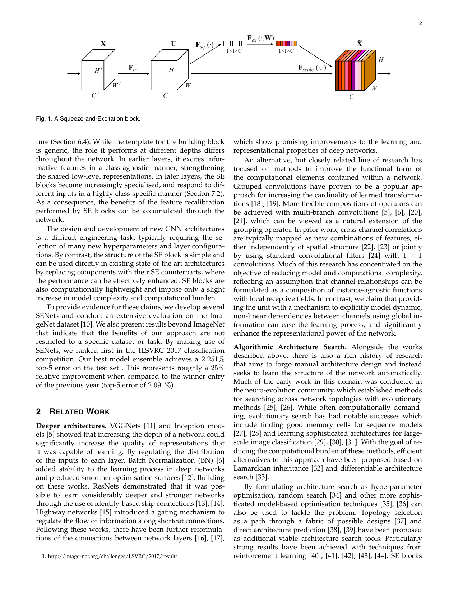
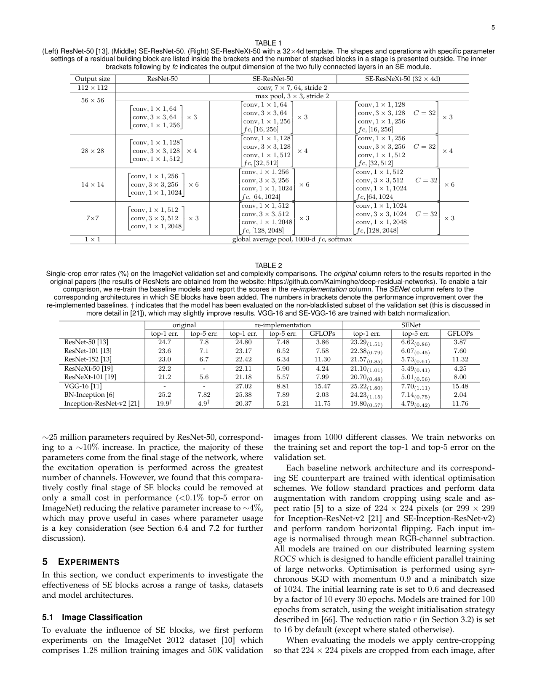

# SENet（2017/2019）· 论文笔记

- **论文**：Squeeze-and-Excitation Networks（IEEE TPAMI 期刊版；会议原文 CVPR 2017；arXiv:1709.01507v4，2019-05-16）
- **作者**：Jie Hu、Li Shen、Samuel Albanie、Gang Sun、Enhua Wu（中科院软件所 / 中科大 / Momenta / Oxford VGG）
- **BibTeX 键名**：`hu2019squeeze`
- **本地 PDF**：`3.科研基本任务/论文/Hu 等 - 2019 - Squeeze-and-Excitation Networks.pdf`（共 13 页）
- **任务书条目**：第 2 周 #9｜🟢 AI 辅助读｜阅读要点：Channel attention 经典实现
- **阅读日期**：2026-10-31
- **核对规则**：数字后的「出处」指回原 PDF 的 §章节 / Table n / Fig n / p.页码；✅ = 已回原文查证。

---

## 0. 术语表（零基础全能版 · 先看这一节再看正文）

> SENet 的公式只有 4 个，但术语密度很高（"通道"这件事要从卷积的定义讲起）。按「卷积与特征 → SE 三步 → 宿主网络 → 训练 → 评估与竞赛」分组。

### 0.1 卷积与特征表示（为什么要谈"通道"）

| 术语（英文原词） | 大白话解释（在本篇里的含义） |
|---|---|
| **convolution operator（卷积算子）** | 在每个局部窗口里，把"空间信息"和"跨通道信息"一起加权求和（式 (1)，p.3）。原文的立论就建立在这：**卷积的通道关系是"隐式"的**，被空间相关"纠缠"在一起，没人显式建模过。 |
| **transformation $\mathcal{F}_{tr}$** | 广义的"任意一层变换"，本篇取它就是卷积（也可以是整个 Inception 块或残差支路，§3.3 p.4）。输入 $X\in\mathbb{R}^{H'\times W'\times C'}$，输出 $U\in\mathbb{R}^{H\times W\times C}$。 |
| **channel（通道）** | 特征图的"厚度"，即有多少张特征图叠在一起。**本篇所有的操作都只在 C 这个维度上做**，不动 H、W。 |
| **filter kernel $v_c$ / $v_c^s$** | 第 $c$ 个卷积核的全部参数 / 其中作用于第 $s$ 个输入通道的那一片 2D 核（p.3）。 |
| **receptive field（感受野）** | 一个输出神经元能看到的输入范围。原文的关键句：**每个滤波器只有局部感受野，所以看不到全局上下文**（§3.1 p.3）——这就是必须加 squeeze 的理由。 |
| **1×1 conv（逐点卷积）** | 只看单个像素、跨通道线性组合。**在 SE 里它是"不该用的东西"**：§7.1 的 NoSqueeze 变体把两层 FC 换成两层 1×1 卷积，精度就掉（Table 16）。 |
| **global average pooling（GAP，全局平均池化）** | 把 C 张 H×W 的图各自压成一个平均数，得到长度 C 的向量（式 (2)）。朴素做法：全连接层直接砸到 1 维（参数爆炸）；优化做法：**先空间平均再进 FC**（参数只和 C 有关）。为什么有效：平均本身就是"这个通道整体有多活跃"的统计量，且天然与输入尺寸无关。 |
| **global max pooling** | 同上但取最大值。§6.2 对比过：Max 22.57/6.09 略差于 Avg 22.28/6.03（Table 11）。 |
| **spatial dimension / 空间维度** | H×W 这两个方向。SE 把它们**压掉**，只留通道，所以 SE 是"通道注意力"而不是"空间注意力"。 |

### 0.2 SE 三步（本篇的核心）

| 术语（英文原词） | 大白话解释（在本篇里的含义） |
|---|---|
| **SE block（Squeeze-and-Excitation 块）** | 一个"即插即用"的小模块：GAP → 两层 FC（降维再升维）→ Sigmoid → 逐通道相乘。**输入输出形状完全相同**，所以能塞进任何网络（Fig 1 p.2）。 |
| **channel attention（通道注意力）** | 给每个通道打一个 0–1 的分、再乘回去，让网络自己决定"哪些通道重要"。**朴素做法**：固定权重或手工设通道重要性；**优化做法**：用输入自己算权重（self-gating，与样本相关）；**为什么有效**：同一层对不同图片需要的通道不同，"按图定权"比"一套固定权重"表达力强。它与 **spatial attention（空间注意力，看"哪个位置重要"）** 是两个正交维度，本篇只做通道（§2 p.2）。 |
| **squeeze（压缩）** | 第一步，式 (2)：用 GAP 把 $H\times W\times C$ 压成 $1\times1\times C$。原文叫它 "global information embedding"——把全局信息塞进一个通道描述子。 |
| **channel descriptor $z$（通道描述子）** | squeeze 的输出，$z\in\mathbb{R}^{C}$，第 $c$ 个元素 $z_c$ = 第 $c$ 个通道的平均响应。它是"这个通道整体上有多重要"的原始证据。 |
| **excitation（激励）** | 第二步，式 (3)：$s=\sigma(W_2\,\delta(W_1 z))$，把 $z$ 变成 C 个 0–1 的门控权重。原文要求它满足两条：**能学非线性交互**、**不能是 one-hot（允许多通道同时被激活）**——这两条正好排除了 softmax。 |
| **gating / self-gating（门控/自门控）** | 用输入自己算出一个"开关"，再乘回自己。SE 属于 self-gating：门控信号完全由当前输入产生，与样本相关（同一层对不同图片给出不同权重）。 |
| **bottleneck（瓶颈）** | 中间层把通道压到 $C/r$ 再升回去。朴素做法：一个 $C\to C$ 的满秩 FC（$C^2$ 参数）；优化做法：**降维 → ReLU → 升维**。为什么有效：参数从 $C^2$ 降到 $2C^2/r$（r=16 时省 8 倍），同时强迫网络学"通道组合的低秩表达"而不是死记。 |
| **reduction ratio $r$** | 瓶颈的压缩比，默认 **16**（§5.1 p.5）。r 越大越省参数、但表达能力下降；Table 10 显示 r=16 是精度/成本的折中点。 |
| **ReLU $\delta(\cdot)$** | 中间那层非线性，逐元素 $\max(0,x)$。§6.3 说它是**必须的**：如果把"最终的 Sigmoid"换成 ReLU，精度直接崩（Table 12）。 |
| **sigmoid $\sigma(\cdot)$** | 把权重压到 (0,1)。选它的理由：① 输出可当"比例"用；② 不做归一化，因此**多个通道可以同时接近 1**（不是 one-hot）。换成 tanh 略差（23.00/6.38），换成 ReLU 灾难（23.47/6.98）。 |
| **scale / reweight（重标定）** | 第三步，式 (4)：$\tilde{x}_c=s_c\,u_c$，一个标量乘一整张 H×W 图（广播）。**这就是"注意力"落地的那一步**：重要通道放大、无用通道抑制。 |
| **scale factor（缩放因子）** | 就是 $s_c$，一个 0–1 的标量。注意它不是"权重矩阵"，参数量为 0（参数全在两层 FC 里）。 |
| **drop-in replacement（即插即用替换）** | SE 块形状不变，可以直接把原网络的 block 换成 SE 版本，不用改别的（§1 p.1、§3.3 p.4）。这是它能横扫所有 backbone 的根本原因。 |

### 0.3 宿主网络

| 术语（英文原词） | 大白话解释（在本篇里的含义） |
|---|---|
| **residual block（残差块）** | ResNet 的基本单元：支路算 $F(x)$，再与恒等映射 $x$ 相加。**SE 插在"支路算完、还没相加"的位置**（Fig 3 p.4）。 |
| **identity branch / non-identity branch** | 直连的那条（$x$）／做卷积的那条（$F(x)$）。原文："Squeeze and Excitation both act before summation with the identity branch"（§3.3 p.4）。 |
| **Inception module** | GoogLeNet 的多分支模块（1×1/3×3/5×5 并行后 concat）。SE-Inception 就是"把整个 Inception 块当作 $\mathcal{F}_{tr}$"（Fig 2 p.4）。 |
| **SE-ResNet / SE-Inception / SE-ResNeXt** | 把 SE 塞进对应网络的产物。SE-ResNet-50 的逐层配置见 Table 1（p.5）。 |
| **cardinality（基数）** | ResNeXt 里"分组数"，SE-ResNeXt-50 用 32×4d 模板（Table 1）。 |
| **depthwise separable conv（深度可分离卷积）** | MobileNet 的核心：先逐通道卷积再 1×1 组合，大幅降算力。SE 加成后 MobileNet 28.4→25.3（Table 3）。 |
| **stage（阶段）** | 输出尺寸相同的一组 block。SE-ResNet-50 有 4 个 stage（输出 56/28/14/7），**stage 数 $S$ 是参数量公式 (5) 里的求和上限**。 |
| **SENet-154** | ILSVRC 2017 提交用的最大模型：SE + 改造版 ResNeXt-152（64×4d），附录 p.11–12 列了 7 条改造细节。 |

### 0.4 训练

| 术语（英文原词） | 大白话解释 |
|---|---|
| **from scratch（从头训练）** | 不用预训练权重，100 epoch 训完（§5.1 p.5）。所以 baseline 也要自己重训——这就是 Table 2 有 "re-implementation" 列的原因。 |
| **synchronous SGD** | 多卡算完再平均梯度。minibatch **1024**、momentum 0.9、初始 lr **0.6**、**每 30 epoch ×0.1**、共 100 epoch（§5.1 p.5）。 |
| **label smoothing（标签平滑）** | 把 one-hot 标签改成 $1-\epsilon$ / $\epsilon$ 的软标签，抑制"过度自信"。消融实验里用了（§6 p.8），SENet-154 也用了（附录 (e)）。 |
| **weight initialisation [66]** | 原文引用 [66] 的初始化策略（§5.1 p.5），具体公式【待核对】，不在正文展开。 |
| **data augmentation** | 随机尺度/长宽比裁剪到 224（IRv2 用 299）+ 随机水平翻转 + 减均值（§5.1 p.5）。mobile 网络用更温和的增强（§5.1 p.6）。 |
| **ROCS** | 作者自研的分布式训练系统（§5.1 p.5）。等价于今天的 DDP。 |
| **Titan X / 8 GPUs** | 测速用 8 张 Titan X（§4 p.4）；主实验也在单机 8 卡（§6 p.8）；SENet-154 用 **64 张卡、batch 2048、lr 1.0**（附录 (g)）。 |

### 0.5 评估与竞赛（最容易被带偏的一组）

| 术语（英文原词） | 大白话解释（在本篇里的含义） |
|---|---|
| **top-1 / top-5 error** | top-1：第一名猜错的比例；top-5：正确答案不在前 5 的比例。**ILSVRC 主指标是 top-5**，但论文表格里两个都给——**看提升要看同一列**。 |
| **single-crop（单裁剪）** | 只从图中心裁一块（224×224，短边先缩到 256）评估（§5.1 p.5–6）。**Table 2–8 全是 single-crop**，这是最保守的口径。 |
| **centre-crop** | 上面那种"中心裁剪"的具体做法，与 multi-crop 相对。 |
| **multi-crop（多裁剪）** | 在图上按网格裁多块（含翻转）分别预测再平均。比 single-crop 好 1 个点以上，但慢 N 倍。 |
| **multi-scale + multi-crop fusion（多尺度多裁剪融合）** | 竞赛提交用的标准套路：多尺度 × 多裁剪 × 翻转，全部取平均。**2.251% 就是这么来的**（§5.4 p.7）。 |
| **ensemble（集成）** | 多个模型预测平均。**2.251% 是"a small ensemble of SENets"**，不是单模型——这是本篇最容易被误传的数字（见 §5 核对表）。 |
| **ILSVRC 2017** | ImageNet 大规模视觉识别挑战赛 2017 届分类赛道，SENet **第一名**；2016 冠军 top-5 是 **2.991%**，相对提升 **~25%**（摘要 p.1、§5.4 p.7）。 |
| **validation vs test set** | 验证集 50k（有标签，可调参）；测试集标签不公开，只能提交服务器。**Table 2–3、8–9 是验证集，2.251% 是测试集**。 |
| **blacklisted subset（†）** | IRv2 原文在验证集里剔除了部分"与训练集重复"的图，† 表示用了这个子集，数字略好看（Table 2 表注 p.5）。 |
| **GFLOPs / MFLOPs** | 一次前向的浮点运算量（十亿/百万次）。ResNet-50 3.86 GFLOPs，SE 版 3.87（§4 p.4）。 |
| **Params（M）** | 参数量（百万）。ResNet-50 25.6M，SE-ResNet-50 28.1M（Table 10 p.8）。 |
| **CIFAR-10/100、Places365、COCO minival** | 三个"换个数据集/任务还灵不灵"的验证场：CIFAR 32×32 小图（Table 4/5）、Places365 场景分类（Table 6）、COCO 检测（Table 7）。 |
| **trunk architecture（主干）** | 检测器里负责提特征的那部分（这里是 ResNet / SE-ResNet），换掉它、其他不动，才能把涨点归因于"特征更好"（§5.3 p.7）。 |

---

## 1. 一句话说清

**问题**：卷积把"空间"和"通道"的信息一起揉进一个核里，**通道之间的关系是隐式的、且被局部感受野限制**（§3 p.3）。此前的研究几乎都在改空间维度（多尺度、空间注意力），没人显式建模"哪些通道更重要"。

**做法**：插一个 **SE block**，三步——① **squeeze**：GAP 把每个通道压成一个数 $z_c$；② **excitation**：$z\to$ FC($C/r$) $\to$ ReLU $\to$ FC($C$) $\to$ Sigmoid，得到 C 个 0–1 权重；③ **reweight**：逐通道乘回原特征。输入输出形状不变，可即插即用地替换任意 block。

**结果**：ImageNet 单裁剪 **SE-ResNet-50 top-5 6.62%**（ResNet-50 7.48%，**降 0.86**），已接近更深的 ResNet-101（6.52%）却只要一半算力（**3.87 vs 7.58 GFLOPs**，Table 2 p.5）；参数只多 **~2.5M（+10%）**、算力只多 **0.26%**（§4 p.4）。以此为基础拿下 **ILSVRC 2017 分类第一**，测试集 top-5 **2.251%**，比 2016 冠军 2.991% 相对提升 **~25%**。

> **背下来：SE = 让每个通道先"看一眼全局"（GAP），再用一个 16 倍瓶颈的两层 FC 学出 0–1 的门控权重，最后乘回去——参数量 +10%、算力 +0.26%，换 ResNet-50 上 0.86 个点的 top-5（VGG-16 上 1.11 个点）。**

---

## 2. 核心图 / 公式

### 2.1 必看 Figure 1：一个块只有三步（p.2）



看这张图只需盯住**形状那条线**：$X(H'\times W'\times C') \xrightarrow{\mathcal{F}_{tr}}$ $U(H\times W\times C)$ $\xrightarrow{F_{sq}}$ $1\times1\times C$ $\xrightarrow{F_{ex}(\cdot,W)}$ $1\times1\times C$ $\xrightarrow{F_{scale}}$ $\tilde X(H\times W\times C)$。**进出的形状完全一样**——这就是"即插即用"的全部秘密。

> 右半页第 4 段给出了竞赛口径的原话："a small ensemble of SENets ... 2.251%"，以及对比 2016 冠军 "top-5 error of 2.991%"。**这两句必须和 Table 2 的 6.62% 分开记。**

### 2.2 四个公式（§3 p.3，✅）

**(1) 卷积本身**（说明"通道关系为什么是隐式的"）：

$$
u_c=v_c * X=\sum_{s=1}^{C'} v_c^s * x^s
$$

$v_c^s$ 是第 $c$ 个核作用在第 $s$ 个输入通道上的 2D 核。**求和跨所有输入通道**，所以通道关系被"混"进了 $v_c$ 里，与空间相关纠缠在一起。

**(2) squeeze**：

$$
z_c=F_{sq}(u_c)=\frac{1}{H\times W}\sum_{i=1}^{H}\sum_{j=1}^{W}u_c(i,j)
$$

| 符号 | 含义 | 本篇取值 |
|---|---|---|
| $u_c(i,j)$ | 第 $c$ 个通道在位置 $(i,j)$ 的响应 | 实数 |
| $H\times W$ | 空间尺寸（分母就是元素个数，即平均） | 随层变化 |
| $z_c$ | 第 $c$ 个通道的全局描述子 | 实数 |

**(3) excitation**：

$$
s=F_{ex}(z,W)=\sigma\big(g(z,W)\big)=\sigma\big(W_2\,\delta(W_1 z)\big)
$$

| 符号 | 含义 | 本篇取值 |
|---|---|---|
| $W_1$ | 降维 FC | 形状 $\frac{C}{r}\times C$ |
| $\delta$ | ReLU | 逐元素 |
| $W_2$ | 升维 FC | 形状 $C\times\frac{C}{r}$ |
| $\sigma$ | Sigmoid | 输出 (0,1) |
| $s$ | C 个通道权重 | $s\in\mathbb{R}^{C}$ |

**(4) reweight**：

$$
\tilde x_c=F_{scale}(u_c,s_c)=s_c\,u_c
$$

**为什么这三步能成立（原文的论证链，不是我的推断）**：

1. 卷积核只有局部感受野 → 单个输出单元看不到全局 → **必须 squeeze**（§3.1 p.3）；
2. 要建模通道依赖，函数必须"**灵活（能学非线性交互）**"且"**非互斥（允许多通道同时被激活）**" → 用两层 FC + Sigmoid，**不能用 softmax**（§3.2 p.3）；
3. 加瓶颈是为了"limit model complexity and aid generalisation"（§3.2 p.3）——省参数 + 正则。

### 2.3 参数量 / 计算量到底加了多少（§4 p.4–5，✅ 可复算）

**公式 (5)**（两层 FC 引入的参数量）：

$$
\frac{2}{r}\sum_{s=1}^{S}N_s\,C_s^2
$$

| 符号 | 含义 | 取值（SE-ResNet-50） |
|---|---|---|
| $r$ | reduction ratio | 16 |
| $S$ | stage 数 | 4 |
| $N_s$ | 该 stage 重复几个 block | 3 / 4 / 6 / 3（Table 1） |
| $C_s$ | 该 stage 输出通道 | 256 / 512 / 1024 / 2048 |

**自己算一遍**（把 Table 1 的数字代进去）：

```
(2/16) × [3×256² + 4×512² + 6×1024² + 3×2048²]
= 0.125 × [196608 + 1048576 + 6291456 + 12582912]
= 0.125 × 20119552 = 2,514,944 ≈ 2.5 M
```
与原文"∼2.5 million additional parameters ... ∼10% increase"（p.5）**完全对上**（2.5/25.6 ≈ 9.8%）。

| 指标 | ResNet-50 | SE-ResNet-50 | 增量 |
|---|---|---|---|
| 参数量 | 25.6 M | 28.1 M | **+2.5 M ≈ +10%** |
| GFLOPs | 3.86 | 3.87 | **+0.01 ≈ +0.26%**（相对） |
| 训练（minibatch 256，8×Titan X） | 190 ms | 209 ms | +10% |
| CPU 推理（224 图） | 164 ms | 167 ms | **+1.8%** |

原文还给了两个"省钱"结论：① 参数主要来自**最后一个 stage**（通道最多）；② **去掉最后 stage 的 SE 只掉 <0.1% top-5**，参数增量降到 **~4%**（p.5）。→ 所以"SE 很贵"是错的，"最后 stage 的 SE 很贵且没用"才对。

### 2.4 结构表：SE-ResNet-50（Table 1，p.5，✅）

| 输出尺寸 | 模块 | 重复 | 通道 | SE 的两层 FC |
|---|---|---|---|---|
| 112×112 | 7×7 conv, 64, stride 2 | 1 | 64 | — |
| 56×56 | max pool 3×3 / 2 | 1 | 64 | — |
| 56×56 | [1×1,64; 3×3,64; 1×1,256] | 3 | 256 | **fc [16, 256]** |
| 28×28 | [1×1,128; 3×3,128; 1×1,512] | 4 | 512 | **fc [32, 512]** |
| 14×14 | [1×1,256; 3×3,256; 1×1,1024] | 6 | 1024 | **fc [64, 1024]** |
| 7×7 | [1×1,512; 3×3,512; 1×1,2048] | 3 | 2048 | **fc [128, 2048]** |
| 1×1 | GAP + 1000-d FC + softmax | 1 | — | — |

注意 fc 里的 `[16, 256]` 意思是 **256 → 16 → 256**（$r=16$），不是"16 通道"。**这行是理解 Eq (5) 的钥匙。**

### 2.5 插在残差块的哪个位置（Fig 2/3，p.4）

- **SE-Inception**：$\mathcal{F}_{tr}$ = 整个 Inception 块，SE 接在它的 concat 输出之后（Fig 2）。
- **SE-ResNet**：$\mathcal{F}_{tr}$ = 残差块的**非恒等支路**，SE 作用在 $F(x)$ 上，**在与 $x$ 相加之前**（Fig 3）。→ 和 `ResNet + SE` 的直觉一致：先把支路特征重标定好，再加回主干，避免污染恒等路径。
- **不共享 FC**：每个 block 有自己的一套 SE 参数（Table 1 逐层列出）。

---

## 3. 关键实验数据

### 3.1 主结果：ImageNet 单裁剪（Table 2，p.5，✅）



| 网络 | 原始论文 top-1 / top-5 | 复现 top-1 / top-5 | GFLOPs | **+SE 后 top-1 / top-5** | +SE 后 GFLOPs |
|---|---|---|---|---|---|
| ResNet-50 | 24.7 / 7.8 | 24.80 / 7.48 | 3.86 | **23.29(1.51) / 6.62(0.86)** | 3.87 |
| ResNet-101 | 23.6 / 7.1 | 23.17 / 6.52 | 7.58 | 22.38(0.79) / 6.07(0.45) | 7.60 |
| ResNet-152 | 23.0 / 6.7 | 22.42 / 6.34 | 11.30 | 21.57(0.85) / 5.73(0.61) | 11.32 |
| ResNeXt-50 | 22.2 / — | 22.11 / 5.90 | 4.24 | 21.10(1.01) / 5.49(0.41) | 4.25 |
| VGG-16（加 BN） | — / — | 27.02 / 8.81 | 15.47 | 25.22(1.80) / 7.70(1.11) | 15.48 |
| BN-Inception | 25.2 / 7.82 | 25.38 / 7.89 | 2.03 | 24.23(1.15) / 7.14(0.75) | 2.04 |
| Inception-ResNet-v2 | 19.9† / 4.9† | 20.37 / 5.21 | 11.75 | 19.80(0.57) / 4.79(0.42) | 11.76 |

**四个易误读点**：

1. **括号里的 1.51/0.86 是相对"复现基线"，不是相对原始论文**。原文表注明写 "The numbers in brackets denote the performance improvement over the re-implemented baselines"（p.5）。ResNet-50 原始 top-5 是 7.8，复现是 7.48，SE 是 6.62 → 对原始是 **1.18**，对复现才是 **0.86**。
2. **"SE-ResNet-50 超过 ResNet-101"是错的**：6.62 vs 6.52，**还差 0.10**。原文用词是 "approaching the performance achieved by the much deeper ResNet-101"（§5.1 p.6）。
3. **SE-ResNet-101 反超 ResNet-152 才算真的"越级"**：6.07 vs 6.34，好 **0.27**（§5.1 p.6）。
4. **† 号的 IRv2 用了"非黑名单子集"**，和别人的数字不完全可比（表注 p.5）。

### 3.2 消融：SE 的每个设计选择值多少（Table 10–16，p.8–9，✅）

| 消融维度 | 配置 | top-1 | top-5 | Params | 出处 |
|---|---|---|---|---|---|
| **r** | r=2 | 22.29 | 6.00 | 45.7M | Table 10 |
| | r=8 | 22.26 | **5.99** | 30.7M | Table 10 |
| | **r=16（默认）** | 22.28 | 6.03 | 28.1M | Table 10 |
| | r=32 | 22.72 | 6.20 | 26.9M | Table 10 |
| | 无 SE（baseline） | 23.30 | 6.55 | 25.6M | Table 10 |
| **squeeze** | Max pooling | 22.57 | 6.09 | — | Table 11 |
| | **Avg pooling** | 22.28 | 6.03 | — | Table 11 |
| **excitation 非线性** | ReLU | 23.47 | 6.98 | — | Table 12 |
| | Tanh | 23.00 | 6.38 | — | Table 12 |
| | **Sigmoid** | 22.28 | 6.03 | — | Table 12 |
| **加在哪个 stage** | 只 stage2 | 23.03 | 6.48 | 25.6M | Table 13 |
| | 只 stage3 | 23.04 | 6.32 | 25.7M | Table 13 |
| | 只 stage4 | 22.68 | 6.22 | 26.4M | Table 13 |
| | **全部** | 22.28 | 6.03 | 28.1M | Table 13 |
| **插在哪** | SE（标准，相加前） | 22.28 | 6.03 | 28.1M | Table 14 |
| | SE-PRE（残差单元前） | 22.23 | 6.00 | — | Table 14 |
| | SE-POST（相加、ReLU 后） | 22.78 | 6.35 | — | Table 14 |
| | SE-Identity（接在恒等支路） | 22.20 | 6.15 | — | Table 14 |
| **放在 3×3 之后** | SE 3×3 | 22.48 | 6.02 | **25.8M** | Table 15 |
| **去掉 squeeze** | NoSqueeze（两层 1×1 卷积） | 22.93 | 6.39 | 28.1M（**4.27 GFLOPs**） | Table 16 |

**这张表的四条必背结论**：

1. **r 不是越大越好、也不是越小越好**：r=2 参数 45.7M 只换来 6.00；r=16 用 28.1M 拿 6.03。原文结论 "performance is robust to a range of reduction ratios ... r=16 achieves a good balance"（§6.1 p.8）。r=4/8 的 top-1 甚至略好，说明**单调性不存在**。
2. **ReLU 版比没有 SE 还差**（6.98 vs baseline 6.55）→ excitation 的构造很脆弱，sigmoid 是必需品，不是顺手一写（§6.3）。
3. **每个 stage 单加都涨，全加更多**：baseline 6.55 → 只 stage2 6.48（几乎没涨）、只 stage3 6.32、只 stage4 6.22（单加最强）、全加 6.03；但**全加参数增量 2.5M，只加 stage4 只要 0.8M**（25.6→26.4），性价比是 stage4 最高。
4. **NoSqueeze 是关键对照**：同样 28.1M 参数，把 GAP 换成两层 1×1 卷积（保留"全局"其实做不到，因为 1×1 只有局部）→ 6.39，还多花 0.4 GFLOPs（4.27 vs 3.87）。**证明"全局"本身比"参数"更值钱**（§7.1 p.9）。

### 3.3 泛化到别的数据集 / 任务（Table 3–7，p.6–7，✅）

| 数据集 | 基线 | +SE | 出处 |
|---|---|---|---|
| CIFAR-10 | ResNet-110 6.37 / ResNet-164 5.46 / WRN-16-8 4.27 / Shake-Shake+Cutout 2.56 | **5.21 / 4.39 / 3.88 / 2.12** | Table 4 |
| CIFAR-100 | 26.88 / 24.33 / 20.43 / 15.85 | **23.85 / 21.31 / 19.14 / 15.41** | Table 5 |
| Places365 | ResNet-152 41.15 / 11.61；Places-365-CNN 41.07 / 11.48 | **SE-ResNet-152 40.37 / 11.01** | Table 6 |
| COCO 检测（Faster R-CNN） | R50 57.9 / 38.0；R101 60.1 / 39.9 | **SE-R50 61.0 / 40.4；SE-R101 62.7 / 41.9** | Table 7 |
| MobileNet-224 | 28.4 / 9.4（4.2M, 569MFLOPs） | **25.3 / 7.7（4.7M, 572）** | Table 3 |
| ShuffleNet 1× | 32.6 / 12.5（1.8M, 140） | **31.0 / 11.1（2.4M, 142）** | Table 3 |

> **易误读**：Table 7 的 57.9/38.0 是 **AP@IoU=0.5 / AP（COCO 两个口径）**，不是 top-1/top-5；表头 p.7 写得很清楚。**把它当成"分类准确率 57.9%"就错了。**
> **另一处**：ShuffleNet 加 SE 后参数从 1.8M 涨到 **2.4M（+33%）**，对小模型来说这个相对代价并不小——"SE 几乎零成本"只对大模型成立。

### 3.4 竞赛与 SOTA 对照（Table 8/9，p.8，✅）

| 模型 | 裁剪 | top-1 | top-5 |
|---|---|---|---|
| SENet-154 | 224 | **18.68** | **4.47** |
| SENet-154 | 320 | **17.28** | **3.79** |
| DPN-131 | 224 / 320 | 19.93 / 18.55 | 5.12 / 4.16 |
| PyramidNet-200 | 224 / 320 | 20.1 / 19.2 | 5.4 / 4.7 |
| Attention-92 | 320 | 19.5 | 4.8 |
| SENet-154†（Table 9） | 320 | **16.88** | **3.58** |
| NASNet-A（Table 9） | 331 | 17.3 | 3.8 |
| AmoebaNet-C（Table 9） | 331 | 16.5 | 3.5 |
| ResNeXt-101 32×48d（**额外数据**） | 224 | **14.6** | **2.4** |

> **最易误读**：Table 9 里 14.6/2.4 是**用十亿级弱标注数据预训练**的结果（§5.4 p.8），和只用 ImageNet 的 16.88/3.58 不是一个赛道。**别把 2.4% 当成"架构差距"。**

---

## 4. 我的思考

1. **它是"发明了一个小零件 + 大规模验证"，而不是"发明了一个新网络"。**【原文结论】作者通篇强调 SE 是 drop-in、轻量、可插拔（§1 p.1–2），并把 7 种 backbone（ResNet / ResNeXt / Inception-ResNet-v2 / VGG-16 / BN-Inception / MobileNet / ShuffleNet）全部刷了一遍。【我的推断】这篇的说服力一半来自零件简单，一半来自**实验矩阵足够宽**——单看 ResNet-50 的 0.86 个点，你无法判断它是不是调参运气。
2. **边界：解释很浅，且对"小模型"和"最后一层"不友好。**【原文结论】§7 只是经验观察（Fig 6/7 的激活分布），作者自己说 "A rigorous theoretical analysis ... remains challenging"（§7 p.9）；最后 stage 的 SE 常饱和到 ~1，等价于恒等映射，去掉只掉 <0.1%（p.5）。【我的推断】"通道注意力"这个解释更像事后叙事：NoSqueeze（Table 16）和 SE 3×3（Table 15）都能拿到接近的精度，说明**涨点可能来自"多了一层带全局统计的非线性"，而不一定是"注意力"本身**。【课外补充·待核实】CBAM/ECA 等后续工作也在争这一点。
3. **消融设计逻辑：五个维度把"块内"和"块外"全覆盖**。块内：r（容量）、squeeze 算子（Avg/Max）、excitation 非线性（ReLU/Tanh/Sigmoid）、要不要全局（NoSqueeze）；块外：加在哪个 stage、插在残差块的哪个位置。**每组只改一个变量，且每组都同时报 GFLOPs/Params**——这让"性价比"可算，而不只是"精度涨了"。这套"精度 + 成本"双列的写法，比只报精度的论文更经得住追问。
4. **如果让我改**：① r 按层自适应（原文自己也说"using an identical ratio throughout a network may not be optimal"，§6.1 p.8）；② 把降维 FC 换成 1D 卷积（ECA 的做法，参数更少且避免降维损失）；③ 把通道权重同时用于**空间**（CBAM 的 spatial attention）；④ 用 SE 权重做**剪枝**（原文 conclusion 亲自点名 "feature importance values ... may be of use for ... network pruning"，§8 p.11）。这四条都是原文自己铺好的路。

---

## 5. 回原文核对记录

| 说法 | 原文依据 | 判定 |
|---|---|---|
| "SENet 单模型 top-5 2.251%" | §5.4 p.7："winning entry comprised a **small ensemble** of SENets ... **multi-scale and multi-crop fusion**" | 🟥 错，是**小集成 + 多尺度多裁剪**，不是单模型 |
| "2.251% 比 2016 冠军提升 25%" | 摘要 p.1：2016 冠军 2.991%，相对提升 ~25% | 🟩 正确（2.991→2.251 的相对降幅约 24.7%） |
| "SE-ResNet-50 超过了 ResNet-101" | §5.1 p.6：6.62 vs 6.52，原文用 "approaching" | 🟥 错，还差 0.10，只是"接近" |
| "SE 只加 10% 参数、0.26% 算力" | §4 p.4–5：+2.5M（~10%）、3.86→3.87（0.26%） | 🟩 正确 |
| "括号里 0.86 是相对原论文 ResNet-50 的提升" | Table 2 表注 p.5：括号相对 **re-implementation**（7.48） | 🟥 错，相对原始 7.8 应是 1.18 |
| "r=16 是精度最高" | Table 10：r=8 的 top-5 5.99 更好，r=2/4 的 top-1 也略好 | 🟨 不完整，r=16 是"精度/参数"折中，非最优精度 |
| "消融表里的 ResNet-50 baseline 和 Table 2 是同一个数" | Table 2 的 ResNet-50 复现是 24.80/7.48；Table 10–16 的 baseline 是 **23.30/6.55** | 🟨 **原文不一致点**：消融用了更长训练（~300 epoch）+ label smoothing（§6 p.8），两处 baseline 不可互比 |
| "SE 里有空间注意力" | §2 p.2、§3 p.3：只建模 **channel** 关系 | 🟥 错（空间注意力是 CBAM 等后续工作） |

---

## 6. 本篇 3 个自测问题

1. **为什么 squeeze 一定要用"全局"池化？把两层 FC 换成两层 1×1 卷积（NoSqueeze）会怎样、为什么算力反而更高？**（提示：Table 16，4.27 vs 3.87 GFLOPs）
2. **为什么 excitation 的 Sigmoid 不能换成 ReLU？**（提示：Table 12，ReLU 6.98 比无 SE 的 6.55 还差；再想"非互斥"这条要求）
3. **用公式 (5) 手算 SE-ResNet-50 的增量参数（2.5M），并说明为什么"去掉最后 stage 的 SE"只掉 <0.1% 却省掉一半以上的增量参数。**
