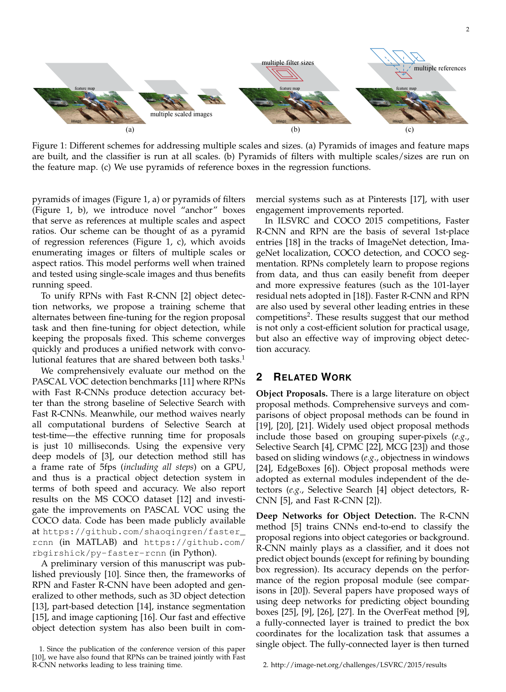
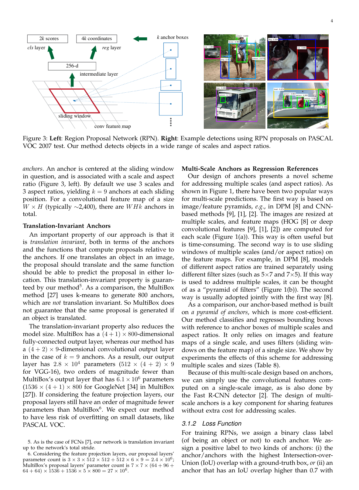
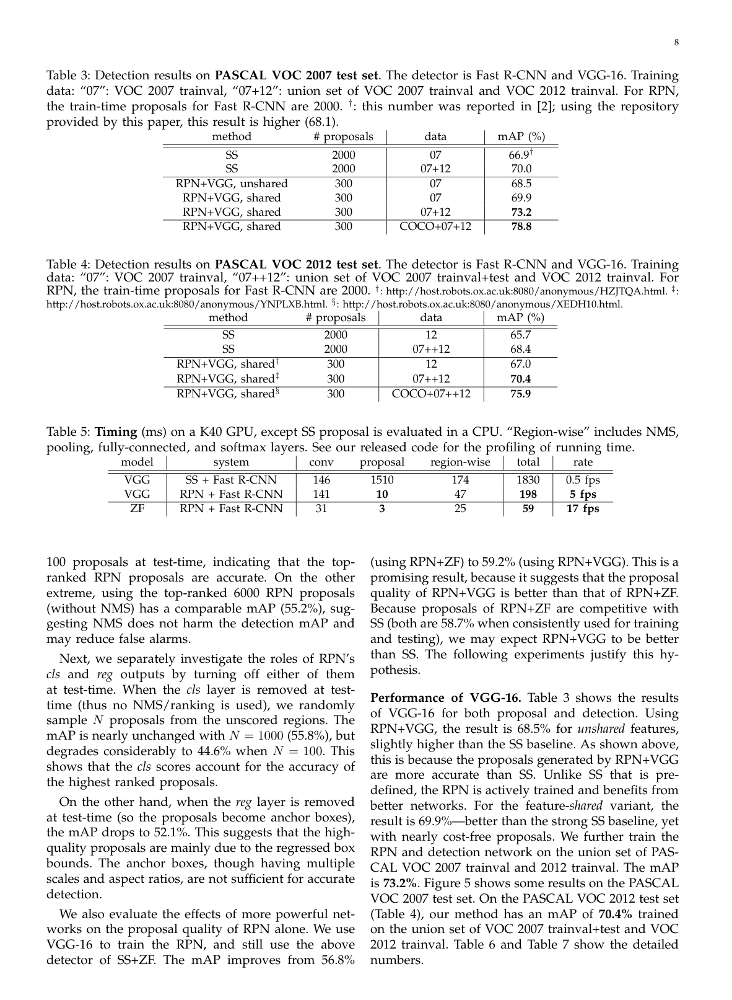

# Faster R-CNN（2015/2016）· 精读型论文笔记

- **论文**：Faster R-CNN: Towards Real-Time Object Detection with Region Proposal Networks
- **作者**：Shaoqing Ren、Kaiming He、Ross Girshick、Jian Sun（中科大 / MSRA / FAIR）
- **版本**：本 PDF 为 arXiv:1506.01497v3（2016-01-06），IEEE 期刊排版；正文说明"会议预印版发表于 [10]"，[10] 的会议信息被 PDF 内图注文字覆盖 →【待核对：参考文献 [10] 条目】
- **BibTeX 键名（建议，非原文给出）**：`ren2015faster`
- **本地 PDF**：`3.科研基本任务/论文/目标检测/Ren 等 - 2016 - Faster R-CNN ... .pdf`（14 页）
- **任务书条目**：第 3 周 #10｜🔴 自精读
- **核对规则**：数字后的「出处」= 原 PDF 的章节 / 表号 / 页码；✅ 已提取全文逐段核对；🟨 大意对但细节需注意；🟥 常见说法与原文不符。

---

## 0. 术语表（零基础版 · ≥40 条）

> 本篇最容易"看懂每个字、但不知道它在系统里干什么"。下面每条都写清**它在 Faster R-CNN 里具体是什么**；0.5 节工程词强制按「朴素做法 → 优化做法 → 为什么有效」展开。

### 0.1 检测任务类

| 术语 | 大白话（在本篇里的含义） |
|---|---|
| **目标检测** | 同时做两件事：认出框里是什么类（分类）+ 把框摆准（定位）（§1 开篇，✅）。 |
| **region proposal（区域提议）** | "先粗猜一堆可能装物体的框"，不管类别；检测流水线的第一级。 |
| **proposal（候选框）** | region proposal 输出的具体框 + 一个 objectness 分数；本篇测试只用 **300 个**（Table 2/3，✅）。 |
| **objectness（物体性）** | "有没有物体（不分品类）"的分数；RPN 的 `cls` 层输出 2 类 softmax（物体/非物体，脚注 4，✅）。 |
| **anchor（锚框）** | 每个滑窗位置预置的**参考框**，带一个尺度 + 一个长宽比；默认 3 尺度 × 3 比例 = **k = 9**（§3.1.1，✅）。**不是检测结果，是回归起点**。 |
| **IoU（交并比）** | 交集面积/并集面积，0–1。本篇两用：给 anchor 打正负标签（>0.7 正、<0.3 负）；NMS 去重（0.7）（§3.1.2、§3.3，✅）。 |
| **GT box（真值框）** | 人工标注的正确框；所有回归都是"把参考框往 GT 挪"。 |
| **正/负/忽略 anchor** | 正：与某 GT 的 IoU **最高** 或与任意 GT 的 IoU **>0.7**；负：与所有 GT 都 **<0.3**；0.3–0.7 之间**不计损失**（§3.1.2，✅）。 |
| **class-agnostic** | 只判"有没有物体"、不分类别；RPN 是 class-agnostic，第二级才是 class-specific（§4.1，✅）。 |
| **class-specific** | 输出 20 类（VOC）+ 背景 = 21 路 softmax。 |
| **two-stage（两阶段）** | 阶段一提框（RPN），阶段二对每个框分类 + 精修（Fast R-CNN）；Table 10 实测比一阶段高 **4.8 个点**（58.7 vs 53.9，✅）。 |
| **one-stage（一阶段）** | 直接在特征图上稠密预测类别 + 框，无独立 proposal 步骤（本篇用"稠密滑窗 + Fast R-CNN"模拟 OverFeat，§4.1，✅）。 |
| **cascade（级联）** | 把"提框"与"分类/精修"串成两级流水线。原文原话：本文是 "a two-stage cascade consisting of class-agnostic proposals and class-specific detections"（§4.1，✅）。**注意**这里的级联只有两级；把第二级内部再拆成多级的是下一篇 Cascade R-CNN。 |
| **hard negative mining（难负样本挖掘）** | 专挑被错判成物体的背景去训；本篇**只在讲 SPPnet 的 SVM 步骤时提到**，Faster 自身用随机采样（§4.2 末，✅）。 |

### 0.2 网络结构类

| 术语 | 大白话 |
|---|---|
| **共享卷积层** | RPN 与 Fast R-CNN 共用的那坨卷积；ZF 5 层、VGG-16 13 层（§3.1，✅）。"共享"是标题里 Real-Time 的全部秘密。 |
| **conv feature map** | 共享卷积最后一层的输出；1000×600 图经总 stride 16 得到约 60×40 格、每格 512 维（VGG）。 |
| **RPN** | 全卷积小网络：滑 3×3 窗口，每位置同时输出"9 个 anchor 是不是物体"（2k 个数）和"该往哪挪"（4k 个数）。 |
| **滑窗 n×n** | 原文 **n = 3**；对应原图有效感受野 **171（ZF）/ 228（VGG）像素**（§3.1，✅）。 |
| **mini-network** | 滑窗 → 256-d（ZF）/512-d（VGG）中间层 → 两个兄弟层。 |
| **sibling layers（兄弟层）** | `reg`（4k 输出）与 `cls`（2k 输出）并列挂在同一中间特征上，互不依赖。 |
| **1×1 卷积实现** | 那两个"全连接"实际是 1×1 卷积，于是权重在所有空间位置共享——RPN 能"一次前向、全图出结果"的关键（§3.1，✅）。 |
| **RoI Pooling** | 把任意大小的候选区域池化成固定 7×7×512 特征块，好接全连接（Fast R-CNN [2] 提供）。 |
| **检测头** | Fast R-CNN 那一半：RoI Pooling → FC → 21 类 softmax + 每类 4 个框偏移。 |
| **FCN（全卷积网络）** | 只用卷积、不要固定尺寸全连接的网络；原文说 RPN "是一种 FCN"，故可吃任意尺寸输入（§1，✅）。 |
| **总 stride** | 原图到特征图的缩尺倍数；ZF/VGG 均为 **16**，对典型 PASCAL 图（约 500×375）≈ 原图 **10 像素**一格（§3.3，✅）。 |
| **平移不变性** | 物体平移 → proposal 跟着平移，且用**同一套**权重预测；原文用它批评 MultiBox 的 800 个 k-means anchor 不具此性质（§3.1.1，✅）。脚注 5：只在这个总 stride 精度内成立。 |
| **ZF / VGG-16** | 两种骨干。ZF：5 卷积 + 3 全连接（"fast" 版）；VGG-16：13 卷积 + 3 全连接（§4.1，✅）。**5 fps 是 VGG，17 fps 是 ZF**（Table 5）。 |

### 0.3 训练类

| 术语 | 大白话 |
|---|---|
| **multi-task loss** | 一个损失里同时装分类与回归，λ 配比（式 (1)）。 |
| **smooth L1** | 鲁棒回归损失：小误差像 L2、大误差像 L1；由 Fast R-CNN [2] 引入（§3.1.2，✅）。 |
| **λ** | 两项权重，默认 **10**；Table 9 显示 0.1–100 内 mAP 只波动约 1 个点（✅）。 |
| **N_cls / N_reg** | 归一化分母：**N_cls = 256（mini-batch 大小）**，**N_reg ≈ 2400（anchor 位置数）**；正因如此 λ=10 才"两项大致等权"（§3.1.2，✅）。 |
| **image-centric 采样** | 一个 batch 只来自一张图，从该图 anchor 抽 256 个，正:负 ≤ 1:1；正样本不足 128 用负样本补满。 |
| **为什么不全用** | 全用会"被负样本淹没"（原文：bias towards negative samples as they are dominate，§3.1.3，✅）。 |
| **end-to-end** | 输入图到输出框梯度一路回传、不靠人工中间模块。**注意本文是"分模块端到端"**：RPN 可端到端训、检测网可端到端训，合成一个靠交替训练（§3.1.3/§3.2，✅）。 |
| **alternating training（交替训练）** | 训 RPN → 用其 proposal 训 Fast R-CNN → 用检测网初始化 RPN → 再回头；**本文所有实验都用它**（§3.2 (i)，✅）。 |
| **approximate joint training（近似联合）** | 训练时合成一个网；前向把 proposal 当**固定**；反向把两个损失的梯度**合并**回传共享层。**近似**在哪：忽略"框坐标也是网络输出"的导数。比交替**快 25–50%**，结果接近，官方 Python 代码用它（§3.2 (ii)，✅）。 |
| **non-approximate joint training** | 严格版需要对框坐标可导的 RoI pooling（原文指向 [15] 的 "RoI warping"），本篇不做（§3.2 (iii)，✅）。 |
| **4-step alternating training（四步）** | ①训 RPN；②用①proposal 训 Fast R-CNN（此时不共享）；③用②权重初始化 RPN，**冻结共享卷积**只调 RPN 独有层；④**冻结共享卷积**只调检测头独有层。 |
| **ImageNet 预训练** | 共享层用 ImageNet 分类模型初始化；新增层均值 0、标准差 0.01 高斯初始化（§3.1.3，✅）。 |
| **微调范围** | ZF 全调；VGG 只从 conv3_1 往上调（**为省显存**，§3.1.3，✅）。 |
| **优化设置** | VOC：lr 0.001 跑 60k 次、再 0.0001 跑 20k 次；momentum 0.9；weight decay 0.0005；框架 Caffe（§3.1.3，✅）。 |
| **忽略越界 anchor** | 训练丢掉跨出图像边界的 anchor；否则目标函数出现"大而难修正的误差项"，训练不收敛（§3.3，✅）。测试不丢，改为裁到图内。 |

### 0.4 评估类

| 术语 | 大白话 |
|---|---|
| **mAP** | 每类算 AP 再取平均；原文强调"检测要看 mAP，别只看 proposal 代理指标"（§4.1，✅）。 |
| **AP / AP50 / AP75** | COCO 口径：AP = IoU 0.5→0.95（步长 0.05）平均；AP50 只算 0.5（≈VOC 口径）；AP75 只算 0.75（更严）。本篇正文写作 **mAP@[.5,.95]** 与 **mAP@0.5**（§4.2，✅）。 |
| **VOC / COCO** | VOC：20 类，约 5k trainval + 5k test（2007），mAP@0.5；COCO：80 类，80k train / 40k val / 20k test-dev，mAP@[.5,.95]（§4.1/4.2，✅）。 |
| **recall-to-IoU** | 固定取前 N 个 proposal，看在某 IoU 阈值能召回多少 GT；原文说它只与最终精度"松散相关"，**适合诊断 proposal、不适合当最终指标**（§4.1，✅）。 |
| **top-N proposals** | 按分数取前 N；**N 是上限**，NMS 后可能更少（脚注 8，✅）。 |
| **NMS** | 高分框周围 IoU 超阈值的低分框删掉；本篇阈值 **0.7**，一图留约 2000 个。 |
| **fps** | 每秒处理几张图；**5 fps = VGG 全流程，17 fps = ZF**（Table 5，✅）。 |
| **s = 600 单尺度** | 短边缩到 600 就开跑，**不用图像金字塔**（§3.3，✅）。 |
| **multi-scale testing** | 多尺度分别跑再融合；本篇**明确不做**（"速度-精度折中不好"，§3.3，✅）；Table 10 里的"5 尺度"只是为了公平模拟 OverFeat。 |
| **mAP@[.5,.95]** | 见 AP 条；21.5 / 21.9 都是此口径，别与 mAP@0.5 的 42.1 混。 |

### 0.5 工程类（朴素做法 → 优化做法 → 为什么有效）

| 术语 | 朴素做法 | 本篇的优化做法 | 为什么有效 |
|---|---|---|---|
| **proposal 太慢** | Selective Search 在 CPU 上**约 2 s/图**，EdgeBoxes 约 0.2 s/图（§1，✅） | proposal 也做成卷积网络（RPN），与检测网共享卷积，额外 **10 ms/图**（Table 5） | 从"低层特征 + CPU 串行"变成"复用已算好的深度特征 + GPU 批量运算"；proposal 由前置模块变成网络分支，边际成本近零。 |
| **多尺度覆盖** | 图像金字塔（图跑多个尺度）或滤波器金字塔（多尺寸模板） | **anchor 金字塔**：只跑一个尺度、只用 3×3 一种滑窗，靠 9 个参考框覆盖尺度 | 尺度多样性从"输入侧"挪到"回归参考侧"，省掉重复卷积（Figure 1 三方案对比），快且不掉点。 |
| **输出层太大** | MultiBox：k-means 800 anchor + 全连接输出层，**6.1×10⁶** 参数 | 9 anchor + 1×1 卷积输出层，**2.8×10⁴** 参数（VGG） | 少两个数量级，降低小数据集过拟合风险；平移不变让权重可复用。 |
| **两网怎么共享** | 各训各的（unshared）→ Table 2 的 58.7 | 4 步交替（shared）→ 59.9；VGG 上 68.5 → 69.9（Table 3） | 第 3 步用检测网特征初始化 RPN，proposal 质量提升（原文原话，§4.1，✅），好 proposal 又喂回检测头，正反馈。 |
| **正负极不平衡** | 对全部 anchor 算损失 | 每图抽 256 个，正:负 ≤ 1:1，正不足 128 用负补 | 一张 1000×600 图约 20000 个 anchor（60×40×9），负样本压倒性多；限比例让梯度不被背景吞。 |
| **越界框污染损失** | 不处理 | 训练忽略越界 anchor（20000 → 约 6000）；测试裁到图内 | 越界 anchor 的回归目标在图外，永远学不准，留下"改不动的"误差项 → 训练不收敛（§3.3，✅）。 |
| **全连接太贵** | 大 FC 直接算 | 用 SVD 压缩（引 [2]）：320 ms → **223 ms**（§4.1，✅） | 检测头矩阵乘法是大头，低秩分解省时、精度基本不掉（Fast R-CNN 既有技巧，本篇沿用）。 |
| **显存不够** | 整网反传 | VGG 只微调 conv3_1 以上；COCO 8 卡时 RPN 每卡 1 图、Fast R-CNN 每卡 2 图（§4.2，✅） | 浅层特征通用不必重训；batch 变小后 lr 改 0.003（原文说明为适配 batch，✅）。 |
| **OHEM（在线难例挖掘）** | —— | **本篇未使用**（全文只在讲 SPPnet 的 hard-negative mining 时提及，§4.2，✅） | 放这里只为提醒：OHEM 不是 Faster 的组件，别混进"本文创新点"。 |

---

## 1. 论文定位

### 1.1 输入 → 输出

```
输入：任意尺寸图像（短边缩放到 s = 600）
   │
   ▼
共享卷积（ZF:5 层 / VGG-16:13 层，总 stride 16）→ 约 60×40×512 的特征图
   │
   ├───────────────┬──────────────────────────────┐
   ▼               ▼                              │
RPN：3×3 滑窗 → 256/512-d → cls(2k) + reg(4k)     │ （同一份特征图，
   │               （k=9 anchors）                │  两条分支共享）
   ▼
排序 + NMS(IoU 0.7) → top-N proposal（训练 2000 / 测试 300）
   │
   ▼
RoI Pooling（每框 → 7×7×512）
   │
   ▼
Fast R-CNN 头（FC → 21 类 softmax + 框精修）
   │
   ▼
输出：每图若干「类别 + 置信度 + 框」；VGG 全程约 198 ms（5 fps），ZF 约 59 ms（17 fps）
```

一句话读图：**上面那坨卷积只算一次，两条分支各取所需**（对应 Figure 2，p.3）。

### 1.2 上一篇留下的坑 → 本篇填什么

1. **Fast R-CNN 已填掉"每框重复卷积"的坑**：整图算一次卷积 + 每框 RoI Pooling，速度接近实时——**但前提是 proposal 已给好**（§1，✅）。
2. **于是 proposal 成了新瓶颈**：SS 约 2 秒/图，比检测网还慢；原文原话 "proposals are the test-time computational bottleneck"（§1，✅）。Fast R-CNN 跑 2000 个 SS 框只要 320 ms（§4.1，✅），proposal 却要 1–2 秒。
3. **作者明确否掉"把 SS 移植到 GPU"这条路**：那只是工程优化，**放弃了与下游检测网共享计算的机会**（§1，✅）——这是全文出发点。
4. **本篇的填法**：proposal 也做成网络（RPN）并共享卷积，边际成本 ≈ 10 ms；而且因为可学习，它随骨干变强而变强（COCO 换 ResNet-101 即证据，§4.2，✅）。

### 1.3 一句话说清

**问题**：两阶段检测器里 proposal 是 CPU 上的独立模块，比检测网还费时，且无法与检测网共享计算。
**做法**：用小型全卷积 **RPN**（在共享特征图上滑 3×3 窗口，对 9 个多尺度/多比例 **anchor** 同时做 objectness 分类与框回归）替代外部 proposal 算法，并用 **4 步交替训练**让 RPN 与 Fast R-CNN 共享同一套卷积。
**结果**：VGG-16 全流程 **198 ms / 5 fps**（proposal 仅 10 ms），每图 **300 个 proposal** 即在 VOC 2007 test 得 **69.9%（07 训练）/ 73.2%（07+12）/ 78.8%（COCO+07+12）**，COCO test-dev **42.1 mAP@0.5、21.5 mAP@[.5,.95]**，并成为 ILSVRC/COCO 2015 多个赛道冠军方案的基础（摘要 + Table 3/5/11，✅）。

---

## 2. 逐节导读（严格按原文顺序）

### 2.1 §1 Introduction（p.1–2）

- **想解决什么**：让 proposal 不再拖慢检测，且要"优雅"而非"换个更快的 CPU 实现"。
- **动机链**：①精度由 proposal 质量 + 检测网能力共同决定；②SPPnet/Fast R-CNN 证明共享卷积能大幅提速；③那么 proposal 也应由**同一份共享卷积**产生。
- **关键句**：`the marginal cost for computing proposals is small (e.g., 10ms per image)`（✅）——本文的"卖点句"，Table 5 的 proposal 列 10 ms 即证据；另一句 `anchor boxes that serve as references at multiple scales and aspect ratios`（p.2，✅）——尺度问题从"多尺度图"改为"多尺度参考框"。
- **【批注】**
  - 易误解：Faster 不是"新检测头"，检测头原封不动是 Fast R-CNN；新增的只有 RPN + 共享训练。标题写 "with RPN" 而不是 "a new detector"，就是这个意思。
  - 与上篇差异：Fast R-CNN 的输入是"图像 + 外部 proposal 列表"，本篇输入只剩图像。这是**接口层变化**，也是后面 4 步训练的麻烦来源。
  - 工程细节：摘要 "5fps (including all steps)" 的括注很关键——含 proposal、NMS、RoI、softmax 全部步骤。

### 2.2 §2 Related Work（p.2–3）

三小块，每块都在为"我为什么不一样"铺垫：
1. **Object Proposals**：SS/CPMC/MCG（超像素合并）、objectness/EdgeBoxes（滑窗）；共同点——**独立于检测器的外部模块**（✅）。
2. **Deep Networks for Object Detection**：R-CNN 把 CNN 当分类器、**不预测框**（只做精修）；OverFeat 用全连接预测单物体框再"卷积化"；MultiBox 输出多个 class-agnostic 框，但**不与检测网共享特征**、且作用在裁剪块上（✅）。
3. **Shared computation of convolutions**：OverFeat 金字塔 → SPPnet 自适应池化 → Fast R-CNN 端到端共享，这条线就是本文的位置。
- **【批注】** 最该背的对比：**MultiBox 与本文 = "不共享特征 + 非平移不变 + 800 个 k-means anchor"**；§3.1.1 还给了参数量对比（2.8×10⁴ vs 6.1×10⁶）。另注意原文称 OverFeat 为 **one-stage、class-specific**，本文是 **two-stage cascade**（§4.1，✅）——Table 10 就是为这个对比设计的。

### 2.3 §3 Faster R-CNN（总述，p.3）

- 两个模块：RPN（提框）+ Fast R-CNN（用框），合成**一个统一网络**（Figure 2）。
- 关键比喻：`the RPN module tells the Fast R-CNN module where to look`，用 "attention" 一词把 RPN 定位成注意力机制（✅）——组会被问"RPN 和检测头什么关系"时可直接用这句。
- **【批注】** Figure 2 里 RPN 与 RoI pooling **并列**，都由 feature maps 出发。这个顺序决定了"共享"到底共享哪一段，也决定了近似联合训练为何能"偷懒"（把 proposal 当常数）。

### 2.4 §3.1 Region Proposal Networks（p.3–4）

- **想解决什么**：如何在已算好的共享特征上"廉价地"产生多尺度 proposal。
- **做法**：3×3 滑窗 → 256/512-d → 两个 1×1 卷积（reg/cls）；滑窗天然共享权重，全图一次前向即得所有位置的预测。n = 3；中间层 256-d（ZF）/512-d（VGG）；有效感受野 171/228 像素（§3.1，✅）。
- **【批注】**
  - 我的第一遍疑问：3×3 特征格怎么预测几百像素的大物体？答案在 §3.3 末：**允许预测比感受野更大的框**，因为"只看到物体中部也大致能推断其范围"（原文，✅）。这句解决了我对 512² anchor 的疑惑。
  - 复现坑：那两个"全连接"实际是 1×1 卷积；若按真·全连接实现，每位置一份独立权重，参数爆炸且不能平移共享。

#### §3.1.1 Anchors（p.4）

- **想解决什么**：一种 3×3 滑窗如何覆盖各种尺度与长宽比。
- **做法**：每位置预置 k = 9（尺度 128²/256²/512² × 比例 1:1/1:2/2:1）；`reg` 输出 4k、`cls` 输出 2k；W×H 特征图共 **WHk** 个 anchor（约 2400 位置 → 约 2 万）。
- 两个小标题各答一问：
  - **Translation-Invariant Anchors**：平移不变 → 同一套函数能预测任意位置的框；**参数少**（输出层 2.8×10⁴ vs MultiBox 6.1×10⁶；含投影层 2.4×10⁶ vs 27×10⁶，脚注 6，✅）。
  - **Multi-Scale Anchors as Regression References**：Figure 1 的三种方案 —— (a) 图像/特征金字塔、(b) 滤波器金字塔、(c) **anchor 金字塔（本文）**；前两种都要多跑几遍，第三种只在回归参考上做金字塔，**图只跑一个尺度**。
- **【批注】**
  - 易误解 1：**anchor 不是"候选结果"**，它是回归基准；最终框 = anchor + 预测偏移。去掉 reg 层（框退化成 anchor）mAP 掉到 52.1%（Table 2，✅），正好证明精修才是精度主体。
  - 易误解 2：**anchor 尺度/比例不是按数据集精调的**：§3.3 原话 "These hyper-parameters are not carefully chosen for a particular dataset"（✅）；Table 8 里 3 尺度 1 比例（69.8）与 3 尺度 3 比例（69.9）几乎一样。
  - 与上篇差异：Fast R-CNN 的回归对**任意大小 RoI 池化特征**做、**所有尺寸共享权重**；RPN 的回归在**固定 3×3 特征**上做，因此要**为每个尺度/比例各学一个回归器（k 个不共享）**（§3.1.2 末，✅）。这段最"技术"，值得单独记一行。

#### §3.1.2 Loss Function（p.4–5）

- **标签规则**：正 = IoU 最高的 anchor，**或**与任意 GT IoU > 0.7；负 = 与所有 GT IoU < 0.3；0.3–0.7 不计损失。为何要"最高 IoU"兜底？原文说极少数情况 0.7 条件找不到任何正样本（✅）。
- **公式**见 §3.6 精读；回归只对正样本生效。
- **【批注】**
  - 最易看错：`p*_i L_reg` 里的 `p*_i` 是**标签**不是预测概率；写成代码即 `loss_reg * (label==1)`。
  - 归一化：N_cls = 256、N_reg ≈ 2400、λ = 10；原文还说"这种归一化其实不必要、可以简化"（✅）——后来复现常用 `1/N` 就源于此。
  - 与上篇差异：Fast R-CNN 的 N_reg 是"RoI 数"，RPN 的是"anchor 位置数"（约 2400），别混。

#### §3.1.3 Training RPNs（p.5）

- **采样**：1 个 batch = 1 张图的 256 个 anchor，正:负 ≤ 1:1，正不足 128 用负补满。
- **初始化/超参**：新增层高斯（σ=0.01）；共享层 ImageNet 预训练；ZF 全调、VGG 从 conv3_1 起调；lr 0.001(60k)→0.0001(20k)；momentum 0.9；wd 0.0005；Caffe。
- **【批注】** 这是复现 checklist。特别"VGG 从 conv3_1 起调"：全调显存不够，不调又会让浅层与分类任务耦合过紧。今天很多实现（如 Detectron）会全调，但**理解这句才知道当年取舍**。

### 2.5 §3.2 Sharing Features for RPN and Fast R-CNN（p.5–6）★最烧脑一节

- **想解决什么**：两网各自训练会各自改动共享卷积，"共享"就名存实亡。
- **三种方案**（原文明确只列三种，必须按序记）：
  1. **Alternating training**：训 RPN → 用其 proposal 训 Fast R-CNN → 用检测网初始化 RPN → 迭代；**所有实验都用它**。
  2. **Approximate joint training**：合成一个网；前向把 proposal 当**固定**；反向把两损失梯度**合并**回传共享层。忽略了对 proposal 坐标的导数 → "近似"；**快 25–50%**、结果接近；**官方 Python 代码用它**。
  3. **Non-approximate joint training**：需要"对框坐标可导"的 RoI pooling（[15] 的 RoI warping），**超出本文范围**。
- **4 步落地版**：
  ```
  Step1: ImageNet 初始化 → 端到端训 RPN
  Step2: 用 Step1 的 proposal 训 Fast R-CNN（两网【不共享】）
  Step3: 用 Step2 权重初始化 RPN；【冻结共享卷积】，只调 RPN 独有层
  Step4: 保持共享卷积【冻结】，只调 Fast R-CNN 独有层 → 统一网络成型
  ```
- **【批注】**
  - 一句话概括：**Step3/4 冻结共享卷积，是不让两个任务互相拆台**。只有共享特征"两边都认"，共享才有意义；若放开共享层，两个损失会把同一份特征拉向两个方向。
  - 与上篇差异：Fast R-CNN 里 proposal 是常量，所以能放心端到端；本篇 proposal 成了网络输出，**常量假设被打破**——这就是为什么非得交替/近似。
  - 脚注 1 极重要：会议版之后发现 RPN 可与 Fast R-CNN **联合训练**、更省时间（✅）。所以"4 步"不是唯一正解。
  - 易误解："Faster 是端到端的"严格讲指"不再需要 SS 这类外部模块"，不是"一次反向传播训完"。

### 2.6 §3.3 Implementation Details（p.6）

- 单尺度 s = 600；总 stride 16（原图约 10 px 一格）；anchor 3 尺度 + 3 比例；NMS IoU 0.7 → 约 2000 个 proposal，再取 top-N；训练 Fast R-CNN 用 2000 个，测试可换 N。
- 两个关键工程细节：**越界 anchor**（1000×600 约 20000 个 → 忽略后约 **6000**，不忽略则训练不收敛）；**允许预测大于感受野的框**。
- Table 1（p.6）ZF 下每个 anchor 学到的**平均 proposal 尺寸**：128² 三比例 → 188×111 / 113×114 / 70×92；256² → 416×229 / 261×284 / 174×332；512² → 768×437 / 499×501 / 355×715。
- **【批注】** Table 1 说明学到的东西"符合直觉但更细"：512²/2:1 的 anchor 平均给出 768×437，**比 anchor 更宽**——回归在放大框；这解释了"允许超出感受野"为何必要，否则这类大框学不出来。

### 2.7 §4.1 Experiments on PASCAL VOC（p.7–10）

逻辑是"先证 RPN 不输 SS → 再拆零件证明谁在起作用 → 换强骨干 → 看超参"：
1. **主表（Table 2，p.7）**：ZF + Fast R-CNN。SS 2000 → 58.7；EB 2000 → 58.6；**RPN+ZF 共享/测试 300 → 59.9**；不共享 → 58.7。
2. **RPN 消融**（同表下半，**设定是"固定检测器、只换测试 proposal"**）：SS 训 + RPN 300 测 → 56.8（分布不一致，作为后续基线）；top-100 → 55.1（高分框已很准）；无 NMS、6000 个 → 55.2（**NMS 不掉点**）；去 cls（随机取）→ N=1000 时 55.8、N=100 崩到 44.6（cls 决定高分框质量）；去 reg（退化成 anchor）→ 52.1（精修是精度主体）；RPN+VGG 提框（检测器仍 SS+ZF）→ 59.2（RPN 吃得到强骨干红利）。
3. **VGG 主结果（Table 3，p.8）**：SS 2000/07 → 66.9†（本代码复现 68.1，表注†，✅）；RPN+VGG 不共享 68.5；共享 69.9；07+12 → 73.2；COCO+07+12 → 78.8。
4. 其余：Table 5 计时、Table 8/9 超参、Figure 4 召回、Table 10 一阶段对照、Table 11 COCO、Table 12 数据迁移。
- **【批注】**
  - 最值得学的实验设计：证明"RPN 好"时不是给一个总数，而是**把 cls / reg / NMS 三个零件逐个关掉**。这套"关零件看掉多少"的写法就是消融模板。
  - 易误解：Table 2 里 58.7 出现两次（SS 基线、RPN 不共享），是数值巧合，不是复制错误。

### 2.8 §4.2 Experiments on MS COCO（p.11）

- 数据：80 类，80k train / 40k val / 20k test-dev；指标 mAP@[.5,.95] 与 mAP@0.5。
- 适配改动（跨数据集实操细节，值得记）：8 卡时 RPN 每卡 1 图（有效 batch 8）、Fast R-CNN 每卡 2 图（16）；两步都训 240k（lr 0.003）+ 80k（0.0003）；anchor 加 **64²** 成 4 尺度（COCO 小物体多）；负样本从 [0.1,0.5) 放宽到 **[0,0.5)**，因为 SPPnet 还有 SVM 阶段的难例挖掘会碰 [0,0.1)，而 Fast R-CNN 取消了 SVM 阶段，这段负样本**从未被访问**（✅）。
- 结果：Faster（VGG）COCO train：val 41.5/21.2、test-dev 42.1/21.5；trainval 42.7/21.9。换 ResNet-101：val 41.5/21.2 → **48.4/27.2**；He et al. [18] 加正交改进后 COCO test-dev 单模型 55.7/34.9、集成 59.0/37.4 夺 2015 COCO 检测第一；同系统 ILSVRC 2015 检测第一，**领先第二名 8.5 个绝对点**。
- **【批注】** 这节真正信息量在"**RPN 完全从数据学 proposal，所以骨干越强它越强**"。SS 是手工算法，换 ResNet 不会变好；RPN 会。这就是"模块可学习化"的价值论证范式。

### 2.9 §4.3 From MS COCO to PASCAL VOC（p.11）

- 直接拿 COCO 模型评 VOC（不微调）：**76.1%**，已超 VOC07+12 训练的 73.2%；再用它做初始化、在 VOC 微调：**78.8%**（+5.6）。
- **【批注】"预训练数据比预训练任务更值钱"的早期证据：76.1% 完全没用 VOC 数据。

### 2.10 §5 Conclusion（p.11–12）

- 三句话：RPN 高效准确；共享卷积让 proposal 近乎免费；统一系统近实时，且 RPN 还提升精度。
- **【批注】** 结论克制，没吹"最强检测器"；被后人记住的是 **anchor + 共享卷积 + 交替训练**这套范式。

---

## 3. 核心图 / 公式深读

### 3.1 Figure 1（p.2）：多尺度三方案



- **(a) 图像/特征金字塔**：图缩多个尺度各算特征（DPM、OverFeat、SPPnet、Fast R-CNN 都这样），代价是"跑 N 遍"。
- **(b) 滤波器金字塔**：同一特征图上用多尺寸滑窗/模板（DPM 的 5×7 与 7×5 分别训），代价是"多套模板参数"。
- **(c) 本文：参考框金字塔**：图只跑一个尺度、滑窗只一种尺寸，把尺度多样性挪到 **anchor** 上。
- **图的用意**：三种解法并排，让读者一眼看到前两种都要重复计算、第三种不用。
- **【批注】** 看这张图时眼睛放在 **(c) 里 "image" 那一栏只有一个框**——这是全图最关键的信息。

### 3.2 Figure 2（p.3）：统一网络 = RPN（attention）+ Fast R-CNN

conv → feature maps → **分叉**：上支 RPN 出 proposals，下支 RoI pooling 吃 proposals → classifier。
- **【批注】** 画这张图最常见的错：把 RPN 画在 RoI pooling **之后**。原文是**并列**，都从 feature maps 出发。

### 3.3 Figure 3（p.4）：RPN 结构与检测示例



- **左**：`conv feature map` → `sliding window`(3×3) → `intermediate layer 256-d` → 分叉 `cls layer`(2k scores) / `reg layer`(4k coordinates)；右侧竖排 `k anchor boxes`。
- **右**：同一张 VOC 图上狗/人/车/船被各种尺度与比例的框覆盖，标题强调 "a wide range of scales and aspect ratios"——anchor 金字塔有效的定性证据。
- **【批注】** 左图 `2k` 与 `4k` 并列挂在同一中间特征上，说明"多任务"是**共享中间层、各自输出**，不是两个网络。另注意 anchor 画在特征图旁而非原图上：anchor 尺寸（128²/256²/512²）指**原图像素面积**，但预测发生在特征图格子，复现时最容易在这里搞错 stride 16 的换算。

### 3.4 Table 1（p.6）：每个 anchor 学到的平均 proposal 尺寸（ZF）

| anchor | 128²,2:1 | 128²,1:1 | 128²,1:2 | 256²,2:1 | 256²,1:1 | 256²,1:2 | 512²,2:1 | 512²,1:1 | 512²,1:2 |
|---|---|---|---|---|---|---|---|---|---|
| proposal | 188×111 | 113×114 | 70×92 | 416×229 | 261×284 | 174×332 | 768×437 | 499×501 | 355×715 |

- **怎么读**：量级相近但**普遍偏大或形状有偏**，说明网络学到的是"适度放大 + 形状微调"。
- **【批注】** 我原以为 anchor 尺寸≈最终框平均大小，这张表正好推翻：512²/1:1 产出 499×501（略缩），512²/2:1 产出 768×437（横向大放）。**同一尺度不同比例行为不同**，这就是"k 个回归器不共享权重"的理由。

### 3.5 Table 5（p.8）：计时表（全文最易误读）



| 模型 | 系统 | conv | proposal | region-wise | total | rate |
|---|---|---|---|---|---|---|
| VGG | SS + Fast R-CNN | 146 | **1510** | 174 | 1830 | 0.5 fps |
| VGG | RPN + Fast R-CNN | 141 | **10** | 47 | 198 | **5 fps** |
| ZF | RPN + Fast R-CNN | 31 | 3 | 25 | 59 | **17 fps** |

- **回答什么**：proposal 有多贵？共享后省多少？
- **关键**：SS 的 1510 ms 跑在 **CPU**（表注："except SS proposal is evaluated in a CPU"，✅），其余是 **K40 GPU**。两种硬件混在一张表里，是全文最"不公平"也最"诚实"的一处——§1 就承认比较不对等，并强调本文的解法在**算法层**而非硬件移植。
- **【批注】** "5 fps" 的唯一正确解读：VGG-16 + K40 + 含 conv 141 + proposal 10 + region-wise 47 = 198 ms，倒数 5.05。**不是平均值、不是 ZF**（ZF 是 17 fps）。汇报时被问"Faster 多快"，必须补全这三个限定。

### 3.6 式 (1)：RPN 的多任务损失（p.5）

```latex
L(\{p_i\},\{t_i\}) = \frac{1}{N_{cls}}\sum_i L_{cls}(p_i,\, p_i^{*})
                   + \lambda\,\frac{1}{N_{reg}}\sum_i p_i^{*}\,L_{reg}(t_i,\, t_i^{*})
```

- `i`：batch 内 anchor 索引（每图抽 256 个）。
- `p_i`：第 i 个 anchor 判为"有物体"的**预测概率**。
- `p_i*`：**标签**，1 正 / 0 负（0.3–0.7 的 anchor 不参与损失）。
- `t_i`：预测 4 维偏移 `(t_x,t_y,t_w,t_h)`；`t_i*`：对应 GT 的 4 维偏移（由式 (2) 换算）。
- `L_cls`：2 类 log loss；`L_reg = R(t_i - t_i*)`，R 是 **smooth L1**。
- `p_i* L_reg`：回归开关，只算正样本。
- `N_cls = 256`、`N_reg ≈ 2400`、`λ = 10`；原文目的是"使两项 roughly equally weighted"（✅）。
- **【批注】** 手推量级：分类项 ≈ 平均 log loss × 1 ≈ O(0.7)；回归项 ≈ 平均 smooth L1（约 0.1–0.5）× 10 × (正样本约 100/2400) ≈ 0.4 —— 两项确实接近。Table 9 的 λ 扫描（0.1→67.2、1→68.9、10→69.9、100→69.1）说明平衡点附近很宽，不必死磕。

### 3.7 式 (2)：框参数化（p.5，沿用 R-CNN [5]）

```latex
t_x = (x - x_a)/w_a,\quad t_y = (y - y_a)/h_a,\quad t_w = \log(w/w_a),\quad t_h = \log(h/h_a)
t_x^{*} = (x^{*} - x_a)/w_a,\quad t_y^{*} = (y^{*} - y_a)/h_a,\quad t_w^{*} = \log(w^{*}/w_a),\quad t_h^{*} = \log(h^{*}/h_a)
```

- `x,y,w,h`：预测/待回归框的中心与宽高；`x_a,y_a,w_a,h_a`：**anchor**；`x*,y*,w*,h*`：**GT**。
- 前两维：平移量按 anchor 尺寸归一化（无量纲，"大 anchor 挪得动更多像素"）；后两维：对数尺度比（保证 w>0，"放大 2 倍/缩小 2 倍"对称）。
- 原文解读："可看作**从 anchor 框到附近 GT 框的回归**"（✅）。
- **【批注】**
  - 这是**相对 anchor** 的参数化（Fast R-CNN 是相对 RoI、所有尺度共享权重）；代码里若把 `w_a` 写成常数，就退化成绝对坐标回归，收敛明显变差。
  - 对数项易溢出：实践上要裁 `w/w_a` 到合理范围（原文未写，属【我的推断】）。

### 3.8 四步训练（p.6）伪代码

```
# C = 共享卷积；R = RPN 独有层；D = 检测头独有层
C, R = ImageNet_init(C), Gauss_init(R)
Step1: train(C ∪ R)                     # 端到端训 RPN
Step2: P = RPN(C).proposals(top-2000);  train(C' ∪ D)   # 独立的 C'，不共享
Step3: C ← C';  freeze(C);  train(R)    # 只调 RPN 独有层 → 此时才"共享"
Step4: freeze(C);  train(D)             # 只调检测头独有层
```
- **【批注】** 该画红圈的是 **Step3 的 `C ← C'`**：这才是"共享"发生的时刻，前两步都是各训各的。继续迭代（Step5/6）改善可忽略（negligible improvements，✅）——"4 步够用"的出处。

### 3.9 参数量对比（§3.1.1 与脚注 6，p.4）

```
本文输出层： 512 × (4+2) × 9 = 2.76 万 ≈ 2.8 × 10^4
MultiBox：1536 × (4+1) × 800 = 614 万 ≈ 6.1 × 10^6      → 差两个数量级
含投影层：本文 3×3×512×512 + 512×6×9 ≈ 2.4 × 10^6
         MultiBox 7×7×(64+96+64+64)×1536 + 1536×5×800 ≈ 27 × 10^6  → 差一个数量级
```
- **【批注】** 这是"平移不变 + 9 anchor"相对"800 个 k-means anchor"的结构优势；但它只是 **proposal 分支**的参数，不是整网（VGG 骨干本身已上亿参数）。第一遍读最容易混。

---

## 4. 实验逐表解读

### 4.1 Table 2（p.7）：ZF + Fast R-CNN 换 proposal 方法

**回答**：RPN 的框比 SS/EB 好吗？各零件贡献多少？

| 设定 | 训练 proposal | 测试 proposal | mAP |
|---|---|---|---|
| SS | SS 2000 | SS 2000 | 58.7 |
| EB | EB 2000 | EB 2000 | 58.6 |
| **RPN 共享** | RPN 2000 | RPN **300** | **59.9** |
| RPN 不共享 | RPN 2000 | RPN 300 | 58.7 |
| 不一致 | SS 2000 | RPN 100/300/1000 | 55.1/56.8/56.3 |
| 无 NMS | SS 2000 | RPN 6000 | 55.2 |
| 去 cls | SS 2000 | 随机 100/300/1000 | 44.6/51.4/55.8 |
| 去 reg | SS 2000 | anchor 300/1000 | 52.1/51.3 |
| RPN+VGG 提框 | SS 2000 | RPN+VGG 300 | 59.2 |

**最易误读的三个数**：
1. **59.9 vs 58.7**：两个 58.7 含义不同（SS 基线 / RPN 不共享）。"共享"带来的 +1.2 是**训练策略**的功劳，不是 RPN 结构本身。
2. **56.8**：不是"RPN 真实水平"，而是"检测器用 SS 框训练、测试喂 RPN 框"的人为分布不一致，作者拿它当基线。
3. **55.2（6000 个、无 NMS）**：看起来"框多反而差"，结论其实是 **NMS 不掉点**——原话 "NMS does not harm the detection mAP and may reduce false alarms"（✅）；mAP 小降是多出来的低分框挤进了排序。

### 4.2 Table 3 / Table 4（p.8）：VGG-16 主结果

| 方法 | #proposals | 数据 | VOC2007 test mAP |
|---|---|---|---|
| SS | 2000 | 07 | 66.9†（本代码复现 68.1） |
| SS | 2000 | 07+12 | 70.0 |
| RPN+VGG 不共享 | 300 | 07 | 68.5 |
| **RPN+VGG 共享** | **300** | 07 | **69.9** |
| RPN+VGG 共享 | 300 | 07+12 | **73.2** |
| RPN+VGG 共享 | 300 | COCO+07+12 | **78.8** |

VOC2012 test（Table 4）：SS/12 65.7；SS/07++12 68.4；RPN/12 67.0；RPN/07++12 **70.4**；COCO+07++12 75.9。

**易误读**：① 66.9 的 † 表示该数取自 [2]，本文代码跑出 **68.1**（表注，✅）——谈"提升 3 个点"要先确认基数；② 69.9 与 73.2 训练数据不同，**不能用来度量 RPN 贡献**，同数据下的干净对比是 68.5 → 69.9；③ 78.8 是 COCO 预训练 + VOC 微调的结果（§4.3），不是"Faster 本体"。

### 4.3 Table 5（p.8）：计时（详见 §3.5）

三个易误读：① **5 fps = VGG + K40 + 全流程**；② SS 的 1510 ms 是 **CPU**，不能与 GPU 的 10 ms 做"快 150 倍"的宣传；③ region-wise 47 ms 含 NMS/pooling/FC/softmax（表注），"300 vs 2000 个框"省的正是这一列（174 → 47）。

### 4.4 Table 6 / Table 7（p.9）：逐类 AP

- **回答**：RPN 是全面小涨，还是只挑好提的类？
- 07+12 下 RPN（73.2）多数类超 SS（70.0），chair（52.0 vs 42.8）、bottle（52.1 vs 38.3）大涨；但 **diningtable（65.7 vs 68.9）反而降**。
- **【批注】** 逐类数字只判断趋势，但"某类下降"这种反例值得记一条，审稿人常问"是不是所有类都涨"。

### 4.5 Table 8（p.9）：anchor 超参（VGG，07 数据）

| 设定 | 尺度 | 比例 | mAP |
|---|---|---|---|
| 1 尺度 1 比例 | 128² | 1:1 | 65.8 |
| 1 尺度 1 比例 | 256² | 1:1 | 66.7 |
| 1 尺度 3 比例 | 128² | {2:1,1:1,1:2} | 68.8 |
| 1 尺度 3 比例 | 256² | 同上 | 67.9 |
| 3 尺度 1 比例 | {128²,256²,512²} | 1:1 | 69.8 |
| **3 尺度 3 比例** | 同上 | 同上 | **69.9** |

- **结论**：单个 anchor 掉 **3–4 个点**；**3 尺度 1 比例 ≈ 3 尺度 3 比例**，作者因此说"scales 与 aspect ratios 不是解耦的维度"（✅）。
- **易误读**：这不是"比例没用"——1 尺度时加比例 65.8 → 68.8 收益很大；只是"有多尺度兜底后，比例的边际收益变小"。

### 4.6 Table 9（p.9）：λ

λ = 0.1/1/10/100 → 67.2/68.9/69.9/69.1：**两个数量级内只差约 1 个点**（原文"by ∼1%"，✅）。→ 多任务损失这项超参不敏感，不必耗时间调。

### 4.7 Figure 4（p.10）：Recall vs IoU

- 三条曲线（RPN/SS/EB）× 300/1000/2000 个 proposal；proposal 从 2000 降到 300 时 **RPN 召回下降最平缓**，SS/EB 掉得更快（✅）。
- **【批注】** 这是"300 个够用"的直接证据；但原文反复提醒 recall 与 mAP 只是"松散相关"（§4.1）。只报召回不报 mAP 会被认为避重就轻。

### 4.8 Table 10（p.10）：一阶段 vs 两阶段

| 设定 | proposals | 检测器 | mAP |
|---|---|---|---|
| 两阶段 | RPN+ZF 不共享 300 | Fast R-CNN 1 尺度 | 58.7 |
| 一阶段 | 稠密 3 尺度 3 比例，20000 | Fast R-CNN 1 尺度 | 53.8 |
| 一阶段 | 同上 | Fast R-CNN **5 尺度** | 53.9 |

- **结论**：一阶段低 **4.8 个点**，给 5 尺度特征也只到 53.9；原文另引 [2][39]：换滑窗会掉约 6%（✅）。
- **易误读**：这里的一阶段**不是 SSD/YOLO**，而是"**用 Fast R-CNN 在稠密滑窗上做 class-specific 预测**"以公平模拟 OverFeat（消除实现差异）。别读成"论文证明 YOLO 不行"。且一阶段**更慢**（要处理 20000 个窗口，原文明确，✅）。

### 4.9 Table 11（p.11）：COCO

| 方法 | proposals | 数据 | val mAP@.5 / @[.5,.95] | test-dev mAP@.5 / @[.5,.95] |
|---|---|---|---|---|
| Fast R-CNN [2] | SS 2000 | COCO train | – | 35.9 / 19.7 |
| Fast R-CNN（本文实现） | SS 2000 | COCO train | 38.6 / 18.9 | 39.3 / 19.3 |
| **Faster R-CNN** | RPN 300 | COCO train | 41.5 / 21.2 | **42.1 / 21.5** |
| Faster R-CNN | RPN 300 | COCO trainval | – | 42.7 / 21.9 |

**易误读**：① 两行 Fast R-CNN 不是同一实现（本文复现 39.3 > 原文 35.9，作者用 conjecture 解释为负样本定义与 batch 大小不同，✅）；② "Faster 高 2.8" 指 mAP@0.5（39.3→42.1），mAP@[.5,.95] 是 +2.2（19.3→21.5），原文特别指出 RPN 对**更高 IoU 阈值的定位**提升更明显（✅）——这是理解 Cascade R-CNN 的伏笔；③ 21.5 与 42.1 是同一模型的两个指标，不是两个模型。

### 4.10 Table 12（p.11）：训练数据影响

| 训练数据 | 2007 test | 2012 test |
|---|---|---|
| VOC07 | 69.9 | 67.0 |
| VOC07+12 | 73.2 | – |
| VOC07++12 | – | 70.4 |
| COCO（不含 VOC） | **76.1** | 73.0 |
| COCO+VOC07+12 | 78.8 | – |
| COCO+VOC07++12 | – | 75.9 |

**易误读**：76.1 那行**完全没用 VOC 数据**（COCO 类别是 VOC 超集，可直接评，其他类忽略、softmax 只做 20 类 + 背景）；不是"用 COCO 训了 VOC 的 20 类"。

---

## 5. 我的思考（🔴 自精读 · 本节必须你自己写）

> 只放引导问题，不写答案。（以下空白，读完自己补）

1. **RPN 为什么能共享卷积特征？**（提示：proposal 需要的特征和检测需要的特征是不是同一类东西？Figure 2 里 RPN 与 RoI pooling 为什么挂在同一 feature map 上？若 RPN 单用一套卷积会损失什么？Table 2 的 58.7 vs 59.9 说明什么？）
2. **anchor 的尺度/比例是怎么定的？**（提示：128²/256²/512² 与 1:1/1:2/2:1 从哪来？原文说"没针对数据集精挑"，那它凭什么 work？Table 8 的"3 尺度 1 比例 ≈ 3 尺度 3 比例"怎么解释？换到无人机小目标数据集你会怎么改？COCO 上加 64² 是什么信号？）
3. **四步训练为什么不直接端到端？**（提示：把 §3.2 三方案按"梯度能否穿过 proposal 坐标"排一排；脚注 1 说"后来发现可联合训练、更省时间"，这与你理解的"必须四步"矛盾吗？）
4. **RPN 和 Fast R-CNN 的"竞争"体现在哪？**（提示：两个损失都想改同一份卷积、想让它变成什么样？Step3/Step4 为什么要冻结共享层，不冻结会怎样？"竞争"对应原文哪一段？）

（以下空白，读完自己补）

---

## 6. 与前后论文的衔接（继承 / 改动 / 留下的坑）

### 6.1 继承

| 拿来的东西 | 来自 | 在本篇的角色 |
|---|---|---|
| RoI Pooling | SPPnet [1] / Fast R-CNN [2] | 第二级把任意 proposal 池化成固定尺寸 |
| 多任务损失 + smooth L1 | Fast R-CNN [2] | RPN 的式 (1) 直接照抄这个形式 |
| 框参数化（相对参考框 + log 尺度） | R-CNN [5] | 式 (2)，把"参考框"从 RoI 换成 anchor |
| image-centric 采样 | Fast R-CNN [2] | RPN 每图抽 256 个 anchor |
| ImageNet 预训练 + 微调 | R-CNN 传统 | 共享卷积初始化 |

### 6.2 改动

① RPN（滑窗 + 9 anchor + 两个 1×1 卷积兄弟层）；② 共享训练策略（4 步交替为主、近似联合为代码实现）；③ 单尺度 + anchor 金字塔替代图像金字塔；④ NMS 0.7 + 测试只取 300 个的"少而精"推理设定。

### 6.3 留下的坑

| 坑 | 后来谁填 | 备注 |
|---|---|---|
| 固定 IoU 0.5 训练，高 IoU 检测差 | **Cascade R-CNN**（同目录 `11_CascadeRCNN.md`） | 本篇 Table 11 已露苗头：RPN 对更高 IoU 的提升更明显 |
| RoI Pooling 有量化误差 | Mask R-CNN 的 RoIAlign（2017） | 属【课外补充·待核实该文细节】 |
| 单尺度特征图，小目标召回不足 | **FPN**（W2 `08_FPN.md`） | 本篇"加 64² anchor"只是权宜 |
| 一阶段差 4.8 个点 | SSD / RetinaNet（尤其 focal loss） | Table 10 的差距是后来的主攻方向 |
| 推理仍依赖 NMS，端到端不彻底 | 后续可学习 NMS / DETR 一类 | 属【课外补充·待核实】 |
| 训练流程复杂（4 步 / 近似联合） | 后续框架统一为"近似联合 + BN" | 本篇脚注 1 已自我修正 |

> **我的观察（🟨 推断，非原文）**：Faster 的历史地位不在"某模块巧妙"，而在**把流水线最后一个手工模块（proposal）也变成可学习网络**；此后"检测 = 一堆可学习模块"成了默认世界观，所以 Cascade / FPN / Mask 都能"挂"在它上面。

---

## 7. 回原文核对记录（≥6 条，含纠偏）

| # | 常见说法 | 原文依据 | 判定 |
|---|---|---|---|
| 1 | "Faster R-CNN 是 5 fps" | Table 5（p.8）：VGG 198 ms = 5 fps；ZF 59 ms = **17 fps**；均 K40 GPU，SS 行是 CPU | 🟥 纠偏：必须补"VGG-16 + K40 + 全流程"；ZF 实为 17 fps |
| 2 | "RPN 只有 2.8×10⁴ 参数，所以很轻" | §3.1.1 + 脚注 6（p.4）：2.8×10⁴ **只是输出层**；含投影层 **2.4×10⁶**；整网远大于此 | 🟥 纠偏：把"输出层参数"说成"RPN 参数量"是偷换概念 |
| 3 | "四步训练就是端到端训练" | §3.2（p.5–6）：三方案并列，实验用交替；近似联合忽略框坐标导数、快 25–50%；严格版需 RoI warping [15]，本篇不做 | 🟨 大意偏：本文"端到端"指"无需 SS 这类外部模块" |
| 4 | "RPN 用 300 个 proposal 就超过 SS 的 2000 个" | Table 2（p.7）：RPN+ZF 共享 300 → 59.9；SS 2000 → 58.7 | 🟩 正确（同骨干同检测器） |
| 5 | "NMS 会掉精度，所以作者减少 proposal 数" | §4.1（p.8）：无 NMS、6000 个 → 55.2；"NMS does not harm the detection mAP and may reduce false alarms" | 🟩 正确：NMS 不掉点，只减数量 |
| 6 | "anchor 尺度/比例是针对 PASCAL 精调的" | §3.3（p.6）："not carefully chosen for a particular dataset"；Table 8 中 69.8 ≈ 69.9 | 🟥 纠偏：作者明说没针对数据集精挑 |
| 7 | "1000×600 图有 2 万个 anchor 参与训练" | §3.3（p.6）：约 20000 个（60×40×9），**忽略越界后约 6000** | 🟨 不完整：训练只用约 6000 |
| 8 | "λ=10 是仔细调出的最优值" | §3.1.2 + Table 9（p.9）：λ∈[0.1,100] 只差约 1 点；原文说归一化"not required" | 🟩 结论对、因果错：λ 不敏感，10 只是"大致等权"的方便值 |
| 9 | "COCO 上 Faster 比 Fast 高 2.8 个点" | Table 11（p.11）：mAP@0.5 39.3→42.1（+2.8）；mAP@[.5,.95] 19.3→21.5（+2.2） | 🟩 正确，但要说清指哪个指标 |
| 10 | "一阶段 53.9 说明 SSD/YOLO 不行" | Table 10（p.10）：一阶段是"用 Fast R-CNN 在稠密 3 尺度 3 比例滑窗上"做 class-specific 预测以模拟 OverFeat | 🟥 纠偏：对象不是 SSD/YOLO，目的是比"级联 vs 一步到位" |

---

## 8. 自测题 5 题 + 常见误解 5 条

### 8.1 自测题

1. 画出完整数据流，标出"共享卷积"共享了哪几层；说明 RoI Pooling 与 RPN 为何**并列**而非串联。
2. 写出 RPN 正/负/忽略三条标注规则；只用 IoU>0.7 会出什么问题？为什么需要"最高 IoU"兜底？
3. 写出式 (1)，解释 N_cls / N_reg / λ 与"两项大致等权"的关系，以及 `p_i* L_reg` 如何关掉负样本的回归。
4. 5 fps 与 17 fps 各自的硬件、骨干与统计口径是什么？Table 5 里 1510 ms 为何不能与 10 ms 直接比？
5. 4 步训练第 3、4 步为何冻结共享卷积？近似联合"近似"在哪？为何近似仍能得到接近的结果？

### 8.2 常见误解

1. ❌"Faster 提出了新检测头。" → ✅ 检测头仍是 Fast R-CNN，新增是 RPN + 共享训练。
2. ❌"anchor 就是候选框，取高分当结果。" → ✅ anchor 是回归基准，最终框 = anchor + 偏移；去掉 reg 层 56.8 掉到 52.1。
3. ❌"这篇速度是 5 fps。" → ✅ 须限定 VGG-16 + K40 + 全流程；ZF 是 17 fps。
4. ❌"一次反传训完，完全端到端。" → ✅ 默认是 4 步交替；"端到端"指不再需要 SS。
5. ❌"9 个 anchor 是精心设计的最优组合。" → ✅ 作者说没针对数据集精挑，3 尺度 1 比例与 3 尺度 3 比例几乎等价。

---

## 9. 读到这里最容易产生的疑问（5 组 Q&A，大白话）

**Q1：为什么非要共享卷积？RPN 单独一套卷积不行吗？**
A：行，但慢且弱。单独一套要把 conv（表里 141 ms 那列）付两次；更关键是 Table 2 里不共享只有 58.7、共享 59.9——共享后 RPN 用**检测任务调过的特征**提框，提的框更"像检测器想要的框"。共享不只是省时间，还让两任务互相校准。

**Q2：9 个 anchor，最后输出 9 个框吗？**
A：不是。每个位置对 9 个 anchor 各输出"是不是物体"和"该挪多少"，所以一张 1000×600 图约 2 万组（anchor, 分数, 偏移）；再排序 + NMS，测试只留 300 个。**9 是"每格的假设数"，不是"每格的输出框数"**。

**Q3：训练时丢掉越界 anchor、测试时又不丢，为什么？**
A：训练要算损失，越界 anchor 的正确目标在图外，永远学不到，会变成"永远错又改不动"的常数项，把梯度带偏（原文说会不收敛）。测试不算损失，越界框裁一下就能用，丢了反而损召回。**训练看"能不能学"，测试看"能不能用"**。

**Q4：为什么训练用 2000 个 proposal、测试只用 300 个？**
A：训练时 proposal 是喂给检测头的样本，多些覆盖更全、梯度更稳；测试时它是计算预算，300 个已能到 59.9（Table 2），再多只多花 region-wise 时间（174 → 47 ms 就是这么省下的）。脚注 8 还说 300 是**上限**、实际常更少。

**Q5：这篇到底算不算"实时"？**
A：看定义。VGG 5 fps 在 2015 年是 "near real-time"（原文用词），但到不了摄像头 30 fps；ZF 17 fps 更接近但精度低。真正的实时是后来一阶段（YOLO/SSD）的主场。准确说法：**Faster 把两阶段从"秒级"拉到"0.2 秒级"，把 proposal 瓶颈彻底消掉了**，而不是"做到了实时"。
