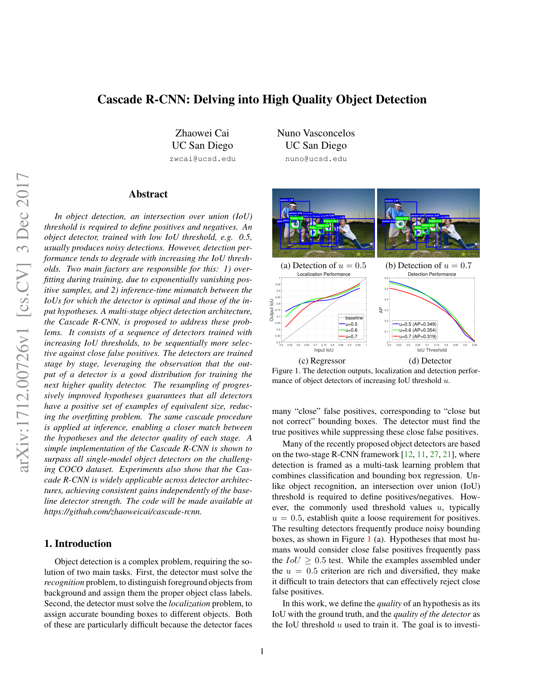
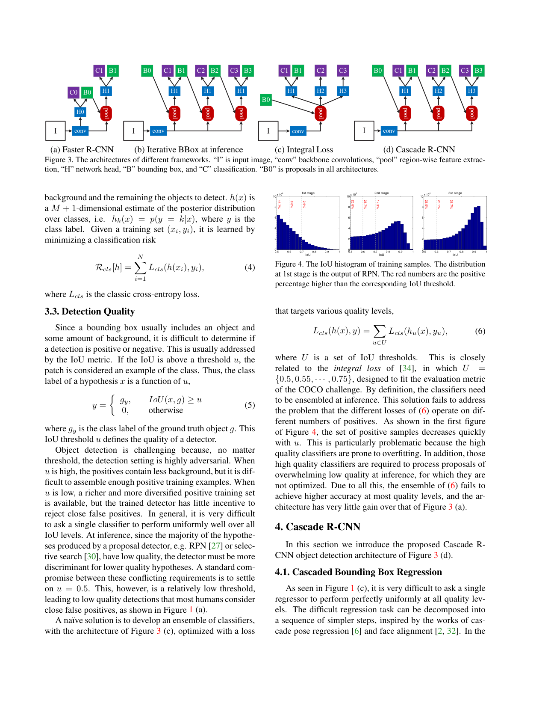
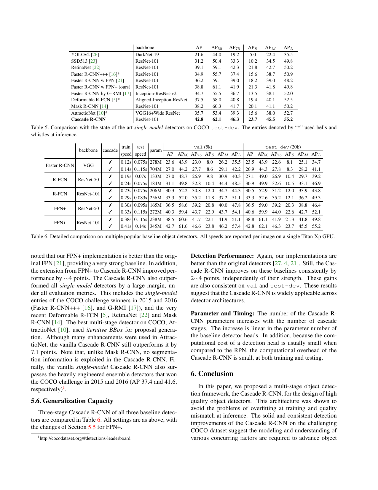

# Cascade R-CNN（2017）· 精读型论文笔记

- **论文**：Cascade R-CNN: Delving into High Quality Object Detection
- **作者**：Zhaowei Cai、Nuno Vasconcelos（UC San Diego）
- **版本**：本 PDF 为 arXiv:1712.00726v1（2017-12-03），首页只有 arXiv 标识，未印会议名；通行说法是 CVPR 2018 →【待核对：正式发表会议/年份，定位线索 = 本 PDF 首页页眉】
- **BibTeX 键名（建议，非原文给出）**：`cai2017cascade`
- **本地 PDF**：`3.科研基本任务/论文/目标检测/Cai和Vasconcelos - 2017 - Cascade R-CNN ... .pdf`（9 页）
- **任务书条目**：第 3 周 #11｜🟢 AI 辅助读
- **核对规则**：数字后标「出处」= 章节 / 表号 / 页码；✅ 已提取全文逐段核对；🟨 需注意细节；🟥 常见说法与原文不符。

---

## 0. 术语表（零基础版 · ≥40 条）

> 这篇的难点不是网络画法（结构很简单），而是**"IoU 阈值到底在管什么"**。下面每组都写清"它在这篇里具体指什么"；0.5 节工程词按「朴素做法 → 优化做法 → 为什么有效」展开。

### 0.1 检测任务类

| 术语 | 大白话（在本篇里的含义） |
|---|---|
| **IoU 阈值 u** | 判定"这个框算正样本还是背景"的门槛。u=0.5 表示与 GT 交并比 ≥0.5 就算正（式 (5)，✅）。**u 同时也是"检测器质量"的定义**（原文：the quality of the detector = 训练它的 IoU 阈值，§1，✅）。 |
| **正样本 / 负样本** | 高于 u 的是正（带类别标签）、低于 u 的是背景 0（式 (5)）。 |
| **close false positive（近似误检）** | "看着像、但不准"的框——IoU 刚过 0.5 但离 GT 差一截。全文动因就是"人类会把它们当误检"（§1，✅）。 |
| **检测质量（detection quality）** | 两种含义要分清：**hypothesis（框）的质量 = 它与 GT 的 IoU**；**detector 的质量 = 训练它的阈值 u**（§1 定义，✅）。 |
| **quality mismatch（质量错配）** | 检测器只在"训练它的那个质量档"最优，却被喂了别的质量档的框，于是次优。Figure 1(c) 的曲线、Figure 5(a) 的虚线都是这个现象（✅）。 |
| **overfitting（过拟合，此处的特殊含义）** | 不是"训练集好测试集差"的常规过拟合，而是：**u 越高，正样本指数级减少 → 检测器学不动/学偏**（摘要 + §1，✅）。 |
| **two-stage** | 阶段一是 proposal（RPN），阶段二对每个 proposal 做 RoI 检测头。Cascade 是在**第二级内部**做多级（§3，✅）。 |
| **multi-stage（多阶段）** | 论文对 Cascade 的定位：不止两级，第二级拆成 T 个递进的检测头（§4，✅）。 |
| **cascade（级联）** | 一串**逐步更严**的检测器：第 t 个用 u_t 训练、u_t > u_{t-1}；训练和推理都串起来用（§4.1、§4.2，✅）。 |
| **resampling（重采样）** | Cascade 的核心机制：**用上一级的回归输出当作下一级的输入样本分布**，让每级都拿到"质量刚好匹配自己阈值"的样本（§4.1、§4.2，✅）。 |
| **integral loss（积分损失）** | 一种"朴素替代方案"：多个分类头 + 一套共享回归，各用不同 u 训练，推理时集成（式 (6)，引 [34]，✅）。**本篇证明它几乎没用**。 |
| **iterative BBox（迭代框回归）** | 另一种朴素替代：同一个回归器反复套 f ∘ f ∘ …（式 (3)），只在推理阶段做后处理（§3.1，✅）。本篇证明它提点有限、甚至会让高 IoU 框变差。 |
| **class-agnostic regressor** | 所有类别共用一套回归参数（单纯回归框，不分 20 类）。本篇"所有回归器都 class agnostic"（§5.1，✅）。 |
| **OHEM（在线难例挖掘）** | 训练时专挑损失大的样本。**本篇明确不用**：R-FCN 基线那节写 "Online hard negative mining [28] was not used"（§5.1.1，✅）。 |

### 0.2 网络结构类

| 术语 | 大白话 |
|---|---|
| **backbone（骨干）** | 提特征的卷积网络；本篇三种：Faster R-CNN 用 VGG、R-FCN 与 FPN 用 ResNet（§5.1.1，✅）。 |
| **H0 / H1 / H2 / H3（头）** | 原文用 H 表示"网络头"：H0 是 proposal 子网（RPN），H1–H3 是三个检测头，每个都输出分类 C 与框 B（§3、Figure 3，✅）。 |
| **B0 / B1 / B2 / B3（框）** | B0 = 初始 proposal；B_t = 第 t 级回归后的框。**B_{t-1} 是下一级的输入**（Figure 3，✅）。 |
| **pool（区域特征提取）** | 把每个框区域池化成固定尺寸特征块；FPN+ 用 RoIAlign（§5.1.1，✅）。 |
| **共享 head 架构** | Cascade 的每一级检测头**结构完全相同**，只共享前面的 backbone（+pool），头本身各有一份参数（§5.1，✅）。 |
| **FPN / FPN+** | FPN：多尺度特征金字塔；**FPN+ 是作者自己加强的版本（用 RoIAlign）**，比原版 FPN 更强，作为"很强的基线"（§5.1.1、§5.5，✅）。 |
| **R-FCN** | 用区域全卷积代替逐 ROI 的 FC，速度快、精度略低；本篇作为第二类基线（§5.1.1，✅）。 |
| **RoIAlign** | 不做量化取整的区域特征对齐（FPN+ 采用）；用于消融研究（§5.1.1，✅）。 |
| **RPN** | 提初始 proposal（B0）的子网；本篇**沿用、且不限**于它（"adopt, but are not limited to, the RPN"，§3，✅）。 |
| **attention 式串联** | 每一级的输出框被下一级"再看一眼"，所以级联天然是"逐步聚焦"的结构（属【我的推断】，原文未用 attention 一词）。 |

### 0.3 训练类

| 术语 | 大白话 |
|---|---|
| **stage-by-stage training** | 训练时逐级进行：第 t 级的样本 = 第 t−1 级的回归输出；每级用自己的 u_t（§4.1、§4.2，✅）。 |
| **end-to-end training** | 本篇实现里用端到端训练替代了 Faster R-CNN 传统的多步训练（原文：End-to-end training was used instead of multi-step training，§5.1.1，✅）。注意这并不等于"单次反传就学到全部级联"，两者要分清。 |
| **多任务损失（式 (8)）** | 每级：分类交叉熵 + λ·[y_t≥1]·回归损失，λ = 1（✅）。 |
| **指示函数 [y_t≥1]** | 就是"只对正样本算回归损失"的开关（✅）。 |
| **回归统计量归一化** | 把 Δ=(δx,δy,δw,δh) 按其**均值/方差**归一化再回归，是本篇强调的关键训练细节（§3.1、Figure 2，✅）。 |
| **sequential statistics（逐级更新的统计量）** | 每级回归后分布都会变（σx：0.1234 → 0.0606 → 0.0391），所以**每级要用自己的统计量**（Figure 2，✅）。 |
| **λ** | 分类/回归的配比，本篇取 **1**（式 (8)，✅）。 |
| **学习率方案（三种基线）** | Faster R-CNN/VGG：0.002，60k 与 90k 各降 10 倍，到 100k 停；R-FCN：0.003，160k/240k 降，到 280k 停；FPN：0.005 跑 120k，再 0.0005 跑 60k（§5.1.1，✅）。 |
| **每图 RoI 数** | Faster 128、R-FCN 256、FPN 256（§5.1.1，✅）。 |
| **数据增强** | **只做水平翻转**，其余不用（§5.1，✅）。 |
| **单尺度推理** | 测试只用一个尺度，不做花活（"no further bells and whistles"，§5.1，✅）。 |
| **bells and whistles** | 原文口头语，指"各种额外技巧/工程 trick"；Table 5 里带 * 的条目就是用了推理期技巧的（表注，✅）。 |
| **Caffe** | 训练框架；所有基线在同一代码库上重实现，保证公平比较（§5.1，✅）。 |

### 0.4 评估类

| 术语 | 大白话 |
|---|---|
| **AP（COCO 口径）** | IoU 0.5→0.95（步长 0.05）各算一次 AP 再平均（§5，✅）。 |
| **AP50 / AP60 / AP70 / AP80 / AP90** | 只看某一个 IoU 阈值的 AP；**表 1/2/3/4 的关键就是这几列**（✅）。 |
| **AP75** | 常被当作"高质量检测"的分水岭；Cascade 在这里提升最大（Table 1：43.6 → 46.9，✅）。 |
| **APS / APM / APL** | 小/中/大目标的 AP（Table 5、Table 6，✅）。 |
| **AP 曲线（Figure 5/6/7）** | 横轴 IoU 阈值、纵轴 AP 的曲线；看曲线的**形状**比看单个数字更能看出"质量错配"（✅）。 |
| **val / test-dev** | COCO 2017：val 5k（有标注）、test-dev 20k（无标注），训练集约 118k（§5，✅）。 |
| **单模型 vs 集成** | 原文反复强调"vanilla 单模型超过所有单模型，也超过 2015/2016 冠军的**集成**"（AP 37.4 / 41.6）（§5.5，✅）。 |
| **推理速度 / 参数** | Table 6 逐行给 train speed / test speed / param，单位秒、兆（M）（✅）。 |

### 0.5 工程类（朴素做法 → 优化做法 → 为什么有效）

| 术语 | 朴素做法 | 本篇的优化做法 | 为什么有效 |
|---|---|---|---|
| **高 IoU 训练** | 直接把 u 提到 0.7：正样本**指数级变少** → 过拟合，AP 反而降到 0.319（Figure 1(d)） | **多级 + 重采样**：每级只比上一级严一点（0.5→0.6→0.7），样本量保持稳定 | 每级都"喂得起"自己的阈值：Figure 4 显示三级正样本占比从 16.7%/8.0%/2.9% 升到 28.0%/25.1%/21.7%，不再缺样本。 |
| **提升精细定位** | 迭代同一个回归器 f∘f∘…（iterative BBox） | **每级一个专用回归器 f_t**，各自在自己那档分布上最优 | 一个回归器只在训练它的分布上最优（Figure 1(c)：u=0.5 的回归器对 IoU>0.85 的框**会变差**）；换成专用回归器后，越往后越好。 |
| **多阈值集成** | integral loss：多个分类头 + 共享回归，推理集成（式 (6)） | **级联**：每级串联、后级吃前级的框 | integral loss 的多个头都吃同一批低质量 proposal，高阈值的头缺正样本、又被迫处理低质量框，所以"集合后几乎没收益"（Figure 7(b)：ensemble 0.354 ≈ 单头最好 0.355）。 |
| **多级头太贵** | —— | 只复制**检测头**（H1–H3），backbone 与 pool 共享 | 头相对 RPN 很便宜：FPN+/R101 参数 238M → 345M、推理 0.115s → 0.14s（Table 6）；换来 AP 38.5 → 42.7。 |
| **框偏移太小、被分类损失淹没** | 直接回归原始 Δ | 按 **均值/方差归一化** Δ，且每级用自己的统计量 | bounding box 回归改动很小、风险远小于分类风险，不归一化则多任务学习失效（§3.1，✅）；每级分布不同，所以统计量也要逐级换（Figure 2）。 |
| **推理期分布不一致** | 训练用 u=0.5，测试喂各种质量的框 | 推理**复用同一套级联**，后级只处理前级产出的高质量框 | 让"输入质量"和"检测器质量"对齐（摘要的 inference-time mismatch），Figure 5(a) 虚线即证据（0.319→0.352）。 |
| **训练 vs 推理不一致（iterative BBox 的老问题）** | 只在推理迭代、训练不迭代 | 级联**训练和推理都做** | 消除 train/test 分布差异（§4.1 第二点，✅），不需要"proposal 累积、box voting"这类人工工程。 |

---

## 1. 论文定位

### 1.1 输入 → 输出

```
输入：图像（单尺度）
   │
   ▼
backbone 卷积（VGG / ResNet）+ FPN（可选）
   │
   ▼
H0 = RPN → 初始 proposal B0（质量参差不齐，多数偏低）
   │
   ├─ pool(B0) → H1（用 u=0.5 训练）→ C1, B1
   │        B1 质量比 B0 高（回归器输出 IoU 基本都优于输入）
   ├─ pool(B1) → H2（用 u=0.6 训练）→ C2, B2
   ├─ pool(B2) → H3（用 u=0.7 训练）→ C3, B3
   │
   ▼
输出：B3 + 三级分类分数（可只取最后一级，也可三级集成）
```

要点：**同一个 B 只被"越修越好"，每一级都在更适合自己的样本上训练**（Figure 3(d)，p.4）。

### 1.2 上一篇（Faster R-CNN / 两阶段）留下什么坑 → 本篇填什么

1. **Faster R-CNN 固定用 u=0.5 训练**，这是"折中值"：正样本够多，但检测器没有动力拒绝"近似误检"（§3.3 原话：标准做法是折中到 u=0.5，✅）。Figure 1(a) 就是 u=0.5 的输出：一堆人/飞盘框互相重叠。
2. **直接把 u 调高（如 0.7）会更差**（Figure 1(d)：AP 0.319 < 0.349）。两个原因：正样本指数级减少 → 过拟合；推理时又被喂低质量 proposal → 质量错配（摘要，✅）。
3. **推理与训练的质量档不匹配**：proposal 大多低质量，而高质量检测器只在高 IoU 上最优（§1、§3.3，✅）。
4. **本篇填法**：把第二级拆成 3 个递进的头（u=0.5/0.6/0.7），**用上一级的回归输出重采样下一级的训练样本**，推理时同样串联——一句话：**让"喂进来的框"和"检测器的水平"逐级对齐**。

### 1.3 一句话说清

**问题**：单阶段 u=0.5 的检测器会产生大量"近似误检"；但直接提高 u 会因正样本锐减而过拟合，且推理时的 proposal 质量与检测器质量不匹配。
**做法**：**Cascade R-CNN**——把检测头级联成 T 级，每级用递增的 IoU 阈值（U = {0.5, 0.6, 0.7}）训练，并把上一级的回归框作为下一级的输入（训练、推理都这么做，即"级联重采样"）。
**结果**：COCO test-dev **AP 42.8 / AP50 62.1 / AP75 46.3**（FPN+ + ResNet-101），比同基线 **+4 个点**；在三种基线上稳定 **+2~4 点**；单模型超过 2015/2016 COCO 冠军的集成（37.4 / 41.6）（Table 5、Table 6、§5.5，✅）。

---

## 2. 逐节导读（严格按原文顺序）

### 2.1 §1 Introduction（p.1–2）

- **想解决什么**：检测要做两件事——分类（前景/背景/哪一类）+ 定位（框摆准）；难在大量"近似误检"（§1 开篇，✅）。
- **动机链**：①u=0.5 太松 → 近似误检多（Figure 1a）；②单检测器只能在**一个质量档**最优（类比 cost-sensitive learning 里"不同 ROC 点需要不同损失"，✅）；③所以要么提高 u，要么换架构——但提高 u 会过拟合、且推理错配。
- **关键实验（Figure 1c/1d）**：u=0.5/0.6/0.7 三个检测器，**回归器各自在自己那档附近最好**（图 c 每条曲线在对应输入 IoU 附近达峰，且**都在灰色对角线上方**）；检测器 AP：0.349 / 0.354 / 0.319（图 d）。
- **关键句**：`the output IoU of a regressor is almost invariably better than the input IoU`（p.2，✅）——这是"级联能成立"的**唯一前提**：回归只会把框变好，所以下一级总能拿到更高质量的样本。
- **【批注】**
  - 易误解：这篇不是"堆三个检测头就涨点"，关键在**每一级的训练样本都来自上一级的输出**。没有重采样，多出来的头基本没用（Table 3 第一行 vs 最后一行就是证据）。
  - 与上篇差异：Faster R-CNN 里"proposal 质量"是个外部给定的事实；这里变成**架构内部可以主动改善的变量**——这是从"检测器"到"检测流水线"的观念转变。
  - 工程细节：摘要说"vanilla implementation, without any bells and whistles"，后面 Table 5 里带 * 的对比方法则是"用了推理期技巧"——作者在强调"我没加料"。

### 2.2 §2 Related Work（p.2–3）

四块，每块都在定位"我与它差在哪"：
1. **两阶段**：R-CNN → SPP-Net/Fast R-CNN（区域特征提取）→ Faster R-CNN（RPN）→ R-FCN（区域全卷积）→ MS-CNN/FPN（多层输出解决尺度错配）。Cascade 直接建在 Faster/FPN 上（✅）。
2. **一阶段**：YOLO（一次前向、稀疏输出）、SSD（多分辨率特征图，类似 RPN）、RetinaNet（解决前景背景极端不平衡，超过当时两阶段）。原文承认一阶段"精度通常低于两阶段"（✅）。
3. **多阶段探索**：multi-region（迭代框回归）、CRAFT/AttractioNet（多级生成 proposal 再送 Fast R-CNN）、[19,25]（把经典 cascade 塞进检测网络）、[3]（检测与分割交替）。→ Cascade 与它们的差别是"**用回归输出重采样、且逐级换 u**"。
- **【批注】** 这一节最该记住的一句：Cascade 的重采样**不是难例挖掘**——原文明确"does not aim to mine hard negatives. Instead, by adjusting bounding boxes, each stage aims to find a good set of close false positives"（p.2，✅）。很多人把它当 OHEM 的变体，这是最典型的误读。

### 2.3 §3 Object Detection（p.3–4）：先把"检测"拆成三个组件

- **§3 总述**：沿用 Faster R-CNN 的两阶段；H0 = proposal 子网，H1 = 检测头，输出 C 与 B。本文"专注建模多级检测子网"，proposal 用 RPN 但**不限于**它（✅）。
- **§3.1 Bounding Box Regression**：定义 b=(bx,by,bw,bh)、目标 g、回归器 f(x,b)；风险 R_loc（式 (1)，R-CNN 用 L2，Fast R-CNN 改 smooth L1）；为"尺度/位置不变"，对距离向量 Δ 做归一化（式 (2)）；接着批评 iterative BBox（式 (3)）的**两个问题**：①u=0.5 的回归器对高 IoU 框反而有害（>0.85 会变差）；②每迭代一次分布就变（Figure 2），回归器对初始分布最优、迭代后就次优；还要"proposal 累积、box voting"等人工工程，**收益不可靠**，"通常超过两次就没好处"（✅）。
- **§3.2 Classification**：h(x) 输出 M+1 类后验，最小化交叉熵（式 (4)）。
- **§3.3 Detection Quality**：用 u 定义正负（式 (5)），"u 即检测器质量"；点明检测的"对抗性"：**u 高 → 正样本少；u 低 → 训练器没动力拒绝近似误检**；因此业界折中到 0.5；最后提出朴素方案 integral loss（式 (6)，U={0.5,…,0.75} 以适配 COCO 指标），但**它有三个毛病**：不同损失对应的正样本数不同、高质量头易过拟合、高质量头在推理时要处理大量低质量 proposal → **集成后几乎无收益**（✅）。
- **【批注】**
  - 这三节是"理论准备"，读的时候要带着一个问题：**为什么"多一个头"没用，而"多一个头 + 换样本"有用？** 答案藏在式 (6) 与式 (8) 的差别里：式 (6) 是**并行、共享回归、同样本**；式 (8) 是**串行、独立回归、换样本**。
  - 易误解："u 高 = 高质量"这句话只对**检测器定义**成立，不代表高 u 训练出的模型一定更好（Figure 1d 里 u=0.7 反而最差）。这正是本篇要解决的问题。
  - 与上篇差异：Faster R-CNN 只在"RPN 内部"讨论 0.7/0.3 的正负阈值；这篇把 **u 提到"整个检测头设计维度"** 的位置。

### 2.4 §4 Cascade R-CNN（p.4–5）★核心

- **§4.1 Cascaded Bounding Box Regression**：把难回归任务拆成串联的简单步骤（受 cascade pose regression [6] 与 face alignment [2,32] 启发）；式 (7)：f = f_T ∘ … ∘ f_1；**每个 f_t 针对到达该级的分布 {b_t} 优化，而不是初始分布 {b_1}**；并与 iterative BBox 给出**三点区别**：
  1. iterative BBox 是**后处理**；cascaded regression 是**重采样机制**，改变的是"各级看到的样本分布"；
  2. Cascade **训练与推理都用**，因此无 train/test 分布差；
  3. 多个**专用**回归器 vs 单个回归器（后者只对初始分布最优）。
  → 结论：定位更准，且不需要额外人工工程。
  另外强调：Δ 需按均值方差归一化，且**每级统计量不同**（Figure 2）。
- **§4.2 Cascaded Detection**：初始 proposal 分布严重偏向低质量（Figure 4 左），直接训高质量分类器 = 无效。Cascade 用"级联回归"当**重采样器**：因为回归器输出的 IoU 总比输入好（Figure 1c 全在灰线上方），所以逐级能把样本"洗"得更高 IoU，**正样本数量大致保持恒定**；两个后果：不过拟合 + 深层检测器针对更高 u。还有一些离群样本被逐级剔除（Figure 2 红点）。
  每级：h_t 与 f_t 针对 u_t，且 u_t > u_{t-1}；损失式 (8)。
  推理：同样的级联，高质量检测器只处理高质量框。
- **【批注】**
  - 全篇最该抄进笔记的一句：**"级联 = 用回归做重采样"**，而不是"级联 = 多个检测头"。
  - 易误解：u_t > u_{t−1} 是**设计约束**，不是自动保证；要靠式 (8) 分别训练来落实。
  - 与上篇差异：Faster R-CNN 的 RPN 也做回归，但**只用一次**、且输出直接进检测头；这里回归输出**又被当作下一级的输入**，形成闭环式递进。
  - 工程细节：因为每级都要 pool 一次（Figure 3d 里三个 pool），所以**推理开销确实增加**（Table 6：0.115s → 0.14s，FPN+/R101）。

### 2.5 §5 Experimental Results（p.5–8）

- **§5 总述**：COCO 2017（约 118k 训练 / 5k val / 20k test-dev）；AP 按 0.5:0.05:0.95 平均；模型在 train 上训、val 上评，最终也报 test-dev（✅）。
- **§5.1 Implementation Details**：所有回归器 class-agnostic；各级检测头**架构相同**（= 基线检测头）；共 4 级（1 RPN + 3 检测，U={0.5,0.6,0.7}）；第一级采样沿用 [11,27]，后续级**直接用上一级回归输出作为重采样**；只做水平翻转；单尺度推理；全部用 Caffe 在同一代码库重实现。
- **§5.1.1 Baseline Networks**：三种基线（Faster R-CNN+VGG、R-FCN+ResNet、FPN+ResNet）。具体：Faster 头两层 FC 剪枝到 2048 单元、**去掉 dropout**；R-FCN **不用 OHEM**；FPN 官方无代码，作者自己实现并用 **RoIAlign（记作 FPN+）**，消融用 ResNet-50、最终用 ResNet-101。三者的 lr 方案、GPU 数、每图 RoI 数见 §0.3 表。
- **【批注】**
  - "去掉 dropout、FC 剪到 2048"这类细节说明：**为了让三种基线的头结构统一**，作者改了基线的默认设置。复现时若直接拿 Detectron 的默认配置对比论文数字，会有系统差。
  - "FPN+ 是自己的实现"很重要：Table 5 里 FPN+ 38.8 已经比原版 FPN 36.2 高，所以"比 SOTA 高 4 个点"里有一部分来自基线本身更强，不能全算给 Cascade。

### 2.6 §5.2 Quality Mismatch（p.6）★最直观的一节

- **实验 A（Figure 5a）**：三个独立训练的检测器（u=0.5/0.6/0.7），各自用"自己的 proposal"或"级联第 2/3 级的 proposal"。结果：u=0.6 的检测器用 2 级 proposal，AP 0.354 → **0.367**；u=0.7 用 3 级 proposal，0.319 → **0.352**。→ **喂对质量的框，检测器就变强**。
- **实验 B（Figure 5b）**：把 **GT 混进 proposal 集合**。三个检测器都变好（0.394 / 0.457 / 0.495），其中 **u=0.7 提升最大**，且在几乎所有 IoU 档最好。→ 两个结论：①u=0.5 不是精细检测的好选择，只是对低质量 proposal 更鲁棒；②高精度检测**需要与检测器质量匹配的 proposal**（原文两条结论，✅）。
- **实验 C（Figure 6）**：把级联三级的检测器**在每个级上都测一遍**。1 级：0.355/0.352/0.256；2 级：0.365/0.383/0.355；3 级：0.368/0.384/0.383。→ u=0.7 的检测器在 1 级 proposal 上很差（0.256），在 3 级 proposal 上很好（0.383）；并且**联合训练的三个检测器比单独训练的三个更好**（同一批 proposal 下）。
- **【批注】**
  - 这一节是全篇最好懂、也最能说明"为什么"的部分：**图 5 是"换输入"，图 6 是"换位置"**。做汇报时先讲这节，听众立刻能懂。
  - 易误解：Figure 6 里 u=0.7 的检测器在 1 级只有 0.256——比单独训练同配置的 0.319 更低。原因是**级联里 u=0.7 的头从没见过低质量样本**（它只吃 2 级输出），所以对低质量输入更"水土不服"。这恰好证明"质量必须匹配"。

### 2.7 §5.3 Comparison with Iterative BBox and Integral Loss（p.6–7）

- **Localization（Figure 7a）**：单个回归器对高 IoU 反而有害，迭代会**累积**这个伤害（"iterative BBox after 3 iterations 表现非常差"）；级联回归在后期更好，几乎在所有 IoU 档超过 iterative BBox。
- **Integral Loss（Figure 7b）**：共享一个回归器时，u=0.6 的头最好、u=0.7 最差，**集成无可见收益**。
- **Table 1（p.7）**：FPN+ 34.9 / 57.0 / 51.9 / 43.6 / 29.7 / 7.1；Iterative BBox 35.4 / 57.2 / 52.1 / 44.2 / 30.4 / 8.1；Integral Loss 35.4 / 57.3 / 52.5 / 44.4 / 29.9 / 6.9；**Cascade 38.9 / 57.8 / 53.4 / 46.9 / 35.8 / 15.8**（AP/AP50/AP60/AP70/AP80/AP90）。→ 低 IoU 收益温和，高 IoU 收益巨大（AP90 从 7.1 到 15.8）。
- **【批注】** 这张表是"三选一"的判决书：iterative 与 integral 都只比基线好一点点（+0.5），Cascade +4.0。**关键差别在 AP80/AP90**：Cascade 分别为 35.8/15.8，而 integral loss 只有 29.9/6.9（高阈值头缺正样本，学废了）。

### 2.8 §5.4 Ablation Experiments（p.7）

- **Stage-wise（Table 2）**：1 级 35.5（已超基线 34.9，因为多级多任务）；2 级 38.3（大涨）；3 级 38.3（与 2 级持平）；集成 1~2 = 38.5；**集成 1~3 = 38.9**（AP50 57.8、AP90 15.8）。→ 后期级擅长高 IoU、前期级擅长低 IoU，**集成才最强**。
- **IoU Thresholds（Table 3 前两行）**：全部用 u=0.5 → 36.8（只靠"换样本"已 +1.9）；再让 u 递增 → 38.5（+1.7 更多）。
- **Regression Statistics（Table 3）**：关掉逐级统计量 → 37.5；两者都开 → 38.9。
- **Number of Stages（Table 4）**：1 级 34.9；2 级 38.2；3 级 38.9；**4 级（加 u=0.75）整体降到 38.6，但 AP90 最高 16.3**；作者结论"三级是最佳折中"。
- **【批注】**
  - Table 3 的四行是**教科书式消融**：先证明"只换样本"有效（36.8），再证明"同时升 u"更有效（38.5），再证明"统计量"也有贡献（37.5/38.9）。**每个开关都在回答一个具体问题**。
  - 易误解：Table 4 的 4 级"下降"不等于"4 级没意义"——它在高 IoU（AP90 16.0/16.3）更好。作者选择 3 级是**折中**，不是"4 级错"。

### 2.9 §5.5 Comparison with the state-of-the-art（p.7–8）

- Table 5（COCO test-dev，单模型）：YOLOv2 21.6；SSD513 31.2；RetinaNet 39.1；Faster R-CNN+++ 34.9；Faster R-CNN w FPN 36.2；**FPN+（ours）38.8**；G-RMI 34.7；Deformable R-FCN 37.5；Mask R-CNN 38.2；AttractioNet 35.7；**Cascade R-CNN 42.8 / 62.1 / 46.3（APS 23.7 / APM 45.5 / APL 55.2）**。
- 结论：比 FPN+ **+4 点**；在所有指标上超过所有单模型（含 2015/2016 冠军单模型、RetinaNet、Mask R-CNN）；比多阶段方法 AttractioNet **高 7.1 点**；且**vanilla 单模型超过 2015/2016 冠军的集成（AP 37.4 / 41.6）**。
- **【批注】**
  - Mask R-CNN 那行要注意：Mask R-CNN 用了**分割监督**，Cascade 没用（原文明确"no segmentation information is exploited"）。所以"超过 Mask R-CNN"是"纯检测 vs 检测+分割"的对比，别过度解读。
  - 表里带 * 的条目（Faster R-CNN+++、Deformable R-FCN、AttractioNet）用了"推理期 bells and whistles"，Cascade 没有——这是公平性说明，不是技巧展示。

### 2.10 §5.6 Generalization Capacity（p.8）与 §6 Conclusion（p.8–9）

- Table 6（三种基线的 val 与 test-dev、参数、训练/测试速度）：
  - Faster R-CNN + VGG：23.6 → **27.0**（val），参数 278M → 704M，测试 0.075s → 0.115s；
  - R-FCN + R50：27.0 → **31.1**，参数 133M → 184M，0.07s → 0.075s；
  - R-FCN + R101：30.3 → **33.3**，206M → 256M，0.075s → 0.083s；
  - FPN+ + R50：36.5 → **40.3**，165M → 272M，0.095s → 0.115s；
  - FPN+ + R101：38.5 → **42.7**（test-dev 38.8 → 42.8），238M → 345M，0.115s → 0.14s。
- 结论：**+2~4 点、与基线强弱无关**；参数随级数**线性**增加；因为"检测头相对 RPN 很便宜"，开销小。
- **【批注】** "参数线性增加"要盯住眼睛看：VGG 基线 278M → 704M（**+426M，翻 2.5 倍**），因为 VGG 的头是 2 层 4096/2048 的大 FC，复制三份很贵；ResNet 头是轻量卷积，只 +45M（238M→345M）。**"线性"不等于"便宜"，取决于头的大小**——这是我读第一遍时没有意识到的。

---

## 3. 核心图 / 公式深读

### 3.1 Figure 1（p.1）：整篇的动机图



四张子图逐条解读：
- **(a) u=0.5 的检测输出**：一堆 person/frisbee 框高度重叠、分数 0.56–1.00，全是"近似误检"。
- **(b) u=0.7 的检测输出**：框更干净、更贴合（person 只剩几个高分的），但代价是漏检/低分框被砍掉。
- **(c) 定位性能（Regressor）**：横轴输入 IoU、纵轴输出 IoU；三条曲线（baseline / u=0.5 / u=0.6 / u=0.7）。**所有曲线都在灰色对角线上方** → 回归只会让框变好（级联的前提）；且**每条曲线在自己训练的那档附近最靠上** → 一个回归器只在一种质量上最优。
- **(d) 检测性能（Detector）**：横轴 IoU 阈值、纵轴 AP；u=0.5 在低 IoU 领先、高 IoU 被 u=0.6 反超；u=0.7 整体最差（0.319）。
- **【批注】** 看这张图的顺序应该是 (c) → (d) → (a)(b)：**(c) 是"为什么能级联"，(d) 是"为什么单个不够"，(a)(b) 是"现象长什么样"**。很多人只看 (a)(b)，就以为这只是一篇"让框更好看"的论文。

### 3.2 Figure 3（p.4）：四种架构对照（全篇最关键的结构图）



图注："I" 输入图、"conv" 骨干卷积、"pool" 区域特征提取、"H" 网络头、"B" 框、"C" 分类；**B0 在所有架构里都是 proposal**。
- **(a) Faster R-CNN**：conv → H0(RPN) → B0 → pool → H1 → C1, B1。只有一级检测。
- **(b) Iterative BBox at inference**：一个 H1 被**反复用**（pool→H1→B1→pool→H1→B2…）。注意：**所有头都是同一个**，且只在推理做。
- **(c) Integral Loss**：conv → H1/H2/H3 **并联**，各自输出 C1/C2/C3，但**共享一个 box 回归**（图里 B1 只出现一次，C1–C3 并排）。→ 三个分类器都吃同一批 B0。
- **(d) Cascade R-CNN**：H1→B1→H2→B2→H3→B3 **串联**，每个 H 有自己的 C 和 B，B_{t−1} 喂给下一级。→ 样本逐级重采样。
- **【批注】** 这张图的精髓在"**B 的箭头方向**"：(b) 是回到同一个头，(c) 是三个头各自分叉，(d) 是**一个接一个往下传**。看懂箭头，就懂了三者的本质区别。
- 附带 **Figure 4（同页）IoU 直方图**：1 级（RPN 输出）正样本占比 16.7% / 8.0% / 2.9%；2 级 25.6% / 21.7% / 17.3%；3 级 28.0% / 25.1% / 21.7%（红字为"高于对应 IoU 阈值的正样本百分比"）。→ **越往后，高质量正样本越充足**，这就是"不过拟合"的定量证据。🟨 三个红字与 0.6/0.7/0.8 三档阈值的对应关系需按图确认（提取文本未保序）。

### 3.3 Figure 2（p.3）：逐级变化的回归统计量

- 三行各画 δx–δy 与 δw–δh 的散点分布（1st/2nd/3rd stage）。
- 数值（红点为按递增阈值剔除的离群点，统计量为剔除后所得）：σx = 0.1234 / 0.0606 / 0.0391；σy = 0.1297 / 0.0613 / 0.0376；σw = 0.2272 / 0.1221 / 0.0798；σh = 0.2255 / 0.1230 / 0.0773；μ 都接近 0（|μ| ≤ 0.05）。
- **怎么读**：**方差逐级缩小约一半**（0.12 → 0.06 → 0.04），说明"后续级只需要做微调"；正因为分布换了，**每级必须用各自的 μ/σ 归一化**。
- **【批注】** 这张图常被跳过，但它是"为什么每级要换统计量"的唯一证据。Table 3 里关掉统计量掉 1.4 点（38.9 → 37.5），不算大但确实有贡献。

### 3.4 Figure 5 / 6 / 7（p.6–7）：三组"对照实验图"

- **Figure 5(a)**：三个独立检测器（实线=自己的 proposal，虚线=级联 proposal）。u=0.5：0.349；u=0.6：0.354 → **0.367**（用 2 级框）；u=0.7：0.319 → **0.352**（用 3 级框）。
- **Figure 5(b)**：把 GT 加入 proposal 集：0.394 / 0.457 / 0.495 —— u=0.7 提升最大。
- **Figure 6**：级联内三个检测器在各 stage 的表现（1 级 0.355/0.352/0.256；2 级 0.365/0.383/0.355；3 级 0.368/0.384/0.383）。
- **Figure 7(a)**：定位曲线（baseline / iterative 1st / iterative 3rd / cascade 1st / cascade 3rd）；iterative 3rd 在高 IoU 明显下滑。
- **Figure 7(b)**：integral loss 各分类器 0.354 / 0.355 / 0.337，**ensemble 0.354**（集成等于没集）。
- **【批注】** 这一组图的共同读法：**横轴是 IoU 阈值，曲线形状 = "检测器擅长哪一档"**。curves 的交叉点就是"质量错配的分界线"。

### 3.5 式 (2)：框回归的距离向量（p.3）

```latex
\delta_x = (g_x - b_x)/b_w,\quad \delta_y = (g_y - b_y)/b_h,\quad
\delta_w = \log(g_w/b_w),\quad \delta_h = \log(g_h/b_h)
```
- `b = (b_x,b_y,b_w,b_h)`：候选框；`g`：目标框。
- 前两维：**按框宽高归一化**的平移（无量纲）；后两维：**对数尺度比**（w>0 且对称）。
- 原文强调：因为回归只是"微调"，**Δ 数值往往很小**，导致回归风险远小于分类风险 → 必须归一化（`δ'_x = (δ_x - μ_x)/σ_x`，§3.1，✅）。
- **【批注】** 与 Faster R-CNN 的式 (2) 形式一致，**唯一差别是"参考框"从 anchor 换成了上一级的 b**。这个差别正是"级联"的定义所在。

### 3.6 式 (7)：Cascade 的回归组合（p.5）

```latex
f(x, b) = f_T \circ f_{T-1} \circ \cdots \circ f_1(x, b), \qquad T = 3\ (\text{检测级数})
```
- `f_t`：第 t 级专用回归器；`∘`：先做 f_1、再 f_2 …。
- 原文关键补充：**每个 f_t 针对到达该级的分布 {b_t} 优化，而不是初始分布 {b_1}**（✅）。
- **【批注】** 与式 (3)（iterative：同一个 f 反复套）对照着记：**同一符号 f 出现 T 次 = 迭代；f_1…f_T 各不同 = 级联**。这是两篇最容易混的一处。

### 3.7 式 (8)：每一级的损失（p.5）

```latex
L(x_t, g) = L_{cls}(h_t(x_t), y_t) + \lambda\,[y_t \ge 1]\,L_{loc}(f_t(x_t, b_t), g)
```
- `x_t`：第 t 级的区域特征（由 b_{t−1} pool 出来）；`b_t = f_{t−1}(x_{t−1}, b_{t−1})`。
- `g`：该区域对应的 GT；`λ = 1`；`[·]` 指示函数（只在正样本算回归）。
- `y_t`：由式 (5) 按 **u_t** 给的标签——**标签随级数变**，这是与式 (6)（integral loss 并行多损失）最本质的差别。
- **【批注】** 注意 `b_t` 的定义里出现了 `f_{t−1}`：**训练时下一级的输入框是上一级回归出来的**（不是 GT，也不是原始 proposal）。复现时如果你用 GT 当下一级输入，就变成"teacher forcing"，指标会虚高、且推理时对不上。

### 3.8 推理时的匹配策略（§4.2）

```
B0 = RPN(img)
for t = 1..3:
    feat = pool(feature_map, B_{t-1})     # 用上一级的框去池化
    C_t, B_t = H_t(feat)                  # H_t 用 u_t 训练
输出：B_3（可选：把 C_1、C_2、C_3 集成）
```
- **【批注】** 三件事必须一致：①训练级联与推理级联**同一套**（消除 train/test 分布差）；②每一级 pool 用的是**上一级的框**；③级数 T=3 是折中（Table 4）。

---

## 4. 实验逐表解读

### 4.1 Table 1（p.7）：iterative BBox / integral loss / Cascade 三选一

| 方法 | AP | AP50 | AP60 | AP70 | AP80 | AP90 |
|---|---|---|---|---|---|---|
| FPN+ baseline | 34.9 | 57.0 | 51.9 | 43.6 | 29.7 | 7.1 |
| Iterative BBox | 35.4 | 57.2 | 52.1 | 44.2 | 30.4 | 8.1 |
| Integral Loss | 35.4 | 57.3 | 52.5 | 44.4 | 29.9 | 6.9 |
| **Cascade R-CNN** | **38.9** | **57.8** | **53.4** | **46.9** | **35.8** | **15.8** |

**回答什么**：想提"检测质量"，是迭代回归、多阈值集成，还是级联？
**最易误读的三个数**：
1. **AP50 只从 57.0 → 57.8（+0.8）**，别以为"低级指标也会大涨"；增益集中在中高 IoU（AP80 +6.1、AP90 **+8.7，翻倍**）。
2. **Integral Loss 的 AP90 = 6.9，比基线 7.1 还低**：多出来的高阈值头不是"没用"，而是"有害"（缺正样本 + 被迫处理低质量框）。
3. **Iterative BBox 的 +0.5** 常被说成"迭代也有用"，但它 AP90 只有 8.1；原文在图 7(a) 还指出"三次迭代后表现非常差"——**均值掩盖了尾部劣化**。

### 4.2 Table 2（p.7）：各级单独与集成

| test stage | AP | AP50 | AP60 | AP70 | AP80 | AP90 |
|---|---|---|---|---|---|---|
| 1 | 35.5 | 57.2 | 52.4 | 44.1 | 30.5 | 8.1 |
| 2 | 38.3 | 57.9 | 53.4 | 46.4 | 35.2 | 14.2 |
| 3 | 38.3 | 56.6 | 52.2 | 46.3 | 35.7 | 15.9 |
| 1~2 | 38.5 | 58.2 | 53.8 | 46.7 | 35.0 | 14.0 |
| **1~3** | **38.9** | 57.8 | 53.4 | 46.9 | 35.8 | 15.8 |
| FPN+ baseline | 34.9 | 57.0 | 51.9 | 43.6 | 29.7 | 7.1 |

**回答什么**：多级里到底是哪一级在起作用？要不要集成？
**易误读**：① **第 1 级就已超基线**（35.5 vs 34.9），这是"多级多任务"带来的；② 第 3 级 AP50（56.6）**低于**第 2 级（57.9），但 AP90 更高（15.9 vs 14.2）——**级别越高越"偏科"**；③ 集成 1~3 的 AP 最高，但 AP50 反而不如集成 1~2（57.8 vs 58.2），说明"集成"也不是全面碾压。

### 4.3 Table 3（p.7）：两个开关（升 u / 逐级统计量）

| IoU↑ | stat | AP | AP50 | AP60 | AP70 | AP80 | AP90 |
|---|---|---|---|---|---|---|---|
| ✗ | ✗ | 36.8 | 57.8 | 52.9 | 45.4 | 32.0 | 10.7 |
| ✓ | ✗ | 38.5 | 58.4 | 54.1 | 47.1 | 35.0 | 13.1 |
| ✗ | ✓ | 37.5 | 57.8 | 53.1 | 45.5 | 33.3 | 13.1 |
| ✓ | ✓ | **38.9** | 57.8 | 53.4 | 46.9 | 35.8 | 15.8 |

**回答什么**：涨点来自"换样本"还是"升阈值"还是"换统计量"？
**易误读**：① 第一行 36.8 说明**只靠级联重采样、全用 u=0.5 也有 +1.9**——"级联"本身就有价值；② 第二行 38.5 说明"升 u"再 +1.7；③ 统计量单独 +0.7（36.8→37.5），合计 38.9，说明两项**基本可加**。注意 AP50 在四行里都 ≈57.8，**低阈值指标对这两个开关几乎不敏感**。

### 4.4 Table 4（p.7）：级数

| # stages | test stage | AP | AP50 | AP60 | AP70 | AP80 | AP90 |
|---|---|---|---|---|---|---|---|
| 1 | 1 | 34.9 | 57.0 | 51.9 | 43.6 | 29.7 | 7.1 |
| 2 | 1~2 | 38.2 | 58.0 | 53.6 | 46.7 | 34.6 | 13.6 |
| 3 | 1~3 | 38.9 | 57.8 | 53.4 | 46.9 | 35.8 | 15.8 |
| 4 | 1~3 | 38.9 | 57.4 | 53.2 | 46.8 | 36.0 | 16.0 |
| 4 | 1~4 | 38.6 | 57.2 | 52.8 | 46.2 | 35.5 | 16.3 |

**回答什么**：多加几级合适？
**易误读**：① 2 级已经拿到大部分收益（34.9 → 38.2），**边际收益递减**；② 4 级（u=0.75）整体 AP 降到 38.6，但 **AP90 最高（16.3）**——"整体变差、尾部变好"；③ 表中两行"4 stages"是**同一模型**在不同测试方式下的结果（1~3 集成 vs 1~4 集成），不是两个模型。

### 4.5 Table 5（p.8）：COCO test-dev 单模型对比



| 方法 | backbone | AP | AP50 | AP75 | APS | APM | APL |
|---|---|---|---|---|---|---|---|
| YOLOv2 | DarkNet-19 | 21.6 | 44.0 | 19.2 | 5.0 | 22.4 | 35.5 |
| SSD513 | ResNet-101 | 31.2 | 50.4 | 33.3 | 10.2 | 34.5 | 49.8 |
| RetinaNet | ResNet-101 | 39.1 | 59.1 | 42.3 | 21.8 | 42.7 | 50.2 |
| Faster R-CNN+++ * | ResNet-101 | 34.9 | 55.7 | 37.4 | 15.6 | 38.7 | 50.9 |
| Faster R-CNN w FPN | ResNet-101 | 36.2 | 59.1 | 39.0 | 18.2 | 39.0 | 48.2 |
| Faster R-CNN w FPN+（ours） | ResNet-101 | 38.8 | 61.1 | 41.9 | 21.3 | 41.8 | 49.8 |
| G-RMI * | Inception-ResNet-v2 | 34.7 | 55.5 | 36.7 | 13.5 | 38.1 | 52.0 |
| Deformable R-FCN * | Aligned-Inception-ResNet | 37.5 | 58.0 | 40.8 | 19.4 | 40.1 | 52.5 |
| Mask R-CNN | ResNet-101 | 38.2 | 60.3 | 41.7 | 20.1 | 41.1 | 50.2 |
| AttractioNet * | VGG16+Wide ResNet | 35.7 | 53.4 | 39.3 | 15.6 | 38.0 | 52.7 |
| **Cascade R-CNN** | ResNet-101 | **42.8** | 62.1 | 46.3 | 23.7 | 45.5 | 55.2 |

**回答什么**：Cascade 到底排在什么位置？
**最易误读**：① **FPN+ 的 38.8 是作者自己的基线，不是原版 FPN 的 36.2**，所以"+4 点"里有一半是基线加强的功劳；② **Mask R-CNN 38.2 用了分割监督**，Cascade 没用（原文明确），"超过它"不能理解为"纯检测架构全面碾压带分割的模型"；③ 带 * 的条目在推理期用了额外技巧，Cascade 没有——**"公平"要看清表注**。

### 4.6 Table 6（p.8）：泛化性 + 代价（三种基线 × 有无级联）

| 基线 | backbone | 级联 | 训练/测试速度 | 参数 | val AP | test-dev AP |
|---|---|---|---|---|---|---|
| Faster R-CNN | VGG | ✗ | 0.12s / 0.075s | 278M | 23.6 | 23.5 |
| Faster R-CNN | VGG | ✓ | 0.14s / 0.115s | **704M** | **27.0** | 26.9 |
| R-FCN | R50 | ✗ | 0.19s / 0.07s | 133M | 27.0 | 27.1 |
| R-FCN | R50 | ✓ | 0.24s / 0.075s | 184M | **31.1** | 30.9 |
| R-FCN | R101 | ✗ | 0.23s / 0.075s | 206M | 30.3 | 30.5 |
| R-FCN | R101 | ✓ | 0.29s / 0.083s | 256M | **33.3** | 33.3 |
| FPN+ | R50 | ✗ | 0.30s / 0.095s | 165M | 36.5 | 36.5 |
| FPN+ | R50 | ✓ | 0.33s / 0.115s | 272M | **40.3** | 40.6 |
| FPN+ | R101 | ✗ | 0.38s / 0.115s | 238M | 38.5 | 38.8 |
| FPN+ | R101 | ✓ | 0.41s / 0.14s | 345M | **42.7** | 42.8 |

**回答什么**：换任何基线都涨吗？代价多大？
**易误读**：① **VGG 基线的参数从 278M 涨到 704M**（+153%），而 ResNet 头只 +45M（238→345M）——"参数线性增加"在 FC 头上非常贵；② **训练速度只慢 0.02–0.06 s/image**，但**测试速度慢 0.008–0.04 s/image**，推理开销远小于参数涨幅；③ val 与 test-dev 数字几乎一样（差异 ≤0.5），说明**没有过拟合测试集**。

---

## 5. 我的思考（🟢 AI 辅助读）

1. **【原文结论】贡献是什么**：把"检测质量"定义为 IoU 阈值 u，指出**单检测器只能一个档最优**（Figure 1c/d），于是提出**级联 + 重采样**，让每一级都在"自己那档"的样本上训练、推理时也让输入与检测器质量对齐；结果是 COCO 单模型 SOTA（42.8），且在 Faster/R-FCN/FPN 三种基线上稳定 +2~4 点（摘要、Table 1、Table 6）。
2. **【原文结论】局限**：级联必然带来**参数和推理开销**——FPN+/R101 参数 238M → 345M、测试 0.115s → 0.14s（Table 6）；而且**超过 3 级整体 AP 反而降**（Table 4，4 级 38.6），高 IoU 才继续涨；同时它**不解决"低质量 proposal 本身"**，只是把"匹配"做对。
3. **【我的推断】消融设计逻辑**：Table 3 的四行是"控制变量"的典型写法——(0,0) 建基线、(1,0) 只升 u、(0,1) 只换统计量、(1,1) 全开，于是可以读出"级联本身 +1.9、升 u 再 +1.7、统计量 +0.7"。Table 4 则是"级数"这条维度的一维扫描，并用"整体 AP vs AP90"揭示折中点。**这套"两开关 + 一级数"的组合，正好覆盖了 Cascade 的三种可能失效原因**：样本不够、标签没升、级数过多。
4. **【课外补充·待核实】如果让我改**：① 把固定 U={0.5,0.6,0.7} 改成**按 stage 自适应**（比如按上一级输出的实际 IoU 分布定阈值，让正样本占比维持在固定比例）；② 让**各级共享部分参数**（类似 CBNet/可变形头的思路）以压低 VGG 那种"参数翻 2.5 倍"的代价；③ 与 DETR 式集合预测结合，去掉 NMS 与重复框——这些都是我的设想，**原文没有**，需要查后续文献（Cascade 的后续工作、以及自适应 IoU 的相关论文）确认是否已有人做。

---

## 6. 与前后论文的衔接（继承 / 改动 / 留下的坑）

### 6.1 继承

| 拿来的东西 | 来自 | 在本篇的角色 |
|---|---|---|
| 两阶段框架（RPN + RoI 检测头） | Faster R-CNN [27] | H0 + H1 的基本形态 |
| 框参数化（Δ + log 尺度） | Fast R-CNN [11] / R-CNN [12] | 式 (2) |
| 多任务损失（cls + loc） | Fast R-CNN | 式 (8) 的形式 |
| 平滑 L1 | Fast R-CNN | L_loc（原文说明 R-CNN 用 L2、Fast 改成 smooth L1，§3.1，✅） |
| 级联思想 | cascade pose regression [6]、face alignment [2,32]、经典 cascade [31] | 式 (7) 的灵感来源 |
| 迭代回归 / 多阈值集成 | multi-region [9]、AttractioNet [10]、integral loss [34] | 被对比、被否定的两种替代方案 |

### 6.2 改动

① **把 u 变成架构维度**（每级一个阈值）；② **用回归输出做重采样**（训练与推理一致）；③ **每级独立回归器 + 独立分类头**；④ **逐级用各自的回归统计量归一化**。

### 6.3 留下的坑

| 坑 | 后来谁填 | 备注 |
|---|---|---|
| 级联的参数/推理开销（尤其 VGG 大 FC） | 轻量头 / 参数共享 / 蒸馏类工作 | 属【课外补充·待核实具体文献】 |
| 固定阈值 U 需要人工设定 | 自适应 IoU / 学习式阈值 | 属【课外补充·待核实】 |
| 仍依赖 NMS、正负样本定义 | DETR 一类集合预测 | 属【课外补充·待核实】 |
| 只做框质量、不做掩码质量 | Mask R-CNN 的多任务头 / 分割级联 | 属【课外补充·待核实】 |
| 单尺度推理 | 多尺度测试 / FPN 多层 | 本篇明确只用单尺度（§5.1，✅） |

> **我的观察（🟨 推断，非原文）**：这篇的方法论价值大于 AP 本身——它示范了**"把超参当成一个可级联的维度"**这种思路：既然一个模型只能在一个 u 上最优，那就别选一个 u，而是**排一排 u**。这个思路后来被大量迁移到"级联式 refinement"的各种任务里（姿态、分割、跟踪），虽然原文没这么说。

---

## 7. 回原文核对记录（≥6 条，含纠偏）

| # | 常见说法 | 原文依据 | 判定 |
|---|---|---|---|
| 1 | "Cascade 的提升只在高 IoU 上" | Table 1（p.7）：AP 34.9→38.9（+4.0）、AP50 57.0→57.8（+0.8）、AP75 43.6→46.9（+3.3）、AP90 7.1→15.8（+8.7） | 🟥 纠偏："只在"是错的——**所有档都涨，但增益随 IoU 升高而放大** |
| 2 | "级联就是多堆几个检测头" | Table 3（p.7）：只换样本不升 u → 36.8（+1.9）；只升 u 不换样本 → 37.5（+0.9）；两者都开 38.9 | 🟩/🟨 半对：**重采样是关键**，光加头（integral loss）几乎无用（Table 1：35.4） |
| 3 | "Cascade 的重采样就是 OHEM" | §2（p.2）："does not aim to mine hard negatives. Instead … each stage aims to find a good set of close false positives"；§5.1.1：R-FCN 基线"Online hard negative mining was not used" | 🟥 纠偏：它是**按框质量重采样**，不是难例挖掘 |
| 4 | "COCO 上 42.8 是 val 还是 test-dev？" | Table 5 表头（p.8）：test-dev；Table 6（p.8）：val 42.7 / test-dev 42.8 | 🟩 正确：val 42.7、test-dev 42.8，报道时要写清 |
| 5 | "级联代价很小，参数几乎不变" | Table 6（p.8）：FPN+/R101 238M → 345M；Faster/VGG 278M → **704M**；测试 0.115s → 0.14s | 🟥 纠偏：原文说"开销小"是相对 RPN 而言；**VGG 大 FC 头下参数翻 2.5 倍** |
| 6 | "级数越多越好" | Table 4（p.7）：4 级整体 38.6 < 3 级 38.9，但 AP90 16.3 > 15.8；原文结论"三级是最佳折中" | 🟥 纠偏：整体 AP 会降，只有高 IoU 继续涨 |
| 7 | "论文说它是端到端训练的" | §5.1.1（p.5）："End-to-end training was used instead of multi-step training"；但 §4.1/4.2 是逐级重采样、逐级不同 u | 🟨 需精确：实现上端到端（替代多步），**逻辑上逐级依赖**，两者不矛盾但别简化为"一次反传学完所有级" |
| 8 | "Cascade 超过了 Mask R-CNN，所以更强" | Table 5（p.8）+ §5.5：Mask R-CNN 38.2 用了分割监督，Cascade "no segmentation information is exploited" | 🟨 需限定：赢了纯检测指标，但**监督信息不对等** |
| 9 | "FPN+ 38.8 就是原版 FPN" | §5.1.1 / §5.5（p.5、p.8）：FPN 无官方代码，作者自行实现并用 RoIAlign（记作 FPN+）；原版 FPN 在 Table 5 是 36.2 | 🟥 纠偏："比 SOTA 高 4 点"部分是**基线本身更强**带来的 |
| 10 | "第 3 级检测器一定比第 2 级好" | Table 2（p.7）：第 3 级 AP50 56.6 < 第 2 级 57.9，只有 AP90（15.9 vs 14.2）更高 | 🟨 需注意：高阈值级"偏科"，低阈值反而略降 |

---

## 8. 自测题 5 题 + 常见误解 5 条

### 8.1 自测题

1. 用一句话解释"quality mismatch"，并说明**训练期**与**推理期**各出现一次在哪个环节（分别对应 Figure 1c 与 Figure 5a 的哪条曲线）。
2. 写出式 (8)，说明 `[y_t ≥ 1]` 与 `b_t = f_{t-1}(x_{t-1}, b_{t-1})` 的含义；如果训练时把 b_t 换成 GT，会发生什么？
3. 对比式 (3)（iterative）与式 (7)（cascade）：两者在**训练/推理一致性**、**回归器个数**、**样本分布**上各有什么差别？
4. Table 3 四行分别证明了什么？为什么说"级联重采样"的贡献（+1.9）比"升阈值"（+1.7）还略大？
5. Table 4 里为什么 3 级是最佳折中？4 级在什么指标上更好、为什么作者仍不用它？

### 8.2 常见误解

1. ❌"Cascade 就是把 Faster R-CNN 复制三份。" → ✅ 复制的是**检测头**，且每级用不同 u、吃上一级的框；backbone/pool 共享。
2. ❌"u=0.7 训练的检测器更准。" → ✅ Figure 1(d) 里 u=0.7 的 AP 最低（0.319）；它只有在**喂高质量框**时才好（Figure 5）。
3. ❌"这个方法和 OHEM 是一个思路。" → ✅ OHEM 挖难负样本；Cascade 是**按框质量重采样**，原文明确不是难例挖掘。
4. ❌"级联没什么额外开销。" → ✅ 参数线性增（VGG 头下 278M→704M）、推理 0.115s→0.14s（Table 6）。
5. ❌"AP 42.8 说明它在所有方面最强。" → ✅ 它是 vanilla 单模型、单尺度、只用水平翻转；但对比对象里有用了分割监督（Mask R-CNN）与推理技巧（*）的，**比较条件不对等**。

---

## 9. 读到这里最容易产生的疑问（5 组 Q&A，大白话）

**Q1：为什么"直接提高 IoU 阈值"不行，非要搞三级？**
A：因为正样本会**指数级变少**。u=0.5 时正样本一大堆；u=0.7 时只剩零头，网络学不动、还容易记住噪声（就是原文说的"过拟合"）。级联的办法是"**先易后难**"：第一级在宽松阈值下学，把框修好一点；第二级用**修好的框**当输入，这时高质量正样本又变多了，才敢用 0.6；第三级同理。Figure 4 的三张直方图就是这个过程的证据（16.7%/8.0%/2.9% → 28.0%/25.1%/21.7%）。

**Q2：为什么"每级一个回归器"比"一个回归器反复用"好？**
A：一个回归器只在**它训练时见过的分布**上最优。Figure 1(c) 里 u=0.5 的回归器遇到 IoU 0.9 的框，输出反而**变差**（曲线跌到对角线下面）。反复用同一个回归器，误差会累积（Figure 7a 里 iterative 三次后很差）。每级一个专用回归器，就等于"每一档都有自己的专家"。

**Q3：推理时到底怎么串？会不会越修越偏？**
A：不会，前提是**训练和推理用同一套**。推理：RPN 给 B0 → 用 B0 池化 → H1 出 B1 → 用 **B1**（不是 B0）池化 → H2 出 B2 → …。每一步都用"上一级的输出"当输入，和训练时一模一样，所以分布对得上。这也是它比 iterative BBox 强的原因之一（iterative 只在推理做，训练没见过这种分布）。

**Q4：为什么不干脆把三个头的分数平均一下（集成）就好？**
A：因为集成**不改变每一级看到什么样本**。Integral loss 就是三个头并联、共享一个回归器、都吃同一批低质量 proposal：高阈值的头缺正样本、还要硬处理低质量框，所以它本身就很弱（Figure 7b 里 u=0.7 只有 0.337），集成后 0.354 也没超过最好的单头（0.355）。**级联的价值在"换样本"，不在"多头"。**

**Q5：那我自己的小数据集（比如无人机航拍）该不该上 Cascade？**
A：先看你的评测口径。如果只看 AP50（VOC 口径），Table 1 说收益只有 +0.8，**性价比不高**；如果你要 AP75/高 IoU（比如小目标定位、工业测量），收益会明显（AP75 +3.3、AP90 翻倍）。另外注意代价：VGG 那种大 FC 头会让参数翻倍（278M→704M），小数据集反而更容易过拟合；换轻量头（ResNet/FPN）更划算（238M→345M）。这三条判断都基于 Table 1 与 Table 6，**属于"读表得出的结论"，不是原文直接建议**（🟨）。
