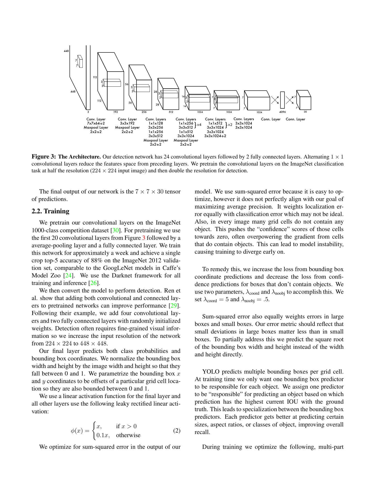
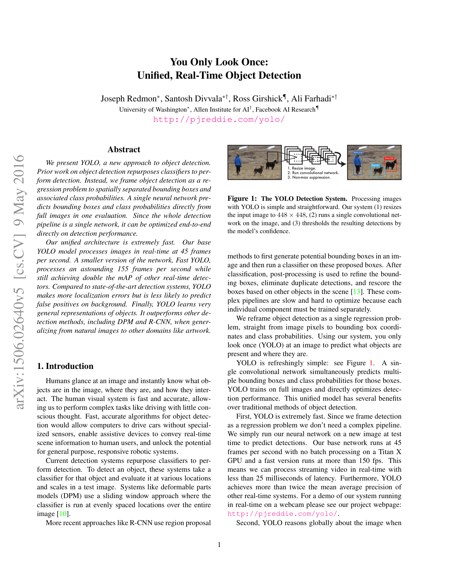
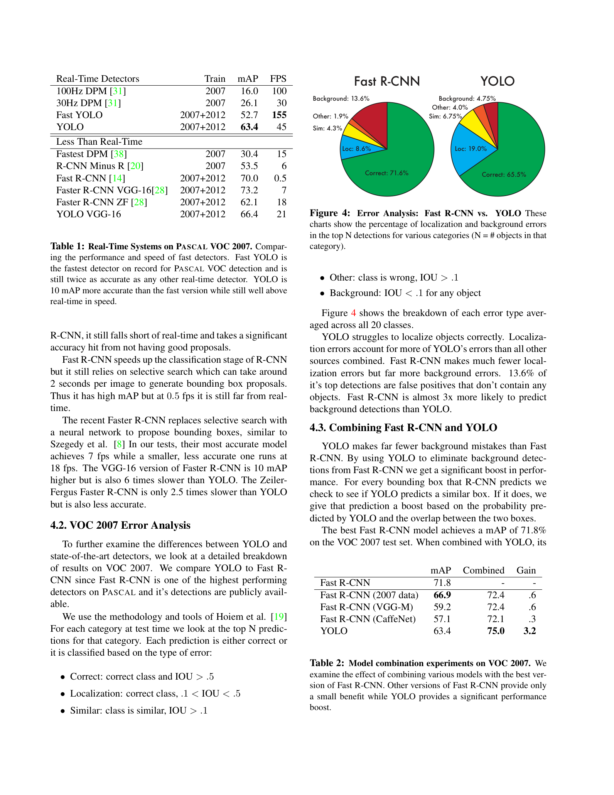

# YOLOv1（2016）· 精读笔记

- **论文**：You Only Look Once: Unified, Real-Time Object Detection（CVPR 2016；本地为 arXiv:1506.02640v5，2016-05-09）
- **BibTeX**：`redmon2016you`
- **本地 PDF**：`3.科研基本任务/论文/目标检测/Redmon 等 - 2016 - You Only Look Once Unified, Real-Time Object Detection.pdf`
- **PDF 结构**：共 10 页；正文 p.1–p.8，参考文献 p.9–p.10（✅ 逐页核对）
- **任务书条目**：第 3 周 #12｜🔴 自精读（第 5 节必须自己写）
- **阅读日期**：2026-11-01
- **核对规则**：数字后的「出处」指回 PDF 页/节/表号。✅=已回原文查证；🟨=原文有但需限定；🟥=流行说法与原文不符（纠偏）。

---

## 0. 术语表（零基础版 · 57 条）

> 分组：0.1 检测任务 / 0.2 网络结构 / 0.3 训练 / 0.4 评估 / 0.5 工程。
> 工程组每条按「朴素做法 → 优化做法 → 为什么有效」三段写。
> 标 ⚠️ 的是**本篇没有、但读 YOLO 系列一定遇到**的词——防止把后代做法安到 v1 头上。

### 0.1 检测任务组

| 术语 | 在本文里的确切含义 |
|---|---|
| **object detection** | 同时答"有什么"+"在哪"。本篇输出不是单标签，而是一堆框 + 每框的类别分。 |
| **bounding box** | 用 `(x,y,w,h)` 表示：`x,y` 是框中心**相对本 cell 左上角**的偏移，`w,h` 是**相对整图**的比例，全部归一化到 0–1（✅ §2.2）。 |
| **grid cell** | 图切成 S×S（VOC 上 7×7）。规则只有一条：**物体中心落在哪格，哪格负责它**（✅ §2）。 |
| **confidence** | `Pr(Object)·IOU_truth_pred`：**有没有东西 × 框得准不准**。它不是类别概率（✅ §2）。 |
| **class probability** | `Pr(Class_i|Object)`：有物体的前提下是第 i 类。每格只出**一组** C 个，与框数 B 无关（✅ §2）。 |
| **IoU** | 交集/并集。算 confidence 监督值、判 TP/FP、选"负责框"都靠它。 |
| **NMS** | 按分排序、保留最高、压掉 IoU 过高的重复框。**本篇只值 +2–3% mAP**（✅ §2.3）。 |
| **Selective Search** | R-CNN 的候选框算法，约 **2000 个/图**；YOLO 只出 **98 个**（✅ §3）。 |
| **region proposal** | 两阶段"先猜哪里有东西"那一步；本篇把它整段删掉。 |
| **two-stage / one-stage** | 先提候选再分类 vs 一次前向出框+类。本篇是一阶段的起点。 |
| **anchor** ⚠️ | 预设宽高模板。**v1 没有**，直接从网格回归绝对尺寸；anchor 是 v2 引入（见 `13_YOLOv3.md` §2.1）。 |
| **objectness** ⚠️ | "有无物体"的分。v1 塞进 confidence（两者混装），v3 才独立成一路 logistic 输出。 |
| **multi-scale prediction** ⚠️ | 多分辨率特征图上分别预测，治小物体。**v1 没有**，只有 7×7 一层。 |
| **feature pyramid** ⚠️ | 深浅层特征融合再预测。**v1 没有**，v3 才有。 |
| **localization error** | 类别对但 `0.1<IoU<0.5`（✅ Fig.4）。本篇占 **19.0%**，是头号误差来源。 |
| **background false positive** | 背景被判成物体。本篇仅 **4.75%**，是相对 Fast R-CNN 的核心优势。 |

### 0.2 网络结构组

| 术语 | 在本文里的确切含义 |
|---|---|
| **Darknet** | 作者自研的 C 框架（✅ §2.2）。注意它同时是骨干网前缀（Darknet-19/53），看上下文。 |
| **backbone** | 只提特征的那截卷积网。本篇 24 层卷积（Fast YOLO 9 层，✅ §2.1）。 |
| **24 conv + 2 FC** | 完整结构（✅ §2.1）。FC 把 7×7×1024 压成 4096→4096，再 reshape 成 7×7×30。 |
| **1×1 reduction layer** | 先用 1×1 降通道再上 3×3；原文用它**替代 GoogLeNet 的 inception**（✅ §2.1）。 |
| **7×7×30** | `S×S×(B·5+C)=7×7×(2·5+20)`（✅ §2 末、Fig.2）。全篇最该背的一组数。 |
| **leaky ReLU** | `φ(x)=x (x>0)；0.1x (x≤0)`（✅ 式 2），防神经元"死掉"，用于除最后一层外全部层。 |
| **linear activation** | 最后一层**不加激活**（✅ §2.2），避免压掉坐标梯度。 |
| **fully connected** | 7×7×1024=50176 → 4096 → 4096 → 1470。**参数几乎全在这**（见 §3.3 复算）。 |
| **downsampling** | 448→224→112→56→28→14→7，共 6 次；**1 个 cell = 原图 64×64 像素**。 |
| **receptive field** | 一个神经元在原图看到的范围。**远大于 cell**，所以每格都在"看一大片"。 |
| **end-to-end** | 像素直出检测结果，中间无 proposal/SVM/回归器，一次反向传播到底。 |

### 0.3 训练组

| 术语 | 在本文里的确切含义 |
|---|---|
| **sum-squared error** | 所有输出维度都用 `(预测-真值)²`。原文自认"易优化但**不完美对齐 mAP**"（✅ §2.2）。 |
| **λcoord = 5** | 坐标项权重放大 5 倍（✅ 式 3）。补偿"坐标只有 4 维、类别有 20 维"的梯度失衡。 |
| **λnoobj = 0.5** | 背景 confidence 项压到 0.5（✅ 式 3）。不压，模型会学成"永远输出 0"。 |
| **responsible predictor** | 每格 2 框里，**只让当前 IoU 最高的那个**背坐标与 confidence loss（✅ §2.2），促成两框分工。 |
| **√w / √h** | 宽高回归开方值（✅ §2.2），让小框的偏差梯度被放大，缓解大小框等权。**x,y 不开方**。 |
| **pretraining** | 先训**前 20 个卷积层**做 ImageNet 1000 类分类（224 输入，约 1 周，single-crop top-5 **88%**，✅ §2.2）。 |
| **fine-tuning** | 预训练权重 + 随机初始化的 4 卷积 + 2 FC，输入放大到 **448** 上整体训。 |
| **dropout 0.5** | 只在第一个 FC 之后（✅ §2.2），防层间共适应。 |
| **data augmentation** | 随机缩放+平移（≤20% 原图）+ HSV 曝光/饱和 ±1.5（✅ §2.2）。 |
| **warmup** | lr 从 10⁻³ 缓升到 10⁻²，再 10⁻²×75 → 10⁻³×30 → 10⁻⁴×30；一开始就大 lr 会发散（✅ §2.2）。 |
| **epoch** | 本篇共 **135** 个 epoch，训练集为 VOC2007 trainval + 2012 trainval；测 2012 时还额外加入 2007 test（✅ §2.2）。 |
| **batch norm** ⚠️ | **原文全文未提 BN**，v1 配置也没见 BN 层【待核对：查 yolov1.cfg】。**别把 BN 安到 v1**。 |
| **momentum 0.9 / decay 5e-4 / batch 64** | 三个超参（✅ §2.2）。注意是 batch **64**，不是 VGG 的 256。 |
| **co-adaptation** | 神经元互相依赖、一起过拟合；dropout 就是打断它。 |

### 0.4 评估组

| 术语 | 在本文里的确切含义 |
|---|---|
| **precision / recall** | 查准率 = 检出的有多少对；查全率 = 真值有多少被检出；PR 曲线下面积 = AP。 |
| **AP** | 单类 PR 曲线下面积。VOC 具体插值方式本篇未展开【待核对】。 |
| **mAP** | 各类 AP 平均。**本篇所有 mAP 都是 VOC 口径 = IoU 0.5**，即今天的 AP50 / mAP@0.5。 |
| **mAP@0.5 / AP50** | "框对了"的门槛取 IoU 0.5。**63.4 属于这一档，不能和 COCO 的 AP（0.5:0.95）比**。 |
| **AP75** | 门槛提到 0.75。**本篇没有**（VOC 不算），它是 COCO 指标，v3 笔记会用到。 |
| **FPS** | 每秒处理张数。本篇招牌：YOLO **45**、Fast YOLO **155**（Titan X，无 batch，✅ Table 1）。 |
| **Titan X** | 2015 年旗舰卡。**所有速度数字都在它上面测**，换卡不可直接比（✅ §1）。 |
| **top-5 accuracy** | 分类指标，只在预训练阶段用到（88%，✅ §2.2）。 |

### 0.5 工程组（朴素做法 → 优化做法 → 为什么有效）

| 术语 | 三段展开 |
|---|---|
| **resize 448×448** | 朴素：原图直进 → batch 拼不起来。优化：统一 resize（✅ Fig.1）。为什么有效：CNN 需固定尺寸；448 比预训练的 224 大一倍，**小物体在特征图上还剩更多像素**。代价：长宽比被拉伸。 |
| **一次前向** | 朴素（R-CNN）：2000 个 proposal 各跑一次 CNN。优化：整图只前向一次（✅ §2.3）。为什么有效：重叠区域的卷积结果本来就被重复算了 2000 遍，**去掉重复就是 45 FPS 的来源**。 |
| **输出 reshape 成 7×7×30** | 朴素：输出 1470 维向量再手写切片。优化：直接 reshape 成带空间维的张量（✅ Fig.2）。为什么有效：空间位置与预测内容一一对应，算 loss、做 NMS 都按 cell 索引。 |
| **阈值 + NMS 后处理** | 朴素：全部框输出 → 满屏重复。优化：先阈值筛再 NMS（✅ Fig.1 第 3 步）。为什么有效：网格已强制空间分散，同物体通常只有 1–2 格抢，所以 NMS 只值 **2–3% mAP**（✅ §2.3）。 |
| **用 YOLO 给 Fast R-CNN 重打分** | 朴素：只用 Fast R-CNN 的分。优化：查 YOLO 是否有相似框，按 YOLO 概率与重叠加权（✅ §4.3）。为什么有效：YOLO 背景误检只有对方 1/3，**错误类型互补**，71.8→75.0。代价：两模型都要跑，不省时间。 |
| **预训练 + 提分辨率** | 朴素：检测数据从零训。优化：ImageNet 预训练 20 层，再翻倍到 448 微调（✅ §2.2）。为什么有效：VOC 只有约 1.6 万张，从零必过拟合；448 补回被下采样吃掉的细节。 |
| **Darknet（C + CUDA）** | 朴素：用 Caffe/Theano。优化：自研轻量 C 框架（✅ §2.2）。为什么有效：45/155 FPS 下**框架开销本身就是瓶颈**，纯 C 前向 + 手写核才压得住每帧 <7 ms。 |
| **webcam 实时演示** | 朴素：只报数据集 mAP。优化：接摄像头端到端跑（✅ §5）。为什么有效：把"实时"从表格数字变成**含取图与显示的可验证事实**。 |

---

## 1. 论文定位

### 1.1 输入 → 输出（✅ Fig.1 p.1）

```
输入：任意尺寸 RGB 图
   │ ① resize → 448×448
   ▼
[ 24 层卷积 backbone ]（1×1 降维 + 3×3）
   │ 7×7×1024
   ▼
[ FC 4096 → FC 4096 ] → 1470 维
   │ reshape
   ▼
7×7×30 张量：每格 = [框1: x,y,w,h,conf | 框2: x,y,w,h,conf | 20 类概率]
   │ ② 阈值（+NMS）
   ▼
输出：若干 (框, 类别, 分数)，VOC 上最多 98 个框（✅ §2.3）
```

> 关键：图里**没有任何候选框生成模块**。R-CNN 流水线最贵的两段（Selective Search、逐框 CNN）被整段删掉，换成一个 reshape。"unified" 就是这个意思。

### 1.2 上一篇（两阶段）留下的坑 → 本篇填什么

| 坑 | 原文依据 | 本篇怎么填 |
|---|---|---|
| 流水线各段要单独训 | "hard to optimize because each individual component must be trained separately"（✅ §1） | 一个网络、一个 loss，梯度一次回传到底 |
| 极慢 | R-CNN **>40 s/图**（✅ §3）；Fast R-CNN **0.5 FPS**（✅ Table 1） | 整图一次前向 → **45 / 155 FPS** |
| 候选框太多 | Selective Search 约 **2000** 个（✅ §3） | 网格只出 **98** 个，少 20 倍 |
| 只看局部、背景误检多 | Fast R-CNN 背景误检 **13.6%**（✅ Fig.4） | 整图进网络 → **4.75%** |
| 特征为分类而训 | — | 用检测 loss 端到端优化特征（✅ §6） |

### 1.3 一句话说清

- **问题**：当时最强检测器是"模块拼起来的流水线"，精度高但**慢到不能实时**（0.5–7 FPS），且各模块目标不一致。
- **做法**：检测改写成**一次回归**——7×7 网格，每格直接回归 2 个框 + 20 个条件类别概率，整图只前向一次，一个加权 SSE 端到端训。
- **结果**：VOC2007 **63.4 mAP @45 FPS**（比 Fast R-CNN 70.0 低 6.6 点，但快 90 倍）；Fast YOLO **52.7 @155 FPS** 是当时最快；背景误检仅 1/3；与 Fast R-CNN 组合 **71.8→75.0**（✅ Table 1/2）。

> 一句话：**YOLOv1 = 别先猜哪里可能有东西，直接把"哪里有什么"当回归一次算出来**——用 6.6 个 mAP 换 90 倍速度。

---

## 2. 逐节导读（按原文章节顺序）

> 每节：**想解决什么 → 设计动机 → 关键句/公式 → 【批注】**。

### §1 Introduction（p.1–2）

**想解决什么**：让读者快速接受"检测不必走分类器流水线"。**设计动机**：人眼"glance at an image and instantly know what objects are ... and where they are"（✅ §1）——人只看一眼，机器为什么看 2000 眼？标题 You Only Look Once 就是这个类比的产品化。

**关键句**：`We reframe object detection as a single regression problem, straight from image pixels to bounding box coordinates and class probabilities.`（✅ §1）

**【批注】** ①"regression"**不等于没有分类**：仍有 20 维类别输出，只是用平方误差而非 softmax 交叉熵优化；初学者最常在这里误判。②三大卖点的排序是 speed → global reasoning → generalization，就是作者的自我定位。③原文已预告短板："struggles to precisely localize ... especially small ones"（✅ §1），这正是 v2/v3 的主线。

### §2 Unified Detection（p.2）

**想解决什么**：把"谁负责哪个物体"的歧义消掉——这是把检测变回归的前提。**设计动机**：R-CNN 靠 proposal 解决，YOLO 用一条极简规则：中心落在哪格就归哪格。

**关键句**：`If the center of an object falls into a grid cell, that grid cell is responsible for detecting that object.`（✅ §2）；`confidence = Pr(Object)·IOU_truth_pred`；推理合成见式 (1)；VOC 取 `S=7, B=2, C=20`。

**【批注】** ①"负责"**只看中心点、不看面积**，所以跨格大物体会被邻格重复检出 → 这是重复框来源。②confidence 是"混装量"（有无物体 + 框准不准），好处是推理一个数就能排序，坏处是**背景格梯度会主导**（→ λnoobj）。③每格只出一组类别概率却被 **B=2 个框共享**（"regardless of the number of boxes B"，✅ §2），这是 §2.4"一格只能一类"的根源。④与两阶段的本质差别：R-CNN 先有框再问是什么；YOLO 先有位置再同时答有无/是什么/框在哪。

### §2.1 Network Design（p.2–3）

**想解决什么**：给上述数学配一个够快、又能吃 448 输入的网络。**设计动机**：结构 "inspired by GoogLeNet" 但**弃用 inception**，改用 `1×1 reduction + 3×3`（引 Lin et al，✅ §2.1）——分支结构在当年 GPU 上不好并行，直筒更快。

**关键句**：`24 convolutional layers followed by 2 fully connected layers`；`Fast YOLO ... (9 instead of 24)`。



**【批注】** ①24 是**卷积层数**，不含 FC、不含池化。② Fast YOLO 与 YOLO "Other than the size of the network, all training and testing parameters are the same"（✅ §2.1）→ 155 FPS vs 52.7 mAP 是一组干净对照。③预训练 224、检测 448（✅ Fig.3 图注）：检测更吃分辨率。④两个 4096 FC 是速度的"隐形税"（见 §3.3 复算），v2 换全卷积正是砍这块（**我的推断，原文未讨论**）。

### §2.2 Training（p.3–4）

**想解决什么**：让"直接回归"真的能训起来。**设计动机**：原文自列 SSE 三处不匹配（✅ §2.2）：定位与分类**等权**；大量背景格把 confidence 压向 0、**梯度压过**有物体的格、早期发散；大框小框**等权**。对应三个补丁：`λcoord=5`、`λnoobj=0.5`、**对 w,h 开方**。

**关键句**：`λcoord = 5 and λnoobj = .5`；`we predict the square root of the bounding box width and height`；负责框按 `highest current IOU` 选。配方：135 epoch、batch 64、momentum 0.9、decay 5e-4、warmup、dropout 0.5、增强（✅ §2.2）。

**【批注】** ①坐标项放大 5 倍是**补偿维度失衡**（4 维坐标 vs 20 维类别）的**手工经验值**，不是推导。②背景项降权是因为 98 个框里通常只有 1–3 个有物体，"不降权就退化成永远输出 0"。③开方只对 w,h：`x,y` 已是 cell 内相对偏移，与物体大小无关；`w,h` 是绝对比例，`d√w/dw = 1/(2√w)` 恰好**放大小框梯度**。④只有 IoU 最高的框背坐标/confidence loss，另一个只背 noobj——原文称这带来 "specialization"，但也意味着另一个框一直在学"我很低"，是召回上不去的隐因（**我的推断**）。⑤类别项用 `𝟙^{obj}_i`（**cell 级**），背景格完全不背分类 loss。⑥测 VOC2012 时训练集**额外加入 VOC2007 test**（✅ §2.2）——当年 comp4 赛道允许，今天不能这么干。

### §2.3 Inference（p.4）

**关键句**：每图 `98 bounding boxes`；`non-maximal suppression adds 2-3% in mAP`；`While not critical ... as it is for R-CNN or DPM`（✅ §2.3）。

**【批注】** 98 = 7×7×2，**召回上限被结构锁死**（密集小目标必漏）；NMS 只值 2–3% 说明**网格已完成大部分去重**；推理全靠 confidence 阈值，原文未给阈值数值【待核对】。

### §2.4 Limitations（p.4）

**关键句**：`each grid cell only predicts two boxes and can only have one class`；`struggles with small objects that appear in groups, such as flocks of birds`；`Our main source of error is incorrect localizations`（✅ §2.4）。

**【批注】** 四条限制 → 谁解决的：

| 原文限制 | 后果 | 后续 |
|---|---|---|
| 每格 2 框、1 类 | 密集/重叠必漏 | v2 加 anchor、v3 三尺度 ×3 anchor + logistic 多标签 |
| 依赖数据里的长宽比 | 罕见比例泛化差 | v2 用 k-means 聚类 anchor 先验 |
| 特征太粗（6 次下采样） | 小物体只剩几像素 | v3 三尺度预测 |
| 大框小框等权 | sqrt 只是"**部分**缓解"（partially address） | 后续换 IoU 系 loss |

### §3 Comparison to Other Detection Systems（p.4–5）

**想解决什么**：把 YOLO 放进当时版图。**覆盖**：DPM、R-CNN、Fast/Faster R-CNN、Deep MultiBox、OverFeat、MultiGrasp（✅ §3）。**关键句**：`YOLO throws out the pipeline entirely and is fast by design.`

**【批注】** ①这一节是"研究现状"写作模板：**它的做法 → 它的问题 → 我的差异**，写开题报告可直接照搬。②对 OverFeat 的批评最准："the localizer only sees local information ... cannot reason about global context"，正解释了 YOLO 背景误检少的原因。③**MultiGrasp 是直系祖先**：网格回归思想来自抓取检测（✅ §3），注意这种"自引血缘"。

### §4 Experiments（p.5–8）

**设计逻辑**：先"我最快"(4.1) → 再"我错得不一样"(4.2) → 再"所以能合体"(4.3) → 再"我泛化好"(4.5)。**这是一条论证链，不是四张独立的表**。详见本文第 4 节。

### §5 / §6（p.7–8）

**关键句**：接摄像头并"including the time to fetch images from the camera and display the detections"（✅ §5）——**把 FPS 从"纯前向"扩成系统延迟**。结论用词是 `corresponds to` detection performance（✅ §6），不是 `equals`；作者在 §2.2 已承认 SSE 不完美对齐 mAP，**读结论要回头验算措辞强度**。

---

## 3. 核心图 / 公式深读

### 3.1 Figure 1：三步流水线（PDF p.1）



**图注**：`(1) resizes the input image to 448 × 448, (2) runs a single convolutional network, and (3) thresholds the resulting detections by the model's confidence.`（✅ Fig.1）

**解读**：第 1 步 resize 不是"预处理技巧"而是**契约**（网络只认 448、输出只对应 7×7）；第 2 步只有一条主干、没有分支，是"unified"的图形证据；第 3 步图注**只说 threshold、没提 NMS**（NMS 在 §2.3 才出现），所以"阈值+NMS"是我的合并表述。

### 3.2 Figure 2：7×7×30 张量（PDF p.2）

**图注**：`predicts B bounding boxes, confidence for those boxes, and C class probabilities ... encoded as an S × S × (B ∗ 5 + C) tensor.`（✅ Fig.2）

```text
每格 30 维 = 框1[x,y,w,h,conf] (5) + 框2[x,y,w,h,conf] (5) + 20 类概率 = 2×5+20 ✅
```

| 符号 | 范围 | 相对谁 | 监督值 |
|---|---|---|---|
| `x,y` | 0–1 | 本 cell 左上角（✅ §2.2） | 真值框中心的格内相对坐标 |
| `w,h` | 0–1 | 整图宽高（✅ §2.2） | 真值宽高 / 图宽高 |
| `conf` | 0–1 | — | `Pr(Object)·IoU`，无物体取 0 |
| `p_c` | 0–1 | — | one-hot，仅在有物体的格上监督 |

**【批注】** ①`x,y∈[0,1]` 但**落在哪格是先验确定的**，网络不能靠改 x,y 跨格移动框 → 框中心只能在本格 1/7 范围内微调（**我的推断**）。②`w,h` 相对整图，大物体 0.8、小物体 0.05，**同一维度要覆盖两个数量级**——这就是 sqrt 的存在理由。③v1 无 anchor，是"从零回归绝对尺寸"，所以对没见过的长宽比最脆。

### 3.3 Figure 3：逐阶段结构（PDF p.3）

| 阶段 | 图中标注 | 输出 |
|---|---|---|
| 输入 | — | 448×448×3 |
| S1 | `Conv 7×7×64-s-2` + `Maxpool 2×2-s-2` | →112×112×192 |
| S2 | `Conv 3×3×192` + `Maxpool 2×2-s-2` | →56×56×256 |
| S3 | `1×1×128 / 3×3×256 / 1×1×256 / 3×3×512`，标 `×4` + Maxpool | →28×28×512 |
| S4 | `1×1×256 / 3×3×512 / 1×1×512 / 3×3×1024`，标 `×2` + Maxpool | →14×14×1024 |
| S5 | `1×1×512 / 3×3×1024 / 3×3×1024-s-2 / 3×3×1024` | →7×7×1024 |
| 头 | `Conn 4096` → `Conn 4096` → `7×7×30` | 7×7×30 |

**【批注】** 花括号 `×4/×2` 是该组重复次数；原文只给"24 个卷积层"总数、**没有逐层表**，逐层复现需查 `yolov1.cfg`，**精确卷积层数【待核对】**。S5 里那个 `-s-2` 卷积就是 14→7 那一步——**最后一次下采样用卷积而非池化**，让网络自己学降采样。

**参数量复算（自算，非原文）**：

```text
FC1: 50176 → 4096 ≈ 2.06 亿
FC2: 4096 → 4096  ≈ 1680 万
FC3: 4096 → 1470  ≈ 602 万      合计 ≈ 2.29 亿；卷积层总量级 10⁶
```

→ **参数几乎全在三个 FC 里**，卷积很省。与 VGG 的结论一致（`W2/02_VGG.md` §3.3），也解释了 v2 为何改全卷积。

### 3.4 式 (2)：leaky ReLU（p.3）

```latex
\phi(x)=\begin{cases} x, & x>0\\ 0.1x, & \text{otherwise}\end{cases}
```

**为什么**：ReLU 负半轴梯度为 0 → 长期负输入的神经元**永不更新**（dying ReLU）；检测输出里大量"该输出 0"的项常给负输入，用 ReLU 会大面积杀神经元。0.1 是经验值（原文未解释）。**最后一层不加激活**：加 sigmoid 会把梯度乘上 `σ'≤0.25`，坐标学得更慢。

### 3.5 式 (3)：五项加权 SSE（p.4）★核心

```latex
L=\lambda_{coord}\sum_{i}\sum_{j}\mathbb{1}^{obj}_{ij}\big[(x_i-\hat x_i)^2+(y_i-\hat y_i)^2\big]
+\lambda_{coord}\sum_{i}\sum_{j}\mathbb{1}^{obj}_{ij}\big[(\sqrt{w_i}-\sqrt{\hat w_i})^2+(\sqrt{h_i}-\sqrt{\hat h_i})^2\big]
+\sum_{i}\sum_{j}\mathbb{1}^{obj}_{ij}(C_i-\hat C_i)^2
+\lambda_{noobj}\sum_{i}\sum_{j}\mathbb{1}^{noobj}_{ij}(C_i-\hat C_i)^2
+\sum_{i}\mathbb{1}^{obj}_{i}\sum_{c}(p_i(c)-\hat p_i(c))^2
```

| 符号 | 含义 |
|---|---|
| `S²=49`, `B=2` | 49 格、每格 2 框；`i` 格索引，`j` 框索引 |
| `𝟙^{obj}_{ij}` | 该框是**responsible predictor**（格内有物且此框 IoU 最高） |
| `𝟙^{noobj}_{ij}` | 该框**不是**负责者（含"格内无物"与"有物但 IoU 非最高"） |
| `𝟙^{obj}_i` | **cell 级**：格内有物（注意不是框级） |

| # | 项 | 权重 | 作用 | 去掉会怎样 |
|---|---|---|---|---|
| 1 | 中心 x,y | **5** | 学会把框挪对位置 | 定位误差（本已 19%）更不受约束 |
| 2 | 宽高 √w,√h | **5** | 学会尺寸，开方缓解大小框不均 | 小框永远不准 |
| 3 | 有物体 confidence | 1 | 学会"这里有东西" | 召回崩 |
| 4 | 无物体 confidence | **0.5** | 学会"这里没有" | 背景梯度淹没一切 → **早期发散**（原文明确） |
| 5 | 类别概率（`𝟙^{obj}_i`） | 1 | 学会分类 | 只剩框、没有类 |

**【批注】** ①第 3、4 项教的是**同一个输出维度**，`𝟙` 互补；v3 改成了 objectness + logistic + BCE。②第 5 项是 `𝟙^{obj}_i`（**cell 级**）：2 个框共享类别监督，**即使不是负责框也照算**；坐标/confidence 是框级筛选、类别是格级筛选——原文只在 `where` 那段点了一句，极易看漏。③**没有 background 类别项**，所以"这格是背景"只由 confidence 项负责。④两个 λ 是**独立旋钮**，不是固定比例，是 v1 最难调的两个超参。

### 3.6 式 (1)：推理合成（p.2）

```latex
\Pr(\text{Class}_i\mid\text{Object})\cdot\Pr(\text{Object})\cdot IOU^{truth}_{pred}=\Pr(\text{Class}_i)\cdot IOU^{truth}_{pred}
```

**人话**：类条件概率 × 框置信度 = 该类框的最终分数；中间一步用贝叶斯恒等式把条件概率变成联合概率。**分开存的意义**：①一个格只有一组类概率却有 2 个框，分开才能给 2 个框算 2 个不同分数；②两个问题性质不同（"是什么" vs "有没有/准不准"）；③训练时类别项只在有物体的格上算，背景不污染分类器——这正是 v3 说"separate objectness and conditional class predictions"所继承的设计（✅ v3 §4）。

### 3.7 Figure 4：误差构成（PDF p.6）



**图注**：`These charts show the percentage of localization and background errors in the top N detections ... (N = # objects in that category)`（✅ Fig.4）

**五类判据（✅ §4.2）**：Correct = 类别对且 IoU>0.5；Localization = 类别对且 `0.1<IoU<0.5`；Similar = 相似类且 IoU>0.1；Other = 类别错且 IoU>0.1；Background = 与任何物体 IoU<0.1。

| | Correct | Localization | Similar | Other | Background |
|---|---|---|---|---|---|
| **YOLO** | 71.6% | **19.0%** | 6.75% | 4.0% | **4.75%** |
| **Fast R-CNN** | 65.5% | 8.6% | 4.3% | 1.9% | **13.6%** |

**三条结论**：①YOLO 定位误差是对方 **2.2 倍**；②背景误检只有对方 **~1/3**；③Correct 只差 6.1 点但 mAP 差 6.6 点 → **mAP 差距主要来自框的精度而非"找不找得到"**（我的推断）。

> 【批注·细节核对】两列加起来分别约 **106.1** 和 **93.9**，**都不等于 100** → 分母不同（很可能 Correct 按真值计、各类误差按 top-N 检出计），**原文未说明**【待核对】。

---

## 4. 实验逐表解读

### 4.1 Table 1：你到底有多快（p.6，✅）

**回答的问题**：在"实时"这个约束下，YOLO 是不是把精度做到了最高？关键行：

| 方法 | 训练数据 | mAP（VOC2007） | FPS |
|---|---|---|---|
| 100Hz DPM | 2007 | 16.0 | 100 |
| 30Hz DPM | 2007 | 26.1 | 30 |
| **Fast YOLO** | 2007+2012 | **52.7** | **155** |
| **YOLO** | 2007+2012 | **63.4** | **45** |
| Fast R-CNN | 2007+2012 | 70.0 | 0.5 |
| Faster R-CNN VGG-16 | 2007+2012 | 73.2 | 7 |
| YOLO VGG-16 | 2007+2012 | 66.4 | 21 |

**三条结论**：① Fast YOLO 是"有记录以来最快的检测器"（✅ Table 1 图注）；② 实时档里 YOLO 比第二名（30Hz DPM 26.1）高 **37 个点**；③ 和非实时的最强比，YOLO 差 **9.8 点**（63.4 vs 73.2）但快 **6.4 倍**。

**最易误读的三处 ❗**
- **❌"63.4 是 VOC2012 成绩"** → 错。表头写的是 `Real-Time Systems on PASCAL VOC 2007`，63.4 属 **VOC2007**；训练用了 2007+2012 trainval。**VOC2012 是 57.9**（✅ §4.4）。
- **❌"Fast YOLO 只比 YOLO 慢一点"** → 方向反了：Fast YOLO **更快（155>45）但更差（52.7<63.4）**，差 10.7 点，图注原话 "YOLO is 10 mAP more accurate than the fast version"。
- **❌"YOLO 比 Fast R-CNN 准"** → 错，**63.4 < 70.0**；YOLO 赢的是速度与背景误检。另注意 **YOLO VGG-16 更准但更慢**（66.4@21），原文说它"slower than real-time"，后续讨论基本弃用（✅ §4.1）。

### 4.2 Figure 4：误差结构（p.6，✅ 见 §3.7）

**回答的问题**：两者"错得有什么不一样"→ YOLO 错在框不准，Fast R-CNN 错在把背景当物体。
**最易误读**：①"背景误检是对方一半"——§1 说 "less than half"，Fig.4 实测 4.75 vs 13.6（约 1/3），§4.2 又说 "almost 3x more likely"，**三个说法指同一件事，"一半"最保守**。②"19.0% 定位误差 = 19% 的框完全错了"——错，它是 `0.1<IoU<0.5`，框大致罩住了物体只是不贴合；IoU<0.1 的归入 Background。

### 4.3 Table 2：与 Fast R-CNN 组合（p.6，✅）

**回答的问题**：YOLO 的"另一种错误"能不能被利用？→ 能，且远超"再集成一个 Fast R-CNN"。

| 组合 | 单独 mAP | 组合后 | 增益 |
|---|---|---|---|
| Fast R-CNN（基准） | 71.8 | — | — |
| + Fast R-CNN（2007 数据版） | 66.9 | 72.4 | +0.6 |
| + Fast R-CNN（VGG-M） | 59.2 | 72.4 | +0.6 |
| + Fast R-CNN（CaffeNet） | 57.1 | 72.1 | +0.3 |
| **+ YOLO** | 63.4 | **75.0** | **+3.2** |

**设计逻辑（值得学）**：先用"集成别的 Fast R-CNN 只有 +0.3~0.6"作对照，再给 +3.2，从而把提升归因到**错误类型互补**而非"集成总会涨点"（`not simply a byproduct of model ensembling`，✅ §4.3）。
**最易误读**：①"YOLO 单独 75.0"——错，75.0 是**组合**成绩。② 🟨 **原文未解释的数字冲突**：Table 1 里 Fast R-CNN 是 **70.0**，§4.3/Table 2 说 "best Fast R-CNN **71.8**"，两个数对不上【待核对】。

### 4.4 Table 3：VOC2012 榜单（p.7，✅）

**回答的问题**：放进公开榜单排第几？→ YOLO 57.9 与 R-CNN VGG（59.2）同档；**Fast R-CNN+YOLO 70.7 进前四**（榜首 MR CNN MORE DATA 73.9，Faster R-CNN 70.4，Fast R-CNN 68.4）。
**最易误读**：①"接近 SOTA"——错，比榜首低 **16 点**，原文说它 "closer to the original R-CNN using VGG-16"。②"YOLO 贡献 2.3 点"源自 `68.4→70.7`（✅ 可复算），**与 Table 2 在 VOC2007 上的 +3.2 不是同一实验**。③ bottle/sheep/tv 差不是随机的：bottle **22.7 vs 38.7**，原文归因 "struggles with small objects"（✅ §4.4），正是 §2.4 第一条限制的证据。

### 4.5 Figure 5：跨域泛化（p.8，✅）

**回答的问题**：换到"数据分布完全不同"的领域会不会崩？

| 模型 | VOC2007 AP | Picasso AP | Picasso F1 | People-Art AP |
|---|---|---|---|---|
| **YOLO** | 59.2 | **53.3** | 0.590 | **45** |
| R-CNN | 54.2 | **10.4** | 0.226 | 26 |
| DPM | 43.2 | 37.8 | 0.458 | 32 |

**最值得看的是"退化幅度"**：R-CNN 掉 **43.8 点**，YOLO 只掉 **5.9 点**。作者解释：R-CNN 依赖在自然图像上调过的 Selective Search；YOLO 学的是尺寸/形状/相对位置，这些性质在画作里依然成立（✅ §4.5）。
**最易误读**：只看绝对 AP 会以为"YOLO 远胜 DPM"；原文特意指出 DPM **退化幅度只有 5.4 点**，和 YOLO 几乎一样。

---

## 5. 我的思考（🔴 自精读 · 本节必须你自己写）

> 只给 4 个引导问题，**不写答案**。每个问题至少写 5 行，且必须引用原文的具体句子或数字。四问对应 v1 的四根支柱：**范式 / 表示 / 监督 / 损失**。

### 问题 1：为什么把检测变成回归？这个"回归"省掉了什么，又付出了什么？

提示：算一算"1 次前向" vs "2000 个 proposal 各前向一次"的算力差；再想清楚回归**丢掉的自由度**（proposal 可在任意位置 vs 网格位置固定）。

（以下空白，读完自己补）

```text

```

### 问题 2：7×7 网格的代价是什么？

提示：1 cell = 448/7 = 64 像素；每图最多 98 个框；每格只能 1 类。把这三点对到 §2.4 的四条限制，再想：**为什么"提高 S"不能无脑解决小物体**（S 变大 → 特征图更大、FC 参数爆炸）。

（以下空白，读完自己补）

```text

```

### 问题 3：confidence 和类别概率为什么分开？

提示：回到式 (1)，问"如果只有一个 20 类 softmax 输出会怎样"；再分训练（背景格不进分类项）与推理（一格两框能拿两个分数）两面想。

（以下空白，读完自己补）

```text

```

### 问题 4：损失函数里为什么坐标项要加权、背景项要降权？

提示：数一数 7×7×30 里"坐标 : 类别 : confidence" = `4×2 : 20 : 2`；再估一张 VOC 图里"有物体的框 : 背景框"≈ 1–3 : 95+。**用这两个比例解释 λcoord=5、λnoobj=0.5 的量级**。

（以下空白，读完自己补）

```text

```

> 自检：① 至少引用 4 处原文数字；② 至少提出 1 个"原文没写但你能推出来"的点；③ 至少承认 1 处"我不确定/待核对"。

---

## 6. 与前后论文的衔接

### 6.1 继承了谁

| 来源 | 继承内容 | 出处 |
|---|---|---|
| **MultiGrasp**（Redmon 2014） | **网格回归**核心思想（"based on the MultiGrasp system"） | ✅ §3 |
| **GoogLeNet** | 骨干网整体风格，但**弃用 inception** | ✅ §2.1 |
| **Network in Network** | `1×1` 降维 + `3×3` 的组合 | ✅ §2.1（引 [22]） |
| **R-CNN 系** | 输出形式（框+类分）、NMS、误差分析工具（Hoiem） | ✅ §3、§4.2（引 [19]） |
| **Ren et al. 2015** | "给预训练网络加卷积/全连接层能涨点" | ✅ §2.2（引 [29]） |

### 6.2 改动了什么

| 维度 | R-CNN / Fast R-CNN | **YOLOv1** |
|---|---|---|
| 候选框 | Selective Search ~2000 个（外挂） | **网格 98 个（网内）** |
| 每图前向 | 2000 次 | **1 次** |
| 训练 | 分阶段（微调→SVM→框回归） | **一个 loss 端到端** |
| 速度 | 0.5–7 FPS | **45 / 155 FPS** |
| 误差结构 | 背景误检 13.6% | 定位误差 19.0% |
| 上下文 | 只看 proposal 局部 | **整图进网络** |

### 6.3 留下的坑与填补者

| 坑 | 后果 | 谁填 |
|---|---|---|
| 无 anchor、直接回归绝对尺寸 | 罕见比例泛化差、框不准 | **v2** k-means 聚类 anchor |
| 7×7 单尺度 | 小物体/密集必漏 | **v3** 三尺度 + 上采样拼接 |
| 每格只能 1 类 | 同类相邻被合并 | v3 logistic 多标签 |
| SSE 硬编码 λ | 要手调、与 mAP 不一致 | v2/v3 改 t 空间 + logistic/BCE |
| FC 固定 448 输入 | 不能多尺度训练 | v2 全卷积（Darknet-19） |
| 无 BN | 训练不稳、要 warmup | v2/v3 全面加 BN |
| 定位精度差 | v3 的 AP75 仍只有 34.4 | v4/v5 换 IoU 系 loss |

> 一条线：**v1 证明"一次前向就能检测"，v2 修"框准不准"（anchor），v3 修"小物体"（多尺度）+"多标签"（logistic）**。

---

## 7. 回原文核对记录

> 🟩 一致；🟨 需限定；🟥 与原文不符（纠偏）。

| # | 说法 | 原文依据 | 判定 |
|---|---|---|---|
| 1 | 24 卷积 + 2 全连接 | §2.1 原句 | 🟩 24 不含 FC 与池化 |
| 2 | Fast YOLO 9 个卷积层，其余设置相同 | §2.1 "9 instead of 24" + "all ... parameters are the same" | 🟩 干净对照 |
| 3 | λcoord=5、λnoobj=0.5 | §2.2 "We set λcoord = 5 and λnoobj = .5" | 🟩 |
| 4 | **confidence 就是类别概率** | §2 定义 `Pr(Object)*IOU`；式 (1) 还要再乘类条件概率 | 🟥 **纠偏**：它是"有无物体×框准确度" |
| 5 | **63.4 是 VOC2012 成绩** | Table 1 标题 VOC 2007；§4.4 "VOC 2012 ... scores 57.9%" | 🟥 **纠偏**：63.4 属 2007，2012 是 57.9 |
| 6 | 骨干用了 GoogLeNet 的 inception | §2.1 "Instead of the inception modules ... we simply use 1×1 ... 3×3" | 🟥 **纠偏**：没用 inception |
| 7 | 98 框/图 vs Selective Search 2000 | §2.3；§3 "about 2000" | 🟩 98=7×7×2 |
| 8 | NMS 对 YOLO 很重要 | §2.3 "not critical ... adds 2-3% in mAP" | 🟨 只值 2–3% |
| 9 | 预训练 88% top-5 | §2.2 "single crop top-5 ... 88% ... 2012 validation"，只训前 20 层 | 🟨 需限定 single-crop/val/20 层 |
| 10 | 训了 75 个 epoch | §2.2 "about 135 epochs"；75 只是 1e-2 那一段 | 🟥 **纠偏**：总 135 |
| 11 | YOLO 用了 BatchNorm | 全文无 BN 一词（✅ 全文检索） | 🟨 v1 没有，v2/v3 才有 |
| 12 | Table 1 的 70.0 与 Table 2 的 71.8 是同一模型 | Table 1 70.0；§4.3/Table 2 71.8 | 🟨 **原文未解释**【待核对】 |

> 最该记的两条纠偏：**#4（confidence ≠ 类别概率）**、**#5（63.4 属 2007、57.9 属 2012）**。

---

## 8. 自测题 5 题 + 常见误解 5 条

### 8.1 自测题

1. **7×7×30 里的 30 怎么来？** 写出 `B×5+C` 的取值，并指出"哪一组分量是格共享、哪 10 个是每框独有"。
2. **一张只含一只猫的 VOC 图上，confidence 的监督值长什么样？** 具体到：几个格的几个框非 0？非 0 的值等于什么？
3. **式 (3) 五项里哪一项用 `𝟙^{obj}_i` 而非 `𝟙^{obj}_{ij}`？为什么？**
4. **为什么 YOLO mAP 低于 Fast R-CNN，组合后反而更高？** 用 Fig.4 两组百分比回答。
5. **只改一个超参让小物体变好，你改哪个？** 说明为什么有效、代价是什么（S / 输入分辨率 / λcoord 都可讨论）。

### 8.2 常见误解

| # | 误解 | 错在哪 | 正确说法 |
|---|---|---|---|
| 1 | "YOLO 是第一个 one-stage 检测器" | OverFeat/MultiBox/SSD 时间线更早或同期 | 说"**实时 one-stage 的里程碑**"，别说第一 |
| 2 | "YOLO 用 anchor" | anchor 是 **v2** 引入 | v1 直接回归绝对 w,h；见 `13_YOLOv3.md` §2.1 |
| 3 | "confidence 是 softmax 类概率" | v1 **连 softmax 都没有**（末层 linear + SSE） | confidence=`Pr(Object)·IoU`，类概率是另一组 20 维 |
| 4 | "YOLO 更准、只是慢" | 方向全反 | **更不准、更快**：63.4 vs 70.0；45 vs 0.5 FPS |
| 5 | "网格就是把图切开各自识别" | 特征图每个位置感受野远大于 cell | 网格只是**责任划分/输出坐标系**，不是独立看小块 |

---

## 9. 读到这里最容易产生的疑问（5 组 Q&A）

**Q1：物体横跨 3 个格，另外 2 格的 loss 怎么算？**
A：那 2 格没匹配到真值，`𝟙^{obj}_{ij}=0`、`𝟙^{noobj}_{ij}=1`，**只背第 4 项**（背景 confidence→0），不背坐标与类别（✅ 对照式 3）。后果是邻格被训成"这里没东西"，压在格边界的大物体容易只得到一个勉强合格的框（后半句是我的推断）。

**Q2：一格里真有两只鸟怎么办？**
A：**结构上无解**。`𝟙^{obj}_i` 是格级，一格只有一组类概率 → 两只不同类鸟只能出一类；同类的可能被两个框各框住但类别监督共享。原文明确列为限制并点名 "flocks of birds"（✅ §2.4）——这就是 v3 要"3 尺度 × 3 anchor"的原因。

**Q3：推理时为什么不能直接 argmax？**
A：输出是 49×2×20 的**上万个候选分数**，不是一图一标签。必须先用式 (1) 乘出类相关框分数，再阈值、再 NMS。**顺序不能反**，因为 NMS 按分数排序。

**Q4："看全局"是不是等于"感受野覆盖整图"？**
A：**不一定**。6 次下采样 + 若干 3×3，感受野很大但未必等于整图（原文未给计算，【待核对】）。准确说法是"整图一次前向、信息在深层混合"，别写成"感受野=整图"。

**Q5：为什么用 SSE 而不用交叉熵？作者不别扭吗？**
A：作者**自己就别扭**，两处直说：`does not perfectly align with our goal of maximizing average precision`、`treats errors the same in small ... versus large`（✅ §2.2/§2.4）。真实理由是 "easy to optimize"——2016 年在 Darknet 上手写反向传播，SSE 梯度最简单（`2(pred-gt)`）。这是**工程可行性优先于理论优雅**的典型案例。

---

## 附：一页速记卡

```text
YOLOv1 = 7×7 网格 + 每格 2 框 + 20 类 → 7×7×30，一次前向，加权 SSE 端到端
数：S=7 B=2 C=20；24 conv + 2 FC；448 输入；98 框/图；1 cell=64 像素
超参：λcoord=5 λnoobj=0.5；135 epoch；batch 64；lr 1e-3→1e-2 warmup
成绩：VOC2007 63.4@45FPS（Fast YOLO 52.7@155FPS）；VOC2012 57.9；组合 75.0
强项：速度、背景误检 4.75%、跨域泛化（Picasso 53.3 vs R-CNN 10.4）
弱项：定位误差 19.0%、小物体/密集、每格 1 类
留坑：无 anchor、单尺度、SSE 硬权重、FC 固定输入、无 BN
```


