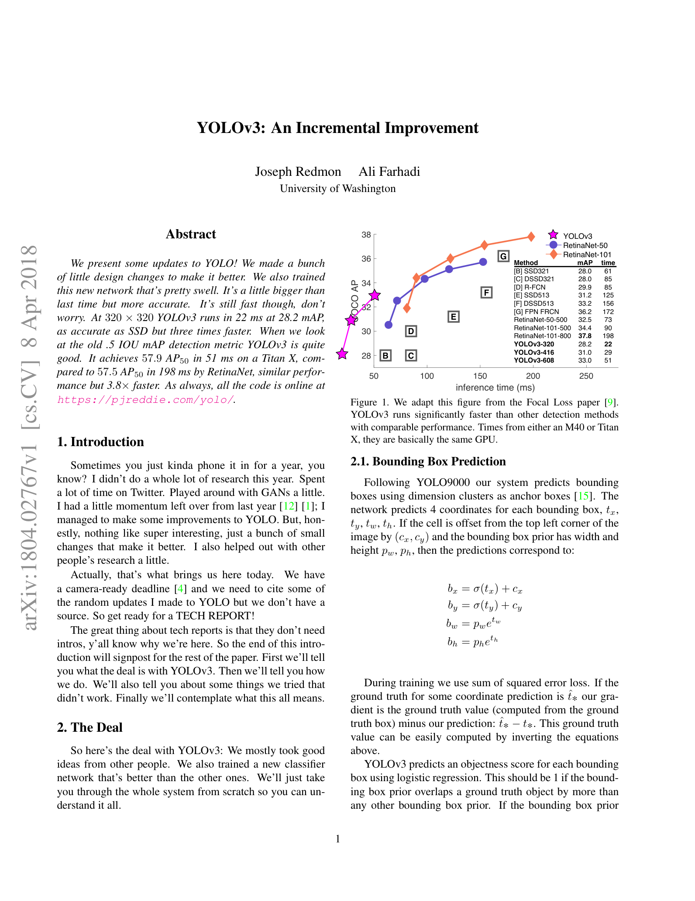
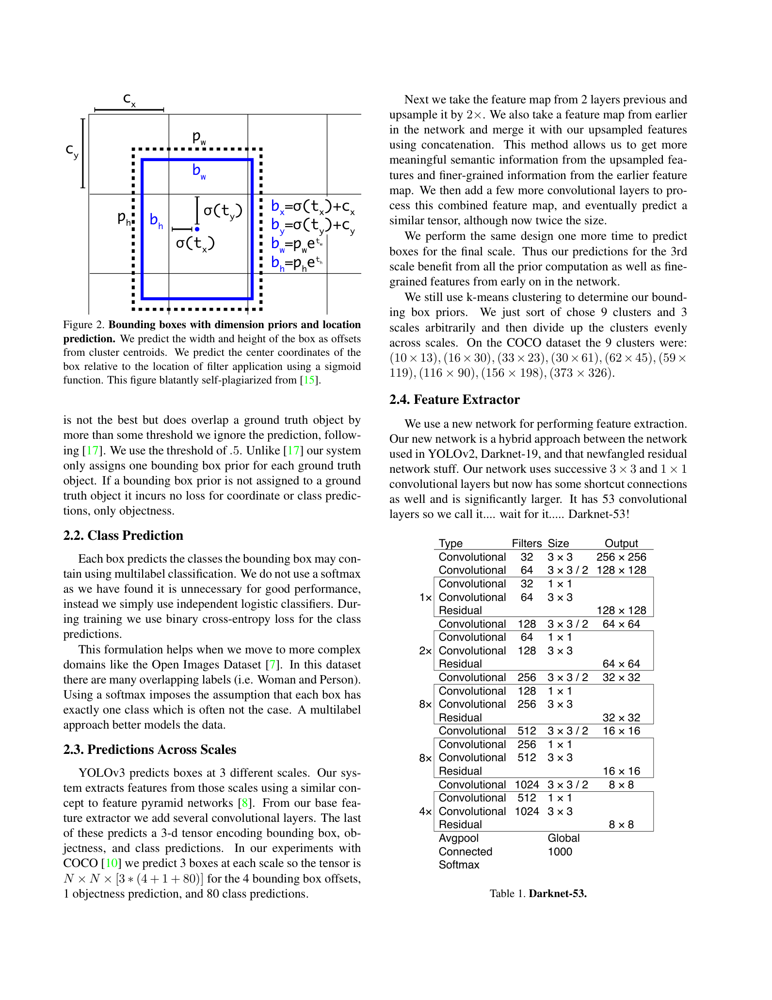
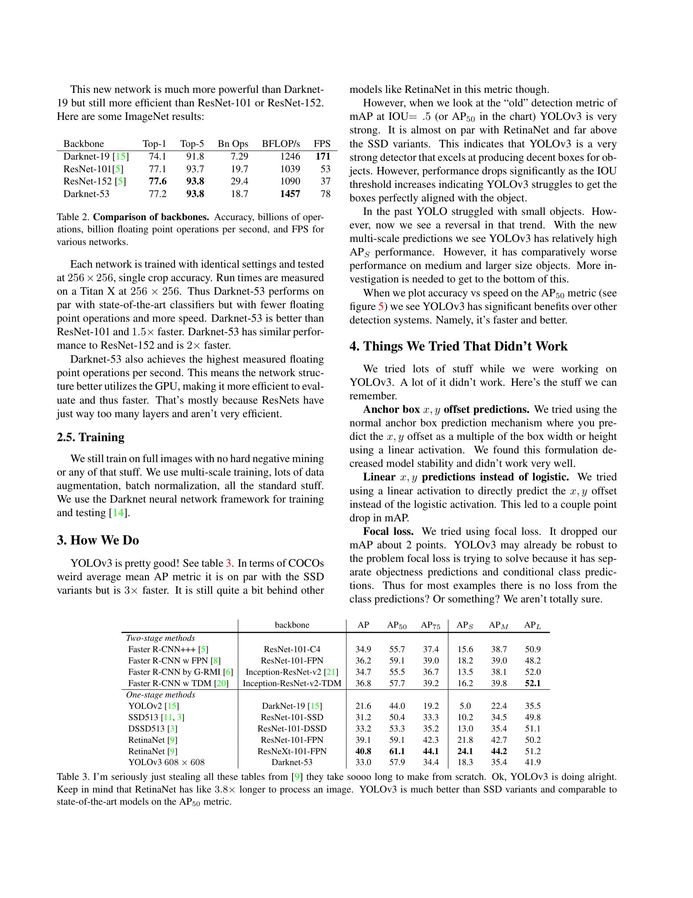

# YOLOv3（2018）· 精读笔记

- **论文**：YOLOv3: An Incremental Improvement（Tech Report，arXiv:1804.02767v1，2018-04-08）
- **BibTeX**：`redmon2018yolov3`
- **本地 PDF**：`3.科研基本任务/论文/目标检测/Redmon和Farhadi - 2018 - YOLOv3 An Incremental Improvement.pdf`
- **PDF 结构**：共 6 页；正文 p.1–p.4（含 §5 与 Meta 式的 Rebuttal 段），参考文献 p.5，p.6 是 Figure 4 + Rebuttal 正文（✅ 逐页核对）
- **任务书条目**：第 3 周 #13｜🟢 AI 辅助读
- **阅读日期**：2026-11-01
- **核对规则**：数字后的「出处」指回 PDF 页/节/表号。✅=已回原文查证；🟨=原文有但需限定；🟥=流行说法与原文不符（纠偏）。

> 读前提醒：这是一篇**故意写得不像论文的论文**（"get ready for a TECH REPORT!"，✅ §1）。正文里没有 related work、没有公式推导细节，大量设计只用一个句子带过。所以**精读的价值不在"读懂句子"，而在"把句子背后缺的参数补齐"**——凡原文没写的，本笔记一律标【待核对】，不替它补。

---

## 0. 术语表（零基础版 · 52 条）

> 分组：0.1 检测任务 / 0.2 网络结构 / 0.3 训练 / 0.4 评估 / 0.5 工程。
> 工程组每条按「朴素做法 → 优化做法 → 为什么有效」三段写。
> 标 ⚠️ 的是**本篇没有明说、但读的时候一定会碰到**的词。

### 0.1 检测任务组

| 术语 | 在本文里的确切含义 |
|---|---|
| **bounding box** | 现在不再直接回归 `(x,y,w,h)`，而是回归 4 个**变换量** `t_x,t_y,t_w,t_h`，再由固定公式换算成框（✅ §2.1，见式组 1）。 |
| **anchor / bounding box prior** | 预设的宽高模板，共 9 个，由 COCO 上 k-means 聚类得到；每个尺度分 3 个（✅ §2.3）。**这是 v1 没有、v3 必有的核心部件**。 |
| **dimension cluster（尺寸聚类）** | 用 k-means 对真值框的 `(w,h)` 聚类，得到 9 组"典型尺寸"。YOLOv3 直接沿用 YOLOv2 的做法（✅ §2.1/§2.3）。 |
| **grid cell** | 输出特征图上的一个位置。**v3 有三个网格**：13×13、26×26、52×52（输入 416 时），每个位置出 3 个框（✅ §2.3）。 |
| **objectness** | "这个框里有没有物体"的分。v3 把它**独立成一路输出**，用 logistic 回归训练，监督值是"该 anchor 与真值 IoU 是否最大"（✅ §2.1）。 |
| **logistic classifier** | 对每个类别**独立**做一次二分类（sigmoid + BCE），而不是 80 类 softmax（✅ §2.2）。所以一个框可以同时是 "Person" 和 "Woman"。 |
| **confidence** ⚠️ | v1 的 confidence = `Pr(Object)·IoU`（混装量）。v3 把它**拆成两项**：objectness（有无）+ 类别 logistic 分。本篇不再用 v1 那个定义。 |
| **IoU** | 交集/并集。v3 里用于：①给 anchor 分配真值（IoU 最大的那个负责）；②判定预测对错（AP 的阈值）。 |
| **NMS** | 非极大值抑制去重。**原文正文没有讨论 NMS**（只在实验隐含使用）→ 具体阈值与实现【待核对】。 |
| **multi-scale prediction** | 在 3 个不同分辨率的特征图上分别预测，小目标交给高分辨率那层（✅ §2.3）。 |
| **feature pyramid** | 深层上采样 2× 后与浅层**拼接（concatenation）**，再卷积预测（✅ §2.3，明说 "similar concept to feature pyramid networks"）。 |
| **localization error** | 框不够贴合真值。v3 自己承认：IOU 阈值一升高性能就明显掉（✅ §3），即 AP75 差。 |

### 0.2 网络结构组

| 术语 | 在本文里的确切含义 |
|---|---|
| **Darknet-53** | 新骨干：53 个卷积层，`3×3`/`1×1` 交替 + **残差 shortcut**，是 Darknet-19 与 ResNet 的混血（✅ §2.4）。 |
| **residual / shortcut** | 把输入直接加到输出（`x + F(x)`）。v3 用它让 53 层训得动（✅ §2.4 "some shortcut connections"）。 |
| **1×1 / 3×3 交替** | 1×1 压通道、3×3 提特征，交替堆叠（✅ §2.4）。 |
| **stride-2 卷积** | 用 `3×3/2` 代替池化做下采样（✅ Table 1 里的 `3×3 / 2`）。 |
| **3 个尺度** | 输出张量 `N×N×[3×(4+1+80)]`：3 个 anchor、4 个框偏移、1 个 objectness、80 类（✅ §2.3）。 |
| **upsample 2×** | 把深层特征图上采样一倍，与浅层拼接（✅ §2.3）。 |
| **concatenation（拼接）** | 通道维拼接（不是相加）。原文明确用词是 "merge ... using concatenation"（✅ §2.3）。 |
| **Bn Ops（Billion operations）** | 十亿次运算量。Darknet-53 是 **18.7**，ResNet-101 是 19.7（✅ Table 2）。 |
| **BFLOP/s** | 实测浮点吞吐。Darknet-53 达 **1457**，是全场最高（✅ Table 2）——说明结构**更会用 GPU**。 |
| **leaky ReLU** ⚠️ | 原文**正文未提激活函数**；Darknet 的 YOLOv3 配置里各卷积层用的是 leaky ReLU（0.1）【待核对：查 yolov3.cfg】。 |
| **batch norm** | 原文 §2.5 明说用了 "batch normalization"（✅），但**没说加在哪、用什么 momentum**【待核对】。 |

### 0.3 训练组

| 术语 | 在本文里的确切含义 |
|---|---|
| **sum-squared error（框回归）** | v3 的框坐标**仍用 SSE**（✅ §2.1 "we use sum of squared error loss"），且梯度写成 `t̂* − t*`（真值减预测）。 |
| **binary cross-entropy（BCE）** | 类别与 objectness 用 BCE（✅ §2.2），配合 sigmoid。 |
| **truth assignment（真值分配）** | **只给每个真值分配 1 个 anchor**（IoU 最大者）；没被分配到的框**不背坐标/类别 loss，只背 objectness**（✅ §2.1）。 |
| **ignore 阈值 0.5** | 与真值 IoU 超过 0.5 但又不是最好的框 → **忽略**（不罚不奖），原文跟 Faster R-CNN 的做法（✅ §2.1）。 |
| **multi-scale training** | 训练时随机换输入尺寸（✅ §2.5 只说 "we use multi-scale training"，具体步长【待核对】）。 |
| **no hard negative mining** | 原文特意强调 "no hard negative mining or any of that stuff"（✅ §2.5）——即不做难例挖掘。 |
| **data augmentation** | 只说 "lots of data augmentation"，具体种类【待核对】。 |
| **focal loss（试过但没用）** | 作者试了，mAP 掉约 2 点（✅ §4），并猜原因是 objectness 与类别已分开。 |

### 0.4 评估组

| 术语 | 在本文里的确切含义 |
|---|---|
| **AP** | COCO 主指标：IoU 从 0.5 到 0.95、步长 0.05 共 10 个阈值上 AP 的平均（v3 记为 AP，✅ Table 3 表头）。 |
| **AP50 / mAP@0.5** | 只看 IoU=0.5 的 AP（= VOC 口径的 mAP）。**v3 的 57.9 是 AP50**，不是 AP。 |
| **AP75** | IoU=0.75 时的 AP。**v3 只有 34.4**（✅ Table 3），是它最明显的短板。 |
| **APS / APM / APL** | 小/中/大物体的 AP（COCO 按框面积划分）。v3 是 18.3 / 35.4 / 41.9（✅ Table 3）。 |
| **recall** | 真值里被找回的比例。v1 靠"每格 2 框"限制召回；v3 靠 3 尺度 × 3 anchor 提升。 |
| **inference time (ms)** | 单张图耗时。v3-320 = **22 ms**、v3-416 = 29 ms、v3-608 = **51 ms**（✅ Fig.1 表）。 |
| **Titan X / M40** | 测速硬件；原文说 "they are basically the same GPU"（✅ Fig.1 图注）。 |

### 0.5 工程组（朴素做法 → 优化做法 → 为什么有效）

| 术语 | 三段展开 |
|---|---|
| **用 Darknet-53 换 Darknet-19** | 朴素：沿用 v2 的 19 层（74.1 top-1）。优化：加残差堆到 53 层（77.2）（✅ Table 2）。为什么有效：**残差让深网训得动**；且 BFLOP/s 从 1246 涨到 1457——**同样的卡能吃下更多有效算力**，所以"更深还更快"。 |
| **用卷积做下采样** | 朴素：maxpool 降分辨率。优化：`3×3 stride 2` 卷积（✅ Table 1）。为什么有效：**降采样同时提特征**，不是纯丢信息；也避免池化的"固定网格"带来的对齐偏移。 |
| **多尺度预测（3 层）** | 朴素：单尺度 13×13（v2 的做法）。优化：13/26/52 三层各出 3 框（✅ §2.3）。为什么有效：小物体在 52×52 上还有足够空间分辨率；**APS 从 5.0（v2）跳到 18.3**（✅ Table 3）是最直接的证据。 |
| **上采样 + 拼接（类 FPN）** | 朴素：各尺度独立预测，浅层缺语义。优化：深层上采样 2× 与浅层拼通道（✅ §2.3）。为什么有效：**语义（深）+ 细节（浅）同时给到一个头**，小目标既"看得清"又"认得对"。 |
| **每个真值只配 1 个 anchor** | 朴素（Faster R-CNN）：IoU>0.7 全算正、0.3–0.7 忽略、<0.3 算负。优化：**只留 IoU 最大的 1 个**，其余 >0.5 的忽略（✅ §2.1）。为什么有效：减少"一个物体被多个框抢着学"的重复监督，训练更稳（作者也试过双阈值，没work，✅ §4）。 |
| **logistic 多标签分类** | 朴素：softmax 强制互斥。优化：每类独立 sigmoid + BCE（✅ §2.2）。为什么有效：Open Images 里 "Woman" 与 "Person" **本就重叠**，softmax 的互斥假设是错的；改成独立二分类后可直接建模重叠标签。 |
| **不丢 pipeline、只改部件** | 朴素：重新设计检测范式。优化：**全部沿用 v2 的框架，只换骨干/损失/尺度**（✅ §2 原话 "We mostly took good ideas from other people"）。为什么有效：每个改动都能单独归因，也解释了标题 "Incremental"——**这是一篇诚实的增量改进报告**。 |

---

## 1. 论文定位

### 1.1 输入 → 输出（✅ Fig.2 + §2.3）

```
输入 416×416（或 320/608）
   │
   ▼
[ Darknet-53 ]（53 conv，含残差）
   ├── 深层 13×13×1024 ──► 头1：13×13×[3×(4+1+80)]  ← 大物体
   │        │ 上采样 2× + 拼 26×26 浅层
   ├────────┴──► 26×26 ──► 头2：26×26×[3×(4+1+80)]  ← 中物体
   │        │ 上采样 2× + 拼 52×52 浅层
   └────────────► 52×52 ──► 头3：52×52×[3×(4+1+80)]  ← 小物体
                              │
                              ▼ 阈值 + NMS（原文未给数值【待核对】）
                    输出：框 + objectness + 80 类 logistic 分
```

> 与 v1 的三处结构性差别：**①有 anchor（9 个聚类先验）；②有 3 个尺度；③类别不再是"一格一组 softmax"，而是"每框 80 个独立 sigmoid"**。

### 1.2 上一篇（YOLOv2）留下什么坑 → 本篇填什么

| 坑 | 原文依据 | 本篇怎么填 |
|---|---|---|
| 小物体差 | v2 的 APS 只有 **5.0**（✅ Table 3） | 3 尺度 + 上采样拼接 → APS **18.3** |
| 框不够准 | — | 仍用 SSE 于 `t` 空间 + 9 个聚类 anchor（✅ §2.1） |
| 类别互斥假设 | softmax 强约束单标签 | 改 independent logistic + BCE（✅ §2.2） |
| 骨干不够强 | Darknet-19 top-1 74.1（✅ Table 2） | Darknet-53 → **77.2**，且更快 |
| 与 SOTA 差距 | — | AP 33.0（608），AP50 **57.9** 与 RetinaNet 59.1 接近但快 3.8×（✅ 摘要） |

### 1.3 一句话说清

- **问题**：v2 之后 YOLO 在小物体和整体 AP 上仍落后于 RetinaNet/FPN 这类"重"检测器；同时 COCO 的 AP 指标把"框得准"权重抬得很高。
- **做法**：**不换范式、只换部件**——Darknet-53 骨干、3 尺度预测（类 FPN）、每框独立 logistic 分类、objectness 用 logistic、框仍用 SSE 但对 `t` 回归。
- **结果**：608 输入 **AP 33.0 / AP50 57.9 / AP75 34.4 @ 51 ms**（Titan X）；320 输入 **28.2 mAP @ 22 ms**，"as accurate as SSD but three times faster"；AP50 上 57.9 vs RetinaNet 57.5，但 **3.8 倍快**（✅ 摘要）。

> 一句话：**YOLOv3 = 把别人的好点子（anchor、FPN、残差、logistic）拼进 YOLO，用"框得不够准"换"又快又全"**。

---

## 2. 逐节导读（按原文章节顺序）

> 每节：**想解决什么 → 设计动机 → 关键句/公式 → 【批注】**。

### §1 Introduction（p.1）

**想解决什么**：其实什么也没解决——原文自嘲 "Sometimes you just kinda phone it in for a year"，只是因为要投的 camera-ready 论文需要引用自己对 YOLO 的修改而"没有出处"，所以写这份 tech report（✅ §1）。

**【批注】** 这段是全篇阅读体验的分水岭：**如果你按"正经论文"的期待读，会觉得它不严谨；按"改进日志"的期待读，信息密度极高**。它同时告诉你一件重要的事：**本文的方法没有理论动机，全是工程试错**（后半句可由 §4 "Things We Tried That Didn't Work" 反证）。

### §2 The Deal（p.1–3）

**想解决什么**：把整个系统"从头讲一遍"（原文原话 "We'll just take you through the whole system from scratch"）。**设计动机**：明确承认 "We mostly took good ideas from other people"（✅ §2）——**这是一篇"组装"型论文**。

### §2.1 Bounding Box Prediction（p.1–2）

**想解决什么**：v1/v2 的"框怎么参数化"的问题，v3 沿用 v2 的 anchor 机制并**改掉监督方式**。

**关键公式（本组四条，✅ §2.1）**：

```latex
b_x=\sigma(t_x)+c_x,\quad b_y=\sigma(t_y)+c_y,\quad b_w=p_w e^{t_w},\quad b_h=p_h e^{t_h}
```

- `c_x,c_y` = 该预测所属格子的左上角坐标；`p_w,p_h` = 该 anchor 的宽高先验；`t_*` = 网络输出。
- **x,y 用 sigmoid** → 中心被限制在**本格内**（0–1 偏移）；**w,h 用 exp** → 在对数尺度上缩放，永远为正。

**监督方式（关键句）**：`During training we use sum of squared error loss. If the ground truth ... is t̂*, our gradient is the ground truth value ... minus our prediction: t̂* − t*.`；objectness 用 **logistic regression**，目标为"该 prior 与真值的 IoU 是否最大"；"If a bounding box prior is not assigned to a ground truth object it incurs no loss for coordinate or class predictions, only objectness"（✅ §2.1）。阈值 **0.5** 之上的非最优框被**忽略**。

**【批注】** ①**注意"梯度 = 真值 − 预测"，不是"2×(真值−预测)"**：作者写的是梯度形式，等价于对 `0.5(t−t̂)²` 求导，省掉了常数 2——看着像 bug，其实是**表述约定**。②**exp 参数化是"乘法"而非"加法"**：`b_w = p_w e^{t_w}` 意味着网络学的是"放大几倍"，这对大小 anchor 都公平（v1 直接回归绝对 w,h 就没这个好处）。③"只分配 1 个 anchor"是**与 Faster R-CNN 最大的差别**，作者在 §4 说双阈值那套"couldn't get good results"。④**没被分配到的框只背 objectness loss**——这是 v3 不需要 focal loss 就能平衡正负样本的原因（作者在 §4 也这么猜）。

### §2.2 Class Prediction（p.2）

**想解决什么**：一个框可能有多个标签（Open Images 里 "Woman" 与 "Person" 重叠）。

**关键句**：`We do not use a softmax ... instead we simply use independent logistic classifiers. During training we use binary cross-entropy loss`（✅ §2.2）。

**【批注】** ①**softmax 的隐含假设是"恰好一类"，这在真实数据里常常不成立**——这是全篇少数有清晰理论动机的改动。②代价：类别数从 1 组变成 80 个独立通道，**输出维度从 5+80 变成 4+1+80**（多出的 1 就是 objectness）。③**这解决的是 v1 的"一格只能一类"限制**（v1 §2.4），但注意：v3 一格仍有 3 个框、每框一套 80 类，所以"同格多类"其实是靠"多框"实现的。

### §2.3 Predictions Across Scales（p.2）

**想解决什么**：小物体。**设计动机**：明说借鉴 FPN 的思路（✅ §2.3）。

**关键句**：`we predict 3 boxes at each scale so the tensor is N × N × [3 ∗ (4 + 1 + 80)]`；`take the feature map from 2 layers previous and upsample it by 2× ... merge ... using concatenation`；9 个聚类：`(10×13),(16×30),(33×23),(30×61),(62×45),(59×119),(116×90),(156×198),(373×326)`（✅ §2.3）。

**【批注】** ①**三层不是并列的，是链式的**：最深层预测 → 上采样拼中层 → 预测 → 上采样拼浅层 → 预测，所以第三层"benefit from all the prior computation"（✅ §2.3）。② 9 个 anchor **如何分配**原文只说"divide up the clusters evenly across scales"，**没写哪 3 个给哪一层**【待核对：查 cfg】；按常识应是"大框给粗尺度、小框给细尺度"。③`3×(4+1+80)` 里的 **1 是 objectness**——这是 v1 没有、v3 新增的独立通道。

### §2.4 Feature Extractor（p.2–3）

**想解决什么**：v2 的 Darknet-19 精度不够。

**做法**：Darknet-19 与残差网络的混血，53 个卷积层 → **Darknet-53**（✅ §2.4）。Table 2 的核心对比：Darknet-53 的 top-1 **77.2**、Bn Ops **18.7**、BFLOP/s **1457**、FPS **78**；ResNet-101 是 77.1 / 19.7 / 1039 / 53（✅ Table 2）。

**【批注】** ①**"更准"几乎没涨（77.1→77.2），真正涨的是效率**：BFLOP/s 更高说明**结构更会用 GPU**，原文原话 "the network structure better utilizes the GPU"（✅ §2.4）。②作者顺手吐槽 "ResNets have just way too many layers and aren't very efficient"——这句不是玩笑，**它解释了"为什么不上 ResNet-152"**。③Table 2 全部在 **256×256、single crop** 下测（✅ 图注），不能和 224 的结果直接比。

### §2.5 Training（p.3）

**关键句**：`We still train on full images with no hard negative mining ... multi-scale training, lots of data augmentation, batch normalization, all the standard stuff.`（✅ §2.5）

**【批注】** 这一节只有三句话，**几乎所有超参都缺失**（学习率、batch、迭代数、增强种类）→ 全部【待核对】。想复现只能读 Darknet 配置。**这也是 tech report 与正式论文的差别**：它假设读者会去看代码。

### §3 How We Do（p.3）

**想解决什么**：给结果表。**关键判断**：①COCO 的 AP 上 "on par with the SSD variants but is 3× faster"；②AP50 上 "almost on par with RetinaNet and far above the SSD variants"；③`performance drops significantly as the IOU threshold increases indicating YOLOv3 struggles to get the boxes perfectly aligned`；④小物体出现**反转**：`now we see a reversal in that trend ... relatively high APS ... comparatively worse performance on medium and larger size objects. More investigation is needed`（✅ §3）。

**【批注】** 第 ④ 条是全篇最诚实也最值得记的一句：**v3 修好了小物体，却让中/大物体相对变差**。作者自己也不知道原因（"More investigation is needed"）。**读论文时遇到作者承认"不知道为什么"，那往往就是下一篇论文的选题**。

### §4 Things We Tried That Didn't Work（p.3–4）

**想解决什么**：把失败实验公开。**四条**（✅ §4 逐条）：

| 试过的东西 | 结果 |
|---|---|
| anchor 的 x,y 用"宽高的倍数"线性预测 | 降低稳定性，效果不好 |
| x,y 用线性激活而非 logistic | mAP 掉"a couple point" |
| focal loss | mAP 掉约 **2 点** |
| 双 IoU 阈值 + 真值分配（Faster R-CNN 式 .7 / .3–.7 / .3） | 拿不到好结果 |

**【批注】** ①**这一节的价值高于很多论文的"消融实验"**：它告诉你"哪些方向已经被证伪"，省掉你的重复劳动。②作者对 focal loss 失败的猜测很谨慎："YOLOv3 may already be robust ... because it has separate objectness predictions and conditional class predictions. Thus for most examples there is no loss from the class predictions? Or something? We aren't totally sure."（✅ §4）——**"Or something? We aren't totally sure" 直接写进论文，是极少见的坦诚**。③ Fig.3 图注里还顺手塞了一句：`we also fix a data loading bug in YOLOv2, that helped by like 2 mAP`（✅ Fig.3 图注）——**v3 的提升里有约 2 点是"修 bug"而非"改方法"**，这点极易被忽略。

### §5 What This All Means（p.4）

**想解决什么**：质疑 COCO 的 AP 指标本身。**关键论点**：①COCO 原文对指标的说明只有一句"待补充"的占位句；②Russakovsky 等报告"人眼很难区分 IoU 0.3 和 0.5 的框"（✅ §5 引 [18]）；③"If humans have a hard time telling the difference, how much does it matter?"；④后半段是 AI 伦理讨论（监控、军事资助），并以 "do not @ me" 收尾。

**【批注】** 这一节在中文语境常被删掉，但它其实是**指标批判**的经典段落：**当一个指标的物理意义连人都分不清时，为它优化 2–3 个点是否值得？** 这正是 v3 "AP50 很强、AP 一般"却仍然自信的底气来源。

### Rebuttal（p.6）

**内容**：回应审稿人/Reddit 评论——①补画"零起点坐标轴"的图（原文自嘲 "our graphs have not one but two non-zero origins"）；②承认对 COCO 指标的批评"a bit weak"；③给出 Figure 5：**两个"按 mAP 完全等价"的检测器**（一个给出 99%/99%/99% 的高分但错标，另一个分数低但排序正确），用来证明 **mAP 只看类内排序、不看置信度校准**；④提议改成 global AP 或 per-image AP；⑤结尾 "Boxes are stupid anyway ... I'm probably a true believer in masks"（✅ p.6）。

**【批注】** Figure 5 这个反例值得单独记：**mAP 对"分数是否校准"完全不敏感**，只要排序对，99% 还是 52% 都一样。做工程时如果你的下游要用"分数阈值"（比如报警系统），**mAP 高不代表阈值可用**。

---

## 3. 核心图 / 公式深读

### 3.1 Figure 1：速度—精度散点（PDF p.1）



**图注**：`We adapt this figure from the Focal Loss paper [9]. YOLOv3 runs significantly faster than other detection methods with comparable performance. Times from either an M40 or Titan X, they are basically the same GPU.`（✅ Fig.1）

**读法**：横轴 inference time（ms），越左越好；纵轴 COCO AP，越高越好。**每个点旁边标着方法名**，YOLOv3 的三个点（320/416/608）全在图的最左侧。

| 方法 | AP | 时间(ms) |
|---|---|---|
| SSD321 | 28.0 | 61 |
| DSSD321 | 28.0 | 85 |
| R-FCN | 29.9 | 85 |
| SSD513 | 31.2 | 125 |
| DSSD513 | 33.2 | 156 |
| FPN FRCN | 36.2 | 172 |
| RetinaNet-50-500 | 32.5 | 73 |
| RetinaNet-101-500 | 34.4 | 90 |
| RetinaNet-101-800 | 37.8 | 198 |
| **YOLOv3-320** | **28.2** | **22** |
| **YOLOv3-416** | **31.0** | **29** |
| **YOLOv3-608** | **33.0** | **51** |

**【批注】** ①**"as accurate as SSD but three times faster"的出处就在这里**：YOLOv3-320 的 28.2/22ms 对比 SSD321 的 28.0/61ms（摘要，✅）。②**纵轴是 AP 不是 AP50**，所以 YOLOv3 的位置其实不占优（33.0 低于 FPN FRCN 36.2、RetinaNet-101-800 37.8）。③图是**从 Focal Loss 论文借来的**（原文自己承认），坐标轴起点非零，作者在 Rebuttal 里被审稿人（Dan Grossman）指出后才补了零起点版本（✅ p.6）。

### 3.2 Figure 2：框参数化（PDF p.2）★核心公式



**图注**：`We predict the width and height of the box as offsets from cluster centroids. We predict the center coordinates of the box relative to the location of filter application using a sigmoid function.`（✅ Fig.2）

```latex
b_x=\sigma(t_x)+c_x \qquad b_y=\sigma(t_y)+c_y
```

```latex
b_w=p_w\,e^{\,t_w} \qquad b_h=p_h\,e^{\,t_h}
```

| 符号 | 含义 | 作用 |
|---|---|---|
| `t_x,t_y,t_w,t_h` | 网络在该位置的 4 个原始输出（**无激活**，可以为负） | 待学量 |
| `c_x,c_y` | 该预测所属格子的左上角坐标（整数格坐标） | 把预测"锚"到格子上 |
| `p_w,p_h` | 该 anchor 的宽、高先验（来自聚类） | 提供尺寸先验 |
| `σ(·)` | sigmoid，输出 (0,1) | **把中心限制在本格内**，训练更稳 |
| `e^{t_w}` | 指数 | **在对数尺度缩放**，保证宽高恒正、且大小 anchor 梯度尺度一致 |

**为什么这么设计（三条，均需自己推）**：
1. **sigmoid 限制中心 ∈ 本格**：如果不加，一个 anchor 可能被拉去预测几十格外的物体，导致同一物体被远处格子抢，训练不稳定——§4 说"线性预测 x,y 掉 a couple point"正说明这点。
2. **exp 而非直接回归 w,h**：`b_w = p_w e^{t_w}` 等价于 `t_w = log(b_w/p_w)`，网络学的是**相对先验的对数比例**；这样"把框放大 2 倍"对所有 anchor 都是同一个数值操作，损失尺度一致。
3. **反解真值（原文明确说了怎么做）**：`This ground truth value can be easily computed by inverting the equations above`（✅ §2.1）——即 `t̂_x = σ⁻¹(b_x - c_x)`、`t̂_w = log(b_w/p_w)`。

**【批注】** ①**训练时梯度写的是 `t̂* − t*`**（真值减预测），对应 `0.5(t−t̂)²` 的导数；看到"少了系数 2"不要以为出错。②**σ⁻¹ 在边界会爆**：当 `b_x - c_x` 接近 0 或 1 时 logit 趋于无穷，工程实现通常要做截断——**原文没提**【待核对：查 Darknet 实现】。③**这套参数化不是 v3 首创**，图注自己写 "This figure blatantly self-plagiarized from [15]"（= YOLO9000，✅ Fig.2）——**读 v3 时必须知道 v2 已经这么做了**。

### 3.3 Table 1：Darknet-53 结构（PDF p.2）

| Type | Filters | Size | Output |
|---|---|---|---|
| Convolutional | 32 | 3×3 | 256×256 |
| Convolutional | 64 | 3×3/2 | 128×128 |
| Convolutional ×1 | 32 / 64 | 1×1 / 3×3 | 128×128 |
| Residual | — | — | 128×128 |
| Convolutional ×2 | 128 / 64 | 1×1 / 3×3 | 64×64 |
| Residual | — | — | 64×64 |
| Convolutional ×8 | 256 / 128 | 1×1 / 3×3 | 32×32 |
| Residual | — | — | 32×32 |
| Convolutional ×8 | 512 / 256 | 1×1 / 3×3 | 16×16 |
| Residual | — | — | 16×16 |
| Convolutional ×4 | 1024 / 512 | 1×1 / 3×3 | 8×8 |
| Residual | — | — | 8×8 |
| Avgpool / Connected / Softmax | — | Global / 1000 | — |

（✅ Table 1，已逐行核对）

**【批注】** ①**残差块结构是 `1×1 降通道 → 3×3 → 加回输入`**，重复 1/2/8/8/4 次——**背结构按这 5 个数字背最快**。②53 = 1 + 1 + (2×1) + (1+2×2) + (2×8) + (2×8) + (2×4) 里的卷积层总和（不含 Residual 与 FC）——**"53"不含全连接**【待核对：原文只说 "53 convolutional layers"】。③表里全是 `3×3/2` 的 stride-2 卷积做下采样，**没有 maxpool**，这是 v3 与 VGG 式结构最大的视觉差别。

### 3.4 Table 2：骨干对比（PDF p.3）

| Backbone | Top-1 | Top-5 | Bn Ops | BFLOP/s | FPS |
|---|---|---|---|---|---|
| Darknet-19 | 74.1 | 91.8 | 7.29 | 1246 | 171 |
| ResNet-101 | 77.1 | 93.7 | 19.7 | 1039 | 53 |
| ResNet-152 | 77.6 | 93.8 | 29.4 | 1090 | 37 |
| **Darknet-53** | **77.2** | **93.8** | **18.7** | **1457** | **78** |

**【批注】** ①**Darknet-53 的 top-1 比 ResNet-101 高 0.1 点，但运算量只 18.7 vs 19.7、FPS 78 vs 53** → 原文结论 "better than ResNet-101 and 1.5× faster"、"similar to ResNet-152 and 2× faster"（✅ §2.4）。②**BFLOP/s 1457 是全场最高**，说明它"更会用 GPU"——这是"更深还更快"的物理解释。③**注意 Table 2 与 Table 3 的 AP 不是一个东西**：Table 2 是 ImageNet 分类，Table 3 是 COCO 检测。

### 3.5 三尺度输出张量（§2.3 公式化表述）

```text
尺度1：13×13×[3×(4+1+80)] = 13×13×255  ← 大 anchor
尺度2：26×26×[3×(4+1+80)] = 26×26×255  ← 中 anchor
尺度3：52×52×[3×(4+1+80)] = 52×52×255  ← 小 anchor
```

- `4` = `t_x,t_y,t_w,t_h`；`1` = objectness；`80` = COCO 类别（**独立 logistic**，不是 softmax）。
- 9 个聚类 anchor（COCO）：`(10×13)(16×30)(33×23)(30×61)(62×45)(59×119)(116×90)(156×198)(373×326)`（✅ §2.3）。
- 416 输入时的三层分辨率由 32 倍下采样决定：`416/32=13`、`416/16=26`、`416/8=52`（**自算，原文只给 13/26/52 需从 cfg 确认**【待核对】）。

**【批注】** ①**anchor 尺寸"从小到大"跨越 373×326 到 10×13，接近 30 倍**——这就是它能同时覆盖大小物体的原因。②**每层 3 个 anchor 是"任意选的"**（原文原话 "We just sort of chose 9 clusters and 3 scales arbitrarily"，✅ §2.3）——**这是全篇最不"科学"的一句话，也最值得记住**：很多有效设计是试出来的，不是推出来的。

---

## 4. 实验逐表解读

### 4.1 Table 3：COCO 主结果（PDF p.3）



**这张表在回答**：在 COCO 上，YOLOv3 到底处于什么位置？关键行：

| 方法 | 骨干 | AP | AP50 | AP75 | APS | APM | APL |
|---|---|---|---|---|---|---|---|
| Faster R-CNN+++ | ResNet-101-C4 | 34.9 | 55.7 | 37.4 | 15.6 | 38.7 | 50.9 |
| Faster R-CNN w FPN | ResNet-101-FPN | 36.2 | 59.1 | 39.0 | 18.2 | 39.0 | 48.2 |
| YOLOv2 | Darknet-19 | 21.6 | 44.0 | 19.2 | 5.0 | 22.4 | 35.5 |
| SSD513 | ResNet-101-SSD | 31.2 | 50.4 | 33.3 | 10.2 | 34.5 | 49.8 |
| DSSD513 | ResNet-101-DSSD | 33.2 | 53.3 | 35.2 | 13.0 | 35.4 | 51.1 |
| RetinaNet | ResNet-101-FPN | **39.1** | 59.1 | 42.3 | 21.8 | 42.7 | 50.2 |
| RetinaNet | ResNeXt-101-FPN | 40.8 | **61.1** | 44.1 | 24.1 | 44.2 | 51.2 |
| **YOLOv3 608×608** | Darknet-53 | **33.0** | **57.9** | **34.4** | 18.3 | 35.4 | 41.9 |

**三条结论**：① **AP50 57.9 与 RetinaNet-101 的 59.1 只差 1.2**，但后者 AP 39.1 高出 6.1；② **AP75 只有 34.4**，比 RetinaNet 低 7.9，比 DSSD513（35.2）还低；③ 与 v2 比，APS **5.0 → 18.3**（提升 13.3），但 APL 从 35.5 只涨到 41.9。

**最易误读的三处 ❗**
- **❌"YOLOv3 的 mAP 是 57.9"** → 错。**57.9 是 AP50**；COCO 的 AP 是 **33.0**。摘要里的 "28.2 mAP" 也是 AP（320 输入），别和 AP50 混。
- **❌"YOLOv3 和 RetinaNet 精度相当"** → 只在 **AP50** 上相当（57.9 vs 57.5 在 51ms/198ms 那组，✅ 摘要）；**AP 上差 6.1 点**。原文对此非常诚实："It's not as great on the COCO average AP between .5 and .95 IOU metric"（✅ §5）。
- **❌"v3 全面修好了小物体"** → 只修好了**小物体**（APS 18.3），原文自己说中/大物体 "comparatively worse performance"（✅ §3）。**这是一个此消彼长的交换，不是全面胜利。**
- （可复算的补充）**AP50 与 AP75 的落差**：YOLOv3 是 `57.9−34.4=23.5`，RetinaNet-101 是 `59.1−42.3=16.8`，YOLOv2 是 `44.0−19.2=24.8`。→ **v3 从 v2 的 24.8 只改善到 23.5，说明"框得准"这件事几乎没有进步**（自算，数字均来自 ✅ Table 3）。

### 4.2 Figure 3：AP50 上的速度—精度（PDF p.4）

**这张图在回答**：换成"旧指标" AP50 后，YOLOv3 是不是更强？→ 是。

| 方法 | AP50 | 时间(ms) |
|---|---|---|
| SSD321 | 45.4 | 61 |
| DSSD321 | 46.1 | 85 |
| R-FCN | 51.9 | 85 |
| SSD513 | 50.4 | 125 |
| DSSD513 | 53.3 | 156 |
| FPN FRCN | 59.1 | 172 |
| RetinaNet-101-800 | 57.5 | 198 |
| **YOLOv3-320** | **51.5** | **22** |
| **YOLOv3-416** | **55.3** | **29** |
| **YOLOv3-608** | **57.9** | **51** |

**最易误读**：①**"3 倍快"和"3.8 倍快"是两个对比对象**——对 SSD 是 3×（28.2/22ms vs 28.0/61ms），对 RetinaNet 是 **3.8×**（57.9/51ms vs 57.5/198ms，✅ 摘要）。②YOLOv3-320 的 AP50 有 51.5，看着比 SSD513 的 50.4 高，但**AP 只有 28.2 vs 31.2**——**又一次说明它的强项在"粗框"而不在"精框"**。

### 4.3 Figure 5（p.6）：两个"按 mAP 等价"的检测器

**这张图在回答**：mAP 这个指标本身有什么问题？→ **它只看类内排序，不看置信度是否校准**。Detector #1 输出 99%/99%/99% 但把鸟标成 Camel；Detector #2 分数只有 10–90% 但排序正确；**按 mAP 两者完全相同**（✅ p.6）。

**最易误读**：这是**反例构造**，不是实验结果。作者自己说 "this is OBVIOUSLY an over-exaggeration"（✅ p.6）。它的用途是**质疑指标**，不是证明 YOLOv3 更强。

---

## 5. 我的思考（🟢 AI 辅助读 · 每条都标来源等级）

> 标注规则：**【原文结论】**= 论文明确写了；**【我的推断】**= 我从原文数字/设计推出来、原文没写；**【课外补充·待核实】**= 论文之外的知识，需自己查证后再用。

### 5.1 贡献

- **【原文结论】** v3 的贡献是"组装 + 效率"：AP50 上追平 RetinaNet 但快 3.8×；小物体 APS 从 5.0 提到 18.3；Darknet-53 比 ResNet-101 更准且快 1.5×（✅ 摘要/§2.4/Table 3）。
- **【我的推断】** 真正的贡献可能不在指标，而在**"三件套"的组合方式**：anchor（v2）＋ 多尺度（FPN）＋ 独立 logistic 分类。这三件单独看都不是新的，但**同时塞进一个单阶段实时检测器**是第一次——这也是为什么它成了工业界用了很多年的 baseline。
- **【课外补充·待核实】** 后续 YOLOv4/v5 大量沿用 v3 的"三尺度 + anchor + logistic"骨架，改进主要在骨干、数据增强（Mosaic）、loss（CIoU）等——具体版本差异需查原论文，别凭记忆写。

### 5.2 局限（小物体 / 密集场景）

- **【原文结论】** 作者自陈两条：①IOU 阈值升高性能明显下降（框不够贴合，✅ §3）；②小物体变好但中/大物体相对变差，"More investigation is needed"（✅ §3）。
- **【我的推断】** 密集场景仍是弱项，原因是结构性的：**每个真值只分配 1 个 anchor**（✅ §2.1），所以两个高度重叠的同真值物体中，必然有一个 anchor 被"忽略"（IoU>0.5 但非最优→不罚不奖），等于**没有被有效监督**。这与 v1 "一格 2 框"的限制是同一类问题，只是换了个位置。
- **【课外补充·待核实】** 现代做法会用"中心度采样（center sampling）"或"多正样本分配（如 ATSS/SimOTA）"来缓解一真值一 anchor 的问题——**这些不在 v3 里，引用前请核对原文**。

### 5.3 消融设计的逻辑

- **【原文结论】** v3 **几乎没有标准消融表**，取而代之的是 §4 "Things We Tried That Didn't Work"（4 条失败）＋ Fig.3 图注里一句"修 v2 的 data loading bug 涨了约 2 mAP"（✅ §4/Fig.3）。
- **【我的推断】** 这是 tech report 体裁的必然结果：**作者没做"逐项加回"的对照**，所以我们**无法从论文里知道每个改动的单独贡献**（比如三尺度到底值几个点、logistic 分类值几个点）。想拆解只能自己复现——**这是读 v3 最大的信息缺口**。
- **【课外补充·待核实】** 若要自己补消融，最小可行方案是：以 v2 为基线，逐一打开 ①Darknet-53 ②三尺度 ③logistic 分类 ④objectness 独立通道，在 COCO 上各测一次 AP/AP50/APS——**这是我的实验设想，尚未验证**。

### 5.4 如果让我改

- **【我的推断】** 第一优先级是**把框回归从 SSE 换成 IoU 系损失**：证据是 AP50→AP75 的落差 23.5 几乎没比 v2（24.8）改善（自算自 ✅ Table 3），说明问题就在"框不够贴合"；SSE 对 `t` 的惩罚与 IoU 并不单调对应。
- **【我的推断】** 第二优先级是**放开"一真值一 anchor"**：至少允许 IoU 排前 2 的 anchor 都参与回归，以缓解密集场景漏检。
- **【课外补充·待核实】** 这两条正是后来 YOLOv4（CIoU）与一些 anchor 分配策略做的事，但**具体收益数字必须以原论文为准，不能凭印象**。

---

## 6. 与前后论文的衔接

### 6.1 继承了谁（v3 自己列的"借来的东西"）

| 来源 | 借了什么 | 出处 |
|---|---|---|
| **YOLO9000 / YOLOv2** | anchor 机制、`σ(t)+c` 与 `p·e^{t}` 参数化（"blatantly self-plagiarized"）、k-means 聚类 | ✅ §2.1、Fig.2 图注（引 [15]） |
| **FPN** | 上采样 + 拼接的多尺度思路（"similar concept to feature pyramid networks"） | ✅ §2.3（引 [8]） |
| **ResNet** | 残差 shortcut | ✅ §2.4 |
| **Faster R-CNN** | 忽略区的阈值思想（v3 把 .7/.3 那套简化成"只留最优 + 0.5 忽略"） | ✅ §2.1、§4（引 [17]） |
| **Focal Loss 论文** | 图 1/图 3 的散点图模板；Table 3 的表格 | ✅ Fig.1/Fig.3 图注、Table 3 图注 |

### 6.2 改动了什么（相对 v1/v2）

| 维度 | v1 | v2 | **v3** |
|---|---|---|---|
| 框参数化 | 直接回归绝对 w,h | anchor + σ/exp | **同 v2** |
| 尺度 | 1 个（7×7） | 1 个（13×13） | **3 个（13/26/52）** |
| 分类 | 每格 1 组，SSE | softmax | **每框 80 个独立 logistic + BCE** |
| objectness | 混在 confidence 里 | 有 | **独立一路 logistic** |
| 骨干 | 24 conv + 2 FC | Darknet-19 | **Darknet-53（残差）** |
| 每真值正样本 | 1 格 IoU 最高框 | 1 anchor | **1 anchor**（未改） |

### 6.3 留下的坑

| 坑 | 后果 | 谁接着填 |
|---|---|---|
| AP75 低（框不贴合） | COCO AP 上不去 | v4 换 CIoU loss；后续换 DIoU 等（【课外·待核实】） |
| 一真值一 anchor | 密集场景监督不足 | 后续的多正样本分配策略（【课外·待核实】） |
| 中/大物体相对变差（原因不明） | 作者自己说 "More investigation is needed" | 悬案 |
| 超参几乎不公开 | 难以复现 | 只能读 Darknet 配置 |
| 单阶段对遮挡/小目标仍有上限 | — | 后续 anchor-free（FCOS/CenterNet）另开路线（【课外·待核实】） |

---

## 7. 回原文核对记录

| # | 说法 | 原文依据 | 判定 |
|---|---|---|---|
| 1 | YOLOv3 的 AP 是 57.9 | Table 3：AP **33.0**、**AP50 57.9** | 🟥 **纠偏**：57.9 是 AP50，AP 是 33.0 |
| 2 | v3 用 softmax 分类 | §2.2 "We do not use a softmax ... independent logistic classifiers" | 🟥 **纠偏**：用的是独立 logistic + BCE |
| 3 | 每个尺度 3 个 anchor，共 9 个 | §2.3 `3 boxes at each scale`；9 个聚类列表 | 🟩 正确 |
| 4 | 输出是 `N×N×[3×(4+1+80)]` | §2.3 原式（COCO） | 🟩 正确；`1` 是 objectness |
| 5 | v3 用 focal loss 提升明显 | §4 "We tried using focal loss. It dropped our mAP about 2 points" | 🟥 **纠偏**：试了、**掉了 2 点**、弃用 |
| 6 | 框回归用 IoU loss | §2.1 "we use sum of squared error loss" | 🟥 **纠偏**：v3 用 **SSE**（在 t 空间） |
| 7 | 快 3.8 倍是对 SSD | 摘要：SSD 是 "three times faster"；RetinaNet 是 "3.8× faster" | 🟨 两个倍数对应两个对象 |
| 8 | v3 全面解决了小物体 | §3 "reversal ... relatively high APS ... worse on medium and larger" | 🟨 只解决小物体，中大物体变差 |
| 9 | Darknet-53 大幅提高了分类精度 | Table 2：77.2 vs ResNet-101 77.1；真正赢在 FPS 78 vs 53 与 BFLOP/s 1457 | 🟨 精度几乎持平，"更强"体现在效率 |
| 10 | anchor 尺寸是精心设计的 | §2.3 "We just sort of chose 9 clusters and 3 scales arbitrarily" | 🟨 作者自称"随便选的" |
| 11 | v3 的提升全部来自方法改动 | Fig.3 图注："we also fix a data loading bug in YOLOv2, that helped by like 2 mAP" | 🟨 至少约 2 点来自修 bug |
| 12 | 论文给了完整训练超参 | §2.5 仅三句话 | 🟨 缺失，全部【待核对】 |

---

## 8. 自测题 5 题 + 常见误解 5 条

### 8.1 自测题

1. **写出 `b_x,b_y,b_w,b_h` 四条式子**，并说明：为什么中心用 σ、宽高用 exp？如果把中心的 σ 换成线性，会发生什么（提示：§4）。
2. **`N×N×[3×(4+1+80)]` 里每个数字是什么？** 若换成 VOC 20 类，这个张量变成多少？
3. **为什么 v3 不用 softmax？** 举一个 softmax 会出错的具体数据集例子（提示：Open Images 的 Woman/Person）。
4. **AP50=57.9 但 AP=33.0，这个落差说明什么？** 用 AP75=34.4 和 RetinaNet 的 AP75=42.3 做对比解释。
5. **v3 对每个真值只分配 1 个 anchor，这样做的代价是什么？** 想想"两个高度重叠的同类物体"会发生什么。

### 8.2 常见误解

| # | 误解 | 错在哪 | 正确说法 |
|---|---|---|---|
| 1 | "YOLOv3 精度全面超过 RetinaNet" | 只有 AP50 接近（57.9 vs 59.1/57.5），AP 差 6.1 | **AP50 上接近、AP 上落后**，赢在速度 |
| 2 | "v3 用 focal loss" | 试过、掉 2 点、弃用 | 用的是 objectness + BCE，靠"分离 objectness 与类别"天然抗类别不平衡（作者也只是猜） |
| 3 | "v3 是一篇完整的方法论文" | 它是 tech report，无 related work、无超参、无消融 | **"改进日志"体裁**，复现必须看代码 |
| 4 | "anchor 是网络学出来的" | anchor 由 k-means 在训练集上**离线聚类**得到，训练中固定 | 网络只学 `t_*` 偏移量，不改 anchor 本身 |
| 5 | "AP 越高就代表分数可以当阈值用" | mAP 只看类内排序（✅ Fig.5） | **mAP 不衡量校准**；要设阈值必须另做校准评估 |

---

## 9. 读到这里最容易产生的疑问（5 组 Q&A）

**Q1：为什么三个尺度的 anchor 数量都是 3，而不是"小尺度多给几个"？**
A：原文只说 9 个聚类"evenly across scales"（✅ §2.3），**没有解释为什么均分**，也没给每层具体尺寸【待核对】。合理推测是：**每层 3 个 anchor 足以覆盖该层的尺寸区间**，多给只会增加计算量（每多一个 anchor，该层多 85 维输出）。

**Q2：如果网络在同一格预测出 3 个框，它们会不会互相打架？**
A：不会，因为**三个框绑定了三个不同的 anchor 先验**（`p_w,p_h` 不同），各自的 `t_w` 学的是"相对自己先验的缩放"。这就是 anchor 机制的核心：**把"预测绝对尺寸"换成"预测相对某个模板的修正量"**，降低了学习难度。

**Q3：objectness 和类别分是两套，推理时怎么合成一个分数？**
A：**分数 = objectness × 类别的 sigmoid 分**。注意这与 v1 的 `Pr(Class)·conf` 结构相同，但含义不同：v1 的 conf 里混了 IoU，v3 的 objectness **不预测 IoU**（监督值是 0/1 的"是否最优 anchor"）。→ 所以 v3 的分数**不携带"框有多准"的信息**，这也是它 AP75 差的一个可能原因（**我的推断**；原文未讨论）。

**Q4：既然 exp 参数化更好，为什么 v1 不用？**
A：**因为 v1 没有 anchor**。`b_w = p_w e^{t_w}` 必须有先验 `p_w` 才能成立；v1 从零回归绝对 w,h，没有"相对谁缩放"的基准。→ **anchor 是这套参数化的前提**，两者是一个整体（v2 引入 anchor 时同时引入了这个公式）。

**Q5：作者在 §5 质疑 COCO 指标，是不是"输了找借口"？**
A：**部分是，但论点成立**。他自己在 Rebuttal 里承认 "I was basically trying to do that and I lashed out at the COCO metrics a little bit"（✅ p.6）。但论据是硬的：①COCO 原文对指标只有一句占位说明；②Russakovsky 的实验显示人眼难分 IoU 0.3 与 0.5（引 [18]）；③Fig.5 的构造反例说明 mAP 不看校准。→ **读论文时要能把"情绪"和"论据"分开**，这里两者都有，但论据可独立验证。

---

## 附：一页速记卡

```text
YOLOv3 = Darknet-53 + 3 尺度(13/26/52) + 9 聚类 anchor + 每框独立 logistic + objectness
核心式：b_x=σ(t_x)+c_x；b_w=p_w·e^{t_w}；框回归仍用 SSE（在 t 空间）
张量：N×N×[3×(4+1+80)]（COCO）
成绩：608 → AP 33.0 / AP50 57.9 / AP75 34.4 / APS 18.3，51ms（Titan X）
      320 → AP 28.2，22ms（≈SSD 精度、3× 快）；AP50 对 RetinaNet 57.9 vs 57.5，3.8× 快
强项：小物体 APS 5.0→18.3；多标签（logistic）；效率（BFLOP/s 1457）
弱项：AP75 34.4（框不贴合）；中/大物体反而变差（作者不解）；超参不公开
失败实验：线性 x,y(−2pt)、focal loss(−2pt)、双 IoU 阈值、anchor 倍数偏移
彩蛋：修 v2 data loading bug 贡献约 +2 mAP（藏在 Fig.3 图注里）
```

