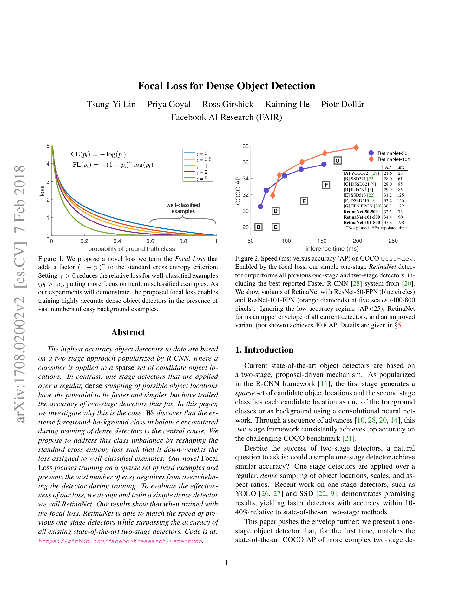
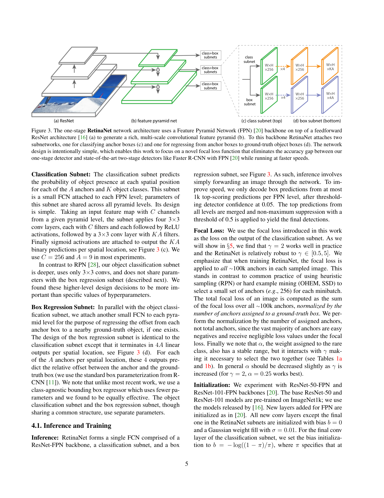
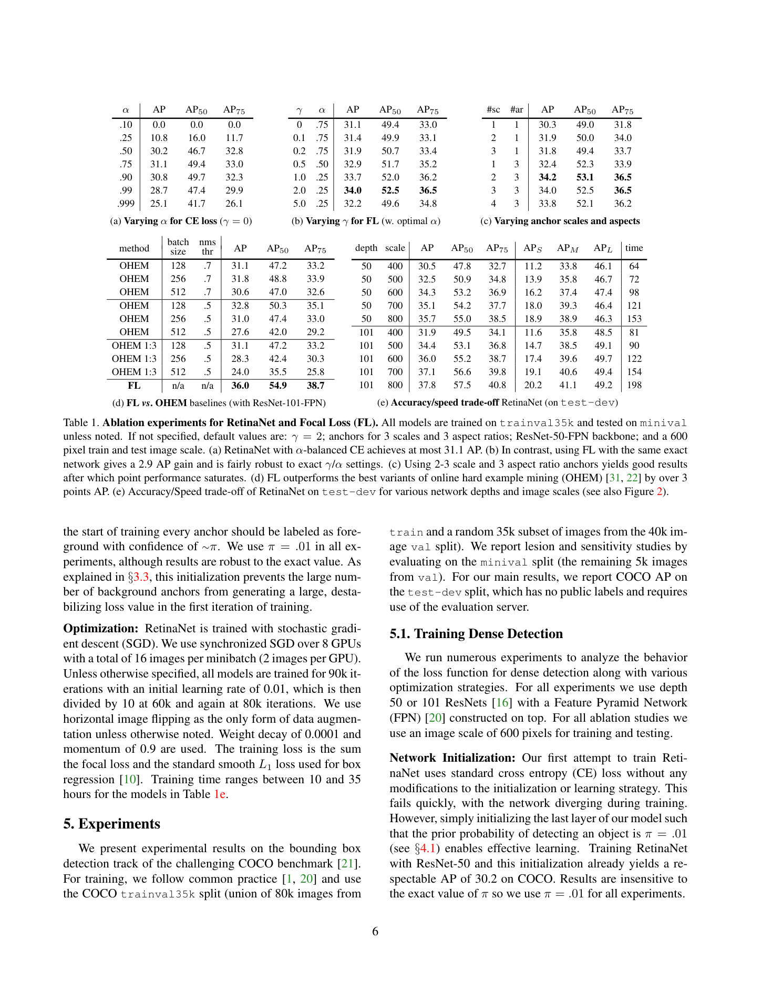

# Focal Loss / RetinaNet（2017/2018）· 论文笔记（精读版）

- **论文**：Focal Loss for Dense Object Detection（ICCV 2017；本地 PDF 为 arXiv:1708.02002v2，2018-02-07 版）
- **BibTeX 键名**：`lin2017focal`
- **作者/机构**：Tsung-Yi Lin, Priya Goyal, Ross Girshick, Kaiming He, Piotr Dollár（Facebook AI Research，FAIR）
- **本地 PDF**：`3.科研基本任务/论文/Lin 等 - 2018 - Focal Loss for Dense Object Detection.pdf`（共 10 页，正文 p.1–8，附录 p.9）
- **任务书条目**：第 3 周 #15｜🔴 必精读｜阅读要点：one-stage 精度差的真正原因是正负样本极端不平衡；一个 loss 函数能否补上结构上的差距
- **阅读日期**：2026-11-01
- **核对规则**：本文所有数字后的「p.X」指本地 PDF 的**物理页码**（不是论文印刷页码，两者在本篇里恰好一致）；✅ = 已用 PyMuPDF 逐页提取原文核对过。
- **本笔记定位**：写给"控制专业、刚入门深度学习、第一次认真读检测论文"的自己。**不是汇报稿**，所以会大量写"这句话到底在说什么、哪里容易读错、和上一篇差在哪"。

---

## 0. 术语表（零基础全能版·先看这节再看正文）

> 这篇论文的难点不在公式（公式只有 5 行），而在**一堆工程词**：anchor、dense prediction、OHEM、prior 初始化、loss 归一化……这些词中文教程常常一句带过，但恰恰是"复现失败"的高发区。下面按 **检测任务 → 结构 → 训练 → 评估 → 工程** 分组，每条都写清"在**这篇**里具体指什么"。

### 0.1 检测任务基础

| 术语 | 大白话解释（在本篇里的含义） |
|---|---|
| **目标检测（object detection）** | 输入一张图，输出若干个"框 + 类别 + 置信度"。本质是"在哪里 + 是什么"两个问题一起做。 |
| **dense prediction（稠密预测）** | 对**图上每一个位置**都做一次预测（不管这里有没有物体），而不是只在少数候选区域做预测。RetinaNet 是典型稠密预测：每个特征图格点上都挂 9 个 anchor，全部要算分类和回归。 |
| **one-stage（单阶段）** | 一步出结果：直接在稠密格点上分类 + 回归，没有"先找候选再分类"的中间步骤。YOLO、SSD、RetinaNet 属于这一类。**优点是快、结构简单**。 |
| **two-stage（两阶段）** | 第一步用 RPN 等机制从海量位置里**筛出 1–2k 个候选**（proposal），第二步只对这 1–2k 个候选做精细分类 + 回归。Faster R-CNN、FPN、Mask R-CNN 属于这一类。**优点是准，缺点是慢、结构复杂**。 |
| **anchor（锚框）** | 在每个格点上预先摆好的"参考框"，有固定尺寸和长宽比。网络不直接预测框的绝对坐标，而是预测"相对这个参考框要挪多少、缩放多少"。本篇 P3–P7 每层 9 个 anchor（3 个尺度 × 3 个长宽比），全图合计约 **100k 个**（p.5）。 |
| **anchor 的正/负/忽略** | 与某个真值框 IoU ≥ 0.5 → 正样本（负责这个物体）；IoU < 0.4 → 负样本（背景）；IoU 落在 [0.4, 0.5) → **忽略**，不参与训练（p.4）。这条"忽略带"是很多人复现时漏掉的细节。 |
| **class imbalance（类别不平衡）** | 本篇的核心。图上真正有物体的位置只有几个，其余上万个 anchor 都是"一眼就能看出是背景"的负样本。原文给的量级：前景:背景 ≈ **1:1000**（p.3），每张图约 **10⁴–10⁵** 个候选位置（p.3）。 |
| **easy example（易分样本）** | 模型已经很自信地分对的样本，比如一片纯天空的 anchor，p_t 接近 1。它的**单条 loss 很小，但数量巨大**，加起来就把总 loss 和梯度淹没了。 |
| **hard example（难分样本）** | 模型还没分对的样本（p_t 小）。它才是真正能教会网络东西的样本。Focal Loss 的全部目的就是"让难样本的相对权重变大"。 |
| **foreground / background** | 前景 = 有物体（正类）；背景 = 没有物体（负类）。本篇的分类子网是**二分类 × K 类**（每类各自做一次"有/无"判断），不是 K+1 类 softmax。 |
| **proposal（候选框）/ RoI** | 两阶段里第一步吐出来的候选区域。RPN 把"近乎无限"的位置压到 1–2k 个，**而且这些候选大概率落在物体上**——这一步就天然把海量 easy negative 干掉了。 |
| **候选位置（candidate location）** | 本篇特指"anchor 铺满全图后形成的所有可预测位置"。数量级 100k 是理解全文的钥匙。 |
| **box regression（框回归）** | 不直接回归绝对坐标，而是回归 4 个**偏移量**（相对 anchor 中心与宽高的变换）。本篇用 R-CNN 的标准参数化（p.5），并用 smooth L1 损失（p.6）。 |
| **class-agnostic regressor（类别无关回归器）** | 所有类别共用一套框回归参数（4A 个输出），而不是每类各一套。原文说这样参数更少、效果一样（p.5）。**这是和 R-CNN 系列"每类一套回归"的重要区别**。 |

### 0.2 损失函数相关（本篇的绝对主角）

| 术语 | 大白话解释 |
|---|---|
| **cross entropy（CE，交叉熵）** | 二分类的标准损失：`CE = -log(p_t)`。p_t 越接近 1（分对了且自信），loss 越接近 0；但**永远不会真的到 0**。 |
| **p_t（"分对的那个类的概率"）** | 一个记号技巧。真值是正类时 p_t = p；真值是负类时 p_t = 1-p。这样正负样本可以写成同一个公式（p.3 式 2）。**记住：p_t 越大 = 分得越对**。 |
| **α（alpha，类别权重）** | 给正负类各一个固定权重（正类 α，负类 1-α）。它解决的是"**哪一类更重要**"，**不解决"哪条样本更难"**（p.3 明确写了这句）。 |
| **α-balanced CE** | `CE = -α_t log(p_t)`。相当于两阶段里"正负 1:3 采样"的**软化版**：不真的删样本，只是给负类降权。本篇把它当作 FL 的对照基线（Table 1a）。 |
| **focal loss（FL，焦点损失）** | `FL = -α_t (1-p_t)^γ log(p_t)`。在 CE 前面乘一个 **调制因子 (1-p_t)^γ**：分得越对，这个因子越小，这条样本的 loss 就被压得越狠。 |
| **(1-p_t)^γ（调制因子 / modulating factor）** | 整篇论文的"那一行"。p_t=0.9、γ=2 时它 ≈ 0.01，即这条样本的 loss 被压到 CE 的 **1/100**；p_t≈0.968 时压到 **1/1000**（p.3 原文举例）。 |
| **γ（gamma，聚焦参数）** | 控制"压得多狠"。γ=0 时 FL 退化成 CE；γ 越大，易分样本被压得越狠。原文取 **γ=2**，并说对 γ∈[0.5, 5] 比较稳健（p.5）。 |
| **α 与 γ 的耦合** | 关键工程点：γ 变大后，负类已经被压得很惨，就不需要再用大 α 去压负类了，所以 **α 要跟着变小**。原文：γ=2 时 α=0.25 最好；γ 增大则 α 略减；α 的最佳区间只落在 [0.25, 0.75]（p.5、p.7）。 |
| **prior π（先验概率）** | 训练开始时，我们希望网络对"这是前景"的初始估计是 0.01 而不是 0.5。**这不属于 loss，属于初始化**（原文特意强调，p.4）。 |
| **OHEM（online hard example mining，在线难例挖掘）** | 老办法：每个 batch 里按 loss 排序，只保留 loss 最大的若干个样本训练。**它是"扔掉易分样本"**，而 FL 是"给易分样本降权但保留"。原文 Table 1d 拿它当主要对手。 |
| **hard negative mining / bootstrapping** | 更老的一类做法（Viola-Jones、DPM 时代），思想同上：反复挑难的负样本重训。原文把它归为"经典检测里的老问题解法"（p.2）。 |
| **robust loss（稳健损失，如 Huber）** | 一类"降低**离群点**（loss 很大）权重"的损失。原文特意做对比：**FL 反着来**，它降低的是 **inlier（易分样本，loss 很小）** 的权重（p.3）。这句话极易读反，务必记牢。 |
| **hinge loss** | "p_t 高于某阈值就直接置 0"的损失。作者试过，训练不稳定、拿不到有意义的结果（p.7）。这条阴性结果很有价值：**硬截断不如平滑降权**。 |
| **FL\*（附录的替代形式）** | `FL* = -log(σ(γx_t+β))/γ`，用两个参数 γ、β 控制曲线陡度和位移。Table 3 显示效果和 FL 几乎一样（33.8/33.9 vs 34.0）。作者的结论：**FL 的具体形式不重要，只要具备"压低易分样本"的性质就行**。 |
| **归一化（normalization）分母** | 一张图的总 loss = 所有 ~100k anchor 的 FL 之和，**除以"被分配到真值框的 anchor 数"**，而不是除以 100k（p.5）。这是 FL 能用的前提之一。 |
| **数值稳定性（numerically stable）** | 实现上把 sigmoid 和 log 合并成一个算子（等价于 `binary_cross_entropy_with_logits`），避免先算 p 再取 log 造成的溢出/下溢（p.3 末句）。 |

### 0.3 网络结构

| 术语 | 大白话解释 |
|---|---|
| **backbone（骨干网）** | 负责"把图变成特征图"的那一坨卷积。本篇用 ResNet-50 / ResNet-101（ImageNet 预训练），再在上面搭 FPN。 |
| **FPN（Feature Pyramid Network，特征金字塔）** | 用"自顶向下 + 横向连接"把**一张输入图**变成**一组不同分辨率的特征图**（P3 最细、P7 最粗），每层负责一个尺度。原文强调：**FPN 这个选择很关键，只用 ResNet 最后一层特征会明显掉点（p.4）**。 |
| **横向连接（lateral connection）/ 自顶向下（top-down）** | 把深层（语义强、分辨率低）上采样后，与浅层（分辨率高、语义弱）逐元素相加。这样每层都兼得"细"和"懂"。 |
| **P3–P7 / 分辨率 2^l** | P_l 的分辨率是输入的 1/2^l。P3 到 P5 由 ResNet 的 C3–C5 经 FPN 得到；P6 是 C5 上做 3×3 stride-2 卷积；P7 在 P6 上接 ReLU + 3×3 stride-2 卷积（p.4 脚注 2）。**作者特意说明这三处与原始 FPN 不同**：不用 P2（省算力）、P6 用 stride 卷积而非池化、加 P7 提大物体。 |
| **C = 256（金字塔通道数）** | FPN 每层都统一成 256 通道，两个子网都在 256 维上工作。 |
| **classification subnet（分类子网）** | 每个层上挂的小 FCN：4 个 3×3 conv（256 通道）+ 1 个 3×3 conv（KA 个滤波器）+ sigmoid，输出每个位置上 A 个 anchor × K 类的二分类概率（p.5）。 |
| **box regression subnet（回归子网）** | 结构同上，只是最后一层输出 4A 个线性值（每个 anchor 4 个偏移）。 |
| **参数共享（across levels）** | 分类/回归子网的参数在 **P3–P7 五个层级之间共享**，但**两个子网之间不共享**。原文说这是刻意的：RPN 那种"共享 + 只用一个 3×3"更浅，他们发现"更深、只用 3×3、两子网分开"更重要（p.5）。 |
| **KA / 4A 输出维度** | K=类别数，A=每位置 anchor 数（=9）。分类输出 KA 个通道，回归输出 4A 个通道。 |
| **head（检测头）** | 接在 backbone 后面、专门出预测的那部分。本篇的 head 就是上面两个子网。 |
| **单尺度 vs 多尺度特征** | "只用最后一层特征"是 SSD 之前/早期做法的常见简化；FPN 用多层。表 1e 里同一 backbone 换输入尺度（400→800）就能从 30.5 涨到 35.7 AP，说明"多尺度"这件事对检测极其重要。 |

### 0.4 评估指标与数据划分

| 术语 | 大白话解释 |
|---|---|
| **AP（Average Precision）** | COCO 的主指标：在 **IoU = 0.5:0.05:0.95 共 10 个阈值**上各算一次 AP 再平均（写作 AP 或 AP@[.5:.95]）。它同时惩罚"框不准"和"漏检/误检"。 |
| **AP50 / AP75** | 只在 IoU=0.5 / 0.75 处的 AP。AP50 高说明"找得到"，AP75 高说明"框得准"。 |
| **AP_S / AP_M / AP_L** | 按物体面积分小/中/大三类算 AP。本篇 RetinaNet 的短板主要体现在 AP_S（小物体）。 |
| **test-dev / minival / trainval35k** | COCO 的三种划分。**trainval35k** = 80k train + 35k val 子集，用来训练；**minival** = val 剩下的 5k，用来做消融；**test-dev** = 没有公开标签、要提交服务器评测的那部分，用来报最终数字（p.6）。**读表时必须先看它是在哪个划分上测的，minival 与 test-dev 的数值不能直接对比。** |
| **NMS（non-maximum suppression，非极大值抑制）** | 同一物体被多个框预测时，保留分数最高的，把与它 IoU 过高的其他框删掉。本篇推理用阈值 0.5（p.5）。 |
| **置信度阈值 / top-k 解码** | 推理时先把分数 <0.05 的预测扔掉，每层最多解码 1000 个框，再统一做 NMS（p.5）。这是**纯加速手段，不影响精度太多**。 |
| **fps / 推理时间（ms）** | 每秒处理多少张图（1/fps = 单图毫秒数）。Figure 2 用 ms 作横轴、AP 作纵轴，画"速度-精度"曲线。**比较速度必须说明硬件**（本篇：Nvidia M40，p.8）。 |
| **AR（Average Recall）** | 每图取固定数量（1/10/100）检测时能达到的召回上限。本篇正文不重点用，但 CornerNet / CenterNet 的表里会大量出现，先记住。 |

### 0.5 工程细节（"朴素做法 → 优化做法 → 为什么有效"）

> 这一小节是本篇最容易被跳过、也最容易复现翻车的部分。每条都按三列写。

| 朴素做法 | 本篇的优化做法 | 为什么有效 |
|---|---|---|
| 最后一层分类卷积**随机初始化**（bias=0，即初始认为"是前景的概率 0.5"） | 把最后一层分类卷积的 **bias 初始化为 b = -log((1-π)/π)，π=0.01**，即初始认为"前景概率 1%"（p.4、p.6） | 100k 个 anchor 里只有几个正样本；若初始 p=0.5，第一轮就会产生**巨大且一边倒的 loss**，训练直接发散。原文实测：不加这个初始化，用纯 CE **立刻发散**（p.6）；加上以后，纯 CE 就能到 **30.2 AP**（p.6、Table 1a 的 α=0.5 行）。 |
| 总 loss 除以**全部 anchor 数**（≈100k） | 除以**被分配到真值框的 anchor 数**（p.5） | 若除以 100k，正样本的 loss 会被摊薄到几乎为 0，模型学不到东西；用 FL 后绝大多数负样本 loss 本来就 ≈0，除以正样本数才让"梯度量纲"稳定。 |
| 用**采样**（固定正负 1:3）或 **OHEM** 只训练一部分 anchor | **所有 ~100k anchor 全部参与 loss 计算**，靠 FL 的权重自然压制易分负样本（p.5 加粗强调） | 采样会**丢掉信息**（OHEM 是硬丢弃），而且 batch 内样本分布随实现细节漂移；FL 是"全部保留 + 软加权"，等价于一个**随训练进程自动变化**的采样器。Table 1d：FL 36.0 vs 最好的 OHEM 32.8，**+3.2 AP**。 |
| 只用一个尺度的特征图做预测 | 用 **FPN 的 P3–P7 五层**，每层 9 个 anchor，覆盖 **32–813 像素**（p.4） | 单层特征对小物体（P3 层细粒度）和大物体（P7 层大感受野）都照顾不到。原文说"只用 ResNet 最后一层"会明显掉 AP（p.4）。 |
| 每类各一套框回归参数 | **class-agnostic**（所有类共用 4A 输出） | 参数量少一个数量级，实测效果一样（p.5）。因为"框该往哪挪"和"这是什么类"基本无关。 |
| 每层只放 1 组 3 个长宽比 anchor | 每层 **3 个尺度（2^0, 2^1/3, 2^2/3）× 3 个长宽比（1:2, 1:1, 2:1）= 9 个**（p.4） | 只放 1 个正方形 anchor 也能有 30.3 AP，但加到 3×3 直接到 34.0（**+3.7**，Table 1c）；再加到 6–9 个以上**不再涨**（p.7），说明"密度"这件事有饱和点。 |
| 只在 ImageNet 上预训练后直接微调 | 除了 backbone，**新增层全部**用 σ=0.01 的高斯初始化、bias=0；只有分类最后一层用上面的 π 先验（p.5） | 新增层若初始权重过大，会在早期破坏预训练特征。小方差初始化让新层"轻轻地"接上去。 |
| 长训练 + 固定学习率 | 90k 次迭代，初始 lr=0.01，**60k 和 80k 各降 10 倍**；8 卡同步 SGD，mini-batch=16（p.6） | 检测训练的前 2/3 在"找大致位置"，后 1/3 在"抠精度"；后段必须降 lr 才能收敛稳。整个训练 10–35 小时（p.6）。 |

---

## 1. 论文定位

### 1.1 一句话说清

**问题**：one-stage 检测器（YOLO/SSD）一直比 two-stage（Faster R-CNN + FPN）**低 10–40% 的相对精度**（p.1 原文 "within 10-40% relative"），而且大家以为是"结构不够好"或"特征不够强"。

**做法**：作者把原因定位到一件很朴素的事——**训练时的极端类别不平衡**（1:1000）。然后不改结构、不改数据，只**改损失函数**：在交叉熵上乘一个 `(1-p_t)^γ`，让易分负样本的 loss 自动趋 0。为了证明"是这个 loss 而不是结构"，他们顺手搭了一个**故意做得很简单**的 one-stage 检测器 RetinaNet（FPN + 两个小 FCN 子网 + 9 个 anchor）。

**结果**：RetinaNet-101-800 在 COCO test-dev 上 **39.1 AP**，比当时最好的 one-stage（DSSD513 33.2）高 **5.9**，比最好的 two-stage（Faster R-CNN w TDM 36.8）高 **2.3**；换 ResNeXt-101 骨干到 **40.8 AP**（p.8 Table 2）。速度上 RetinaNet-101-600 用 **122 ms** 达到 FPN Faster R-CNN 的精度（后者 172 ms，p.8）。

> 一句话：**one-stage 不是结构不行，是 loss 被"简单负样本"带偏了；把 loss 改一行，one-stage 就追平并反超 two-stage。**

### 1.2 ASCII 流程图（从"图"到"框"的完整数据流）

```
输入图像 (短边缩放到 600 / 800 px)
        │
        ▼
┌───────────────────────────────┐
│ backbone: ResNet-50/101       │  ImageNet 预训练
│  (C3, C4, C5 三个 stage 输出)  │
└───────────────┬───────────────┘
                │  横向连接 + 自顶向下上采样
                ▼
┌───────────────────────────────┐
│ FPN 金字塔 P3 … P7 (每层 256ch)│   分辨率: 1/8, 1/16, 1/32, 1/64, 1/128
│  P6 = C5 上 3×3/s2 conv        │
│  P7 = P6 上 ReLU+3×3/s2 conv   │
└───────┬───────────────┬───────┘
        │               │
        ▼               ▼
┌──────────────┐  ┌──────────────┐
│ 分类子网      │  │ 回归子网      │   两个子网结构相同、参数独立
│ 4×3×3conv    │  │ 4×3×3conv    │   参数在 P3–P7 层间共享
│ +3×3conv(KA) │  │ +3×3conv(4A) │
│ +sigmoid     │  │  (线性输出)   │
└──────┬───────┘  └──────┬───────┘
       │                 │
       ▼                 ▼
  KA 个二分类得分      4A 个框偏移
  (每位置 9 anchor×K类)  (每 anchor 4 个)
       │                 │
       └────────┬────────┘
                ▼
       ┌──────────────────────────┐
       │ 推理：分数<0.05 丢掉        │
       │ 每层取 top-1000 解码        │
       │ 全层合并 → NMS(0.5) → 框    │
       └──────────────────────────┘

训练时：上面所有 ~100k 个 anchor 全部算 Focal Loss
        └─► 总 loss = Σ FL / (分配到真值的 anchor 数)  +  smooth L1(框回归)
```

### 1.3 "上一篇留下什么坑 → 本篇填什么"

| 上一篇（前置）留下的坑 | 本篇怎么填 |
|---|---|
| **FPN（#?）**证明了"多尺度特征金字塔"能让检测涨点，但它是在 **two-stage** 框架里验证的；one-stage 用上 FPN 之后仍然比 two-stage 差。 | 本篇把 FPN 直接搬进 one-stage，并证明"结构已经够了"，差的是 loss。**这是全文的实验设计核心：结构对齐，只改 loss。** |
| **SSD / YOLO** 证明了 one-stage 能快，但 SSD 比当时 SOTA 低 **10–20% AP**（p.2），YOLO 更是牺牲精度换速度。它们的补丁是"多尺度 + 更难的数据增强 + 更复杂的匹配规则"，**没人系统回答"为什么差"**。 | 本篇给出诊断：**不是匹配规则、不是特征，而是 easy negative 主导梯度**。证据链：① 纯 CE 训练直接发散（p.6）；② 加 α 平衡只到 31.1（Table 1a）；③ 加 γ 到 34.0（Table 1b）；④ OHEM 最好只有 32.8（Table 1d）。**四条对照逐层排除。** |
| **OHEM（Shrivastava 2016）** 提供了"按 loss 挑样本"的工具，但它是为 two-stage 设计的，直接搬到 100k anchor 的 dense 场景会**把正样本也一起丢掉**（因为负样本 loss 绝对值大）。 | FL 换成"软加权"：不丢弃，只按 (1-p_t)^γ 连续降权。Table 1d 证明软加权比硬挖掘好 **3.2 AP**。 |
| **Faster R-CNN 的两阶段级联 + 1:3 采样**其实是一种"隐式的 α 平衡"（p.4 原文 "This ratio is like an implicit α-balancing factor"）。 | 本篇把这套机制**显式化**成 loss 里的 α，再叠上 γ 处理"易/难"，从而在 one-stage 里一次性替代掉"级联 + 采样"两个机制。 |

---

## 2. 逐节导读（严格按原文章节顺序）

### §1 Introduction（p.1–2）

**想解决什么**：给整篇论文立一个"反常识"的靶子——大家都默认 one-stage 精度天生不如 two-stage。

**动机**：作者先承认事实（one-stage 快但差 10–40%），再提出一个**可以证伪的问题**："a simple one-stage detector achieve similar accuracy?"（p.1）。注意用词 "simple"：他们**故意不堆结构创新**，就是为了让结论干净。

**关键句**：
> "We discover that the extreme foreground-background class imbalance encountered during training of dense detectors is the central cause."（p.1，摘要）

翻译成自己的话：**不是网络不够强，是训练信号被背景淹了。**

**批注**：
- 【易误解】"one-stage 精度差是因为没有 RoI pooling / 特征不够好"——这是当时很流行的解释（本文 §2 里也提到有人做了"两阶段加速"的实验，p.2 引用 [17]）。本文的贡献恰恰是**否掉这个解释**：结构对齐后（都用 FPN + ResNet），只改 loss 就能反超。**读这篇一定要抓住"控制变量"这四个字。**
- 【与上篇差异】VGG 时代比的是"结构深度"，这里比的是"损失函数"。检测领域的"创新点"从此多了一条：**loss 工程**。
- 【工程细节】摘要里 "match the speed of previous one-stage detectors while surpassing the accuracy of all existing state-of-the-art two-stage detectors"——注意是"匹配速度"，不是"更快"。真正的卖点是**同等速度下精度反超**。

### §2 Related Work（p.2–3）

**想解决什么**：把"自己的工作"放进三条历史脉络里，同时**预防审稿人质疑"你这不就是 OHEM 吗"**。

**四个小节的动机各不相同**：
1. **Classic Object Detectors**：说明"滑窗 + 稠密预测"是老传统（LeCun 手写数字、Viola-Jones 人脸、HOG、DPM），**所以 RetinaNet 不是新范式，而是老范式 + 新 loss**。
2. **Two-stage Detectors**：说明"级联 + 采样"是两阶段处理不平衡的**结构性手段**。
3. **One-stage Detectors**：说明 SSD/YOLO 已经做过各种结构努力，精度仍差。
4. **Class Imbalance**：把"不平衡"这个问题从 1994 年（Sung & Poggio 的 bootstrapping）一直串到 2016 年（OHEM），证明**这是经典难题，且所有老办法都是"采样/挖掘"**。
5. **Robust Estimation**：**最容易被读反的一段**。

**关键句（Robust Estimation 段，p.3）**：
> "…rather than addressing outliers, our focal loss is designed to address class imbalance by down-weighting **inliers** (easy examples)… the focal loss performs the **opposite** role of a robust loss."

**批注**：
- 【易误解】很多人把 FL 理解成"Huber loss 那一类鲁棒损失"。**恰好相反**：Huber 压的是"错得离谱的样本"（outlier，loss 大），FL 压的是"分得太对的样本"（inlier，loss 小）。一个压大 loss，一个压小 loss——这是本文最锋利的一句话，组会问这个能立刻区分"读过"和"背过"。
- 【易误解】"不平衡"在这个上下文里有两个后果，原文列得很清楚（p.3）：(1) 训练**低效**（大部分位置不提供有用信号）；(2) 大量 easy negative **累积起来会淹没训练**（"degenerate models"）。第 (2) 条才是致命的。
- 【与上篇差异】SSD 的解法是"hard negative mining"，即**采样**；本篇明确说"我们不需要采样"（p.3 "without sampling"）。

### §3 Focal Loss（p.3–4）

这一节是全文的数学核心，只有 5 个公式，但每一句都要慢慢读。

#### §3.0 起点：CE 与 p_t（式 1、式 2，p.3）

**想解决什么**：先建立"CE 哪里不好"的定量认识。

```
CE(p, y) = -log(p)        if y = 1
         = -log(1-p)      otherwise            ……式(1)

p_t = p      if y = 1
    = 1-p    otherwise                          ……式(2)

CE(p_t) = -log(p_t)                              ……式(2)后一句
```

**动机**：作者指出 CE 的一个"看图就能看出来"的性质：**即使 p_t ≫ 0.5（已经分得很对），loss 仍有"不可忽略的量级"**（p.3 "non-trivial magnitude"）。单个不起眼，**上万个加起来就压过了稀有类**。

**批注**：
- 【易误解】"CE 对易分样本 loss 很小所以无所谓"——错。原文用词是 "non-trivial"（不可忽略），不是说它大，而是说它**不够小**：p_t=0.9 时 CE = 0.105，乘以 10 万个就是一万多；而正样本总共才几条。**"小 × 极多 = 大"是全文的算术基础。**
- 【工程细节】原文脚注 1（p.3）说：扩展到多类"很简单且有效"，但正文只讨论二分类。RetinaNet 实现里每个类各自做 sigmoid 二分类（不是 softmax），所以"二分类"不是简化，而是**真实实现**。

#### §3.1 Balanced Cross Entropy（式 3，p.3）

**关键公式**：
```
CE(p_t) = -α_t log(p_t)                          ……式(3)
```
（α_t 的定义与 p_t 完全对称：正类取 α，负类取 1-α）

**动机**：这是"最常见的处理不平衡的方法"，作者把它**当基线**，不当贡献。

**批注**：
- 【易误解】"α 能解决不平衡"——原文立刻否掉：**"α balances the importance of positive/negative examples, it does not differentiate between easy/hard examples"**（p.3，§3.2 开头）。也就是说 α 只回答"正负谁重要"，不回答"这条样本难不难"。
- 【与上篇差异】两阶段的 1:3 采样 ≈ 一个隐式 α（p.4 明说）。所以**两阶段不需要显式 α，one-stage 才需要**——这句话解释了为什么 α 在检测文献里"看起来是个可有可无的技巧"。

#### §3.2 Focal Loss Definition（式 4、式 5，p.3）

**关键公式（全文最重要两行）**：

$$
\mathrm{FL}(p_t) = -\,(1-p_t)^{\gamma}\,\log(p_t) \tag{4}
$$

$$
\mathrm{FL}(p_t) = -\,\alpha_t\,(1-p_t)^{\gamma}\,\log(p_t) \tag{5}
$$

**逐符号**（零基础必看）：

| 符号 | 含义 | 取值范围 / 本篇取值 |
|---|---|---|
| $p_t$ | 模型给"正确类"的概率，越大越好 | [0, 1] |
| $\gamma$ | 聚焦参数（focusing parameter），控制易分样本被压多狠 | ≥0；**本篇取 2** |
| $(1-p_t)^\gamma$ | 调制因子：p_t 越接近 1 → 越接近 0 | [0, 1] |
| $\alpha_t$ | 类别权重（正类 α，负类 1-α） | **γ=2 时取 0.25** |
| $\log(p_t)$ | 交叉熵主体 | ≤0，取负号后 ≥0 |

**原文给的两条性质（p.3）**，要背下来：
1. **难样本不受影响**：p_t 小（分错）时 (1-p_t)^γ ≈ 1，loss 几乎和 CE 一样。
2. **易样本被压制**：p_t → 1 时因子 → 0，loss 迅速归零。
3. （作者补充的定量例子）**γ=2 时**：p_t=0.9 → loss 是 CE 的 **1/100**；p_t≈0.968 → **1/1000**；而 p_t≤0.5 的难样本最多只被压 **4 倍**。→ **相对权重被拉大 25–250 倍**。

**批注**：
- 【易误解】"γ 让难样本的 loss 变大"。**不成立**。γ 从不放大任何 loss，它只**压缩易分样本**；难样本的权重"变大"是**相对**的（分母变小）。这也是 §5 思考题的核心。
- 【易误解】"γ 和 α 可以独立调"——原文明确说**两者耦合**，必须一起选（p.5 "it interacts with γ"）。Table 1b 每一行都用了"该 γ 下最优的 α"，这才是公平对比；如果你固定 α=0.75 去扫 γ，会得出"γ 越大越差"的错误结论。
- 【工程细节】式(5) 才是实验里真正用的形式；原文说它比不带 α 的版本"精度略好"。另一个工程细节：**把 sigmoid 和 log 合并实现**（p.3 最后一句），否则 p 很小时 log 会炸。
- 【工程细节】原文还强调"loss 的精确形式不重要"（p.3 末、附录 A）。这句话是**降低读者复现焦虑**的，也是给后续工作（如 GHM、AP-Loss）留的口子。

#### §3.3 Class Imbalance and Model Initialization（p.4）

**想解决什么**：一个非常具体的工程灾难——**训练第一步就发散**。

**动机**：二分类网络默认初始化让"正/负概率各 0.5"。在 1:1000 的场景下，**第一轮的总 loss 几乎全部来自 10 万个负样本**，梯度方向一边倒 → 发散。

**做法**：引入 prior π：让模型初始认为"前景概率 ≈ 0.01"，即最后一层分类卷积 bias 设为
$$
b = -\log\!\left(\frac{1-\pi}{\pi}\right),\qquad \pi = 0.01
$$
（p.4 给出概念，p.5–6 给出具体形式）

**批注**：
- 【易误解】"π 是 loss 的一部分"——**不是**。原文加粗强调 "this is a change in **model initialization** … and **not** of the loss function"（p.4）。这是**初始化技巧**，跟 FL 正交；实验上它对 CE 和 FL 都有帮助。
- 【工程细节】这条极其重要却被大量复现代码悄悄实现（PyTorch 里就是 `nn.init.constant_(conv.bias, -math.log((1-0.01)/0.01))`）。**如果你自己写 RetinaNet 却发散，九成是漏了这一行。**
- 【量化证据】**不加这个初始化，纯 CE 直接发散**；加了之后，纯 CE + ResNet-50 就有 **30.2 AP**（p.6）。这个 30.2 与 Table 1a 的 α=0.5 行（30.2）吻合，说明 Table 1a 的基线就是"CE + 正确初始化"。

#### §3.4 Class Imbalance and Two-stage Detectors（p.4）

**想解决什么**：解释"为什么 two-stage 不用 FL 也没事"。

**动机/结论**：两阶段靠两个机制绕开不平衡——**(1) 两阶级联**（第一步把近乎无限的位置压到 1–2k，且**筛掉的都是简单背景**）；**(2) 有偏的 mini-batch 采样**（正负 1:3）。

**批注**：
- 【易误解】"两阶段的 RPN 也会遇到不平衡"——会遇到，但 RPN 只做"前景/背景"粗筛，且候选数被压到 1–2k 量级，**不平衡度从 1:1000 降到 1:3**，CE 完全扛得住。
- 【与上篇差异】这一段其实是在说：**FL = 把两阶段的两个机制"折算"进一个 loss**。有了这个视角，后面 Table 1d（FL vs OHEM）就不是"两个 loss 打架"，而是"软机制 vs 硬机制"。

### §4 RetinaNet Detector（p.4–6）

**想解决什么**：提供一个**尽可能不带结构创新**的实验平台。原文反复强调 "our simple detector achieves top results **not based on innovations in network design** but due to our novel loss"（p.2）。

**逐组件**：

1. **FPN backbone（p.4）**：P3–P7，C=256；P3–P5 由 C3–C5 经横向连接 + 自顶向下得到；P6/P7 用 stride-2 卷积逐级下采。**作者说这是"必要的"设计**（"we emphasize the use of the FPN backbone is"）。
2. **Anchors（p.4）**：面积 32²–512² 分配到 P3–P7；长宽比 {1:2, 1:1, 2:1}；再乘尺度 {2⁰, 2^1/3, 2^2/3} → **每层 9 个**，跨层覆盖 **32–813 像素**。
3. **匹配规则（p.4）**：IoU ≥ 0.5 → 正；IoU < 0.4 → 负；**[0.4, 0.5) → 忽略**。每个 anchor 最多分给一个真值框，标签是 K 维 one-hot。
4. **分类子网（p.5）**：4×[3×3 conv, C=256, ReLU] + 1×[3×3 conv, KA] + sigmoid。
5. **回归子网（p.5）**：同结构，末端 4A 线性输出；**class-agnostic**。
6. **§4.1 推理（p.5）**：分数阈值 0.05；每层最多 1000 个；合并后 NMS 0.5。
7. **§4.1 Focal Loss 用法（p.5）**：**全部 ~100k anchor 都算 FL**；总 loss 除以"分配到真值的 anchor 数"；α 与 γ 一起调；γ=2、α=0.25 为默认。
8. **§4.1 初始化（p.5–6）**：新增卷积 bias=0、权重 σ=0.01 高斯（最后一层除外）；分类最后一层 bias = -log((1-π)/π)，π=0.01。
9. **§4.1 优化（p.6）**：8 卡同步 SGD，mini-batch 16（每卡 2）；90k 迭代；lr 0.01，60k/80k 各 ×0.1；weight decay 1e-4，momentum 0.9；**唯一的增强是水平翻转**；训练 10–35 小时。

**批注**：
- 【易误解】"RetinaNet 有 FPN、有 anchor、有金字塔，所以它是个结构创新"——严格说**没有原创结构**，全部借自 FPN/RPN/SSD。它"简单到刻意"，就是为了让"只改 loss"这个结论可信。写综述时不要把 RetinaNet 当"结构贡献"。
- 【易误解】"FL 是对采样后的 anchor 算的"——**错**。原文加粗：`the focal loss is applied to all ∼100k anchors in each sampled image`,**对比**常见做法"每 batch 只选 256 个 anchor"（p.5）。**这是全文最重要的实现细节**：FL 之所以能"替代采样"，前提就是它真的看了全部 anchor。
- 【工程细节】"归一化用正样本数"还有一个副作用：**当一张图没有正样本时，分母为 0**，实现里必须加保护（`max(1, num_pos)`）。原文没写，但这是复现必须处理的边界。
- 【工程细节】"只用水平翻转做增强"（p.6）听起来很省，但 Table 2 的最终模型（39.1）**额外用了 scale jitter 和 1.5 倍训练时长**（p.8，明确写了 "trained with scale jitter and for 1.5× longer"）。**所以 39.1 不是 Table 1 那套默认设置的结果**——这是下面 §4 表格解读里最容易误读的一条。
- 【与上篇差异】这一节的写法（"结构故意简单"）和 VGG 那篇"结构就是贡献"完全相反。读检测论文要习惯这种"用简单结构做干净实验"的范式。

### §5 Experiments（p.6–8）

#### §5.1 Training Dense Detection（p.6–7）——一条完整的"排除法"证据链

| 步 | 做法 | 结果 | 结论 |
|---|---|---|---|
| 0 | 纯 CE，随机初始化 | **发散**（p.6） | 不平衡会直接毁掉训练 |
| 1 | 纯 CE + π=0.01 初始化 | **30.2 AP**（p.6） | 初始化是必要的，但还差得远 |
| 2 | α-balanced CE（扫 α） | 最好 **31.1**（α=0.75，Table 1a） | 只调"类权重"最多 +0.9 |
| 3 | FL（扫 γ/α） | **34.0**（γ=2, α=0.25，Table 1b） | **比 α-CE 高 2.9 AP** |
| 4 | OHEM（多种设置） | 最好 **32.8**（Table 1d） | 硬挖掘不如软加权，差 3.2 |
| 5 | Hinge loss | **失败/不稳定**（p.7） | 硬截断不行 |

**动机**：作者想让读者相信"改善顺序是有因果的"：初始化 → α → γ。**如果没有步 0–1，步 3 的 +2.9 会被误认为"只是初始化带来的"。**

**关键分析（Analysis of the Focal Loss，p.7 + Figure 4）**：作者拿收敛模型的预测做统计：抽 ~10⁷ 个负样本窗口、~10⁵ 个正样本窗口，算 FL 并归一化，画**累积分布函数（CDF）**。
- **正样本**：不同 γ 下 CDF 几乎一样（"the effect of changing γ on … positive examples is minor"）→ γ 对正样本几乎无影响。
- **负样本**：γ=0 时正负 CDF 形状相似；**γ 增大后，绝大部分 loss 集中到极少数 hard negative 上**（p.7）。

**批注**：
- 【易误解】"FL 会牺牲正样本的召回"——Figure 4 直接否掉：γ 对正样本分布影响"minor"。**FL 是"只对负样本动手"的手术刀**。
- 【易误解】"γ=2 时难样本权重提升是线性的"——不是。p_t=0.5 处只压 4 倍，p_t=0.9 处压 100 倍，p_t=0.968 处压 1000 倍，是**幂律**。这也是为什么它"能兼顾难样本又不至于把极难样本（可能是标注噪声）捧上天"——因为 power 增长是**双向**的。
- 【课外·待核实】Figure 4 的统计是在**已经用 γ=2 训好的模型**上做的，然后用不同 γ 重新算 loss。所以它是"事后诊断"，不是"训练过程中"的分布。原文说得很清楚（"even though model was trained with γ = 2"），但很容易被忽略。

#### §5.2 Model Architecture Design（p.7–8）

**Anchor Density（Table 1c）**：从"每位置 1 个正方形 anchor"扫到"4 个八度尺度 × 3 长宽比 = 12 个"。结果：1 个 → **30.3**；2 尺度×3 长宽比 → **34.2**（表中最高）；3 尺度×3 长宽比 → **34.0**（作者选为默认）。**超过 6–9 个不再涨**。

**Speed vs Accuracy（Table 1e + Figure 2）**：深度（50/101）× 输入尺度（400–800）。关键读数：ResNet-101-600 = **36.0 AP / 122 ms**，与 FPN Faster R-CNN 的 **36.2 AP / 172 ms** 几乎同精度但快 30%（p.8 明说）。

**批注**：
- 【易误解】"anchor 越多越好"——原文结论相反：**密度有饱和点**，并且由此推出一个更深刻的结论：**两阶段的"任意位置/任意尺度分类"能力带来的高密度优势，可能根本不需要**（p.7 最后一句）。这句话是 ATSS/FCOS 等"无 anchor"工作的伏笔。
- 【易误解/细节】Table 1c 里**最好的一行是 2 尺度×3 长宽比（34.2）**，但作者选 3×3（34.0）当默认。原文正文写的是 "improved by nearly 4 points (to 34.0)"（p.7），**没解释为什么不用 34.2**。合理解释是 34.2 与 34.0 在噪声范围内（差值 0.2），而 3×3 更规整；但这属于**我的推断**，原文没写。
- 【工程细节】Table 1e 的 time 列（64/72/98/121/153 ms 等）**与 Figure 2 的数字不完全同一套**：Figure 2 里 RetinaNet-101-800 是 198 ms，Table 1e 对应行也是 198。但 50-500 在 Figure 2 是 73 ms，Table 1e 是 72 ms。**差 1 ms，属于测量噪声，不要当成"两套模型"。**

#### §5.3 Comparison to State of the Art（p.8，Table 2）

**动机**：把最终模型（101-800 + scale jitter + 1.5× 训练）放到 test-dev 上和所有人比。

**关键数字**：RetinaNet-101-FPN **39.1 / 59.1 / 42.3 / 21.8 / 42.7 / 50.2**（AP/AP50/AP75/APs/APm/APl）；ResNeXt-101-FPN **40.8**。对比：DSSD513 33.2（+5.9）、Faster R-CNN w TDM 36.8（+2.3）、Mask R-CNN（表里没有，在 CornerNet 的表里才有）。

**批注**：
- 【易误解】"39.1 是 Table 1e 里 101-800 的 37.8 涨上来的？"——是，但**涨的原因不是 FL 变了，而是加了 scale jitter + 训练 1.5 倍长**（p.8 明确 "giving a 1.3 AP gain"）。**同一张表里两个数（37.8 与 39.1）对应不同训练配置，混用就错。**
- 【易误解】"RetinaNet 全面超过两阶段"——Table 2 里 **Mask R-CNN / Cascade R-CNN 等更强的两阶段并没有列进来**，CornerNet 的表（Table 7）里才补全。原文自己也承认发表后有更快更好的变体（p.8 提到 [12]）。**"超过所有 two-stage" 是 2017 年的语境。**

### §6 Conclusion（p.8）

**关键句**：把贡献压缩成两句：① 诊断出 class imbalance 是主因；② FL 用调制项解决它，且"简单有效"。

**批注**：结论里**没有提 RetinaNet 的结构**，只说 "a fully convolutional one-stage detector"——再次说明作者的自我定位是"loss 论文"，不是"结构论文"。

### Appendix A（FL\*，p.9）与 Appendix B（导数，p.9）

**想解决什么**：回答"你这个 (1-p_t)^γ 是不是碰巧好使？"

**做法**：换一个形式，用 logit $x_t = yx$ 表示，定义
$$
p_t^{*}=\sigma(\gamma x_t+\beta),\qquad \mathrm{FL}^{*}=-\frac{1}{\gamma}\log(p_t^{*})
$$
两个参数 γ（陡度）、β（平移）。Table 3：CE 31.1 / FL 34.0 / FL\*(γ=2,β=1) 33.8 / FL\*(γ=4,β=0) 33.9。Figure 7 把"AP>33.5 的参数组合"标蓝，说明**一大片参数都有效**。

**导数（式 9–11）**：
$$
\frac{d\,\mathrm{CE}}{dx}=y(p_t-1),\quad
\frac{d\,\mathrm{FL}}{dx}=y(1-p_t)^{\gamma}(\gamma p_t\log p_t+p_t-1)
$$
**批注**：
- 【易误解】附录是"补丁/次要内容"——恰恰相反，**附录给出了全文最强的一句总结**："we expect **any loss function with similar properties** as FL or FL* to be equally effective"（p.9）。这句话等于宣布：**关键不是这个公式，而是"压易分样本"这个性质**。后来的 GHM-C、AP-Loss、Quality Focal Loss 全在这条线上。
- 【工程细节】式(10) 的导数在 p_t→1 时趋于 0 的速度比 CE（趋于 0 但慢）快得多；正文 Figure 6 的注解是 "for effective settings of both FL and FL*, the derivative is **small as soon as x_t > 0**"。**用导数视角看，FL 就是"一旦分对了就立刻停止推"**。

---

## 3. 核心图 / 公式深读

### 3.1 Figure 1（p.1）：FL 曲线族——"只看横轴右边"



**图注原文**：FL 在 CE 上乘 (1-p_t)^γ；γ>0 会降低"已分类良好（p_t>0.5）"样本的相对 loss，把注意力放到"分错的难样本"上。

**怎么读这张图（关键）**：
- 横轴：`probability of ground truth class`（就是 p_t）；纵轴：loss。
- 图中两条粗线：`CE(p_t) = -log(p_t)`（最上面那条）和 `FL(p_t) = -(1-p_t)^γ log(p_t)`；另外 5 条细线对应 γ = 0, 0.5, 1, 2, 5。
- **看图顺序**：先看**左侧（p_t 小，难样本）**——所有曲线几乎重合，说明"难样本的 loss 基本没被动过"；再看**右侧（p_t→1，易样本）**——γ 越大，曲线**越快掉到 0**。
- 图上标注的 "well-classified examples" 指的是右侧那片区域。**这片区域的面积就是 FL "省下来"的 loss 总量。**

**批注**：
- 【易误解】以为 γ 曲线在左侧**高于** CE——图上没有。**FL 永远 ≤ CE**，它是"只减不增"。
- 【易误解】以为 γ=5 最好——Table 1b 显示 γ=5 时 AP **掉到 32.2**（比 γ=2 的 34.0 低 1.8）。**压太狠会把"稍微难一点的负样本"也一起压掉，模型就学不到边界了。** 原文说 γ 的稳健区间是 [0.5, 5]，但最优是 2。

### 3.2 Figure 2（p.1）：速度-精度散点——RetinaNet 的"上包络"

**图注原文**：在 COCO test-dev 上画 speed(ms) vs AP；RetinaNet-50/101 在 5 个尺度（400–800）上形成所有现有检测器的**上包络**（忽略 AP<25 的低精度区）；未画出的一个变体达到 40.8 AP。

**逐点读（这是"检测器选型表"，值得背）**：

| 标记 | 方法 | AP | 时间 (ms) |
|---|---|---|---|
| [A] | YOLOv2 | 21.6 | 25（未画） |
| [B] | SSD321 | 28.0 | 61 |
| [C] | DSSD321 | 28.0 | 85 |
| [D] | R-FCN | 29.9 | 85（时间外推） |
| [E] | SSD513 | 31.2 | 125 |
| [F] | DSSD513 | 33.2 | 156 |
| [G] | FPN FRCN（两阶段） | 36.2 | 172 |
| — | **RetinaNet-50-500** | **32.5** | **73** |
| — | **RetinaNet-101-500** | **34.4** | **90** |
| — | **RetinaNet-101-800** | **37.8** | **198** |

**批注**：
- 【易误解】"RetinaNet-50-500 的 32.5 比 SSD513 的 31.2 只高 1.3"——但**速度快 42%**（73 vs 125 ms）。Figure 2 的价值不是"单点最高"，而是**在同等时间下都更高**（上包络）。
- 【易误解】[G] FPN FRCN 36.2/172 与 RetinaNet-101-600 36.0/122 是**几乎同一精度、后者快 30%**——这才是"追平两阶段"的直接证据（p.8 原文）。
- 【工程细节】[A] YOLOv2 标了 "†Not plotted"（25 ms 太快、AP 太低，画进去会把坐标轴压扁）；[D] R-FCN 标 "‡Extrapolated time"（时间是从别的配置外推的，不是实测）。**引用 Figure 2 时别把外推值当实测值。**

### 3.3 Figure 3（p.5）：RetinaNet 结构——四个子图



**图注原文**：FPN 搭在 ResNet 上（a）生成多尺度金字塔（b）；再挂两个子网：分类（c）与回归（d）。**"网络设计刻意简单，以便本文专注于 loss"**。

**四个子图的读法**：
- **(a) ResNet**：只画了 C3/C4/C5 的输出位置，说明"从哪三个 stage 抽特征"。
- **(b) feature pyramid net**：自顶向下箭头 + 横向连接 → P3…P7；右侧还有 "class+box subnets" 重复出现 5 次，说明**每个层级都挂同一套子网（参数共享）**。
- **(c) class subnet（上）**：`W×H×256 → 4 次 3×3 → W×H×KA`，末端 sigmoid。图上标的 `W×H×KA` 是关键：**输出通道 = K×A**（每位置 9×80 = 720）。
- **(d) box subnet（下）**：同结构，末端 `W×H×4A`。

**批注**：
- 【易误解】把 (c)(d) 的 `W×H×256` 当成"输入图尺寸"——**是特征图尺寸**，不同层 W×H 不同（P3 是 1/8，P7 是 1/128）。
- 【易误解】以为两个子网共享参数——图上并排画很容易看错。原文明确：**结构相同、参数分开、层间共享**（p.5）。
- 【工程细节】分类子网末端 **KA** 而不是 K，是因为每个位置有 A 个 anchor，每个 anchor 都要独立判断 K 个类。**这个维度最容易在写代码时写错。**

### 3.4 Figure 4（p.7）：正/负样本的 loss 累积分布——"FL 只动负样本"的定量证据

（图见 p.7 原文；本篇只渲染了 p.1/p.5/p.6 三页）

**图注原文**：对不同 γ，画正样本（左）与负样本（右）归一化 loss 的 CDF；γ 对正样本影响很小；对负样本，γ 增大把 loss 大幅集中到难样本上。

**怎么读**：
- 横轴 = "按 loss 从小到大排序后累积的样本比例"；纵轴 = "累积的 loss 占比"。
- **曲线越"贴右下"**，说明 loss 越集中在少数大 loss 样本上。
- 右上图（负样本）在 γ=2 时曲线明显**右移**：前 20% 的 hard negative 就占了绝大部分 loss。

**批注**：
- 【易误解】"FL 让正样本 loss 变小"——左图 γ 变化几乎看不出差别，**原文说 "minor"**。真正的变化全在右图。
- 【课外·待核实】这两个 CDF 图没有给坐标刻度数字（原文只画了 0–1 归一化），**所以无法从图里直接读出"具体压了多少倍"**；数字只能引正文的 100×/1000× 例子。

### 3.5 公式汇总（按原文编号，全部手打 LaTeX）

**(1) CE**：
$$
\mathrm{CE}(p,y)=\begin{cases}-\log(p) & y=1\\-\log(1-p) & \text{otherwise}\end{cases}
$$

**(2) p_t 与 CE 的重写**：
$$
p_t=\begin{cases}p & y=1\\1-p & \text{otherwise}\end{cases}
\qquad
\mathrm{CE}(p_t)=-\log(p_t)
$$

**(3) α 平衡 CE**：
$$
\mathrm{CE}(p_t)=-\alpha_t\log(p_t)
$$

**(4) Focal Loss**：
$$
\mathrm{FL}(p_t)=-(1-p_t)^{\gamma}\log(p_t)
$$

**(5) α 平衡 Focal Loss（实验实际使用）**：
$$
\mathrm{FL}(p_t)=-\alpha_t(1-p_t)^{\gamma}\log(p_t)
$$

**(6)–(8) 附录 FL\***：
$$
x_t=yx,\qquad p_t^{*}=\sigma(\gamma x_t+\beta),\qquad \mathrm{FL}^{*}=-\frac{1}{\gamma}\log\left(p_t^{*}\right)
$$

**(9)–(11) 导数**：
$$
\frac{d\,\mathrm{CE}}{dx}=y(p_t-1)
$$
$$
\frac{d\,\mathrm{FL}}{dx}=y(1-p_t)^{\gamma}\left(\gamma p_t\log(p_t)+p_t-1\right)
$$
$$
\frac{d\,\mathrm{FL}^{*}}{dx}=y\left(p_t^{*}-1\right)
$$

**逐符号补充解释（容易漏的）**：
- 式(4)(5) 里的 `log` 是自然对数；实现时 p 会被 clamp（剪到 [ε, 1-ε]）或用 log-sum-exp 技巧。
- 式(10) 的括号里 `γ p_t log p_t + p_t - 1`：当 p_t→1 时，`p_t-1→0` 且 `log p_t→0`，整体→0；乘上 (1-p_t)^γ 后**双保险地趋 0**。这就是"分对了就不再推"的数学来源。
- **α_t 与 p_t 的"对称定义"是本文的记号巧思**：正负样本共享一个公式，代码里只需要判断 `target==1` 取 α 还是 1-α。

---

## 4. 实验逐表解读（Table 1a–1e、Table 2、Table 3）

### 4.1 Table 1a（p.6）：只调 α 的 CE——"类权重"的天花板



| α | AP | AP50 | AP75 |
|---|---|---|---|
| .10 | 0.0 | 0.0 | 0.0 |
| .25 | 10.8 | 16.0 | 11.7 |
| .50 | 30.2 | 46.7 | 32.8 |
| **.75** | **31.1** | 49.4 | 33.0 |
| .90 | 30.8 | 49.7 | 32.3 |
| .99 | 28.7 | 47.4 | 29.9 |
| .999 | 25.1 | 41.7 | 26.1 |

**这张表回答什么**：**只靠"给正类加权"能把 one-stage 拉到多少？** 答案：**31.1**，比 α=0.5 的 30.2 只高 **0.9 AP**。

**关键数字含义**：
- **α=0.10 → AP 0.0**：正类权重只有 0.1，等于"几乎不学前景"，**模型彻底学不到物体**。这是"α 太小会崩"的极端证据。
- **α=0.999 → 25.1**：反方向过度，负类权重几乎为 0，模型开始把背景当物体（误检爆炸）。
- **最优 α=0.75**（正类权重 0.75 > 负类 0.25）——注意，**这里 α 大 = 正类权重大**；而 FL 里最优 α=**0.25**（负数权重更大）。**两次的 α 含义相反，极易混！** 原因见 4.3 批注。

**最易误读的 2 点**：
1. 把 Table 1a 的 α=0.75 与 Table 1b 的 α=0.25 当成"同一套 α 应该用哪个"。**它们是在不同损失下的最优值**：γ=0 时正类需要加权补偿；γ=2 时负类已被压得极狠，正类反而不需要加权。
2. 把 α=0.50 的 30.2 当成"CE 的真实基线"，然后算"FL 涨了 3.8"。原文的口径是**与最优 α-CE（31.1）比，涨了 2.9**（p.6 明写 "2.9 AP improvement over the α-balanced CE loss"）。**引用时必须用 2.9，不是 3.8。**

### 4.2 Table 1b（p.6）：扫 γ——"聚焦"的天花板更高

| γ | α（该 γ 下最优） | AP | AP50 | AP75 |
|---|---|---|---|---|
| 0 | .75 | 31.1 | 49.4 | 33.0 |
| 0.1 | .75 | 31.4 | 49.9 | 33.1 |
| 0.2 | .75 | 31.9 | 50.7 | 33.4 |
| 0.5 | .50 | 32.9 | 51.7 | 35.2 |
| 1.0 | .25 | 33.7 | 52.0 | 36.2 |
| **2.0** | **.25** | **34.0** | 52.5 | 36.5 |
| 5.0 | .25 | 32.2 | 49.6 | 34.8 |

**这张表回答什么**：**"聚焦"比"加权"值多少钱？** 答：**γ 从 0→2，AP 从 31.1→34.0（+2.9）**，而 α 从 0.75 一路降到 0.25。

**关键数字含义**：
- **γ=0.1/0.2 只涨 0.3/0.8**：说明 γ 的作用是**连续**的，不是"开了就有"。
- **γ=2 是峰值**；**γ=5 掉 1.8**：过度聚焦。
- **α 随 γ 增大而单调下降（0.75→0.50→0.25）**，这正是"耦合"的直接证据。

**最易误读的 2 点**：
1. 以为"这张表的 α 列是固定扫出来的"——原文说 **"for a fair comparison we find the best α for each γ"**（p.7）。所以这 7 行各自用了不同的 α，**不能当成"γ 单独的作用"**（虽然作者说 γ 的收益远大于 α）。
2. 以为 γ=5 的 32.2 说明"γ 越大越好"——**32.2 < 34.0**，是变差。原文的稳健区间 [0.5, 5] 只是说"不会崩"，不是"都好"。

### 4.3 Table 1c（p.6）：anchor 密度——"密度的饱和点"

| #sc（尺度数） | #ar（长宽比数） | AP | AP50 | AP75 |
|---|---|---|---|---|
| 1 | 1 | 30.3 | 49.0 | 31.8 |
| 2 | 1 | 31.9 | 50.0 | 34.0 |
| 3 | 1 | 31.8 | 49.4 | 33.7 |
| 1 | 3 | 32.4 | 52.3 | 33.9 |
| **2** | **3** | **34.2** | 53.1 | 36.5 |
| 3 | 3 | 34.0 | 52.5 | 36.5 |
| 4 | 3 | 33.8 | 52.1 | 36.2 |

**这张表回答什么**：**一个 one-stage 检测器到底需要多少 anchor？** 答：**很少就能到 30.3，2 尺度×3 长宽比最优（34.2），再加密不涨。**

**关键数字含义**：
- **1 个正方形 anchor → 30.3**：这几乎就是"单 anchor 的极限"，非常有信息量——说明**FL 让"用不用复杂 anchor"变得不那么重要**。
- **长宽比比尺度更"值钱"**：1 尺度+3 长宽比（32.4）> 3 尺度+1 长宽比（31.8）。因为 COCO 里细长物体多，长宽比覆盖更关键。
- **3×3=34.0 vs 2×3=34.2**：表中最高是 2×3，作者选 3×3 当默认（差 0.2，在噪声内）。

**最易误读的 2 点**：
1. 原文正文写 "AP can be improved by nearly 4 points (to 34.0)"（p.7），读者容易以为"34.0 是这张表的最好值"——**不是，最好的是 34.2**。
2. 把这张表的 AP 与 Table 1b 的 34.0 对比，得出"anchor 密度和 FL 一样重要"——**这两组实验的基线不同**（1b 是 3 尺度 3 长宽比、1c 是 ResNet-50/600px 默认 FL）。Table 1c 全表都是 FL 训练的，所以它衡量的是"在 FL 之上再加密 anchor 的收益"。

### 4.4 Table 1d（p.6）：FL vs OHEM——"软 vs 硬"的直接对决

| method | batch size | nms thr | AP | AP50 | AP75 |
|---|---|---|---|---|---|
| OHEM | 128 | .7 | 31.1 | 47.2 | 33.2 |
| OHEM | 256 | .7 | 31.8 | 48.8 | 33.9 |
| OHEM | 512 | .7 | 30.6 | 47.0 | 32.6 |
| **OHEM** | **128** | **.5** | **32.8** | 50.3 | 35.1 |
| OHEM | 256 | .5 | 31.0 | 47.4 | 33.0 |
| OHEM | 512 | .5 | 27.6 | 42.0 | 29.2 |
| OHEM 1:3 | 128 | .5 | 31.1 | 47.2 | 33.2 |
| OHEM 1:3 | 256 | .5 | 28.3 | 42.4 | 30.3 |
| OHEM 1:3 | 512 | .5 | 24.0 | 35.5 | 25.8 |
| **FL** | **n/a** | **n/a** | **36.0** | **54.9** | **38.7** |

**这张表回答什么**：**"按 loss 挑样本"的老办法，在 dense 场景到底能到多少？** 答：**最好 32.8，比 FL 的 36.0 低 3.2 AP。**

**关键数字含义**：
- **OHEM 对超参极度敏感**：batch 128→512、nms 0.7→0.5，AP 在 **24.0–32.8** 之间大幅震荡。**这本身就是 FL 的卖点：FL 只有一个 γ 和一个 α，且对它们稳健。**
- **OHEM 1:3 反而更差（最低 24.0）**：强制 1:3 会把"loss 极小的正样本"也塞进来，同时丢掉最难负样本——**两头不讨好**。
- **FL 那一行 batch/nms 是 "n/a"**：因为它不需要采样、不需要 nms 挑样本。**这个 "n/a" 是全表最响的一句。**

**最易误读的 2 点**：
1. 以为"OHEM 差是因为实现不好"——作者说 "we tried other parameter setting and variants for OHEM but did not achieve better results"（p.7）。**是结构性缺陷：硬丢弃会丢信息。**
2. 以为 Table 1d 与 Table 1a/1b 可比——**不同！1d 用的是 ResNet-101，1a/1b 用的是 ResNet-50**（表注 p.6 说 default 是 R50，1d 表头明写 ResNet-101-FPN）。所以 1d 的 FL=36.0 不能与 1b 的 34.0 直接比。

### 4.5 Table 1e（p.6）：深度 × 尺度——"速度/精度曲线"

| 深度 | 尺度 | AP | AP50 | AP75 | APs | APm | APl | time |
|---|---|---|---|---|---|---|---|---|
| 50 | 400 | 30.5 | 47.8 | 32.7 | 11.2 | 33.8 | 46.1 | 64 |
| 50 | 500 | 32.5 | 50.9 | 34.8 | 13.9 | 35.8 | 46.7 | 72 |
| 50 | 600 | 34.3 | 53.2 | 36.9 | 16.2 | 37.4 | 47.4 | 98 |
| 50 | 700 | 35.1 | 54.2 | 37.7 | 18.0 | 39.3 | 46.4 | 121 |
| 50 | 800 | 35.7 | 55.0 | 38.5 | 18.9 | 38.9 | 46.3 | 153 |
| 101 | 400 | 31.9 | 49.5 | 34.1 | 11.6 | 35.8 | 48.5 | 81 |
| 101 | 500 | 34.4 | 53.1 | 36.8 | 14.7 | 38.5 | 49.1 | 90 |
| 101 | 600 | 36.0 | 55.2 | 38.7 | 17.4 | 39.6 | 49.7 | 122 |
| 101 | 700 | 37.1 | 56.6 | 39.8 | 19.1 | 40.6 | 49.4 | 154 |
| **101** | **800** | **37.8** | 57.5 | 40.8 | 20.2 | 41.1 | 49.2 | 198 |

**这张表回答什么**：**"加深"和"放大输入"分别值多少 AP、代价多少毫秒？** 这是工程选型的核心表。

**关键数字含义**：
- **输入尺度比深度更"便宜"**：50-400→50-800，AP +5.2、时间 +89 ms；50-800→101-800 这条同尺度换深度的对比（35.7→37.8，+2.1，+45 ms）。**两者的"每 ms 换多少 AP"差不多，但小物体（APs）几乎全靠输入尺度（11.2→18.9）。**
- **AP_L 几乎不随尺度变**（46.1→46.3）：大物体本来就够大，放大输入对它没帮助；**AP_S 才是尺度的直接受益者**（11.2→18.9）。
- **唯一的"反常"点**：p.8 明确说 "there is only one operating point (500 pixel input) at which using ResNet-50-FPN improves over ResNet-101-FPN"——指**同等时间**下，500 px 时 R50（72 ms/32.5）比 R101（90 ms/34.4）"更划算"。**这是唯一 50 优于 101 的工作点。**

**最易误读的 2 点**：
1. 拿 101-800 的 37.8 当"RetinaNet 最终成绩"——**Table 2 的 39.1 是加了 scale jitter 和 1.5× 训练的结果**，两者不可混。
2. 把 time 列当绝对速度——**M40 GPU、单图、batch=1 的实测**，换硬件不可直接比。

### 4.6 Table 2（p.8）：test-dev 终局对比

| 类别 | 方法 | backbone | AP | AP50 | AP75 | APs | APm | APl |
|---|---|---|---|---|---|---|---|---|
| 两阶段 | Faster R-CNN+++ | ResNet-101-C4 | 34.9 | 55.7 | 37.4 | 15.6 | 38.7 | 50.9 |
| 两阶段 | Faster R-CNN w FPN | ResNet-101-FPN | 36.2 | 59.1 | 39.0 | 18.2 | 39.0 | 48.2 |
| 两阶段 | Faster R-CNN by G-RMI | Inception-ResNet-v2 | 34.7 | 55.5 | 36.7 | 13.5 | 38.1 | 52.0 |
| 两阶段 | Faster R-CNN w TDM | Inception-ResNet-v2-TDM | 36.8 | 57.7 | 39.2 | 16.2 | 39.8 | 52.1 |
| 单阶段 | YOLOv2 | DarkNet-19 | 21.6 | 44.0 | 19.2 | 5.0 | 22.4 | 35.5 |
| 单阶段 | SSD513 | ResNet-101-SSD | 31.2 | 50.4 | 33.3 | 10.2 | 34.5 | 49.8 |
| 单阶段 | DSSD513 | ResNet-101-DSSD | 33.2 | 53.3 | 35.2 | 13.0 | 35.4 | 51.1 |
| **本篇** | **RetinaNet** | **ResNet-101-FPN** | **39.1** | 59.1 | 42.3 | 21.8 | 42.7 | 50.2 |
| **本篇** | **RetinaNet** | **ResNeXt-101-FPN** | **40.8** | 61.1 | 44.1 | 24.1 | 44.2 | 51.2 |

**这张表回答什么**：**"改 loss"到底能不能补上 one-stage 与 two-stage 的差距？** 答：能，而且**反超 2.3 AP**。

**关键数字含义**：
- **+5.9 over DSSD513（33.2）**：这是"最好的 one-stage 对手"；**+2.3 over TDM（36.8）**：这是"最好的两阶段对手"。
- **AP_S 21.8 vs 18.2**：RetinaNet 甚至在小物体上也不输 FPN Faster R-CNN（因为 FPN 的 P3 层）。
- **AP_L 50.2 vs 52.1（TDM）**：大物体仍是两阶段的强项（TDM 用了 top-down modulation，专门强化大物体）。**不要以为 RetinaNet "全面碾压"。**

**最易误读的 2 点**：
1. **"39.1 是单模型、test-dev、800px、scale jitter、1.5× 训练"**——这四条缺一不可。很多博文写"RetinaNet 39.1"却配 600px 的配置，是错的。
2. **ResNeXt 的 40.8 不在 Figure 2 里**——Figure 2 说 "an improved variant (not shown) achieves 40.8 AP"。**图和表不是同一套模型，引用时注意。**

### 4.7 Table 3（附录，p.9）：FL vs FL\*——"形式不重要"的证据

| loss | γ | β | AP | AP50 | AP75 |
|---|---|---|---|---|---|
| CE | – | – | 31.1 | 49.4 | 33.0 |
| FL | 2.0 | – | **34.0** | 52.5 | 36.5 |
| FL\* | 2.0 | 1.0 | 33.8 | 52.7 | 36.3 |
| FL\* | 4.0 | 0.0 | 33.9 | 51.8 | 36.4 |

**这张表回答什么**：**换一个函数形状，还能不能复现？** 答：能，差 0.1–0.2 AP。

**批注**：三者差距在 0.2 AP 内，且 FL\* 的 AP50 甚至略高——**统计上等价**。这张表的作用是"抗审稿"：证明作者抓的是**性质**（压易分样本），不是**公式**。**这也是为什么后来的变体（GHM、AP-Loss）能接着做。**

---

## 5. 我的思考（🔴 自精读 · 本节必须你自己写）

> 规则：本篇是 🔴 必精读篇目，**思考部分不给你答案**。下面只留 4 个引导问题，读完（包括回原文核对）后自己补。写的时候要求：每个问题给出"我的答案 + 依据（哪一页/哪张表）+ 还有什么不确定"。

**Q1. 为什么说 one-stage 精度差的**核心**在"正负样本极度不平衡"，而不是"结构/特征不够好"？**
- 提示：去看 §3.4 怎么描述两阶段的"两个机制"，再看 §5.1 的 5 步排除法。要能说出"如果结构是主因，那么把结构对齐后（都用 FPN+ResNet）应该还是差，但 Table 2 显示不差了"这条推理。
- 还要回答：1:1000 这个比例**具体是怎么算出来的**？（hint：100k anchor / 每图物体数）

**Q2. γ 为什么能让"难样本的相对权重"变大，而**绝对** loss 一点没涨？**
- 提示：从式(4) 的乘性结构出发，写出 p_t=0.9 / 0.5 / 0.1 三个点分别被压多少倍（提示：p_t≤0.5 最多压 4 倍）；再用"归一化分母"解释为什么"相对权重"最终体现在梯度里。
- 进一步：如果 γ=2 且 p_t=0.99，这条样本还"值得学"吗？如果它其实是**标注噪声**呢？（这就引出 Focal Loss 的已知弱点）

**Q3. RetinaNet 的 anchor 密度为什么这么大（每层 9 个、跨层覆盖 32–813 px，全图约 100k）？既然 Table 1c 显示"1 个 anchor 也有 30.3"，那这 100k 是不是浪费？**
- 提示：区分"密度"的两个作用——**召回覆盖**（保证每个真值框都有 anchor 的 IoU 够高）与**精度**（让回归起点更近）。再看 Table 1c 的饱和点。
- 还要回答：**如果 anchor 变少，FL 的收益会变大还是变小？**（想清楚"anchor 数 → 不平衡度 → FL 必要性"这条因果链）

**Q4. 如果拿掉 Focal Loss、只把 α 调到最优（0.75），会发生什么？如果只用 γ 不加 α 呢？**
- 提示：用 Table 1a（31.1）与 Table 1b（34.0）的差值说话；再看 Table 1d（OHEM 32.8）——**三种"替代方案"的天花板分别是多少**。
- 进一步：为什么"α=0.75 的 CE" 与 "α=0.25 的 FL" 最优值方向相反？这说明了 α 和 γ 各自在"管什么"。

（以下空白，读完自己补）

---

## 6. 与前后论文的衔接

### 6.1 往前看：它踩在谁身上

| 前作 | 本篇借了什么 | 本篇改了什么 |
|---|---|---|
| **FPN（Lin 2017）** | P3–P5 的结构、C=256、横向连接；anchor 设计（RPN 变体） | 不用 P2（省算力）、P6 改 stride 卷积、加 P7；把 FPN 从"两阶段的颈部"变成"one-stage 的躯干" |
| **Faster R-CNN / RPN（Ren 2015）** | anchor 概念、正负样本分配规则、框参数化 | 匹配阈值改为 0.5 / 0.4（带忽略带）；正负样本不再采样，**全部参与 loss** |
| **SSD（Liu 2016）** | 多尺度特征 + 稠密 anchor 的 one-stage 范式、hard negative mining 的思路 | 用 FL 取代 mining；用 FPN 式特征融合取代"多层独立预测" |
| **OHEM（Shrivastava 2016）** | "按 loss 挑难样本"的核心直觉 | 把"硬挑"换成"(1-p_t)^γ 软加权"，Table 1d 直接对决 |
| **YOLO（Redmon 2016）** | "one-stage 可以很快"的存在证明 | 不用 grid-cell 回归，回到 anchor 体系（精度优先） |

### 6.2 往后看：它给谁留了口子

| 后续工作 | 与本篇的关系 |
|---|---|
| **CornerNet（#16a，本周同批）** | **直接用 FL 的变体**（CornerNet 式 (1)：正样本用 (1-p)^α log p，负样本用 (1-y)^β p^α log(1-p)，α=2、β=4）。**注意：CornerNet 的 α/β 与本文的 α/γ 不是同一套记号**，这是读下一篇时的第一个坑。CornerNet 还继承了"用 π 先验初始化最后一层 bias"的做法（其 §4.1 明说 follow [Lin et al., 2017]）。 |
| **CenterNet（#16b，本周同批）** | 在 CornerNet 上继续改结构；**loss 体系里仍保留两路 focal loss**（角点 + 中心点）。所以本周三篇是一条线：**FL（loss）→ CornerNet（把检测变成关键点）→ CenterNet（补上"看框内"的能力）**。 |
| **FCOS / ATSS（2019）** | 本文 §5.2 的结论"anchor 密度饱和、两阶段的高密度优势可能不存在"（p.7）是"无 anchor"路线的直接依据。ATSS 进一步证明"**anchor 怎么设不如正负样本怎么分**"。 |
| **GHM / AP-Loss / Quality Focal Loss** | 全是"改 loss 处理不平衡"的延续，且都引用本文附录那句"任何具备类似性质的损失都有效"（p.9）。 |

### 6.3 本篇在课题组阅读路线里的位置

- 如果用一句话概括本周三篇的关系：**Focal Loss 解决了"训练信号被背景淹没"；CornerNet 解决了"anchor 这套超参太烦"；CenterNet 解决了"只看角点不看框内，假框太多"。**
- 自动驾驶场景的提醒（**我的推断，非原文**）：车载图像里背景占比通常比 COCO 更极端（大面积天空/路面），而且**小目标（远处行人、锥桶）极多**。本篇 Table 1e 显示 AP_S 几乎完全由输入尺度决定（11.2→18.9），**这对车端部署是很硬的约束：想保小目标就得抬分辨率，代价是毫秒数线性上升**。

---

## 7. 回原文核对记录

> 规则：≥6 条；🟩 = 我的原说法与原文一致；🟨 = 部分对/表述需修正；🟥 = 我原来的说法是错的（**纠偏**）。

| # | 我原来的说法 | 原文依据（页码） | 判定 |
|---|---|---|---|
| 1 | "FL 让难样本的 loss 变大，从而学到更多" | p.3 §3.2：调制因子在 p_t 小时**≈1，loss 不受影响**；只有 p_t→1 才被压 | 🟥 **纠偏**。FL **从不放大**任何 loss，它只压缩易分样本；"难样本更重要"是**相对权重**效应（分母/总量变小），不是绝对 loss 变大。 |
| 2 | "RetinaNet 的最终成绩是 39.1 AP" | Table 1e 的 101-800 是 **37.8**；Table 2 的 39.1 额外加了 **scale jitter + 1.5× 训练**（p.8 "giving a 1.3 AP gain"） | 🟨 需补充条件：**39.1 = 101-800 + scale jitter + 1.5× 训练 + test-dev**。只说"39.1"不完整。 |
| 3 | "FL 比 CE 高 3.8 AP（30.2→34.0）" | p.6 原文："FL yields a **2.9 AP** improvement over the **α-balanced** CE loss"；31.1 → 34.0 | 🟥 **纠偏**。官方口径是 **+2.9**（对比最优 α-CE 31.1）。30.2（α=0.5）不是官方基线。 |
| 4 | "α 的最优值是 0.75" | Table 1a（CE，γ=0）：α=0.75 → 31.1 最优；Table 1b（FL，γ=2）：**α=0.25** 最优；p.5 明写 "for γ = 2, α = 0.25 works best" | 🟨 需分情况：**CE 下 0.75、FL 下 0.25**，方向相反；α 与 γ 必须联合调（p.5）。 |
| 5 | "FL 是对采样后的 256 个 anchor 算的" | p.5 加粗："the focal loss is applied to **all ∼100k anchors** in each sampled image"，并与"每 batch 选 256 个"的做法对比 | 🟥 **纠偏**。这是全文最核心的实现细节：**不采样、全部 anchor 参与**。 |
| 6 | "RetinaNet 用了多尺度测试（multi-scale testing）" | 全文的 AP 都是**单尺度测试**（image scale 固定 600/800）；推理只有"翻转不算增强"（水平翻转只在训练时用作唯一增强，p.6） | 🟥 **纠偏**。本文**没有多尺度测试、没有测试时增强**，39.1 是单尺度单模型。**（这是最容易误读的一条，因为 CornerNet 的表里 CornerNet 有 single/multi-scale 两行，容易串味）** |
| 7 | "OHEM 是最好的难例挖掘方法，FL 只是另一种实现" | Table 1d：OHEM 最好 32.8，FL 36.0，**差 3.2**；p.7 说 OHEM "completely discards easy examples" | 🟩 方向正确但**结论要改**：FL **不是** OHEM 的另一种写法，它是"软加权 vs 硬丢弃"的**不同机制**，实测领先 3.2 AP。 |
| 8 | "π 先验是 Focal Loss 的一部分" | p.4 加粗："this is a change in **model initialization** … and **not** of the loss function" | 🟥 **纠偏**。π 属于**初始化**（最后一层 bias），与 FL 正交，对 CE 同样有效（p.6：纯 CE + π 就有 30.2）。 |
| 9 | "γ 的最优区间是 [0.5, 5]，所以 γ=5 也不错" | p.5 说 "relatively robust to γ∈[0.5,5]"；但 Table 1b 显示 γ=5 的 AP **32.2 < γ=2 的 34.0** | 🟨 需补："稳健"≠"最优"；**γ=2 最好，γ=5 掉 1.8 AP**。 |
| 10 | "FL 会降低正样本的召回" | Figure 4 + p.7："the effect of changing γ on the distribution of the loss for **positive** examples is **minor**" | 🟥 **纠偏**。γ 几乎不动正样本；FL 是"只对负样本动手"。 |

**（额外一条"原文内部细节"记录，不是我的错但值得记）**：Table 1c 中最好的一行是 **2 尺度×3 长宽比（34.2）**，而正文选择 3 尺度×3 长宽比（34.0）作为默认；原文**未解释这 0.2 的取舍**——我的推断是"差值在噪声内、3×3 更规整"，标记为【我的推断】。

---

## 8. 自测题 5 题 + 常见误解 5 条

### 8.1 自测题（不看笔记作答）

1. **写出 FL 的两个公式**（式 4、式 5），并**逐符号解释** α_t、p_t、γ。再算：γ=2 时，p_t=0.9 与 p_t=0.5 的样本各被压多少倍？（提示：1/100 与 4 倍）
2. **RetinaNet 的 anchor 是怎么铺的**？给出层数（P3–P7）、每层数量（9）、尺度范围（32²–512²）、覆盖的像素范围（32–813），以及**正/负/忽略**三个 IoU 阈值。
3. **为什么"不加 π 初始化"时纯 CE 会发散**？给出 bias 的公式 b = -log((1-π)/π) 与 π=0.01 时的数值（约 4.595）。
4. **Table 1d 为什么 FL 那一行的 batch size、nms thr 是 n/a**？这个"n/a"在论证上起了什么作用？
5. **本文用了多尺度测试吗**？39.1 AP 对应的完整配置是什么（backbone / 输入尺度 / 增强 / 训练时长 / 数据划分）？

### 8.2 常见误解 5 条

| # | 误解 | 纠正 |
|---|---|---|
| 1 | "Focal Loss 是鲁棒损失（像 Huber），压制的是离群点/大 loss 样本" | **正好相反**。p.3 明说 FL 压的是 **inlier（易分样本）**，"performs the **opposite** role of a robust loss"。 |
| 2 | "FL 会牺牲易分样本的召回，等于把简单样本扔掉" | FL **不丢样本**，只降权；OHEM 才是"扔掉"。p.7 明说 OHEM "completely discards easy examples"。 |
| 3 | "RetinaNet 的结构是本文的创新点" | 结构全部借自 FPN/RPN/SSD，作者自己说 "not based on innovations in network design but due to our novel loss"（p.2）。 |
| 4 | "39.1 AP 是靠 FL 一个 trick 得到的" | 39.1 = FL + FPN + 800px + scale jitter + 1.5× 训练（p.8）。**FL 的净增益是 +2.9（对 α-CE 31.1→34.0）**，其余是结构与训练预算带来的。 |
| 5 | "γ 越大越好，因为越聚焦难样本" | Table 1b：γ=2 最好（34.0），**γ=5 掉到 32.2**。过度聚焦会把"稍难的负样本"也压掉，学到的东西反而少。 |

---

## 9. 读到这里最容易产生的疑问（5 组 Q&A）

**Q1：既然 FL 只是"乘一个 (1-p_t)^γ"，为什么不能直接在 CE 上做"按 loss 排序 + 加权"？两者不是等价吗？**
A：不等价。按 loss 排序加权需要**先算出 loss 再决定权重**，权重依赖 batch 内其他样本（排序是全局操作），而 (1-p_t)^γ 是**逐样本、闭式、可微**的，直接进反向传播。更关键的是：FL 的权重是**关于 p_t 的连续函数**，随训练进行**自动变化**（模型变自信 → 权重自动变小），而 OHEM 的"排序取 top-k"是离散步长，会引入"样本在不同 batch 间忽进忽出"的不稳定（Table 1d 里 OHEM 对 batch size 极敏感就是证据）。

**Q2：1:1000 这个比例是怎么来的？如果我的数据集里物体特别多，FL 还有用吗？**
A：按原文的量级算：每图约 **100k 个 anchor**（p.5），一张图里的物体通常只有个位数到几十个，所以前景 anchor 大约几十~几百，比例自然落到 1:1000 量级（p.3 给的就是这个例子）。如果物体极多（比如密集人群/密集车辆），不平衡度下降，**FL 的增益会变小但一般不会变负**——因为它只是把"已经很对的样本"压掉，不会伤害难样本。**这是推断，原文没有做"高密度场景"的对照实验，标记【待核实】。**

**Q3：为什么 FL 的归一化要用"正样本数"而不是"总 anchor 数"，而 CE 就可以用总数？**
A：因为 CE 下每个负样本都贡献可观 loss，"除以总数"能让量纲稳定；但 FL 下 99.9% 的负样本 loss 已经≈0，如果还除以 100k，**正样本的 loss 会被稀释到几乎为 0**，梯度消失。除以正样本数相当于"以正样本为标尺"。副作用：**当图里没有正样本时分母为 0**，实现要加 `max(1, num_pos)`——这一点原文没写，是我在读代码时的经验，标记【课外补充·待核实】。

**Q4：Table 1a 里 α=0.10 时 AP 精确等于 0.0，这合理吗？是不是训练崩了？**
A：合理但要注意解读。α=0.10 意味着**正类权重只有 0.1、负类 0.9**——在一个 1:1000 的场景下，这等于"几乎完全不管前景"。网络会把所有 anchor 判成背景，于是**所有检测的 IoU 都极低 AP≈0**（不是"训练发散"，而是"退化解"）。原文把它列出来，是为了显示"α 太小会直接失去检测能力"，构成 Table 1a 的左边界。**对比 §5.1 的"纯 CE 无 π 初始化会发散"——那是数值层面的崩，这是语义层面的崩，两者不同。**

**Q5：本文的结论在今天的检测器上还成立吗？比如 YOLOv8 还用 FL 吗？**
A：结论（"不平衡是 one-stage 的核心障碍 + 软加权优于硬采样"）仍然成立且已被吸收进主流实现。具体形式会变：现代 YOLO 系列多用 **BCE + 正负样本分配策略（如 TaskAlignedAssigner）+ 分类/回归解耦**，**不一定显式乘 (1-p_t)^γ**，但"对易分负样本降权"的思想仍在（例如通过"只对分配到的正样本 + 少量难负样本算 loss"来实现）。**这句属于我的课外认知，标记【课外补充·待核实】——如果要写进汇报，请先查具体版本的 loss 实现。**

---

### 附：本篇的一页速记卡

```
问题：one-stage 精度低  ← 真因：1:1000 类别不平衡，easy negative 淹梯度
方案：FL = -α_t (1-p_t)^γ log(p_t)     γ=2, α=0.25
      必要条件：① 全 100k anchor 都算 ② 分母=正样本数 ③ bias=-log((1-π)/π), π=.01
证据：CE 30.2 → +α 31.1 → +γ 34.0 (+2.9) → OHEM 32.8 (差 3.2)
平台：RetinaNet = ResNet + FPN(P3-P7, 9 anchor, 32-813px) + 两小 FCN 子网
成绩：test-dev 39.1 (R101-800, s.jitter, 1.5x) / 40.8 (ResNeXt) ; 101-600 用 122ms 追平 FPN FRCN 172ms
坑：① 没有多尺度测试 ② 39.1≠37.8 ③ α 在 CE/FL 下方向相反 ④ γ 从不放大 loss ⑤ π 是初始化不是 loss
```
