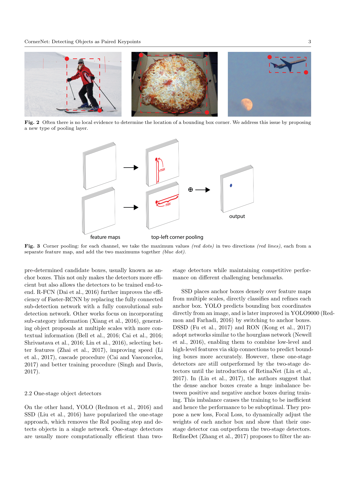
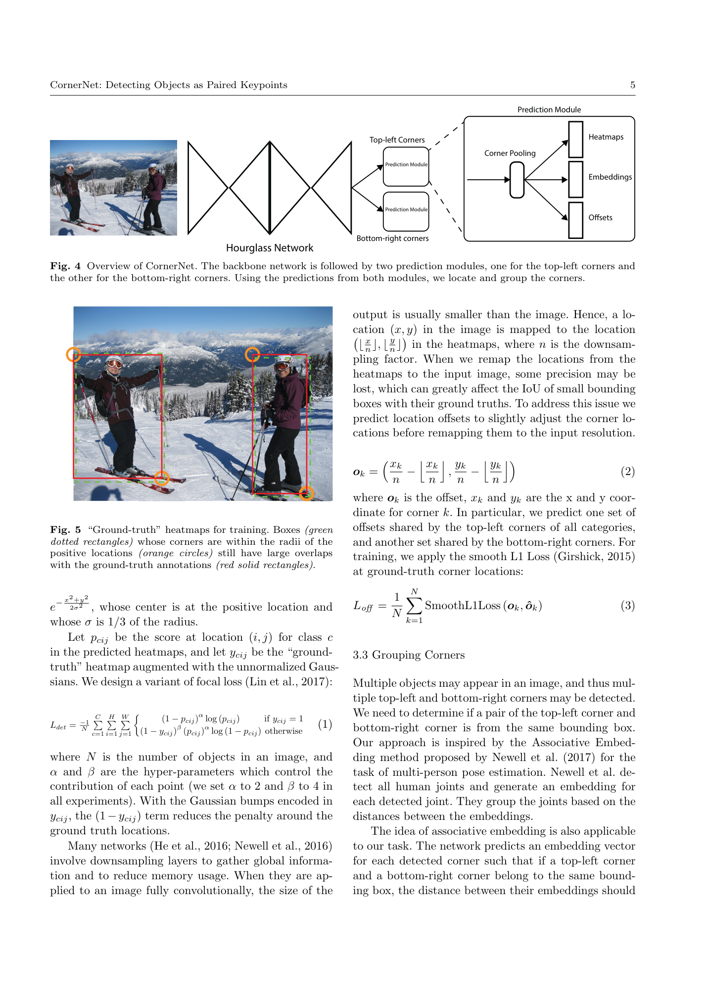
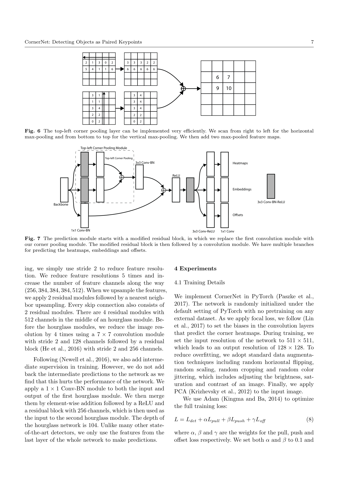

# CornerNet（ECCV 2018 / arXiv v2 2019）· 论文笔记（精读版）

- **论文**：CornerNet: Detecting Objects as Paired Keypoints（ECCV 2018；本地 PDF 为 arXiv:1808.01244v2，2019-03-18 版，14 页）
- **BibTeX 键名**：`law2018cornernet`
- **作者/机构**：Hei Law, Jia Deng（Princeton University）
- **本地 PDF**：`3.科研基本任务/论文/目标检测/Law和Deng - 2019 - CornerNet Detecting Objects as Paired Keypoints.pdf`
- **任务书条目**：第 3 周 #16｜🟢 AI 辅助读｜阅读要点：把"检测"改写成"关键点检测 + 配对"，anchor 之外的另一种稠密预测
- **阅读日期**：2026-11-01
- **核对规则**：「p.X」= 本地 PDF 物理页码；✅ = PyMuPDF 逐页提取原文核对过。
- **一句话预警**：本篇和下周可能遇到的 **Zhou et al. 2019 "Objects as Points"（也叫 CenterNet）不是同一个东西**，见 §6.3。

---

## 0. 术语表（零基础全能版）

> 这篇的难点是三个"新造词"：**corner pooling、associative embedding、hourglass**。前两个是本文贡献，第三个是从姿态估计借来的骨干网。下面每条都写"在**本篇**里具体指什么"，工程词按"朴素→优化→为什么有效"展开。

### 0.1 检测任务基础

| 术语 | 大白话解释（在本篇里的含义） |
|---|---|
| **anchor box（锚框）** | 预先在图上铺好的参考框。本篇的出发点就是**干掉它**。原文给的数量级：DSSD 里 >40k、RetinaNet 里 >100k（p.1）。 |
| **anchor 的两大缺点** | 原文列得很清楚（p.1）：① **数量巨大且正负极不平衡**（只有极小比例 anchor 与真值重叠，训练慢）；② **引入一堆超参**（多少个、多大、什么长宽比），且多尺度时每层还要各自设一套。 |
| **anchor-free（无锚框）** | 不预先摆框，直接预测"关键点/中心点"的位置，再用几何关系拼出框。CornerNet 是这条路线最早的强 baseline 之一。 |
| **keypoint（关键点）** | 本篇特指**框的角点**：左上角（top-left）和右下角（bottom-right）。**注意只用这一对**，不是四个角。 |
| **paired keypoints（成对关键点）** | 一个物体 = 一个左上角 + 一个右下角，**必须配成对**才算一个框。配对错了就产生假框（本文最大的误差来源之一）。 |
| **heatmap（热力图）** | 一张 H×W 的图，每个像素值 = "这里是不是某类角点"的分数。本篇输出**两组**热力图（左上、右下），每组 **C 个通道**（C = 类别数），**没有背景通道**（p.4）。 |
| **no background channel（无背景通道）** | 和 RetinaNet 的"每类做二分类"不同，这里是**每类一张二值 mask**：只有"是这类角点"和"不是"两种，没有"背景类"。 |
| **dense prediction（稠密预测）** | 对每个像素都预测。本篇输出 128×128 的热力图（输入 511×511，p.7），**每个位置都要算 loss**。 |
| **one-stage / two-stage** | 本篇是 one-stage：单个网络直接出热力图 + embedding + offset，没有候选框分类阶段。原文 §2 用两段对比说明自己站在 one-stage 这一边。 |
| **class imbalance（类别不平衡）** | 本篇同样面对它（一个 128×128 热力图里只有几个正像素），但**处理方式变了**：不再用 anchor 的正负比例，而是用"高斯软标签 + 变体 focal loss"（见 §0.2）。 |
| **easy / hard example** | 离真值角点很远的像素是 easy negative（一眼就知道不是角点）；**真值附近的像素是 hard negative**——它们离角点只差 1–2 像素，看起来很像。本篇专门为此设计了"半径内减罚"。 |
| **false corner（假角点）** | 预测出的角点位置其实略有偏差。原文的关键洞察：**一对"各自都偏一点"的角点，仍然可能拼出一个 IoU 够高的框**（p.4，Figure 5），所以不该按普通负样本重罚。 |
| **proposal / RoI** | 两阶段里的候选区域。CornerNet 没有 RoI，因此**无法"看框内"**——这正是下一篇 CenterNet 要补的洞。 |

### 0.2 核心机制（本篇的三个新东西）

| 术语 | 大白话解释 |
|---|---|
| **corner pooling（角点池化）** | 本篇最重要的结构创新。普通 3×3 卷积只看**局部**，但框的角点常常**在物体外面**（想象一个圆形物体的左上角，那里是背景）。所以判断"这里是不是左上角"必须**往右看**（找物体最上边界）和**往下看**（找最左边界）。corner pooling 就是：对每个通道，把"右边一整行"的最大值 和"下面一整列"的最大值 **取出来相加**（p.3，Figure 3）。 |
| **top-left corner pooling / bottom-right corner pooling** | 两种方向。左上角：向右 + 向下（Figure 3）；右下角：向左 + 向上（p.6 "max-pools all feature vectors between (0, j) and (i, j)"）。 |
| **corner pooling 的高效实现（DP）** | 朴素做法是对每个像素都扫一整行/一整列（O(HW × (H+W))，很慢）。原文给出递推式（式 6、7）：从右往左、从下往上逐格取 max，**一次遍历就算完**（Figure 6，p.7）。复杂度降到 O(HW)。 |
| **associative embedding（关联嵌入）** | 从多人姿态估计借来的方法（Newell et al. 2017）。给每个检测到的角点配一个**向量**，让"同一个物体的两个角点"的向量**距离小**，"不同物体的角点"的向量**距离大**。于是"配对"变成了"比距离"（p.5）。 |
| **embedding 维度 = 1** | 极简：每个角点只预测 **1 个数**（p.6 "we use embeddings of 1 dimension"）。配对时比的是**两个标量的 L1 距离**，阈值 0.5（p.8）。**这一点很容易记错成 128 维。** |
| **pull loss（拉近）** | `L_pull = (1/N) Σ [(e_tk - e_k)² + (e_bk - e_k)²]`，其中 e_k 是同一物体两角点 embedding 的**均值**。作用：把同物体的两个角点拉到一起（p.6 式 4）。 |
| **push loss（推开）** | `L_push = (1/(N(N-1))) ΣΣ max(0, Δ - |e_k - e_j|)`，Δ=1。作用：不同物体的 embedding 至少差 Δ（p.6 式 5）。**注意它是 hinge 形式：差得够远就不罚。** |
| **offset（偏移）** | 热力图分辨率只有输入的 1/4（511→128，downsampling n=4，p.5）。把热力图的整数坐标映射回原图会丢精度，**对小框的 IoU 影响巨大**。所以额外预测 2 个小数（x、y 的余数）来补偿（p.5 式 2）。 |
| **radius（半径）/ t=0.3 IoU** | 真值角点周围"**不重罚**"的圆的半径。原文定义：这个半径保证"圆内任意一点与真值配对后，拼出的框与真值框 IoU ≥ t"，**t 取 0.3**（p.4）。半径由物体尺寸决定——**大物体半径大**。 |
| **unnormalized 2D Gaussian（未归一化二维高斯）** | 半径内的"软标签"形状：`exp(-(x²+y²)/(2σ²))`，σ = 半径的 1/3（p.5）。峰值 1 在真值点，向四周衰减。**"未归一化"意味着它不积分到 1，只是一个权重掩码。** |
| **变体 focal loss（α=2, β=4）** | 在 RetinaNet 的 FL 上改造（p.5 式 1）：正像素用 `(1-p)^α log p`，负像素用 `(1-y)^β p^α log(1-p)`。**α=2、β=4** 是本文取值。与 RetinaNet 的 α/γ **不是同一套记号**，务必区分（见 §7 纠偏）。 |
| **intermediate supervision（中间监督）** | 在每个 hourglass 的中间输出也加 loss（姿态估计的常见技巧）。**但本篇不把中间预测加回下一级**——原文说加了会掉点（p.7）。 |
| **hourglass network（沙漏网络）** | 骨干网。结构是"下采样若干次（提取全局）+ 上采样回原分辨率（恢复定位精度）"，形状像沙漏。**skip connection 把下采样时丢掉的细节送回来**（p.6）。本篇用 **2 个沙漏堆叠、总深度 104**。 |

### 0.3 训练与评估

| 术语 | 大白话解释 |
|---|---|
| **L_det（检测损失）** | 热力图的 focal loss，按图中物体数 N 归一化（p.5）。 |
| **L_off（偏移损失）** | 只在**真值角点**位置算 smooth L1（p.5 式 3）。 |
| **总损失** | `L = L_det + α L_pull + β L_push + γ L_off`，**α=β=0.1、γ=1**（p.7 式 8、p.7 末）。 |
| **Adam** | 优化器，本篇用它（而 RetinaNet 用 SGD）。lr = 2.5×10⁻⁴（p.7）。 |
| **训练迭代数** | 消融实验 250k 次；报正式成绩时**再训 250k**，最后 50k 把 lr 降到 2.5×10⁻⁵（p.7）。 |
| **batch size 49 / 10 张 Titan X** | 主卡放 4 张、其余 9 张各放 5 张图（p.7）。**当年这就是"大模型"的显存规模。** |
| **PCA 增强** | 对输入图像做 PCA 颜色扰动（借自 AlexNet，p.7）。 |
| **从零训练（from scratch）** | **不用任何外部数据预训练**（p.7）。和 RetinaNet（ImageNet 预训练）形成对比，说明 hourglass + 大量数据增强可以自己训起来。 |
| **3×3 maxpool NMS** | 推理第一步：在角点热力图上用 3×3 最大池化做"局部极大值抑制"，**只留局部峰**（p.8）。 |
| **top-k 角点** | 取分数最高的 **100 个左上 + 100 个右下**（p.8）。 |
| **配对拒绝规则** | embedding 的 **L1 距离 > 0.5** → 拒绝；**类别不同** → 拒绝（p.8）。 |
| **检测分数** | 用两角点分数的**平均**（p.8）。 |
| **翻转测试 + soft-NMS** | 原图和水平翻转图都跑一遍，合并后用 **soft-NMS** 去重，最后只报 top 100（p.8）。 |
| **AP / AP50 / AP75 / AP_S/M/L** | 同 COCO 标准定义（IoU 0.5:0.05:0.95 平均）。本篇还额外用了 **AP60/AP70/AP80/AP90**（Table 5）来专门考察"框质量"。 |
| **test-dev / minival / trainval35k** | train-dev 无标签需提交；**消融在 minival（5k）**；正式成绩报 test-dev（p.8）。 |
| **AR1 / AR10 / AR100** | 每图取 1/10/100 个检测时的平均召回。**CornerNet 的 AR100 达到 59.4**（Table 7），这是它"能找全"的证据。 |

### 0.4 工程细节（"朴素做法 → 优化做法 → 为什么有效"）

| 朴素做法 | 本篇的优化做法 | 为什么有效 |
|---|---|---|
| 把每个非真值像素都当**同等负样本**惩罚（标准 focal loss 的做法） | 给真值角点周围一个**半径内的高斯软标签**，负像素的惩罚乘上 `(1-y)^β`（β=4），**越靠近真值罚得越轻**（p.4–5） | 因为"角点偏 1 像素"拼出来的框**仍然可能 IoU 很高**（Figure 5），重罚它等于逼网络做无意义的像素级精度。Table 2：不减罚 32.9 → 固定半径 2.5 → **38.4**，两步各涨 2.7 和 2.8 AP。 |
| 用固定半径（比如一律 2.5 像素） | 半径**由物体尺寸决定**（保证 IoU ≥ 0.3，p.4） | 大物体的角点"偏几个像素无所谓"，小物体"偏 2 像素就废了"。固定半径对小物体太松、对大物体太紧。Table 2 里 object-dependent 比 fixed 再涨 **2.8 AP**（对 AP_L 涨 5.8）。 |
| 用普通 3×3 卷积判断"这里是不是角点" | **corner pooling**：向右一整行取 max + 向下一整列取 max，相加（p.3、p.6 式 6–7） | 角点常在物体**外面**，局部卷积看不到物体边界；pooling 把"整条边界"的证据压缩进这个像素。Table 1：**+2.0 AP**，且对大物体收益最大（AP_L **+3.6**），因为大物体角点离边界更远（p.9 明确解释）。 |
| 用两层 for 循环逐像素扫一整行/列实现 pooling | **动态规划递推**：从右往左、从下往上，一次遍历（式 6、7、Figure 6） | 把 O(HW·(H+W)) 降到 O(HW)，且可以写成两个"累积 max"的卷积式操作，能塞进网络里实时算。 |
| 用 128 维 embedding + 复杂聚类来配对 | **1 维 embedding + L1 距离阈值 0.5** | 任务只有一个"配对/不配对"的二值判断，1 维足够；维度越高越难训（push/pull 的尺度难平衡）。 |
| 把中间监督的预测**加回**下一级（姿态估计的常见做法） | **只加 loss，不加回预测**（p.7） | 中间预测本身噪声大，加回去会把噪声注入深层特征。原文实测"加了会掉点"。 |
| 用 maxpool 做下采样（hourglass 原版） | 改成 **stride=2 卷积**下采样（p.6–7） | maxpool 是不可学的硬采样，stride 卷积可以学"怎么降采样"；同时避免 pooling 索引在实现上的麻烦（**这句是我的推断**）。 |
| 多尺度特征 + 多层预测头（RetinaNet/SSD 式） | **只用最后一个 hourglass 的输出**做预测（p.7 末） | 作者的选择：单个 hourglass 已经通过 skip + 上采样同时保有全局与局部信息，不需要 FPN。Table 4 显示这个选择很关键（见 §4.4.4）。 |
| 用 ImageNet 预训练骨干 | **从零训练** + 强数据增强（翻转/缩放/裁剪/颜色抖动/PCA） | 姿态估计的预训练权重和检测任务分布差异大；作者用增强 + 大 batch（49）+ 长训练补上。 |

---

## 1. 论文定位

### 1.1 一句话说清

**问题**：one-stage 检测器（SSD/RetinaNet）都靠 anchor 铺满全图，但 anchor 有两大毛病：**数量爆炸（100k）导致正负极度不平衡**，以及**一堆手工超参（数量/尺度/长宽比）**（p.1）。

**做法**：**把"检测框"改写成"一对角点"**——网络输出两张热力图（左上角 / 右下角），再给每个角点一个 1 维 embedding，用"距离小"把同一物体的两个角点配起来。配套两个新东西：**corner pooling**（让角点"看见"物体边界）和**修过的 hourglass 骨干**。

**结果**：COCO test-dev **42.2 AP（多尺度）**、**40.6 AP（单尺度）**，超过当时所有 one-stage（RetinaNet800 39.1），两阶段里也只输给少数几篇（Table 7，p.11）。**另一个亮眼的数字是 AP90 = 23.4**，远高于 RetinaNet 的 15.1——说明它的框"框得特别准"（Table 5，p.10）。

> 一句话：**不摆框了，改猜"两个角点 + 它们属于谁"；角点看不清就用 corner pooling 把边界信息拉过来。**

### 1.2 ASCII 流程图

```
输入图像 511×511（保持原图分辨率，零填充，不缩放）
        │
        ▼
┌──────────────────────────────┐
│ 预处理：7×7 conv s2 (128)     │  分辨率 ×1/4
│        + residual s2 (256)    │
└──────────────┬───────────────┘
               ▼
┌──────────────────────────────┐
│ Hourglass-104（2 个沙漏堆叠）   │  5 次 stride2 下采样
│  通道 256,384,384,384,512     │  上采样用 nearest + 2 个 residual
│  skip = 2 个 residual         │  中间监督只加 loss、不回灌
└──────────────┬───────────────┘
               │  只取最后一层输出 (256ch) —— 不用 FPN 多尺度
       ┌───────┴────────┐
       ▼                ▼
┌─────────────┐   ┌─────────────┐
│ 左上角预测模块 │   │ 右下角预测模块 │   两个模块结构相同、参数独立
│ corner pooling│   │ corner pooling│   （向右+向下 / 向左+向上）
└──┬───┬───┬──┘   └──┬───┬───┬──┘
   │   │   │         │   │   │
   ▼   ▼   ▼         ▼   ▼   ▼
 热力图 embedding offset   热力图 embedding offset
 (C×H×W)  (1×H×W)  (2×H×W)  (C×H×W)  (1×H×W)  (2×H×W)
   │        │        │         │        │       │
   └────────┴────────┴────┬────┴────────┴───────┘
                          ▼
        ┌────────────────────────────────────┐
        │ 后处理：                            │
        │ ① 3×3 maxpool NMS 取局部峰           │
        │ ② 各取 top-100 左上 / top-100 右下    │
        │ ③ 用 offset 把坐标映射回原图          │
        │ ④ 比 embedding L1 距离，>0.5 或类别不同 → 丢 │
        │ ⑤ 分数 = 两角点均值                   │
        │ ⑥ 原图 + 翻转图合并 → soft-NMS → top100│
        └────────────────────────────────────┘

训练 loss = L_det(热力图, 变形 focal) 
         + 0.1·L_pull(同物体拉近) + 0.1·L_push(异物体推开) 
         + 1·L_off(smooth L1, 只在真值角点)
```

### 1.3 "上一篇留下什么坑 → 本篇填什么"

| 上一篇（RetinaNet / FL）留下的坑 | 本篇怎么填 |
|---|---|
| **anchor 数量 ≈100k、正负 1:1000**，靠 focal loss "抢救"训练信号。**但 anchor 本身还在**，超参也还在（每层 9 个、3 种长宽比、3 种尺度）。 | 直接**取消 anchor**：预测 O(wh) 个角点，而不是 O(w²h²) 个框（p.2 原文的复杂度论证）。**不平衡问题的"根"被拆掉了**，只剩"少数角点 vs 大量背景像素"。 |
| FL 需要 **π 先验初始化 + 正样本数归一化 + α/γ 联调**，工程上要小心。 | 本篇仍用 focal loss 的**变体**，但把"易分负样本"的处理换成了**高斯软标签**：靠近真值的负样本自动减罚。**这是"用标签形状"代替"用 loss 形状"来解决同一个问题。** |
| RetinaNet 的框来自 anchor 回归，**框的四个边是独立回归出来的**，高 IoU 时精度有限（AP90 只有 15.1）。 | 框由**两个角点坐标直接决定**：角点定位得准，框就准。**AP90 = 23.4**（Table 5），比 RetinaNet 高 7.3（p.10 原文）。 |
| one-stage 没有 RoI，**看不见框内部**。 | **本篇没填这个坑，反而把它变成了最大的弱点**（假框多、配对错）。下一篇（Duan 2019 CenterNet）专门填。 |

---

## 2. 逐节导读（严格按原文章节顺序）

### §1 Introduction（p.1–2）

**想解决什么**：为"不要 anchor"找一个**站得住的技术理由**（而不是"anchor 不好调"这种主观理由）。

**动机（两条，p.1）**：
1. anchor 要"足够密"才能保证和真值有足够重叠 → 数量爆炸（DSSD >40k、RetinaNet >100k）→ **只有极小比例 anchor 命中真值 → 巨大不平衡 → 训练慢**。
2. anchor 带来**一堆超参**（多少个、多大、什么长宽比），多尺度时每层还要各设一套，**全是 ad-hoc 启发式**。

**关键句（p.2）**：
> "corners provide a more efficient way of densely discretizing the space of boxes: we just need **O(wh) corners** to represent **O(w²h²) possible anchor boxes**."

→ 这是本篇最"数学"的一句：**用两个角点枚举，把框的假设空间从 w²h² 降到 wh**。

**另一关键句（p.2）**：
> "the center of a box can be harder to localize because it depends on **all 4 sides** of the object, whereas locating a corner depends on **2 sides**"

**批注**：
- 【易误解】"角点比中心好定位"是**本文的假设（hypothesize）**，原文用词就是 "We **hypothesize** two reasons"（p.2）——**没有实验直接证明"中心点更难定位"**。事实上下一篇 CenterNet 恰恰把中心点用起来了并涨点，说明这个假设**只对了一半**。读的时候要把"假设"和"结论"分开。
- 【易误解】"CornerNet 完全没超参了"——错。anchor 那套超参是没了，但**冒出来一批新的**：半径 t=0.3、高斯 σ=半径/3、α=2、β=4、Δ=1、距离阈值 0.5、top-k=100（§7 有专门一条）。
- 【工程细节】"O(wh) vs O(w²h²)" 里的 w,h 指的是**特征图宽高**（离散格点）。这句话解释的是"为什么角点方案的输出维度小"，不是"计算量小"。
- 【与上篇差异】RetinaNet 的思路是"**保留稠密 anchor，改 loss**"；CornerNet 是"**改输出表示，从根上避开**"。两种思路都有效，但后者引入了新问题（配对）。

### §2 Related Work（p.2–4）

**想解决什么**：把工作放进脉络，并**提前划清与三个最近邻的界限**：DeNet、PLN、Associative Embedding。

| 对比对象 | 它们的做法 | 本篇的不同（原文强调的点） |
|---|---|---|
| **DeNet**（two-stage，无 anchor） | 判断每个位置属于四种角点中的哪一种，**枚举所有角点组合**生成 RoI，再用子网络筛 | ① DeNet **不判断两个角点是否同物体**，靠第二级筛；本篇**一个网络同时检测+配对**（one-stage）。② DeNet 要"手工选特征位置"；本篇不需要。③ 本篇有 **corner pooling**。 |
| **PLN（Point Linking Network）** | 预测四角 + 中心，用"回归像素位置"把角点和中心连起来 | ① 本篇用 **embedding** 分组，PLN 用"预测像素位置"；② 本篇有 corner pooling；③ PLN 要合并 4 个框，本篇一对角点直接成框。 |
| **Associative Embedding**（Newell 2017） | 多人姿态：检测所有关节 + embedding 分组 | **本篇是第一个把它用到"物体检测"的**（原文 "To the best of our knowledge, we are the first…"）。 |

**批注**：
- 【易误解】"DeNet 也是 anchor-free，所以本文只是把 DeNet 改成 one-stage"——差别很大：**DeNet 的角点枚举是组合爆炸**（N 个角点 → 组合出大量 RoI），必须靠第二级筛；本篇**靠 embedding 直接配对**，不需要枚举。
- 【与上篇差异】§2.2 里作者**主动复述了 RetinaNet 的诊断**（"dense anchor boxes create a huge imbalance…they propose Focal Loss"，p.3）。这句话很重要：它说明本篇**承认** FL 的贡献，只是选择"绕开"而不是"修补"。
- 【工程细节】§2.2 提到 DSSD/RON 用的是"类似 hourglass 的网络"（p.3）——这就是本篇选 hourglass 的部分理由：**这种结构在检测里已被验证过**。

### §3 CornerNet（p.4–7）

#### §3.1 Overview（p.4）

**想解决什么**：把"角点 + 配对 + 偏移"三件事装进一个网络。

**关键句**：网络输出 **两组热力图**（左上/右下）、**每个角点一个 embedding**、**offset**；"Unlike many other object detectors, **we do not use features from different scales**"（p.4）。

**批注**：
- 【易误解】"不用多尺度特征"是个**大胆的减法**，不是疏忽。作者用 hourglass 的"沙漏 + skip"来替代 FPN 的多尺度（Table 4 证明这个选择值 8.2 AP，见 §4.4.4）。
- 【工程细节】"只对最后一个 hourglass 的输出做预测"（p.7 末）——所以**没有 P3/P4/P5 这些层的概念**，所有尺度共用一个 128×128 的热力图。

#### §3.2 Detecting Corners（p.4–5）

**想解决什么**：怎么"监督"热力图。

**四个关键设计**：

1. **通道数 = C，无背景通道**（p.4）：每类一张二值 mask。
2. **正样本只有一个像素**：其余全是负（p.4）——**所以 1 个物体只有 2 个正像素**（左上+右下），不平衡比 RetinaNet 更极端。
3. **半径内减罚**（p.4）：`t=0.3` 的 IoU 保证 → 半径由物体尺寸决定 → 高斯权重衰减。
4. **offset 补偿量化误差**（p.5）：n=4 的下采样把 511 映射到 128，**坐标取整会丢最多 3 像素**；对小框 IoU 影响巨大。offset 用 smooth L1 训练（式 3）。

**变体 focal loss（式 1，p.5，逐符号）**：

$$
L_{det}=-\frac{1}{N}\sum_{c=1}^{C}\sum_{i=1}^{H}\sum_{j=1}^{W}
\begin{cases}
(1-p_{cij})^{\alpha}\log(p_{cij}) & y_{cij}=1\\[2pt]
(1-y_{cij})^{\beta}\,(p_{cij})^{\alpha}\log(1-p_{cij}) & \text{otherwise}
\end{cases}
$$

| 符号 | 含义 | 本篇取值 |
|---|---|---|
| N | 图中物体数（归一化用） | 每图动态 |
| p_cij | 位置 (i,j) 属于类别 c 的**角点**的预测分数（sigmoid 后） | [0,1] |
| y_cij | "真值热力图"（**加了高斯的软标签**，不是 0/1） | [0,1] |
| α | 正样本侧的聚焦指数 | **2** |
| β | 负样本侧的"减罚"指数，作用在 (1-y) 上 | **4** |

**批注（这一段最容易读错）**：
- 【易误解】"这是 RetinaNet 的 FL，只是换了字母"——**不是**。原始 FL 是 `-α_t (1-p_t)^γ log(p_t)`，只有一个 γ；这里变成 **α 控正样本、β 控负样本**，且负样本项额外乘 **(1-y_cij)^β**（**用 GT 的软标签来减罚**，RetinaNet 没有这个）。所以 **CornerNet 的 β ≈ RetinaNet 的 γ 的角色，CornerNet 的 α ≈ RetinaNet 的 α 的角色但作用位置不同**。混用会算错。
- 【易误解】"(1-y)^β 是让负样本更难学"——**反了**。y 越接近 1（越像真角点），(1-y)^β 越小，**罚得越轻**。这是"给 hard negative 减负"。
- 【工程细节】σ = 半径/3 是经验取值（p.5），**原文没有解释为什么是 1/3**（是 CenterNet（Zhou）那篇才把它形式化）。标记【待核对/无解释】。
- 【工程细节】offset 是**所有类别共享**的（"one set of offsets shared by the top-left corners of all categories"，p.5）——不是每类一套。这样省参数。

#### §3.3 Grouping Corners（p.5–6）

**想解决什么**：一张图里可能有多个物体，检测出一堆左上角和右下角，**怎么知道谁跟谁配对**？

**做法**：给每个角点 1 维 embedding，用 pull/push 两个损失训练：
$$
L_{pull}=\frac{1}{N}\sum_{k=1}^{N}\left[(e_{tk}-e_k)^2+(e_{bk}-e_k)^2\right] \tag{4}
$$
$$
L_{push}=\frac{1}{N(N-1)}\sum_{k=1}^{N}\sum_{\substack{j=1\\j\neq k}}^{N}\max\left(0,\Delta-|e_k-e_j|\right) \tag{5}
$$
（e_k 是同一物体两角点 embedding 的**均值**；Δ=1）

**批注**：
- 【易误解】"embedding 是分类特征"——**不是**。原文明确：**embedding 的绝对值毫无意义，只用距离**（p.6 "The actual values … are unimportant. Only the distances … are used"）。
- 【易误解】"pull 拉的是两个角点到 0"——不是，拉的是**到它们的均值** e_k。这样避免了"整体漂移"（如果拉到 0，所有 embedding 都趋于 0，push 就没法推开了）。
- 【工程细节】push 用 **hinge**（max(0, Δ - |差|)）：**差得足够远就不罚**。如果改成"越大越好"，训练会发散（距离无上界）。这个设计是整套 embedding 方案能训稳的关键。
- 【工程细节】pull/push **只在真值角点位置计算**（p.6 末），不是全图。否则 100k 个背景像素的 embedding 会互相打架。
- 【课外·待核实】Δ=1 与检测距离阈值 0.5 的关系：阈值 0.5 = **Δ 的一半**，相当于"同一物体的距离必须小于半个安全间隔"。原文没有推导这个 0.5 是怎么定的，只说经验。

#### §3.4 Corner Pooling（p.6–7）——本篇的核心创新

**想解决什么**：**角点处的局部特征里没有"角点"的证据**。

**动机（原文的圆形例子，p.2、Figure 2）**：一个圆形物体的左上角，那个像素本身是**背景**；局部 3×3 窗口里全是背景。要判断"这是左上角"，必须**往右扫到物体最上边界、往下扫到物体最左边界**。

**公式（式 6、7，p.6）**：
$$
t_{ij}=\begin{cases}\max\left(f_{ij}^{t},\,t_{(i+1)j}\right) & i<H\\ f_{Hj}^{t} & \text{otherwise}\end{cases}
\qquad
l_{ij}=\begin{cases}\max\left(f_{ij}^{l},\,l_{i(j+1)}\right) & j<W\\ f_{iW}^{l} & \text{otherwise}\end{cases}
$$
最终输出 `out(i,j) = t_ij + l_ij`。

**逐符号**：
- `f^t`：第一张输入特征图（负责**竖直方向**：从 (i,j) 向下到 (H,j) 取 max）。
- `f^l`：第二张输入特征图（负责**水平方向**：从 (i,j) 向右到 (i,W) 取 max）。
- `t_ij, l_ij`：两个方向的累积 max（**递推 = 动态规划**，从右往左 / 从下往上算一遍）。
- 求和而不是拼接/平均：**两个方向的证据要同时存在**（缺一个就不是角点）。用加法实现"与"的最便宜方式。

**批注**：
- 【易误解】"corner pooling 是把整行整列求和/平均"——是**max**，不是 sum/mean。用 sum 会让"长边界"天然占优（小物体被淹没）；用 max 只关心"边界上最强的那个响应"。
- 【易误解】"两张输入特征图是同一张"——**不是**，是两个**独立的 3×3 conv**（128 通道）的输出（p.7，Figure 7 里写的是 "3×3 Conv-ReLU ×2 / 128"）。
- 【易误解】式 6、7 的下标在原文里写得比较随意（正文说"between (i,j) and (i,H)"），**但递推方向是一致的：i 增加（向下）、j 增加（向右）**。Figure 6 的扫描方向图（从右往左、从下往上）才是"怎么一次算完"的说明。**读公式晕的时候直接看 Figure 6。**
- 【工程细节】预测模块（Figure 7，p.7）：`Backbone → 两个 3×3 Conv-ReLU(128) → corner pooling → 3×3 Conv-BN(256) → +投影 shortcut → 3×3 Conv-ReLU(256) → 三个分支（1×1 Conv-BN → ReLU → 3×3 Conv-BN-ReLU → 1×1 Conv）` 分别出热力图/embedding/offset。**注意它是"改造版残差块"，把第一个 3×3 换成了 corner pooling。**
- 【与上篇差异】RetinaNet 的 head 是"4 个 3×3 + 1 个 3×3"，**纯局部卷积**；CornerNet 的 head 里塞了一个**全局方向的 pooling**，这是"先验知识硬编码进结构"的典型例子。

#### §3.5 Hourglass Network（p.6–7）

**想解决什么**：一个"既能看全局、又能精确定位"的骨干。

**结构要点（p.7，逐条）**：
- **2 个沙漏堆叠**，总深度 **104**。
- 下采样 **5 次**，通道 **256, 384, 384, 384, 512**。
- 下采样**用 stride=2 卷积**（不用 maxpool，p.6–7 明确）。
- 上采样：**2 个残差模块 + nearest neighbor 上采样**。
- **skip connection 也是 2 个残差模块**。
- 沙漏**中部**有 **4 个 512 通道的残差模块**。
- 沙漏之前：**7×7 conv（stride 2, 128 通道）+ 残差块（stride 2, 256 通道）**→ 预降 4 倍。
- 中间监督：**加 loss、但不把中间预测加回网络**（p.7）。
- 第一个沙漏的输入/输出各做 **1×1 Conv-BN**，相加 + ReLU + 256 通道残差块，作为第二个沙漏的输入。
- **只用最后一层特征预测**。

**批注**：
- 【易误解】"hourglass 是本文提出的"——**不是**，来自 Newell et al. 2016（姿态估计）。本篇做的是"改造 + 迁移"。
- 【易误解】"depth 104 指的是 104 个卷积层"——原文说 "The depth of the hourglass network is 104"，是**按 hourglass 论文的层数记法**（含残差块内部层）。**不要用它和 ResNet-101 的层数直接比大小。**
- 【工程细节】"不用 maxpool、改 stride 卷积"是 acc 和实现双赢；"nearest neighbor 上采样"比转置卷积更省显存、也不引入棋盘伪影。
- 【课外·待核实】为什么"中间监督加回去会掉点"原文只说 "we find that this hurts"（p.7），没给分析。我的猜测是"中间层监督的梯度尺度与最终层冲突"，**标记为推断**。

### §4 Experiments（p.7–12）

#### §4.1 Training Details（p.7）

| 项目 | 设置（全部核对自 p.7） |
|---|---|
| 输入 / 输出分辨率 | **511×511 → 128×128** |
| 初始化 | 随机初始化，**无任何预训练** |
| 热力图分支 bias | 按 RetinaNet 的 π 先验做法设（p.7 明说 follow Lin et al.） |
| 数据增强 | 随机水平翻转、随机缩放、随机裁剪、随机颜色抖动（亮度/饱和/对比度）、**PCA** |
| 优化器 | Adam，lr **2.5×10⁻⁴** |
| 损失权重 | **α=β=0.1，γ=1**（对应 pull/push/offset）；原文说"α、β 取 1 或更大效果很差" |
| batch / 硬件 | **49**，**10 张 Titan X (PASCAL)**（主卡 4 张、其余 5 张） |
| 迭代 | 消融 **250k**；正式成绩再 +250k，最后 50k 降到 **2.5×10⁻⁵** |
| 推理耗时 | **244 ms/图**（Titan X PASCAL，p.8） |

**批注**：
- 【易误解】"α=β=0.1 说明 embedding 不重要"——恰恰相反，是因为 **pull/push 的数值尺度天然很大**（embedding 距离的平方），乘 0.1 是为了和 L_det 量级对齐。原文只说"取 1 或更大效果很差"，没给理论解释。
- 【易误解】"250k 迭代就是最终模型"——**不是**。报 40.6/42.2 的模型训了 **500k**（250k + 250k）。**Table 1–4 的消融数字都来自 250k 的模型，和 Table 7 不是同一批权重。**
- 【工程细节】"从零训练 + batch 49 + 10 卡" 意味着**这套配置在单卡上几乎不可复现**；这也是 CornerNet 后来被 CenterNet（Zhou）等轻量方案取代的现实原因之一。

#### §4.2 Testing Details（p.8）

流程六步（全部核对自 p.8）：① 热力图上 **3×3 maxpool** 做 NMS；② 各取 **top-100**；③ 用 offset 修正坐标；④ 比 embedding **L1 距离>0.5** 或**类别不同**则拒绝；⑤ 分数 = 两角点均值；⑥ 原图 + 翻转图合并，**soft-NMS**，报 top-100。

**批注**：
- 【易误解】"top-100 是最终框数"——是**每类各 100 个角点**，配对后可产生远多于 100 个候选框，最后才 top-100。
- 【工程细节】"保持原图分辨率 + 零填充"（p.8）而不是 resize——这样**小物体不会被缩小**，对 AP_S 有利。代价是不同尺寸图片的 padding 量不同，batch 内需要处理。
- 【工程细节】"用 3×3 maxpool 做 NMS" 是最廉价的局部峰提取，**不是标准 NMS**（不比较 IoU）。很多人复现时用错成标准 NMS，会导致同一个角点被保留多次。

#### §4.3 MS COCO（p.8）、§4.5 Comparisons（p.12）

数据集：80k train / 40k val / 20k test；用 **train set + 35k val** 训练；剩 5k 做消融；test-dev 提交服务器（p.8）。**最终 42.2（多尺度）/ 40.6（单尺度）**（Table 7，p.11）。

### §4.4 Ablation Study（p.9–12）——逐小节

**§4.4.1 Corner Pooling（Table 1，p.8）**：去掉 pooling 但保持参数量 → **36.5 → 38.4（+2.0 AP）**；AP_L **+3.6**、AP_M +2.4、AP_S +1.1。原文解释：中大型物体角点离边界更远（p.9）。

**§4.4.2 Stability of Corner Pooling over Larger Area（Table 3，p.8）**：按象限拆开算 mAP。左上角在左上象限 66.1→69.2（+3.1），在右下象限 60.8→63.5（+2.7）；右下角 53.4→56.2、65.0→67.6。**结论：pooling 在"扫的区域很大"和"很小"的象限都一样有效**。

**§4.4.3 Reducing Penalty to Negative Locations（Table 2，p.8）**：不减罚 **32.9** → 固定半径 2.5 → **35.6（+2.7）** → 尺寸自适应半径 → **38.4（+2.8）**。

**§4.4.4 Hourglass Network（Table 4，p.9）**：FPN(ResNet-101)+角点 **30.2**；Hourglass+anchor **32.9**；**Hourglass+角点 38.4**。→ 分别 +8.2 / +5.5（p.10）。

**§4.4.5 Quality of the Bounding Boxes（Table 5，p.10）**：高 IoU 时比较。CornerNet AP90 **23.4** vs Cascade R-CNN+IoU-Net 19.5（+3.9）、Cascade R-CNN 15.8（+7.6）、RetinaNet 15.1（+7.3）（p.10 原文数字）。

**§4.4.6 Error Analysis（Table 6，p.10）**：用**真值热力图**替换预测 → AP **38.4 → 73.1**；再替换 offset → **86.1**。→ **主瓶颈是"检测角点"本身**（p.11 原文）。

**批注**：
- 【易误解】"73.1 说明模型只差角点"——`gt heatmaps` 只保证**角点位置对**，但 embedding 配对**仍然由网络预测**，所以 73.1 < 86.1 的那 13 个点里，既有 offset 误差，也有**配对错误**。原文自己写 "although there is still ample room for improvement in **both detecting and grouping** corners"（p.11）。
- 【易误解】"配对错误是小问题"——Figure 9（p.10）第二行专门展示了"不同物体的角点被预测了相似 embedding"，**这是 CornerNet 的典型失败模式**，也是下一篇的切入点。
- 【工程细节】Table 4 的三行都是"从零训练、同样流程"（p.10 明确），**所以 30.2/32.9/38.4 是可比的三行**——这是全文最干净的一组对照（同时换了"骨干"和"输出表示"两个因素，实际上是个 2×2 表的缺角版本）。

---

## 3. 核心图 / 公式深读

### 3.1 Figure 2 与 Figure 3（p.3）：corner pooling 的动机与定义



**Figure 2 图注（原文）**："Often there is **no local evidence** to determine the location of a bounding box corner. We address this issue by proposing a new type of pooling layer."
**Figure 3 图注（原文）**："Corner pooling: for each channel, we take the **maximum values (red dots) in two directions (red lines), each from a separate feature map, and add the two maximums together (blue dot)**."

**怎么读 Figure 2**：图里若干张照片，框的角点落在"物体轮廓之外"（比如圆盘、车轮、杯子边缘）。**局部窗口里看不到"这里是角点"的任何纹理**——这是整个 corner pooling 存在的前提。

**怎么读 Figure 3**：一张特征图上，左上角 pooling 从该像素**向右**扫一条红线、**向下**扫一条红线（两条红线来自**两张不同的特征图**），各自取最大值（红点），再相加（蓝点）。**蓝点就是该像素的"角点证据"。**

**批注**：
- 【易误解】以为"两条射线会延伸到图像边界"——是的，**会一直扫到 H 或 W 的边界**，所以"长得像边界"的响应会被拉到很远的地方。**这也是它在"大区域内也稳定"（Table 3）的原因**，但也意味着**远处的强响应会污染近处的角点**（Figure 9 第一行展示的正是这类错误）。
- 【易误解】以为 pooling 是"对整张特征图做一次"——它是**每个像素各自做**一条射线，最终输出与原特征图同尺寸（128×128）。

### 3.2 Figure 4 与 Figure 5（p.5）：整体结构与"高斯真值"



**Figure 4 图注**：骨干网后接**两个预测模块**（左上/右下），中间标注 "Corner Pooling / Heatmaps / Embeddings / Offsets"；用两个模块的预测"定位并分组角点"。

**Figure 5 图注**："'Ground-truth' heatmaps for training. Boxes（绿虚线）whose corners are **within the radii** of the positive locations（橙圈）still have **large overlaps** with the ground-truth annotations（红实线）。"

**Figure 5 是本文最值钱的一张"设计依据图"**：它画了一个真值框（红），在它左上角画一个橙圈（半径），然后在圈内取一些点当"预测的角点"，画绿虚线框——**这些绿框与红框的 IoU 仍然很高**。→ 所以"圈内预测"应该被容忍。

**批注**：
- 【易误解】"半径是固定 3 像素之类"——**是尺寸自适应的**，由"保证 IoU ≥ 0.3"反推（p.4）。Table 2 里 fixed 2.5 只有 35.6，自适应 38.4。
- 【易误解】"圈内像素当正样本"——**不是二值正样本，是高斯权重**（0 到 1 连续）。它们仍然算负样本，只是"罚得轻"。**这个区别决定了 loss 里用 (1-y)^β 而不是 y。**
- 【工程细节】σ = 半径/3 意味着"到半径处权重已衰减到 exp(-9/2)≈0.011"，基本可以忽略——所以"半径"是一个**软边界**。

### 3.3 Figure 6 与 Figure 7（p.7）：DP 实现 + 预测模块细节



**Figure 6 图注**："The top-left corner pooling layer can be implemented very **efficiently**. We scan **from right to left** for the horizontal max-pooling and **from bottom to top** for the vertical max-pooling. We then add two max-pooled feature maps."

**Figure 7 图注**：预测模块以**改造版残差块**开始（把第一个卷积模块换成 corner pooling 模块），后接一个卷积模块，再分多支预测热力图/embedding/offset。图例给出：`1×1 Conv`、`3×3 Conv-ReLU`、`ReLU`、`1×1 Conv-BN`、`3×3 Conv-BN`、`3×3 Conv-BN-ReLU`。

**怎么读 Figure 6**：一串数字组成的网格，红色箭头表示**扫描方向**（从右往左、从下往上），每一步把"当前值"和"已累积的 max"比较取大。这就是式 6、7 的递推。**一旦看懂这张图，式 6、7 就不用背了。**

**批注**：
- 【易误解】"扫描是从左往右"——**是反的**：水平方向从右往左、垂直从下往上。因为 `t_ij = max(f_ij, t_(i+1)j)` 依赖**右边/下边**已经算好的值。
- 【工程细节】Figure 7 里 corner pooling 模块输出 "3×3 Conv-BN 256 + 投影 shortcut"，说明 corner pooling **本身不改变通道数**（输入 128，输出 128），通道扩展由后面的 conv 做。
- 【工程细节】三个分支各自"1×1 Conv-BN → ReLU → 3×3 Conv-BN-ReLU → 1×1 Conv"：**两个 1×1 夹一个 3×3**，是典型的"降维-卷积-升维"瓶颈，省参数。

### 3.4 公式全集（手打 LaTeX，按原文编号）

**式(1) 变体 focal loss**：见 §2 §3.2（已完整给出）。

**式(2) offset 定义**：
$$
o_k=\left(\frac{x_k}{n}-\left\lfloor\frac{x_k}{n}\right\rfloor,\ \frac{y_k}{n}-\left\lfloor\frac{y_k}{n}\right\rfloor\right)
$$
（n = 下采样倍数 = 4；o_k 是"余数"，即真实坐标落在该格点内的相对位置）

**式(3) offset 损失**：
$$
L_{off}=\frac{1}{N}\sum_{k=1}^{N}\mathrm{SmoothL1Loss}\left(o_k,\hat{o}_k\right)
$$

**式(4)(5) pull / push**：见 §2 §3.3。

**式(6)(7) corner pooling 递推**：见 §2 §3.4。

**式(8) 总损失**：
$$
L=L_{det}+\alpha L_{pull}+\beta L_{push}+\gamma L_{off},\qquad \alpha=\beta=0.1,\ \gamma=1
$$

**逐符号补充**：
- 式(2) 的 `⌊x/n⌋` 是"格点索引"，减去后剩下的就是**亚像素余数**，范围 [0,1)。**这就是为什么 offset 只需要 2 个输出、且不需要归一化。**
- 式(3) 只在 `k` 迭代**真值角点**（N 个角点），不是每个像素。
- 式(8) 里 γ=1 而 α=β=0.1：**offset 的 loss 量级与 L_det 相近（都是逐像素回归），所以不用缩放**；pull/push 是"平方距离"，量级大，要压。

### 3.5 Table 5 与 Table 6（p.10）：两张"诊断表"

| 方法 | AP | AP50 | AP60 | AP70 | AP80 | AP90 |
|---|---|---|---|---|---|---|
| RetinaNet | 39.8 | 59.5 | 55.6 | 48.2 | 36.4 | 15.1 |
| Cascade R-CNN | 38.9 | 57.8 | 53.4 | 46.9 | 35.8 | 15.8 |
| Cascade R-CNN + IoU-Net | 41.4 | 59.3 | 55.3 | 49.6 | 39.4 | 19.5 |
| **CornerNet** | **40.6** | 56.1 | 52.0 | 46.8 | **38.8** | **23.4** |

**这张表回答什么**：**CornerNet 的框"质量"如何？** 关键读法：**AP 整体 40.6 < IoU-Net 的 41.4**，但 **AP90（要求极高 IoU）23.4 ≫ 19.5**。→ **"平均精度略低，但高精度框的比例明显更高"。** 这是"角点定位 → 框四边天然对齐"的直接收益。

| 设置 | AP | AP50 | AP75 | AP_S | AP_M | AP_L |
|---|---|---|---|---|---|---|
| 原始 | 38.4 | 53.8 | 40.9 | 18.6 | 40.5 | 51.8 |
| + 真值热力图 | **73.1** | 87.7 | 78.4 | 60.9 | 81.2 | 81.8 |
| + 真值热力图 + 真值 offset | **86.1** | 88.9 | 85.5 | 84.8 | 87.2 | 82.0 |

**这张表回答什么**：**瓶颈在哪？** 答：**检测角点**（一换真值暴涨 34.7 AP）。剩下 13 个点是 offset + 配对 + 分类的综合误差。

**批注**：
- 【易误解】"86.1 是上限，说明方法只差 47 个点"——注意 86.1 仍然**不是 100**，因为 embedding 配对仍是网络预测的，且"真值热力图"只在有物体的位置给正样本，**假阳性仍会被配对**。
- 【易误解】Table 5 里 CornerNet 的 AP50 是 **56.1**，而 Table 7 里同一模型（CornerNet511 single scale）AP50 是 **56.4**。**同一篇论文两张表差 0.3**，属于原文内部不一致（见 §7 第 6 条）。

---

## 4. 实验逐表解读

### 4.1 Table 1（p.8）：corner pooling 值多少

| 设置 | AP | AP50 | AP75 | AP_S | AP_M | AP_L |
|---|---|---|---|---|---|---|
| w/o corner pooling | 36.5 | 52.0 | 38.8 | 17.5 | 38.9 | 49.4 |
| **w/ corner pooling** | **38.4** | 53.8 | 40.9 | 18.6 | 40.5 | 51.8 |
| improvement | +2.0 | +2.1 | +2.1 | +1.1 | +2.4 | **+3.6** |

**回答什么**：这个新层本身值不值 2 AP？答：**值，且对大物体最值（+3.6）**。

**最易误读的 2 点**：
1. **"保持参数量相同"**（p.9 原文："we train another network without corner pooling but **with the same number of parameters**"）。所以这 +2.0 **不是"加了参数换来的"**，是**结构先验**换来的。这是全文最硬的一条因果证据。
2. **AP_S 只涨 1.1**：小物体角点离边界很近，局部卷积本来也够用，pooling 的收益小。**别把"corner pooling 全面提升"说成结论。**

### 4.2 Table 2（p.8）：半径减罚——两步各有贡献

| 设置 | AP | AP50 | AP75 | AP_S | AP_M | AP_L |
|---|---|---|---|---|---|---|
| w/o reducing penalty | 32.9 | 49.1 | 34.8 | 19.0 | 37.0 | 40.7 |
| fixed radius | 35.6 | 52.5 | 37.7 | 18.7 | 38.5 | 46.0 |
| **object-dependent radius** | **38.4** | 53.8 | 40.9 | 18.6 | 40.5 | 51.8 |

**回答什么**：**"减罚"这件事本身有多重要？"自适应半径"又有多重要？**

**关键数字**：不减罚只有 **32.9**（比带 pooling 的 38.4 低 5.5！）——**这是整篇论文里最容易低估的一条：软标签比 corner pooling 还值钱（5.5 vs 2.0）。** 自适应半径再贡献 +2.8，其中 **AP_L 从 40.7 一路涨到 51.8（+11.1）**。

**最易误读的 2 点**：
1. **AP_S 反而越调越低（19.0 → 18.7 → 18.6）**：小物体对"半径"不敏感（半径本身就小），而"减罚"相对放松了对近邻的惩罚，小物体检测更容易被"邻近假角点"干扰。原文**没有解释这个反降**（只说 "especially benefits medium and large objects"，p.10）。**标记：原文未解释，属于值得追问的点。**
2. **fixed radius 的 2.5 是怎么选的**：原文只说 "a **fixed radius of 2.5**"（p.9），**没有说怎么定**。这是一个值得记的空白。

### 4.3 Table 3（p.8）：pooling 在不同象限是否稳定

| 目标 / 象限 | w/o pooling | w/ pooling | 提升 |
|---|---|---|---|
| 左上角 · 左上象限 | 66.1 | 69.2 | +3.1 |
| 左上角 · 右下象限 | 60.8 | 63.5 | +2.7 |
| 右下角 · 左上象限 | 53.4 | 56.2 | +2.8 |
| 右下角 · 右下象限 | 65.0 | 67.6 | +2.6 |

**回答什么**："pooling 扫的区域长度差别很大（左上象限的左上角要扫很长），会不会只在某些位置有效？"答：**不会，四个格子提升都在 +2.6~+3.1**。

**批注**：
- 【易误解】把这张表的数字当"检测 AP"——**它是"角点检测的 mAP"**（把角点检测当二值分类任务来评，p.9 明确），不是框的 AP。**两套指标不能混。**
- 【工程细节】这张表是**专门为一个"潜在质疑"做的**，是很好的"审稿人思维"示范：作者自己想到"pooling 的区域大小会变，可能不稳定"，然后专门做了实验。

### 4.4 Table 4（p.9）：hourglass 值多少

| 设置 | AP | AP50 | AP75 | AP_S | AP_M | AP_L |
|---|---|---|---|---|---|---|
| FPN (w/ ResNet-101) + Corners | 30.2 | 44.1 | 32.0 | 13.3 | 33.3 | 42.7 |
| Hourglass + Anchors | 32.9 | 53.1 | 35.6 | 16.5 | 38.5 | 45.0 |
| **Hourglass + Corners** | **38.4** | 53.8 | 40.9 | 18.6 | 40.5 | 51.8 |

**回答什么**：**换骨干值多少？换表示值多少？** 拆开看：
- 同是角点表示，**hourglass 比 FPN(ResNet-101) 高 8.2 AP**（30.2→38.4）；
- 同是 hourglass，**角点表示比 anchor 高 5.5 AP**（32.9→38.4）。

**最易误读的 3 点**：
1. **8.2 这个差值远大于 5.5**，所以本文的收益**一半以上来自骨干网**。CornerNet 常被引用为"角点表示的胜利"，但 Table 4 显示**hourglass 的贡献更大**。原文自己也说 "the choice of the backbone network is **important** and the hourglass network is **crucial**"（p.10）。
2. **"Hourglass + Anchors" 这个对照很容易被忽略**：作者为了让对比公平，**在同一个 hourglass 上重建了一个 anchor 检测器**（focal loss + 中间监督 + 多分辨率 anchor，p.10）。**这是很扎实的消融设计。**
3. **30.2 那一行只用了 FPN 的最终输出**（p.10 "We only use the final output of FPN"），**不是完整 FPN 多尺度**——所以 30.2 不能代表"FPN 的上限"。这一点要写清，否则会误判"FPN 不如 hourglass"。

### 4.5 Table 6（p.10）：误差分析

（已在 §3.5 给出表与解读）**关键：38.4 → 73.1 → 86.1，说明主瓶颈是角点检测。**

**最易误读的 2 点**：
1. **"用真值热力图"并不等于"角点完全正确"**：真值热力图仍然经过 NMS、top-k 选择、embedding 配对，**假阳性/漏检仍然存在**，只是"位置"对了。
2. **这张表在 minival 上做（38.4 与 Table 1 的 baseline 一致）**，不能拿去和 test-dev 的 40.6 比。

### 4.6 Table 7（p.11）：test-dev 终局对比（节选）

| 类别 | 方法 | backbone | AP | AP50 | AP75 | AP_S | AP_M | AP_L | AR100 |
|---|---|---|---|---|---|---|---|---|---|
| 两阶段 | Mask R-CNN | ResNeXt-101 | 39.8 | 62.3 | 43.4 | 22.1 | 43.2 | 51.2 | – |
| 两阶段 | Soft-NMS | Aligned-Inception-ResNet | 40.9 | 62.8 | – | 23.3 | 43.6 | 53.3 | – |
| 两阶段 | Cascade R-CNN | ResNet-101 | 42.8 | 62.1 | 46.3 | 23.7 | 45.5 | 55.2 | – |
| 两阶段 | D-RFCN + SNIP | DPN-98 | **45.7** | 67.3 | 51.1 | 29.3 | 48.8 | 57.1 | – |
| 单阶段 | RetinaNet800 | ResNet-101 | 39.1 | 59.1 | 42.3 | 21.8 | 42.7 | 50.2 | – |
| 单阶段 | RefineDet512（multi） | ResNet-101 | 41.8 | 62.9 | 45.7 | 25.6 | 45.1 | 54.1 | – |
| **本篇** | **CornerNet511（single）** | Hourglass-104 | **40.6** | 56.4 | 43.2 | 19.1 | 42.8 | 54.3 | **59.4** |
| **本篇** | **CornerNet511（multi）** | Hourglass-104 | **42.2** | 57.8 | 45.2 | 20.7 | 44.8 | 56.6 | **60.3** |

**回答什么**：**CornerNet 在 test-dev 到底排在什么位置？** 答：**单阶段第一（40.6 > 39.1），两阶段里排在 Cascade R-CNN(42.8) 之下、Soft-NMS(40.9) 附近**；多尺度 42.2 也只输给 Cascade R-CNN 与 D-RFCN+SNIP。

**最易误读的 3 点**：
1. **AP_S 只有 19.1 / 20.7**，比 RetinaNet 的 21.8 **还低**！→ 角点方案对**小物体不友好**（128×128 热力图 + 4 倍下采样，小物体角点只占 1–2 像素）。**"CornerNet 在 COCO 上更好"不等于"每个子项都更好"。**
2. **AP50 明显偏低（57.8 vs RetinaNet 59.1）**，但 **AP75/AP90 更高**——典型的"整体精度被低 IoU 段拉低、高 IoU 段很强"的分布。原文用 Table 5 专门讲这一点。
3. **AR100 = 59.4 / 60.3** 很高（RetinaNet 没报 AR），说明"召回能力"强，**但假框多**（这正是下一篇的动机）。

---

## 5. 我的思考（🟢 四问四答）

> 每条都要标来源：**【原文结论】**=原文明确写了；**【我的推断】**=我自己的推理；**【课外补充·待核实】**=笔记外的知识，写进汇报前要查。

### 5.1 贡献：它到底改了什么？

1. **【原文结论】把"框"变成"一对角点"**，用 O(wh) 的角点假设替代 O(w²h²) 的 anchor 假设（p.2），anchor 的超参体系被整体删掉。
2. **【原文结论】corner pooling** 把"边界先验"硬编码进网络，且**在参数量相同的前提下**换来 +2.0 AP（Table 1）。
3. **【原文结论】高斯软标签 + 半径减罚**：让"近邻误检"不再被重罚，单独贡献 +5.5 AP（Table 2 的 32.9→38.4）。**我认为这一条比 corner pooling 更重要，但论文的宣传重心放在了 corner pooling 上**——这是"叙事"与"实际贡献"的偏差，值得学。
4. **【我的推断】它真正的价值是"**指出了一个可复用的范式**"：任何"结构化输出"（框、姿态、车道线、可行驶区域）都可以拆成"关键点检测 + 分组"，而分组可以用 embedding 学出来。对自动驾驶里的**车道线检测**（一条线 = 一串点）几乎是直接可迁移的。

### 5.2 局限：会在哪崩？

1. **【原文结论】"要么角点漏了，要么配错了"**：Table 6 显示换真值热力图能到 73.1，说明**角点检测是主瓶颈**（p.11 原文）；Figure 9 显示**配对错误**是第二类主要错误。
2. **【我的推断】小物体几乎无解**：输出 128×128（输入 511，4 倍下采样），一个 10×10 像素的小物体，两个角点相距不到 3 个格点，**corner pooling 的"向右/向下扫描"会直接扫过整个物体**，边界证据几乎无法区分。Table 7 的 AP_S=19.1 是这条推论的证据。
3. **【我的推断】"组合爆炸"式的误检没有被真正约束**：100 个左上 + 100 个右下理论上能配出上万对，只靠"距离<0.5 + 同类"过滤。**没有"看框内"这一步**，所以大量"两个真角点、但不是同一个物体"的组合会活下来。这正是 CenterNet（Duan）Table 1 里 FD5=32.7% 的来源。
4. **【原文结论】训练成本极高**：10 张 Titan X、batch 49、500k 迭代、从零训练（p.7）。**换到今天也就是 8 卡 V100 级别**，个人复现困难；且**不能用 ImageNet 预训练骨干**（hourglass 没有标准预训练权重）。

### 5.3 消融设计逻辑：作者是怎么"证明"的？

1. **【原文结论】先"等参数"再比（Table 1）**：去掉 pooling 时**保持参数量不变**，排除"涨点是因为参数变多"。
2. **【原文结论】先"拆因素"再比（Table 4）**：骨干（FPN vs hourglass）× 表示（anchor vs 角点）做了三个格子，**把两个因素分开量化**（8.2 与 5.5）。
3. **【原文结论】先"想到质疑"再补实验（Table 3）**：pooling 扫的区域大小随位置变化 → 专门按象限统计稳定性。
4. **【我的推断】还缺两块**：① **没有"radius 的 t 值扫描"**（t=0.3 是拍的，0.2/0.5 会怎样？）；② **没有"embedding 维度扫描"**（1 维是拍的，2/4 维会怎样？）。这两块空白正好是后来工作（如 CornerNet-Lite、CenterNet）补的。

### 5.4 如果让我改：三个具体动作

1. **【我的推断】把热力图分辨率提上去**：511→128 是 4 倍下采样，小物体吃亏。改成 2 倍下采样（256×256）+ 相应加 offset 精度，AP_S 应该能明显涨。代价是显存 ×4——**这正是后来 CenterNet（Zhou）用"输出 stride 4 但高分辨率输入"折中的原因**。
2. **【我的推断】给"配对"加一个"框内一致性"检查**：CornerNet 靠 embedding 距离配对，但**从没看过框里面**。哪怕只加一个极廉价的"中心点响应"（1 个通道），就能筛掉大量假框——**这就是下一篇 CenterNet（Duan 2019）做的事**（它把 AP 从 40.5 提到 44.9，见 16b 笔记）。
3. **【课外补充·待核实】改成"四角点 + 中心"或"中心 + 宽高"**：Zhou et al. 2019（Objects as Points）走的是"中心点 + 宽高回归"路线，完全不做配对，反而更简单。**两篇都叫 CenterNet，但方法完全不同**（见 §6.3）。

---

## 6. 与前后论文的衔接

### 6.1 往前看

| 前作 | 借了什么 | 改了什么 |
|---|---|---|
| **RetinaNet（#15）** | focal loss（改造成 α/β 版本）、热力图分支 bias 的 π 先验初始化（p.7 明说 follow） | 去掉 anchor 与"正负样本分配"整套逻辑，改用"单像素正样本 + 高斯软标签" |
| **Hourglass（Newell 2016）** | 沙漏结构、skip、中间监督 | 改 stride 卷积下采样、2 个沙漏、只取最后输出、不加回中间预测 |
| **Associative Embedding（Newell 2017）** | embedding + pull/push 的整套训练机制 | 从"人体关节分组"迁移到"框角点分组"；改为 1 维；只在真值点算 |
| **DeNet / PLN** | "无 anchor 的角点思路" | 用"单网络 + embedding"代替"组合枚举 + 二级筛选" |

### 6.2 往后看

| 后续 | 关系 |
|---|---|
| **CenterNet: Keypoint Triplets（#16b，Duan 2019）** | **直接以本篇为 baseline**，加一路"中心点热力图"来做"看框内"的廉价替代。Table 2 里 CenterNet511-104 单尺度 44.9 vs 本篇 40.5（同一复现口径）。**这是本周三篇里最强的一条"上下篇"关系。** |
| **FCOS / ATSS / CenterNet(Zhou)** | 都引用本篇作为"anchor-free 可行"的证据；ATSS 进一步证明"anchor 有无不重要，正负样本定义才重要"。 |
| **CornerNet-Lite** | 作者自己的加速版（把 hourglass 换成更轻的骨干 + 只用一个沙漏），说明本篇的算力问题被承认。 |

### 6.3 ⚠️ 常被混淆：两个 "CenterNet"

| | **CenterNet: Keypoint Triplets**（Duan 等，2019，arXiv:1904.08189） | **Objects as Points**（Zhou 等，2019，arXiv:1904.07850） |
|---|---|---|
| 表示 | **三个关键点**：左上角 + 右下角 + **中心点** | **一个中心点** + 宽高（+ 可选 offset） |
| 配对 | 需要（corner 的 embedding） | **不需要**（一个中心点直接回归宽高） |
| 与 CornerNet 关系 | **直接改进 CornerNet**（加中心点筛假框） | 另一条独立路线（更像"稠密中心点检测 + 尺寸回归"） |
| 本组笔记归属 | **#16b（本篇的下一个文件）** | 不在本周任务里，如遇到需另建条目 |

**读文献时看到 "CenterNet" 必须看作者和 arXiv 号，否则整段结论会串。**

---

## 7. 回原文核对记录

| # | 我原来的说法 | 原文依据（页码） | 判定 |
|---|---|---|---|
| 1 | "CornerNet 是 anchor-free，所以基本没有超参数了" | p.1 只否掉 **anchor 相关**超参；但同时引入 **t=0.3 半径、σ=半径/3、α=2、β=4、Δ=1、距离阈值 0.5、top-100**（p.4–8） | 🟥 **纠偏**。它把"anchor 超参"换成了"关键点超参"，**超参总量并没有变少**。 |
| 2 | "CornerNet 的 42.2 AP 是单尺度结果" | Table 7（p.11）：CornerNet511 **single scale 40.6**、**multi scale 42.2**；摘要的 42.2 对应多尺度 | 🟥 **纠偏**。**摘要报的是多尺度 42.2；单尺度只有 40.6。** |
| 3 | "它直接用 RetinaNet 的 focal loss" | p.5 式(1)：正样本 `(1-p)^α log p`（α=2），负样本 `(1-y)^β p^α log(1-p)`（β=4），**且负样本项乘了 GT 软标签** | 🟨 需修正：是**改造版**（α/β 分工不同 + 高斯减罚），与 RetinaNet 的 `-α_t(1-p_t)^γ log p_t` **不是同一公式**，字母也不能混用。 |
| 4 | "hourglass 用 maxpool 下采样" | p.6–7："Instead of using max pooling, we simply use **stride 2**" | 🟥 **纠偏**。**本篇明确不用 maxpool。** |
| 5 | "中间监督的预测会加回网络（像姿态估计那样）" | p.7："we **do not** add back the intermediate predictions … we find that this **hurts**" | 🟥 **纠偏**。只加 loss，不回灌。 |
| 6 | "CornerNet 单尺度 test-dev 是 40.6 / 56.1" | Table 5（p.10）AP50=56.1；Table 7（p.11）同一模型 AP50=**56.4** | 🟨 **原文内部不一致**：同模型两张表 AP50 差 0.3。引用时以 Table 7（终局表）为准。 |
| 7 | "embedding 是 128 维向量" | p.6："we use embeddings of **1 dimension**" | 🟥 **纠偏**。**1 维。** |
| 8 | "Table 1 的 38.4 就是论文最终成绩" | Table 1–6 都在 **minival（5k）** 且用 **250k 迭代**的模型；Table 7 是 **test-dev + 500k 迭代** | 🟨 需区分：**38.4（消融）≠ 40.6（单尺度 test-dev）≠ 42.2（多尺度）**。 |
| 9 | "corner pooling 是本文最大贡献" | Table 2 显示"减罚"单独值 **+5.5**（32.9→38.4），Table 1 显示 pooling 值 **+2.0** | 🟨 需修正：**数值上"高斯软标签"贡献更大**；但 pooling 是"结构创新"，叙事上被放在最前。 |
| 10 | "AP_S 20.7，比 RetinaNet 强" | Table 7：CornerNet511 multi AP_S=20.7，RetinaNet800 AP_S=**21.8** | 🟥 **纠偏**。**小物体上 CornerNet 反而更差**（20.7 < 21.8）。 |

---

## 8. 自测题 5 题 + 常见误解 5 条

### 8.1 自测题

1. **写出 corner pooling 的递推式**（式 6、7），说明扫描方向，并解释为什么用 **max + 加法**而不是 mean 或 concat。
2. **式(1) 里 α=2、β=4 分别作用在哪里**？`(1-y_cij)^β` 这一项为什么能让"近邻误检"不被重罚？
3. **pull 与 push 分别是什么形式**？push 为什么用 hinge（`max(0, Δ-|·|)`）？如果改成"距离越大越好"会怎样？
4. **CornerNet 的 offset 为什么必须存在**？给出 n=4 时的量化误差上界，并解释它为什么"对小框 IoU 影响最大"。
5. **Table 4 的三行各自说明了什么**？为什么说"CornerNet 的一半收益来自 hourglass"？

### 8.2 常见误解

| # | 误解 | 纠正 |
|---|---|---|
| 1 | "角点检测是 anchor-free，所以没有不平衡问题" | 不平衡依然存在：128×128×C 的热力图上，**一个物体只有 2 个正像素**。只是解法从"采样/anchor 分配"换成了"高斯软标签 + 变体 focal"。 |
| 2 | "corner pooling 是把整行整列相加" | 是 **max**（各自取最大再加）。相加会让长边界天然占优。 |
| 3 | "两个角点都检测对了就一定有正确的框" | **配对还需要 embedding 判断**。Figure 9 显示"角点全对、配错"的典型失败。 |
| 4 | "42.2 是可以随便比的数字" | 42.2 是 **test-dev + 多尺度 + 500k 迭代**；消融用的 38.4 是 **minival + 250k**。混用会得出错误结论。 |
| 5 | "CenterNet 就是 CornerNet 加了一个中心点" | 加中心点只是手段；**真正的机制变化是"用中心点存在性来筛掉假框"**——从"只看两个角"变成"看一眼框内"。而且要注意 **Duan 的 CenterNet ≠ Zhou 的 CenterNet**。 |

---

## 9. 读到这里最容易产生的疑问（5 组 Q&A）

**Q1：为什么只用"左上 + 右下"两个角，不用四个角？**
A：**【原文未解释】**。原文只偶尔提到 "top-left and bottom-right corners"，从未讨论"为什么不是四角"或"为什么不用左上+右上"。从几何上看，两个对角点已经唯一确定一个轴对齐框；四角会带来"多检一遍"的冗余和额外的配对复杂度。**【我的推断】**：两角是"最小充分表示"，四角会让 embedding 分组变成 4-路匹配，训练更难。**这一条要在汇报里标成推断。**

**Q2：corner pooling 会不会"看太远"，把别的物体的边界当成自己的？**
A：**会**，而且这就是 Figure 9 第一行展示的错误类型（"mistakenly combines boundary evidence from **different objects**"，p.10）。原文没有量化这个问题，但 Table 3 显示 pooling 在"大区域"里依然稳定——说明**平均情况下**收益大于风险。**【我的推断】**：解决方式是限制扫描长度（加一个最大距离），或用"注意力"代替硬 max。**【课外·待核实】** 后续工作（如 CornerNet-Lite、CenterNet-Zhou）没有沿用 corner pooling，说明它"有效但不是必需"。

**Q3：为什么 embedding 只用 1 维？1 维怎么可能区分很多物体？**
A：任务是**"两个角点是否属于同一物体"的二值判断**，不是"每个物体一个类"。1 维下，只要**同物体距离小、异物体距离大**就够了——这是个"一维聚类"问题，物体数再多，只要它们的 1 维坐标散开就行。**二维以上反而更难训**：push 的 hinge 在高维下更容易出现"部分维度靠得近"，pull 也很难把多维同时拉紧。**原文只说"follow Newell et al. 用 1 维"，没给论证**，所以这个解释标 **【我的推断】**。

**Q4：Table 2 里 AP_S 越调越低（19.0→18.7→18.6），为什么反而变差？**
A：**原文没解释**。**【我的推断】**：小物体的"半径"本来就很小（可能只有 1 像素），高斯软标签几乎退化成"单点正样本"；同时"减罚"放宽了真值附近负样本的惩罚，**小物体更容易被邻近的假角点干扰**，因为这些假角点也落在"不重罚"的区域里。→ 这说明"半径减罚"**对小物体是负收益，对中大物体是强正收益（AP_L +11.1）**，是典型的"按尺度不均匀"的设计。**标【我的推断】。**

**Q5：既然 42.2 已经超过所有 one-stage，为什么还要做 CenterNet？**
A：因为**"框准"和"框少错"是两件事**。CornerNet 的 AP90（23.4）很亮眼，说明"能框得准"；但它的**假框极多**：Duan 2019 的 Table 1 统计出 CornerNet 在 IoU=0.05 时都有 **32.7% 的假框率**（FD5），小物体上高达 **60.3%**（FD_S）。**这些假框大多来自"角点配对错误"，而配对错误源于"从没看过框里面"**。→ CenterNet 用一个中心点当"裁判"，成本极低（+40 ms / +0.4 个钟形分支）。**这条因果链是我读两篇后自己接的，原文各自只写了半句，标【我的推断】。**

---

### 附：一页速记卡

```
表示：物体 = 左上角 + 右下角（paired keypoints），不摆 anchor
输出：2 组热力图(C×128×128) + 1 维 embedding + 2 维 offset
创新：corner pooling（向右+向下取 max 相加，DP 递推 O(HW)）
配对新招：associative embedding，pull(拉向均值) + push(hinge 推开 Δ=1)，距离阈值 0.5
训练：L = L_det(变体 focal, α=2,β=4) + .1 L_pull + .1 L_push + 1 L_off
      511→128，batch 49，10×Titan X，500k 迭代，从零训练，Adam 2.5e-4
成绩：test-dev 40.6（单尺度）/ 42.2（多尺度）；AP90=23.4 ≫ RetinaNet 15.1
坑：① 42.2 是多尺度 ② 小物体 AP_S=20.7 反而低于 RetinaNet 21.8
     ③ embedding 是 1 维 ④ hourglass 不用 maxpool ⑤ 中间监督不回灌
     ⑥ 假框多（FD5=32.7%）→ 下一篇 CenterNet 的动机
```
