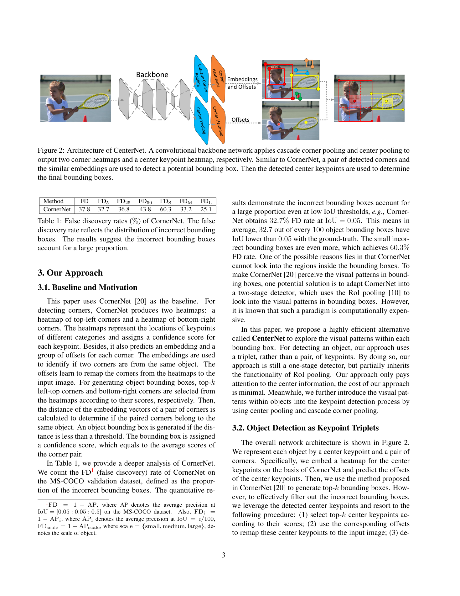
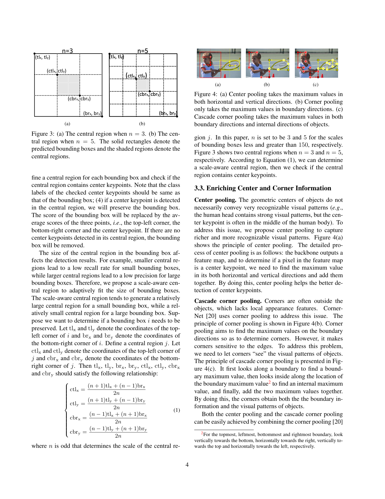
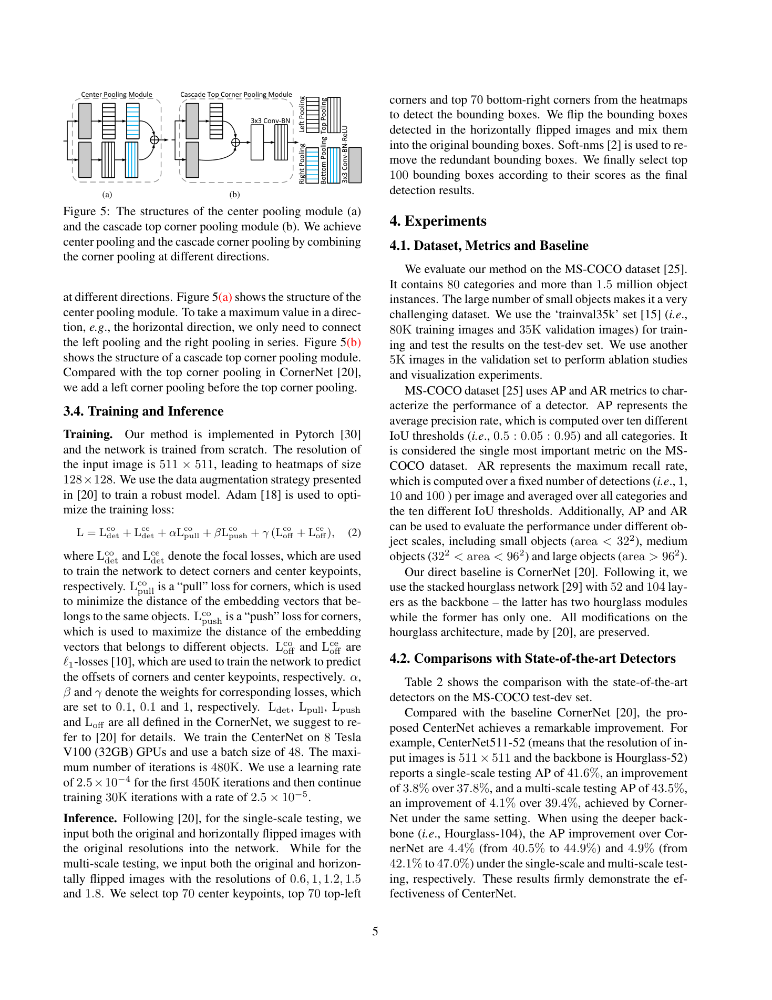

# CenterNet: Keypoint Triplets（arXiv 2019）· 论文笔记（精读版）

- **论文**：CenterNet: Keypoint Triplets for Object Detection（arXiv:1904.08189v3，2019-04-19；共 10 页，正文 p.1–8）
- **BibTeX 键名**：`duan2019centernet`
- **作者/机构**：Kaiwen Duan（中科院大学，一作，工作在华为诺亚实习期间完成）、Song Bai（Oxford）、Lingxi Xie / Qi Tian（华为诺亚）、Honggang Qi / Qingming Huang（中科院大学）
- **本地 PDF**：`3.科研基本任务/论文/目标检测/Duan 等 - 2019 - CenterNet Keypoint Triplets for Object Detection.pdf`
- **任务书条目**：第 3 周 #16｜🟢 AI 辅助读｜阅读要点：在 CornerNet 基础上用"中心点"给假框做裁判
- **阅读日期**：2026-01-01 起笔、2026-11-01 定稿
- **核对规则**：「p.X」= 本地 PDF 物理页码；✅ = 用 PyMuPDF 逐页提取原文核对过。
- **⚠️ 最重要的一条提醒（先看）**：本篇 **不等于** Zhou et al. 2019 的 *Objects as Points*（arXiv:1904.07850，也叫 CenterNet）。本篇是"**中心点 + 两个角点**"的三元组；Zhou 那篇是"**只有中心点 + 宽高回归**"。**两篇名字相同、方法完全不同**，引用、汇报、写综述时必须核对作者与 arXiv 号。（详见 §6.3）

---

## 0. 术语表（零基础全能版）

> 这篇的阅读难点在于：它**假设你已经读过 CornerNet**。所以它会直接甩出 "baseline / top-k / embedding / offset / FD rate" 这些词而不解释。下面把这些词全部展开，并把本篇新造的 4 个词（**triplet / central region / center pooling / cascade corner pooling**）讲透。

### 0.1 检测任务基础

| 术语 | 大白话解释（在本篇里的含义） |
|---|---|
| **anchor-based（基于锚框）** | 在图上铺一堆预设框，再分类 + 回归。本篇 §1 说它的两大毛病：**要保证和真值有足够 IoU 就得铺很多**，且**每个 anchor 尺寸/长宽比都要手工设**，而且"**anchor 常常和真值框对不齐**，不利于分类"（p.1）。 |
| **keypoint-based（基于关键点）** | 直接预测"框的关键点在哪"，再用几何关系拼出框。CornerNet 用两个角点；本篇用三个关键点。 |
| **one-stage / two-stage** | 本篇坚持 one-stage（p.3 明说 "our approach is still a one-stage detector"），但**"部分继承了 RoI pooling 的功能"**——这是全文最核心的自我定位。 |
| **RoI pooling（RoI 池化）** | 两阶段里"把候选框内部的特征抠出来看一遍"的操作。**本篇的整个动机就是：one-stage 没有这一步，能不能用一个极便宜的替代品？** |
| **triplet（三元组）** | 本篇的核心概念：一个物体 = **左上角 + 右下角 + 中心点**（p.1、p.3）。**"triplet" 不是"三个角点"，是"两个角 + 一个中心"。** |
| **pair（角点对）** | CornerNet 的表示：左上 + 右下。本篇把它**保留**，但再加一个中心点当"裁判"。 |
| **central region（中心区域）** | 框内部、以几何中心为中心的一个**小矩形**。它判断"这个框是不是真的"：**中心区域内必须有同类中心点**（p.3–4）。 |
| **scale-aware central region（尺度自适应的中心区域）** | 中心区域的大小**随框大小变化**：**小框用相对大的中心区域**（保召回），**大框用相对小的中心区域**（保精度）（p.4）。由公式 (1) 的奇数 n 控制。 |
| **n（中心区域参数）** | 控制中心区域尺度的**奇数**。**框尺寸 <150 用 n=3，>150 用 n=5**（p.4）。 |
| **center keypoint（中心点）** | 物体几何中心处的关键点。本篇给它单独一路热力图。**注意：它和"物体中心"几何上是同一个位置，但网络要"学会在哪"**。 |
| **heatmap（热力图）** | H×W 的分数图，每个像素给一个"这里是不是某类关键点"的分数。本篇有 **3 组**热力图：左上角、右下角、中心点（p.3、Figure 2）。 |
| **offset（偏移）** | 热力图分辨率是输入的 1/4（511→128），取整会丢精度，所以额外预测 2 个小数补偿（CornerNet 引入，本篇沿用）。本篇对**中心点也预测 offset**（p.3）。 |
| **embedding（嵌入向量）** | 每个**角点**一个向量，同物体的两角点距离小、异物体距离大。**本篇只给角点做 embedding，中心点不做**（因为中心点不需要配对）。 |
| **top-k** | 从热力图取分数最高的 k 个关键点。推理时 **中心点取 70、左上角取 70、右下角取 70**（p.5）。 |
| **false box（假框/错框）** | 与任何真值框 IoU 都很低、但被模型输出的框。CornerNet 的假框主要来自"**两角点配错**"或"**角点位置偏**"。**本篇就是冲这个来的。** |
| **class imbalance** | 128×128×C 的热力图上只有极少数正像素。CornerNet 用"高斯软标签 + 变体 focal loss"处理，**本篇沿用同一套**（p.5 式 2 里的 `L^co_det`、`L^ce_det` 都是 focal 形式）。 |
| **easy / hard example** | 离真值关键点很远的像素是 easy negative；**中心区域附近的假中心点是 hard negative**——center pooling 的直接目的就是让"真中心"和"假中心"在特征上更可分（p.4）。 |

### 0.2 本篇的四个新东西

| 术语 | 大白话解释 |
|---|---|
| **center pooling（中心池化）** | 为了"判断这个像素是不是中心点"，在特征图上**取该像素所在行的最大值 + 所在列的最大值，相加**（p.4、Figure 4(a)）。直觉：物体的几何中心常常在**纹理最弱的地方**（比如人的身体中段、牛的身体中部），只看局部看不出"这是中心"，必须**横向看一整行、纵向看一整列**（例如人的头在两个方向都有强响应）。 |
| **cascade corner pooling（级联角点池化）** | 对 CornerNet 的 corner pooling 的改良。原版只看"**边界方向**"（左上角：向右、向下），因此**角点对边缘极其敏感**（p.4 "it makes corners sensitive to the edges"）。级联版**先沿边界找最大值，再从那个最大值的位置往物体内部找最大值**，两者相加（p.4、Figure 4(c)）。→ 角点同时获得"边界信息 + 物体内部纹理"。 |
| **"看两次"（cascade 的实质）** | 第一跳：找边界极值（知道边界在哪）；第二跳：沿边界极值处向里看（知道物体内部长什么样）。**这不是"更深的池化"，是"两段式路由"**——第二次 pooling 的起点由第一次的结果决定，所以叫 cascade（级联）。 |
| **三联点判框（triplet judging）** | 推理时的 4 步（p.3–4）：① 取 top-k 中心点；② 用 offset 映射回原图；③ 为每个候选框算中心区域；④ **中心区域内若有同类中心点 → 保留，否则删除**；保留框的分数 = **三个点的分数平均值**（不是两个角点的平均）。 |
| **FD rate（false discovery rate）** | 本篇自己引入的评价指标：**FD = 1 - AP**，其中 AP 是在 **IoU=0.05:0.05:0.5** 这 10 个低阈值上平均得到的（p.3 脚注）。物理含义：**"连低 IoU 都够不上的框占多大比例"**。FDS/FDM/FDL 分别按小/中/大物体算。**它衡量的不是"误检率"，而是"低质量框的比例"。** |

### 0.3 骨干与训练

| 术语 | 大白话解释 |
|---|---|
| **hourglass（沙漏网络）** | 下采样 → 上采样 的对称结构，配合 skip 保留细节。**Hourglass-52 = 1 个沙漏模块；Hourglass-104 = 2 个**（p.5 明说 "the latter has two hourglass modules while the former has only one"）。 |
| **511×511 → 128×128** | 输入 511、输出热力图 128（**4 倍下采样**）。**这个 128 分辨率是 CornerNet 的遗产，也是小物体性能的天花板所在。** |
| **从零训练（from scratch）** | 不用外部预训练（p.5）。所以"501 个类别"之类的迁移优势一点都没有，全靠数据增强（沿用 CornerNet 的策略）。 |
| **Adam / 学习率** | lr = **2.5×10⁻⁴** 训 **450K** 迭代，再 **2.5×10⁻⁵** 训 **30K**，总 **480K**（p.5）。 |
| **batch 48 / 8×V100(32GB)** | 8 张 Tesla V100 32GB，batch 48（p.5）。**比 CornerNet 的 49/10×Titan X 略"现代"一点，但仍是多卡工程。** |
| **损失权重 α/β/γ** | α=0.1（pull）、β=0.1（push）、γ=1（offset）（p.5）。**注意：这里的 α/β/γ 与 focal loss 的 α/β 完全无关**，是总损失的权重。 |
| **single-scale / multi-scale 测试** | 单尺度：原图 + 水平翻转；多尺度：在 **0.6 / 1 / 1.2 / 1.5 / 1.8** 五个尺度上都跑（含翻转）（p.5）。 |
| **soft-NMS** | 不直接删掉重叠框，而是**按重叠程度给分数打折**，再把多尺度/翻转的结果合并（p.5）。 |
| **最终输出 top-100** | 合并所有结果后按分数取前 100（p.5）。 |

### 0.4 评估指标

| 术语 | 大白话解释 |
|---|---|
| **AP** | COCO 主指标：**IoU = 0.5:0.05:0.95 十个阈值**上平均（p.5）。 |
| **AP50 / AP75** | IoU=0.5 / 0.75 处的 AP。 |
| **AP_S / AP_M / AP_L** | 面积 **<32²** / **32²–96²** / **>96²** 三档（p.5 明确给了面积区间）。 |
| **AR1 / AR10 / AR100** | 每图只取 1/10/100 个检测时的平均召回（p.5）。**本篇 AR 大幅提升，是"删掉假框"带来的副作用收益**（p.6 原文有解释）。 |
| **test-dev / minival / trainval35k** | 训练用 trainval35k（80k train + 35k val）；消融在剩下 **5K val**；正式成绩报 **test-dev**（p.5）。 |
| **FD / FD5 / FD25 / FD50 / FDS / FDM / FDL** | 见 §0.2。**FD_i = 1 - AP_i（IoU=i/100 处的 AP）；FD_5 最常被引用（IoU=0.05 这么松都够不上的比例）。** |

### 0.5 工程细节（"朴素做法 → 优化做法 → 为什么有效"）

| 朴素做法 | 本篇的优化做法 | 为什么有效 |
|---|---|---|
| 把 CornerNet 直接升级成 two-stage（加 RoI pooling 去看框内） | **不改成两阶段**，只加一路"中心点热力图"，用"中心区域内有没有同类中心点"来判框（p.3） | RoI pooling 要额外采样 + 额外子网络，**算力贵、破坏 one-stage 的速度优势**；"中心点存在性"只要一张 H×W 的图，**成本几乎为零**（实测 +40 ms，p.7）。 |
| 中心区域用固定像素大小（比如 5×5） | **尺度自适应**：n=3（框 <150）/ n=5（框 >150）（p.4 式 1） | 小框如果中心区域太小，中心点稍稍偏一点就掉出去 → **召回崩**；大框如果中心区域太大，假框很容易在框内找到一个"碰巧同类"的中心点 → **精度崩**。原文一句话总结："smaller central regions lead to a low recall for small boxes, larger ones lead to low precision for large boxes"（p.4）。 |
| 中心点只做一次 max pooling（横/纵各一次） | **center pooling**：取"该行最大值 + 该列最大值"（p.4） | 物体几何中心常常是**弱纹理区**，局部卷积判不出来；但"中心这一行上一定有物体的某部分（比如人的头/肩）、这一列上也一定有"，**行列极值能把远处强响应拉过来**。Table 4：+CRE 39.9 → +CTP 40.8（**+0.9**），且 AP_L 涨 1.4（p.7）。 |
| 沿用 CornerNet 的 corner pooling（只看边界方向） | **cascade corner pooling**：先找边界极值，再从该位置向**内部**找极值（p.4） | 只看边界 → 角点"对边缘极其敏感"，边缘噪声会直接毁掉角点；看内部能补上"这个物体长什么样"。单用 cascade 在 CornerNet 上 +0.7（37.6→38.3），在 CenterNet 上 +0.5（40.8→41.3）。 |
| 框的分数 = 两个角点分数的平均 | 框的分数 = **左上 + 右下 + 中心点** 三个分数的平均（p.4） | 三个点都"同意"的框更可信；中心点分数低时，把整体分数拉下来，**让假框在排序里自然下沉**（这也是 AR 提升的机制，p.6 原文解释了这一点）。 |
| top-k 只取角点（CornerNet：100+100） | 取 **70 中心 + 70 左上 + 70 右下**（p.5） | 多了 70 个中心点当"裁判"，**数量反而减少**——因为中心点极大的压缩了无效组合，不需要那么多角点候选。 |
| 单尺度测试 | 多尺度 **0.6/1/1.2/1.5/1.8** + 翻转 + soft-NMS（p.5） | 小物体在 1.8× 下才"够得着"128 热力图的分辨率。**这也是为什么多尺度 AP（47.0）比单尺度（44.9）高 2.1 的原因之一。** |

---

## 1. 论文定位

### 1.1 一句话说清

**问题**：CornerNet 靠"两个角点 + embedding 配对"做检测，**但配对只在特征层面判断"像不像同一个物体"，从没看过框内部**。后果是：**大量假框**（原文 Table 1：IoU=0.05 这么松，CornerNet511-104 仍有 **32.7%** 的框连这个门槛都够不上；小物体更糟，**60.3%**）。

**做法**：给每个候选框配一个"**中心点裁判**"——框的中心区域里如果存在**同类**的中心点，这个框就保留；否则删掉。为了让这个裁判靠谱，再加两个池化模块（**center pooling** 让中心点更好检出、**cascade corner pooling** 让角点别被边缘带跑）。

**结果**：COCO test-dev **47.0 AP（多尺度）**，比所有 one-stage 至少高 **4.9**（摘要原话 "by at least 4.9%"）；比 CornerNet 同口径高 **+4.9**（42.1→47.0）；**假框率大幅下降**（FD5 32.7→28.2，FDS 60.3→50.7）。推理 **270 ms（HG-52）/ 340 ms（HG-104）**（p.2、p.7）。

> 一句话：**"你这框里到底有没有东西？"——用一个几乎免费的中心点回答它。**

### 1.2 ASCII 流程图

```
输入 511×511（原图 or 翻转图；多尺度时再 ×0.6/1/1.2/1.5/1.8）
        │
        ▼
┌─────────────────────────────────────────┐
│ Hourglass-52 / Hourglass-104  骨干        │
└───────┬───────────────┬──────────────┬──┘
        │               │              │
        ▼               ▼              ▼
┌──────────────┐ ┌──────────────┐ ┌──────────────┐
│ 角点预测模块   │ │ 角点预测模块   │ │ 中心点预测模块 │
│ cascade corner│ │ cascade corner│ │ center pooling│
│   pooling    │ │   pooling    │ │              │
└──┬────┬───┬──┘ └──┬────┬───┬──┘ └──┬────┬───┬──┘
   │    │   │       │    │   │       │    │   │
 热力图 emb offset 热力图 emb offset  热力图 offset
 (左上)      (2)   (右下)      (2)   (中心)   (2)
   │    │   │       │    │   │       │    │   │
   └────┴───┴───┬───┴────┴───┴───────┴────┴───┘
                ▼
   ┌────────────────────────────────────────────┐
   │ ① 取 top-70 中心点 / top-70 左上 / top-70 右下 │
   │ ② 用 offset 映射回原图坐标                     │
   │ ③ 角点配对：embedding L1 距离 < 阈值 且同类     │
   │    → 得到候选框 (tl, br)                      │
   │ ④ 为每个候选框算"中心区域"（式1，n=3 或 5）      │
   │ ⑤ 中心区域内若有同类中心点 → 保留，否则删除       │
   │ ⑥ 保留下来的框，分数 = (s_tl + s_br + s_c)/3    │
   │ ⑦ 多尺度/翻转结果混合 → soft-NMS → top-100      │
   └────────────────────────────────────────────┘

训练 loss = L^co_det + L^ce_det          ← 角点 focal + 中心点 focal
          + 0.1 L^co_pull + 0.1 L^co_push ← 只有角点做 embedding
          + 1 (L^co_off + L^ce_off)        ← 角点 offset + 中心点 offset
```

### 1.3 "上一篇留下什么坑 → 本篇填什么"

| CornerNet（#16a）留下的坑 | 本篇怎么填 |
|---|---|
| **配对只看 embedding 距离，从不看框内部**：两个真角点如果被配错，会生成一个"跨物体"的假框 | 加一个**中心点**当裁判：框的中心区域里没有同类中心点 → 删。**这一步等价于"廉价地看了一眼框内"。** |
| **假框极多**：FD5 = 32.7%（IoU 0.05 都够不上），FDS = 60.3%（小物体） | 按 Table 3：CenterNet511-104 把 FD5 降到 **28.2**、FDS 降到 **50.7**（各降 4.5 / 9.6）。 |
| **角点对边缘敏感**：corner pooling 只看边界方向，边缘噪声直接污染角点 | **cascade corner pooling**：先找边界极值，再从那里往内部看。 |
| **中心点/几何中心区域几乎没有特征**（CornerNet 根本没用中心点） | 本篇说"物体几何中心常常是弱纹理区"（p.4），提出 **center pooling** 用行列极值把远处强响应拉过来。 |
| **AP_S 反而比 RetinaNet 差**（Table 7：20.7 vs 21.8） | 本篇 AP_S 单尺度 25.6（vs CornerNet 19.4）→ **+6.2**；多尺度 28.9（vs 20.8）→ **+8.1**。**小物体是最大受益者**（p.6 原文明确指出）。 |
| **速度慢**（244 ms / Titan X） | 本篇 Hourglass-52 版本 **270 ms** / **精度更高**（41.6 vs CornerNet511-52 的 37.8）；104 版本 340 ms（p.7）。**用更浅的骨干实现了更好的精度。** |

---

## 2. 逐节导读（严格按原文章节顺序）

### §1 Introduction（p.1–2）

**想解决什么**：说明"keypoint-based 方法天生缺一步'看框内'"，并给出一个**极便宜的补法**。

**动机链（原文的四步推理，p.1–2）**：
1. anchor-based 要保证 IoU 就得铺很多 anchor，且**anchor 与真值常常不对齐**，不利于分类 → 所以有人做 keypoint-based（CornerNet）。
2. 但 CornerNet **"relatively weak ability of referring to the **global information** of an object"**（p.1）——它只对边界敏感，**不知道哪对角点该被归为一组**。
3. 后果是 Figure 1 第一行展示的那一堆假框，**"most of which could be easily filtered out with **complementary information**, e.g., the aspect ratio"**（p.1）。
4. 解决思路：**"if a predicted bounding box has a high IoU with the ground-truth box, then the probability that the center keypoint in its central region is predicted as the **same class** is high, and vice versa."**（p.2）→ 这句是全文的**核心假设**。

**批注**：
- 【易误解】"中心点检测"是为了**提高召回**——恰恰相反，它是**过滤器**：它只会**删框**，不会新增框。所以它天然提高精度、可能降低召回；这也是为什么作者要做"尺度自适应中心区域"来**保护小框的召回**。
- 【易误解】"中心点和物体中心是同一件事"——几何上是，**但网络学的不是"几何中心"而是"看起来像中心的位置"**。center pooling 的存在说明：**几何中心处的视觉特征往往很弱**，得靠上下文补。
- 【工程细节】原文说假框"用长宽比就能滤掉一大批"——这句话很关键：它说明**假框的典型形态是"细长/比例离谱"**（两个角点来自不同物体时，拼出来的框特别扁或特别长）。**这也解释了为什么"中心点"能滤掉它们**：这种怪框的中心区域基本落在背景上。
- 【与上篇差异】CornerNet 的叙事是"**换表示**"（anchor → 角点）；本篇的叙事是"**加裁判**"（pair → triplet）。**两篇的结构改动量差别很大：CornerNet 换了整套输出，本篇只加了一个分支。**

### §2 Related Work（p.2）

**想解决什么**：把"两阶段 vs 一阶段"和"anchor vs keypoint"这两条线摆清楚，并说明"为什么我不直接把 CornerNet 改成两阶段"。

**关键动机句（p.3）**：
> "one potential solution is to adapt CornerNet into a **two-stage** detector, which uses the **RoI pooling** to look into the visual patterns in bounding boxes. However, it is known that such a paradigm is **computationally expensive**."

**批注**：
- 【易误解】"作者没想到两阶段"——他们想到了，并且**明确否掉**了。这是很好的"预防审稿"写法：先把最显而易见的替代方案说出来，再给否掉的理由（成本）。
- 【工程细节】§2 里列的两阶段工作（R-CNN/SPP/Fast/Faster/Mask/R-FCN/Cascade）和 one-stage（YOLO/YOLOv2/SSD/DSSD/R-SSD/RON/RefineDet/CornerNet）**基本是"点名式"综述**，信息量不大。**读这一节只需要抓两个点：① 两阶段贵；② CornerNet 还有改进空间。**
- 【与上篇差异】CornerNet 的 §2 花了很大篇幅和 DeNet/PLN 划清界限（因为那时"角点检测"还是新东西）；本篇的 §2 **几乎不和自己人吵架**，只做背景铺垫。**这说明到 2019 年，"keypoint-based 检测"已经是公认的一条路线了。**

### §3.1 Baseline and Motivation（p.3）——用一张表把动机"量化"

**想解决什么**：把"CornerNet 假框多"从**印象**变成**数字**。

**做法**：定义 FD rate 并在 COCO val 上统计 CornerNet（Table 1）：

| Method | FD | FD5 | FD25 | FD50 | FDS | FDM | FDL |
|---|---|---|---|---|---|---|---|
| CornerNet | 37.8 | **32.7** | 36.8 | 43.8 | **60.3** | 33.2 | 25.1 |

**关键句（p.3）**：
> "This means in average, **32.7 out of every 100 object bounding boxes have IoU lower than 0.05** with the ground-truth."

**批注**：
- 【易误解】把 FD5=32.7 读成"误检率 32.7%"——**它不是误检率**。FD5 = 1 - AP@IoU0.05，衡量的是"**连 0.05 的 IoU 都达不到的框占多少**"，它同时包含"漏检导致的空位"和"错框"。**原文脚注把定义写得很清楚，但正文的解读句容易被误读成"误检"。**
- 【易误解】"FDS=60.3 说明小物体错得最多"——注意这是**比例**：小物体本身数量多、且面积小导致 IoU 天然容易低。**它说明"小物体上的假框占比最高"，这是本篇改进的重点方向**（后来 AP_S 提升最大，正好对上）。
- 【工程细节】Table 1 用的是 **CornerNet511-104**（因为数字与 Table 3 的 CornerNet511-104 那行完全一致：37.8/32.7/36.8/43.8/60.3/33.2/25.1）。**看表时对一下这两张表，就能确认"基线是哪个模型"。**

### §3.2 Object Detection as Keypoint Triplets（p.3–4）

**想解决什么**：把"中心点裁判"写成可执行的 4 步流程 + 一个公式。

**流程（p.3–4 原文的四步，逐条抄下来）**：
1. 取 top-k 中心点（按分数）；
2. 用对应 offset 把中心点映射回输入图；
3. 为每个**候选框**定义中心区域，检查其中是否有中心点，**且类别必须与框一致**；
4. 有 → 保留，**分数改为三点平均**；没有 → 删除。

**中心区域公式（式 1，p.4，逐符号）**：

$$
\begin{aligned}
c_{tlx}&=\frac{(n+1)\,t_{lx}+(n-1)\,b_{rx}}{2n}, &
c_{tly}&=\frac{(n+1)\,t_{ly}+(n-1)\,b_{ry}}{2n},\\
c_{brx}&=\frac{(n-1)\,t_{lx}+(n+1)\,b_{rx}}{2n}, &
c_{bry}&=\frac{(n-1)\,t_{ly}+(n+1)\,b_{ry}}{2n}
\end{aligned}\tag{1}
$$

| 符号 | 含义 | 取值 |
|---|---|---|
| t_lx, t_ly | 候选框左上角坐标 | 由角点 + offset 得到 |
| b_rx, b_ry | 候选框右下角坐标 | 同上 |
| c_tlx … c_bry | **中心区域**的左上/右下坐标 | 由式 1 算出 |
| n | 奇整数，控制中心区域相对框的**尺度** | **框 <150 → n=3；框 >150 → n=5** |

**直观理解式 1**：把 n=3 代进去，`c_tlx = (4 t_lx + 2 b_rx)/6 = (2/3)t_lx + (1/3)b_rx`，即中心区域的左边界在"从左往右 1/3 处"；右边界在"2/3 处"。→ **中心区域占框宽的 1/3（n=3）或 1/5（n=5）**。**n 越大，中心区域越小。**

**批注**：
- 【易误解】"n 越大中心区域越大"——**反了**。n=5 时中心区域只占 1/5 宽，比 n=3 的 1/3 **更小**。原文说"大框用 n=5"，正是**大框取更小的中心区域**（保精度）。**这个符号方向极易记反，Figure 3 的阴影框可以直接验证。**
- 【易误解】"n 是像素数"——**n 是无量纲的奇数**，控制的是**比例**（1/n）。原文写 "n is **odd** that determines the **scale** of the central region"（p.4）。
- 【工程细节】"150" 这个阈值是**像素面积还是边长？** 原文只说 "the **scales** of bounding boxes less and greater than 150"（p.4），**没有明确是宽、高还是 sqrt(area)**。这是原文的一处模糊，**复现时必须自己定（多数开源实现用的是 max(w,h)）**，标记【原文模糊·待核对】。
- 【工程细节】第 3 步要求"**类别一致**"：中心点的类别必须和框的类别相同。这条很关键——否则一个"人的框"可以被"车"的中心点救活。**原文用 "of the same class" 明确写了（p.2、p.4 两处）。**
- 【与上篇差异】CornerNet 的框分数是"两角平均"；本篇改成"三点平均"。**这个细节改动很小，但影响很大**：中心点分数低的框会被压下去，排序更靠后（这解释了 AR 的提升，p.6）。

### §3.3 Enriching Center and Corner Information（p.4–5）

**想解决什么**：让"中心点"和"角点"都更容易被检出。

#### 3.3.1 Center pooling（p.4）

**动机（原文的原话）**：
> "The geometric centers of objects do **not necessarily** convey very recognizable visual patterns (e.g., the **human head** contains strong visual patterns, but the center keypoint is often in the **middle of the human body**)."

**做法**：取"该像素所在**行**的最大值 + 所在**列**的最大值"，相加。

**批注**：
- 【易误解】"center pooling = 横向 max + 纵向 max" 与 corner pooling 的"向右 + 向下"混为一谈——**差别在"方向是否单向"**：corner pooling 只看**一个方向**（从角点指向物体内部的一侧），center pooling 看的是**整行整列（两个方向都看）**。p.5 明确说："to take a maximum value in a direction, e.g., the horizontal direction, we only need to connect the **left pooling and the right pooling in series**"（串联左右两个 pooling = 整行）。
- 【工程细节】Figure 5(a) 的实现：`3×3 Conv-BN-ReLU` 之后接 **Top/Bottom/Left/Right 四种 pooling**组合，再由 `3×3 Conv-BN` 融合。**"串联"= 先左后右（或类似），这样一次卷积核就能拿到整行极值**，不需要真的扫。
- 【易误解】"center pooling 让中心点的**位置**更准"——原文说的是让中心点**更可分（more recognizable）**，即"能不能检出来"，不是"检得准不准"（位置精度靠 offset）。**Table 4 里 CTP 主要提升 AP_L（+1.4），因为大物体的"中心弱纹理"问题最严重。**

#### 3.3.2 Cascade corner pooling（p.4）

**动机（原文）**：corner pooling 只找**边界**方向的极值，**"makes corners sensitive to the edges"**（p.4）——边缘一有噪声，角点就飘。

**做法（p.4 原文 + Figure 4(c)）**：
1. 先沿边界方向找**边界最大值**；
2. 再**从那个最大值的位置**向物体**内部**方向找**内部最大值**；
3. 两者相加。

**批注**：
- 【易误解】"cascade 就是把 corner pooling 做两遍"——**不是同一位置的重复**。第二跳的**起点是"第一跳找到的极值点"**，是一个"数据依赖的路由"（cascade 的本意）。这一点 Figure 4(c) 画得很清楚。
- 【工程细节】Figure 5(b)：`Cascade Top Corner Pooling Module` = 在 CornerNet 的 top corner pooling **前面**再加一个 left corner pooling（p.5 原文："we add a **left corner pooling before** the top corner pooling"）。**所以"级联"在实现上就是"两个方向的 pooling 串联"。**
- 【工程细节】四个方向怎么配（脚注 2，p.4）：top 边界 → 向下看；left 边界 → 向右看；bottom → 向上；right → 向左。**这是"从边界指向物体内部"的四种配对，不是随便组合。**
- 【与上篇差异】CornerNet 的 corner pooling 里，"两个输入特征图"是**并列**的（各自负责一个方向）；cascade 里两个 pooling 是**串联**的（后者的输入/起点依赖前者）。**结构上从"并联"变"串联"，代价几乎为零（都是 max 操作）。**

### §3.4 Training and Inference（p.5）

**总损失（式 2，p.5）**：
$$
L=L^{co}_{det}+L^{ce}_{det}+\alpha L^{co}_{pull}+\beta L^{co}_{push}+\gamma\left(L^{co}_{off}+L^{ce}_{off}\right)
$$
（α=β=0.1，γ=1）

**逐项**：
| 项 | 作用 | 归属 |
|---|---|---|
| L^co_det | 角点热力图的 focal loss | 沿用 CornerNet 式(1) |
| L^ce_det | 中心点热力图的 focal loss | **本篇新增** |
| L^co_pull / L^co_push | 角点 embedding 的拉近/推开 | **只有角点**，中心点不做 embedding |
| L^co_off | 角点 offset（ℓ1） | 沿用 CornerNet |
| L^ce_off | 中心点 offset（ℓ1） | **本篇新增** |

**训练设置（p.5）**：511×511 → 128×128；从零训练；Adam；8×V100(32GB)；batch 48；**480K 迭代**（前 450K lr 2.5e-4，后 30K lr 2.5e-5）；数据增强沿用 CornerNet。

**推理设置（p.5）**：单尺度（原图 + 翻转）；多尺度 0.6/1/1.2/1.5/1.8（含翻转）；**top-70 中心 / 70 左上 / 70 右下**；翻转结果翻回来混合；soft-NMS；**top-100**。

**批注**：
- 【易误解】"中心点也要做 embedding 配对"——**不需要**。中心点是"裁判"，它不参与配对，所以没有 pull/push。**这也是"成本极低"的原因：只多了一张热力图 + 2 个 offset。**
- 【易误解】"α/β/γ 是 focal loss 的参数"——**完全是另一套**。这里的 α/β/γ 是**总损失里三项的权重**（0.1/0.1/1）。读的时候必须看上下文，否则会把它和 CornerNet 式(1) 的 α=2/β=4 混起来。**这是本篇最隐蔽的记号冲突。**
- 【工程细节】"从零训练 + 480K 迭代 + 8 卡"——**这套设置比 CornerNet（500K、10 卡）略短**，但多了中心点分支，算力其实相当。**个人复现仍然困难。**
- 【工程细节】top-k 从 CornerNet 的 100+100 降到 **70+70+70**：**总候选数几乎没有增加**（70×70=4900 对 vs 100×100=10000 对，反而更少），因为中心点把大部分组合直接枪毙了。**这个数字变化本身就是"中心点有效"的一个证据。**

### §4.1 Dataset, Metrics and Baseline（p.5）

- COCO：**80 类、>1.5M 实例**；小物体多，是"challenging dataset"（p.5）。
- 训练 trainval35k；消融 5K val；最终 test-dev。
- 指标：AP（10 个 IoU 平均）、AR（1/10/100）、AP_S/M/L（**面积 <32² / 32²–96² / >96²**）。
- 骨干：**Hourglass-52**（1 个沙漏）/ **Hourglass-104**（2 个沙漏）；**CornerNet 对 hourglass 的所有修改都保留**（p.5 明说）。

**批注**：原文给的小/中/大**面积区间**（<32²、32²–96²、>96²）比 CornerNet 那篇写得更清楚，**可以直接用来核对任何 COCO 表格**。

### §4.2 Comparisons（p.5–6，Table 2）与 §4.3 假框减少（p.6–7，Table 3）与 §4.4 速度（p.7）与 §4.5 消融（p.7–8，Table 4）与 §4.6 误差分析（p.8，Table 5）

这五小节的**表格与数字**统一放到 §4 逐表解读，这里只记它们的**论证目的**：
- §4.2：**"比所有 one-stage 都强、和两阶段可比"**；
- §4.3：**"我确实减少了假框"**（用 FD 指标，而不是只看 AP）；
- §4.4：**"这些收益不是靠变慢换来的"**（CornerNet 300 ms vs CenterNet 340 ms，但 HG-52 版只要 270 ms 且更准）；
- §4.5：**"三个组件各值多少"**（CRE / CTP / CCP 逐个加）；
- §4.6：**"中心点检测是不是瓶颈"**（用真值替换，**结论句与数据存在矛盾，见 §4.6 批注**）。

### §5 Conclusions（p.8）

**关键句**：
> "this is a common defect for **all one-stage approaches**. As one-stage approaches remove the RoI extraction process, they cannot pay attention to **internal information** within cropped regions."
> "we equip a one-stage detector with the ability of two-stage approaches, with an **efficient discriminator** being added."

**批注**：
- 【易误解】"中心点 branch 只对 keypoint-based 方法有用"——原文明确说可以推广：**"potentially generalized to other existing one-stage approaches (e.g., SSD)"**（p.8）。这句话后来被很多工作验证（"给 one-stage 加一个廉价的质量分支"成了常规操作，如 FCOS 的 centerness、GFL 的质量估计）。**【我的推断】**：这条路线的本质是"**用一个可学习的标量来预测'这个框有多可信'**"，而中心点只是它的一种物理实现。
- 【与上篇差异】CornerNet 的结论只有两句、很敷衍；本篇的结论给了"为什么这是所有 one-stage 的通病"的**一般性论证**，学术写作上更完整。

---

## 3. 核心图 / 公式深读

### 3.1 Figure 2 与 Table 1（p.3）：结构总览 + 动机的数字



**Figure 2 图注（原文）**：骨干网对**角点**用 cascade corner pooling、对**中心点**用 center pooling，输出两张角点热力图 + 一张中心点热力图；"Similar to CornerNet，一对检测到的角点和相似的 embedding 用于生成**潜在**框；然后用检测到的中心点**决定最终**框。"

**怎么读**：图上分三路（左上、右下、中心），前两路有 `Embeddings and Offsets` 分支，第三路只有 `Offsets`。**"potential bounding box（潜在框）→ final bounding box（最终框）"这个两段式，就是全文的方法骨架。**

**Table 1** 见 §2 §3.1（已给全表）。

**批注**：
- 【易误解】"中心点热力图是第 4 组输出"——只有 3 组（左上、右下、中心）。
- 【工程细节】Figure 2 里中心点那一路**没有 embedding 分支**，这个"缺一条线"就是"成本低"的图形化证据。

### 3.2 Figure 3（p.4）：n=3 与 n=5 的中心区域到底差多少



**Figure 3 图注**：上排 (a) 是 **n=3**，下排 (b) 是 **n=5**；**实线矩形 = 预测框，阴影区域 = 中心区域**。

**怎么读**：同一组框，n=5 的阴影明显**更小、更靠近几何中心**。这就是"大框用 n=5"的效果——**大框的中心区域被收紧，假中心点更难"混进来"**。

**批注**：
- 【易误解】"n=5 的中心区域比 n=3 大一倍"——从图上一眼就能看出**是更小**（1/5 vs 1/3 宽）。
- 【工程细节】图上标的四个点 `(tlx,tly) (brx,bry) (ctlx,ctly) (cbrx,cbry)` 正好对应式 1 的四个变量，**看图就能把式子对应上**。

### 3.3 Figure 4（p.4）：三种 pooling 的"看的方向"

**图注**：(a) center pooling 取**横 + 纵**两方向最大；(b) corner pooling **只取边界方向**；(c) cascade corner pooling **既取边界方向、又取物体内部方向**。

**怎么读**：三张小图画的都是**箭头方位**：
- (a) 从中心点出发，**上下左右四条**箭头（因为要整行整列）；
- (b) 从角点出发，**两条**箭头（朝物体内部的两个方向）；
- (c) 从角点出发，**先两条边界箭头，再从箭头终点**再发两条内部箭头。

**批注**：
- 【易误解】"center pooling 比 corner pooling 强，所以应该都用 center pooling"——两者**服务不同任务**：角点在**框外**（要边界），中心点在**框内**（要内部纹理）。**用错方向就是噪声。**
- 【工程细节】三者的实现**都是 max + 加**，差别只在"扫描的起点和方向"。**这就是作者说"用 corner pooling 组合一下就能实现"（p.4–5）的原因**——不需要新的底层算子。

### 3.4 Figure 5（p.5）：模块级的实现



**图注**：左边 (a) 是 center pooling 模块（`3×3 Conv-BN-ReLU → Top/Bottom/Left/Right Pooling → 3×3 Conv-BN`）；右边 (b) 是 cascade top corner pooling 模块（**在 top corner pooling 前面加一个 left corner pooling**）。

**批注**：
- 【易误解】"(a) 里四个 pooling 是并联后取平均"——是**按方向组合后相加**（横 = 左+右，纵 = 上+下，再相加），不是平均。用平均会把量级压掉一半，和训练时的尺度不匹配。**【我的推断】**：原文没写是加还是平均，但从"corner pooling 是相加"的惯例（CornerNet 式 6、7 后明确"adds"）推断这里也是加。
- 【易误解】"(b) 是全新的模块"——它就是把 CornerNet 的 top corner pooling 前面串一个 left pooling（p.5 原文一句话说清）。**改动量极小，这是本篇"低成本"叙事的又一处证据。**

### 3.5 公式汇总（手打 LaTeX）

**式(1) 中心区域**：见 §2 §3.2（完整给出）。

**式(2) 总损失**：
$$
L=L^{co}_{det}+L^{ce}_{det}+\alpha L^{co}_{pull}+\beta L^{co}_{push}+\gamma\left(L^{co}_{off}+L^{ce}_{off}\right)
$$

**未在本篇重复给出的公式（沿用 CornerNet，需回原文 16a 查）**：
- 角点/中心点热力图的 focal loss：**CornerNet 式(1)**（α=2、β=4、高斯软标签）；
- 角点 offset：**CornerNet 式(2)(3)**；
- pull / push：**CornerNet 式(4)(5)**（Δ=1）。

**批注**：本篇**没有重抄这些公式**，只写 "Ldet, Lpull, Lpush and Loff are all defined in the CornerNet, we suggest to refer to [20] for details"（p.5）。**所以读本篇必须手边有 CornerNet 的式子，否则 L^ce_det 到底用什么形式都说不清**（合理推断是"中心点也当角点一样用同一套 focal + 高斯"，但**原文没有明说**，标记【推断】）。

---

## 4. 实验逐表解读

### 4.1 Table 2（p.6）：test-dev 总表（节选，单位 %）

| 类别 | 方法 | backbone | AP | AP50 | AP75 | AP_S | AP_M | AP_L | AR100 |
|---|---|---|---|---|---|---|---|---|---|
| 两阶段 | Faster R-CNN w/ FPN | ResNet-101 | 36.2 | 59.1 | 39.0 | 18.2 | 39.0 | 48.2 | – |
| 两阶段 | Mask R-CNN | ResNeXt-101 | 39.8 | 62.3 | 43.4 | 22.1 | 43.2 | 51.2 | – |
| 两阶段 | Cascade R-CNN | ResNet-101 | 42.8 | 62.1 | 46.3 | 23.7 | 45.5 | 55.2 | – |
| 两阶段 | Grid R-CNN w/ FPN | ResNeXt-101 | 43.2 | 63.0 | 46.6 | 25.1 | 46.5 | 55.2 | – |
| 两阶段 | D-RFCN + SNIP (multi) | DPN-98 | 45.7 | 67.3 | 51.1 | 29.3 | 48.8 | 57.1 | – |
| 两阶段 | PANet (multi) | ResNeXt-101 | **47.4** | 67.2 | 51.8 | 30.1 | 51.7 | 60.0 | – |
| 单阶段 | RetinaNet800 | ResNet-101 | 39.1 | 59.1 | 42.3 | 21.8 | 42.7 | 50.2 | – |
| 单阶段 | RefineDet512 (multi) | ResNet-101 | 41.8 | 62.9 | 45.7 | 25.6 | 45.1 | 54.1 | – |
| 单阶段 | CornerNet511 (single) | Hourglass-52 | 37.8 | 53.7 | 40.1 | 17.0 | 39.0 | 50.5 | 57.0 |
| 单阶段 | CornerNet511 (multi) | Hourglass-52 | 39.4 | 54.9 | 42.3 | 18.9 | 41.2 | 52.7 | 57.7 |
| 单阶段 | CornerNet511 (single) | Hourglass-104 | 40.5 | 56.5 | 43.1 | 19.4 | 42.7 | 53.9 | 59.1 |
| 单阶段 | CornerNet511 (multi) | Hourglass-104 | 42.1 | 57.8 | 45.3 | 20.8 | 44.8 | 56.7 | 60.0 |
| **本篇** | **CenterNet511 (single)** | **Hourglass-52** | **41.6** | 59.4 | 44.2 | 22.5 | 43.1 | 54.1 | 60.1 |
| **本篇** | **CenterNet511 (single)** | **Hourglass-104** | **44.9** | 62.4 | 48.1 | 25.6 | 47.4 | 57.4 | 63.3 |
| **本篇** | **CenterNet511 (multi)** | **Hourglass-52** | **43.5** | 61.3 | 46.7 | 25.3 | 45.3 | 55.0 | 61.3 |
| **本篇** | **CenterNet511 (multi)** | **Hourglass-104** | **47.0** | 64.5 | 50.7 | 28.9 | 49.9 | 58.9 | 64.8 |

**这张表回答什么**：**"中心点裁判"值多少 AP？值不值得那 40 ms？**

**关键数字含义（原文自己给的对照口径，p.5–6）**：
- HG-52：单尺度 **37.8 → 41.6（+3.8）**；多尺度 **39.4 → 43.5（+4.1）**。
- HG-104：单尺度 **40.5 → 44.9（+4.4）**；多尺度 **42.1 → 47.0（+4.9）**。
- **小物体收益最大**：HG-52 的 AP_S **+5.5（单尺度）/ +6.4（多尺度）**；HG-104 的 AP_S **+6.2 / +8.1**（p.6 原文）。
- 与两阶段的对比：**44.9 ≈ D-RFCN+SNIP 的 45.7**；**47.0 ≈ PANet 的 47.4**。

**最易误读的 3 点**：
1. **47.0 是多尺度**！单尺度最好只有 **44.9**。摘要只写 47.0，**极易被当作单尺度成绩**。
2. **"比 CornerNet 高 4.9"是"多尺度对多尺度"（42.1→47.0）**；单尺度对单尺度是 **+4.4**（40.5→44.9）。**两个数不能混用。**
3. **本篇表里的 CornerNet（40.5/42.1）与 CornerNet 原论文的（40.6/42.2）差 0.1**。这是**复现/再训练导致的微小差异**（本表注明 CornerNet 那几行是 "511×511 / ≤1.5×" 的设置）。**引用 CornerNet 成绩时应以 CornerNet 论文为准，本篇表里的数字只用于"同口径对比"。**

### 4.2 Table 3（p.7）：假框率（FD）对比——本篇的"专属指标"

| Method | FD | FD5 | FD25 | FD50 | FDS | FDM | FDL |
|---|---|---|---|---|---|---|---|
| CornerNet511-52 | 40.4 | 35.2 | 39.4 | 46.7 | 62.5 | 36.9 | 28.0 |
| **CenterNet511-52** | **35.1** | **30.7** | 34.2 | 40.8 | **53.0** | 31.3 | 24.4 |
| CornerNet511-104 | 37.8 | 32.7 | 36.8 | 43.8 | 60.3 | 33.2 | 25.1 |
| **CenterNet511-104** | **32.4** | **28.2** | 31.6 | 37.5 | **50.7** | 27.1 | 23.0 |

**这张表回答什么**：**"假框到底少了没有？"** 答：全指标下降；**FD5 各降 4.5、FDS 各降 9.5 / 9.6**（p.7 原文数字，与表内差值吻合）。

**关键数字含义**：
- **FDS 降幅最大（9.5/9.6）**：小物体上的假框最容易被中心点杀掉（原文解释：**"框越小，中心区域里检出一个中心点的概率越低"**，p.6）。
- **FDL 只降 3.6/2.1**：大物体的假框本来就少（CornerNet FDL=28.0 已经不差），下降空间小。
- **FD 总体降 5.3/5.4**：说明"每一档都在改善"，不是"只救了某一档"。

**最易误读的 2 点**：
1. **FD 不是误检率**（见 §0.2 定义）。FD5=28.2 的读法是"**28.2% 的框连 IoU 0.05 都够不上**"，而不是"28.2% 的框是假的"。
2. **这张表是 minival（5K val）**（p.7 "on the MS-COCO **validation** dataset"），**不能拿去和 test-dev 的 AP 直接对比**。

### 4.3 Table 4（p.8）：三组件消融——谁是主要贡献？

| CRE | CTP | CCP | AP | AP50 | AP75 | AP_S | AP_M | AP_L | AR100 |
|---|---|---|---|---|---|---|---|---|---|
| – | – | – | 37.6 | 53.3 | 40.0 | 18.5 | 39.6 | 52.2 | 56.7 |
| – | – | ✓ | 38.3 | 54.2 | 40.5 | 18.6 | 40.5 | 52.2 | 57.9 |
| ✓ | – | – | **39.9** | 57.7 | 42.3 | 23.1 | 42.3 | 52.3 | 58.5 |
| ✓ | ✓ | – | 40.8 | 58.6 | 43.6 | 23.6 | 43.6 | 53.6 | 59.0 |
| ✓ | ✓ | ✓ | **41.3** | 59.2 | 43.9 | 23.6 | 43.8 | 55.8 | 59.2 |

**（CRE=中心区域探索，CTP=center pooling，CCP=cascade corner pooling；基线是 CornerNet511-52 在 minival 上 37.6）**

**这张表回答什么**：**"三个改动各自值多少？"** 答：**CRE +2.3（37.6→39.9）、CTP +0.9（39.9→40.8）、CCP +0.5（40.8→41.3）**。

**关键数字含义（这是全文最重要的一条"贡献排序"）**：
- **"加一个中心点热力图"（CRE）单独就值 +2.3，是三者里最大的**——而且**几乎全部来自小物体（AP_S 18.5→23.1 涨 4.6，AP_L 只从 52.2→52.3 涨 0.1）**。
- **CTP（center pooling）主要救大物体**（AP_L 52.2→53.6，+1.4；原文 p.7 明说"conventional convolution 对大物体只涨 0.1"）。
- **CCP（cascade corner pooling）在"只有 CRE"的情况下单独值 +0.7（37.6→38.3），但 AP_L 完全不变（52.2→52.2），AR100 涨 1.8** → 原文解释：cascade 能"看到更多物体"（召回↑），但**内部纹理反而干扰边界判断**，导致框不准（精度不涨）。**加上 CenterNet 的框过滤后，AP_L 反而涨 2.2（53.6→55.8）**（p.7–8 明确写了这个机制）。

**最易误读的 3 点**：
1. **原报告某句写"center pooling 让大物体 AP 提升 1.4（从 52.2 到 53.6）"**，但表里 **52.2 是"没有 CRE/CTP"的基线**，而"加 CRE 后"是 **52.3**。所以严格说是"相对 52.3 涨 1.3"，不是 1.4。**原文用的是"相对原始基线"，表述上不严谨**（见 §7 第 5 条）。
2. **AP_L 在"只有 CRE"那行是 52.3（几乎没涨）**，这正好反驳"中心点对大物体有用"的直觉——**大物体的中心点太容易检了，所以没增益；真正难的是小物体**。
3. **最后一行 41.3 与 Table 5 的 "w/o GT" 41.3 是同一个模型**（minival），**说明 Table 4 的最终配置 = Table 5 的被分析对象**，这两张表可以对照读。

### 4.4 Table 5（p.8）：中心点误差分析——**这里有原文自相矛盾**

| 设置 | AP | AP50 | AP75 | AP_S | AP_M | AP_L |
|---|---|---|---|---|---|---|
| CenterNet511-52（无 GT） | 41.3 | 59.2 | 43.9 | 23.6 | 43.8 | 55.8 |
| **CenterNet511-52（用真值中心点）** | **56.5** | 78.3 | 61.4 | 39.1 | 60.3 | 70.3 |
| CenterNet511-104（无 GT） | 44.8 | 62.4 | 48.2 | 25.9 | 48.9 | 58.8 |
| **CenterNet511-104（用真值中心点）** | **58.1** | 78.4 | 63.9 | 40.4 | 63.0 | 72.1 |

**这张表回答什么**：**"中心点检测是不是瓶颈？"**

**数据说**：换成真值中心点，AP **+15.2（41.3→56.5）/+13.3（44.8→58.1）**；AP_S **+15.5 / +14.5**、AP_M **+16.5 / +14.1**、AP_L **+14.5 / +13.3**。

**⚠️ 原文的结论句与自己的数据矛盾**：
> 原文（p.8 末）："This demonstrates that the detection of center keypoints is **far from the bottleneck**."

**批注**：
- 【🟥 这是原文的表述问题】+15.2 AP 的差距**恰恰说明中心点检测是最大的瓶颈**：如果中心点检测已经很好，换成真值不会有这么大提升。**原文这句话与 Table 5 的数据逻辑相反**（可能是"中心点还有很大提升空间"的笔误/表述颠倒）。**我们引用时必须自己判断，不能照抄这句结论。**（详见 §7 第 3 条）
- 【易误解】"56.5 就是上限"——不是。真值中心点只解决"裁判准不准"，**角点检测和 embedding 配对仍然可能有错**，所以 56.5 < 100。
- 【工程细节】这也**反向解释了 Table 4 里 CRE 的收益为什么不是更大**：中心点本身并不好检（一换真值就 +15），说明"加一路中心点"这个**思路**是对的，但**当前的检测质量离饱和还远**。→ 这正好是后续工作（GFL、质量估计）的切入点。
- 【我的推断】原文这句结论更可能想表达的是"**中心点检测还有很大改进空间，所以现在还不是最终瓶颈**"（即"bottleneck 之外还有别的问题"），但"far from the bottleneck"的字面意思是"根本不是瓶颈"，**与数据冲突**。

### 4.5 §4.4 速度（p.7，无表）

| 模型 | 推理时间（Tesla P100） |
|---|---|
| CornerNet511-104 | **300 ms** |
| **CenterNet511-104** | **340 ms** |
| **CenterNet511-52** | **270 ms** |

**批注**：原文的论证很聪明——**"CenterNet511-52 比 CornerNet511-104 更快（270 vs 300）而且更准（41.6 vs 40.5）"**。→ **"我加的这 40 ms 完全可以用'换更浅的骨干'省回来"**。这是"低成本"叙事的收尾。

---

## 5. 我的思考（🟢 四问四答）

### 5.1 贡献：它到底改了什么？

1. **【原文结论】提出"**用中心点存在性作为框的质量判据**"**（p.2 的核心假设句）：if IoU 高 → 中心区域大概率有同类中心点。这是一个**可证伪、且被 Table 3 证实**的假设。
2. **【原文结论】cost 几乎为零**：只多一张 H×W 热力图 + 2 个 offset 通道，**不加 RoI、不加第二级网络**（+40 ms，可被更浅骨干抵消）。
3. **【原文结论】给出 FD rate 这个**诊断指标**（p.3 脚注）：让人第一次能"量化假框"，而不只是看 AP。**我认为这是本篇最被低估的贡献**——它把"假框多"这件模糊的事变成了一个可优化的目标。
4. **【我的推断】它其实是"**给 one-stage 装了一个廉价的判别器**"（原文自己也这么说："equip a one-stage detector with the ability of two-stage approaches, with an efficient discriminator"）。这条路线的后续形态是 FCOS 的 centerness、GFL 的质量分布、各种"质量分支"——**中心点只是这个思想的一个物理实现**。

### 5.2 局限：会在哪崩？

1. **【原文结论 + 我的推断】中心点漏检 → 真框被删**：这是**结构性的**——中心点是"一票否决制"，漏检一个中心点就等于丢一个真框。Table 5（+15.2）说明中心点检测远未做好，**所以"漏删"在现实中一定发生**。
2. **【我的推断】密集/遮挡场景会崩**：两个物体的中心区域可能互相包含（比如一排紧挨着的人）。**中心区域里"有一个同类中心点"就够了**，所以"用 A 的中心点救活 B 的假框"完全可能。原文**没有任何关于密集场景的分析**（COCO 里 crowd 不多），这是它在自动驾驶场景的**最大隐患**。
3. **【我的推断】小物体仍受限**：128×128 热力图 + 4 倍下采样，一个 8×8 像素的远处物体，角点相距 2 个格点，**中心区域（1/3 宽）可能只有 1 个格点**，中心点检测几乎不可能。AP_S 单尺度 25.6 / 多尺度 28.9，**仍远低于 AP_M/L（47.4/57.4）**。
4. **【原文结论】训练成本**：8×V100、480K 迭代、从零训练。**没有轻量版**（CornerNet-Lite 那套思路它没做）。

### 5.3 消融设计逻辑

1. **【原文结论】"逐个加"而不是"一次上全"**：Table 4 从 37.6 起，先单独加 CCP、单独加 CRE，再加组合——**这样能看出"哪个组件离开别的组件也能涨"**。
2. **【原文结论】专门为"潜在质疑"做实验**：Table 3（"假框真的少了吗"）、Table 5（"中心点是不是瓶颈"）、§4.4（"是不是靠变慢换的"）——**三条都是在回应审稿人可能的追问**，而不是炫耀分数。**这种写法值得抄。**
3. **【我的推断】Table 4 有个设计缺陷**：**没有"只加 CTP、不加 CRE"的行**。所以"CTP 单独值多少"无法判断（现在的 +0.9 是"在 CRE 之上"的增量）。**同理，CCP 与 CRE 的交互也没有单独行。**
4. **【我的推断】缺少"中心区域 n 值的扫描"**：n=3/5 和阈值 150 都是**拍的经验值**，全文**没有 n=1/7/9 的对照**。这是最值得补的一张表。

### 5.4 如果让我改：三个具体动作

1. **【我的推断】把"一票否决"改成"**软投票**"**：现在是"中心区域有中心点 → 保留；没有 → 删"。改成"中心点分数作为框分数的一个乘性因子"（类似 FCOS centerness），**可以避免"漏一个中心点就丢一个真框"**，同时保留"假框被压分"的好处。
2. **【我的推断】中心区域改成"**以中心点为圆心的高斯区域**"，而不是硬矩形：硬边界会让"中心点刚好落在边外 1 像素"的真框被删。高斯软权重可以缓解（**和 CornerNet 的半径减罚是同一个思路**）。
3. **【课外补充·待核实】给中心点也加"**宽高回归**"**：这样中心点就不只是"裁判"，还能直接生成框（**这就是 Zhou 2019 Objects as Points 的做法**）。两篇 CenterNet 的"最优组合"是：**角点给位置精度，中心点给判据，宽高回归给兜底**。这属于我读两篇后的合并设想，**标【我的推断】**。

---

## 6. 与前后论文的衔接

### 6.1 往前看

| 前作 | 借了什么 | 改了什么 |
|---|---|---|
| **CornerNet（#16a）** | 全部基础：hourglass、角点热力图、embedding、offset、focal 变体、高斯软标签、从零训练策略 | 加中心点分支；改 pooling（center / cascade）；改分数聚合（三点平均）；改 top-k（70/70/70） |
| **RetinaNet（#15）** | 经由 CornerNet 传递的 focal loss 思想 | 本篇不再讨论 anchor 与不平衡，**默认读者已接受** |
| **两阶段（RoI pooling）** | "看框内"的**功能目标** | 用"中心点存在性"替代"RoI 特征"，**功能近似、成本降两个数量级** |
| **Associative Embedding** | 角点配对机制 | 本篇不给中心点做 embedding（不需要配对） |

### 6.2 往后看

| 后续 | 关系 |
|---|---|
| **FCOS（2019）** | 也加了一个"centerness"分支来判断"这个位置的质量"，**思想同源**（用一个额外标量管质量），但 FCOS 是 anchor-free + 逐点回归，不用关键点。 |
| **GFL / Quality Focal Loss（2020）** | 把"分类分数"和"定位质量"联合成一个分布来学，**正是本篇"三点平均分数"这种粗糙做法的精细化版本**。 |
| **CenterNet（Zhou, Objects as Points）** | 走"只有中心点 + 宽高"的路，**不需要角点也不需要配对**；与本篇是**并行竞争关系**，不是继承关系。 |
| **CornerNet-Lite / 各种轻量化 keypoint 检测** | 解决本篇"8 卡 480K 迭代"的复现门槛。 |

### 6.3 ⚠️ 常被混淆：两个 "CenterNet"（再强调一次）

| 维度 | **本篇**（Duan 等，arXiv:1904.08189） | **Objects as Points**（Zhou 等，arXiv:1904.07850） |
|---|---|---|
| 全名 | CenterNet: **Keypoint Triplets** for Object Detection | **Objects as Points**（社区里也叫 CenterNet） |
| 表示 | 左上角 + 右下角 + **中心点**（triplet） | **中心点** + 宽高（+ offset） |
| 需要配对吗 | **需要**（角点 embedding） | **不需要** |
| 是否需要角点 | **需要** | **不需要** |
| 与 CornerNet 关系 | **直接改进 CornerNet**（同一代码库谱系） | 独立路线（基于"稠密中心点 + 尺寸回归"） |
| 本组笔记归属 | **本文件（16b）** | 不在本周任务；遇到必须另立条目 |

**一句话记法**：**Duan 的 CenterNet 是"三角（三关键点）"，Zhou 的 CenterNet 是"一点（一中心点）"。**

---

## 7. 回原文核对记录

| # | 我原来的说法 | 原文依据（页码） | 判定 |
|---|---|---|---|
| 1 | "CenterNet 的 47.0 AP 是单尺度最好成绩" | Table 2（p.6）：单尺度 HG-104 = **44.9**；多尺度 HG-104 = **47.0**；摘要的 47.0 亦为多尺度 | 🟥 **纠偏**。**47.0 是多尺度；单尺度 44.9。** |
| 2 | "比 CornerNet 高 6.5 AP（40.5→47.0）" | p.5–6 官方口径：单尺度 **+4.4**（40.5→44.9）、多尺度 **+4.9**（42.1→47.0） | 🟥 **纠偏**。**跨设置相减是错的**；同口径最大提升是 **+4.9**。 |
| 3 | "原文说中心点检测不是瓶颈，所以中心点已经很好了" | Table 5（p.8）：用真值中心点 AP **41.3→56.5（+15.2）**；但原文结论句写 "**far from the bottleneck**" | 🟥 **纠偏（原文自相矛盾）**。数据表明中心点是**最大瓶颈**；结论句与数据相反。**引用时必须自己判断，不能照抄。** |
| 4 | "基线 37.6 就是 CornerNet 的 40.6" | Table 4 基线是 **CornerNet511-52 在 minival** 的 37.6；CornerNet 原论文的 40.6 是 **test-dev + Hourglass-104** | 🟥 **纠偏**。**不同模型、不同数据划分，不能等同。** |
| 5 | "center pooling 让大物体 AP 提升 1.4（52.2→53.6）" | Table 4：加 CRE 后 AP_L = **52.3**，再加 CTP 才 **53.6** → 增量是 **+1.3** | 🟨 需修正：原文拿 **52.2（原始基线）** 作参照，**严格应相对 52.3**。 |
| 6 | "FD rate 就是误检率" | p.3 脚注：**FD = 1 − AP**，AP 在 IoU 0.05:0.05:0.5 上平均 | 🟨 需修正：它是"**低 IoU 框的比例**"，同时包含漏检与错框，**不是纯误检率**。 |
| 7 | "n 越大中心区域越大" | p.4 式(1) + Figure 3：中心区域宽 = 框宽 **1/n**；**n=5 比 n=3 更小**；原文对大框用 n=5 | 🟥 **纠偏**。**n 越大，中心区域越小。** |
| 8 | "α=β=0.1 是 focal loss 的参数" | p.5 式(2)：α/β 是 **pull/push 的损失权重**；focal 的参数是 CornerNet 式(1) 的 **α=2、β=4** | 🟥 **纠偏**。**两套同名符号，含义完全不同。** |
| 9 | "中心点也要做 embedding 配对" | p.3、Figure 2：embedding 只对角点；中心点分支只有 heatmap + offset | 🟩 正确（我最初确实想错了，回原文后纠正：中心点不参与配对）。 |
| 10 | "训练 480K 迭代、lr 2.5e-4 退火到 2.5e-5" | p.5：max **480K**；前 **450K** 用 2.5×10⁻⁴，后 **30K** 用 2.5×10⁻⁵ | 🟩 正确。 |
| 11 | "作者只说它比 one-stage 强 4.9%" | 摘要："outperforms all existing one-stage detectors by **at least 4.9%**"；47.0 vs CornerNet multi 42.1 = 4.9 | 🟩 正确（口径是多尺度 vs 多尺度）。 |
| 12 | "150 是像素面积阈值" | p.4 只写 "the **scales** of bounding boxes less and greater than 150"，**未说明是宽/高/√area** | 🟨 **原文模糊**：复现时必须自己定（多数实现用 max(w,h)）。 |

---

## 8. 自测题 5 题 + 常见误解 5 条

### 8.1 自测题

1. **写出式(1) 并代入 n=3**：中心区域的宽度占框宽的几分之几？若 n=5 呢？**为什么大框要用更小的中心区域？**
2. **三联点判框的 4 个步骤**是什么？框的最终分数怎么算？**"类别一致"这条为什么不能省？**
3. **center pooling 与 corner pooling 在"看的方向"上有什么本质区别**？cascade corner pooling 相比 corner pooling 多了哪一跳？
4. **FD5 的定义**是什么？为什么作者要用 FD 这个指标而不是只看 AP？（提示：AP 反映"好框有多少"，FD 反映"差框有多少"）
5. **Table 4 的三行加组件顺序**分别带来多少 AP？哪一个贡献最大？它主要提升了哪个尺度？

### 8.2 常见误解 5 条

| # | 误解 | 纠正 |
|---|---|---|
| 1 | "CenterNet 就是 CornerNet 加了个中心点热力图，涨点靠的是 pooling" | 涨点主力是**中心点裁判本身（+2.3）**；center pooling 只 +0.9，cascade corner pooling 只 +0.5。 |
| 2 | "47.0 是单尺度成绩" | 单尺度 **44.9**；47.0 是**多尺度**（0.6–1.8×）。 |
| 3 | "两个 CenterNet 是同一篇" | **Duan（三关键点）≠ Zhou（Objects as Points）**。看 arXiv 号：1904.08189 vs 1904.07850。 |
| 4 | "中心点能提升召回" | 中心点是**过滤器**，只删不加。它提升的是**精度**（和"删掉假框后真框排序上升"带来的**间接召回**，见 p.6 的解释）。 |
| 5 | "n 越大中心区域越大" | **反了**。中心区域宽 = 框宽/n。 |

---

## 9. 读到这里最容易产生的疑问（5 组 Q&A）

**Q1：中心点热力图和角点热力图是同一张网络输出的吗？三个分支共享特征吗？**
A：**【原文没有明说】**。Figure 2 画的是"骨干 → 三路预测模块"，其中两路角点模块用 cascade corner pooling、中心点模块用 center pooling。三路**共享同一个骨干特征**（否则做不到"低成本"），但**各自的预测模块是独立参数**（因为 pooling 类型不同）。**共享骨干这点是合理推断**，因为原文说"the cost of our approach is minimal"（p.3）且速度只多 40 ms。标【我的推断】。

**Q2：如果中心点漏检了，那个真框就永远丢失了吗？有没有补救？**
A：**在本文的推理流程里，是的**——它是硬删除（"If there are no center keypoints detected in its central region, the bounding box will be **removed**"，p.4）。**没有回退机制**。这也是我在 §5.4 建议改成"软投票"的原因。**【我的推断】**：实际影响被 top-k 稀释了——因为候选框有 4900 个，即使真框被误删几个，AP 的整体下降有限；但**对小物体/密集场景，误删比例会显著上升**。

**Q3：为什么要给中心点也预测 offset？中心点不是"框的中心"吗，可以直接算出来啊？**
A：**不能直接算**。框的中心是"两个角点坐标的几何平均"，理论上可以由角点推出；但——① 角点本身有误差，几何平均会把误差传过去；② **中心点热力图的整数格点会引入最多 3 像素的量化误差**（4 倍下采样），而中心区域只有几个格点宽，**3 像素的误差足以让真中心点掉到区域外**。所以必须像角点一样用 offset 补偿。**原文只写"we predict the offsets of the center keypoints"（p.3），没解释必要性；这段推理是【我的推断】，但和 CornerNet 式(2) 的逻辑完全一致。**

**Q4：Table 5 里"用真值中心点"能涨 15 AP，但 Table 4 里"加中心点分支"只涨 2.3 AP，这不矛盾吗？**
A：**不矛盾，而且这个对比非常有信息量**：
- Table 4 的 +2.3 是"**有了一个不完美的中心点**"带来的净收益——它已经能筛掉很多假框了；
- Table 5 的 +15.2 是"**如果中心点完美**"能带来的收益——**上界**。
→ 两个数字的差（约 13 AP）说明"**中心点检测本身还有巨大提升空间**"。**这正是原文那句 "far from the bottleneck" 最可能想表达的意思**（但它写反了，见 §7 第 3 条）。**【我的推断】**

**Q5：这套方法能直接用在自动驾驶上吗？**
A：**【我的推断，必须标未核实】** 有三个具体风险：
1. **密集目标**：一排锥桶/一排停靠车辆，中心区域互相重叠 → 互相"救活"假框（本文没有密集场景实验）。
2. **极端长宽比**：卡车、公交车、拖挂，两个角点跨度极大，corner pooling 要扫很长的行列 → 边界证据容易被路过的东西污染（CornetNet Figure 9 第一行就是这个错误）。
3. **实时性**：340 ms（V100 之前一代的 P100）远达不到车端 30 fps；CornerNet-Lite 那类轻量化版本才是可行起点。
**反过来它有一个很适合自动驾驶的优点：**角点表示天然给出"框的四条边"，对**可行驶区域/车道线**这类"结构化输出"很友好（见 16a §5.1 第 4 点）。

---

### 附：一页速记卡

```
动机：CornerNet 从没看过框内 → 假框多（FD5=32.7%、FDS=60.3%）
方法：物体 = 左上角 + 右下角 + 中心点（triplet）
      推理 4 步：top-70 → offset 映射 → 角点配对 → 中心区域内有同类中心点则保留
      中心区域：式(1)，宽=框宽/n，n=3（<150）/ n=5（>150）
      分数 = (s_tl + s_br + s_c)/3
模块：center pooling（整行+整列 max 相加）
      cascade corner pooling（先边界极值，再从该点向内部取极值）
训练：L = Lco_det + Lce_det + 0.1 Lpull + 0.1 Lpush + 1 (Lco_off + Lce_off)
      511→128，batch 48，8×V100，480K 迭代，Adam 2.5e-4→2.5e-5，从零训练
成绩：test-dev 44.9（单尺度）/ 47.0（多尺度，HG-104）；270 ms（HG-52）
消融：CRE +2.3（AP_S +4.6）/ CTP +0.9（AP_L +1.3）/ CCP +0.5
坑：① 47.0 是多尺度 ② FD≠误检率 ③ n 越大区域越小 ④ α/β 是损失权重不是 focal
     ⑤ Table5 与结论句矛盾 ⑥ 与 Zhou 的 CenterNet 同名不同物
```
