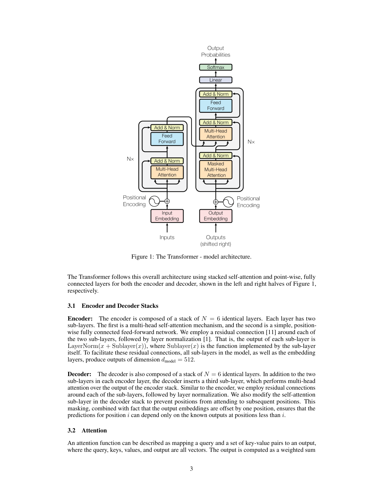
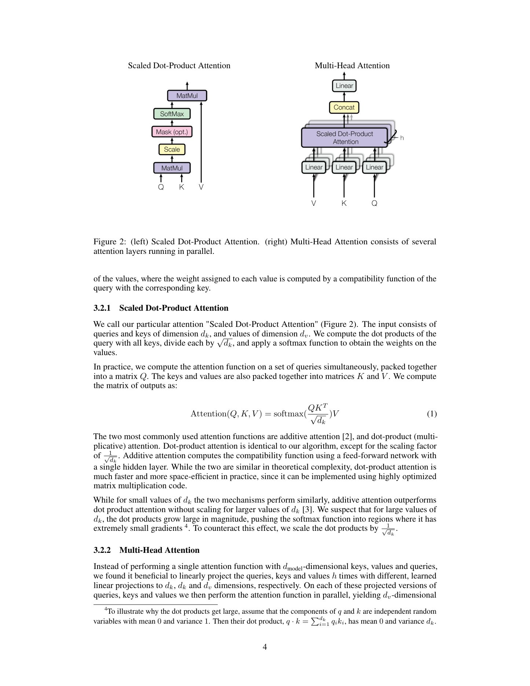
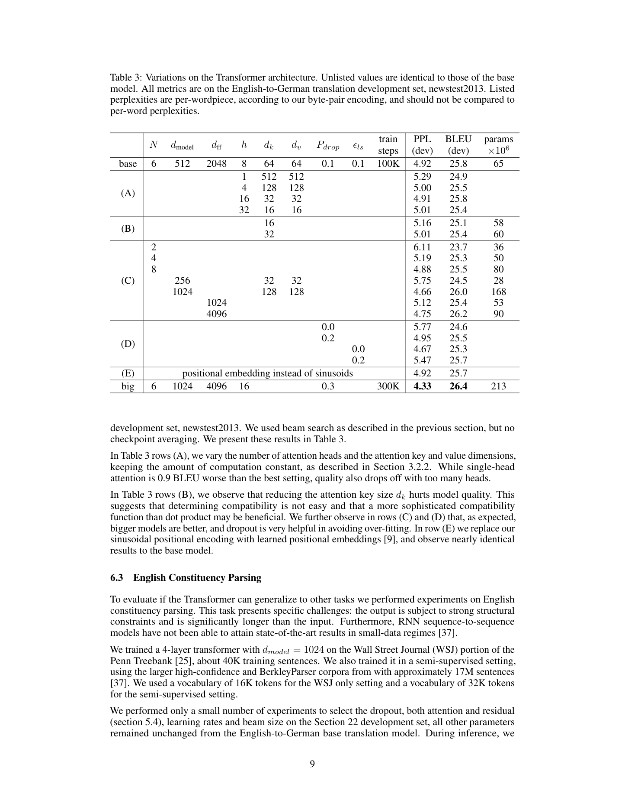

# Transformer（Attention Is All You Need，2017）· 精读笔记

- **论文**：Attention Is All You Need（NIPS 2017；本地 PDF 为 arXiv:1706.03762v7，2023-08-02 重排版，共 15 页）
- **BibTeX 键名**：`vaswani2017attention`
- **出处**：31st Conference on Neural Information Processing Systems (NIPS 2017), Long Beach, CA, USA
- **本地 PDF**：`3.科研基本任务/论文/目标检测/Vaswani 等 - 2023 - Attention Is All You Need.pdf`
- **任务书条目**：第 3 周 #17｜🔴 自精读｜阅读要点：NLP→CV 的桥梁——self-attention、多头注意力、位置编码
- **阅读日期**：2026-11-01
- **核对规则**：数字后标「出处」= 原 PDF 的章节号 / 图表号 / 页码（页码指 PDF 的第几页）；✅ = 已回原文逐字查证；【待核对】= 原文未写明或本笔记未能定位。
- **本篇读法**：22 篇里唯一"没有图像"的论文。零基础读它的姿势是**先把它当成一个加权平均算子**，别一上来就背结构图。

---

## 0. 术语表（零基础全能版，先看这一节再看正文）

> 这篇难点不是公式（只有 3 行），而是**术语密度**：d_model / d_k / d_ff / head 这些词常被混用。下面按「序列建模 → 结构 → 训练 → 评估 → 工程」五组，每条写清**它在本篇里指什么**。

### 0.1 序列建模（这篇要取代的东西）

| 术语 | 大白话解释（在本篇里的含义） |
|---|---|
| **sequence transduction（序列转导）** | 把一个序列变成另一个序列的任务，如机器翻译（源句→目标句）、句法分析。本篇全部实验都是这个任务。 |
| **RNN / LSTM / GRU** | 逐词推进的网络：第 t 步的隐状态 h_t = f(h_{t-1}, x_t)。**"必须等 h_{t-1} 算完"就是它不可并行的根源**（§1，✅）。 |
| **encoder-decoder** | 编码器把源句 (x_1..x_n) 压成连续表示 z=(z_1..z_n)，解码器从 z 生成 (y_1..y_m)（§3）。本篇保留这个骨架，**只把里面的循环层换成注意力层**。 |
| **autoregressive（自回归）** | 生成第 i 个词时，把前 i−1 个已生成的词当输入（§3，✅）。这一性质决定了解码器**必须遮住未来**。 |
| **self-attention（自注意力）** | Q、K、V 全部来自**同一个序列**的注意力（§3.2.3）。它让每个位置一步看到全序列，这正是本篇敢删掉 RNN 的原因。 |
| **cross-attention（编码器-解码器注意力）** | Q 来自解码器上一层，K/V 来自编码器输出（§3.2.3）。本篇叫它 "encoder-decoder attention"。 |
| **masked attention（带掩码的注意力）** | 在 softmax 之前把"不该看的位置"置为 −∞，使其权重为 0（§3.2.3，✅）。解码器用它保住自回归性质。 |
| **long-range dependency（长距离依赖）** | 句首的词要和句尾的词建立关系。学得好不好，取决于两者在计算图里的**路径长度**（§4，✅）。 |
| **path length（路径长度）** | 前向/反向信号从位置 i 走到位置 j 要经过的层数。RNN 是 O(n)、CNN 是 O(log_k n)、自注意力是 O(1)（Table 1）。 |
| **置换不变性（permutation invariance）** | 把输入顺序打乱，输出只是跟着换位置——模型本身分不出顺序。**自注意力天生有这性质，所以才必须加位置编码**。 |

### 0.2 结构（模型里真正存在的零件）

| 术语 | 大白话解释 |
|---|---|
| **Q / K / V** | 查询 / 键 / 值。类比查字典：Q 是你要查的问题，K 是每个词条的标题，V 是词条正文（§3.2）。三者都是**同一输入的三个不同线性投影**，不是三份不同的数据。 |
| **scaled dot-product attention** | 本篇的注意力：`softmax(QKᵀ/√d_k)V`（Eq.1）。"scaled" 就是指那个 `1/√d_k`。 |
| **additive attention** | Bahdanau 式注意力，用一个单隐层前馈网络算匹配分数（§3.2.1）。理论上复杂度相近，但**实践中比点积慢、更占内存**（因为没有现成的高效矩阵乘）。 |
| **√d_k** | 缩放因子。目的是把点积的方差从 d_k 拉回 1，避免 softmax 被推入梯度极小的饱和区（§3.2.1 + 脚注 4）。 |
| **multi-head（多头）** | 把 d_model 切成 h 份，每份独立做一次注意力，再拼接、再线性投影（§3.2.2）。本篇 h=8、d_k=d_v=64。 |
| **d_model = 512** | 贯穿全模型的"主干宽度"。所有子层、embedding 的输出都必须是这个维度，否则残差加不上（§3.1，✅）。 |
| **d_k / d_v = 64** | 每个 head 内 Q/K 与 V 的维度，= d_model/h = 512/8。 |
| **d_ff = 2048** | FFN 中间层的宽度，是 d_model 的 4 倍（§3.3，✅）。 |
| **FFN（position-wise feed-forward）** | `max(0, xW_1+b_1)W_2+b_2`（Eq.2），对每个位置**独立且相同**地作用。原文点明：等价于两个 kernel=1 的卷积（§3.3，✅）。 |
| **residual connection（残差）** | `x + Sublayer(x)`。和 ResNet 同一个动机：给梯度一条直通路径（§3.1）。 |
| **layer norm（层归一化）** | 对**单个样本的 feature 维**做归一化，不跨 batch。`LayerNorm(x + Sublayer(x))` 是本篇每个子层的固定写法（§3.1）。 |
| **post-LN** | 本篇的写法：先 add 再 norm（`LN(x+Sublayer(x))`）。**注意 ViT 改成了 pre-LN**，这是两篇之间一个必须记住的差别。 |
| **positional encoding（位置编码）** | 加在 embedding 上的位置信号，维度同为 d_model 以便相加（§3.5）。本篇用**正弦/余弦**，不是可学习参数。 |
| **embedding 共享** | 两个 embedding 层与 softmax 前的线性层共用同一个权重矩阵，且 embedding 权重乘 `√d_model`（§3.4，✅）。这是省参数 + 稳定训练的技巧。 |

### 0.3 训练

| 术语 | 大白话解释 |
|---|---|
| **Adam** | 自适应优化器。本篇用 β1=0.9、β2=0.98、ε=1e−9（§5.3，✅）。**β2 特意调到 0.98 而不是默认 0.999**，属于本篇的隐性经验。 |
| **warmup（预热）** | 前 4000 步**线性升高**学习率，之后按步数平方根倒数下降（Eq.3）。 |
| **学习率公式** | `lrate = d_model^-0.5 · min(step^-0.5, step · warmup_steps^-1.5)`（Eq.3），warmup_steps=4000（§5.3）。 |
| **batch size** | 本篇不按"句数"而是**按 token 数**组 batch：每批约 25000 源 token + 25000 目标 token（§5.1，✅）。 |
| **BPE（byte-pair encoding）** | 把词切成子词单元。EN-DE 用共享的约 37000 词表；EN-FR 用 32000 的 word-piece 词表（§5.1，✅）。 |
| **label smoothing（标签平滑）** | 训练时把"正确类概率 1"软化成 0.9 左右，εls=0.1（§5.4）。原文说它**让 PPL 变差、但让准确率和 BLEU 变好**（✅）。 |
| **dropout** | base 用 Pdrop=0.1，加在每个子层输出（add+norm 之前）以及 embedding 与位置编码之和上（§5.4，✅）。 |
| **checkpoint averaging（权重平均）** | base 平均最后 5 个 checkpoint（每 10 分钟存一次），big 平均最后 20 个（§6.1，✅）。 |
| **beam search** | 解码时保留 beam=4 条候选，长度惩罚 α=0.6（§6.1）。 |

### 0.4 评估

| 术语 | 大白话解释 |
|---|---|
| **BLEU** | 机器翻译的主指标，比对 n-gram 重合度（越高越好）。**本篇所有 BLEU 都是 newstest2014 上的数**。 |
| **PPL（困惑度）** | 模型对"下一个词"有多犹豫。**本篇 Table 3 的 PPL 是 per-wordpiece 的，原文明确说不能和 per-word PPL 比较**（Table 3 表注，✅）。 |
| **WMT 2014 EN-DE** | 约 4.5M 句对（§5.1）。主战场，BLEU 28.4 就是这里的数。 |
| **WMT 2014 EN-FR** | 36M 句对，规模大得多（§5.1）。 |
| **newstest2013 / newstest2014** | 前者是**开发集**（Table 3 全部消融都在它上面），后者是**测试集**（Table 2 的 BLEU）。**两者不能混着比**。 |
| **single model vs ensemble** | Table 2 把两者分开列。本篇 28.4 是单模型，却比所有已有**集成**都高——这是摘要强调的点。 |
| **FLOPs（训练成本）** | 用"训练时长 × GPU 数 × 单卡持续算力"估算（§6.1 + 脚注 5）。base 3.3·10^18，big 2.3·10^19（Table 2）。 |
| **F1（句法分析）** | §6.3 用 WSJ 第 23 节的 F1 衡量成分句法分析，不是 BLEU。 |

### 0.5 工程（含"朴素做法 → 优化做法 → 为什么有效"三连）

| 术语 | 大白话解释 |
|---|---|
| **O(n²·d) 复杂度** | 自注意力要为 n×n 个位置对算分数。**这是它进 CV 最大的障碍**（图像 n=像素数，动辄几万）。 |
| **restricted self-attention** | 只让每个位置看半径 r 的邻居，复杂度降到 O(r·n·d)，但路径长度变成 O(n/r)（Table 1、§4）。原文说这是"future work"（✅）。 |
| **separble convolution 对比** | 原文指出：即使 k=n，可分离卷积的复杂度也正好等于"一个自注意力层 + 一个逐位置 FFN"（§4，✅）。这说明 Transformer 并不比最优卷积更贵。 |
| **P100 / K80 / K40 / M40** | 估算 FLOPs 时用的四种卡，持续算力分别按 9.5 / 2.8 / 3.7 / 6.0 TFLOPS 计（脚注 5，✅）。 |
| **patch embedding / CLS / hybrid / inductive bias / ImageNet-21k / JFT** | **下一篇 ViT 的核心词，本篇一个都没出现**，列此只为对上号：patch embedding = 切块后线性投影成 token；CLS = 额外加的可学习分类向量；hybrid = CNN 特征图喂 Transformer；inductive bias = 写死在结构里的先验（CNN 有、Transformer 没有）；ImageNet(1.3M)/21k(14M)/JFT(303M) 是三级预训练数据规模。 |

**工程词三连（这三条是"看论文时最容易跳过、但最值钱"的部分）**

| 词 | 朴素做法 | 优化做法（本篇实际做法） | 为什么有效 |
|---|---|---|---|
| **batch 组织** | 按句数凑 batch（每批 32 句） | 按 **token 数**凑：约 25000 源 + 25000 目标 token（§5.1） | 句长差异极大，按句数会让每步算力忽大忽小；按 token 数则每步算力恒定、梯度噪声稳定 |
| **学习率** | 固定学习率，或直接余弦衰减 | **4000 步线性 warmup + 之后 step^-0.5 衰减**（Eq.3） | 初期参数随机、梯度方向乱，大学习率会把 embedding 打飞；先升后衰兼顾"别早期发散"与"后期收敛"，故成后来所有 Transformer 的默认配方 |
| **多头实现** | 写 h 个 for 循环，每次做一个小矩阵乘 | 把 h 个头**拼成一次大矩阵乘**（W^Q 为 d_model×d_model），算完 reshape 成 h 份 | GPU 上大矩阵乘吞吐远高于 h 次小矩阵乘，数学完全等价，只是把"循环"变成"张量维度"；§3.2.2 "总计算成本与单头全维相当"就靠这个 |
| **注意力实现** | for 循环逐个算 Q_i·K_j | 整批 `QKᵀ` 一次算出 n×n，再 softmax、再乘 V | 三次大矩阵乘吃满 GPU/TPU 矩阵单元；§3.2.1 说点积注意力"更快更省内存"正因可复用高度优化的矩阵乘代码 |
| **位置编码** | 每个 batch 现场算 sin/cos | 预先缓存 (max_len, d_model) 的 PE 表，训练时切片取 | PE 与数据无关，是常量表；省掉每步三角函数开销，且同一位移下编码严格一致 |
| **权重平均** | 只取最后一个 checkpoint | 平均最后 5（base）/ 20（big）个 checkpoint（§6.1） | 末期权重在最优附近抖动，平均相当于免费集成，通常白赚 0.5–1 BLEU，代价只是多存几个文件 |

---

## 1. 论文定位

### 1.1 结构流程图（据 Figure 1，PDF p.3，✅ 逐框核对）

```
源句 (x1 … xn)                                   目标句 (y1 … ym)〔训练时右移一位〕
     │                                                    │
     ▼                                                    ▼
Input Embedding ×√d_model                        Output Embedding ×√d_model
     │  ＋ PE(pos)（sin/cos，相加）                        │  ＋ PE(pos)
     ▼                                                    ▼
┌──────────────────────────┐   K, V（= 编码器输出 z）  ┌────────────────────────────┐
│ Encoder Layer × N = 6    │──────────────────────────▶│ Decoder Layer × N = 6      │
│ ① Multi-Head Self-Attention │                        │ ① Masked Multi-Head Self-Attn│
│    → Add & Norm          │                          │    → Add & Norm            │
│ ② FFN(512→2048→512)      │                          │ ② Multi-Head Cross-Attn     │
│    → Add & Norm          │                          │    (Q=解码器, K/V=编码器)    │
└──────────────────────────┘                          │    → Add & Norm            │
                                                      │ ③ FFN(512→2048→512)        │
                                                      │    → Add & Norm            │
                                                      └────────────────────────────┘
                                                                   ▼
                                                     Linear（与 Embedding 共享权重）
                                                                   ▼
                                                       Softmax → P(下一个词)
```

### 1.2 上一篇（CNN/RNN）留下什么坑 → 本篇填什么

| 上一代方案的坑 | 原文依据 | 本篇怎么填 |
|---|---|---|
| RNN 必须按位置串行计算，"**这一步不并行**"（within training examples 无法并行） | §1 第二段，✅ | 把序列一次性铺平成矩阵，**所有位置同时算**；串行操作数从 O(n) 降到 O(1)（Table 1） |
| 长距离依赖要走 O(n) 步，梯度一路衰减 | §4 第三段 + [12]，✅ | 任意两位置**一步直连**，最大路径长度 O(1)（Table 1） |
| ConvS2S 要 O(n/k) 层、ByteNet 要 O(log_k n) 层才能连通两个远端位置 | §2 第一段，✅ | 一层注意力就全连通；代价是"注意力加权平均会降低有效分辨率"，用多头补偿（§2 明说，✅） |
| 注意力机制在别的论文里**必须挂在 RNN 上**（除极少数例外） | §2 第三段，✅ | 本篇是第一个**完全**靠 self-attention 的转导模型 |

### 1.3 一句话说清

**问题**：2017 年最好的翻译模型 = RNN/LSTM + attention，而 RNN 的串行性让长序列训练慢、长距离依赖学不动。
**做法**：保留 encoder-decoder 骨架，**把循环层整个删掉**，只留"多头自注意力 + 逐位置 FFN + 残差 + LayerNorm + 正弦位置编码"，编码器解码器各堆 N=6 层，宽度 d_model=512。
**结果**：WMT14 EN-DE **28.4 BLEU**（比当时最好结果、含集成，高 2 BLEU 以上）、EN-FR **41.8**（单模型 SOTA），big 模型 8 张 P100 训 **3.5 天**（Table 2 + 摘要，✅）。

> 一句话：**Transformer = 用"可学习的加权平均"代替"按时间递推"，把序列建模从"串行"改成"矩阵乘"。**

---

## 2. 逐节导读（严格按原文章节顺序）

### §1 Introduction（p.2）

- **想解决什么**：为什么非要把 RNN 换掉。
- **动机**：RNN 把计算"沿符号位置分解"，h_t 依赖 h_{t−1}，"这种内在的串行性使训练样本内部无法并行"（原文关键句，✅）。
- **【批注】** 零基础最易误读：作者没说 RNN"效果差"，而是说它"**训练时间上不去**"。§1 还承认已有工作用 factorization tricks / conditional computation 提升了效率——**但"串行计算这个根本约束仍然存在"**。所以卖点是效率与质量双赢，不是单纯刷点。

### §2 Background（p.2）

- **想解决什么**：把自己放进已有谱系，并说明"为什么以前没人这么干"。
- **动机**：已有三条"减少串行计算"的路——Extended Neural GPU、ByteNet、ConvS2S，都用 CNN 做基础块；它们的问题是"两个位置之间需要的操作数随距离增长"（ConvS2S 线性、ByteNet 对数）。
- **【批注】** 两句必须划线：① "reduced to a constant number of operations, **albeit at the cost of reduced effective resolution** due to averaging attention-weighted positions"——作者**自己承认**注意力把很多位置"平均"掉会损失分辨率，靠多头补偿，**这是全篇最诚实的一句自我批评**。② "the first transduction model relying entirely on self-attention"——限定词是 "to the best of our knowledge" + "**transduction**"，**不是"第一个注意力模型"**（decomposable attention [27] 已用过纯注意力）。

### §3 Model Architecture + §3.1 Encoder/Decoder Stacks（p.3，Figure 1 就在这页）

- **想解决什么**：给出可复现的结构定义。
- **动机**：主流转导模型都是 encoder-decoder（[5,2,35]），本篇沿用这个骨架，只换内脏。
- **关键句**：`LayerNorm(x + Sublayer(x))`；编码器 N=6 层、每层 2 个子层；解码器 N=6 层、每层 3 个子层；所有子层与 embedding 输出维度都是 d_model=512（✅）。
- **【批注】**
  1. **"6 层"不是拍脑袋**：Table 3 行 (C) 中 N=2/4/6/8 的 BLEU 是 23.7/25.3/25.8/25.5 —— 6 层是拐点，8 层反降（✅）。**结构参数也有最优值**。
  2. **残差是"必须"不是"可选"**：每个子层都要求输入输出同维（512），残差才能直接相加；某层一改维度，整条链就断。这解释了为什么后面 ViT 也严守"全模型同一个 D"。
  3. **掩码 + 输出 embedding 右移一位**是两个动作配合才能保证"位置 i 只依赖小于 i 的输出"（✅），**只做其中一个都不够**——零基础最易漏。
  4. 本篇是 **post-LN**（先残差再归一化）；ViT 改成 pre-LN 更稳，这是两篇之间真实存在的结构差异。

### §3.2 Attention（§3.2.1 / §3.2.2 / §3.2.3，p.3–5，Figure 2 在 p.4）

- **想解决什么**：定义"注意力"这个算子，并解释三个超参（缩放、多头、掩码）。
- **动机**：注意力 = 用 query 与 key 的相容性函数算出权重，再对 value 加权求和（§3.2 开头，✅）。
- **关键式**：`Attention(Q,K,V) = softmax(QKᵀ/√d_k)V`（Eq.1）；`MultiHead = Concat(head_1..head_h)W^O`，`head_i = Attention(QW_i^Q, KW_i^K, VW_i^V)`（§3.2.2）。
- **【批注】**
  1. **和 RNN 的根本差别**：RNN 是"沿时间轴搬运隐状态"，注意力是"一次矩阵乘把任意两点连起来"；前者路径 O(n)、后者 O(1)。
  2. **和 CNN 的根本差别**：卷积权重**与位置无关**（一个核扫全图），注意力权重**每个位置对都要现算**（n² 个）。前者省参数、自带平移等变；后者表达力强、没有先验。
  3. **√d_k 的推导在脚注 4**（✅）：设 q、k 各分量独立、均值 0 方差 1，则点积均值 0、**方差 d_k**。d_k 越大点积越尖锐，softmax 被推进饱和区、梯度趋 0。除以 √d_k 把方差拉回 1——**它不是"归一化"，是"控方差"**。
  4. **为什么不用 additive attention**：理论复杂度相近，但点积能落到高度优化的矩阵乘上，"实践中快得多、省内存得多"（§3.2.1，✅）。**数学等价、工程不等价的经典例子**。
  5. **h=8、d_k=d_v=64** 使"多头总计算量与单头全维相当"（§3.2.2，✅），所以多头**不是靠加算力换效果**，这也是 Table 3 行 (A) 能"固定算力比较"的前提。

### §3.3 Position-wise FFN（p.5）

- **想解决什么**：注意力只做"加权平均"（线性 + softmax），**没有非线性变换能力**，需要补一个。
- **关键式**：`FFN(x) = max(0, xW_1+b_1)W_2+b_2`，d_model=512 → d_ff=2048 → 512（Eq.2，✅）。
- **【批注】** 原文那句 "Another way of describing this is as **two convolutions with kernel size 1**" 极其重要：它说明 FFN **不做跨位置混合**（每个位置独立），跨位置混合的活全交给注意力。于是 Transformer 一层的职责被切得很干净：**注意力管"位置之间"，FFN 管"每个位置内部"**。这也是后面所有 ViT/MLP-Mixer 类工作的出发点。

### §3.4 Embeddings and Softmax（p.5）

- **想解决什么**：token 怎么变成向量、输出怎么变成概率。
- **关键句**：两个 embedding 层与 softmax 前的线性层**共享同一个权重矩阵**，且 embedding 权重乘 `√d_model`（✅）。
- **【批注】** 乘 √d_model 是为了让 embedding 的数值量与位置编码（sin/cos，量级约 ±1）**可比**；共享权重是省参数 + 让"输入词向量"和"输出词打分"在同一空间里（[30] 的做法）。**这两条都属于"不写出来也能跑、写出来更稳"的隐性经验**。

### §3.5 Positional Encoding（p.6）

- **想解决什么**：模型里既无循环也无卷积，**没有任何顺序信息**，必须人为注入。
- **关键式**：`PE(pos,2i)=sin(pos/10000^{2i/d_model})`，`PE(pos,2i+1)=cos(pos/10000^{2i/d_model})`（✅）。
- **【批注】**
  1. 原文给的理由是**假设**："我们**推测**它能让模型容易学到按相对位置注意，因为对任意固定偏移 k，PE_{pos+k} 可表示成 PE_{pos} 的线性函数"（✅）。**原文用词是 hypothesized，不是 proved。**
  2. **作者同时试了可学习位置嵌入，结果 "nearly identical"**（Table 3 行 (E)：4.92 / 25.7 vs base 4.92 / 25.8）。选正弦的唯一理由是"**可能外推到更长的序列**"（✅）。
  3. 波长从 2π 到 10000·2π 呈**几何级数**，保证每个维度对应不同频率、位置指纹不重复。

### §4 Why Self-Attention（p.6–7，Table 1 在 p.6）

- **想解决什么**：不是"我觉得注意力好"，而是给出**三条可比的标准**。
- **动机**：① 每层计算复杂度；② 可并行程度（最少串行操作数）；③ 任意两位置的**最大路径长度**。
- **关键结论**：自注意力 O(n²·d) / 串行 O(1) / 路径 O(1)；RNN O(n·d²) / O(n) / O(n)；卷积 O(k·n·d²) / O(1) / O(log_k n)（Table 1，✅）。
- **【批注】**
  1. **原文没有说"注意力永远更快"**，而是明确限定："当序列长度 n 小于表示维度 d 时，自注意力比循环层更快，而这在机器翻译里**大多数情况成立**"（§4，✅）。n 一大（长文档、图像）就反过来。
  2. 原文还老实交代了长序列的解法（restricted attention，只看半径 r 的邻居）并把路径长度变成 O(n/r)，且**明说留给 future work**（✅）。**读到这里应该意识到：本篇没有解决长序列问题，只是把问题标出来了。**
  3. "可解释性"只是 side benefit（附录 Figure 3–5：第 5 层的头在跟 "making…more difficult" 的长距离搭配、有的头做指代消解）。**这是定性展示、不是定量指标，别当成"Transformer 可解释"的强证据。**

### §5 Training（§5.1–§5.4，p.7）

- **关键数字**：EN-DE 4.5M 句对、共享 BPE 词表约 37000；EN-FR 36M 句对、32000 word-piece；每批约 25000+25000 token；8×P100，base 每步 0.4 s、共 100K 步 = 12 h；big 每步 1.0 s、300K 步 = 3.5 天；Adam(0.9, 0.98, 1e−9)；warmup 4000；dropout 0.1；label smoothing 0.1（全部 ✅）。
- **【批注】**
  1. **β2=0.98 而不是 0.999** 是这篇的"隐藏配方"，很多复现失败就栽在这。
  2. **label smoothing 让 PPL 变差、BLEU 变好**（§5.4 原文直言 "hurts perplexity … but improves accuracy and BLEU score"，✅）；Table 3 行 (D) 也印证：εls=0 → 25.3，0.1 → 25.8。**"指标之间会打架"是读论文必须建立的意识。**
  3. dropout 0.1 是 base 的最优（0.0→24.6，0.2→25.5，0.1→25.8），但 **big 改用 0.3**（Table 3 末行），EN-FR 的 big 又用回 0.1（§6.1，✅）。**同篇论文里三处不同，说明超参"配着模型规模走"，没有万能值。**

### §6 Results（§6.1 / §6.2 / §6.3，p.8–10）

- **§6.1**：EN-DE big 28.4（比之前最好含集成高 2.0 以上）；EN-FR 见 §4.1 的纠偏；base 也超过所有已发表模型与集成，且训练成本只是零头（✅）。
- **§6.2**：Table 3 消融。单头比最好设置差 0.9 BLEU；**减小 d_k 会掉点**（作者由此推测"点积这种相容性函数不够强，可能需要更精细的函数"，✅）；模型越大越好；dropout 很有用；正弦 vs 可学习位置编码几乎无差。
- **§6.3**：4 层、d_model=1024 的 Transformer 在 WSJ（约 40K 句）上 F1 **91.3**，半监督（约 17M 句）**92.7**，"除了 RNN Grammar 之外超过所有已报告模型"（Table 4，✅）。
- **【批注】** §6.2 里"减小 d_k 掉点"这个观察，**其实是作者在暗示自己的一个弱点**：点积相容性函数表达能力有限。后来 scaled dot-product 大行其道，很大程度是因为**它足够便宜**，而不是因为它最优。

### §7 Conclusion（p.10）

- **关键**：重申"第一个完全基于注意力的转导模型"；速度快；并明确列出未来方向——**把 Transformer 扩展到文本以外的模态（图像、音频、视频）**，以及研究 local/restricted attention（✅）。
- **【批注】** 这一句 "extend the Transformer to problems involving input and output modalities other than text … such as images, audio and video"，就是三年后 ViT 的立项依据。**读到这里应该能自己推出"下一步一定是把图变成序列"**——这正是第 18 篇要做的事。

---

## 3. 核心图 / 公式深读

### 3.1 Figure 1：编码器-解码器全貌（PDF p.3）



**图注解读**：左半是编码器（N× 两层），右半是解码器（N× 三层）；底部两个 ⊕ 节点是 "Positional Encoding" 相加；解码器中间多出的那条箭头是**编码器输出作为 K/V 进 cross-attention**；解码器自注意力框写着 **"Masked"**；顶部 Linear 与底部两个 Embedding 同色，暗示**权重共享**。

**按图走一遍数据流（维度用 base 模型）**：

```
句子 → 词表 id [n] → Input Embedding [n,512] → ×√512
     → + PE [n,512]                          （数值相加，不改形状）
     → 6 × { MSA(512→512) → Add&Norm → FFN(512→2048→512) → Add&Norm }
     → z [n,512]  ──────────── 作为 K,V 交给解码器
目标句（右移一位）→ Output Embedding [m,512] → ×√512 → + PE
     → 6 × { Masked MSA(m→m) → Add&Norm
             Cross MSA(Q:[m,512], K/V:[n,512]) → Add&Norm
             FFN(m→2048→m) → Add&Norm }
     → Linear(512→词表) → Softmax → [m, 词表]
```

### 3.2 Figure 2 + Eq.(1)：Scaled Dot-Product Attention（PDF p.4）



**图注解读**：左图从下往上：Q、K 先 MatMul → Scale（就是除以 √d_k）→ 可选 Mask(opt.) → SoftMax → 再与 V 做 MatMul。**"Mask (opt.)" 是虚线框**，说明它是可选步骤——只有解码器自注意力才开。右图把左图那个紫色框复制 h 份并行，输入是同一份 V/K/Q 经过 h 组不同 Linear，输出 Concat 后再 Linear。

$$\mathrm{Attention}(Q,K,V)=\mathrm{softmax}\!\left(\frac{QK^{\top}}{\sqrt{d_k}}\right)V \tag{1}$$

**逐符号**：

| 符号 | 形状 | 含义 |
|---|---|---|
| Q | [n, d_k] | n 个 query（每个位置"我想找什么"） |
| K | [m, d_k] | m 个 key（每个位置"我能提供什么"的索引） |
| Kᵀ | [d_k, m] | 转置，为了做矩阵乘 |
| QKᵀ | [n, m] | **相似度分数矩阵**：第 i 行第 j 列 = 位置 i 对位置 j 的原始匹配分 |
| √d_k | 标量 | 缩放因子，d_k=64 时约 8 |
| softmax(·) | 按**行**归一化 | 每行变成和为 1 的权重分布 |
| V | [m, d_v] | m 个 value（真正被加权搬运的内容） |
| 输出 | [n, d_v] | 每个位置的新表示 = 全序列 value 的加权和 |

$$\mathrm{MultiHead}(Q,K,V)=\mathrm{Concat}(\mathrm{head}_1,\dots,\mathrm{head}_h)W^{O},\quad \mathrm{head}_i=\mathrm{Attention}(QW_i^{Q},KW_i^{K},VW_i^{V})$$

维度：`W_i^Q, W_i^K ∈ R^{d_model×d_k}`、`W_i^V ∈ R^{d_model×d_v}`、`W^O ∈ R^{h·d_v×d_model}`；h=8、d_k=d_v=64（§3.2.2，✅）。

**手算（照任务书的模板，自己再算一遍）**：d_k=2、Q=[[1,0]]、K=[[1,0],[0,1]]、V=[[1,2],[3,4]]
QKᵀ = [1, 0] → /√2 → [0.7071, 0] → softmax → [0.669, 0.331] → 0.669·[1,2] + 0.331·[3,4] ≈ **[1.66, 2.66]**。
**这一小步能验三件事**：缩放确实改变了权重（不除 √d_k 时 softmax([1,0]) = [0.731, 0.269]，输出会变成 [1.54, 2.54]）；softmax 是按行（query 维）算的；输出维度由 V 决定（d_v），与 d_k 无关。

**伪代码（逐行注释；本节代码仅用于理解，不参与任何实验）**

```python
def attention(Q, K, V, mask=None, d_k=64):
    # 功能：缩放点积注意力（Eq.1 的实现），返回 [n, d_v] 的新表示
    # 输入：Q [n,d_k]、K [m,d_k]、V [m,d_v]、mask [n,m]（True=屏蔽）、d_k 缩放维度
    # 输出：out [n,d_v]
    # 调用位置：被 multi_head() 调用 h 次；multi_head() 又被每个 Encoder/Decoder 子层调用
    scores = Q @ K.transpose(-1, -2) / (d_k ** 0.5)   # ① QKᵀ/√d_k：相似度打分并控方差
    if mask is not None:                              # ② 只有解码器自注意力会进来
        scores = scores.masked_fill(mask, -float('inf'))  # 置 -inf → softmax 后权重恰为 0
    weights = scores.softmax(dim=-1)                  # ③ 按行归一化：每个 query 的权重和为 1
    return weights @ V                                # ④ 加权求和：out[i] = Σ_j w_ij · V[j]
```

### 3.3 位置编码公式（§3.5，p.6）

$$PE_{(pos,2i)}=\sin\!\left(pos/10000^{2i/d_{model}}\right),\qquad PE_{(pos,2i+1)}=\cos\!\left(pos/10000^{2i/d_{model}}\right)$$

- `pos`：位置序号（0,1,2,…）；`i`：维度序号（0…d_model/2−1）；偶数维用 sin、奇数维用 cos。
- `10000^{2i/d_model}` 是**波长**：i 越大波长越短，从 2π 一直排到 10000·2π。
- 关键性质（原文只当"推测"用）：对固定偏移 k，`PE_{pos+k}` 是 `PE_{pos}` 的**线性函数**（旋转矩阵作用），所以模型有希望学到"相对位移"。
- 实现上必然要**预计算并缓存**一张 (max_len, d_model) 表——这是工程上的标准做法。

### 3.4 Table 1 复杂度对比（p.6，✅ 逐格核对）

| Layer Type | Complexity per Layer | Sequential Operations | Maximum Path Length |
|---|---|---|---|
| Self-Attention | O(n²·d) | O(1) | O(1) |
| Recurrent | O(n·d²) | O(n) | O(n) |
| Convolutional | O(k·n·d²) | O(1) | O(log_k(n)) |
| Self-Attention (restricted) | O(r·n·d) | O(1) | O(n/r) |

n=序列长度、d=表示维度、k=卷积核宽、r=受限注意力的邻域半径（表注，✅）。
**怎么读这张表**：自注意力用"**每层贵 n 倍**"（n²·d vs n·d²，在 n<d 时反而更便宜）换"**路径短 n 倍**"。所以这张表真正的结论不是"注意力更好"，而是"**当 n ≪ d 时注意力又便宜又短路径；当 n ≫ d 时它变成灾难**"。**这一句就是 ViT 必须切 patch 的全部理由。**

---

## 4. 实验逐表解读

### 4.1 Table 2（p.8）：主结果 + 训练成本

| Model | BLEU EN-DE | BLEU EN-FR | FLOPs EN-DE | FLOPs EN-FR |
|---|---|---|---|---|
| ByteNet [18] | 23.75 | — | — | — |
| Deep-Att + PosUnk [39] | — | 39.2 | — | 1.0·10^20 |
| GNMT + RL [38] | 24.6 | 39.92 | 2.3·10^19 | 1.4·10^20 |
| ConvS2S [9] | 25.16 | 40.46 | 9.6·10^18 | 1.5·10^20 |
| MoE [32] | 26.03 | 40.56 | 2.0·10^19 | 1.2·10^20 |
| Deep-Att + PosUnk **Ensemble** | — | 40.4 | — | 8.0·10^20 |
| GNMT + RL **Ensemble** | 26.30 | 41.16 | 1.8·10^20 | 1.1·10^21 |
| ConvS2S **Ensemble** | 26.36 | 41.29 | 7.7·10^19 | 1.2·10^21 |
| **Transformer (base)** | **27.3** | 38.1 | **3.3·10^18** | — |
| **Transformer (big)** | **28.4** | **41.8** | 2.3·10^19 | — |

**这张表回答什么**：① 质量赢了没有——EN-DE 28.4 比最强集成 26.36 高 **2.04**；② 成本赢了没有——base 3.3·10^18 比 ConvS2S 9.6·10^18 便宜 ~3 倍、比 ConvS2S 集成 7.7·10^19 便宜 ~23 倍。
**最易误读的三处**：
1. **EN-FR 38.1 是 base 模型，比 ConvS2S 单模型 40.46 差**。base 只在 EN-DE 上全面碾压，EN-FR 要靠 big（41.8）才赢。
2. **28.4 是"单模型"，但用了最后 20 个 checkpoint 平均 + beam=4**（§6.1）。**"单模型"≠"一次前向"**，它已内含一次轻量集成。
3. **FLOPs 是估算**（训练时长 × 卡数 × 持续算力，脚注 5 给 2.8/3.7/6.0/9.5 TFLOPS）。**口径不同，跨论文比成本要打折扣。**

### 4.2 Table 3（p.9）：变体消融（开发集 newstest2013，无 checkpoint 平均）



| 行 | 改了什么 | PPL(dev) | BLEU(dev) | 参数量 |
|---|---|---|---|---|
| base | N=6, d_model=512, d_ff=2048, h=8, d_k=d_v=64 | 4.92 | 25.8 | 65M |
| (A) | h=1（d_k=d_v=512） | 5.29 | **24.9** | 4M |
| (A) | h=4（128） | 5.00 | 25.5 | — |
| (A) | h=16（32） | 4.91 | 25.8 | — |
| (A) | h=32（16） | 5.01 | 25.4 | — |
| (B) | 只把 d_k=d_v 降到 16 | 5.16 | 25.1 | 58M |
| (B) | 只把 d_k=d_v 降到 32 | 5.01 | 25.4 | 60M |
| (C) | N=2 | 6.11 | 23.7 | 36M |
| (C) | N=4 | 5.19 | 25.3 | 50M |
| (C) | N=8 | 4.88 | 25.5 | 80M |
| (C) | d_model=256 | 5.75 | 24.5 | 28M |
| (C) | d_model=1024 | 4.66 | 26.0 | 168M |
| (C) | d_ff=1024 | 5.12 | 25.4 | 53M |
| (C) | d_ff=4096 | 4.75 | 26.2 | 90M |
| (D) | P_drop=0.0 | 5.77 | 24.6 | — |
| (D) | P_drop=0.2 | 4.95 | 25.5 | — |
| (D) | εls=0.0 | 4.67 | 25.3 | — |
| (D) | εls=0.2 | 5.47 | 25.7 | — |
| (E) | 可学习位置嵌入替代正弦 | 4.92 | 25.7 | — |
| big | N=6, d_model=1024, d_ff=4096, h=16, P_drop=0.3, 300K 步 | 4.33 | 26.4 | 213M |

**这张表回答什么**：每个组件到底值多少 BLEU。
**四个最易误读点**：
1. **单头差 0.9 BLEU（24.9 vs 25.8）是在"总计算量固定"的前提下**（§6.2 明说 keeping the amount of computation constant）。结论是"**同样算力下切多头更好**"，不是"多头天生更强"。
2. **16 头的 BLEU 与 8 头持平（25.8），32 头反降到 25.4**——原文说 "quality also drops off with too many heads"。h=8 是效率与效果的折中，不是越多越好。
3. **(C) 里 d_model=1024 到 26.0，而 N=8 只到 25.5**：说明**加宽比加深划算**。但 (C) 一律是 100K 步的 base 配置，不能直接和 big 比。
4. **(E) 行**：正弦 25.8 vs 可学习 25.7，**差 0.1 属噪声**。所以"正弦更优"本文**没有证据**，只有"可外推"这条工程理由。

### 4.3 Table 4（p.10）：泛化到句法分析

| Parser | Training | WSJ 23 F1 |
|---|---|---|
| Vinyals & Kaiser (2014) [37] | WSJ only | 88.3 |
| Dyer et al. (2016) [8] | WSJ only | **91.7** |
| **Transformer (4 layers)** | WSJ only | 91.3 |
| Zhu et al. (2013) [40] | semi-supervised | 91.3 |
| Vinyals & Kaiser [37] | semi-supervised | 92.1 |
| **Transformer (4 layers)** | semi-supervised | **92.7** |
| Dyer et al. (2016) [8] | generative | **93.3** |

**这张表回答什么**：注意力模型是不是只能做翻译。答案：**只做很少的超参搜索就接近 SOTA，但还不是最好**（输给 RNN Grammar 93.3，§6.3 原文承认，✅）。
**误读点**：用的是 **4 层、d_model=1024** 的小模型，且"只调了 dropout、学习率和 beam"（§6.3，✅）。**这不是"Transformer 天生擅长句法"，而是"没调参也能打"**，恰好说明结构通用性强。

---

## 5. 我的思考（🔴 自精读 · 本节必须你自己写）

> 本节留白。四问请读完原文（尤其 §3.2.1 脚注 4、§4、附录 Figure 3–5、Table 3 行 A/E）后自己补，不要抄二手解读。

1. 为什么 self-attention 能取代 RNN 的时序依赖？它靠什么"知道"顺序，又为此付出了什么代价？
2. 除以 √d_k 的作用到底是什么？（提示：从"方差"和"softmax 梯度"两个角度分别说一遍，能不能推到 d_k 上去？）
3. 多头到底在学什么？（Table 3 行 A 说"算力固定时多头更好"，附录 Figure 3–5 说"不同头做不同事"，这两条能互相支持吗？）
4. 位置编码为什么用正弦而不是可学习？（Table 3 行 E 已经告诉你两者几乎一样，那作者的理由还剩几条？）

（以下空白，读完自己补）

---

## 6. 与前后论文的衔接

| 方向 | 论文 | 与本篇的关系 |
|---|---|---|
| **前** | ResNet（W2 #4） | 本篇的 `Add` 就是 ResNet 的恒等残差；`LayerNorm` 是 BN 在"变长序列 + 小 batch"下的替代品（BN 依赖 batch 统计，序列长度差异太大，所以本篇一次都没用 BN）。 |
| **前** | BatchNorm（W2 #3） | 同上——本篇是"为什么 NLP 不用 BN 而用 LN"最标准的例子。 |
| **前** | FPN / Faster R-CNN（W3 检测篇） | 卷积检测器与本篇是两条平行路线，第 19 篇 DETR 才把它们缝在一起。 |
| **后** | **ViT（#18，下一篇）** | 直接照搬本篇 encoder（改 pre-LN、换 GELU），把"词"换成"图像 patch"，位置编码换成**可学习 1D**。§7 的 "extend to other modalities" 就是它的立项句。 |
| **后** | DETR（#19） | 用本篇**完整 encoder-decoder**：encoder 处理图像 token，decoder 用 100 个 object query 代替"目标句"，cross 的 K/V 来自 encoder——即 §3.2.3 第三种用法。 |
| **后** | Deformable DETR（#20） | 针对本篇最大痛点：cross-attention 对全图所有位置算注意力，收敛慢、算力大 → 改成只采样 K 个点，本质是 §4 那条 restricted attention 的 future work 兑现。 |
| **后** | MAE（#21）/ Mamba（#22） | MAE 沿用 encoder + 掩码思想；Mamba **反过来**：既然注意力是 O(n²)，就换回"线性复杂度可并行"的状态空间模型——它挑战的正是 Table 1 那行 O(n²·d)。 |

---

## 7. 回原文核对记录

| # | 常见说法 | 原文依据 | 判定 |
|---|---|---|---|
| 1 | "Transformer 是第一个完全基于注意力的模型" | §2 末段：**"To the best of our knowledge … the first transduction model relying entirely on self-attention"**；同段还承认 decomposable attention [27] 等例外 | 🟩 对，但**"transduction（转导）"与"to our knowledge"不能省**，说成"第一个注意力模型"就错 |
| 2 | "big 模型 EN-FR 的 BLEU 是 41.8" | **Table 2（p.8）与摘要都写 41.8；但同一页 §6.1 正文写 "achieves a BLEU score of 41.0"** | 🟨 **原文自相矛盾**（版本遗留：摘要/表格改成 41.8，正文没同步）。引用以 Table 2 与摘要为准，但要知正文有 41.0 这个旧值 |
| 3 | "Transformer 训练只要 12 小时" | §5.2：base 100K 步、12 小时；big 300K 步、**3.5 天**；摘要 "as little as twelve hours" 指的也是 base | 🟨 12 小时只属 base；28.4 BLEU 的模型是 3.5 天 |
| 4 | "位置编码用正弦是因为效果更好" | §3.5：两种方案 "nearly identical"；Table 3 行 (E)：4.92/25.7 vs base 4.92/25.8 | 🟥 **错**。选正弦的理由只有一条：**可能外推到更长的序列** |
| 5 | "自注意力全面优于 RNN" | §4 明写：只有当 n < d 时自注意力才比循环层快，"这在机器翻译里大多数情况成立" | 🟥 **错**，是有条件的。n ≫ d 时它反而更贵，原文还把 restricted attention 留作 future work |
| 6 | "label smoothing 提升所有指标" | §5.4：**"hurts perplexity … but improves accuracy and BLEU score"**；Table 3 行 (D) εls=0 → 25.3、0.1 → 25.8 | 🟩 对 BLEU，🟨 但 PPL 变差——**别只记半句** |
| 7 | "dropout=0.1 是全篇统一超参" | base 用 0.1；**big 用 0.3（Table 3 末行）**；EN-FR 的 big 又用回 0.1（§6.1） | 🟥 **错**，三处不一样 |
| 8 | "多头比单头强 0.9 BLEU，所以头越多越好" | §6.2 + Table 3 行 (A)：h=1 是 24.9（差 0.9），但 h=16 只到 25.8、h=32 掉到 25.4 | 🟨 **前半对、后半错**：前提是"算力固定"，且头数有上限 |
| 9 | "N=6 是随便定的" | Table 3 行 (C)：N=2 → 23.7、N=4 → 25.3、N=6 → 25.8、N=8 → 25.5 | 🟩 有依据：6 层是拐点，8 层反降 |
| 10 | "Table 3 的 PPL 可以和语言模型的 per-word PPL 比" | Table 3 表注：**"Listed perplexities are per-wordpiece … should not be compared to per-word perplexities"** | 🟥 **错**，口径不同，一比必错 |

---

## 8. 自测题（5 题）+ 常见误解（5 条）

**自测题**

1. 默写 `Attention(Q,K,V)`，并说明 QKᵀ 的形状、softmax 按哪个维度做、输出维度由谁决定。
2. 编码器一层有几处 Add&Norm？解码器一层有几处？分别挂在哪个子层后面？（答案与依据：编码器 2 处、解码器 3 处，§3.1 + Figure 1）
3. Table 1 四行里，哪一行是"路径最短但代价最大"？为什么说这张表也预告了 ViT 必须切 patch？
4. base 模型的 65M 参数里，FFN 占大头还是注意力占大头？自己按 `4·d_model·d_ff` 与 `4·d_model²` 估一遍再回答。
5. §6.3 的句法分析实验为什么用 4 层、d_model=1024 而不是 base 配置？这说明作者对"通用性"的举证策略是什么？

**常见误解**

1. ❌"self-attention 就是 Q=K=V 等于输入。" → 三者是**同一输入的三次不同线性投影**（W^Q/W^K/W^V），不投影就没有"查询/索引/内容"的角色区分。
2. ❌"有残差就不需要 LayerNorm。" → 本篇是 `LN(x+Sublayer(x))`，**两者是配套的**：残差保梯度，LN 保数值尺度。
3. ❌"位置编码是可学习参数。" → **本篇是固定正弦**；可学习版本只是消融对象（Table 3 行 E）。**ViT 才是可学习 1D**——两篇别记混。
4. ❌"Transformer 没有卷积，所以和 CNN 毫无关系。" → FFN 原文自称"等价于两个 1×1 卷积"（§3.3），§4 还用可分离卷积做复杂度对标。
5. ❌"注意力权重就是可解释性。" → 附录 Figure 3–5 只是定性展示，注意力权重不等于因果贡献（后续有大量工作反驳"attention as explanation"）。

---

## 9. 读到这里最容易产生的疑问（5 组 Q&A）

**Q1：既然 Q/K/V 都来自同一个输入，为什么不干脆让 Q=K=V=X，省两个矩阵？**
A：三个角色做的事不同：Q 是"我在找什么"，K 是"我被怎么找到"，V 是"被取走的内容"。若 Q=K，分数矩阵变对称（i 对 j = j 对 i），模型就表达不出"A 依赖 B 但 B 不依赖 A"这种单向关系，而解码器恰恰需要它。**W^Q/W^K/W^V 的作用就是把"寻址"与"取值"解耦。**

**Q2：解码器为什么需要两个注意力子层？只用 cross-attention 不够吗？**
A：不够。cross 只能让解码器"看源句"，还得让它"看自己已写了什么"（自回归），这靠 self-attention；而它又会泄露未来，所以要掩码。**两个子层的职责分开：Masked Self 管目标句内部的前后关系，Cross 管目标句与源句的对齐。**

**Q3：FFN 为什么是"逐位置"的？它到底在算什么？**
A：注意力只会做凸组合（加权平均），是线性的，模型需要非线性才能拟合复杂函数，FFN 提供这个非线性。之所以逐位置独立，是为了**分工**：跨位置混合全交给注意力，FFN 只在每个位置内部变换特征。它等价于两个 1×1 卷积（§3.3）正说明它不跨位置。

**Q4：65M 参数主要在哪？为什么 big 只有 213M 而不是 130M？**
A：每层 FFN 约 `2·d_model·d_ff = 2·512·2048 ≈ 2.1M`，每层注意力约 `4·d_model² ≈ 1.05M`，**FFN 约为注意力的两倍**；12 层（编+解）加 embedding 正好是 65M 的量级。big 把 d_model 与 d_ff 同时翻倍，**每层参数约变 4 倍**，所以到 213M。

**Q5：embedding 乘 √d_model、三层共享权重，各有什么用？**
A：乘 √d_model 让 embedding 的量级与位置编码（±1 左右）匹配，否则相加时位置信号会被淹没或盖住词义；共享权重让"词→向量"与"向量→词打分"落在同一空间，等价于学一个词向量的正反变换，省参数且收敛更快（§3.4 引 [30]，✅）。**两条都不决定"能不能跑"，只决定"跑得好不好"——这正是精读要盯住的隐性经验。**
