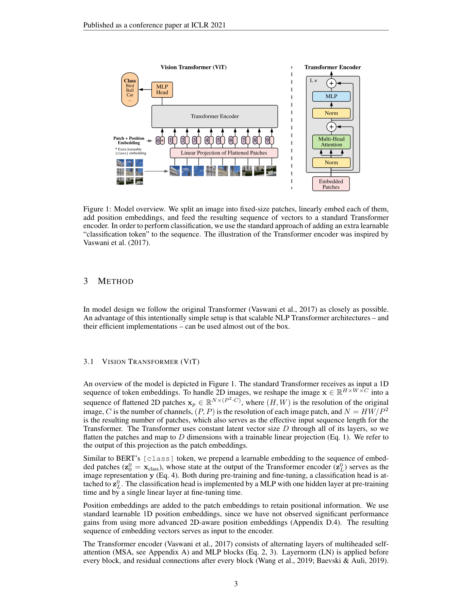
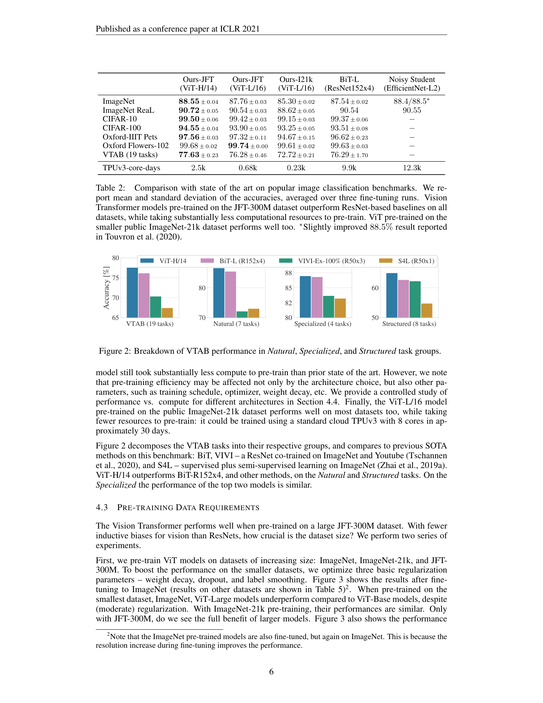
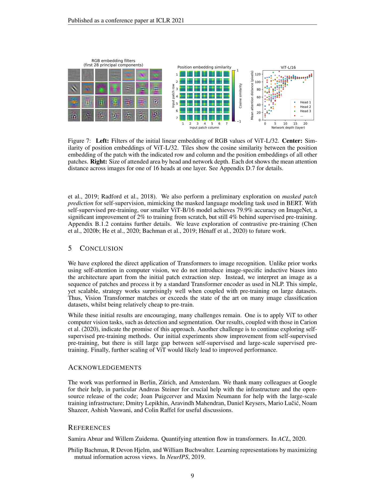

# ViT（An Image is Worth 16x16 Words，2020/2021）· 精读笔记

- **论文**：An Image is Worth 16x16 Words: Transformers for Image Recognition at Scale（ICLR 2021；arXiv:2010.11929v2，2021-06-03，共 22 页）
- **BibTeX 键名**：`dosovitskiy2021image`
- **出处**：ICLR 2021（Published as a conference paper at ICLR 2021）
- **本地 PDF**：`3.科研基本任务/论文/目标检测/Dosovitskiy 等 - 2021 - An Image is Worth 16x16 Words Transformers for Image Recognition at Scale.pdf`
- **任务书条目**：第 3 周 #18｜🔴 自精读｜阅读要点：CV 范式转换——纯 Transformer 做分类
- **阅读日期**：2026-11-01
- **核对规则**：数字后标「出处」= 原 PDF 的章节号 / 图表号 / 页码；✅ = 已回原文逐字查证；【待核对】= 原文未写明或本笔记未能定位。
- **本篇读法**：这篇的方法部分**只有三页**（§3），剩下的十几页全在讲"数据规模"。**所以它真正的主张不是"结构新"，而是"当数据足够多时，卷积的先验反而成了限制"**——读的时候把重心放在 §4.3/§4.4，而不是 §3。

---

## 0. 术语表（零基础全能版，先看这一节再看正文）

> ViT 的术语陷阱集中在两处：① 很多人以为它"和 Transformer 一模一样"，其实**位置编码、LayerNorm 位置、激活函数三处都改了**；② 很多人把"预训练 / 微调 / 线性探针 / few-shot"混成一个词。下面按五组，每条写清本篇里的含义。

### 0.1 序列与表示（把图变成"句子"）

| 术语 | 大白话解释（在本篇里的含义） |
|---|---|
| **patch（图像块）** | 把图切成 P×P 的小方块，本篇 P=16（也有 32、14）。**patch 就是"词"**，这是全文第一块基石。 |
| **patch embedding（块嵌入）** | 把每个 16×16×3 的块拉平成 768 维，再用一个可训练线性层投到 D 维（Eq.1）。**注意：这一步等价于 stride=16、kernel=16 的卷积**（见 §3.2 批注）。 |
| **token / 序列长度 N** | 一张 224×224 图切出 N = HW/P² = 14×14 = **196** 个 patch；加上 CLS 就是 **197** 个 token（§3.1，✅）。**N 与 patch 面积的平方成反比**（Table 1 表注，✅）。 |
| **CLS token（[class] token）** | 额外拼在序列最前面的**可学习向量**，不对应任何像素；它在编码器输出端的状态 z_L^0 被当作整图表示（Eq.4）。 |
| **position embedding（位置嵌入）** | 加到 patch embedding 上的**可学习 1D 向量**，形状 (N+1)×D（Eq.1）。**它和上一篇的正弦编码是两码事**。 |
| **bag of patches** | 不加位置编码时模型看到的东西——一袋无序的块（附录 D.4 的对照项）。 |
| **2D / 相对位置嵌入** | 消融项：按 (x,y) 两轴各学一半 D、或按块间相对距离编码。附录 D.4 证明它们**不比 1D 好**。 |
| **inductive bias（归纳偏置）** | 结构里**写死的先验**。CNN 有局部性、二维邻域、平移等变；ViT 除了切 patch 那一步，**几乎一点都没有**（§3.1 "Inductive bias"，✅）。 |
| **locality（局部性）** | 相邻像素更相关。CNN 每层都强制"只看邻域"，ViT 只有 MLP 层是局部的，注意力层是**全局**的（§3.1，✅）。 |
| **translation equivariance（平移等变）** | 物体左移，特征图也左移。CNN 天生有；ViT 靠数据自己学。 |
| **hybrid architecture（混合结构）** | 输入不取原图 patch，而取 **CNN 特征图上**的 patch（§3.1）。极端情况 patch=1×1，就是把特征图拉平。 |
| **stem** | ViT 的"入口层"，即 patch 切分 + 线性投影这一小段；hybrid 里 stem 换成整个 ResNet。 |

### 0.2 结构（ViT 里真正存在的零件）

| 术语 | 大白话解释 |
|---|---|
| **Transformer encoder** | 只保留**编码器**（不用解码器），因为分类不需要自回归生成（§3.1 + Figure 1）。 |
| **MSA（multi-head self-attention）** | 多头自注意力，附录 Eq.5–8 给了完整定义，**与上一篇同构**（[q,k,v]=zU_qkv，softmax(qkᵀ/√D_h)）。 |
| **MLP block** | 两层全连接 + **GELU**（不是 ReLU）（§3.1，✅）。宽度是 D_MLP，ViT-B 为 3072。 |
| **GELU** | 比 ReLU 平滑的激活函数。**这是与上一篇的第一个差别**（Transformer 用 ReLU）。 |
| **LayerNorm（pre-LN）** | **先归一化再进子层**：`z' = MSA(LN(z)) + z`（Eq.2/3）。**这是与上一篇的第二个差别**——原版是 post-LN（LN(x+Sub(x))）。 |
| **residual（残差）** | 每个 block 后都加一次，写法与 ResNet 相同；作用是让 24/32 层的深模型能训。 |
| **D（hidden size）** | 全模型恒定宽度，ViT-B=768、L=1024、H=1280（Table 1，✅）。 |
| **D_MLP** | MLP 中间层宽度，ViT-B=3072（= 4×768）（Table 1）。 |
| **heads** | 注意力头数，ViT-B=12、L/H=16（Table 1）。 |
| **classification head** | 分类头：**预训练时是"1 个隐层的 MLP"，微调时是"单个线性层"**（§3.1，✅）。 |
| **zero-initialized 分类层** | 微调时删掉旧头、换一个**全零初始化**的 D×K 线性层（§3.2）。原文说比"重新初始化最后一层"更稳。 |
| **resolution adjustment** | 微调时用更高分辨率（384/512/518），**patch 大小不变 → 序列变长 → 位置嵌入要做 2D 插值**（§3.2）。 |

### 0.3 训练

| 术语 | 大白话解释 |
|---|---|
| **pre-training（预训练）** | 在 ImageNet / ImageNet-21k / JFT-300M 上先训一个通用模型。本篇的结论**几乎全部建立在预训练集规模上**。 |
| **fine-tuning（微调）** | 把预训练模型搬到下游小数据集上再训（SGD + momentum 0.9、batch 512、cosine 衰减，附录 B.1.1）。 |
| **linear probe / few-shot（线性探针）** | **冻结**整个 backbone，只用一小部分样本解一个**正则化最小二乘**，把特征映到 {−1,1}^K（§4.1 "Metrics"，✅）。用来"便宜地"衡量表示质量。 |
| **batch size** | 预训练用 **4096**，微调用 512（§4.1 + 附录 B.1.1，✅）。4096 是 TPU 时代的典型值。 |
| **weight decay** | 预训练用 **0.1**（JFT/I21k）或 0.3（ImageNet），微调**不用**（附录 Table 3/4）。原文说大 weight decay 对迁移很关键。 |
| **dropout** | JFT 预训练 dropout=0.0；ImageNet-21k 与 ImageNet 用 0.1（附录 Table 3）。**大 pretrain 反而不需要 dropout**。 |
| **label smoothing** | §4.3 明确把它列为**三个要调的正则参数**之一（weight decay / dropout / label smoothing），用于小数据集预训练（✅）。 |
| **warmup** | 学习率预热 **10k 步**（附录 Table 3 表注，✅），之后 linear 或 cosine 衰减。 |
| **optimizer** | 预训练 **Adam**（β1=0.9、β2=0.999）；微调 **SGD + momentum**。**ResNet 也用 Adam**，这是本篇一个反常选择（附录 D.1 专门辩解）。 |
| **gradient clipping** | ImageNet 上额外做 global norm=1 的梯度裁剪（附录 Table 3 表注）。 |
| **Polyak averaging** | 权重滑动平均，factor=0.9999，只用于 Table 2 的 ImageNet 结果（§4.1，✅）。 |
| **epochs** | JFT 7 或 14；ImageNet-21k 30 或 90；ImageNet 300（附录 Table 3）。 |

### 0.4 评估

| 术语 | 大白话解释 |
|---|---|
| **ImageNet（ILSVRC-2012）** | 1k 类、**1.3M** 图（§4.1，✅）。**"小数据"指的就是它**。 |
| **ImageNet-21k** | 21k 类、**14M** 图（§4.1，✅）。公开可用，本篇的"最低门槛"配置。 |
| **JFT-300M** | 18k 类、**303M** 高分辨率图，**谷歌内部数据、不公开**（§4.1，✅）。本篇最强结果的来源。 |
| **ImageNet-ReaL** | 清洗过标签的 ImageNet 验证集，用来消除标签噪声（§4.1）。 |
| **VTAB（19 tasks）** | 19 个下游任务、**每任务仅 1000 个训练样本**，专测低数据迁移；分 Natural(7)/Specialized(4)/Structured(8) 三组（§4.1，✅）。 |
| **CIFAR-10/100、Pets、Flowers** | 四个常规小数据集，和 VTAB 一起构成迁移评测矩阵（Table 2）。 |
| **fine-tuning accuracy vs few-shot accuracy** | 前者=微调后精度，后者=线性探针精度。**Table 2 是前者，Figure 4 是后者，两者不能混着比。** |
| **TPUv3-core-days** | 预训练成本单位：TPU v3 核数（每芯片 2 核）× 天数（§4.2，✅）。Table 2 里 ViT-H/14 是 2.5k、BiT-L 是 9.9k。 |
| **exaFLOPs** | 预训练总算力，Table 6 用（例如 ViT-B/32 为 55）。 |
| **ObjectNet** | 附录 D.9 的额外评测集，ViT-H/14 得 top-5 **82.1%**、top-1 **61.7%**（✅）。 |
| **BLEU** | **上一篇的指标，本篇完全不用**（列在这里只为防混淆：ViT 全是分类精度，没有 BLEU）。 |

### 0.5 工程（含"朴素做法 → 优化做法 → 为什么有效"三连）

| 术语 | 大白话解释 |
|---|---|
| **O(N²) 的由来** | 197 个 token 就有 197×197 的注意力矩阵。**若不切 patch 而按像素算，224²=50176 个 token 的矩阵是 50176² ≈ 2.5×10⁹（自算，不是原文数字）**，显存直接爆。 |
| **per-core batch size** | 单核能塞下的最大 batch，附录 D.5 实测**大 ViT 比同规模 ResNet 更省显存**（✅）。 |
| **attention distance** | 用注意力权重加权算出的"信息整合跨度"，类比 CNN 的感受野（§4.5 + D.7）。 |
| **attention rollout** | 把各层注意力矩阵递归相乘，得到"输出 token 对输入像素"的总注意力图（附录 D.8，✅）。 |
| **BiT（ResNet152x4）** | 对照组：ResNet + GroupNorm + 标准化卷积 + 大数据预训练（§4.1，✅）。**ViT 必须打赢它才算数**。 |
| **Noisy Student（EfficientNet-L2）** | 当时 ImageNet 上的 SOTA（半监督 + JFT），是 Table 2 里唯一在 ImageNet 上压过 ViT-L/16 的模型。 |
| **iGPT** | 对像素做自回归生成式预训练的模型，ImageNet 最高 **72%**（§2，✅）——本篇用来说明"像素级 Transformer 有多贵且不强"。 |
| **Cordonnier et al. (2020)** | 最接近的前作：patch **2×2** + 全自注意力，只能用于小分辨率图（§2，✅）。 |

**工程词三连**

| 词 | 朴素做法 | 优化做法（本篇实际做法） | 为什么有效 |
|---|---|---|---|
| **patch 大小** | 想用 patch=8 或更小，追求细粒度 | 主实验用 **16**（也有 32、14）；附录 D.2 证明"减小 patch 稳定提升且不增参数" | N 与 P² 成反比：P 减半 → token 数 ×4 → 注意力算力 ×16。**16 是精度与算力的折中**；换细粒度要靠更多算力，不是免费 |
| **位置嵌入与分辨率** | 换分辨率后直接沿用旧的位置嵌入 | 对预训练位置嵌入做 **2D 双线性插值**（§3.2） | 位置嵌入是按 (14×14) 网格学出来的；换成 16×16 网格时，"第 3 行第 5 列"的语义相近，插值比重新初始化稳得多 |
| **微调分类头** | 保留整个旧头，或随机重置最后一层 | **删掉旧头，换成零初始化的 D×K 线性层**（§3.2） | 零初始化让新头一开始就输出 0 而不破坏 backbone 的特征；等价于"先学特征、后接头"，收敛更稳 |
| **训练正规化** | 一律加 dropout + 强数据增强 | **按数据规模分档**：JFT 用 dropout 0/权重衰减 0.1；ImageNet 用 dropout 0.1/权重衰减 0.3 + 梯度裁剪 | 数据越大越不容易过拟合，正则给多了反而欠拟合；本篇把小数据上的三个正则参数当成超参来调（§4.3） |
| **算力利用** | 用局部/稀疏注意力模式省 FLOPs | 坚持**全局注意力**，靠 TPU 上的大矩阵乘吃满算力（§2 结论） | 专用注意力模式（稀疏、轴向）需要定制 kernel，在现有加速器上"理论省、实际慢"；§2 明说这是那些方法没能 scale 的原因 |
| **对照实验设计** | 只和自己的小模型比 | 与 **BiT / Noisy Student** 在**同一预训练集**上比，并报 TPUv3-core-days | 不同数据量下比精度毫无意义；同数据 + 同算力口径才能证明"架构本身的效率"（§4.2、§4.4） |

---

## 1. 论文定位

### 1.1 结构流程图（据 Figure 1，PDF p.3，✅ 逐框核对）

```
输入图 224×224×3
   │ ① 切 16×16 的块（stride=16，不重叠）
   ▼
196 个 patch，每个 16×16×3 = 768 维 → 拉平成 196×768
   │ ② 线性投影 E: 768 → D（ViT-B 的 D=768）
   ▼
196×D（patch embeddings）
   │ ③ 在最前面拼一个可学习向量 x_class（z_0^0 = x_class）
   ▼
197×D  [CLS, p1E, p2E, …, p196E]
   │ ④ ＋ E_pos（197×D，可学习 1D）
   ▼
┌─────────── Transformer Encoder（L 个 block，pre-LN）───────────┐
│   z' = MSA(LN(z)) + z          ← 多头自注意力（全局）          │
│   z  = MLP(LN(z')) + z'        ← 两层 FC + GELU（逐 token）    │
└───────────────────────────────────────────────────────────────┘
   ▼
⑤ 取 z_L^0（CLS 位）→ LN（Eq.4）→ 分类头
   ▼
类别（预训练：MLP 一头；微调：单线性层）
```

### 1.2 上一篇（Transformer / CNN）留下什么坑 → 本篇填什么

| 上一代的坑 | 原文依据 | 本篇怎么填 |
|---|---|---|
| Transformer 只在 NLP 里用，CV 里 attention **必须和 CNN 混着用**，或只替换 CNN 的某个组件（整体结构不变） | 摘要第 2–3 句，✅ | 提出**纯 Transformer**：除了切 patch 那一步，**不引入任何图像专用的归纳偏置**（§5 Conclusion，✅） |
| 朴素的像素级自注意力是"每个像素 attend 所有像素"，**平方代价**，无法用于真实分辨率 | §2 第 2 段，✅ | 用 patch 把序列长度从 50176（224²）压到 196（自算），**注意力算力降约 256² 倍** |
| 已有的近似方案（局部注意力、Sparse Transformer、轴向注意力）**"需要复杂工程才能在加速器上高效实现"** | §2 第 2 段，✅ | 故意用**最朴素的全注意力**，让 NLP 那套高效实现"almost out of the box"可用（§3 开头，✅） |
| 大规模图像识别仍被 ResNet 类结构统治；没人知道"纯注意力 + 大数据"到底行不行 | §1 第 2 段，✅ | 用 ImageNet-21k / JFT-300M 预训练 + 迁移，**在多个 benchmark 上打平或超过 BiT/Noisy Student，且更省算力**（Table 2） |

### 1.3 一句话说清

**问题**：CV 里 attention 一直只能给 CNN 打下手，因为像素级注意力的平方代价不可行。
**做法**：把图切成 16×16 的块，每块线性投影成一个 token，加 CLS、加可学习 1D 位置嵌入，喂给**标准 Transformer 编码器**（pre-LN + GELU），取 CLS 输出分类。
**结果**：在 JFT-300M 上预训练后，ImageNet **88.55%**、ReaL **90.72%**、CIFAR-100 **94.55%**、VTAB-19 **77.63%**，预训练算力 2.5k TPUv3-core-days（BiT-L 为 9.9k）（Table 2，✅）；**但在 ImageNet 单数据集上预训练时，ViT 打不过同规模 ResNet**（Figure 3）。

> 一句话：**ViT = 把图切成"词"，然后证明"数据足够多时，让模型自己学先验比人写先验更强"。**

---

## 2. 逐节导读（严格按原文章节顺序）

### §1 Introduction（p.1–2）

- **想解决什么**：NLP 已被 Transformer 统一，CV 为什么还是 CNN 的天下。
- **动机**：Transformer 已能训到 100B 参数级别且"性能还没饱和"（原文引 Brown 2020 / Lepikhin 2020，✅）；而 CV 里替代卷积的尝试"理论上高效，但在现代加速器上没能 scale 起来"。
- **关键句**：模型在 ImageNet 这类中等数据集上"会比同规模 ResNet 低几个百分点"，作者**自己先承认**，并把原因归为"缺少 CNN 的归纳偏置（平移等变、局部性）"（✅）。
- **【批注】** 注意 §1 的论证顺序：**先承认在小数据上输，再给出"large scale training trumps inductive bias"** 这句判词（原文原话，✅）。**整篇论文的贡献一半是结构，一半是这句结论**——如果只记住"ViT 是纯 Transformer"，等于没读到重点。

### §2 Related Work（p.2）

- **想解决什么**：把所有"在 CV 里用 attention"的既有路线分类，并说明自己为什么不走那些路。
- **三条既有路线**：① 局部邻域内的自注意力（Parmar 2018 等）② Sparse Transformer 的稀疏近似 ③ 轴向/分块注意力（Ho 2019、Wang 2020a）；以及 ④ CNN + attention 混合（Bello 2019、Carion 2020 等）。
- **最接近的前作**：Cordonnier 2020，**patch 2×2 + 全自注意力**，只能用于小分辨率图（✅）。
- **【批注】**
  1. 原文用一句话否掉了这些近似方案：**"require complex engineering to be implemented efficiently on hardware accelerators"**（✅）。这是很典型的"**工程可行性否决技术优越性**"的论断——**理论上更省的方案，在 TPU 上跑不快就等于没用**。
  2. 与 Cordonnier 的差别被写得很克制：**"our work goes further to demonstrate that large scale pre-training makes vanilla transformers competitive"**（✅）。**"vanilla（原味）"是关键词**：本篇刻意不改结构，只改数据规模。
  3. iGPT 被当作反例提及：把 Transformer 用在像素上、生成式预训练，ImageNet 最高 72%（✅）。**这条数据很重要——它说明"像素级 token"这条路在本篇写作时是走不通的**。

### §3 Method（§3.1 ViT，p.3–4；§3.2 微调与高分辨率，p.4）

- **想解决什么**："怎么把 2D 图塞进一个只吃 1D 序列的标准 Transformer"。
- **动机**：**"In model design we follow the original Transformer as closely as possible"**（§3 第一句，✅）——刻意少改，才能直接复用 NLP 的高效实现。
- **关键句/式**：x∈R^{H×W×C} → x_p∈R^{N×(P²·C)}，N=HW/P²（§3.1）；`z_0 = [x_class; x_p^1E; …; x_p^NE] + E_pos`（Eq.1）；`z'_ℓ = MSA(LN(z_{ℓ-1})) + z_{ℓ-1}`（Eq.2）；`z_ℓ = MLP(LN(z'_ℓ)) + z'_ℓ`（Eq.3）；`y = LN(z_L^0)`（Eq.4）。
- **【批注】**
  1. **三处和上一篇不一样，必须记**：① 位置编码换成**可学习 1D**；② LayerNorm 挪到子层**前面**（pre-LN）；③ 激活换成 **GELU**。**其余（MSA、残差、FFN 结构、√D_h 缩放）全部照抄。**
  2. **CLS 不是"图像块"**，它是可学习向量，**不对应任何像素**；它靠自注意力把信息"吸"过来，再被当作整图表示。原文借自 BERT，但 BERT 的 CLS 是配合预训练目标学的，**ViT 的 CLS 只是在监督分类下顺带学出来的**——这一点附录 D.3 有补充。
  3. **Inductive bias 那一段是全文的方法论核心**：CNN 的局部性/二维邻域/平移等变是"**baked into each layer**"（烤进每一层），而 ViT 里"**only MLP layers are local and translationally equivariant, while self-attention layers are global**"，二维结构只在两处出现：**切 patch** 和 **微调时插值位置嵌入**（§3.1，✅）。
  4. **§3.2 的两个工程细节，零基础最容易忽略**：① 微调时**保留 patch 大小、让序列变长**（模型能处理任意长度，但位置嵌入要 2D 插值）；② 换分辨率是**除了切 patch之外第二个手动注入 2D 先验的地方**（原文原话，✅）。**所以"ViT 完全无先验"这句话是夸张的。**

### §4 Experiments（§4.1–§4.6，p.4–9）

- **§4.1 Setup**：三个预训练集（ImageNet 1.3M / ImageNet-21k 14M / JFT-300M 303M）、VTAB-1k；三个模型档（B/L/H，Table 1）；对照 ResNet(BiT) 与 hybrid；Adam + batch 4096 + wd 0.1 + warmup 10k（✅）。
- **§4.2 与 SOTA 比较**：Table 2。**"注意：预训练效率也会受训练 schedule、优化器、weight decay 影响"——作者主动提醒这张表不是纯架构对比**（✅）。
- **§4.3 预训练数据需求**：Figure 3（三个数据集 × 五个模型）、Figure 4（JFT 随机子集 9M/30M/90M/300M × 5-shot 线性精度）。
- **§4.4 规模研究**：7 个 ResNet + 6 个 ViT + 5 个 hybrid，**同一 JFT、控制算力**比 transfer 精度（Figure 5）。
- **§4.5 内部观察**：Figure 7（左：嵌入滤波器的前 28 个主成分；中：位置嵌入相似度呈行列结构；右：注意力跨度随深度变化）、Figure 6（注意力图落在语义相关区域）。
- **§4.6 自监督**：模仿 BERT 做**掩码 patch预测**，ViT-B/16 达 **79.9%**，比从头训**高 2%**，但仍**落后监督预训练 4%**（✅）。
- **【批注】**
  1. **§4.3 的结论要连起来读**：小数据（ImageNet）上 **ViT-L 还不如 ViT-B**（Table 5：L/16 76.53 vs B/16 77.91）——**模型越大越吃亏，这是"缺先验"的直接量化证据**。到了 ImageNet-21k 两者持平，到 JFT 才"full benefit of larger models"（✅）。
  2. **Figure 4 的横轴是"预训练样本数"而不是 epoch**：ResNet 在 9M 上就赢 ViT-B/32，但**很快就饱和**；ViT 一直涨（✅）。**"先验让 CNN 在小数据上起步快，但没有让它在数据面前封顶"**——这句话是理解整篇论文的钥匙。
  3. **§4.4 有两个"反直觉"**：① hybrid 只在**小算力区间**略好，大模型上优势消失（作者说"somewhat surprising"，✅）；② **ViT 在试验范围内没有饱和**（原文 "appear not to saturate"）——这是后来 ViT-G/CLIP 一路 scale 的直接依据。
  4. **§4.5 用"注意力跨度"当感受野的类比**：低层就有些头在看整图，也有些头只在极小范围（后者在 hybrid 里不明显，说明它在模仿 CNN 的早期卷积层）（✅）。**这解释了"为什么 ViT 不需要早期卷积"——它自己学会了局部头。**

### §5 Conclusion（p.9）

- **关键**：① 除切 patch 外**不引入图像专用先验**；② 大规模预训练后"matches or exceeds SOTA 且预训练相对便宜"；③ 三个未解问题：**检测/分割**、**自监督**、**继续 scale**（✅）。
- **【批注】** 第 ③ 条里"apply ViT to detection and segmentation"正是第 19 篇 DETR 与后续 Swin/PVT 的入口；"self-supervised"正是第 21 篇 MAE 的入口。**结论段的三句话，就是本组后续三篇论文的选题清单。**

---

## 3. 核心图 / 公式深读

### 3.1 Figure 1：patch → token → Transformer（PDF p.3）



**图注解读**：左下把一张图切成 3×3 的示意网格（实际是 14×14），每块经 "Linear Projection of Flattened Patches" 变成一行向量；上方 "Patch + Position Embedding" 处**多出一个带 * 的方块**，图注明确写 "Extra learnable [class] embedding"；右侧虚线框把编码器放大：`Norm → Multi-Head Attention → ⊕ → Norm → MLP → ⊕`，外面套 "L×"，**注意 Norm 在注意力/MLP 之前**；最后只从顶部那个位置接出 "MLP Head"。

**维度链（必须能默写，✅ 全部可按 Eq.1 复算）**：

```
224×224×3  ──切 16×16──▶  (14×14) 个块，每块 16×16×3 = 768 维
           ──拉平+投影──▶  196×D    （D=768，ViT-B）
           ──拼 CLS─────▶  197×D    （196 + 1）
           ──＋位置嵌入──▶  197×D    （形状不变，数值相加）
           ──L 个 block──▶ 197×D
           ──取第 0 行──▶   D       （CLS 位，Eq.4 再过一次 LN）
           ──分类头─────▶   K       （下游类别数）
```

**公式逐符号**

$$\mathbf{z}_0=\big[x_{\text{class}};\ \mathbf{x}_p^{1}E;\ \mathbf{x}_p^{2}E;\ \cdots;\ \mathbf{x}_p^{N}E\big]+E_{pos},\qquad E\in\mathbb{R}^{(P^2\cdot C)\times D},\ E_{pos}\in\mathbb{R}^{(N+1)\times D}\tag{1}$$

| 符号 | 含义 | 本篇取值 |
|---|---|---|
| `x_p^i` | 第 i 个 patch 拉平后的向量 | 长度 P²·C = 16²×3 = 768 |
| `E` | **patch embedding 矩阵**（可训练） | 768×768（ViT-B） |
| `x_class` | 可学习分类向量 | 长度 D |
| `E_pos` | 可学习 1D 位置嵌入 | 197×D |
| `z_0` | 编码器输入 | 197×D |

$$\mathbf{z}'_\ell=\mathrm{MSA}(\mathrm{LN}(\mathbf{z}_{\ell-1}))+\mathbf{z}_{\ell-1},\qquad \mathbf{z}_\ell=\mathrm{MLP}(\mathrm{LN}(\mathbf{z}'_\ell))+\mathbf{z}'_\ell,\qquad y=\mathrm{LN}(\mathbf{z}_L^{0})\tag{2,3,4}$$

**注意 Eq.4 的下标是 `z_L^0`**：上标 0 = 序列第 0 个 token（CLS），下标 L = 第 L 层输出。**这是全篇最容易看错的符号之一**（上一篇用 z 表示编码器整体输出，这里借用了同一个字母）。

**伪代码（逐行注释；仅用于理解，不参与实验）**

```python
def vit_forward(img, patch=16, D=768):
    # 功能：把一张图变成分类 logits（对应 Figure 1 的 ①~⑤）
    # 输入：img [B,3,224,224]；patch 边长；D 主干宽度
    # 输出：logits [B,K]
    # 调用位置：训练/推理主循环入口；内部调用 patch_embed.py 与 encoder.py
    x = unfold_patches(img, patch)          # ① [B,3,224,224] → [B,196,768]（切成不重叠块并拉平）
    z = x @ E                               # ② 线性投影：[B,196,768] → [B,196,D]
    z = concat([cls.expand(B,1,D), z], 1)   # ③ 拼 CLS 在最前 → [B,197,D]
    z = z + pos_emb                         # ④ 加可学习位置嵌入 → [B,197,D]
    for blk in range(L):                    # ⑤ 堆 L 层，每层 = pre-LN + MSA + 残差 + pre-LN + MLP + 残差
        z = z + msa(norm1(z))               #    对应 Eq.2（注意力做全局混合）
        z = z + mlp(norm2(z))               #    对应 Eq.3（MLP 逐 token 变换）
    y = norm_final(z[:, 0])                 # 只取 CLS 位 → Eq.4
    return head(y)                          # 分类头：预训练 MLP / 微调单线性层
```

### 3.2 patch 切分为什么等价于一个卷积（自算 + 原文对照）

- 原文只说"flatten the patches and map to D with a trainable linear projection"（§3.1）。
- **自己推**：每个 patch 的 768 维拉平向量乘 E（768×D），与"用 D 个 16×16×3 的卷积核、stride=16 扫图"在数学上完全等价（都是"取一块 768 维 → 线性组合成 D 维"）。**唯一区别是卷积核会重叠滑动，patch 不重叠。** 这一步它把"图像专用算子"降级成了"普通全连接"，正是"去掉归纳偏置"的第一步。
- **代价**：patch 之间**没有重叠**，边界信息会被切断；patch 内部的空间结构也被拉平丢弃（只有 E 的权重里隐含一点）。这也是后续 Swin（重叠窗口 + 层级）要修的地方。

### 3.3 CLS 与位置嵌入（§3.1 + 附录 D.3/D.4）

- **CLS 的形状与去向**：`z_0^0 = x_class`（Eq.1 里就是方括号最左那项），输出端 `y = LN(z_L^0)`（Eq.4）。**它没有任何"特殊机制"**：它就是一个普通的 token，只是**不来自图像**，靠注意力把别人的信息汇总到自己身上。
- **位置嵌入形状**：(N+1)×D，与 patch tokens 逐元素相加（不改形状、不拼接）。
- **附录 D.4 / Table 8（ViT-B/16，ImageNet 5-shot 线性）**：无位置嵌入 **0.61382**；1D 默认 **0.64206**；2D **0.64001**；相对位置 **0.64032**；每层都加（共享/不共享）0.64292/0.63964（✅）。
  → **结论：位置信息必然要有（0.6138 → 0.6421 是最大的一跳），但"怎么编码"几乎无所谓**。原文的解释是：**ViT 在 patch 级（14×14）而非像素级（224×224）上工作，空间分辨率小得多，几种编码方式学起来同样容易**（✅）。

### 3.4 Table 1：三个模型档（p.5，✅ 逐格核对）

| Model | Layers | Hidden size D | MLP size | Heads | Params |
|---|---|---|---|---|---|
| ViT-Base | 12 | 768 | 3072 | 12 | 86M |
| ViT-Large | 24 | 1024 | 4096 | 16 | 307M |
| ViT-Huge | 32 | 1280 | 5120 | 16 | 632M |

命名规则：`ViT-L/16` = Large + 16×16 的 patch（§4.1，✅）。**表注的关键一句：序列长度与 patch 尺寸的平方成反比，所以 patch 越小算力越贵**——这就是"patch 大小"这个超参的全部代价模型。

---

## 4. 实验逐表解读

### 4.1 Table 2（p.6）：与 SOTA 对比（**这张表最容易误读**）



| 数据集 | ViT-H/14 (JFT) | ViT-L/16 (JFT) | ViT-L/16 (I21k) | BiT-L (R152x4) | Noisy Student |
|---|---|---|---|---|---|
| ImageNet | **88.55** | 87.76 | 85.30 | 87.54 | 88.4/88.5* |
| ImageNet ReaL | **90.72** | 90.54 | 88.62 | 90.54 | 90.55 |
| CIFAR-10 | **99.50** | 99.42 | 99.15 | 99.37 | — |
| CIFAR-100 | **94.55** | 93.90 | 93.25 | 93.51 | — |
| Oxford-IIIT Pets | **97.56** | 97.32 | 94.67 | 96.62 | — |
| Oxford Flowers-102 | 99.68 | **99.74** | 99.61 | 99.63 | — |
| VTAB (19 tasks) | **77.63** | 76.28 | 72.72 | 76.29 | — |
| TPUv3-core-days | 2.5k | 0.68k | 0.23k | 9.9k | 12.3k |

**这张表回答什么**：① 纯 Transformer 能不能打赢当时最强的 ResNet 系；② 打赢要用多少算力。
**最易误读的三处**：
1. **"ViT 全面超过 SOTA"只对 JFT 预训练的两个模型成立**。看 ViT-L/16 (I21k) 那一列：CIFAR-100 93.25 < BiT 93.51、Pets 94.67 < 96.62、VTAB 72.72 < 76.29——**公开数据预训练时它是输多局的**。原文措辞也只是 "performs well too"（✅）。
2. **88.55 不是"裸模型"成绩**：ImageNet 这一列用了 **512（L/16）与 518（H/14）高分辨率微调 + Polyak 平均 0.9999**（§4.1，✅）。而 Table 5 里同架构的 ImageNet 数是 84.15（B/16）- 87.12（L/16，14 ep），**两张表不能直接混用**。
3. **算力优势要看清对象**：2.5k vs BiT 9.9k ≈ **1/4 算力**、精度 +1.0；但 Noisy Student 12.3k 的 88.4/88.5 与 88.55 **几乎持平**（相差 0.05）。**"便宜 5 倍、精度打平"是更准确的描述，不是"又便宜又大幅超越"。**

### 4.2 Table 5（p.15）：预训练数据规模的因果实验（对应 Figure 3）

| 预训练集 | ViT-B/16 | ViT-B/32 | ViT-L/16 | ViT-L/32 | ViT-H/14 |
|---|---|---|---|---|---|
| ImageNet | **77.91** | 73.38 | 76.53 | 71.16 | — |
| ImageNet-21k | 83.97 | 81.28 | **85.15** | 80.99 | 85.13 |
| JFT-300M | 84.15 | 80.73 | 87.12 | 84.37 | **88.04** |

**这张表回答什么**："数据规模 × 模型规模"的交互作用（数值为 ImageNet top-1，384 微调）。
**关键读法**：**ImageNet 那一行，L 比 B 还低（76.53 < 77.91）**——模型变大却没变强，这是"缺先验导致过拟合"的最硬证据；到 I21k 才 L>B，到 JFT 才 H 最强。**同一张表里"越大越好"要等工作在"数据足够"之后才成立。**

### 4.3 Table 6（p.15）与 Figure 5：控制算力的架构对比

| 模型 | epoch | ImageNet | exaFLOPs |
|---|---|---|---|
| ResNet50x1 | 7 | 77.54 | 50 |
| ViT-B/32 | 7 | 80.73 | 55 |
| ViT-B/16 | 7 | 84.15 | 224 |
| ResNet152x2 | 7 | 84.97 | 563 |
| ResNet200x3 | 14 | 87.22 | 3306 |
| ViT-L/16 | 14 | 87.12 | 1567 |
| ViT-H/14 | 14 | 88.08 | 4262 |
| R50x1+ViT-L/16 | 14 | 87.12 | 1668 |

**结论**：同等精度下 **ViT 用的算力约为 ResNet 的 1/2–1/4**（§4.4 原文 "approximately 2–4× less compute"，✅）；hybrid 在小算力区间略优，大模型上优势消失。

### 4.4 Table 9（p.22）与 Figure 7：VTAB 明细与内部机制

- **VTAB 明细**（Table 9）：ViT-H/14 (JFT) 在 Natural 组很强（Flowers 99.7、Pets 97.2），但在 Structured 组明显弱——**sNORB-Azim 33.2、sNORB-Elev 51.2、Clevr-Dist 63.8**，远低于同组其它任务（✅）。**"ViT 不擅长需要几何/空间推理的任务"是这张表最值得记的一条**（原文 §4.2 只说 Structured 上它赢 BiT，没说绝对值低）。
- **Figure 7 三张子图**：① 左：初始线性嵌入的前 28 个主成分，**像低频基函数**（类似 DCT/小波），说明 patch embedding 学到的接近"块的频域表示"；② 中：位置嵌入余弦相似度**呈现行/列结构**，即模型自己学到了 2D 拓扑（这正是 2D 位置嵌入没有额外收益的原因）；③ 右：**注意力跨度随深度上升，低层就有头在看整图**（✅）。



**图注解读（读图顺序）**：左图是"patch embedding 长什么样"，中图是"位置嵌入有没有 2D 感"，右图是"注意力真的在做全局混合吗"。三张图合起来回答的是同一个问题——**把 CNN 的先验删掉之后，模型有没有自己把先验学回来**：答案是有（低频滤波 + 行列结构），但右边的"低层就有长跨度注意力"说明它学回来的东西**并不等价于卷积的局部性**，而是另一种全局混合策略。

---

## 5. 我的思考（🔴 自精读 · 本节必须你自己写）

> 本节留白。四问请读完原文（重点：§3.1 的 Inductive bias 段、§4.3 与 Figure 3/4、附录 D.2/D.3/D.4）后自己补，不要抄二手解读。

1. 为什么 CNN 的归纳偏置在中小数据上反而成为优势？这个"优势"到底是"学得更快"还是"上限更高"？
2. patch 大小到底影响什么？（提示：分别从 token 数 N、注意力算力 N²、有效感受野、patch 内部信息丢失四个角度说）
3. 为什么需要 14×14 的大 patch + 大数据？（Table 1 表注说 N ∝ 1/P²，那"大数据"和"大 patch"分别在解决什么问题？）
4. CLS 和全局平均池化（GAP）有什么区别？（附录 D.3 有一个与直觉不同的结论，务必自己读原文再判断它到底证明了什么）

（以下空白，读完自己补）

---

## 6. 与前后论文的衔接

| 方向 | 论文 | 与本篇的关系 |
|---|---|---|
| **前** | **Transformer（#17）** | 直接复用 encoder；**只改三处**：位置编码（正弦→可学习 1D）、LN 位置（post→pre）、激活（ReLU→GELU）。**读不懂 #17 就没法读 §3。** |
| **前** | ResNet（W2 #4） | ① 残差写法照搬；② 对照基线 BiT 就是 ResNet152×4（GroupNorm + 标准化卷积）；③ hybrid 的 stem 就是 ResNet50。 |
| **前** | BatchNorm（W2 #3） | ViT 全程用 **LayerNorm**，且是 pre-LN；BiT 基线反而**把 BN 换成 GroupNorm**（§4.1）——两篇论文都在"逃离 BN 的 batch 依赖"。 |
| **前** | SENet（W2 #9）/ FPN（W2 #8） | 这些都是"在 ResNet 上加模块"的思路；ViT 是**换骨架**，正好构成对照：模块化的极限 vs 换范式的代价。 |
| **后** | **DETR（#19）** | 把 ViT 的"图像当序列"直接用于检测：CNN backbone 出特征图 → 拉平成序列 → Transformer encoder-decoder。**DETR 的 backbone 仍是 ResNet，说明当时纯 ViT 做检测还不够成熟。** |
| **后** | Deformable DETR（#20） | 针对 attention 的 O(N²)（本篇 197 个 token还行，检测要 850+ 甚至几千）改成稀疏采样。 |
| **后** | MAE（#21） | 兑现本篇 §4.6 的"自监督只有 79.9%、落后监督 4%"，用"遮蔽 75% patch + 重建像素"把自监督 ViT 做到超过监督。 |
| **后** | Swin / PVT（不在本清单，但必知） | 修本篇两个硬伤：**patch 之间无重叠 + 全局注意力的平方代价**，用"层级 + 窗口 + 位移"；这也是检测里 ViT 系 backbone 真正落地的形态。 |

---

## 7. 回原文核对记录

| # | 常见说法 | 原文依据 | 判定 |
|---|---|---|---|
| 1 | "ViT 在 ImageNet 上做到 88.55%，全面超过 CNN" | Table 2 的 88.55 是 **ViT-H/14 + JFT-300M + 518 分辨率微调 + Polyak 0.9999**；ViT-L/16(**I21k**) 在 CIFAR-100/Pets/VTAB 均低于 BiT-L | 🟥 **前半对、后半错**。"全面超过"只在 JFT 预训练时成立；公开数据版是输多局的 |
| 2 | "ViT 的位置编码用 sin/cos（和 Transformer 一样）" | §3.1：**"We use standard learnable 1D position embeddings"**；附录 D.4 对比了 2D/相对位置，**没有正弦** | 🟥 **错**。正弦是上一篇的；ViT 是可学习 1D |
| 3 | "ViT 在小数据上不如 ResNet" | Figure 3 + Table 5：ImageNet 预训练时 **ViT-L/16 76.53 < ViT-B/16 77.91**，且都低于 BiT 区间；§4.3 原文说 "Transformers overfit more than ResNets" | 🟩 对，且**证据比想象更强：连"变大"都救不了** |
| 4 | "ViT 必须靠谷歌私有的 JFT-300M 才能用" | Table 2 里 ViT-L/16(**ImageNet-21k**，公开) 达 85.30；§4.2 说"用 8 核 TPUv3 约 30 天可训完"（✅） | 🟨 **夸张了**。公开 21k 就能拿到可用结果，"很好但非最好" |
| 5 | "CLS 一定比全局平均池化好" | 附录 D.3：**"An initial attempt at using only image-patch embeddings, globally average-pooling them … performed very poorly. However … the difference in performance is fully explained by the requirement for a different learning-rate"**（Figure 9） | 🟨 **不是"CLS 更好"，而是"两者需要不同学习率"**。这一点与正文"我们用 CLS"的表述容易冲突，必须读附录才不冤枉 GAP |
| 6 | "patch 越小精度越高，所以应该用小 patch" | 附录 D.2：减小 patch"shows surprisingly robust improvements without introducing parameters" | 🟩 精度确实涨、参数不涨；🟨 **但算力按 N² 涨**（Table 1 表注：N ∝ 1/P²），不是免费的 |
| 7 | "ViT 的自监督已经超过监督预训练" | §4.6：掩码 patch预测达 **79.9%**，比从头训 **高 2%**，但**仍落后监督约 4%** | 🟥 **错**。在本篇写作时自监督还明显落后（这是 MAE 的起点） |
| 8 | "hybrid 一定比纯 ViT 好" | §4.4：hybrid 只在**小算力**略好，"the difference vanishes for larger models"，作者自称 "somewhat surprising" | 🟥 **错**。大模型上优势消失 |
| 9 | "Table 2 的 ImageNet 数字可以和 Table 5 的直接比" | Table 5 表注：**"the ImageNet results are computed without additional techniques (Polyak averaging and 512 resolution images) used to achieve results in Table 2"** | 🟥 **错**，两表口径不同，混用必错 |

---

## 8. 自测题（5 题）+ 常见误解（5 条）

**自测题**

1. 224×224×3 的图、patch=16：几个 patch？加 CLS 后序列多长？每个 patch 拉平多少维？投影后的矩阵 E 是什么形状？
2. 画出 ViT 一个 block 的数据流，并标出**两处 LN 分别在什么位置**（与上一篇有什么不同）。
3. 用 Table 5 的三行数据说明："模型越大越好"这个结论需要什么前提？
4. 微调到 384 分辨率时，位置嵌入为什么不能直接沿用？具体做了什么操作？patch 大小有没有变？
5. 附录 D.4 里"无位置嵌入"与"1D 位置嵌入"差多少（5-shot 线性精度）？这个差距说明了什么？

**常见误解**

1. ❌"ViT 就是 Transformer 原封不动搬到图像上。" → **三处改动**（可学习 1D 位置编码、pre-LN、GELU），而且**去掉了解码器**。
2. ❌"CLS 是一个特殊的图像块。" → 它是**可学习向量，不对应任何像素**，也不算在 196 个 patch 里。
3. ❌"ViT 完全没有归纳偏置。" → 至少还有两处：**切 patch**（引入二维邻域假设）与**微调时位置嵌入的 2D 插值**（§3.2 原文自己点明，✅）。
4. ❌"patch 之间是有重叠的，像卷积一样。" → 本篇 patch **不重叠**（stride=P），这是它和 Swin 的重要差别之一。
5. ❌"ViT 的强来自结构创新。" → 结构几乎是"原味 Transformer"（原文用词 vanilla）；**强来自"大数据 + 大模型 + 足够算力"这套 scaling 组合**（§1 的判词 "large scale training trumps inductive bias"）。

---

## 9. 读到这里最容易产生的疑问（5 组 Q&A）

**Q1：CLS 到底凭什么能代表整张图？它和普通 patch token 有什么机制上的不同？**
A：**没有机制上的不同**——它就是一个额外的 token，唯一特别之处是**它不含任何图像信息**，所以它要想"有用"，只能靠注意力从别的 token 那里取信息。又因为它是分类头唯一读取的位置，**梯度会逼着它把判别性信息汇总过来**。所以 CLS 的作用是"提供一个固定的、不偏袒任何 patch 的汇总槽位"。**注意附录 D.3：GAP 也能做到同样的事，差别主要在学习率。**

**Q2：patch embedding 那一步，为什么说它等价于卷积？那还算"纯 Transformer"吗？**
A：每个 patch 拉平成 768 维再乘 E（768×D），与"D 个 16×16×3 卷积核、stride=16"完全同构——所以**第一步确实是一个卷积式的线性算子**。但它是"不重叠、单层、无激活"的，**没有任何"多层局部特征提取"**，因此不构成 CNN 的归纳偏置。这也是作者反复强调"唯一注入 2D 先验的地方就是切 patch"的原因。

**Q3：为什么用 pre-LN 而不是上一篇的 post-LN？**
A：post-LN 把归一化放在残差相加之后，深层网络的梯度尺度容易失控，需要小心翼翼 warmup；pre-LN 让残差路径成为一条"纯净的恒等通路"，梯度可以直接回流，**深层（24/32 层）更稳、对 warmup 更不敏感**。代价是最终输出要再补一次 LN（这就是 Eq.4 里那个 `LN(z_L^0)` 的来历）。**这是"结构不变、训练性变好"的典型工程改动。**

**Q4：微调到更高分辨率时，为什么要对位置嵌入做 2D 插值？**
A：位置嵌入是"每个网格位置一个向量"，预训练时按 14×14 学的；换到 384 输入、patch 仍为 16，就变成 24×24=576 个位置，**数量对不上，没法相加**。做法是把预训练的 14×14 位置嵌入看成一张二维图，用双线性插值 resize 成 24×24。**语义依据是"相邻位置的位置嵌入相似"**——Figure 7 中间那张相似度图正好证明了这一点。patch 大小保持不变，变的是序列长度。

**Q5：hybrid 为什么在大模型上就没有优势了？**
A：hybrid 的价值是"用 CNN 的局部特征 + 更短的序列，省算力"。小模型时算力紧，这个便宜很实在；模型一大，**纯 ViT 自己就能在低层学到"局部头"**（§4.5：低层有些头的注意力跨度很小，而 hybrid 里这种局部头反而不明显），于是 CNN 提供的先验变成了冗余。**这条正好呼应全篇主旨：先验在小算力/小数据时是拐杖，在规模上去后是束缚。**
