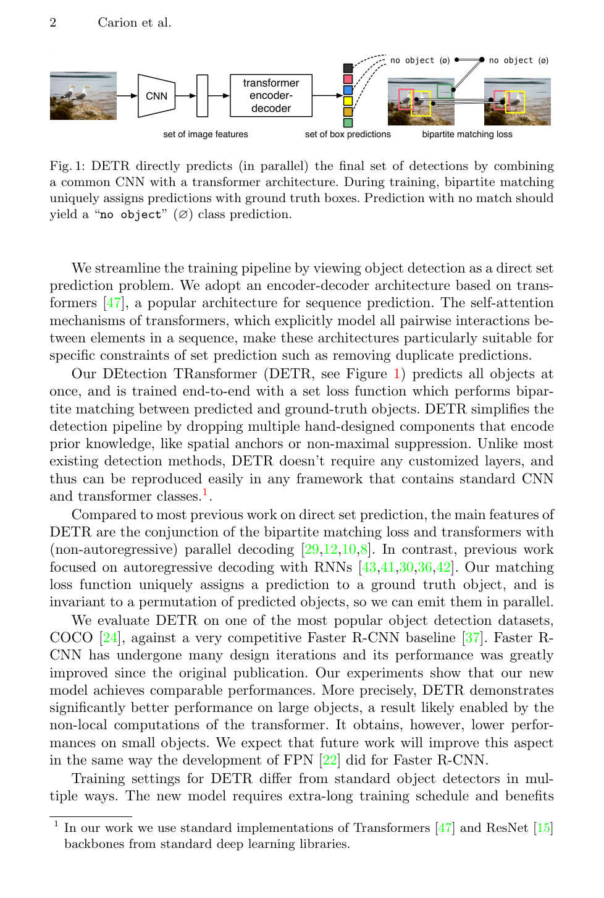
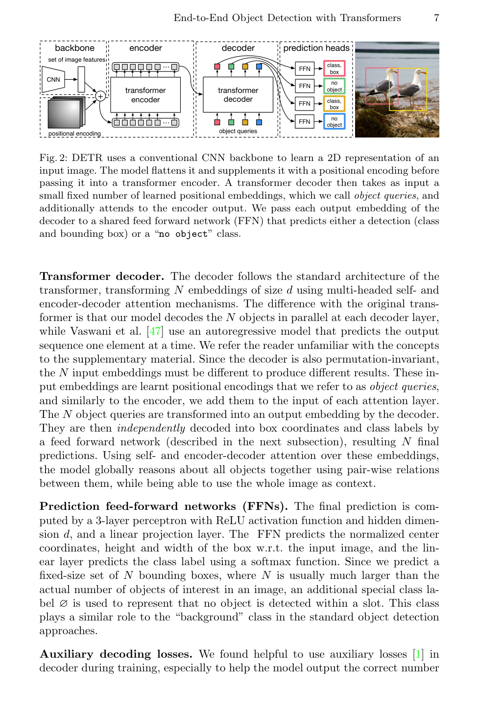
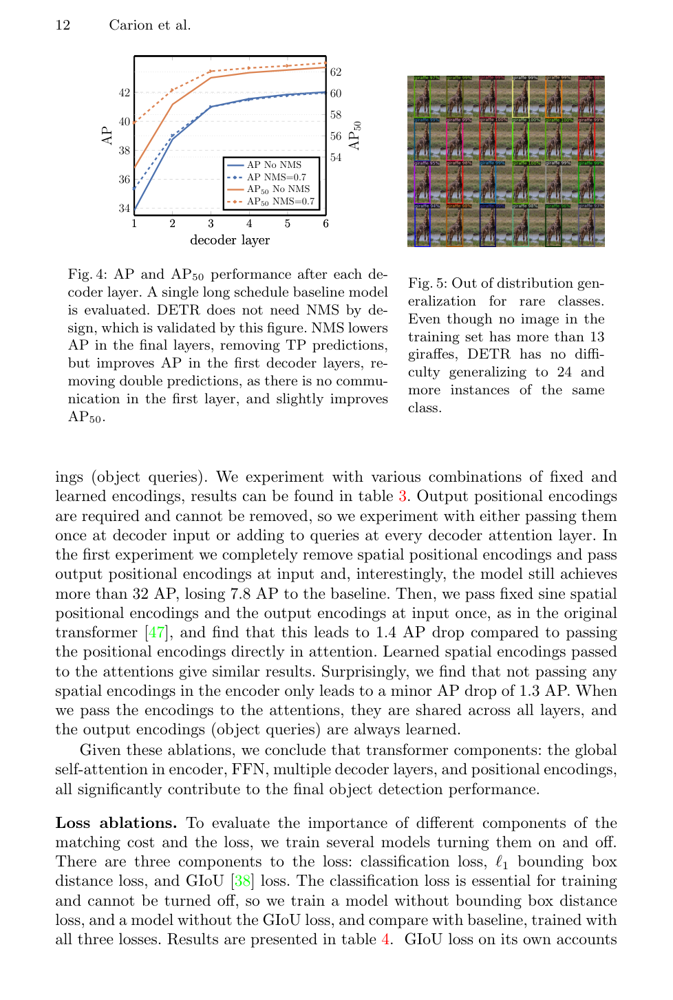

# DETR（2020）· 论文笔记

| 项 | 内容 |
|---|---|
| 论文 | End-to-End Object Detection with Transformers |
| 作者 / 单位 | Nicolas Carion\*、Francisco Massa\*、Gabriel Synnaeve、Nicolas Usunier、Alexander Kirillov、Sergey Zagoruyko（Facebook AI；\* 共同一作） |
| 出处 | ECCV 2020；arXiv:2005.12872v3（2020-05-28） |
| 本地 PDF | `3.科研基本任务/论文/目标检测/Carion 等 - 2020 - End-to-End Object Detection with Transformers.pdf`（26 页，正文 17 页 + 附录） |
| 任务书条目 | 第 3 周 #19｜🔴 自精读｜端到端检测——set prediction + bipartite matching |
| 阅读方式 | 精读：正文逐节过 + 附录 A.1–A.4 查公式；**第 5 节留白，自己写** |
| 核对规则 | 「(p.x)」= PDF 页码（本篇印刷页码与 PDF 页码一致）；✅ = 已用 PyMuPDF 抽全文逐段核对 |

---

## 0. 术语表（零基础版 · 按「检测任务 / Transformer / 训练 / 评估 / 工程」分组）

> DETR 别扭的地方：它一半讲检测老概念（anchor、NMS、AP），一半讲 NLP 老概念（attention、query、位置编码），而它干的恰恰是**扔掉前者、用后者替代**。所以两组都得收，并标出「在 DETR 里它变成了什么」。

### 0.1 检测任务

| 术语 | 大白话（在 DETR 里指什么） |
|---|---|
| **set prediction（集合预测）** | 一次性输出**整个集合**（100 个槽位，各带类别 + 框），而不是"先出候选再筛"。关键性质是**无序**：第 1 槽吐猫、第 2 槽吐狗与反过来是**同一结果**。 |
| **bipartite matching（二分匹配）** | 把「100 个预测」与「真值（补 ∅ 到 100）」**一对一**配上对。元素只能配一次；而且是**一次性算出来的，不算梯度**。 |
| **Hungarian algorithm（匈牙利算法）** | 解上面那个一对一匹配的算法（Kuhn 1955，原文引 [20]）。输入 N×N 代价矩阵，输出总代价最小的一组配对，O(N³)，N=100 时可忽略。**它是"解配对"的算法，不是"算损失"的**——损失在配好对之后才算。 |
| **matching cost（匹配代价）** | 配对时用的"距离" = 负的分类概率 + 框的 L1/GIoU（式(1)后的行内公式，p.5）。**只用于决定谁配谁**，不产生梯度。 |
| **object query（对象查询）** | decoder 的 100 个输入，是**学出来的位置编码**；query 内容初值**为 0**（A.3, p.22：queries "initially set to zero"）。可理解为 100 个"待填空的格子"，各自慢慢学出"我负责哪块区域/哪种尺度"。 |
| **∅（no object）** | 第 101 类，表示"此槽无物体"。等价于传统的 background，但**在 DETR 里它是匹配的一部分**：真值不足 100 时，剩下的槽位就配给 ∅。 |
| **anchor（锚框）** | 传统检测在每个位置预摆的几个"参考框"，网络只学相对偏移。**DETR 没有 anchor**：直接回归归一化绝对坐标 $b\in[0,1]^4$。 |
| **no NMS（无抑重复）** | NMS = 按分数排序、删掉与已保留框 IoU 过高的框。DETR **推理默认不做 NMS**，因为一对一匹配从训练上就压住了重复。§4.2 + Fig.4 专门做了"加 NMS 会怎样"的对照。 |
| **one-to-one vs many-to-many** | Faster R-CNN：一个真值可被多个 anchor 同时当正样本 → 输出扎堆 → 必须 NMS。DETR：一个真值只配一个预测 → 不扎堆。**这条是命门。** |
| **label assignment（标签分配）** | 谁对谁负责的规则。传统是启发式（IoU 阈值 / 中心落框内 / ATSS），DETR 换成"全局最优二分匹配"。 |
| **proposal / ROI / 绝对坐标回归** | 两阶段第一段的候选框、特征对齐算子，DETR 都没有；改为直接回归归一化坐标 $b\in[0,1]^4$——不要 anchor，但大小框 L1 尺度不一，才要配 GIoU。 |

### 0.2 Transformer 结构

| 术语 | 大白话（在 DETR 里指什么） |
|---|---|
| **encoder-decoder** | 编码器把图像特征变成"上下文增强过的 token"；解码器拿 100 个 query 去查，输出 100 个结果。它替代了"RPN + ROI 头"。 |
| **self-attention** | 序列里每个元素看全部元素、按相似度加权求和。encoder 里是"每个图像 token 看全图"→ 全局推理、大物体强；decoder 里是"100 个 query 互相看"→ 防重复。 |
| **cross-attention** | decoder 的 query 去看 encoder 输出（Q 来自 query，K/V 来自图像特征）。 |
| **permutation invariance（置换不变性）** | 输入顺序打乱，输出只是跟着打乱。自注意力天然如此，所以：① 必须加位置编码；② decoder 的 100 个输入**必须彼此不同**，否则输出一样（p.7 原话 "must be different"）。 |
| **positional encoding** | 给 token 附"我在哪"的向量。DETR 有**两种**：空间位置编码（fixed sine 2D，加在 encoder 的 Q/K）与输出位置编码（learned = object query，加在 decoder 的 Q）。 |
| **"加在每一层"** | 原始 Transformer 只在输入加一次；DETR 加在**每个 attention 层的 Q/K**（Fig.10, p.22），Table 3 证明比"只在输入加"好 1.4 AP。 |
| **parallel / non-autoregressive decoding** | 原版一个词一个词蹦（自回归）；DETR 100 个结果**同时**出。§2.2 理由：自回归推理成本正比于长度、难批处理。 |
| **FFN（两种含义）** | ① Transformer 层内那个"两层 1×1 卷积 + ReLU"（逐 token 的 MLP）；② 预测头那个 3 层感知机。**§4.2 "Importance of FFN" 说的是①**。 |
| **quadratic complexity** | encoder self-attention 为 $O(d^2HW+d(HW)^2)$（A.3, p.22）。分辨率翻倍，第二项 ×4，整体约 ×2（DC5 的代价）。 |
| **DC5（dilated C5）** | 去掉 ResNet 末段 stride、改 dilation，分辨率从 H/32 变 H/16。代价：encoder self-attention 成本 **16×**，整体 **2×**。 |

### 0.3 训练

| 术语 | 大白话 |
|---|---|
| **Hungarian loss（匈牙利损失）** | 配好对后的总损失，式(2)：每槽 = 分类 NLL +（非 ∅ 时）框损失。 |
| **auxiliary loss（辅助损失）** | **每一层 decoder 后**都接预测头 + Hungarian loss（§3.2），头参数共享、头前共享一个 LayerNorm。让浅层也有监督，加快收敛、帮模型数对物体个数。 |
| **∅ 降权 10×** | ∅ 槽位的 log-prob 项乘 1/10（p.5–6），因为 100 槽里绝大多数是 ∅，不降权会被背景淹没（原文类比 Faster R-CNN 的正负采样）。 |
| **matching 用概率、loss 用对数** | 匹配代价用 $\hat p(c_i)$，损失用 $\log\hat p$。理由：让分类项与框项量级可比，且经验更好（p.6）。复现时容易踩。 |
| **epoch（轮）** | 训练集过一遍。消融 **300 epoch**；和 Faster R-CNN 比用 **500 epoch**（400 轮降 lr），长 schedule 多 **1.5 AP**。 |
| **convergence（收敛）** | 指标不再涨。DETR 极慢（500 epoch ≈ Faster R-CNN 的 10–20 倍），是 #20 的第一动机。 |
| **AdamW / lr** | transformer lr=1e-4，backbone lr=1e-5（低一个量级以稳训练），wd=1e-4（A.4）。 |
| **正则三件套** | dropout 0.1（attention 与 FFN 之后）、梯度裁剪 0.1、Xavier 初始化；backbone 用 ImageNet 预训练且**冻结 BN**。 |
| **数据增强** | ① 尺度：短边 480–800、长边 ≤1333；② 随机裁剪 p=0.5，**+约 1 AP**（理由：帮 encoder 学全局关系）。 |
| **归一化口径** | 损失按 batch 内**物体总数**归一；分布式要按**所有子 batch 总数**（A.2, p.21），否则各卡梯度不等权。 |

### 0.4 评估（COCO 指标）

| 术语 | 大白话 |
|---|---|
| **AP（mAP）** | IoU 0.50:0.05:0.95 共 10 个阈值各算一次再平均。**COCO 里裸写 "AP" 就是它，不是 AP50**。 |
| **AP50 / AP75** | 只在 IoU=0.50（宽松）/0.75（严格）算。AP50 高、AP75 低 = 框不够精细。 |
| **APs / APm / APL** | 按面积分组：small(<32²px)、medium(32²–96²)、large(>96²)。DETR：AP_L 61.1 领先、AP_S 20.5 落后。 |
| **PQ / SQ / RQ** | 全景分割：PQ 总分，SQ mask 准不准，RQ 有没有漏/多。 |
| **报数口径** | 和 Faster R-CNN 比报"最后一个 epoch 的 val AP"；消融报"最后 10 个 epoch 的中位数"（p.8）。**看表先看口径。** |

### 0.5 工程词：朴素做法 → 优化做法 → 为什么有效

| 工程点 | 朴素做法 | DETR 做法 | 为什么有效 |
|---|---|---|---|
| **槽位数 N** | 按每图物体数动态输出（不可行） | 固定 **N=100**，多的配 ∅ | "变长集合"变"定长 + 背景类"，才能用定形状张量；COCO 平均 7 个、最多 63 个（p.8） |
| **收敛慢** | 只监督最后一层 | **每层 decoder 加辅助损失** | 浅层直接拿梯度，分阶段学会"先定位再分类" |
| **∅ 太多** | 直接算 NLL | ∅ 项**降权 10×** | 100 槽常 90+ 是 ∅，不降权梯度被背景主导 |
| **大小框尺度不一** | 纯 L1 | **L1 + GIoU**（λ_L1=5, λ_iou=2） | GIoU 尺度不变；Table 4：去掉 GIoU 掉 4.8 AP |
| **小物体差** | 用 H/32 | **DC5** 去 stride 改 dilation | 分辨率翻倍 → AP_S +2.0，算力 86G→187G |
| **空槽低分** | 直接过滤 ∅ | ∅ 槽改成**第二高分类别** | 纯过滤浪费"框对了但分错类"的槽；改写 **+2 AP**（p.9） |
| **位置信息** | 只在输入加一次 PE | **每层 Q/K 都加**，2D 正弦 | 每层重新注入坐标；**+1.4 AP**（Table 3） |
| **memory budget** | 想靠堆分辨率救小物体 | 只翻一倍（DC5），**明码报出 16× 自注意力代价** | 讲清"钱花在哪"，才引出 #20 把 encoder 从 O((HW)²) 降到 O(HW) |

### 0.6 下一篇（Deformable DETR, #20）才用到的词（先混脸熟）

| 术语 | 一句话 | DETR 里的对应物 |
|---|---|---|
| **deformable attention** | 每个 query 只看**少数几个学出来的采样点**，不看全部位置 | DETR 看全部 HW 个 token |
| **sampling points** | 被采样的那几个位置（可为小数坐标，双线性插值取值） | 无此概念 |
| **reference point** | 采样点的锚：采样点 = 参考点 + 学出的偏移 | 相当于 query 自己 |
| **multi-scale** | 同时用 C3–C6 多个分辨率 | DETR 单尺度 H/32（DC5 为 H/16），无 FPN |
| **iterative refinement** | 每层 decoder 在上层预测的框上再改一点 | 各层独立回归同一个绝对框 |
| **two-stage** | 先出候选框，再把候选框当 query | DETR 单阶段，query 与图像无关 |
| **memory budget** | 显存与 FLOPs 的账 | DETR-DC5 187 GFLOPs、7000 GPU 小时（#20 Table 1） |

---

## 1. 论文定位

### 1.1 一张图看懂数据流

```
 图像 x ∈ R^{3×H0×W0}
   │
   ▼
 [CNN backbone：ResNet-50/101，BN 冻结]
   │  f ∈ R^{2048×H/32×W/32}       ← 约 20×27 = 540 个 token
   │  1×1 卷积 2048→256，展平成 d×HW，加 2D 正弦位置编码
   ▼
 [Transformer encoder ×6：每个 token 看全图所有 token]
   │  z ∈ R^{256×(HW)}            ← 全局上下文已混好（Fig.3）
   ├─────────────┐（cross-attention：Q 来自 query，K/V 来自 z）
   ▼             │
 [Transformer decoder ×6：N=100 个 object query 并行解码]
   │  每层后加辅助损失；100 个 query 互相 self-attention → 压重复
   ▼
 预测集合 ŷ = {ŷ_1 … ŷ_100}，每个 = (类别 c（含 ∅）, 归一化框 b∈[0,1]^4)
   │  训练时：N×N 匹配代价 → 匈牙利算法求一对一配对 σ̂（不可导，当常数）
   ▼
 L_Hungarian = Σ_i [ −log p̂_σ̂(i)(c_i) + 1{c_i≠∅}·L_box ] → 反传
   │
   ▼
 推理：**不做 NMS**，直接输出（再把 ∅ 槽改成第二高分类别，+2 AP）
```

### 1.2 上一篇（Faster R-CNN / anchor-based）留下什么坑 → 本篇填什么

| # | 上一篇的坑 | 具体表现 | DETR 怎么填 |
|---|---|---|---|
| 1 | **anchor 是手工先验** | 每位置摆几框、几尺度、几长宽比全靠人定；原文引 [52]：性能**高度依赖这些初始猜测** | 直接回归**绝对归一化坐标**，一个 anchor 都不要 |
| 2 | **分配是启发式、多对多** | IoU>0.5 都算正样本 → 一个真值几十个预测在抢 → 输出扎堆 | **全局最优二分匹配**，一个真值只配一个预测 |
| 3 | **必须 NMS 收尾** | 有阈值超参；两个真物体挨近会被误删；难写进端到端训练 | 一对一从**训练目标上**杜绝重复，推理不要 NMS（Fig.4 验证） |
| 4 | **pipeline 长、要自定义算子** | proposal → ROI Align → 头 → NMS | 只用三个标准组件，原文称"不需要 specialized library"，推理代码 <50 行 |
| 5 | **端到端集合预测没跑通** | 前人 [43,41,30,36,42] 用 RNN **自回归**吐框，只在小数据集上验证 | 换 Transformer + **并行解码**，在 COCO 上和调优过的 Faster R-CNN 正面比 |

> ⚠️ 第 5 条要记住：**"集合预测 + 匈牙利损失"不是 DETR 发明的**（§2.1/§2.3 明说前人用过）。DETR 的新是"**集合损失 + Transformer 并行解码**"这个组合，加上"在 COCO 上真打平了"。别写成"首次提出集合预测"。

### 1.3 一句话说清

> **DETR 把检测从"造一堆候选、打分、再收拾重复"改成"一次吐 100 个槽位、用二分匹配逼每个真值只占一个槽位"**——于是 anchor 和 NMS 同时消失。代价写在 Table 1 里：参数量同量级（41M vs 42M）时 AP 打平（42.0 vs 42.0），**大物体大幅领先（AP_L 61.1 vs 53.4）、小物体明显落后（AP_S 20.5 vs 26.6）**，还要 500 epoch 才收敛。

---

## 2. 逐节导读（严格按原文章节顺序）

> 每节按「想解决什么 → 动机 → 关键句/公式 →【批注】」写；批注只挑**易误解点、与 anchor-based 的差异、工程细节**。

### §1 Introduction（p.1）

- **想解决什么**：现代检测器都不"直接"做集合预测，而是绕道解一堆**代理任务**（在 proposals [37,5] / anchors [23] / 窗口中心 [53,46] 上回归分类），再靠后处理合并重复；性能被后处理、anchor 设计、启发式分配三者左右（原文点名 [52]）。
- **动机**：端到端在机器翻译、语音识别已成功，检测却没成功；前人尝试要么又塞别的先验，要么没在难 benchmark 上证明能打。
- **关键句**（p.1）：
  > "The main ingredients ... are a **set-based global loss that forces unique predictions via bipartite matching**, and a **transformer encoder-decoder architecture**."
  > "Given a **fixed small set of learned object queries**, DETR reasons about the relations of the objects and the global image context to directly output the final set of predictions **in parallel**."
- **【批注】** ① "on par with"（打平）不是超越，Table 1 是 42.0 vs 42.0；② 摘要就承认"大物体更好、**小物体更差**"，并说希望后续像 FPN 对 Faster R-CNN 那样解决——**#20 正是接这句**；③ "不需要 specialized library" 指没有 ROI Align、没有 NMS 的 CUDA 核，只有标准算子。

### §2 Related work（p.3–4）

- **§2.1 Set Prediction**：深度学习里**没有**直接预测集合的标准模型。两个难点：① 避免近似重复；② 损失要对排列不变。关键句：损失要建在**匈牙利算法**上，"This enforces permutation-invariance, and guarantees that each target element has a **unique match**."
  - **【批注】** 作者在此明确表态：**沿用二分匹配损失，但抛弃自回归**。损失是老的，解码方式是新的——这是理解 DETR 血统的钥匙。
- **§2.2 Transformers and Parallel Decoding**：自回归推理成本正比于输出长度、难批处理；并行解码已在音频 [29]、翻译 [12,10]、词表示 [8]、ASR [6] 出现。关键句："attention-based models ... **global computations and perfect memory**"。
  - **【批注】** "perfect memory" 指注意力可直接访问任意位置（不像 RNN 把历史压进隐状态）。DETR 的"大物体强"就来自这个全局计算。
- **§2.3 Object detection**：三条对比线 + 一句靶子。
  - 靶子："Recent work [52] demonstrate that the final performance **heavily depends on the exact way these initial guesses are set**."
  - 线路对照：① 早期集合损失检测器 [9,25,35]（有匹配损失，但关系只靠卷积建、**还要 NMS**）；② 可学习 NMS [16,4] 与 Relation Networks [17]（用 attention 建模预测间关系、不要后处理，但**额外喂手工上下文特征**）；③ 循环检测器 [43,41,30,36,42]（也是二分匹配 + encoder-decoder，但 RNN 自回归、只在小数据集试过）。
  - **【批注】** 作者对前人的批评很具体：**要么还留手工先验，要么没证明能打**——所以它的写作策略必须两头都解决。

### §3.1 Object detection set prediction loss（p.5–6）

- **想解决什么**：给"100 个预测"和"数量不定、无顺序"的真值打分。
- **动机**：集合没顺序 → 不能按索引逐个算；物体数不定 → 得先补齐。
- **做法（两步，务必背下来）**：① 真值用 ∅ 补到 N；② 式(1) 求最优配对（匈牙利）；③ 式(2) 对配好的对算损失。
- **【批注 · 易误解】**
  1. **匹配代价 ≠ 损失**。式(1) 只用来选 σ̂，**对参数不产生梯度**；梯度全来自式(2)。这就是"匹配用概率、损失用 log 概率"的根源。
  2. **∅ 的匹配代价是常数**（p.6 原话）。推论：没被真值抢走的槽位**一定配给 ∅**，"哪个槽被浪费"由它自己预测得多差决定（我一开始以为 ∅ 也参与竞争，错了）。
  3. **一对一 = 去重复的根**（对照 Faster R-CNN 的多对多）。
  4. 归一化按 **batch 内物体总数**；分布式要按**所有子 batch 总数**（A.2, p.21）——复现最常见的坑。
  5. ∅ 分类项**降权 10×**，作者类比 Faster R-CNN 的正负采样。

### §3.2 DETR architecture（p.6–8）

| 组件 | 具体设置（原文） | **【批注】** |
|---|---|---|
| **Backbone** | ResNet-50/101，ImageNet 预训练，**BN 冻结**；$f\in\mathbb{R}^{C\times H\times W}$，C=2048，H,W=H₀/32,W₀/32（p.6） | BN 冻结是检测惯例（图尺寸不一，BN 统计量不稳）。**只取 C5 一层，没有 FPN**。 |
| **Encoder** | 1×1 卷积 2048→d（d=256）；空间维展平成 $d\times HW$；每层 = 多头自注意力 + FFN；**固定正弦 PE 加在每层 attention 输入上** | "每层都加"不是原始 Transformer 做法，Table 3 有对照。 |
| **Decoder** | N 个 d 维 embedding，用 self-attention + encoder-decoder attention **并行**解码；输入 embedding = 学出来的位置编码 = object query，同样加在每层 | p.7 原话：decoder 也是置换不变的，N 个输入 embedding **必须不同**——**这就是 object query 存在的全部理由**。A.3（p.22）：query 初值 **0**，第一层 self-attention "can be skipped"。 |
| **Prediction FFN** | 3 层感知机（ReLU，hidden=d）+ 线性投影；出归一化中心+宽高，以及类别 softmax | 100 槽**共享**同一 FFN。∅ "plays a similar role to the background class"（p.7）。 |
| **辅助损失** | 每层 decoder 后加预测头 + Hungarian loss；头参数共享；头前加**共享 LayerNorm** | 共享是为了省参数且让浅层也学好；加 LN 是因为不同层输出分布不同，不归一会让共享头难训。 |

- **【批注 · 与 anchor-based 的差异】** 整个 §3.2 **没有一处**出现 anchor / proposal / ROI / NMS，它替换的是"RPN + ROI 头 + 后处理"整条链，只保留"CNN 提特征"。p.6 特意强调"任何框架几百行就能实现"。

### §4 Experiments（p.8–16）

- **数据集**：COCO 2017，**118k 训练 / 5k 验证**；每图平均 7 个实例、训练集最多 63 个（p.8）。**这是 N=100 的依据。**
- **训练**（p.8–9 + A.4, p.23）：AdamW；transformer 1e-4 / backbone 1e-5；wd 1e-4；Xavier；梯度裁剪 0.1；dropout 0.1；尺度增强短边 480–800、长边 ≤1333；随机裁剪 p=0.5（+约 1 AP）；**300 epoch 消融 / 500 epoch 对比**（400 轮降 lr，+1.5 AP）；16×V100、3 天、每卡 4 图（总 batch 64）。
- **推理**（p.9）：空槽位改成**第二高分类别**（保留置信度），比过滤空槽 **+2 AP**。

#### §4.1 Comparison（p.9–10）
- **想解决什么**：和"多年调优 + 加了同样增强"的 Faster R-CNN 公平比。
- 关键句："we attempt to make a Faster R-CNN baseline **stronger**"——加 GIoU、同样随机裁剪、9× schedule（约 109 epoch），合计 +1~2 AP。
- **【批注】** Table 1 分三段：上段是 Detectron2 的 3× 原始版，中段"+"增强版，下段 DETR。**拿 DETR 比上段是不公平的**（虽然结果差不多）。

#### §4.2 Ablations（p.10–13）
- 五个消融各回答一个问题：encoder 层数（Table 2）、decoder 层数 + NMS（Fig.4）、FFN 要不要（p.11）、位置编码（Table 3）、损失组合（Table 4）。
- **【批注】** Fig.4 是全文最聪明的实验设计：既然声称"不需要 NMS"，就**每层都试着加 NMS**。结论：**第 1 层帮（query 还没交流）、后面反掉点（删了真阳性）**。

#### §4.3 Analysis（p.14）
- **槽位分工**（Fig.7）：把 val 集所有槽位预测画成点 → **每槽学出自己的"工作模式"**（偏向某区域/某框形），且几乎每槽都有"预测整图大框"的模式。
- **超分布泛化**（Fig.5, p.12）：训练集同图最多 **13 只长颈鹿**，合成图上找到 **24 只** → 结论"there is **no strong class-specialization** in each object query"（p.14）。
- **【批注】** 两条合起来回答"object query 是什么"：**不是"第 k 个 query 负责第 k 类"**，而是"每槽有空间/尺度偏好，类别由图像内容决定"。这点常被说反。

#### §4.4 Panoptic segmentation（p.14–16）
- 把 stuff（53 类）与 things（80 类）**统一**当框预测（匈牙利匹配要用框距离，p.15）；decoder 输出上加 mask 头（M 头 attention → 低分辨率 mask → 上采样到 stride 4），DICE/F-1 + Focal 监督；mask 头可**冻结主干单独训 25 epoch**。
- 推理：置信度 <0.85 丢掉 → 逐像素 argmax（**天然不重叠**）→ 合并同类 stuff → 去 <4 像素空 mask。
- 结果：DETR-R50 PQ **43.4**、DETR-R101 **45.1**（Table 5, p.16），测试集 **46 PQ**。
- **【批注】** Table 5 里 DETR 的 **mask AP 只有 31.1**（PanopticFPN++ 是 37.7），PQ 反而更高，靠 **PQ_st 36.3 vs 32.3**。**"各项都更强"是错的**，这是最易误读的一张表。

### §5 Conclusion（p.17）

- 明确承认新问题："regarding **training, optimization and performances on small objects**"，并说"现在的检测器花好几年才解决类似问题，期待后续工作解决 DETR 的这些"。
- **【批注】** 这段等于作者给 #20 写的任务书；读 #20 的引言会发现它几乎逐条回应：训练慢（500 epoch）、小物体差、分辨率上不去。

### 附录（p.20–23，查公式必看）
- **A.1** 多头注意力完整形式（式 3–8），PE 加在 Q/K（式 7）。
- **A.2** GIoU（式 10）、DICE/F-1（式 11）、分布式归一化坑。
- **A.3** 架构图（Fig.10, p.22）+ 复杂度：encoder $O(d^2HW+d(HW)^2)$；decoder self-attn $O(d^2N+dN^2)$；cross-attn $O(d^2(N+HW)+dNHW)$。
- **A.4** 超参（λ、N=100、lr、dropout、梯度裁剪、2D 正弦 PE 构造）。

---

## 3. 核心图/公式深读

### 3.1 Fig.1（p.2）：整篇的"一句话图解"



图注（p.2）："DETR directly predicts (in parallel) the final set of detections by combining a common CNN with a transformer architecture. During training, **bipartite matching uniquely assigns predictions with ground truth boxes**. Prediction with no match should yield a 'no object' (∅) class prediction."

**怎么读（从右往左更顺）**：① 右边输出是**一列等长槽位**，有物体给 (class, box)，没物体给 ∅——**输出形状固定**，这是能用张量算的前提；② 中间 encoder-decoder：encoder 吃"图像特征集合"，decoder 吃"object queries"，靠 cross-attention 相连；③ 左边 CNN 只提特征，不做任何检测判断；④ 底部 "bipartite matching loss" **只在训练时存在**。

> **【批注】** 最容易看漏：**decoder 的输入箭头只画了 object queries，没画图像**。图像是通过 encoder 的 memory 以 K/V 进 decoder 的，第一次读容易以为"query 直接吃图"。

### 3.2 Fig.2（p.7）：三个组件与张量形状



图注（p.7）："DETR uses a conventional CNN backbone to learn a 2D representation of an input image. The model flattens it and supplements it with a positional encoding before passing it into a transformer encoder. A transformer decoder then takes as input a small fixed number of **learned positional embeddings, which we call object queries**, and additionally attends to the encoder output."

把形状串一遍（自己手写最有效）：

```
图像        3 × H0 × W0
  ↓ ResNet-50（去分类头，BN 冻结）
特征       2048 × H0/32 × W0/32        ≈ 2048 × 20 × 27
  ↓ 1×1 卷积
特征       256 × 20 × 27
  ↓ 展平 + 加 2D 正弦 PE（每层 Q/K 都加）
encoder    256 × 540  → 6 层 → 256 × 540（memory）
  ↓
decoder    100 × 256（object query：内容初值 0 + 学出的位置编码）
  ↓ 6 层：self-attn（100 槽互看）→ cross-attn（100 槽看 540 token）
  ↓ 每层后：共享 LayerNorm → 共享 3 层 FFN → 类别（80 类 + ∅）/ 框（4 维，[0,1]）
输出       100 × (类别数 + 4)
```

### 3.3 两个公式，逐符号拆开

**（1）最优配对（式 1, p.5）**

$$\hat{\sigma}=\arg\min_{\sigma\in\mathfrak{S}_N}\sum_{i=1}^{N}\mathcal{L}_{\mathrm{match}}\big(y_i,\hat{y}_{\sigma(i)}\big)$$

| 符号 | 含义 | 零基础注意点 |
|---|---|---|
| $y=\{y_i\}_{i=1}^{N}$ | 真值集合，已用 ∅ 补到 N | **补 ∅ 是关键**：把"变长"变"定长"，才能写成求和 |
| $\hat{y}=\{\hat{y}_i\}_{i=1}^{N}$ | 模型输出的 N 个预测 | 顺序由模型给，**但没有语义** |
| $\mathfrak{S}_N$ / $\sigma(i)$ | N 元素的所有排列（N! 种）/ 排列下"第 i 个真值"配到"第 σ(i) 个预测" | 暴力枚举不可能 → 必须匈牙利；σ 是"谁配谁"的唯一决定 |
| $\mathcal{L}_{\mathrm{match}}$ | 配对代价（下式） | **不可导、不反传**，只定配对 |

$$\mathcal{L}_{\mathrm{match}}\big(y_i,\hat{y}_{\sigma(i)}\big)=-\mathbb{1}_{\{c_i\neq\varnothing\}}\,\hat{p}_{\sigma(i)}(c_i)+\mathbb{1}_{\{c_i\neq\varnothing\}}\,\mathcal{L}_{\mathrm{box}}\big(b_i,\hat{b}_{\sigma(i)}\big)$$

| 符号 | 含义 |
|---|---|
| $c_i$、$b_i\in[0,1]^4$ | 真值类别（可为 ∅）与框：中心 x/y、高、宽，**相对图像尺寸归一化** |
| $\hat{p}_{\sigma(i)}(c_i)$ | 第 σ(i) 个预测"判成 c_i"的概率 |
| $\mathbb{1}_{\{\cdot\}}$ | 指示函数 → **∅ 时两项归零，代价是常数 0** |

**（2）匈牙利损失（式 2, p.5）**

$$\mathcal{L}_{\mathrm{Hungarian}}(y,\hat{y})=\sum_{i=1}^{N}\Big[-\log\hat{p}_{\hat{\sigma}(i)}(c_i)+\mathbb{1}_{\{c_i\neq\varnothing\}}\,\mathcal{L}_{\mathrm{box}}\big(b_i,\hat{b}_{\hat{\sigma}(i)}\big)\Big]$$

与式(1)只差三处，每处都重要：① 分类项由 $\hat p$ 换 $-\log\hat p$ → 可导；② **∅ 项降权 10×**；③ 框项被 $\mathbb{1}$ 门控，**∅ 槽不参与框回归**（否则强迫模型回归"没有物体"的框）。

**（3）框损失（p.6 + 式 10, p.21）**

$$\mathcal{L}_{\mathrm{box}}=\lambda_{\mathrm{iou}}\mathcal{L}_{\mathrm{iou}}+\lambda_{\mathrm{L1}}\|b_i-\hat{b}_{\sigma(i)}\|_1,\quad \lambda_{\mathrm{L1}}=5,\ \lambda_{\mathrm{iou}}=2$$

$$\mathcal{L}_{\mathrm{iou}}(b,\hat b)=1-\left(\frac{|b\cap\hat b|}{|b\cup\hat b|}-\frac{|B(b,\hat b)\setminus b\cup\hat b|}{|B(b,\hat b)|}\right)$$

`|b−b̂|_1` 是 4 坐标绝对差之和；`B(b,b̂)` 是能同时包住两框的最小框（GIoU 的"外接惩罚"）。**为什么加 GIoU**：纯 L1 对大/小框尺度不一致；Table 4：去 GIoU 掉 4.8 AP，去 L1 只掉 0.7 AP。

### 3.4 object query 到底怎么初始化（A.3, p.22）

原文两句是全部信息："the decoder receives **queries (initially set to zero)**, output positional encoding (object queries), and encoder memory"；"The first self-attention layer in the first decoder layer **can be skipped**."

拆开：① query **内容初值 0**（非随机）；② 进每层时给 Q 加上"输出位置编码"（= object query，**学出来的**，100 个不同）；③ 所以"100 槽的差异"**完全来自那 100 个可学习位置编码**；④ 第一层 self-attention 可跳过——因为此时 100 个内容还都是 0。

> **【批注 · 易误解】** 很多人把 object query 说成"100 个待检物体的特征"或"100 个 anchor 编码"。原文更朴素：它是**位置编码，作用是让 100 个槽可区分**；每槽学成什么样（Fig.7 的空间/尺度偏好）是**训练结果**，不是设计先验。

### 3.5 Fig.4（p.12）：NMS 对照——全文最关键的"反常识"图



图注（p.12）："AP and AP50 performance after each decoder layer. ... **DETR does not need NMS by design**, which is validated by this figure. **NMS lowers AP in the final layers, removing TP predictions, but improves AP in the first decoder layers**, removing double predictions, as there is no communication in the first layer."

- 横轴 1→6 是 decoder 层；AP 从第 1 层到第 6 层 **+8.2**，AP50 **+9.5**（p.11）。
- **第 1 层**：加 NMS 明显涨 → 第一层 query "没有任何交流"（self-attention 被跳过），会重复预测。
- **第 2 层起**：self-attention "互相通报"，重复被自己抑制，NMS 增益迅速衰减。
- **最后几层**：加 NMS **反而掉 AP** → 把挨得近的真物体当重复删了。

> **【批注】** 这张图同时回答两件事：① 为什么"不需要 NMS"（末层加了掉点）；② 为什么 NMS 在前人那里有用（前人输出没有 query 间的一对一交流）。**它是"设计即去重"的唯一硬证据**。

---

## 4. 实验逐表解读

### 4.1 Table 1（p.9）：和 Faster R-CNN 正面比

**回答什么问题**：参数与增强尽量对齐后，DETR 能不能打平调优过的 Faster R-CNN？钱花在哪？

| 模型 | GFLOPs/FPS | 参数量 | AP | AP50 | AP75 | APs | APm | APL |
|---|---|---|---|---|---|---|---|---|
| Faster RCNN-DC5 | 320/16 | 166M | 39.0 | 60.5 | 42.3 | 21.4 | 43.5 | 52.5 |
| Faster RCNN-FPN | 180/26 | 42M | 40.2 | 61.0 | 43.8 | 24.2 | 43.5 | 52.0 |
| Faster RCNN-R101-FPN | 246/20 | 60M | 42.0 | 62.5 | 45.9 | 25.2 | 45.6 | 54.6 |
| Faster RCNN-FPN+ | 180/26 | 42M | 42.0 | 62.1 | 45.5 | 26.6 | 45.4 | 53.4 |
| Faster RCNN-R101-FPN+ | 246/20 | 60M | 44.0 | 63.9 | 47.8 | 27.2 | 48.1 | 56.0 |
| **DETR** | 86/28 | 41M | **42.0** | 62.4 | 44.2 | 20.5 | 45.8 | **61.1** |
| DETR-DC5 | 187/12 | 41M | 43.3 | 63.1 | 45.9 | 22.5 | 47.3 | 61.1 |
| DETR-R101 | 152/20 | 60M | 43.5 | 63.8 | 46.4 | 21.9 | 48.0 | 61.8 |
| DETR-DC5-R101 | 253/10 | 60M | 44.9 | 64.7 | 47.7 | 23.7 | 49.5 | **62.3** |

**关键数字**：同 backbone 下 **DETR 42.0 = Faster R-CNN-FPN+ 42.0**，打平；**AP_L 61.1 vs 53.4**（+7.7，靠 self-attention 全局计算）；**AP_S 20.5 vs 26.6**（−6.1，只用 H/32 单尺度）；DC5 使 AP→43.3、AP_S +2.0，代价 FLOPs 86→187、FPS 28→12；**DETR 是这批里 FLOPs 最低（86G）**。

**最易误读的 3 点**：
1. 🟥 "42.0 是 300 epoch 训出来的"——错。Table 1 是 **500 epoch**；300 epoch 基线是 **40.6**（§4.2, p.10），差 1.5 AP。
2. 🟥 "Faster R-CNN 只有 40.2"——错。那是 Detectron2 的 3× 原始版；作者把它增强到 **42.0**（"+"行）才比，拿 42.0 去比 40.2 是薅羊毛。
3. 🟨 "DETR 全方位更好"——错。AP50 基本打平（62.4 vs 62.1），AP75 还略低（44.2 vs 45.5），AP_S 差 6 点。**它赢的是 AP_L 和 FLOPs。**

### 4.2 Table 2（p.10）：encoder 层数

**回答什么问题**：encoder 的全局自注意力值多少？

| encoder 层数 | GFLOPs/FPS | 参数量 | AP | AP50 | APs | APm | APL |
|---|---|---|---|---|---|---|---|
| 0 | 76/28 | 33.4M | 36.7 | 57.4 | 16.8 | 39.6 | 54.2 |
| 3 | 81/25 | 37.4M | 40.1 | 60.6 | 18.5 | 43.8 | 58.6 |
| 6 | 86/23 | 41.3M | 40.6 | 61.6 | 19.9 | 44.3 | 60.2 |
| 12 | 95/20 | 49.2M | 41.6 | 62.1 | 19.8 | 44.9 | 61.9 |

去掉 encoder：AP **−3.9**（40.6→36.7），**AP_L −6.0**（60.2→54.2）；12 层比 6 层再 +1.0 AP 但 FPS 23→20，收益递减，所以默认 6 层。
**【批注】** 该记的是"**掉的主要是大物体**"，与 §4.1"大物体领先"互为印证：encoder 的全局注意力就是为大物体服务的（Fig.3 也显示实例已被分开）。

### 4.3 Table 3（p.13）：位置编码怎么加

| 空间 PE | 输出 PE | 加在哪 | AP | ΔAP | AP50 |
|---|---|---|---|---|---|
| none | none | 只在 decoder 输入 | 32.8 | −7.8 | 55.2 |
| sine at input | sine at input | 只在输入加一次 | 39.2 | −1.4 | 60.0 |
| learned at attn. | learned at attn. | 每层 attention | 39.6 | −1.0 | 60.7 |
| none | sine at attn. | encoder 不加 | 39.3 | −1.3 | 60.3 |
| **sine at attn.** | **learned at attn.** | **每层 attention（基线）** | **40.6** | — | **61.6** |

- **输出 PE（object query）不能删**：删掉掉 7.8 AP（100 个 query 变成完全相同，只能吐同一个结果）。
- 空间 PE"只在输入加一次"掉 1.4 AP → **每层都加**有用但不致命。
- 意外结论：**encoder 完全不加空间 PE 只掉 1.3 AP**（原文用 "surprisingly"）→ CNN 特征本身已带位置信息。
- **【批注】** 表头把三个位置都写了（encoder / decoder / decoder 输入），读时容易对错行；只看 AP 与 ΔAP 列，Δ 都相对最后一行。

### 4.4 Table 4（p.13）：损失组合

| 分类 | L1 | GIoU | AP | ΔAP | AP50 | APs | APm | APL |
|---|---|---|---|---|---|---|---|---|
| ✓ | ✓ | | 35.8 | −4.8 | 57.3 | 13.7 | 39.8 | 57.9 |
| ✓ | | ✓ | 39.9 | −0.7 | 61.6 | 19.9 | 43.2 | 57.9 |
| ✓ | ✓ | ✓ | **40.6** | — | 61.6 | 19.9 | 44.3 | 60.2 |

**GIoU 贡献了绝大部分**（去掉只掉 0.7）；只有 L1 时崩得厉害（掉 4.8，AP_S 仅 13.7）。
**【批注】** 原文自认这个消融很粗（p.14："We only studied simple ablations ... other means of combining them may achieve different results"），λ 没做网格搜索——**它是"默认配置"的验证，不是"最优配置"。**

### 4.5 Table 5（p.16）：全景分割

| 模型 | backbone | PQ | SQ | RQ | PQ_th | PQ_st | mask AP |
|---|---|---|---|---|---|---|---|
| PanopticFPN++ | R50 | 42.4 | 79.3 | 51.6 | 49.2 | 32.3 | 37.7 |
| UPSNet | R50 | 42.5 | 78.0 | 52.5 | 48.6 | 33.4 | 34.3 |
| DETR | R50 | **43.4** | 79.3 | 53.8 | 48.2 | **36.3** | 31.1 |
| DETR-R101 | R101 | **45.1** | 79.9 | 55.5 | 50.5 | 37.0 | 33.0 |

PQ 更高（43.4 vs 42.4），但 **mask AP 低 6.6**（31.1 vs 37.7）；赢在 **stuff（PQ_st 36.3 vs 32.3）**，things 反而略低。
**【批注 · 最易误读】** ① "分割也全面更好" 🟥——mask AP 明显差，只是 PQ 赢了；② "PQ 高 = 分割准" 🟥——PQ 含 RQ（识别质量），DETR 是"少漏少多"赢的，不是 mask 边界更准。

> 训练代价：baseline **300 epoch / 16×V100 / 3 天**，500 epoch 未报时长；#20 §1 写它"around 10 to 20 times slower than Faster R-CNN"。

---

## 5. 我的思考（🔴 自精读 · 本节必须你自己写）

> 只放 4 个引导问题，**不给答案**；每题想清楚后写 3–5 行，能讲给没读过的人听才算过。

**Q1. 为什么"集合预测 + 二分匹配"就能去掉 NMS？**
（提示：重复来自"多个预测共享同一个真值"；把"共享"在训练目标里禁掉会怎样？再看 Fig.4 第 1 层与第 6 层的差别。）

（以下空白，读完自己补）

**Q2. object query 到底代表什么？**
（提示：原文说它是 learned positional embedding、初值 0；Fig.7 显示空间/尺度偏好，Fig.5 显示不强绑类别。那"槽位"和"物体"一一对应吗？图里只有 1 个物体时，另外 99 个 query 在干什么？）

（以下空白，读完自己补）

**Q3. 为什么 DETR 收敛这么慢？**
（提示：三角度——① 匹配是"离散决策"，早期配不准；② 100 个 query 起初几乎"人人平等"，分化要很久；③ 梯度只作用在"配上对的那一个"，效率低。哪些是原文说的，哪些是你推的？）

（以下空白，读完自己补）

**Q4. 辅助损失为什么有用？**
（提示：只监督最后一层时，梯度要穿过 6 层 attention 才到浅层；每层监督等于给浅层"直接派活"。原文说辅助损失帮模型学"the correct number of objects"——为什么"数对个数"特别需要浅层监督？）

（以下空白，读完自己补）

---

## 6. 与前后论文的衔接

### 6.1 往前看：踩在谁的肩膀上

| 前序（W2/W3 编号） | 给了 DETR 什么 | 在 DETR 里的痕迹 |
|---|---|---|
| **Transformer（#17）** | encoder-decoder、多头注意力、位置编码、FFN、LayerNorm、残差 | "照抄结构 + 换并行解码 + 换 2D PE"（A.1 说 follow [47]，PE 细节 follow [7]） |
| **ViT（#18）** | "图像拆成序列交给 Transformer"的可行性 | DETR 不切 patch，**接在 CNN 后面**（特征展平）→ 混合架构 |
| **Faster R-CNN（#10）** | 检测框架、评测协议、对比基线，以及"要被打倒的手工件清单" | 保留 CNN backbone，扔掉 RPN/ROI/NMS；Table 1 就是与它正面比 |
| **FPN（#8）** | 多尺度是小物体检测的标配 | DETR 只用单尺度（DC5 也只 H/16），**这是 AP_S 差的直接原因** |
| **Focal Loss（#15）** | 密集检测的类别不平衡处理 | ∅ 降权 10× 是"同类问题、不同解法"（定长槽位 + 重加权） |
| **Deformable Conv v1/v2（#7）** | "采样点可以学出来" | DETR 没用；是 #20 的核心零件（伏笔） |
| **CornerNet / CenterNet（#16）** | anchor-free 的第一次尝试 | 证明"可以不要 anchor"，**但仍需 NMS**（max-pooling 抑制）→ "去 anchor"≠"去 NMS" |

### 6.2 往后看

- **#20 Deformable DETR**：直接拿它的两个短板（收敛慢、小物体差）当动机，把 encoder 的全局注意力换成"稀疏采样点注意力"，顺手把多尺度塞进去（不再需要 FPN），再加迭代精修与两阶段变体。
- **【课外·待核实】** 后来的 DETR 系（DAB / DN / DINO / RT-DETR / Mask2Former）走三条线：query 显式化成 4D 动态锚框、去噪训练稳定匹配、塞进实时检测。都不在 22 篇书单里，我没逐篇读。

### 6.3 两条主线：去 anchor 化 / 去 NMS 化

| 阶段 | 去 anchor 化 | 去 NMS 化 |
|---|---|---|
| 2014–2016 | Faster R-CNN / SSD：**anchor 是核心** | NMS 是标配后处理 |
| 2016 | YOLOv1：**网格回归，无 anchor** | 仍要 NMS |
| 2017–2018 | RetinaNet：anchor 更密 | Soft-NMS / Learning NMS [4,16]：把 NMS 学出来，但仍是后处理 |
| 2019 | CornerNet / FCOS / CenterNet：**anchor-free 成熟** | 仍要 NMS（或等价的 max-pooling 抑制） |
| 2020 | **DETR：彻底不要 anchor**（绝对坐标） | **DETR：训练一对一，推理不要 NMS** |
| 2021 | Deformable DETR（继承） | 继承（两阶段也"不做 NMS"，#20 §4.2） |

> 一句话：**去 anchor 是改"怎么产生预测"，去 NMS 是改"怎么消除重复"。** DETR 是第一个**同时**走完两条线的检测器，靠的是同一件事——把"谁对谁负责"从启发式改成全局最优的一对一匹配。

---

## 7. 回原文核对记录

| # | 说法 | 原文依据 | 判定 |
|---|---|---|---|
| 1 | "DETR 在 COCO 上超过了 Faster R-CNN" | Table 1（p.9）：42.0 vs 42.0；摘要用 "on par with" | 🟥 错。是打平，只在 AP_L 上大幅领先 |
| 2 | "42.0 AP 是 300 epoch 训出来的" | §4.2（p.10）：300 epoch 是 40.6；42.0 属 500 epoch（p.9） | 🟥 错。消融与正式结果训练长度不同，混用会误导 |
| 3 | "DETR 完全不需要任何后处理" | §4（p.9）：空槽改第二高分，+2 AP；§4.4 还有 0.85 置信度阈值、合并同类 stuff、去 <4 像素 | 🟨 半对。**没有 NMS**，但有一处"为 AP 优化"的改写 + 分割侧过滤 |
| 4 | "原文说 AP_L 高 7.8、AP_S 低 5.5" | §4.1（p.10）正文确实写 +7.8 / −5.5；但 Table 1 是 61.1 vs 53.4（+7.7）、20.5 vs 26.6（−6.1） | 🟨 **口径不一致**：正文与表内数字对不上。**引用以 Table 1 实测为准，并注明正文写的是 +7.8/−5.5** |
| 5 | "6 层 encoder + 6 层 decoder、宽度 256、8 头、N=100、41.3M" | §4.1（p.10）+ A.4（p.23） | 🟩 正确 |
| 6 | "训练 500 epoch 要 3 天" | §4（p.9）：**300 epoch** 在 16×V100 上 3 天（每卡 4 图，batch 64）；500 epoch 未给具体时长 | 🟨 半对。"3 天"对应 300 epoch |
| 7 | "去掉 GIoU 损失掉 0.7 AP" | Table 4（p.13）：去 GIoU（留 L1）=39.9（−0.7）；**去 L1（留 GIoU）=35.8（−4.8）** | 🟩 数字对，但**方向容易记反**：GIoU 单独够用，L1 单独不行 |
| 8 | "分割结果全面超过 PanopticFPN" | Table 5（p.16）：PQ 43.4 vs 42.4 更高，但 mask AP 31.1 vs 37.7 低 6.6 | 🟥 错。只有 PQ / stuff 更强 |
| 9 | "object query 是随机初始化的 100 个向量" | A.3（p.22）："queries (initially set to zero)"；object queries 是 learned PE | 🟥 错。内容初值 0，差异来自可学习位置编码 |
| 10 | "去掉 encoder 掉 3.9 AP，主要掉在大物体" | Table 2（p.10）+ §4.2（p.10）：40.6→36.7（−3.9），AP_L 60.2→54.2（−6.0） | 🟩 正确 |

---

## 8. 自测题 5 题 + 常见误解 5 条

### 8.1 自测题（合上笔记答，答不上回去看对应节）

1. **（§3.1）** 写出 $\mathcal{L}_{\mathrm{match}}$ 的两项，并解释为什么 ∅ 项是常数、为什么匹配用概率而损失用 log 概率。
2. **（§3.2 / §3.4）** decoder 的 100 个 query 为什么必须"彼此不同"？差异来自哪里？内容初值是多少？
3. **（§4.2 / Fig.4）** 为什么"第 1 层加 NMS 有用、第 6 层加 NMS 反而掉点"？这如何支持"不需要 NMS"？
4. **（Table 1）** 参数与 backbone 对齐时，DETR 赢哪一项、输哪一项？给出数字和作者的解释。
5. **（§4.4）** PQ 更高但 mask AP 更低，这两件事怎么同时成立？

### 8.2 常见误解

| # | 误解 | 为什么错 | 正确说法 |
|---|---|---|---|
| 1 | "DETR 首次提出用匈牙利损失做检测" | §2.1/§2.3 明说前人 [9,25,35,43…] 用过 | 新的是"**匹配损失 + Transformer 并行解码**"的组合，且在 COCO 上真能打平调优过的 Faster R-CNN |
| 2 | "object query 就是 anchor 的另一种叫法" | 原文说它是 learned PE、内容初值 0，且无绝对坐标先验 | object query 是"槽位标识"，anchor 是"坐标先验"；DETR 正是要丢掉坐标先验 |
| 3 | "DETR 零后处理、完全端到端" | 推理改第二高分（+2 AP）、分割侧还有阈值与合并规则 | "**没有 NMS**"是真的；"零后处理"是宣传口径 |
| 4 | "DETR 只是比 Faster R-CNN 慢一点" | 正式结果 500 epoch；#20 说"10–20 倍慢" | 训练成本是它最实的短板，是 #20 的第一动机 |
| 5 | "AP 打平说明两者全面等价" | AP 是 10 阈值 + 3 尺度的平均；拆开 AP_S 差 6 点、AP_L 高 7.7 点 | 两者**擅长的东西不同**：DETR 擅大与全局，Faster R-CNN 擅小与局部 |

---

## 9. 读到这里最容易产生的疑问（5 组 Q&A）

**Q1：匹配是"一次性、不可导"的，模型怎么学会"该配给谁"？**
A：配对本身不产生梯度，但**配对结果决定损失怎么算**：被配给"猫"的预测被推向"高概率猫 + 框对齐"，没配到的被推向 ∅。"学会配对"是经由"损失形状随配对变化"间接发生的。副作用：早期配对近乎随机，这也是收敛慢的原因之一。

**Q2：为什么不直接算"最近真值"的损失（像 FCOS 那样），非要匈牙利？**
A："最近真值"是**每个预测独立决定**的，会出现多个预测抢同一个真值——这正是重复的来源。匈牙利在 N×N 代价矩阵上求**全局最优**，保证一对一（§3.1："we need to find one-to-one matching ... without duplicates"）。

**Q3：100 个槽、图里只有 3 个物体，剩下 97 个在学什么？**
A：学"我是空的"；同时每槽还在学"若被激活，我偏向哪个区域、什么尺度"（Fig.7）。所以槽位是"有偏好的备用格"。

**Q4：非要 Transformer 吗？全连接层不行？**
A：§2.1 提到固定尺寸集合预测"用密集全连接够用但代价高"（引 [9]）。Transformer 的优势是**参数与 token 数无关**（权重共享）+ 任意两 token 直接建关系（全局感受野）；全连接要为每对位置存权重，参数爆炸。**"全局 + 权重共享"才是它不可替代的原因**。

**Q5：大物体好、小物体差，是同一个原因吗？**
A：**不是同一个原因**：大物体好 ← encoder 的**全局感受野**（Table 2：去掉 encoder，AP_L −6.0）；小物体差 ← 特征分辨率只有 **H/32**（32×32 的小物体在特征图上不到 1 像素）。DC5 翻倍后 AP_S 20.5→22.5，但 FLOPs 86G→187G——**再翻就付不起**，这正是 #20 要解决的。
