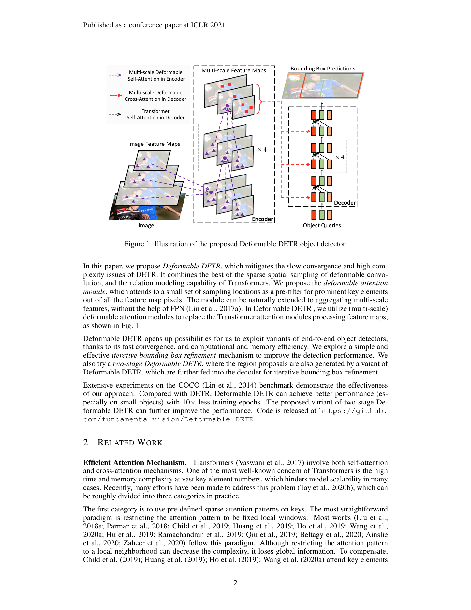
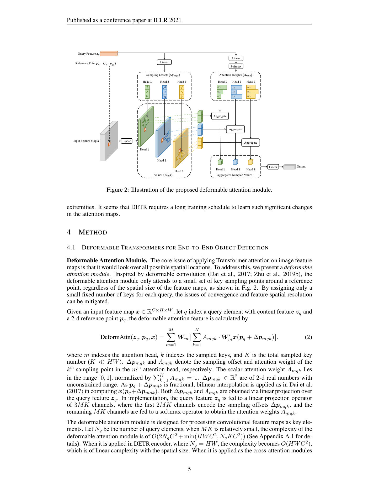
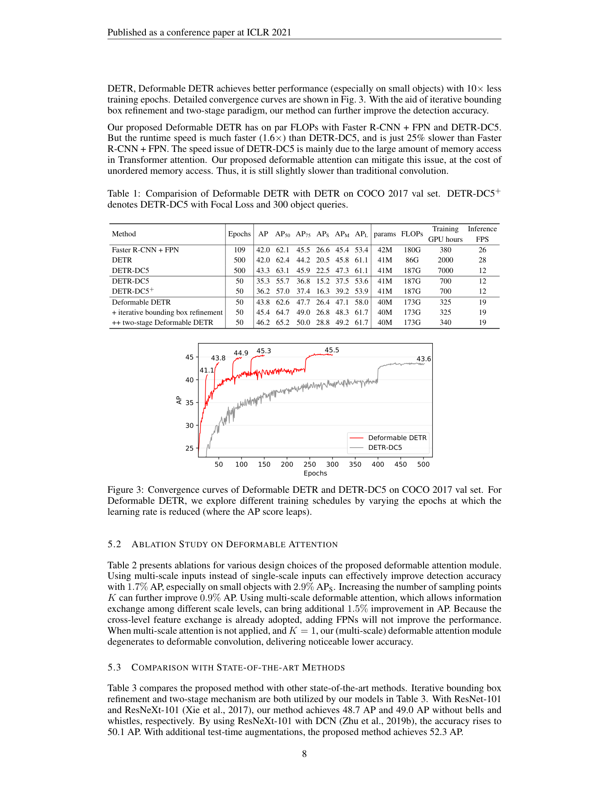

# Deformable DETR（2021）· 论文笔记

| 项 | 内容 |
|---|---|
| 论文 | Deformable DETR: Deformable Transformers for End-to-End Object Detection |
| 作者 / 单位 | Xizhou Zhu\*、Weijie Su\*‡、Lewei Lu、Bin Li、Xiaogang Wang、Jifeng Dai†（商汤 SenseTime Research；中国科大；香港中文大学；\* 共同一作，‡ 实习期间工作） |
| 出处 | ICLR 2021；arXiv:2010.04159v4（2021-03-18） |
| 本地 PDF | `3.科研基本任务/论文/目标检测/Zhu 等 - 2021 - Deformable DETR Deformable Transformers for End-to-End Object Detection.pdf`（16 页：正文 p.1–9 + 参考文献 p.9–11 + 附录 A p.12–16） |
| 任务书条目 | 第 3 周 #20｜🟢 AI 辅助读｜"用可变形注意力解决 DETR 收敛慢" |
| 阅读方式 | 先让 AI 搭骨架，再自己核对：式(1)(2)(3) 逐符号、Table 1/2/3 逐行、附录 A.1/A.3/A.4 |
| 核对规则 | 「(p.x)」= PDF 页码（本篇印刷页码与 PDF 页码一致）；所有数字均用 PyMuPDF 抽全文回查 |

---

## 0. 术语表（零基础版 · 按「检测任务 / 注意力 / 训练 / 评估 / 工程」分组）

> 读法提醒：这篇是 DETR 的"补丁版"，它几乎不引入新的检测概念，只把 DETR 里那个"看全图"的注意力换成"看点"。所以术语表里一半是 DETR 的旧词（我要知道它原来什么意思），另一半是这篇新造的词（我要知道它替代了谁）。

### 0.1 检测任务

| 术语 | 大白话（在这篇里指什么） |
|---|---|
| **set prediction（集合预测）** | 一次输出**固定数量的槽位**（这篇 N=300），每个槽位给（类别, 框）或 ∅。集合**无序**，所以损失必须对排列不变。 |
| **bipartite matching（二分匹配）** | 把 300 个预测与"真值 + ∅ 补齐"一一配上对，一个真值只配一个预测。 |
| **Hungarian algorithm（匈牙利算法）** | 解一对一匹配的算法，输入 N×N 代价矩阵，输出总代价最小的配对，O(N³)。**只决定"谁配谁"，不产生梯度。** |
| **object query（对象查询）** | decoder 的 300 个输入，本质是**学出来的位置编码**（内容初值为 0）。这篇把它**显式地和一个参考点绑定**：参考点由 query 经线性投影 + sigmoid 预测出来。 |
| **encoder-decoder** | encoder 把特征图变成"上下文增强的特征图"（这篇输入输出都是多尺度特征图）；decoder 拿 300 个 query 去采样特征并出框。 |
| **no NMS** | 推理**不做**非极大值抑制。一对一匹配让输出天然不重复；这篇连两阶段的 proposal 之间也不做 NMS。 |
| **anchor（锚框）** | 传统检测的坐标先验。这篇仍然**没有 anchor**：框由"参考点 + 相对偏移"直接回归。 |
| **label assignment（标签分配）** | 谁对谁负责。传统是 IoU 阈值等启发式规则，这里是全局最优二分匹配。 |
| **two-stage（两阶段）** | 先出**候选框**（这篇用"encoder-only 的 Deformable DETR"生成），再把候选框当 query 送进 decoder 精修。 |
| **region proposal（候选框）** | 第一阶段按分数挑出的框。DETR 是单阶段（query 与图像无关），这篇补上了第一阶段。 |
| **iterative refinement（迭代精修）** | 每一层 decoder 都**在上一层预测的框上再改一点**（预测相对偏移），而不是各层独立回归同一个绝对框。 |

### 0.2 注意力机制（本文的核心）

| 术语 | 大白话（在这篇里指什么） |
|---|---|
| **deformable attention（可变形注意力）** | 每个 query **只看少数几个学出来的采样点**，不看全部像素，因此与特征图大小无关。式(2)。 |
| **sampling point（采样点）** | 被采样的位置，坐标可为小数（$p_q+\Delta p_{mqk}$），用**双线性插值**取特征值。 |
| **reference point（参考点）** | 采样点的"锚"，采样点 = 参考点 + 学出的偏移 $\Delta p$。encoder 里参考点 = 像素自己；decoder 里参考点 = query 预测出的框中心。 |
| **sampling offset $\Delta p$** | 相对参考点的 2 维偏移，**不受范围约束**（可跑出特征图）。 |
| **attention weight $A$** | 每个采样点的权重，经 softmax **归一化到 1**（单尺度：$\sum_k A=1$；多尺度：$\sum_l\sum_k A=1$）。 |
| **multi-head（多头）** | 每个 query 有 M=8 个头，每个头有自己的一套采样点与权重；输出用 $W_m$ 线性合并。 |
| **self-attention / cross-attention** | 同序列内部 / query 对特征图。这篇：encoder 的 self-attention 换成 deformable 版；decoder 只换 cross-attention，**self-attention 原样保留**。 |
| **positional embedding** | 给 token 附"我在哪"。encoder 用固定的正弦位置编码（复用 DETR 做法），decoder 的 object query 用可学习位置编码。 |
| **scale-level embedding $e_l$** | 这篇**新增**的可学习向量，告诉网络"这个像素来自第几个尺度"（配合多尺度共用一套参数）。随机初始化、联合训练。 |
| **bilinear interpolation（双线性插值）** | 采样坐标不是整数时，用周围 4 个格点加权取值（Dai 等 2017 的做法）。 |
| **multi-scale feature maps** | 同时用 C3(H/8)、C4(H/16)、C5(H/32)、C6(H/64) 四个尺度，各 256 通道；**不用 FPN 也能互相传信息**——靠多尺度注意力本身。 |
| **quadratic complexity（平方复杂度）** | 普通注意力 $O(N_qN_kC)$；图像里 $N_q=N_k=HW$ → $O((HW)^2C)$，这是 DETR 上不了多尺度的原因。 |

### 0.3 训练

| 术语 | 大白话 |
|---|---|
| **Hungarian loss（匈牙利损失）** | 配好对之后的总损失：分类项 + 框项（L1 + GIoU）。这一项**没改**，沿用 DETR。 |
| **auxiliary loss（辅助损失）** | **每一层 decoder 后**都接预测头 + 匈牙利损失（迭代精修正是靠它落地）。 |
| **focal loss** | 这篇**换掉了 DETR 的分类损失**：用 Focal Loss（weight=2）解决 300 个槽位里大量 ∅ 的不平衡（§5, p.7）。 |
| **epoch（轮）** | 训练集过一遍。本篇默认 **50 epoch**（40 轮时 lr 降 0.1）；DETR 要 500。 |
| **convergence（收敛）** | AP 不再涨。原文的说法是"**10× less training epochs**"（摘要）。 |
| **lr decay schedule** | 学习率在固定轮数乘 0.1。Fig.3 就是"把降 lr 的轮次往后挪"的对照。 |
| **Adam** | 优化器，base lr **2e-4**、wd **1e-4**、$\beta_1$=0.9、$\beta_2$=0.999；**预测参考点与采样偏移的两个线性投影 lr 乘 0.1**（§5, p.7）。 |
| **采样偏移初始化** | 线性投影权重置 0、偏置设成"固定八邻域图案"，使初始采样点像 3×3 卷积（A.4, p.13）。 |
| **梯度阻断（stop-gradient）** | 迭代精修时，梯度**只流过本层的 $\Delta b$**，在 $\sigma^{-1}(\hat b^{d-1})$ 处截断（A.4, p.13）。 |

### 0.4 评估（COCO 指标）

| 术语 | 大白话 |
|---|---|
| **AP（mAP）** | IoU 0.50:0.05:0.95 十个阈值平均。COCO 表里裸写 "AP" 就是它。 |
| **AP50 / AP75** | 只在 IoU=0.50 / 0.75 算。 |
| **APs / APm / APL** | small(<32²) / medium(32²–96²) / large(>96²)。这篇的卖点就是 **AP_S 26.4**（DETR-DC5 22.5、DETR 20.5）。 |

### 0.5 工程词：朴素做法 → 本篇做法 → 为什么有效

| 工程点 | 朴素做法（DETR） | 本篇做法 | 为什么有效 |
|---|---|---|---|
| **memory budget（显存/算力账）** | encoder 自注意力 $O((HW)^2C)$，所以不敢上高分辨率 | 线性 $O(HWC^2)$，多尺度也扛得住 | 把"看全图"改成"看 K 个点"，key 数从 HW 变 K |
| **采样参数怎么出** | 无 | query 特征过一次**3MK 通道**线性投影：前 2MK 是偏移，后 MK 经 softmax 是权重 | 一次投影同时出"看哪 + 看多重"，无需额外模块 |
| **初始采样点** | 注意力权重近似**均匀**（$A\approx 1/N_k$），梯度模糊 | 偏置初始化成固定八邻域、权重置 0 | 让每个头一开始就像 3×3 卷积，收敛快（A.4） |
| **多尺度特征怎么融合** | 无 FPN 就只有单尺度 | 多尺度 deformable attention **自带跨尺度加权求和**（$\sum_l\sum_k$） | 不同尺度的信息在注意力里直接交换，Table 2 显示加 FPN 反而没用 |
| **encoder 参数** | 单尺度，无此问题 | **4 个尺度共用同一套 encoder 参数** + 加 scale-level embedding | 参数不随尺度膨胀，用 $e_l$ 区分尺度 |
| **速度** | DETR-DC5 12 FPS | 19 FPS | 采样点少 → 访存少；代价是"无序访存"，仍比纯卷积略慢 |
| **训练成本** | DETR 2000 / DETR-DC5 **7000 GPU 小时** | **325 / 340 GPU 小时** | 50 epoch + 收敛快（但 FLOPs 其实更高，见 §7 纠偏） |

---

## 1. 论文定位

### 1.1 一张图看懂数据流

```
 图像 x ∈ R^{3×H0×W0}
   │
   ▼
 [ResNet-50（ImageNet 预训练，C5 之后加 3×3 s2 卷积得 C6）]
   │  C3: H/8×W/8×512   C4: H/16×W/16×1024   C5: H/32×W/32×2048
   │  每个尺度 1×1 卷积 → 256 通道；C6 = C5 再 3×3 stride2 卷积（256）
   ▼
 多尺度特征图 {x_l}, l=1..4     ← 各 256 通道，不用 FPN（p.6）
   │
   ▼
 [Encoder ×6：每个像素都当 query，参考点 = 它自己]
   │  multi-scale deformable self-attention：
   │  每个 query 在 4 个尺度上各采 K=4 点（每头），加权求和 → 输出同分辨率特征图
   │  输入输出都是多尺度，尺度信息靠 scale-level embedding e_l 区分
   ▼
 [Decoder ×6：300 个 object query]
   │  ① self-attention：未改（query 之间互相看，负责去重）
   │  ② cross-attention → multi-scale deformable：参考点 = query 经线性投影 + sigmoid
   │  ③ 每层出框 = 参考点 + 相对偏移；每层都接预测头（辅助损失）
   ▼
 预测集合：300 × (类别（含 ∅）, 框 b̂ ∈ [0,1]^4)
   │  训练：匈牙利匹配 → 匈牙利损失（分类用 Focal Loss，weight=2）
   ▼
 推理：不做 NMS（两阶段的 proposal 之间也不做）
```

### 1.2 上一篇（DETR）留下什么坑 → 本篇填什么

| # | DETR 的坑 | 原文怎么描述（p.1 / p.4） | 本篇怎么填 |
|---|---|---|---|
| 1 | **收敛极慢** | "needs 500 epochs to converge, which is around **10 to 20 times slower** than Faster R-CNN"（p.1） | 稀疏采样点：每个 query 只有 K 个 key，注意力不必从"均匀"慢慢学成"稀疏" |
| 2 | **小物体差** | "DETR delivers relatively **low performance at detecting small objects**"（p.1） | 多尺度特征（C3–C6）；Attention 线性复杂度，上高分辨率付得起 |
| 3 | **上不了高分辨率** | "quadratic computation w.r.t. pixel numbers"（p.1） | $O(HWC^2)$ 线性；decoder 侧 $O(NKC^2)$ 与 HW 无关 |
| 4 | **query 与图像无关** | "object queries in the decoder are **irrelevant to the current image**"（p.7） | 两阶段变体：先用 encoder-only 版本出 proposal，再当 query |
| 5 | **各层独立回归同一绝对框** | DETR 各层都预测 $b\in[0,1]^4$ | 迭代精修：第 d 层在上层框上预测相对偏移，并**把参考点挪到上层框中心** |

> ⚠️ 注意第 3 条的逻辑顺序：**先有"复杂度线性"这个技术条件，才有"多尺度 + 迭代精修 + 两阶段"这些后续花样**。原文 §4.2 开头原话："Deformable DETR opens up possibilities ... thanks to its **fast convergence, and computational and memory efficiency**"——变体是"省下来之后才敢做"的东西，不是并列贡献。

### 1.3 一句话说清

> **Deformable DETR 把 DETR"每个 query 看全部像素"的注意力，换成"每个 query 只在 4 个尺度上、每个尺度看 4 个学出来的采样点"**——encoder 复杂度从 $O((HW)^2)$ 降到 $O(HW)$，于是多尺度塞得进去、收敛也快了：**50 epoch 到 43.8 AP（DETR-DC5 要 500 epoch 才 43.3）**，加迭代精修 45.4、再加两阶段 46.2，GPU 小时从 7000 降到 325。

---

## 2. 逐节导读（严格按原文章节顺序）

### §1 Introduction（p.1）

- **想解决什么**：DETR 去掉了 anchor / 分配规则 / NMS，但留下两个代价——**训练太慢、小物体太差**。
- **动机（原文给的病因，很重要）**：① "**At initialization, the attention modules cast nearly uniform attention weights to all the pixels**"；② 注意力是"quadratic computation w.r.t. pixel numbers"。所以不是"DETR 设计错了"，而是"注意力处理图像特征图这件事本身不合适"。
- **关键句**（p.1）："It combines the best of the **sparse spatial sampling of deformable convolution**, and the **relation modeling capability of Transformers**."
- **【批注】** ① 这句话就是全文的矛盾设定：deformable conv 会"看点"但**不会建模元素间关系**；Transformer 会建模关系但"看太多"。② 病因①值得单独记：**慢不是"参数没学好"，而是"注意力一开始太均匀、梯度太模糊"**——这解释了为什么"限制 key 数量"能加速收敛。

### §2 Related work（p.2–3）

- **高效注意力的三大类**（原文分类，p.2–3）：① **预定义稀疏模式**（局部窗口、固定间隔、少数全局 token）；② **数据驱动的稀疏注意力**（LSH、k-means、块置换）；③ **低秩/核化近似**。
- **本篇归属**："Our proposed deformable attention module is inspired by deformable convolution, and **belongs to the second category**."（p.3）
- **一句关键的批评**：图像领域的高效注意力基本停在第一类，而且"Ramachandran et al. (2019); Hu et al. (2019) **admit such approaches are much slower in implementation than traditional convolution** with the same FLOPs (at least 3× slower)"（p.3）；本篇"is just slightly slower than the traditional convolution under the same FLOPs"。
- **多尺度部分**：FPN → PANet → NAS-FPN/Auto-FPN → BiFPN，最后一句"our multi-scale deformable attention ... **without the help of these feature pyramid networks**"。
- **【批注】** 这段 Related work 是"给自己找位置"的范本：**先分类 → 指出每类的毛病 → 说自己属于哪类且消除了哪个毛病**。写综述时可以直接借这个骨架。

### §3 Revisiting Transformers and DETR（p.3–5）

- **式(1) 多头注意力**（p.3）：$\mathrm{MultiHeadAttn}(z_q,x)=\sum_{m=1}^{M}W_m\big[\sum_{k\in\Omega_k}A_{mqk}\cdot W'_m x_k\big]$，其中 $A_{mqk}\propto\exp\{z_q^\top U_m^\top V_m x_k/\sqrt{C_v}\}$，且 $\sum_k A_{mqk}=1$。
  - **【批注】** 和式(2)对照着看：**式(1) 的求和下标 $k\in\Omega_k$ 是"全部 key"，式(2) 变成 $k=1..K$**。整篇论文的改动就是"把求和集合从全网换成 K 个点"，没有别的魔法。
- **two known issues**（p.4）：
  1. **收敛**："$U_m z_q$ and $V_m x_k$ follow distribution with mean 0 and variance 1, which makes attention weights $A_{mqk}\approx \frac{1}{N_k}$" → 梯度模糊 → 要长训练才聚焦。
  2. **复杂度**：$O(N_qC^2+N_kC^2+N_qN_kC)$；图像里 $N_q=N_k\gg C$，第三项主导 → 平方增长。
  - **【批注】** 这两条是**定量**的，不是形容词；A.4 的偏置初始化就是为第一条服务的。
- **DETR 复杂度逐项算**（p.4）：encoder self-attention $O(H^2W^2C)$；decoder cross-attention $O(HWC^2+NHWC)$（线性）；decoder self-attention $O(2NC^2+N^2C)$（与 HW 无关）。
  - **【批注】** 注意：**DETR 的 decoder cross-attention 本来就是线性的**（$N_q=N$ 很小）。真正爆的是 **encoder 的 self-attention**。所以"把 cross-attention 换成 deformable"主要买的是**能上多尺度、能省访存**，"把 encoder 换掉"才是买**复杂度**。很多人把两件事混成一件。
- **DETR 的两个问题（p.4）**：小物体差（要上高分辨率，但 encoder 平方复杂度不允许）；训练慢（"at initialization, the cross-attention modules are almost of average attention on the whole feature maps ... at the end of the training, the attention maps are learned to be very sparse"）。
  - **【批注】** "训练前后注意力从均匀变稀疏"这句，是全文最有说服力的一句**观察**。它把"慢"变成了一个可测量现象（注意力熵），而不只是"跑得久"。

### §4.1 Deformable attention module（p.5–6）

- **做法**：给定特征图 $x\in\mathbb{R}^{C\times H\times W}$、query 内容特征 $z_q$、2 维参考点 $p_q$，则式(2)（p.5）。
- **实现要点**：$z_q$ 过一次 **3MK 通道**线性投影（前 2MK 给 $\Delta p_{mqk}$，后 MK 过 softmax 给 $A_{mqk}$）；$K\ll HW$；坐标为小数时用**双线性插值**。
- **复杂度**："$O(2N_qC^2+\min(HWC^2,N_qKC^2))$"（p.5，见 A.1）；encoder 里 $N_q=HW$ → $O(HWC^2)$；decoder cross-attention 里 $N_q=N$ → $O(NKC^2)$，**与 HW 无关**。
- **【批注 · 易误解】** ① $K$ 是"每头、每尺度"的点数，不是总数：总采样点数 = **$M\times L\times K$** = 8×4×4 = **128** 个（对每个 query）。② $\Delta p$ **没有范围约束**，可以采到特征图外（此时插值给 0）；只有 $A$ 被 softmax 归一化。③ $\min(\cdot)$ 是在两种实现（先全图投影 / 只投影 K 点）之间取便宜的。

### §4.1 Multi-scale 版本与网络装配（p.6–7）

- **式(3)**（p.6）：在 $L$ 个尺度上各采 K 点，权重 $\sum_l\sum_k A_{mlqk}=1$；参考点用**归一化坐标** $\hat p_q\in[0,1]^2$，$\phi_l(\hat p_q)$ 把它换算到第 $l$ 层的实际坐标。
- **退化关系**（p.6）："will degenerate to **deformable convolution**, when $L=1$, $K=1$, and $W'_m\in\mathbb{R}^{C_v\times C}$ **is fixed as an identity matrix**"；反之"当采样点遍历所有位置时，等价于 Transformer attention"。
  - **【批注】** 这句把三点连成一条线：**deformable conv ⊂ deformable attention ⊂ 普通 attention**；但"⊂"需要 $W'_m$ 为单位阵、$K=1$、$L=1$ 同时成立（见 §7 第 5 条）。
- **encoder（p.6）**：输入输出都是多尺度特征图；**每个 query 像素的参考点就是它自己**；为了区分尺度，引入 **scale-level embedding $e_l$**（随机初始化、联合训练）；**FPN 不用**（"our proposed multi-scale deformable attention in itself can exchange information among multi-scale feature maps"）。
- **decoder（p.6–7）**：**只把 cross-attention 换成 multi-scale deformable**，self-attention 原样保留（因为它处理的是 object query，不是特征图）；参考点由 query embedding 线性投影 + sigmoid 得到；预测头出**相对参考点的偏移**，"The reference point is used as the **initial guess of the box center**"。
- **【批注 · 工程细节】** ① "decoder 的 self-attention 不换"是个**容易漏掉的正确选择**：300 个 query 之间互相看，key 数只有 300，本来就不贵，而且去重正是靠它。② 框预测改成"相对参考点"，是为了让**注意力看的地方与预测的框强相关**（原文：learned decoder attention will have strong correlation with the predicted bounding boxes, **which also accelerates the training convergence**）。这一改动常被忽略，但它是"收敛快"的第二来源。

### §4.2 Additional improvements and variants（p.7）

- **Iterative bounding box refinement**：灵感来自光流里的迭代精修（RAFT, Teed & Deng 2020）；"each decoder layer **refines the bounding boxes based on the predictions from the previous layer**"。
- **Two-stage Deformable DETR**：第一阶段让**每个像素都当 query**，直接出框；为了避开 decoder self-attention 的 $N^2$ 爆炸，**直接删掉 decoder，只留 encoder**；按分数挑 proposal，"**No NMS is applied** before feeding the region proposals to the second stage"（p.7）。
- **【批注 · 易误解】** ① 两阶段不是"再加一个 RPN"，而是"**把 encoder 的输出每个像素当一次预测**"——所以它天然没有 anchor、没有 NMS。② "把 proposal 当 query"在实现上是**把 proposal 坐标的位置编码塞给 object query**（A.4, p.13），不是把框本身当向量。

### §5 Experiments（p.7–9）

- **数据集**：COCO 2017，train 训练、val 与 test-dev 评估（p.7）。
- **实现细节**（p.7）：backbone ResNet-50（ImageNet 预训练）用于消融；**M=8、K=4**；encoder 参数**跨尺度共享**；其余超参沿用 DETR，**除两处**：分类用 **Focal Loss（weight=2）**、object query 从 **100 加到 300**；为公平比较还报了 **DETR-DC5+**（DC5 加这两处改动）；**50 epoch，第 40 轮 lr 降 0.1**；Adam lr 2e-4。
- **【批注】** 两处改动很关键：**① 换 focal loss** 是因为 300 个槽位里 ∅ 占绝大多数（DETR 用的是 ∅ 降权 10× 的 NLL）；**② 加到 300 个 query** 是为了和两阶段/迭代精修的容量匹配。若复现时忘了这两条，和 Table 1 比会差 1 AP 以上（DETR-DC5 35.3 vs DETR-DC5+ 36.2）。

### §5.1–5.3 与 §6 Conclusion（p.7–9）

- **§5.1**：与 DETR 比——"10× less training epochs"；速度"1.6× faster than DETR-DC5"、"just 25% slower than Faster R-CNN+FPN"；FLOPs 与两者**同一量级**。
- **§5.2**：消融（Table 2）：多尺度输入 +1.7 AP（AP_S +2.9）；K 从 1 到 4 +0.9 AP；多尺度注意力 +1.5 AP；加 FPN **不涨**（43.8 → 43.8 / BiFPN 43.9）。
- **§5.3**：与 SOTA 比（Table 3）：R50 46.9、R101 48.7、X101 49.0、X101+DCN 50.1、+TTA 52.3（test-dev）。
- **§6 Conclusion**（p.9）：定位为"efficient and fast-converging **end-to-end** object detector"，核心是 (multi-scale) deformable attention，"opens up new possibilities"。
- **【批注】** 结论段没有任何"我们超过了所有方法"的口气——因为 Table 3 里 EfficientDet-D7 是 52.2（无 TTA），它的 50.1（无 TTA）并没赢。**读结论要回到表上看它到底赢在哪。**

### 附录（p.12–16，查公式必看）

- **A.1** 复杂度逐项：$O(N_qC^2+\min(HWC^2,N_qKC^2)+5N_qKC+3N_qCMK)$ → 因 $5K+3MK<C$ 化简为 $O(2N_qC^2+\min(HWC^2,N_qKC^2))$（p.12）。
- **A.2 + Fig.4** 多尺度特征图怎么造：C3/C4/C5 各 1×1 卷积到 256；C6 由 C5 再 3×3 stride 2。
- **A.3** 框预测公式（相对参考点）；**A.4** 迭代精修公式、初始框 $(0.1,0.1)$、梯度阻断、两阶段框公式、**采样偏置初始化**。
- **A.5 / A.6 + Fig.5 / Fig.6**：梯度可视化与采样点可视化（"looks at **extreme points** ... also looks at pixels **inside the object** for predicting its category"）。

---

## 3. 核心图/公式深读

### 3.1 Fig.1（p.2）：整篇的装配图



图注（p.2）："Illustration of the proposed Deformable DETR object detector."

**怎么读**（顺着箭头）：① 输入图像 → CNN → **多尺度特征图（4 个尺度）**；② encoder 用 **multi-scale deformable self-attention**（图上写 "× 4"，指 4 个尺度）；③ decoder 有两种注意力：**multi-scale deformable cross-attention**（看特征图）+ **普通 self-attention**（query 互相看）；④ 输出 bounding box predictions。

> **【批注】** 容易看错的是"× 4"：它指**尺度/层数**（§4.1 说 L=4，默认 6 层），别当成"重复 4 次"。真正要记的是**图上两种注意力并存**：deformable（对特征图）与普通（对 query）。

### 3.2 Fig.2（p.5）+ 式(2)：一个 query 到底在看什么



图注（p.5）："Illustration of the proposed deformable attention module."（图上标了 Query Feature $z_q$、Reference Point $p_q$、Sampling Offsets $\{\Delta p_{mqk}\}$、Attention Weights $\{A_{mqk}\}$、Values $\{W'_m x\}$、三个 head 各自 Aggregate 后合并）。

$$\mathrm{DeformAttn}(z_q,p_q,x)=\sum_{m=1}^{M}W_m\Big[\sum_{k=1}^{K}A_{mqk}\cdot W'_m x\big(p_q+\Delta p_{mqk}\big)\Big]$$

| 符号 | 含义 | 零基础注意点 |
|---|---|---|
| $z_q\in\mathbb{R}^{C}$ | 第 q 个 query 的**内容**特征 | 它就是"当前这个 query 想知道什么" |
| $p_q\in\mathbb{R}^2$ | **参考点**（2 维坐标） | 采样点围绕它散开；encoder 里它=像素自己，decoder 里它=预测框中心 |
| $x\in\mathbb{R}^{C\times H\times W}$ | 输入特征图 | 只当 key/value，**不进 softmax 的分母**（只有 K 个点进） |
| $m$ / $k$ / $K$ | 头索引 / 采样点索引 / 每头采样点数（默认 4） | 总点数 = M×K = 32（单尺度） |
| $\Delta p_{mqk}\in\mathbb{R}^2$ | 采样偏移，**不受约束** | 由 $z_q$ 线性投影得到（前 2MK 通道） |
| $A_{mqk}\in[0,1]$ | 注意力权重，$\sum_{k}A_{mqk}=1$ | 由后 MK 通道过 softmax 得到 |
| $W'_m\in\mathbb{R}^{C_v\times C}$ | value 投影 | 和普通多头注意力的 $W'_m$ 同角色 |
| $W_m\in\mathbb{R}^{C\times C_v}$ | 输出投影 | 多头结果合并 |
| $x(p_q+\Delta p_{mqk})$ | 该位置的**插值取值** | 坐标是小数 → 双线性插值（Dai 2017） |

**和式(1)逐项对照**（这是本篇最该做的动作）：

| 式(1) 普通注意力 | 式(2) deformable | 差别 |
|---|---|---|
| $\sum_{k\in\Omega_k}$，$\Omega_k$ 是所有 key | $\sum_{k=1}^{K}$，K≪HW | **key 集合被换成 K 个学出来的点** |
| $A_{mqk}\propto\exp\{z_q^\top U_m^\top V_m x_k/\sqrt{C_v}\}$ | $A_{mqk}$ 由 $z_q$ 线性投影 + softmax | **权重不再算 query-key 相似度，直接"预测"** |
| $W'_m x_k$ | $W'_m x(p_q+\Delta p_{mqk})$ | 取的是**插值后的特征**，不是整格 |

> **【批注 · 易误解】** ① 式(2) 里**没有 key 的位置编码参与权重计算**——权重是"预测"出来的，不是"内积"出来的。所以它失去了"任意两个位置直接建关系"的能力（这正是作者说的 deformable conv 的短板），靠 decoder 的 self-attention 补回来。② $K$ 再大也不会变成普通注意力（除非遍历全图），因为权重仍是预测的、不是内积的。

$$\mathrm{MSDeformAttn}(z_q,\hat p_q,\{x_l\}_{l=1}^{L})=\sum_{m=1}^{M}W_m\Big[\sum_{l=1}^{L}\sum_{k=1}^{K}A_{mlqk}\cdot W'_m x_l\big(\phi_l(\hat p_q)+\Delta p_{mlqk}\big)\Big]$$

| 符号 | 含义 | 注意点 |
|---|---|---|
| $l$ / $L$ | 尺度索引 / 尺度数（默认 4：C3–C6） | 总点数 = M×L×K = 8×4×4 = **128** |
| $\hat p_q\in[0,1]^2$ | **归一化**参考点坐标 | (0,0) 左上、(1,1) 右下 |
| $\phi_l(\hat p_q)$ | 把归一化坐标换算到第 l 层的实际坐标 | 不同尺度分辨率不同，必须换算 |
| $A_{mlqk}$ | 归一化满足 $\sum_l\sum_k A_{mlqk}=1$ | **跨尺度也做一次 softmax**：同一 query 在"大尺度 4 点"与"小尺度 4 点"之间分配预算 |
| $\Delta p_{mlqk}$ | 每尺度、每头、每点各一个偏移 | 偏移量也随框大小被调制（A.4） |

> **【批注】** 这个 $\sum_l\sum_k A=1$ 是**多尺度版的灵魂**：权重在 32 个点上做归一化，意味着"小物体"可以让 C3 的点权重大、"大物体"让 C6 的点权重大——**尺度选择是学出来的、且与物体大小相关**。这解释了 Table 2 里"加 FPN 不涨"：跨尺度信息在注意力里已经交换完了。

### 3.3 框预测与迭代精修（A.3 p.12 / A.4 p.12–13）

**（a）第 d 层在第一层结果上的精修**：

$$\hat b^{d}_q=\Big\{\sigma\big(\Delta b^{d}_{qx}+\sigma^{-1}(\hat b^{d-1}_{qx})\big),\ \sigma\big(\Delta b^{d}_{qy}+\sigma^{-1}(\hat b^{d-1}_{qy})\big),\ \sigma\big(\Delta b^{d}_{qw}+\sigma^{-1}(\hat b^{d-1}_{qw})\big),\ \sigma\big(\Delta b^{d}_{qh}+\sigma^{-1}(\hat b^{d-1}_{qh})\big)\Big\}$$

- $\hat b^{d-1}$：上一层预测的归一化框；$\Delta b^d$：本层预测的实数偏移；$\sigma,\sigma^{-1}$：sigmoid 与反 sigmoid。
- **为什么要绕一圈 $\sigma^{-1}$ 再加**：归一化坐标住在 $(0,1)$ 里，加偏移必须"先开箱（$\sigma^{-1}$ 打到实数轴）→ 加 $\Delta$ → 再装箱（$\sigma$）"，否则加完会越界。
- **初始框**（A.4）：$\hat b^0_{q}$ 的中心 = 参考点 $\hat p_q$，宽高 = **0.1、0.1**；原文说"robust to the choice"，试过 0.05/0.1/0.2/0.5 结果相近。
- **梯度阻断**：梯度只穿过 $\Delta b$，在 $\sigma^{-1}(\hat b^{d-1})$ 处截断（"to stabilize training"）。
- **参考点随之移动**：第 d 层的参考点取上一层框中心，且偏移被框尺寸调制 $\big(\Delta p_x\cdot\hat b^{d-1}_w,\ \Delta p_y\cdot\hat b^{d-1}_h\big)$——"make the sampling locations related to the center and size of previously predicted boxes"。

**（b）采样偏移的初始化**（A.4, p.13）：线性投影**权重置 0**；偏置使 $A_{mlqk}=\frac{1}{LK}$，且 8 个头的偏移各自对应一个固定方向：
$\Delta p_{1}=(-k,-k),\ \Delta p_2=(-k,0),\ \Delta p_3=(-k,k),\ \Delta p_4=(0,-k),\ \Delta p_5=(0,k),\ \Delta p_6=(k,-k),\ \Delta p_7=(k,0),\ \Delta p_8=(k,k)$（$k\in\{1..K\}$）；decoder 里的偏移偏置再**乘 $\frac{1}{2K}$**，使初始采样点都落在上一层预测框内。

> **【批注 · 关键】** 这就是"为什么它能 50 epoch 收敛"的**直接工程原因**：初始时刻每个头都在采"固定八邻域"（很像 3×3 deformable conv），而不是"随机撒点"。对比 §3 说的"注意力初始化近似均匀"——**均匀 = 梯度模糊；八邻域 = 有结构，梯度清楚**。复现时若忘了这个 bias 初始化，前几个 epoch 的 AP 会明显更低。【我的推断，原文只给了做法没给对照实验】

### 3.4 复杂度为什么变线性（A.1, p.12）

原文逐项：$O(N_qC^2 + \min(HWC^2,N_qKC^2) + 5N_qKC + 3N_qCMK)$，其中 $5N_qKC$ 来自双线性插值 + 加权求和，$3N_qCMK$ 来自"算出偏移与权重"。因 $5K+3MK<C$（$M=8,K\le4,C=256$），整体为 $O(2N_qC^2+\min(HWC^2,N_qKC^2))$。

| 场景 | 普通 Transformer | Deformable |
|---|---|---|
| encoder（$N_q=HW$） | $O(H^2W^2C)$ | $O(HWC^2)$ ✅ 线性 |
| decoder cross-attn（$N_q=N$） | $O(HWC^2+NHWC)$ | $O(NKC^2)$ ✅ 与 HW 无关 |
| decoder self-attn | $O(2NC^2+N^2C)$ | **不变**（没换） |

> **【批注】** $\min(HWC^2, N_qKC^2)$ 是在替你选实现路径：encoder 里像素多、先"全图投影一次"更便宜；decoder 里 query 少、只投影 K 个点更便宜。**这个 min 不是数学上的取小，而是两种实现的代价比较。**

---

## 4. 实验逐表解读

### 4.1 Table 1（p.8）+ Fig.3：与 DETR / Faster R-CNN 正面比



**回答什么问题**：在**相同的训练轮数**下能不能打得过 DETR？训练/推理代价各是多少？

| 方法 | Epochs | AP | AP50 | AP75 | APs | APm | APL | params | FLOPs | 训练 GPU h | FPS |
|---|---|---|---|---|---|---|---|---|---|---|---|
| Faster R-CNN+FPN | 109 | 42.0 | 62.1 | 45.5 | 26.6 | 45.4 | 53.4 | 42M | 180G | 380 | 26 |
| DETR | 500 | 42.0 | 62.4 | 44.2 | 20.5 | 45.8 | 61.1 | 41M | 86G | 2000 | 28 |
| DETR-DC5 | 500 | 43.3 | 63.1 | 45.9 | 22.5 | 47.3 | 61.1 | 41M | 187G | 7000 | 12 |
| DETR-DC5 | 50 | 35.3 | 55.7 | 36.8 | 15.2 | 37.5 | 53.6 | 41M | 187G | 700 | 12 |
| DETR-DC5+ | 50 | 36.2 | 57.0 | 37.4 | 16.3 | 39.2 | 53.9 | 41M | 187G | 700 | 12 |
| **Deformable DETR** | 50 | **43.8** | 62.6 | 47.7 | **26.4** | 47.1 | 58.0 | 40M | 173G | 325 | 19 |
| **+ iterative refinement** | 50 | **45.4** | 64.7 | 49.0 | 26.8 | 48.3 | **61.7** | 40M | 173G | 325 | 19 |
| **++ two-stage** | 50 | **46.2** | 65.2 | 50.0 | 28.8 | 49.2 | 61.7 | 40M | 173G | 340 | 19 |

**关键数字**：
- **50 epoch 43.8 vs DETR-DC5 500 epoch 43.3**：这就是"10× less epochs 还更好"的出处（500/50 = 10）。
- **AP_S 26.4**，比 DETR-DC5（22.5）高 3.9、比 DETR（20.5）高 5.9——**小物体是它的主战场**。
- **AP_L 58.0** 反而**低于** DETR / DETR-DC5 的 61.1——它的"全局推理"优势被换掉了一部分。加了迭代精修才回到 61.7。
- **GPU 小时 325 vs 2000（DETR）/ 7000（DC5）**：训练成本降 6–21 倍；**FPS 19 vs 12**（原文"1.6× faster ... just 25% slower than Faster R-CNN+FPN"）。

**最易误读的 3 点**：
1. 🟥 **"FLOPs 更低所以更省"**——错。173G 比 DETR 的 86G **高一倍**，只比 DETR-DC5 的 187G 略低。省的是**训练轮数和访存**，不是 FLOPs。
2. 🟥 **"50 epoch 一定赢"**——要看清对手。同是 50 epoch，DETR-DC5 只有 35.3、DETR-DC5+ 36.2，这才是公平对手；拿 43.8 去比 DETR-DC5 的 500 epoch 43.3 是"预算不同"的比较。
3. 🟨 **"AP_L 也全面领先"**——错。58.0 < 61.1，**大物体是它的弱项**（因为全局注意力被换掉了）。

### 4.2 Table 2（p.9）：可变形注意力的消融

**回答什么问题**：多尺度输入、采样点数 K、跨尺度注意力、FPN 各贡献多少？

| MS inputs | MS attention | K | FPNs | AP | AP50 | AP75 | APs | APm | APL |
|---|---|---|---|---|---|---|---|---|---|
| ✓ | ✓ | 4 | FPN | 43.8 | 62.6 | 47.8 | 26.5 | 47.3 | 58.1 |
| ✓ | ✓ | 4 | BiFPN | 43.9 | 62.5 | 47.7 | 25.6 | 47.4 | 57.7 |
| | w/o | 1 | | 39.7 | 60.1 | 42.4 | 21.2 | 44.3 | 56.0 |
| ✓ | | 1 | | 41.4 | 60.9 | 44.9 | 24.1 | 44.6 | 56.1 |
| ✓ | | 4 | | 42.3 | 61.4 | 46.0 | 24.8 | 45.1 | 56.3 |
| ✓ | ✓ | 4 | | 43.8 | 62.6 | 47.7 | 26.4 | 47.1 | 58.0 |

**逐行读**（这张表的自洽程度很高，每一行只动一个变量）：
- 第 3 行 39.7 → 第 4 行 41.4：**加多尺度输入 +1.7 AP，AP_S 21.2→24.1（+2.9）**。
- 第 4 行 41.4 → 第 5 行 42.3：**K 从 1 到 4，+0.9 AP**。
- 第 5 行 42.3 → 第 6 行 43.8：**开多尺度注意力（跨尺度权重归一化），+1.5 AP**。
- 第 1/2 行：在已有多尺度注意力的基础上**再加 FPN / BiFPN：43.8→43.8 / 43.9**，等于没用。

**最易误读的 2 点**：
1. 🟥 **"K 越多越好"**——只试了 K=1 与 K=4，没有 K=8/16 的证据；K 变大只会让 FLOPs 上升（A.1 里 $5K+3MK<C$ 的前提也会破）。【原文只报这两档】
2. 🟨 **"第 3 行就是 deformable conv"**——它**不完全等价**：退化需要 $L=1$、$K=1$ **且 $W'_m$ 固定为单位阵**三个条件，而这里的 $W'_m$ 是随机初始化、可学习的。这一行只是"接近 deformable conv"，所以 39.7 不能当作 deformable conv 的正式成绩。【我的理解，见 §7 第 5 条】

### 4.3 Table 3（p.9）：与 SOTA 比（test-dev）

| 方法 | backbone | TTA | AP | AP50 | AP75 | APs | APm | APL |
|---|---|---|---|---|---|---|---|---|
| FCOS | ResNeXt-101 | | 44.7 | 64.1 | 48.4 | 27.6 | 47.5 | 55.6 |
| ATSS | ResNeXt-101 + DCN | ✓ | 50.7 | 68.9 | 56.3 | 33.2 | 52.9 | 62.4 |
| TSD | SENet154 + DCN | ✓ | 51.2 | 71.9 | 56.0 | 33.8 | 54.8 | 64.2 |
| EfficientDet-D7 | EfficientNet-B6 | | 52.2 | 71.4 | 56.3 | – | – | – |
| Deformable DETR | ResNet-50 | | 46.9 | 66.4 | 50.8 | 27.7 | 49.7 | 59.9 |
| Deformable DETR | ResNet-101 | | 48.7 | 68.1 | 52.9 | 29.1 | 51.5 | 62.0 |
| Deformable DETR | ResNeXt-101 | | 49.0 | 68.5 | 53.2 | 29.7 | 51.7 | 62.8 |
| Deformable DETR | ResNeXt-101 + DCN | | 50.1 | 69.7 | 54.6 | 30.6 | 52.8 | 64.7 |
| Deformable DETR | ResNeXt-101 + DCN | ✓ | **52.3** | 71.9 | 58.1 | 34.4 | 54.4 | 65.6 |

**回答什么问题**：它在当年 SOTA 里排第几？**答案：无 TTA 时 50.1 略低于 TSD（51.2，但有 TTA）与 EfficientDet-D7（52.2）**。
**最易误读的 2 点**：
1. 🟥 **"52.3 是无 TTA 的最好成绩"**——52.3 是**开了 TTA**（水平翻转 + 多尺度测试，表注原文）的结果；无 TTA 是 50.1。
2. 🟨 **"Table 3 用了和 Table 1 一样的配置"**——Table 3 的全线都用了**迭代精修 + 两阶段**（§5.3 原文："Iterative bounding box refinement and two-stage mechanism are both utilized by our models in Table 3"），所以 R50 的 46.9 不能和 Table 1 的 43.8 直接当"同一模型"。

---

## 5. 我的思考（🟢 AI 辅助读 · 三档标注）

**（1）它真正的贡献是什么？**
- 【原文结论】贡献是"**deformable attention + multi-scale 版本**"（摘要与 §4.1），外加两个由"效率"解锁的变体：**迭代精修**与**两阶段**（§4.2）。摘要明确量化："better performance than DETR (especially on small objects) with **10× less training epochs**"。
- 【我的推断】它没有改**范式**（还是 set prediction + 匈牙利匹配 + 无 NMS），只是给 DETR 换了一个更省算力的注意力算子；所以它的地位是"**把 DETR 从实验室推到可用**"，而不是"再发明一次检测范式"。
- 【课外补充·待核实】后续 DAB/DN/DINO 系列继续往 query 初始化与去噪训练上做，RT-DETR 往实时做。【未逐篇读】

**（2）它的局限在哪？**
- 【原文结论】① AP_L 58.0 低于 DETR 的 61.1（Table 1）；② 采样点是"预筛"，理论上丢掉了全局可见性（§4.1 承认"当采样点遍历所有位置时才等价于 Transformer attention"）；③ 速度仍"slightly slower than traditional convolution"（unordered memory access，§5.1）。
- 【我的推断】① 它的"快"是**换来**的：把"每个 query 看全图"换成"看 K 点"，等于把"在哪看"的决策提前，**一旦参考点跑偏（小物体、密集场景），K 个点可能全在背景上**；② 两阶段版又把成本加回来了（GPU 小时 325→340，但准确率 +0.8）。
- 【课外补充·待核实】插值采样在 TensorRT 等部署框架里通常要自定义算子，实际部署收益可能不如 FLOPs 显示的好看。【待核实】

**（3）消融为什么选这几个变量？**
- 【原文结论】Table 2 的四行依次回答："要不要多尺度输入"→"K 取多少"→"要不要跨尺度注意力"→"还要不要 FPN"。每一行只动一个变量，最后的结论是"**跨尺度信息已在注意力里交换，FPN 是多余的**"。
- 【我的推断】这是"**先证明零件有用，再证明旧零件可删**"的经典顺序——先 +1.7、+0.9、+1.5 把堆料堆起来，再用 43.8→43.8 把 FPN 摘掉。**审稿人最认这种写法**：不是"我加了东西变好"，而是"我加了东西变好，所以原来的东西可以扔"。
- 【课外补充·待核实】它没有做"K 的敏感曲线"和"层数 L 的消融"（L 固定 4），这两项是后续工作的常见补充。【待核实】

**（4）如果让我改，我会动哪里？**
- 【我的推断】① **参考点初始化**：现在 encoder 里参考点=像素自己、decoder 里=学出来的，若把两阶段的 proposal 直接当参考点（而不是只当 query 位置编码），也许能更快收敛；② **K 的自适应**：小物体用更多点、大物体用更少点（现在全靠 softmax 权重自己学，硬约束更省）；③ **采样偏移的尺度建模**：现在偏移被框宽高线性调制，对数尺度可能更稳。
- 【课外补充·待核实】③ 与 DCNv2 的"调制偏移"思想接近，是否已被后续工作做过，需查文献。【待核实】

---

## 6. 与前后论文的衔接

### 6.1 往前看：它踩在谁的肩膀上

| 前序（W2/W3 编号） | 给了它什么 | 在本篇里的痕迹 |
|---|---|---|
| **DETR（#19）** | set prediction + 匈牙利匹配 + 无 NMS 的整套范式，以及"两个短板" | 损失、匹配、300/100 个 query 的思路全部沿用；**只换注意力算子** |
| **Deformable Conv v1/v2（#7）** | "采样点可以学出偏移"、"双线性插值取值" | 式(2) 直接借这个机制；A.4 的偏置初始化就是"初始化为 3×3 八邻域" |
| **Transformer（#17）** | 多头注意力、位置编码、encoder-decoder | 式(1) 就是它的多头注意力；式(2) 是"把 key 集合换掉"的改写 |
| **FPN（#8）** | 多尺度是小物体检测的标配 | 它**用上了多尺度，但把 FPN 的融合结构扔了**（Table 2 证明多余） |
| **Focal Loss（#15）** | 类别不平衡的处理 | 换掉 DETR 的"∅ 降权 10×"，改用 focal（weight=2） |
| **Faster R-CNN（#10）** | 两阶段的框架思想 | 两阶段变体：encoder-only 出 proposal → 当 query |

### 6.2 往后看

- **【课外·待核实】** DETR 系后续：DAB-DETR 把 query 显式化成 4D 动态锚框、DN-DETR 加去噪训练、DINO 结合两者、RT-DETR 做实时、Mask2Former 用到分割。均不在 22 篇书单里，我未逐篇读。

### 6.3 两条主线：去 anchor 化 / 去 NMS 化

| 阶段 | 去 anchor 化 | 去 NMS 化 |
|---|---|---|
| 2014–2018 | Faster R-CNN / SSD / RetinaNet：anchor 是核心 | NMS 是标配 |
| 2019 | FCOS / CenterNet / CornerNet：anchor-free 成熟 | 仍要 NMS |
| 2020 | **DETR：绝对坐标，无 anchor** | **DETR：一对一训练，推理无 NMS** |
| 2021 | **Deformable DETR：继承"无 anchor"**，但引入**参考点**（介于 anchor 与自由回归之间的"软先验"） | **继承"无 NMS"**，两阶段的 proposal 之间也不做 NMS |

> 一句话：**Deformable DETR 在"去 anchor"这条线上退回半步——它不用 anchor，但用"参考点"当采样与回归的锚**。这半步换来的是收敛速度；也就是说，"完全自由"与"可训练"之间有 trade-off，它选了后者。

---

## 7. 回原文核对记录

| # | 说法 | 原文依据 | 判定 |
|---|---|---|---|
| 1 | "50 epoch 43.8，DETR-DC5 要 500 epoch 才 43.3" | Table 1（p.8）逐行数字；摘要"10× less training epochs" | 🟩 正确 |
| 2 | "Deformable DETR 比 DETR 更省 FLOPs" | Table 1（p.8）：本篇 **173G**，DETR **86G**，DETR-DC5 187G | 🟥 **错**。FLOPs 反而约 2 倍；省的是**训练轮数与访存**（GPU 小时 325 vs 2000） |
| 3 | "多尺度 deformable attention 不依赖 FPN，加 FPN 也没用" | Table 2（p.9）第 1 行（FPN）43.8 = 第 6 行（无 FPN）43.8；BiFPN 43.9；§5.2 原文"adding FPNs will not improve the performance" | 🟩 正确（严格说是"无提升"，BiFPN 有 +0.1） |
| 4 | "两阶段的第一阶段也是用 decoder 出的 proposal" | §4.2（p.7）原文"we **remove the decoder** and form an **encoder-only** Deformable DETR for region proposal generation" | 🟥 **错**。首阶段**没有 decoder**，正是为了避开 self-attention 的 $N^2$ |
| 5 | "K=1 的那一行就是 deformable convolution" | §4.1（p.6）：退化需 $L=1$、$K=1$、**且 $W'_m$ 固定为单位阵**；Table 2 第三行仍是可学习的 $W'_m$ | 🟨 **半对**。只是"接近"，39.7 不能当 deformable conv 的正式成绩 |
| 6 | "所有注意力都换成了 deformable" | §4.1（p.6）：decoder **只换 cross-attention**，self-attention 不变 | 🟥 **错**。decoder 的 self-attention 保留（key 数只有 300，本来不贵） |
| 7 | "默认 M=8、K=4、50 epoch、40 轮降 lr、300 queries、focal weight=2" | §5（p.7）+ A.4（p.13） | 🟩 正确 |
| 8 | "Fig.3 上 50 epoch 对应 AP 41.1，与 Table 1 的 43.8 对不上" | Fig.3（p.8）标注了 41.1 / 43.8 / 44.9 / 45.3 / 45.5 与 DETR-DC5 43.6；caption 说"varying the epochs at which the learning rate is reduced" | 🟨 **口径待核对**：41.1 对应哪个 schedule（是否"未降 lr"或"降得更晚"）原文图注没写清，我不敢直接断定是 50 epoch；此处标【待核对】 |
| 9 | "摘要的 10× 指训练快 10 倍" | 摘要 p.1 + Table 1：epochs 500→50 是 10×；但 GPU 小时 2000→325 约 **6.2×**，DETR-DC5 7000→325 约 **21.5×** | 🟨 需限定口径：**10× 是"轮数"，不是"墙钟时间"** |

---

## 8. 自测题 5 题 + 常见误解 5 条

### 8.1 自测题（合上笔记答）

1. **（§3.2）** 写出式(2)，并指出它相对式(1) 改了**哪三个地方**（key 集合、权重来源、取值方式）。
2. **（§3.4 / A.1）** 为什么 encoder 侧是线性、decoder cross-attention 侧与 HW 无关？分别写出复杂度。
3. **（Table 2）** 表里哪一行证明"FPN 是多余的"？为什么可以在注意力里"顺便"融合多尺度？（提示：$\sum_l\sum_k A=1$）
4. **（A.4）** 采样偏移的 bias 初始化为"固定八邻域"、decoder 再乘 $1/(2K)$，这两步各解决什么问题？
5. **（Table 1）** 它的 AP_S 领先多少、AP_L 落后多少？这两个方向相反的结果，能用一句话解释吗？

### 8.2 常见误解

| # | 误解 | 为什么错 | 正确说法 |
|---|---|---|---|
| 1 | "它是 DETR 的加速版，只是更快" | 它还多了多尺度、迭代精修、两阶段 | 是"**换算子 + 由此解锁的变体**"；准确率也涨了（43.8 vs 35.3 同轮数） |
| 2 | "deformable attention 就是 deformable conv 加了多头" | 还差 $W'_m$ 可学习、$L>1$、权重跨尺度归一化 | 它是 deformable conv 的**泛化**（$L=1,K=1,W'=I$ 时才退化回去） |
| 3 | "采样点越多越准" | 只消融了 K=1 与 K=4；K 大会破坏 A.1 的化简前提 | K=4 是**默认折中**，不是"最优" |
| 4 | "它比 DETR 更省算力" | FLOPs 173G > 86G | 省的是**训练轮数与显存访存**；单次前向反而更贵 |
| 5 | "它在 COCO 上全面 SOTA" | Table 3 无 TTA 50.1 < EfficientDet-D7 52.2 | 它是"**端到端范式里第一个能打的**"，不是那年的绝对最强 |

---

## 9. 读到这里最容易产生的疑问（5 组 Q&A）

**Q1：只采 K 个点，会不会漏掉物体？**
A：会，但**参考点先把范围缩小了**：decoder 的参考点=预测框中心，采样点又被框宽高调制（A.4）。漏检风险主要在小物体与密集场景——这正是它 AP_L 反而低于 DETR 的原因。

**Q2：既然权重是"预测"的，那还算 attention 吗？**
A：算。attention 的定义只需"按权重加权求和 value"，不要求权重来自 query-key 内积。代价是：**它失去了"任意两位置直接建关系"的能力**（作者在 §1 就把 deformable conv 的这个短板点名了），这部分能力由 decoder 的 self-attention 与多层堆叠补回来。

**Q3：为什么 decoder 的 self-attention 不换成 deformable？**
A：因为它的 key 是 **300 个 object query**，不是 HW 个像素。$O(2NC^2+N^2C)$ 在 N=300 时完全可接受；而 self-attention 的作用是"query 互相通报、压重复"，换成稀疏采样反而破坏这个功能。

**Q4：多尺度为什么不用 FPN？**
A：式(3) 里 $\sum_l\sum_k A_{mlqk}=1$ 已经把"不同尺度的点"放进**同一个 softmax**，等于在同一层里做了跨尺度加权融合；FPN 的"自顶向下相加"是另一条融合路径，功能重复。Table 2 的数字（43.8 → 43.8 / 43.9）就是这个论断的证据。

**Q5：它 50 epoch 就收敛，靠的是什么？**
A：三个原因叠加，**原文只明说了前两个**：① 每个 query 只看 K 个 key，注意力不必从"均匀"慢慢学成"稀疏"（§1、§3 的病因分析）；② 采样偏移的 bias 初始化成固定八邻域（A.4），一开始就有结构；③ 【我的推断】参考点与预测框耦合（"learned decoder attention will have strong correlation with the predicted bounding boxes, which also accelerates the training convergence"，§4.1）——这条原文提到了，但没做消融。
