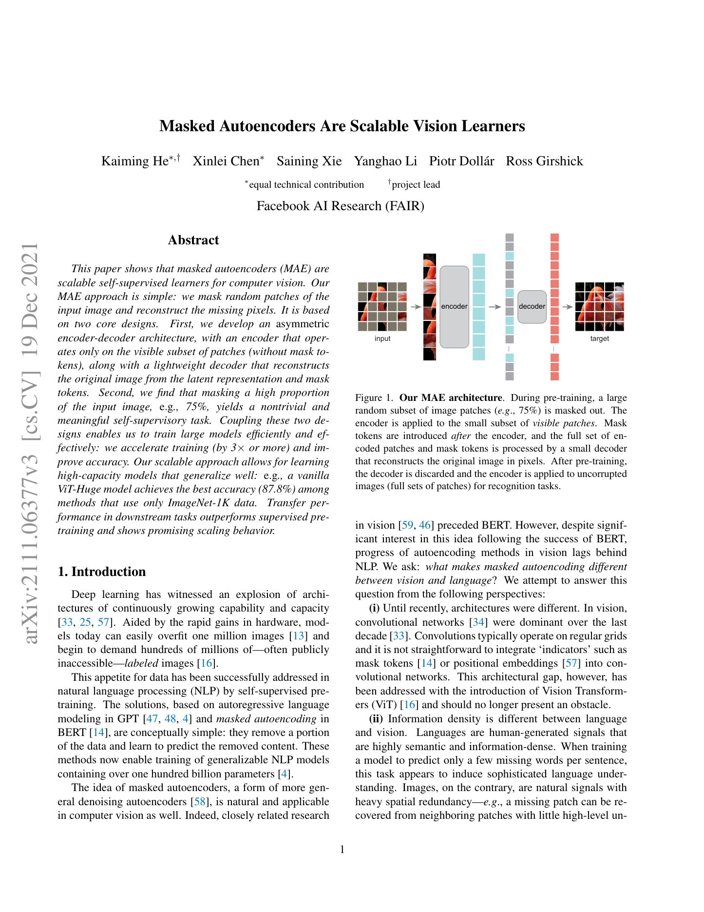
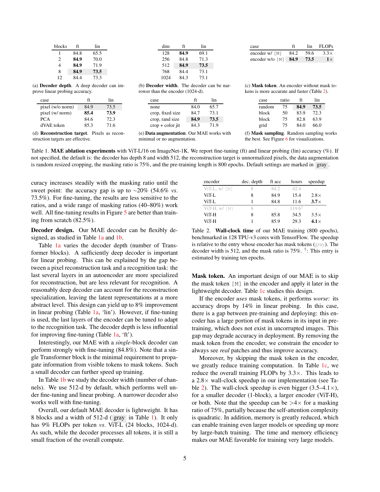
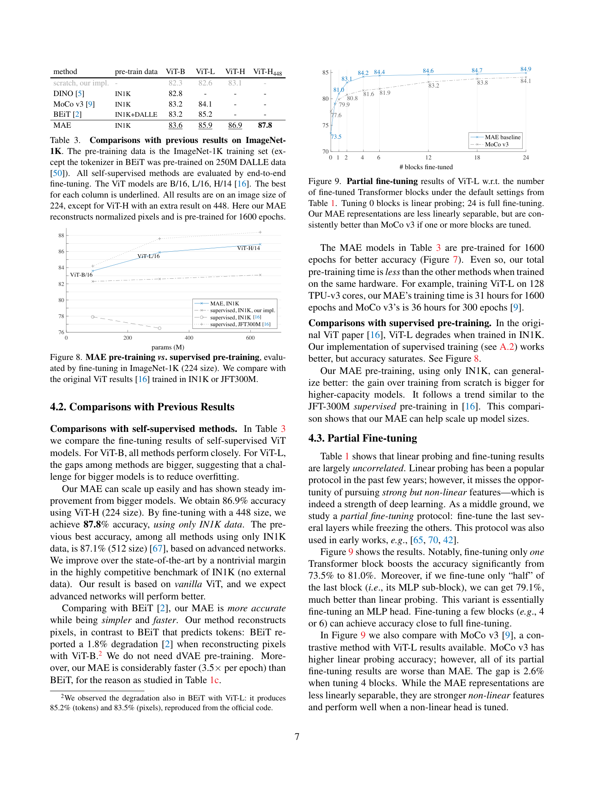

# MAE（2021）· 精读笔记

- **论文**：Masked Autoencoders Are Scalable Vision Learners（arXiv:2111.06377v3, 2021-12-19）
- **BibTeX 键名**：`he2021masked`
- **作者/单位**：Kaiming He, Xinlei Chen, Saining Xie, Yanghao Li, Piotr Dollár, Ross Girshick（Facebook AI Research, FAIR）
- **本地 PDF**：`3.科研基本任务/论文/目标检测/He 等 - 2021 - Masked Autoencoders Are Scalable Vision Learners.pdf`（共 14 页）
- **任务书条目**：第 3 周 #21｜🟢 AI 辅助读｜阅读要点：非对称编解码、75% 掩码、像素重建
- **阅读日期**：2026-11-01
- **核对规则**：正文数字后标「出处」= 原 PDF 的章节 / 表号 / 页码；✅ = 已回原文逐字查证；【待核对】= 原文未写或我读不出来。

> 说明：本篇是**给自己看的精读稿**，不是汇报稿。所以每一步都写"为什么这么设计"，而不是只抄结论。

---

## 0. 术语表（≥40 条，按「任务 / 结构 / 训练 / 评估 / 工程」分组）

> 三类词最容易在中文教程里被一句话带过：**masking ratio（为什么是 75% 而不是 BERT 的 15%）**、**asymmetric（到底哪边不对称）**、**linear probing（它到底在测什么）**。下面每条都写"在这篇论文里具体指什么"。

### 0.1 任务与范式（这篇论文在干什么）

| 术语 | 大白话解释（在 MAE 里的含义） |
|---|---|
| **自监督学习 self-supervised** | 不用人工标签，从数据本身造"题目"来训练。MAE 的题目是"把挖掉的块补回来"。 |
| **掩码自编码 masked autoencoding** | 一类自监督：遮住输入的一部分，让模型预测被遮住的部分。BERT 遮词，MAE 遮图像块。✅（Abstract） |
| **去噪自编码 DAE** | 更老的一类方法：给输入加"噪声/损坏"，学重建干净输入。MAE 属于它的推广（§2 明说 "Our MAE is a form of denoising autoencoding"）✅ |
| **预训练 pretext task** | 为了下游任务而先做的那份"假任务"。MAE 的重建任务就是 pretext task。 |
| **重建目标 reconstruction target** | 被遮住那块要预测成的"标准答案"。MAE 默认是**像素值**，也试了归一化像素、PCA 系数、dVAE token。✅（§3, Table 1d） |
| **掩码比例 masking ratio** | 被挖掉的 patch 占全部的百分比。MAE 最优 **75%**，对比 BERT 的 15%、视觉同期工作 20%–50%。✅（§4.1, Figure 5） |
| **随机采样（无放回）random sampling** | 从 196 个 patch 里均匀随机抽 49 个留下，不放回。原文强调"uniform 可避免中心偏置"✅（§3 Masking） |
| **块状掩码 block-wise** | BEiT 用的策略：一次遮一大块。MAE 实测在 75% 比例下**变差**（82.8/63.9）。✅（Table 1f） |
| **网格掩码 grid-wise** | 每 4 个 patch 固定留 1 个。任务太"容易"，表征反而差（84.0/66.0）。✅（Table 1f） |
| **图像块 patch** | 把图切成 16×16 的小方块。224×224 → 14×14 = **196 个** patch（我自己算的，与 Figure 2 脚注"196 patches"一致 ✅） |
| **可见 token visible token** | 编码器真正看到的那些 patch 的嵌入向量。75% 掩码时只有 49 个。 |
| **掩码 token mask token [M]** | 一个**共享的、可学习**的向量，用来"占位"表示"这里缺一块"。它只在解码器里出现。✅（§3 MAE decoder） |
| **数据效率 data efficiency** | 同样的标签量下能训多好。MAE 的价值就是让 ViT-L/H 在**只用 ImageNet-1K** 时也不退化。 |

### 0.2 结构与模型

| 术语 | 大白话解释 |
|---|---|
| **ViT** | Vision Transformer，把图像切成 patch、线性投影成 token、再过 Transformer。是 MAE 的骨架（#18 那篇）。 |
| **Transformer block** | 一个 `多头自注意力 + MLP` 的残差单元，前后各一个 LayerNorm。 |
| **非对称编码器-解码器 asymmetric encoder-decoder** | MAE 的核心设计：编码器**只看可见 patch、不含 mask token**（又深又宽）；解码器**吃全部 token（含 mask token）**但**又浅又窄**（8 层、512 维）。✅（§3, Figure 1） |
| **轻量解码器 lightweight decoder** | 每个 token 只花 **<10%** 的算力（相对编码器）；默认 8 层 512 维，是 ViT-L（24 层 1024 维）的 **9% FLOPs/token**。✅（§3, §4.1） |
| **线性投影 linear projection** | 一个不带激活的矩阵乘，把 16×16×3=768 维像素拉成 D 维 token；解码器最后也用一层线性投影把 D 维变回 256 个像素值。✅（§3 Reconstruction target） |
| **位置编码 positional embedding** | 告诉模型"这个 token 原来在图的哪个位置"。MAE 用**正弦余弦**版本，编码器和解码器都加。✅（Appendix A.1） |
| **LayerNorm（LN）** | 对每个 token 的特征做归一化，稳定训练。ViT block 里有两处。 |
| **辅助 dummy token** | 为了兼容 ViT 的 class token，MAE 预训练时在编码器输入末尾加一个"占位 token"，微调时当 class token 用。✅（Appendix A.1） |
| **自注意力的二次复杂度** | 注意力计算量 ∝ token 数的平方。**这正是 MAE 能加速 3 倍的数学根源**：196² vs 49²。 |

### 0.3 训练

| 术语 | 大白话解释 |
|---|---|
| **微调 fine-tuning（ft）** | 预训练后把整个编码器 + 一个新分类头**一起**用有标签数据训。MAE 默认只训 50 epoch（B 是 100）。✅（Table 9） |
| **线性探测 linear probing（lin）** | **冻结**编码器，只在特征上训一个线性分类器。测的是"特征线性可分性"。MAE 用 LARS、bs=16384、90 epoch、wd=0。✅（Table 10） |
| **部分微调 partial fine-tuning** | 冻结前面若干 block，只训最后几个。MAE 用它作为 lin 与 ft 的"中间态"（§4.3）。 |
| **MSE 损失（只在掩码块上）** | `L = (1/|M|) Σ_{i∈M} ‖x_i − x̂_i‖²`，**只对被遮住的 patch 算**（原文脚注 1：算全部像素会掉约 0.5%）。✅ |
| **per-patch 归一化** | 对每个 patch 单独算均值方差再归一化，作为重建目标。比原始像素 **+0.5%（85.4 vs 84.9）**。✅（Table 1d） |
| **AdamW** | 带解耦权重衰减的 Adam。预训练 lr=1.5e-4、wd=0.05、β=(0.9,0.95)。✅（Table 8） |
| **cosine 衰减 + warmup** | 学习率先线性升到峰值再余弦降。预训练 warmup 40 epoch。✅ |
| **layer-wise lr decay** | 越靠底层的层学习率越小（0.75 的幂次衰减），微调时防"把预训练特征冲掉"。✅（Table 9） |
| **batch size 4096** | 预训练超大批量，配合 lr 线性缩放规则 `lr = base × bs/256`。✅（Table 8, A.1） |
| **数据增强（RandAug / mixup / cutmix / drop path）** | 只用在**微调**里。**预训练只用 RandomResizedCrop**，连颜色抖动都不用。✅（Table 8 vs Table 9） |
| **训练轮数 epoch** | 预训练默认 **800** epoch（Table 3 那批模型用 1600）；微调 50（L/H）/100（B）epoch。✅ |
| **训练日程 schedule** | 预训练时长。Figure 7：800→1600 epoch，lin 从 73.5 涨到 75.1，**1600 都没饱和**。✅ |

### 0.4 评估

| 术语 | 大白话解释 |
|---|---|
| **top-1 验证精度** | 单张 224×224 中心裁剪，第一预测对就算对。本论文所有 y 轴都是它。✅（§4） |
| **ImageNet-1K（IN1K）** | 1000 类、约 128 万张带标签图。MAE 只用它，**不用任何外部数据**。 |
| **COCO + Mask R-CNN** | 检测/实例分割基准，指标是 `APbox`/`APmask`。✅（Table 4） |
| **ADE20K + UperNet** | 语义分割基准，指标 `mIoU`。✅（Table 5） |
| **iNaturalist / Places** | 细粒度分类 / 场景分类迁移基准。✅（Table 6） |
| **鲁棒性（IN-A / IN-C / IN-R / IN-Sketch）** | ImageNet 的对抗、腐蚀、素描、漫画变体，只推理不重训。✅（Table 13） |
| **迁移学习 transfer** | 把 IN1K 预训练的权重搬到别的任务上微调。 |
| **消融 ablation** | 一次只改一个设计，看精度怎么动。这篇的 Table 1（a–f）就是六组消融。 |

### 0.5 工程（每个都写「朴素做法 → 优化做法 → 为什么有效」）

| 术语 | 朴素做法 | 优化做法（MAE 采用） | 为什么有效 |
|---|---|---|---|
| **token 打乱/反打乱（shuffle / unshuffle）** | 真的把不要的 patch 从张量里删掉 → 得到**不规则张量**，需要写稀疏算子，GPU 上效率极低 | ①先给**所有** patch 做线性投影 + 位置编码；②随机打乱列表，**取前 25%**；③编码后补 mask token；④**反打乱**还原顺序对齐目标 | 全程是规整的稠密张量，**零稀疏算子**；打乱/反打乱是 O(L) 的内存操作，开销"可忽略"✅（§3 Simple implementation） |
| **重建目标的 tokenizer** | 像 BEiT 那样先训一个 dVAE，把像素变成离散 token 再预测 | 直接预测**像素**（可选 per-patch 归一化） | 省掉一整段预训练；dVAE 编码器本身要 40% ViT-L 的 FLOPs 且依赖 250M 外部图；且实测 token 与像素差异统计上不显著（Table 7 的 △ 多为 0.0）✅ |
| **线性探测的分类头** | 直接把编码器输出喂给线性层 | 中间插一层 `BatchNorm(affine=False)` | 不同消融变体的**特征幅值不同**，不归一化就得为每个变体重搜学习率；不加仿射的 BN **可吸收进线性层**，不破坏"线性"性质✅（A.1） |
| **训练时间度量** | 报 FLOPs（好看） | 报 **128 块 TPU-v3 上的墙钟小时数**（Table 2） | 稀疏/规整计算的真实瓶颈是显存 IO 与利用率，FLOPs 会低估开销。MAE 的 FLOPs 省 3.3×，墙钟只省 2.8×，差额就是这部分✅ |
| **掩码实现** | 用 mask 矩阵乘（`x * mask`），仍要把全图送进网络 | 打乱后**截断**列表 | 编码器物理上只处理 25% 的 token，显存与算力同比例下降，才能训 ViT-H |
| **大规模 ViT 的监督训练** | 直接套小模型配方 | wd=0.3、bs=4096、长 warmup、EMA 0.9999 | 不加 EMA 会过拟合：ViT-L 82.6% → 81.5%，ViT-H 83.1% → 80.9%✅（A.2） |

---

## 1. 论文定位

```
【NLP 的成功配方】                        【视觉的现状（2021 年初）】
 BERT：遮 15% 的词 → 预测词               BEiT：遮 40% 的块 → 预测 dVAE token
 GPT ：自回归预测下一个词                  iGPT：像素序列自回归（1362M 参数才 69.0 lin）
        │                                        │
        └──────────┬─────────────────────────────┘
                   ▼
        【ViT（#18）给了可用的骨架】
        把图切成 patch，就能像 NLP 一样做 masked modeling
                   ▼
        【但仍然打不过监督预训练】三个"为什么不一样"：
        ① 架构：卷积不好塞 mask token / 位置编码   → ViT 已解决
        ② 信息密度：图像冗余大，遮 15% 等于没遮     → 需要极高掩码率
        ③ 解码器：视觉重建的是像素，语义层级低     → 解码器必须"非对称"
                   ▼
        【MAE（#21）：非对称编解码 + 75% 随机掩码 + 像素重建】
                   ▼
        单模型 ViT-H 448 微调：ImageNet-1K **87.8%**（只用 IN1K 数据）
        预训练加速：ViT-L 42.4h → 15.4h（2.8×）；1 层解码器 → 11.6h（3.7×）
```

**上一篇（ViT，#18）留下什么坑**：ViT 证明了"Transformer 可以直接吃 patch"，但也证明**ViT-L 在 ImageNet-1K 上从头训会退化**（原文 §4 引用 ViT 论文：scratch 76.5%）；它必须靠 JFT-300M 这种"几亿张带标签图"才能发挥。换句话说：**架构有了，但"没有便宜的自监督目标"**。

**本篇填什么**：给出一个**便宜且有效**的自监督目标——遮住 75% 的块，只让编码器看剩下的 25%，用一个很小的解码器把像素补回来。结果是"又快又准"：预训练时间降到 1/3 左右，同时精度反超监督预训练，而且**模型越大收益越大**（Figure 8）。

**一句话**：**MAE = 「把 BERT 的"遮住再猜"搬到图像上，但把掩码率提到 75%、把解码器压到极小」——省算力的同时让表征更接近"理解"而不是"抄邻居"。**

---

## 2. 逐节导读（严格按原文章节顺序）

### 2.1 Abstract（p.1）

**想解决什么**：视觉领域缺一个"可扩展"的自监督学习器。

**关键句**：两个核心设计 —— ① 非对称编解码（编码器只作用于可见 patch，**不含 mask token**；轻量解码器从隐表征 + mask token 重建原图）；② **遮掉很高比例的块（如 75%）**才能让任务"非平凡且有意义"。

**结果句**：训练加速 **3× 以上**；ViT-Huge 在**只用 ImageNet-1K** 的方法里精度最高（**87.8%**）。

> **【批注】** 注意摘要的因果顺序：**"非对称" 是省算力的设计，"75% 掩码" 是提难度的设计**，二者是两件独立的事，千万别混成一条。省算力的根源是"编码器只处理 25% 的 token"，而 25% 又来自"掩码率 75%"——所以两个设计是**咬合**的：掩码率越高，省得越多，任务也越难。这就是原文说的 "win-win scenario"（§1）。

### 2.2 §1 Introduction（p.1–2）

**想解决什么**：解释"为什么 masked autoencoding 在 CV 里落后于 NLP"。

**动机**：作者不从工程出发，而从**信号本质**出发，列了三条差异（这一段是全篇的思想骨架，务必背下来）：

| # | 差异 | 原文要点 | MAE 的应对 |
|---|---|---|---|
| (i) | **架构不同** | 卷积在规则网格上运算，不容易塞进 mask token / 位置编码这类"指示符" | 用 **ViT**（已经能用指示符了），"should no longer present an obstacle"✅ |
| (ii) | **信息密度不同** | 语言是人造的、语义密集；图像是自然信号，**空间冗余极重**——"a missing patch can be recovered from neighboring patches with little high-level understanding"✅ | **遮极高比例（75%）**，逼模型做"整体理解"而不是"补纹理" |
| (iii) | **解码器角色不同** | 视觉解码器重建的是**像素**，语义层级比识别任务低；语言解码器预测的是**词**，本身就有语义 | 解码器**只在预训练用**，可以做得又小又"专"，把语义留在编码器里✅ |

> **【批注·易误解】** 很多人把 (ii) 读成"图像简单所以要多遮"，其实原文更狠：**图像冗余大到"遮一点点等于没遮"**。Figure 5 的线性探测曲线（遮 10% 只有 54.6%）就是这句话的量化证据。它与 BERT 的 15% 差距（5 倍）不是调参调出来的，是**信号冗余度差异**决定的。

> **【批注·与 CNN/Transformer 差异】** 这条也解释了"为什么 MAE 只能用 ViT 做"：CNN 的卷积核在规则网格上滑动，你没法在中间"插一个空位 token"；而 Transformer 把输入当**集合**处理，加不加 token 都行。所以 (i) 是"历史包袱"，ViT 之后就不再是障碍。

### 2.3 §2 Related Work（p.3）

**想解决什么**：把自己的位置摆清楚（和 BERT/GPT、DAE、BEiT、对比学习划清界限）。

**关键信息**：
- 自编码是"经典"方法，**PCA 和 k-means 都是自编码器**（原文这么写的✅，别觉得离谱——它们都能看成"编码 + 解码"）。
- DAE 家族：遮像素、去颜色通道……MAE 属于这一类，但与经典 DAE **有若干不同**（原文只写了 "different in numerous ways"，具体在 §3 展开）。
- 掩码图像编码线：Context Encoder（卷积 inpaint）→ iGPT（像素序列）→ ViT（试过 masked patch）→ **BEiT（预测离散 token）**。
- 对比学习线：依赖**数据增强**（MoCo/SimCLR/BYOL）。

> **【批注·伏笔】** §2 最后一句"Autoencoding pursues a conceptually different direction"是伏笔，到 §4.1 数据增强那节才收：**MAE 几乎不需要数据增强**（Table 1e 里"完全不增强"还有 84.0/65.7），而对比学习"没有增强就崩"（BYOL/SimCLR 只留裁剪会掉 13%/28%，原文引用 [21][7]✅）。原因是：**随机掩码本身就在每个 epoch 生成新样本**，扮演了增强的角色。

### 2.4 §3 Approach（p.3–4）

这一节是**方法本体**，五个小节，逐个看。

**(1) Masking（掩码）**
- 做法：按 ViT 切成不重叠 patch → **均匀随机、无放回**采样保留一部分。
- 原文的两句关键话：高掩码率"largely eliminates redundancy"，使任务"cannot be easily solved by extrapolation from visible neighboring patches"；均匀分布"prevents a potential center bias"（避免总是遮中间）。✅

> **【批注·工程细节】** "无放回（without replacement）"很重要：有放回会导致某些 patch 被反复采样、实际掩码率偏离名义值。代码里用"打乱后截断"天然就是无放回。

**(2) MAE encoder**
- 就是一个 **ViT，但只喂可见 patch**：线性投影 + 位置编码 + 一串 Transformer block。
- **没有 mask token**。原文："Masked patches are removed; no mask tokens are used."✅

> **【批注·易误解】** "编码器看不到被遮的块"有两层含义：① 输入里没有它们；② 也**没有**用 mask token 占位。后者才是关键（Table 1c）：如果编码器里有 mask token，线性探测会掉 **14%**（73.5 → 59.6），因为**预训练时输入有一大堆"假 token"，部署时一张干净图里根本没有**，产生 train/deploy 鸿沟。这条批注非常值得记住——**"训练分布要贴近部署分布"是比"省算力"更本质的理由**。

**(3) MAE decoder**
- 输入 = 编码后的可见 token **+ mask token**（共享的可学习向量）。
- **所有 token 都加位置编码**，否则 mask token 不知道自己在图的哪个位置。✅
- 解码器**只在预训练用**，所以可以独立设计：又浅又窄（默认 8 层、512 维）。✅

> **【批注·与 Transformer 差异】** 这里有一个反直觉的点：解码器"负责重建"，所以**它的后几层是"专为重建"而特化的**，语义反而不适合识别。原文用这一点解释 Table 1a：解码器越深，**线性探测**越好（65.5 → 73.5），因为"重建特化"被压在解码器里、编码器表征更抽象；但**微调**几乎不受影响（84.8~84.9），因为微调可以自己把编码器后几层调成"识别专用"。**这就是 ft 与 lin 结论不一致的机制性解释。**

**(4) Reconstruction target（重建目标）**
- 默认：解码器最后一层线性投影输出 `16×16×3=768` 维 → reshape 成图；
- 损失：**像素空间的 MSE，且只在被遮 patch 上算**（脚注 1：算全部像素会掉约 0.5%）；✅
- 变体：**per-patch 归一化**（用该 patch 自己的均值/方差归一化）——效果更好。

> **【批注·易误解】** "只在 masked patch 上算 loss"与经典 DAE"全图算 loss"是**故意不同**的。原文说这是"purely result-driven"（纯结果导向），没有理论解释。我的推断：可见 patch 上的重建是"抄自己"，梯度信号几乎为零信息，反而稀释了真正难的部位。

**(5) Simple implementation（实现）**
- 五步：全 patch 投影 → 打乱 → 截断保留 25% → 编码 → 补 mask token 并**反打乱** → 解码。
- 原文明确："does not require any specialized sparse operations"，"shuffling and unshuffling operations are fast"。✅

> **【批注·工程细节】** 这是全篇最"值钱"的工程技巧：**把"不规则"变成"规则"**。同理可推广到任何"只算一部分 token"的场景（如 later 的 token pruning、稀疏注意力）。写代码时不要真去删张量。

### 2.5 §4 ImageNet Experiments（p.4–7）

**基线**：ViT-L/16（比 ResNet-50 大一个数量级，容易过拟合）。§4 开头给了三个数（✅ p.4）：
- ViT-L 从头训（ViT 原文）：**76.5%**
- ViT-L 从头训（作者自己更强配方）：**82.5%**
- 本文 MAE 预训练 + 微调：**84.9%**

> **【批注】** 这三个数必须一起记。只写"84.9 vs 76.5 = +8.4"是**不公平**的对比（对手配方弱）；公平对比是 **+2.4**（84.9 − 82.5）。写论文时这种"对比基线是否用同样强配方"的细节，审稿人一定会问。

#### 4.1 Main Properties（六组消融，Table 1）

| 小节 | 问题 | 关键数字（ft / lin） | 结论 |
|---|---|---|---|
| Masking ratio | 遮多少最好？ | 75%：**84.9 / 73.5**；10%：83.2 / **54.6**；90%：83.0 / 66.1✅（Figure 5） | lin 对掩码率**极敏感**（差 ~19 个点）；ft 很钝（40–80% 都能用） |
| Decoder depth | 解码器要多深？ | 1 层 84.8/**65.5**；8 层 84.9/**73.5**；12 层 84.4/73.3✅（Table 1a） | **lin 需要够深的解码器**；ft 1 层就够（"single block is the minimal requirement to propagate information"） |
| Decoder width | 要多宽？ | 128 维 84.9/**69.1**；512 维 84.9/**73.5**；1024 维 84.3/73.1✅（Table 1b） | 512 维（编码器 1024 的**一半**）最好，解码器可以比编码器窄 |
| Mask token | mask token 要不要进编码器？ | 进：84.2/**59.6**（3.3× FLOPs）；不进：84.9/**73.5**（1×）✅（Table 1c） | 不进编码器，**既准又快** |
| Reconstruction target | 预测什么？ | 原始像素 84.9/73.5；归一化像素 **85.4/73.9**；PCA 84.6/72.3；dVAE token 85.3/71.6✅（Table 1d） | 归一化像素最好；**PCA 掉点说明"高频成分有用"** |
| Data augmentation | 要不要增强？ | 无增强 84.0/**65.7**；固定尺寸裁剪 84.7/73.1；随机尺寸裁剪 **84.9/73.5**；+颜色抖动 84.3/71.9✅（Table 1e） | 只要裁剪；**颜色抖动反而掉点** |
| Mask sampling | 怎么遮？ | 随机 75%：84.9/**73.5**；块状 50%：83.9/72.3；块状 75%：82.8/**63.9**；网格 75%：84.0/66.0✅（Table 1f） | **随机最好**；块状在高比例下"任务太难"；网格"太容易" |

> **【批注·易误解 1】** **"掩码率 75% 是万能最优"是错的**。原文写得很清楚：lin 在 75% 见顶，但 **ft 在 40–80% 都差不多**（Figure 5 上图的点几乎平）。所以"必须 75%"这个说法只对**线性探测**成立。做下游任务微调时，掩码率是可以放松的超参。

> **【批注·易误解 2】** **"颜色抖动掉点"不是玄学**。颜色抖动改变了"像素值"这个重建目标的分布，而 MAE 的题目就是**预测像素**；你把目标本身搅乱了，任务就变噪声了。对比学习之所以爱颜色抖动，是因为它要学**颜色不变性**——目标不同，增强策略就不同。

> **【批注·与 CNN/Transformer 差异】** 块状掩码（BEiT 式）在 75% 下崩到 63.9（lin），说明**"任务难度"要匹配"信息量"**：块状掩码一次删掉一大片，剩下的可见区可能连"物体在哪"都判断不了；随机掩码则在全图均匀留下线索，逼模型做"整体推理"。原文用重建图也能看出来：块状掩码的重建更**糊**。

#### 4.2 Comparisons with Previous Results（Table 3、Table 2、Figure 7–9）

- **Table 3（p.7）自监督横比（都用端到端微调）**：

| 方法 | 预训练数据 | ViT-B | ViT-L | ViT-H | ViT-H 448 |
|---|---|---|---|---|---|
| scratch（作者实现） | — | 82.3 | 82.6 | 83.1 | — |
| DINO | IN1K | 82.8 | — | — | — |
| MoCo v3 | IN1K | 83.2 | 84.1 | — | — |
| BEiT | IN1K + DALLE | 83.2 | 85.2 | — | — |
| **MAE** | **IN1K** | **83.6** | **85.9** | **86.9** | **87.8** |

  原文还给了两个关键对比点（✅ §4.2）：
  1. 只用 IN1K 数据的**前 SOTA** 是 **87.1%**（512 尺寸，VOLO [67]），MAE 的 87.8% 属于"nontrivial margin"；
  2. **BEiT 用 ViT-B 时"重建像素"会掉 1.8%**（作者复现 BEiT ViT-L：token 85.2 vs 像素 83.5，脚注 2）——但 MAE 用像素却更好。**这说明"像素 vs token"不是方法的关键，架构/掩码策略才是。**
  3. 墙钟：ViT-L 训 1600 epoch 只要 **31 小时**（128 TPU-v3），而 MoCo v3 训 300 epoch 要 **36 小时**（引 [9]）。✅

- **Table 2（p.5）墙钟加速**：ViT-L 8 层解码器 **42.4h → 15.4h（2.8×）**；1 层解码器 **11.6h（3.7×）**；ViT-H **119.6h → 34.5h（3.5×）/ 29.3h（4.1×）**。原文还解释了"为什么能超过 4×"：**自注意力是二次的**，token 从 196 降到 49，注意力那部分降到 1/16。✅

- **Figure 7（p.6）训练日程**：800 → 1600 epoch，lin 73.5 → **75.1**，"even at 1600 epochs 没有饱和"。对比 MoCo v3 在 300 epoch 就饱和。**原因是 MAE 编码器每个 epoch 只看到 25% 的 patch，而对比学习看到 200%（两视图）甚至更多**。✅

- **Figure 8（p.7）vs 监督预训练**：MAE 的增益随模型变大而变大，"follows a trend similar to the JFT-300M supervised pre-training"。✅

#### 4.3 Partial Fine-tuning（p.7, Figure 9）

- 动机：lin 与 ft 结果"largely uncorrelated"，而 lin **放弃了非线性特征**——"which is indeed a strength of deep learning"。✅
- 结果：只调 **1 个** Transformer block，73.5% → **81.0%**；只调最后一块的 **MLP 子块**（相当于调一个 MLP 头）就有 **79.1%**；调 4 个块接近全微调（84.2 vs 84.9）。✅
- 与 MoCo v3 对比：MoCo v3 的 lin 更高（77.6 > 73.5），但**所有部分微调结果都低于 MAE**，调 4 块时差 **2.6%**（84.2 vs 81.6）。✅

> **【批注·这是全篇最重要的方法论批注】** 原文用一句话总结："**While the MAE representations are less linearly separable, they are stronger non-linear features**"（MAE 的表征线性可分性更差，但非线性更强）。这句话直接**否定**了"lin 是表征质量的黄金标准"。而且原文补了一句很辣的：**NLP 里根本不用 linear probing 做 benchmark**。✅（§4.3 末）
>
> 对你的实际意义：以后看论文表格，**先看它用 ft 还是 lin 评估**，别拿 lin 的差距去否定一个方法。

### 2.6 §5 Transfer Learning（p.8）

- **COCO（Table 4）**：ViT-B 50.3 vs 监督 47.9（**+2.4**）；ViT-L 53.3 vs 49.3（**+4.0**）。模型越大，自监督的领先越大。✅
- **ADE20K（Table 5）**：ViT-L 53.6 vs 49.9（**+3.7**）；ViT-B 48.1 vs 47.4（+0.7）。✅
- **iNat / Places（Table 6）**：iNat 2017 上 ViT-H 448 达 83.4，前最好 75.4（那个前最好也用了 10 亿图预训练）。✅
- **像素 vs token（Table 7）**：△（dVAE token − 归一化像素）为 0.0 / −0.2 / 0.0 / 0.0 / −0.1 / 0.0 / −0.2，**统计上不显著**。结论："tokenization is not necessary"。✅

> **【批注·工程细节】** 迁移到 COCO 时 ViT 没有多尺度特征，作者的做法（A.3）是：把 ViT 的 24 个 block**均分成 4 组**，每组输出接一个卷积做上/下采样，得到 stride 4/8/16/32 的 4 层特征，再喂 FPN。**这是"ViT 当 backbone 做检测"的标准改造套路**，你在读 DETR/ViTDet 系列时会反复见到。

### 2.7 §6 Discussion / Conclusion（p.8–9）

- 正面："Simple algorithms that scale well are the core of deep learning"，视觉自监督"可能正走上 NLP 的轨迹"。✅
- 反面（作者自己泼冷水）："**images are merely recorded light without a semantic decomposition into the visual analogue of words**"——图像没有"词"这种语义单位，所以 MAE **遮的是随机 patch（大概率不构成语义片段）**，重建的也是**像素（不是语义实体）**。✅
- 但作者观察到 Figure 4：用 75% 训练的模型，在 85%/95% 掩码下仍能给出"合理但不同"的重建 → 认为它学到了"视觉概念（semantics）"。

> **【批注·易误解】** Figure 4 的"合理重建"**不能**当成"模型理解了语义"的证据。原文自己在 Figure 3 的图注里就提醒：COCO 上最右两张"与真值不同但语义上说得通"。这只能说明它学到了**数据分布**，不做因果推断。写综述时别把这句话当结论引用。

---

## 3. 核心图 / 公式深读

### 3.1 Figure 1：整体数据流（p.1）



图注解读（逐句翻译成"数据流"）：

```
输入图 224×224×3
  └→ 切 196 个 16×16 patch
       └→ 随机保留 49 个（遮 75%）
            └→ [编码器 ViT-L：24 层、1024 维]   ← 只吃 49 个 token
                 └→ 49 个 latent
                      └→ 补 147 个 mask token（共享可学习向量）+ 全部加位置编码
                           └→ [解码器：8 层、512 维]  ← 吃 196 个 token
                                └→ 线性投影 → 196×768 像素
                                     └→ 只在 147 个被遮 patch 上算 MSE
预训练结束后：丢掉解码器，编码器直接吃完整 196 个 patch 做识别
```

**三个"看图才能发现"的细节**：
1. 编码器入口**没有**红色的 mask token（Figure 1 里 mask token 出现在编码器**之后**）；
2. 解码器比编码器"窄一半、浅三倍"；
3. 图注明确写："After pre-training, the decoder is discarded"——**推理时零额外开销**。

> **【批注】** "解码器丢掉"这一条决定了 MAE 的**部署友好度**：它不像 DETR 那样带一个必须保留的大解码器；预训练之后你手上就是一个标准 ViT，下游可以无缝替换 backbone。

### 3.2 损失函数（原文未给公式，这是我的形式化，标【我的推导】）

原文只说"computes the mean squared error (MSE) between the reconstructed and original images in the pixel space"且"only on masked patches"。写成式子：

$$
\mathcal{L}=\frac{1}{|\mathcal{M}|}\sum_{i\in\mathcal{M}}\left\|\hat{x}_i-x_i\right\|_2^2
$$

逐符号：

| 符号 | 含义 | 维度 | 备注 |
|---|---|---|---|
| $\mathcal{M}$ | 被遮住的 patch 索引集合 | 147 个（75%） | 75% × 196 = 147 |
| $x_i$ | 第 $i$ 个 patch 的**原始像素**（或 per-patch 归一化后的像素） | 16×16×3 = 768 | 归一化版：`(x−μ_i)/σ_i`，μ/σ 只由该 patch 自己算 ✅ |
| $\hat{x}_i$ | 解码器输出经线性投影 + reshape 得到的重建 patch | 768 | 最后一层线性投影输出通道数 = 768 |
| $\|\cdot\|_2^2$ | 逐元素平方和 | 标量 | 等价于 768 维的 L2 |

**为什么"只在 $\mathcal{M}$ 上算"**：原文脚注 1 说算全部像素会掉约 0.5%，并称这是"purely result-driven"。**我的推断**：可见 patch 的"重建"等于把输入抄一遍，这部分梯度对表征几乎无用，还会把 loss 的量级压小、让真正难的部位学不充分。

**归一化为什么有效（原文的解释 + 我的补充）**：原文说"per-patch normalization enhances the contrast locally"（局部对比度增强）。**我的补充**：归一化把"亮度/色偏"这类**全局、低信息量**的分量从目标里去掉，模型就不用浪费容量去预测它们；这等价于把重建目标往"结构/纹理"上推。Table 1d 里 PCA（只保留 96 个低频系数）反而掉点，正好反证**高频成分对表征有用**。

### 3.3 Figure 5：掩码率曲线（p.4）

> 说明：Figure 5 位于 p.4，其纵轴数字已逐点回原文抄录（✅）；本笔记只渲染 3 个关键页，Figure 5 的版式可对照 `images/mae_p5.png`（同属 §4.1 消融部分）。

| 掩码率 | 10% | 20% | 30% | 40% | 50% | 60% | 70% | 75% | 80% | 90% |
|---|---|---|---|---|---|---|---|---|---|---|
| **微调 ft** | 83.2 | 83.4 | 83.4 | 84.7 | 84.9 | 85.0 | 84.9 | 84.9 | 84.5 | 83.0 |
| **线性探测 lin** | 54.6 | 58.9 | 61.7 | 67.0 | 69.9 | 71.8 | 73.2 | **73.5** | 71.8 | 66.1 |

三条读法：
1. **lin 曲线是"单峰"的**：54.6 → 73.5 → 66.1，峰在 75%，**落差约 19 个点**（原文说 "up to ∼20%"✅）。
2. **ft 曲线是"平台"的**：40–80% 都在 84.5–85.0 之间，**抖动不到 1 个点**。
3. **所有 ft 结果都高于 scratch 的 82.5%**（原文明确说 "All fine-tuning results in Figure 5 are better than training from scratch"✅）——哪怕只遮 10% 也有收益。

> **【批注】** 为什么 lin 这么敏感？我的推断：掩码率低时，模型可以用"抄邻居"完成任务，编码器学到的表征就**高度局部、线性可分的判别信息很少**（因为它压根没被要求理解全局）；掩码率高到 75% 时，"抄"失效，编码器必须把整张图压成一个能推理的隐表征，这个表征反而**更好但更"非线性"**——所以 lin 涨、ft 却不敏感。

### 3.4 Table 1 与 Table 2（p.5）



Table 1 的读法见 §2.5。这里只补两处**必须自己算一遍**的账：

**(1) 为什么"去掉 mask token"能省 3.3× FLOPs？**（我的推导）

```
编码器输入 token 数：有 [M] 时 = 196；无 [M] 时 = 49
自注意力主导项 ∝ (token 数)² × 层数 × 维度  → 比值 (196/49)² = 16
其余线性项（投影、MLP）∝ token 数        → 比值 196/49 = 4
真实 FLOPs 比值 = 3.3×（原文 Table 1c ✅），介于 4 与 16 之间 → 与推导一致
墙钟比值 = 2.8×（原文 Table 2 ✅），小于 3.3×
```

**墙钟 < FLOPs 的原因**：GPU/TPU 的实际瓶颈不全是 FLOPs，还有 kernel 启动、显存读写、批次调度等固定开销；token 少了 4 倍，这些开销并不会同步减少。**这是我读论文时最容易忽略的一层**：论文报"3× 加速"时，一定要确认它是 FLOPs 还是 wall-clock。

**(2) 解码器的成本占比**

原文：默认解码器 8 层、512 维，"only has **9% FLOPs per token** vs. ViT-L (24 blocks, 1024-d)"✅。所以即使解码器要处理 196 个 token（编码器的 4 倍），它的总成本也只有 `4 × 9% = 36%` 左右的量级——**远小于编码器省下来的那 75%**。这就是"非对称"的账。

### 3.5 Figure 9：部分微调的"斜坡"（p.7）



| 微调的 block 数 | 0（=lin） | 1 | 2 | 4 | 6 | 12 | 18 | 24（=全 ft） |
|---|---|---|---|---|---|---|---|---|
| **MAE** | 73.5 | **81.0** | 83.1 | 84.2 | 84.4 | 84.6 | 84.7 | 84.9 |
| **MoCo v3** | **77.6** | 79.9 | 80.8 | 81.6 | 81.9 | 83.2 | 83.8 | 84.1 |

两条曲线**在 0 处交叉**，在 1 处就反超——这是全篇最有说服力的一张图：**"谁的表征更好"取决于你允许下游用多少非线性**。

---

## 4. 实验逐表解读

### 4.1 每张表在回答什么问题

| 表/图 | 页码 | 回答什么问题 | 一句话结论 |
|---|---|---|---|
| Table 1 (a–f) | p.5 | 六个设计各值多少？ | 掩码率、去 mask token、随机采样最关键；解码器"够用就行" |
| Table 2 | p.5 | 加速到底多快（墙钟）？ | 2.8×–4.1×，解码器越浅、编码器越大，加速越多 |
| Table 3 | p.7 | 和同期自监督比？ | 同尺寸全面领先；只用 IN1K |
| Table 4 | p.8 | 检测/分割迁移？ | +2.4（B）/ +4.0（L） |
| Table 5 | p.8 | 语义分割迁移？ | +0.7（B）/ +3.7（L） |
| Table 6 | p.8 | 细粒度/场景分类？ | iNat 全面超；Places 靠"少数据打败十亿图预训练" |
| Table 7 | p.8 | 像素 vs token？ | 差异不显著 → **tokenization 不必要** |
| Table 12 | p.12 | 掩码类方法的 lin 对比 | MAE-L 75.8，远超 BEiT 52.1，但仍低于 MoCo v3 77.6 |
| Table 13 | p.12 | 鲁棒性？ | IN-A 上 68.2 vs 监督 33.1（**+35 点**） |

### 4.2 关键数字的含义（挑 6 个最该记住的）

1. **87.8%** = ViT-H + 448 分辨率微调 + 1600 epoch + 归一化像素 + **仅 IN1K**。
2. **86.9%** = 同上但 **224** 分辨率——**同一模型，只是测试分辨率不同**。
3. **84.9%** = ViT-L 224 ft（Table 1 默认 800 epoch）——**注意它和 85.9%（Table 3，1600 epoch）不是一回事**。
4. **73.5%** = 同模型的 lin——**ft 与 lin 差 11.4 点**，这是本篇的"招牌数字"。
5. **3.3× / 2.8×** = FLOPs 加速 / 墙钟加速（去 mask token）。
6. **75%** = 掩码率；对应编码器只处理 **49/196** 个 patch。

### 4.3 最容易误读的 3 个地方（务必记住）

**① "MAE 的 lin 只有 73.5，比 MoCo v3 的 77.6 差，所以表征不如对比学习"** —— 🟥 错。
原文 §4.3 + Figure 9 明确反驳：调 1 个 block 就 81.0，调 4 个 84.2，**全面反超**。作者原话："linear separability is not the sole metric for evaluating representation quality"，且"linear evaluation is not often used in NLP for benchmarking pre-training"✅。

**② "Table 3 的 87.8% 是 224 输入，所以 MAE 比 VOLO 的 87.1% 高 0.7"** —— 🟥 错。
87.1% 是 **512** 尺寸（VOLO [67]，原文 §4.2 写的），87.8% 是 **448** 尺寸。两者都是"放大分辨率后的结果"，可以比；但 86.9%（224）**不能**直接和 87.1%（512）比。

**③ "Table 1 默认设置（800 epoch）就是最终模型设置"** —— 🟨 半对。
Table 3 的模型全部是 **1600 epoch + 归一化像素**（Table 3 图注明确写 "Here our MAE reconstructs normalized pixels and is pre-trained for 1600 epochs"✅），而 Table 1 的默认是 **800 epoch + 未归一化像素**。所以 Table 1 里 84.9 和 Table 3 里 85.9 的 1.0 点差距，就来自这两处设置。

---

## 5. 我的思考（🟢，4 点）

**① 【原文结论】真正的贡献是"把自监督的成本结构改了"，不是"提出一个新任务"。**
掩码重建这个任务在 2016 年（Context Encoder）就有，BEiT 也已经做了。MAE 的增量是**成本**：编码器只算 25% token，注意力那部分直接降到 1/16，于是"大模型 + 自监督"第一次在经济上可行（ViT-H 119.6h → 29.3h，4.1×，Table 2✅）。这解释了为什么 2021 年之后视觉自监督突然能训大模型——**门槛是算力，不是想法**。

**② 【我的推断】"非对称"的收益有两层，而且第二层比第一层更本质。**
第一层是**算力**（省 3.3× FLOPs）；第二层是**分布对齐**——编码器永远只看真实 patch，部署时也不会有 mask token，所以没有 train/deploy gap（Table 1c 里去掉 [M] 让 lin 从 59.6 跳到 73.5，这个 14 点的跳跃**不可能**只用算力解释）。我推测这个"分布对齐"论点对任何"预训练时输入被污染"的方法都成立（例如带随机擦除的对比学习）。

**③ 【课外补充·待核实】掩码率的最优值与"数据冗余度"正相关。**
MAE 在 ImageNet（自然图像、冗余极高）上要 75%；BERT 在文本上只要 15%。如果这个规律成立，那么**医学影像（冗余更高？）、遥感图（冗余低？）、视频（时间冗余极高）**的最优掩码率应该各不相同。我还没找到系统验证这一点的文献，标【待核实】。**这可能是一个能做的实验**：在同一个数据集上扫掩码率 × 数据规模，看最优点怎么移动。

**④ 【如果让我改】我会把"掩码率"从超参变成**可学习的**变量。**
现在掩码率是人工定的常数；但同一张图里，"天空"区域遮 90% 也能补，"人"区域遮 60% 就补不了。**我的想法**：用第二个轻量网络预测每个 patch 的"可预测性"，按可预测性分配掩码预算（难区域少遮）。这类似 hard-example mining，但作用在**掩码策略**而不是损失上；工程上可以复用同一套 shuffle/truncate 实现，不需要稀疏算子。风险是策略网络本身会退化（全部遮天空），需要加熵正则。

---

## 6. 与前后论文的衔接

```
#18 ViT ──────────────────────────────────────────► #21 MAE ─────► 后续
  • "patch = token" 让 CV 能用 Transformer            • 自监督目标         • SimMIM（同期，掩码+像素但对称）
  • 但 ViT-L 在 IN1K 从头训只有 76.5%，必须靠         • 75% 高掩码率       • BEiT v2 / CAE（改重建目标）
    JFT-300M（3 亿带标签图）                          • 非对称编解码       • ConvNeXt V2（把 MAE 搬到 CNN）
  • 结论：架构有了，"便宜的监督信号"还没有            • 3× 训练加速        • VideoMAE / MAE-ST（搬到视频）
        │                                                  │
        └──────────────► 留下的坑：自我监督怎么训大模型？────┘
```

**向前看（MAE ← ViT）**：ViT 解决了 (i) 架构问题（能把 mask token / 位置编码塞进网络），但没解决 (ii)(iii)。MAE 是把 ViT 的两个"副作用"当成"设计约束"来用：因为 ViT 输入是**集合**，所以可以只喂子集；因为 ViT 没有卷积的局部归纳偏置，所以必须靠高掩码率逼它学全局。

**向后看（MAE → 后续）**：MAE 留下的三个可改进点，直接对应后来三条线：
1. **重建目标**（像素语义太低）→ BEiT v2 用语义 token，CAE 用特征；
2. **掩码策略**（随机是否最优）→ 后续有 attention-guided masking；
3. **只做分类**（MAE 的编码器是单尺度）→ ViTDet / ViT-Adapter 等把它接进检测分割。

**与你的选题（自动驾驶 / 检测）最相关的一句**：MAE 的迁移实验（Table 4）证明**自监督预训练在 COCO 检测上能稳定 +4 个点（ViT-L）**，而且模型越大收益越大——如果你要在小数据集上训检测器，MAE 式预训练是"低成本换精度"的选项之一。

---

## 7. 回原文核对记录（≥6 条，含纠偏）

| # | 我原先/常见的说法 | 原文依据 | 判定 |
|---|---|---|---|
| 1 | MAE 对**整张图**的像素算重建损失 | §3 + 脚注 1：只在 masked patches 上算；"Computing the loss only on masked patches differs from traditional DAE" | 🟥 我原以为全图算。错 |
| 2 | 编码器也吃 mask token，只是被遮住 | §3 "Masked patches are removed; no mask tokens are used"；Table 1c | 🟥 错，编码器里**根本没有** mask token |
| 3 | 掩码率必须 ≥75% 才有效 | Figure 5：ft 在 40–80% 都是 84.5+；只有 lin 单峰于 75% | 🟨 只对 lin 成立 |
| 4 | Table 3 的 87.8% 是 224 输入 | Table 3 图注："All results are on an image size of 224, except for ViT-H with an extra result on 448" | 🟥 错误对应；87.8 是 448，224 是 86.9 |
| 5 | MAE 预训练用了颜色抖动等强增强 | Table 1e：+颜色抖动反而掉点（84.3/71.9）；Table 8 预训练只有 RandomResizedCrop | 🟥 错，预训练**没有**颜色抖动 |
| 6 | 训练加速 3× 指的是墙钟时间 | Table 2：ViT-L 42.4h→15.4h 是 2.8×；3.3× 是 FLOPs（Table 1c） | 🟨 两个数不同，别混 |
| 7 | 掩码类方法在 lin 上普遍很弱 | Table 12：MAE ViT-L **75.8%** 线性探测，远高于 BEiT 的 52.1；但低于 MoCo v3 的 77.6 | 🟩 基本正确，但 MAE 已把差距缩到 1.8 点 |
| 8 | **Table 1 的默认就是最终模型设置** | Table 1 图注默认 800 epoch / 未归一化像素；Table 3 图注是 1600 epoch / 归一化像素 | 🟥 **纠偏**：我一开始把 84.9 当成了"最终模型精度"，实际最终是 85.9（224）/ 87.8（448） |
| 9 | 解码器必须 ≥8 层 | Table 1a：1 层解码器 ft 84.8、lin 65.5；原文说"a single Transformer block is the minimal requirement" | 🟨 只对 lin 需要深度 |

**纠偏总结（第 8 条展开）**：我第一次读时把 Table 1 的 84.9（ViT-L ft）当成了"MAE 的全部实力"，然后对比 BEiT 的 85.2 觉得"MAE 没赢多少"。回原文才发现 Table 3 用的是**更强的设置**（1600 epoch + 归一化像素），对应 85.9。也就是说：**论文里"消融表的默认"和"主结果表的配置"经常不是同一套**，读表必须先读图注。

---

## 8. 自测题 5 题 + 常见误解 5 条

### 8.1 自测题

1. 224×224 的图、16×16 的 patch，75% 掩码率下编码器要吃多少个 token？据此估一下自注意力那部分的 FLOPs 是完整 ViT 的几分之几？
2. 为什么 mask token **不能**放进编码器？原文给了两个理由，分别对应哪个表的哪个数字？
3. 掩码率从 75% 降到 10%，lin 会掉多少点？ft 会掉多少点？这个不对称说明什么？
4. Table 1 里"块状掩码 75%"只有 82.8/63.9，而"随机掩码 75%"是 84.9/73.5。原文用什么词解释这个差距？重建图有什么不同？
5. 如果只允许你改一处让 MAE 更适合"小数据集"（比如 1 万张图），你改哪里？为什么？

### 8.2 常见误解（每条给"为什么错"）

| 误解 | 为什么错 |
|---|---|
| "MAE 就是 BERT 的图像版" | 表面像，实质不同：BERT 遮 15% 词、预测**语义单元**；MAE 遮 75% 块、预测**像素**，且**编解码器不对称**。原文 §1 专门写了三条差异。 |
| "MAE 很快是因为用了稀疏卷积" | 恰恰相反：原文强调 **"does not require any specialized sparse operations"**，靠的是"打乱+截断"把问题变成稠密张量问题。 |
| "线性探测准确率高 = 表征好" | 原文 §4.3 用 Figure 9 直接反驳：MAE lin 低但部分/全微调全胜；还说 NLP 根本不用 lin 做基准。 |
| "解码器越大重建越准，所以表征越好" | Table 1a：解码器加深只改善 lin（65.5→73.5），ft 几乎不动（84.8→84.9）。解码器是"垃圾桶"，把重建特化吸走，**编码器**才是要的东西。 |
| "MAE 的重建图和原图很像 = 学到了语义" | Figure 1/2 图注自己就提醒：可见 patch 输出质量**故意**不修（"As no loss is computed on visible patches, the model output on visible patches is qualitatively worse"）；"像"只说明拟合了分布。 |

---

## 9. 读到这里最容易产生的疑问（5 组 Q&A）

**Q1：掩码率 75% 时，被遮的块里有 147 个，解码器要吃 196 个 token，那"省算力"不就白省了吗？**
A：没白省。省的是**编码器**（占绝对大头）。编码器是 24 层 × 1024 维，解码器只有 8 层 × 512 维，**每 token 只花 9% 的 FLOPs**（原文✅）。粗算：解码器处理 196 个 token ≈ 编码器处理 196 × 9% ≈ 17.6 个 token 的成本，远小于编码器本来的 196。所以净省 3× 以上。

**Q2：为什么不用"可见 patch 的输出"来监督？反正解码器也输出了 196 个 patch。**
A：因为原文**只在 masked patch 上算 loss**，可见 patch 的输出根本没被训练（所以 Figure 2 里可见区域是糊的）。理由（脚注 1）是实验驱动的：全图算 loss 掉约 0.5%。我的推断见 §3.2——可见区域的"重建"是抄自己，梯度无信息。

**Q3：ViT-H 才 632M 参数（Table 12），为什么说"大模型"？和 GPT 比很小啊。**
A：注意这是 2021 年的**视觉**模型。ViT-L 比 ResNet-50 大一个数量级（原文 §4 明说✅），而当时视觉自监督根本训不动 ViT-L。MAE 的意义是"**让视觉也能按 NLP 的曲线扩展**"，不是参数绝对值。Figure 8 就是在证明"增益随模型变大而变大"。

**Q4：为什么预训练**不用**数据增强，反而微调时要用一堆（mixup/cutmix/RandAug）？**
A：两个阶段的任务不同。预训练要学"通用表征"，**随机掩码本身**每轮都在造新样本（原文："The masks are different for each iteration and so they generate new training samples"✅）；加了颜色抖动反而破坏"预测像素"这个目标。微调是**小数据 + 有标签**的判别任务，过拟合风险高，才需要强正则。

**Q5：MAE 的编码器最后能直接拿去做检测吗？**
A：不能直接用，要改造。ViT 所有 block 输出都是**单尺度**（stride 16），检测要 FPN 的多尺度。作者的做法（A.3）：把 24 个 block 均分 4 组，每组后接卷积上/下采样，得到 stride 4/8/16/32 四层。**这也是后续 ViTDet 等工作的起点**。
