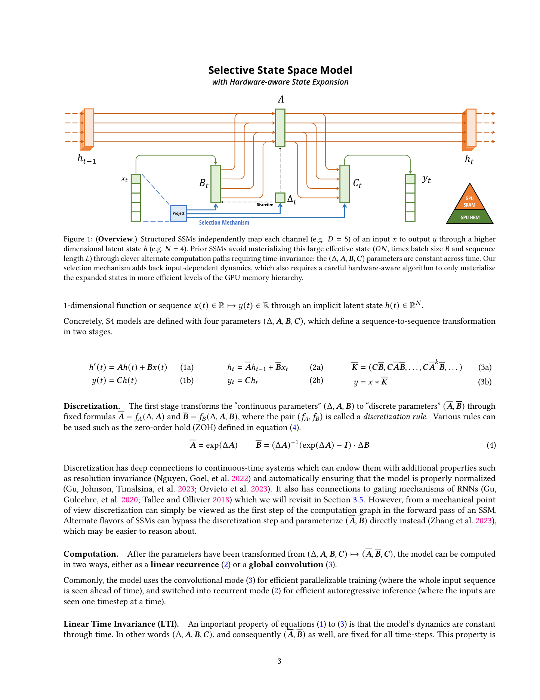
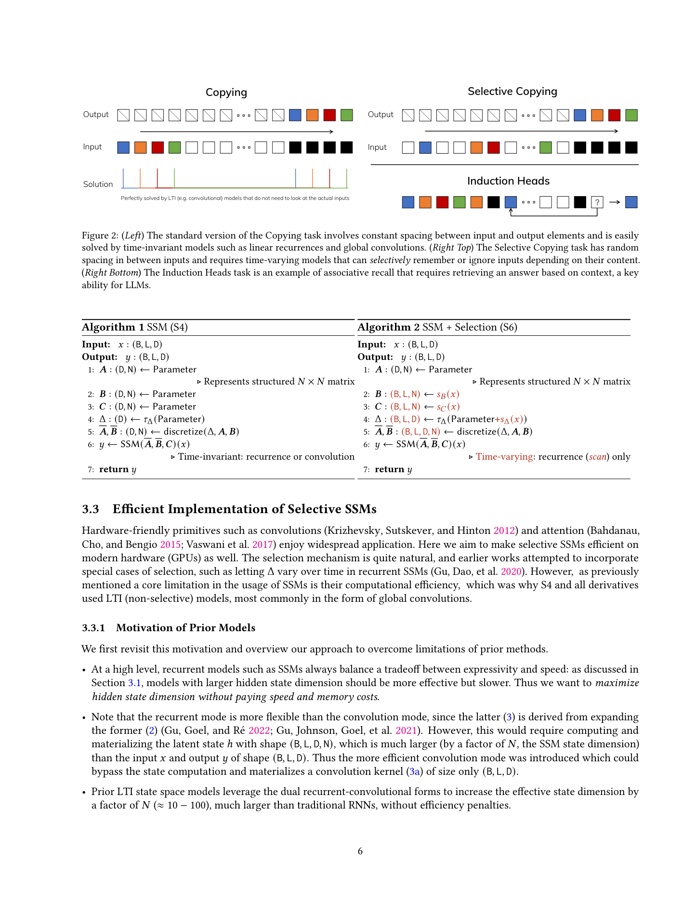
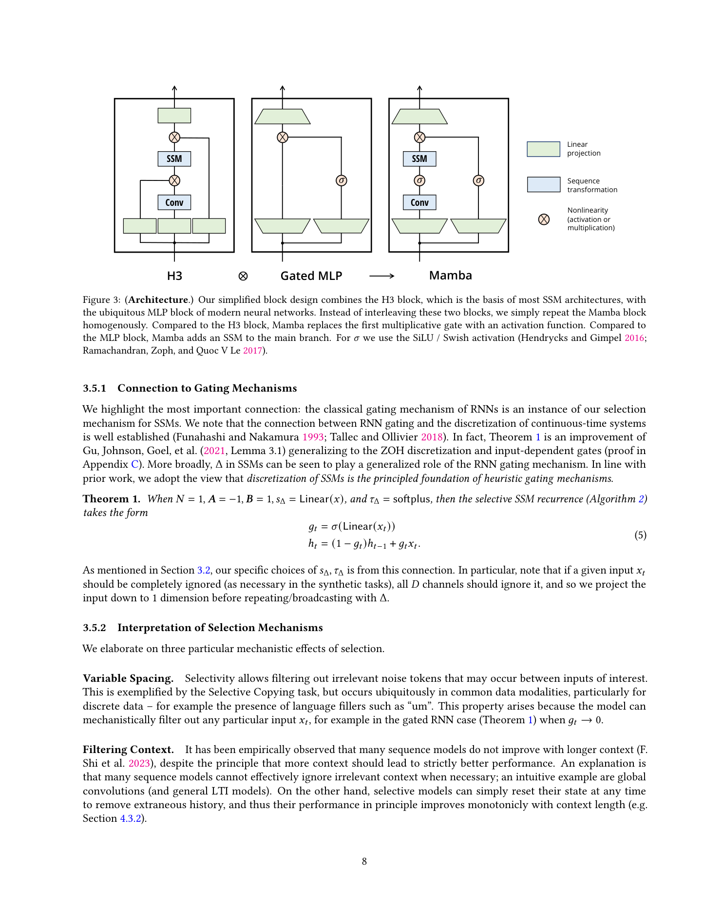

# Mamba（2023/2024）· 精读笔记

- **论文**：Mamba: Linear-Time Sequence Modeling with Selective State Spaces（arXiv:2312.00752v2, 2024-05-31）
- **BibTeX 键名**：`gu2023mamba`
- **作者/单位**：Albert Gu（CMU 机器学习系）、Tri Dao（Princeton 计算机系）；*equal contribution，按名字首字母排序*
- **本地 PDF**：`3.科研基本任务/论文/目标检测/Gu和Dao - 2024 - Mamba Linear-Time Sequence Modeling with Selective State Spaces.pdf`（共 36 页）
- **任务书条目**：第 3 周 #22｜🟢 AI 辅助读｜阅读要点：选择性状态空间、线性时间、硬件感知扫描
- **阅读日期**：2026-11-01
- **核对规则**：数字后标「出处」= 原 PDF 的章节 / 表号 / 页码；✅ = 已回原文查证；【待核对】= 原文未写或我读不出来。

> 阅读背景提醒：这篇是**语言模型**论文（Pile 数据集、GPT3 模型配置），不是视觉论文。把它读懂再去看 VMamba（#22b）会顺很多，因为 VMamba 90% 的公式都来自这篇。

---

## 0. 术语表（≥40 条，按「任务 / 结构 / 训练 / 评估 / 工程」分组）

> 这篇的门槛是**符号太多**：`Δ`、`A`、`B`、`C`（还有带横线的 `Ā`、`B̄`）各自是什么维度、什么时候"连续"什么时候"离散"，是初学者最容易糊涂的地方。下面每条都标了**维度**（按原文 §2 的记法：batch `B`、长度 `L`、通道 `D`、状态维 `N`）。

### 0.1 任务与范式

| 术语 | 大白话解释（在这篇里的含义） |
|---|---|
| **序列建模 sequence modeling** | 输入一串东西（词、DNA 碱基、音频采样点），输出另一串。 |
| **基础模型 foundation model（FM）** | 大规模预训练后适配下游的大模型。原文的核心论点是"Mamba 能不能当 FM 的通用 backbone"。 |
| **自回归语言建模** | 用前 `t−1` 个词预测第 `t` 个词。Mamba 的训练目标就是这个。 |
| **选择性复制 Selective Copying** | 合成任务：输入里随机分布着一些"要记住"的彩色 token 和大量空白 token，模型要按原顺序复制彩色的那些。**LTI 模型做不了**，因为间距是变的。✅（§3.1, Figure 2） |
| **归纳头 Induction Heads** | 合成任务：序列里出现过 "Harry Potter"，之后再出现 "Harry"，要能接 "Potter"。**是在上下文里做查表**，被假设为 LLM 上下文学习能力的主要机制。✅（§3.1, §4.1.2） |
| **上下文学习 in-context learning** | 不改参数、只看 prompt 就会做新任务。 |
| **长上下文 long context** | 序列很长（本文到 100 万 token）仍要保持质量。原文强调这是 Mamba 的三大卖点之一。✅（§1） |
| **选择性 selectivity** | 本篇的灵魂词：**按输入内容决定"记住还是忘掉"**。原文把它上升为"构建序列模型的一条基本原则"。✅（§3.1 末） |

### 0.2 结构与模型

| 术语 | 大白话解释 |
|---|---|
| **SSM（状态空间模型）** | 用一个隐状态 `h(t)` 把"过去"压起来，再按 `y=Ch` 读出。本文全程指 **structured SSM / S4 系列**（§2 明确限定✅）。 |
| **状态空间 state space** | 就是隐状态 `h` 所在的空间，维度 `N`。原文说 `N≈10–100`，比传统 RNN 大得多。✅（§3.3.1） |
| **隐状态 `h`** | 维度 `(B, L, D, N)` 的张量（展开后）。**这个张量太大，是全部效率问题的根源**。✅ |
| **`A`（状态转移矩阵）** | 维度 `(D, N)`，原文用**对角结构**（diagonal），所以一个 `N×N` 矩阵只需 `N` 个数表示。✅（§2 Structure and Dimensions） |
| **`B`（输入矩阵）** | 连续形式 `(D, N)`；选择性版本变成 `(B, L, N)`——**多了 L 维**，这是"时间可变"的直接证据。✅（Algorithm 1 vs 2） |
| **`C`（输出矩阵）** | 同上，`(D, N)` → `(B, L, N)`。 |
| **`Δ`（步长 / 时间尺度）** | 连续系统离散化时的"采样间隔"。选择性版本 `(D)` → `(B, L, D)`。**它是全文最重要的参数**（Table 7）。 |
| **`D`（通道数 / 模型维度）** | 输入 `x` 的通道数，也是 SSM 独立作用的单位：**每个通道各自有一套 `(A,B,C,Δ)`**。 |
| **`N`（状态维 / state dimension）** | 每个通道的隐状态长度，默认 16。 |
| **S4** | 上一代结构化 SSM（Gu 等 2021），**LTI**、可用卷积算、长程任务很强。本文的 baseline，也是"要打破的对象"。 |
| **S6** | 本文的 selective SSM（Remark 3.1：S4 + selection + 用 scan 计算）。**名字来源就是"S4 + 选择性"。**✅ |
| **H3** | 把 SSM 夹在两个门控里的架构；本文架构的直系祖先。✅（§2 SSM Architectures） |
| **Mamba block** | 把 H3 block 和 Transformer 的 MLP block **合并成一个**同构 block（Figure 3）。 |
| **线性注意力 linear attention** | 用核函数重排矩阵乘，把 `O(L²)` 降到 `O(L)`。可以看成"退化的线性 SSM"。✅（§2） |
| **RWKV / RetNet** | 两条同期"Transformer 替代方案"，都被本文当作 baseline。RWKV 的 WKV 机制可看作"两个 SSM 的比值"。✅（§2） |

### 0.3 训练（含离散化，这是本篇最"数学"的部分）

| 术语 | 大白话解释 |
|---|---|
| **连续系统 ODE** | `h'(t)=Ah(t)+Bx(t)`，是微分方程，真实世界是连续的。✅（Eq.1） |
| **离散化 discretization** | 把微分方程变成递推式：`h_t = Ā h_{t-1} + B̄ x_t`。**关键点：离散化之后 `A`、`B` 变成 `Ā`、`B̄`。**✅（Eq.4） |
| **ZOH（零阶保持）** | 一种离散化规则：假设两个采样点之间输入恒定。给出 `Ā=exp(ΔA)`、`B̄=(ΔA)^{-1}(exp(ΔA)−I)·ΔB`。✅（Eq.4） |
| **递推形式 recurrence** | 一次看一个时间步，`O(BLDN)` FLOPs。**灵活但串行**。✅（Eq.2） |
| **卷积形式 convolution** | 把递推展开成一个大卷积核 `K`，可并行（FFT）。`O(BL D log L)`。**只在 LTI 时成立**。✅（Eq.3） |
| **LTI（线性时不变）** | 参数 `(Δ,A,B,C)` **不随时间变**。所有之前的 SSM 都是 LTI，因为这样才能用卷积。✅（§2） |
| **时间可变 time-varying** | 参数随位置/输入变。**Mamba 之后就没有卷积等价物了**，只能 scan。✅（§3.2） |
| **并行扫描 parallel scan** | 一个经典的并行前缀和算法，能把"串行递推"变成 `O(log L)` 深度的并行计算。✅（§3.3.2） |

### 0.4 评估

| 术语 | 大白话解释 |
|---|---|
| **困惑度 perplexity（ppl）** | 语言模型指标，越低越好，等于"平均每 token 的交叉熵取指数"。 |
| **Chinchilla 协议** | 训练 token 数与模型规模成比例的一种公平比较协议（本文 Figure 4 用）。✅ |
| **Transformer++** | 作者造的强 baseline：RoPE + SwiGLU + RMSNorm + 无线性偏置 + 高学习率。**这是"必须打赢的对手"**。✅（§4.2.1） |
| **零样本评测 zero-shot** | 不微调直接测（LAMBADA / HellaSwag / PIQA / Arc-E / Arc-C / WinoGrande）。✅（Table 3） |
| **BPB（bits per byte）** | 音频实验的指标，等于 NLL 乘 `log 2` 的常数倍。✅（§4.4.1） |
| **FID / IS / mIS / AM** | 音频生成质量指标，FID 越低越好。✅（Table 4） |
| **消融 ablation** | 一次改一个组件（本文是 Table 6–10）。 |

### 0.5 工程（每个都写「朴素做法 → 优化做法 → 为什么有效」）

| 术语 | 朴素做法 | 优化做法（Mamba 采用） | 为什么有效 |
|---|---|---|---|
| **硬件感知 hardware-aware** | 按数学公式写：先算 `Ā,B̄` 存到显存，再 scan，再乘 `C` | **把"离散化 + scan + 乘 C"融进一个 kernel**，中间量只活在 SRAM | 显存读写次数从 `O(BLDN)` 降到 `O(BLD+DN)`，**IO 直接降 `N` 倍**（N 常取 16），实测快 20–40×✅（Appendix D） |
| **kernel fusion（算子融合）** | 每个算子一趟显存往返 | 一趟读入、算完再写出 | GPU 上除矩阵乘外**多数算子受显存带宽限制**，少读写就是快✅（§3.3.2） |
| **重计算 recomputation** | 前向存下所有中间状态给反向用 | 前向**不存** `(B,L,D,N)` 的中间态，反向时重算 | 存 `BLDN` 太贵；重算只需再读 `O(BLN+DN)`，**省内存还更快**✅（Appendix D） |
| **分块 chunking** | 整条序列塞进 SRAM（塞不下） | 超长序列切块，块间只传"扫描状态" | SRAM 远小于 HBM，只能分块；递推天然支持"接着算"✅（Appendix D） |
| **PyTorch 原生 scan** | `torch.cumsum` 式实现，要物化大张量 | 自写 CUDA 融合 kernel | 原生实现比本文快 20–40× 慢（Figure 8 左：ours vs Scan(PyTorch)）✅ |
| **推理时的 KV cache** | 存下所有历史 key/value（显存随长度线性涨） | **不存**，只保留一个常数大小的隐状态 | Transformer 必须存全上下文才能算注意力；SSM 天生有"压缩过的历史"，**每步常数时间**✅（§1 (ii)） |

---

## 1. 论文定位

```
【Transformer（#17）的成就与代价】
 自注意力 = 在窗口内"稠密路由"信息 → 表达力强
   代价 ①：窗口外建模不了（有限窗口）
   代价 ②：O(L²) 计算 + KV cache 随 L 线性膨胀
        ▼
【一堆"亚二次"替代方案】linear attention / gated conv / 各类 SSM
   → 在语言上全都打不过 attention，为什么？
        ▼
【本文的诊断：它们都缺"按内容选择"的能力（content-based reasoning）】
   证据：Selective Copying（要按内容记/忘）和 Induction Heads（要按上下文查表）
   LTI 模型（卷积/线性递推）在这两个任务上必败：
     · 卷积核是固定的，间距一变就废
     · 递推式 (Ā,B̄) 恒定，没法"这一项不要"
        ▼
【Mamba 的两步】
 ① 让 Δ、B、C 变成输入的函数 → 模型可以"选择性记忆/遗忘"
      代价：不能再用卷积（时间可变）
 ② 硬件感知算法：把 discretize+scan+乘C 融成一个 kernel，中间态只在 SRAM
      → 线性时间、显存与 FlashAttention 同级、长序列还能更快
        ▼
【结果】Mamba-3B ≈ 同尺寸 Transformer 更好，≈ 2× 尺寸 Transformer（Table 3）
       5× 推理吞吐；序列到 1M 仍受益（DNA/音频）
```

**上一篇（Transformer，#17）留下什么坑**：
1. **复杂度**：`O(L²)`，`L` 到万级就吃不下；
2. **内存**：KV cache 随 `L` 线性涨，批量推理时显存是硬墙；
3. **窗口**：注意力只能看固定窗口内的内容，窗口外"不存在"；
4. **效率改造的两难**：所有线性化方案（Linformer、Performer、线性注意力、门控卷积）都在"效率↑ / 表达力↓"里打转，**没有一个在语言上真打赢 attention**。

**本篇填什么**：指出"表达力↓"的具体病灶是**不能做 content-based 选择**，并用"让 `Δ,B,C` 依赖输入"这一个极小的改动解决它；再配一个硬件算法把"不能并行"的代价抹平。于是得到**第一个在语言建模上追平强 Transformer 的线性时间模型**（摘要原话：first linear-time sequence model that truly achieves Transformer-quality performance✅）。

**一句话**：**Mamba = 「把 SSM 里那几个"固定的旋钮"改成"每个 token 现场调"的旋钮，再用 GPU 显存层次把由此失去的并行性换回来」——代价是丢掉卷积，收益是线性时间 + 常数推理 + 百万上下文。**

---

## 2. 逐节导读（严格按原文章节顺序）

### 2.1 Abstract（p.1）

**关键句拆解**：
1. 现状：基础模型"几乎全部基于 Transformer 及其注意力"。
2. 已有替代品（线性注意力、门控卷积、RNN、结构化 SSM）都有，但"在语言这类重要模态上不如注意力"。
3. **诊断**："a key weakness of such models is their **inability to perform content-based reasoning**"✅。
4. 两步改进：让 SSM 参数成为输入的函数；设计硬件感知的**递推模式**并行算法。
5. 架构：整合成一个**没有 attention、甚至没有 MLP block** 的端到端网络。
6. 结果：**5× 吞吐**、序列长度线性扩展、百万长度仍有提升；Mamba-3B 打赢同尺寸、追平 2× 尺寸。

> **【批注·易误解】** "没有 MLP block"指的是**独立 MLP block 被合并进 Mamba block**，不是"网络里没有 MLP 运算"——Mamba block 里有两层线性投影（本质就是 MLP）。原文 §3.4 说得很清楚：把 H3 block 与 MLP block **combine into one**。别把摘要当结构图看。

> **【批注·为什么这条"诊断"值钱】** 之前的效率工作都在比"谁的近似更准"，本文换了个问法："**这些模型缺的是哪种能力？**"——然后用一个合成任务（Selective Copying）把这个缺失**显式测出来**（Table 1：S4 18.3%，S6 97.0%）。**这是"先造诊断工具、再改模型"的典型研究范式**，非常值得学。

### 2.2 §1 Introduction（p.1–2）

- 开篇立论：Transformer 的强来自"在窗口内稠密路由信息"，代价是**窗口外不可建模 + 窗口内二次**。✅
- SSM 的定位：可以看成 **RNN 与 CNN 的组合**，灵感来自经典状态空间模型（Kalman 1960）；能按递推或卷积计算，线性/近线性；在 Long Range Arena 上曾霸榜；在**连续信号**（音频、视觉）上好用，但在**离散、信息密集**（文本）上不够好。✅
- 三条贡献（Selection / Hardware-aware / Architecture）已在术语表拆开。
- 三条性质：(i) 高质量 (ii) 训练推理都快（**推理每步常数时间，不需要 cache**）(iii) 长上下文。✅
- 四个实验域：Synthetics、Audio & Genomics、Language Modeling。

> **【批注·与 RNN 的差异】** 别把 Mamba 当"新 RNN"。关键区别是**状态维度**：传统 RNN 的 `h` 只有 `D` 维，SSM 是 `D×N`（`N`≈10–100），"有效状态大了两个数量级"（§3.3.1 原话✅）。这也解释了为什么它能"记住更多"——**它把记忆容量做大了，而不是把循环写得更聪明**。

> **【批注·工程细节】** 摘要说 "5× higher throughput"；正文 §4.5 说 "4-5×"，Figure 8 标题写 5×。这三个表述要一起看：**不同 batch size / 模型尺寸下是 4–5×**，5× 是最好情况。写综述时引"约 5×"最稳妥。

### 2.3 §2 State Space Models（p.2–4，全篇的数学地基）

**(1) 四个参数与两条公式**

连续形式（Eq.1，✅ p.3）：

$$
h'(t)=\mathbf{A}\,h(t)+\mathbf{B}\,x(t),\qquad y(t)=\mathbf{C}\,h(t)
$$

- `A ∈ R^{N×N}`：状态怎么自己演化；
- `B ∈ R^{N×1}`：输入怎么进状态；
- `C ∈ R^{1×N}`：状态怎么读成输出；
- `Δ`：离散化步长（不在 Eq.1 里，在 Eq.4 里出现）。

**(2) 离散化（Eq.4，✅ p.3）**：零阶保持（ZOH）

$$
\overline{\mathbf{A}}=\exp(\Delta \mathbf{A}),\qquad
\overline{\mathbf{B}}=(\Delta \mathbf{A})^{-1}\big(\exp(\Delta \mathbf{A})-\mathbf{I}\big)\cdot \Delta \mathbf{B}
$$

**(3) 两种计算方式**

递推（Eq.2）：
$$
h_t=\overline{\mathbf{A}}h_{t-1}+\overline{\mathbf{B}}x_t,\qquad y_t=\mathbf{C}h_t
$$

卷积（Eq.3）：
$$
\mathbf{K}=(\mathbf{C}\mathbf{B},\ \mathbf{C}\overline{\mathbf{A}}\mathbf{B},\ \dots,\ \mathbf{C}\overline{\mathbf{A}}^{k}\mathbf{B},\ \dots),\qquad y=x*\mathbf{K}
$$

> **【批注·这是全篇最该背下来的一段】** `Eq.3` 的意思是：**"递推"等价于"用一个长度为 L 的卷积核做卷积"**，前提是 `Ā,B̄,C` 不随时间变（LTI）。于是：**训练用卷积（可并行、FFT 快），推理用递推（每步常数时间）**。这是 S4 系列能落地的全部秘密。
>
> **而 Mamba 的改动直接把这个等价关系打断了**：`Ā,B̄,C` 随时间变，就不存在一个固定的 `K`。**所以"效率"必须重新解决**——这就是 §3.3 存在的理由。两者是**因果链**，不是并列的两项贡献。

**(4) LTI（线性时不变）**：原文说 LTI "deeply connected to recurrence and convolutions"，并坦承"**Thus far, all structured SSMs have been LTI because of fundamental efficiency constraints**"✅。这句话是本篇的"靶子"。

**(5) 结构与维度**：`A` 用对角结构（`N` 个数表示）；SSM **对每个通道独立作用**；总隐状态维度 `D·N`；沿序列计算需 `O(BLDN)` 时间与内存——"this is the root of the fundamental efficiency bottleneck"✅。

**(6) SSM 架构族谱**：linear attention（退化线性 SSM）→ H3（S4 夹在两个门控里 + 前置短卷积"shift-SSM"）→ Hyena（把 S4 换成 MLP 参数化的全局卷积）→ RetNet → RWKV（"WKV" = 两个 SSM 的比值）。

> **【批注·与 CNN 差异】** H3 "inserts a standard local convolution ... before the main SSM layer"✅。这条伏笔在 Mamba 里被**继承**了：Mamba block 里 `Conv → SSM`（Figure 3，p.8）。所以"Mamba 完全不用卷积"是**错的**（见 §7 核对第 1 条）。

### 2.4 §3 Selective State Space Models（p.5–9，方法主体）

#### 3.1 Motivation：选择即压缩（p.5）

原文给了一个极漂亮的框架：**序列模型的本质问题是"把上下文压进一个更小的状态"**。✅
- **注意力**：**根本不压缩**（保留全部上下文），所以有效但低效（KV cache 线性膨胀、训练二次）；
- **循环模型**：有有限状态，所以高效但受限于"压得好不好"。

两个合成任务就是"体检工具"：
- **Selective Copying**：间距随机 → 卷积核固定长度必然失灵（Figure 2 右上的"?"）。
- **Induction Heads**：要在上下文里做"关联召回"（associative recall）。

> **【批注·易误解】** 原文特意反驳了一种流行说法："加架构门控（multiplicative interaction）就能带来 data-dependence"。它的反驳很精准：**门控不沿序列轴作用，影响不了 token 之间的间距**；"architecture gating is not an instance of a selection mechanism"（Appendix A）✅。Table 1 也给了证据：H3 架构 + S4 层只有 57.0，Mamba 架构 + S4 层只有 56.4——**光有门控没用，必须让 SSM 参数本身随输入变**（H3 架构 + S6 = 99.7，Mamba + S6 = 99.8）。

#### 3.2 用选择改进 SSM（p.5）

改动本身**非常小**：把 `Δ, B, C` 变成输入的函数（Algorithm 2 对比 Algorithm 1）：

| 量 | Algorithm 1（S4，LTI） | Algorithm 2（S6，选择性） |
|---|---|---|
| `A` | `(D, N)` 参数 | **`(D, N)` 参数（不变）** |
| `B` | `(D, N)` 参数 | **`(B,L,N) ← s_B(x)`** |
| `C` | `(D, N)` 参数 | **`(B,L,N) ← s_C(x)`** |
| `Δ` | `(D) ← τ_Δ(Parameter)` | **`(B,L,D) ← τ_Δ(Parameter + s_Δ(x))`** |
| 离散化后 `Ā,B̄` | `(D, N)` | **`(B,L,D,N)`** ← 这就是"状态爆炸"的来源 |
| 计算方式 | 递推**或**卷积 | **只能递推（scan）** |

具体选择：`s_B(x)=Linear_N(x)`、`s_C(x)=Linear_N(x)`、`s_Δ(x)=Broadcast_D(Linear_1(x))`、`τ_Δ=softplus`。✅

> **【批注·工程细节】** `s_Δ` **先把输入压到 1 维再广播**，这个细节有物理意义：原文 §3.5.1 说"如果某个输入 `x_t` 该被完全忽略，那么**所有 D 个通道都该忽略它**"，所以压缩到 1 维是"共享决策"。`τ_Δ=softplus` 保证 `Δ>0`（步长不能是负数）。这两点都来自与 RNN 门控的对应（Theorem 1）。

#### 3.3 高效实现（p.6–7，本文最"硬"的部分）

**动机**：递推灵活但串行；卷积可并行但要求 LTI。现在 LTI 没了，怎么办？

**三步**：
1. **kernel fusion**：不把 `(B,L,D,N)` 的 `Ā,B̄` 写进 HBM，而是从 HBM 读参数到 **SRAM**，在 SRAM 里离散化 + scan + 乘 `C`，只把 `(B,L,D)` 的输出写回 HBM。**IO 降低 `N` 倍**。✅
2. **parallel scan**：递推虽非线性但仍可用"工作高效的并行扫描"（Blelloch 1990 等）。✅
3. **recomputation**：不存中间状态，反向时重算。✅

原文给的两个关键观察（✅ §3.3.2）：
- 递推 `O(BLDN)` FLOPs，卷积 `O(BLD log L)` FLOPs，**且递推常数更小** → 对长序列 + 不大的 `N`，递推**实际更省 FLOPs**；
- 结果：与 FlashAttention 优化的 Transformer **同等显存**。

> **【批注·这是"不懂硬件也能记住"的一句话】** 原文强调 "most operations (except matrix multiplication) are **memory-bandwidth bound**"✅。翻译成人话：**在 GPU 上，慢不慢常常取决于"搬了多少数据"，不是"算了多少次"**。这条洞见也同样适用于 FlashAttention、KV cache 优化、甚至你的数据加载管道。

#### 3.4 简化的 SSM 架构（p.7）

- 把 H3 block（线性注意力式）与 MLP block **合并成一个**，同构堆叠（Figure 3）。灵感来自 GAU（Gated Attention Unit）。
- 维度扩张因子 `E=2`；参数构成：`3ED²`（其中 `2ED²` 是输入投影、`ED²` 是输出投影），SSM 本身的参数**少得多**。
- **堆 2 个 block ≈ Transformer 的 `MHA + MLP` 的 `12D²`**（2×2×3D²=12D²，我的算术✅）。
- 激活用 SiLU/Swish（为了让它等价于 SwiGLU）；可选 LayerNorm（受 RetNet 启发）。

> **【批注·与 Transformer 差异】** 结构上 Mamba block 是 **"SwiGLU 主干 + 一条 conv→SSM 的旁路"**（Appendix E.2.2 原话："the Mamba block is simply the standard SwiGLU block with an extra conv→SSM path added"✅）。所以它**不是**在 Transformer 之外另起炉灶，而是"给 SwiGLU 加了一条带状态的旁路"。理解这一点，VMamba 的 VSS block 就好懂了。

#### 3.5 选择机制的性质（p.7–9）

**Theorem 1（p.8）**：当 `N=1, A=−1, B=1, s_Δ=Linear(x), τ_Δ=softplus` 时，选择性 SSM 退化成**门控 RNN**：

$$
g_t=\sigma(\text{Linear}(x_t)),\qquad h_t=(1-g_t)h_{t-1}+g_t x_t
$$

**三条机制解释**（每条都是"为什么 Mamba 比 LTI 强"的具体说法）：
- **Variable Spacing**：可以过滤掉无关键的噪声 token（如语言里的"嗯"）。
- **Filtering Context**：很多模型"上下文越长反而更差"，因为它们**没法忽略无关上下文**；选择性模型可以随时重置状态。
- **Boundary Resetting**：多条独立序列拼在一起时（文档打包、RL episode 边界），`Δ_t→∞` 就能重置状态。

**四个参数各自解释**：
- `Δ`：**大 Δ → 重置状态、关注当前输入；小 Δ → 保持状态、忽略当前输入**。✅（这是全篇最容易记反的一条）
- `A`：虽然也可以做成选择性，但它只通过 `Ā=exp(ΔA)` 起作用，"selectivity in Δ is enough"，且作者假设单独做 `A` 收益类似，为简化就不做。
- `B`、`C`：分别控制"输入进不进状态"和"状态出不出输出"。

> **【批注·易误解（务必注意）】** "Δ 大 = 记住更多"是**反的**。`Ā=exp(ΔA)`，`A` 是负的（稳定系统），`Δ` 越大 `Ā` 越接近 0，**历史被清空**；`Δ` 小则 `Ā≈I`，历史被原样保留。原文原话："a large Δ resets the state h and focuses on the current input x, while a small Δ persists the state and ignores the current input"✅。用"闸门"比喻：`Δ` 是"开门时间"，开得久就是让新信息占满屋子。

#### 3.6 其他模型细节（p.9）

- **实数 vs 复数**：之前的 SSM 多用复数；本文默认实数。作者假设这与"连续–离散"的谱系有关：**复数对连续模态（音频、视频）有用，对离散模态（文本、DNA）不用**。✅（这条在 §4.4 音频实验里被反转验证——音频是唯一用复数的一组）
- **初始化**：复数用 S4D-Lin（`A_n=−1/2+ni`），实数用 S4D-Real（`A_n=−(n+1)`），来自 HIPPO 理论。
- **`Δ` 参数化**：`Broadcast_D(Linear_1(x))`，可推广为低秩 `Linear_D(Linear_R(x))`；`Δ` 的偏置初始化为 `τ_Δ^{-1}(Uniform([0.001,0.1]))`。✅
- **Remark 3.1**：本文的模型有时简写为 **S6**（S4 + selection，用 scan 算）。

### 2.5 §4 实验（p.10–17）

#### 4.1 合成任务

- **Table 1（p.11）Selective Copying**：

| 架构 / 层 | 准确率 | 读法 |
|---|---|---|
| S4 架构 / S4 层（无门控） | 18.3 | 纯 LTI，完全不会 |
| S4 架构 / S6 层 | 97.0 | **只换层就够了** |
| H3 架构 / S4 层 | 57.0 | 有门控但还是 LTI |
| H3 架构 / Hyena 层 | 30.1 | 全局卷积，更差 |
| H3 架构 / S6 层 | 99.7 | |
| Mamba 架构 / S4 层 | 56.4 | |
| Mamba 架构 / Hyena 层 | 28.4 | |
| **Mamba 架构 / S6 层** | **99.8** | 满配 |

- **Induction Heads**：训练长度 256，测试到 `2^{20}=1048576`（**比训练长 4000 倍**）。Table 11（p.29）给全数字：Mamba 74K 参数，**所有长度全 ✓**；MHA 系列到 `2^{13}` 就开始崩且 `2^{15}` 之后 OOM；H3 153K 参数到 `2^{14}` 就掉到 5.9%。

> **【批注·易误读】** Table 1 最容易被读成"Mamba 解决了 Selective Copying"，但真正的结论是**"层（S6）解决，不是架构"**：Mamba 架构配 S4 层只有 56.4，S4 架构配 S6 层却有 97.0。**架构贡献小，选择机制贡献大**。写论文时把功劳归给"架构"就错了。

#### 4.2 语言建模

- **Figure 4（p.11）扩展律**：125M–1.3B，Pile，长度 2048/8192。结论：**Mamba 是第一个追平 Transformer++ 的非注意力模型**，"particularly as the sequence length grows"。注：RWKV/RetNet 在 8k 上下文缺失，因为**没有高效实现，OOM 或算力不现实**✅（这条脚注很能说明问题：效率不只是理论复杂度）。
- **Table 3（p.12）零样本**：Mamba-130M 平均 **44.7** vs Pythia-160M 40.6；Mamba-2.8B 平均 **63.3** vs RWKV-3B 59.6 / Pythia-2.8B 59.1；GPT-J-6B 63.0。
  → **"同尺寸更好、追平 2× 尺寸"** 的具体依据就在这里。

#### 4.3 DNA 建模

- **Figure 5（p.13）**：左图固定长度 1024 扫模型规模，Mamba 比 HyenaDNA/Transformer++ 好，约 **3–4× 更少参数**即可追平✅；右图固定规模扫长度到 1M，**Mamba 越长越好，HyenaDNA 越长越差**✅。
- **Figure 6 / Table 13（p.14 / p.34）**：类人猿 DNA 五分类（相似度 99%），长度 2^20 时 Mamba-7M 达 **81.31%**，HyenaDNA 只有 54.87%（随机猜测 20%）。✅

> **【批注】** 右图那条"HyenaDNA 越长越差"的曲线是**本文最有说服力的图之一**：它把"LTI 不能过滤无关信息"从哲学论断变成了可视化的实验事实。原文还补了一刀：HyenaDNA 声称自己越长越好，但"**没有控制计算时间**"✅。**读别人的 scaling 曲线，先问"算力是否对齐"**。

#### 4.4 音频

- **Figure 7（p.14）**：YouTubeMix 钢琴曲，长度 8192→~10^6，固定算力，Mamba 全程优于 SaShiMi。
- **Table 4（p.15）**：SC09 语音生成，Mamba 6.1M 的 FID **0.94**，已经超过 23.0M 的 diffusion+SaShiMi（1.42）；24.3M 的 Mamba FID **0.67**。✅
- **Table 5（p.15）**：架构消融，outer/center 各换，**Mamba > S4+MLP > MHA+MLP**。

> **【批注·必须记住的反例】** Appendix E.4（Figure 10，p.35）给了一个**反向结论**："the change from S4 → S6 is **not always beneficial**. On long-form audio waveforms, it **in fact significantly hampers performance**"✅。这就是 §5 说的 "continuous-discrete spectrum"：**对连续模态，选择性反而是负担**。这条对做自动驾驶的人特别重要——如果你的信号是视频/雷达这种连续、低语义密度的，**别默认"Mamba 一定比 S4 好"**。

#### 4.5 速度与显存（p.15）

- **Figure 8 左**：scan 比 PyTorch 标准实现快 **20–40×**（§4.5 正文说 40×，Appendix D 说 IO 降 `N` 倍、快 20–40×，两处一致✅）；序列超过 **2K** 后比 FlashAttention-2 快。
- **Figure 8 右**：Mamba-1.4B 吞吐 ~5× Transformer-1.3B；甚至 **Mamba-6.9B 的吞吐高于 5 倍小的 Transformer-1.3B**✅。
- **Table 15（p.36）显存**：125M 模型，bs=1 时 Transformer 4.6GB vs Mamba 4.8GB；bs=32 时 34.5 vs 38.2 GB。**多 5–10%，但这是与"极致优化的 Transformer"比**。

> **【批注·易误解】** 表 15 说明 Mamba **并不比** Transformer 省显存（略多）。它省的是**推理时随长度增长的 KV cache**。这两个结论经常被混："训练显存"≈持平，"长序列推理显存"= Mamba 大胜。

#### 4.6 模型消融（p.15–17）

| 表 | 问题 | 关键数字（困惑度，越低越好） |
|---|---|---|
| Table 6（p.16） | 架构 vs 内层 SSM | Hyena 10.24；H3+S4复数 10.30；H3+S4实数 10.34；**H3+S6 8.95**；Mamba+Hyena 10.75；Mamba+S4复数 10.54；Mamba+S4实数 10.56；**Mamba+S6 8.69** |
| Table 7（p.16） | 哪些参数该选择性 | 全不选 10.93；只 B 10.15；只 C 9.98；**只 Δ 9.81**；全选 **8.71** |
| Table 8（p.16） | `A` 的初始化 | S4D-Lin（复数）9.16；`−1/2` 8.85；`−(n+1)` **8.71**；随机 8.71 |
| Table 9（p.17） | `Δ` 投影维度 | 不选 9.12 → 1 维 8.97 → 64 维 **8.71**（参数只多 12.6M） |
| Table 10（p.17） | 状态维 `N` | 固定 B,C 时 N=1→16 几乎不变（9.88→9.81）；**选择性 B,C 时** 9.73→**8.71** |

三条最该记的：
1. **Δ 最重要**（9.81 是单项最好），但**三项一起用才 8.71**（协同）；
2. **N 增大只有"B,C 也选择性"时才有效**——这句直接支撑 §3.1/§3.3 的动机："状态越大越好，但要能选择性压缩"；
3. **语言建模上 S4D-Lin（复数）反而更差**（9.16 vs 8.71），说明"初始化那套复杂理论在离散模态上没那么必要"。

---

## 3. 核心图 / 公式深读

### 3.1 Figure 1：整体图（p.3）



图注解读：结构化 SSM **对每个通道独立**地把 `x`（`D` 维，例 D=5）映射到 `y`，中间经过一个**更高维的隐状态 `h`**（`N` 维，例 N=4）。之前的 SSM 靠"时间不变"绕开对 `(D×N × B × L)` 这个大状态的物化；本文的选择机制**把它加回来**，于是必须"只在更快的显存层次里物化它"。

三个必须看出来的东西：
1. 图里标了 **Project / Discretize / 三处 `Δ_t, B_t, C_t`** ——提醒你"选择"发生在离散化**之前**；
2. 左上角写 **`A`（不变）**、旁边写 **`Δ_t, B_t, C_t`（随时间）** ——**只有这三个是 selective 的**；
3. 右下角画了 **GPU SRAM / GPU HBM 两层** ——硬件是这张图的一半内容。

> **【批注】** 这张图把"算法 + 硬件"画在同一张纸上，是本文的写作技巧：**它在告诉你"我们的贡献有一半是系统工作"**。做课题时如果只讲数学不讲实现，往往解释不了"为什么别人早想到了却没做成"。

### 3.2 Figure 2 + 两个算法（p.6）



Figure 2 的读法：
- **左（Copying）**：输入输出的间距**固定** → 一个长度刚好的卷积核就能解 → LTI 也能做。
- **右上（Selective Copying）**：彩色 token 位置**随机** → 必须"按内容"决定记/忘 → LTI 必败。
- **右下（Induction Heads）**：要"看到 `A` 就想起上一次 `A` 后面跟的是 `B`" → 关联召回。

Algorithm 1 → Algorithm 2 的**唯一差别**就是三行的形状（`(D,N)` → `(B,L,N)`），但这个差别导致离散化后的 `Ā,B̄` 变成 `(B,L,D,N)`——**维数从 2 维涨到 4 维**。

> **【批注·这张图的"图注陷阱"】** Figure 2 的主标题写 "Perfectly solved by LTI models that do not need to look at the actual inputs" ——这句话**只对左边的 Copying 成立**，不是对整张图。很多人截这张图时把这句话一起截进去，然后误以为"LTI 能解 Selective Copying"。读图注要看清它管哪一半。

### 3.3 Figure 3：架构（p.8）



> 说明：图注原文——Mamba block 把 H3 block 与 MLP block **同构地重复**，而不是交错；相比 H3，第一个乘性门被换成激活函数；相比 MLP，主分支上加了 SSM；`σ` 用 SiLU。**注意每个子图里都有 `Conv → SSM` 这条路径**（见 §2.4 的批注：Mamba 并不是"完全不用卷积"）。

结构对比（原文图注逐条✅）：

| 组件 | H3 block | Gated MLP block | **Mamba block** |
|---|---|---|---|
| 线性投影 | 有 | 有 | 有 |
| 门控（乘性） | **两个门控** | 一个门控（SiLU 后相乘） | **没有门控**，第一个位置换成激活 `σ` |
| 序列变换 | **SSM**（+ 前置 Conv） | **无** | **Conv → SSM** |
| 参数对齐 | — | `2ED² + ED²` | `3ED²`，两个 block ≈ `12D²` |

三句图注最该记：
1. "Mamba **replaces the first multiplicative gate with an activation function**"；
2. "Compared to the MLP block, Mamba **adds an SSM to the main branch**"；
3. "For σ we use the **SiLU / Swish** activation"（这样 Gated MLP 就退化成流行的 SwiGLU）。

> **【批注·和 Transformer 的差异】** 标准 Transformer block 是"attention 分支 + MLP 分支"两个独立子层；Mamba 是**单分支**，把两条并成一条。这不是"简化美学"，而是**参数预算对齐**的副产品：一个 Mamba block 的参数 ≈ 半个 `MHA+MLP`，所以堆 2 个才等价。

### 3.4 核心公式串（一条链背完）

```
连续：      h'(t) = A h(t) + B x(t)          （Eq.1，A∈R^{N×N}）
                  ↓ 离散化（ZOH，Eq.4）
离散：      Ā = exp(ΔA)     B̄ = (ΔA)^{-1}(exp(ΔA)−I)·ΔB
                  ↓
递推：      h_t = Ā h_{t-1} + B̄ x_t ,  y_t = C h_t          （Eq.2）
                  ↓ 若 LTI（Ā,B̄,C 不随时间变）
卷积：      K = (CB, CĀB, CĀ²B, …) ,  y = x * K              （Eq.3）
                  ↓ 若 selective（Δ,B,C 依赖输入）
→ 卷积等价性失效，只能 scan（O(BLDN)，硬件融合）            （Algorithm 2）
```

逐符号表：

| 符号 | 连续版本维度 | 选择性离散版本维度 | 含义 | 备注 |
|---|---|---|---|---|
| `A` | `N×N`（对角） | `(D,N)` | 状态自演化 | **不随输入变** |
| `B` | `N×1` | `(B,L,N)` | 输入进状态 | 选择性 |
| `C` | `1×N` | `(B,L,N)` | 状态出输出 | 选择性 |
| `Δ` | 标量 | `(B,L,D)` | 步长/门 | 选择性，`softplus` 保证 >0 |
| `Ā` | `N×N` | `(B,L,D,N)` | 离散化后转移 | `exp(ΔA)`，**大 Δ → 趋 0 = 遗忘** |
| `B̄` | `N×1` | `(B,L,D,N)` | 离散化后输入 | 一阶近似 `Δ·B` 量级 |
| `h` | `N` | `(B,L,D,N)`（不物化） | 隐状态 | 全篇的效率瓶颈 |

**Theorem 1 的意义**（p.8）：
$$
g_t=\sigma(\text{Linear}(x_t)),\quad h_t=(1-g_t)h_{t-1}+g_t x_t
$$
这说明 **`Δ` 的 softplus + 线性投影 = 一个 RNN 门**。所以"选择机制"不是新发明，而是**把 RNN 的门控从"启发式"提升为"连续系统离散化"的必然结果**（原文："discretization of SSMs is the principled foundation of heuristic gating mechanisms"✅）。这句话解释了 Table 7 为什么 `Δ` 单项贡献最大。

### 3.5 Figure 8：效率基准（p.15）

两条曲线的"读法"：
- 左图（scan vs conv vs attention）：**scan（ours）** 一直压着 FlashAttention-2，越过 2K 后优势扩大；**Scan（PyTorch）** 在最上面（最慢），到 512K 处出现 **OOM**。→ 说明"同一算法，实现差 20–40×"。
- 右图（推理吞吐）：横轴 batch size，四个模型。`Mamba 6.9B` 的曲线**高于** `Transformer 6.7B`，甚至约等于 5 倍小的 `Transformer 1.3B`。→ 说明"没有 KV cache，就能开大 batch"。

> **【批注·数字口径】** 这里是本文数字最容易被误引的地方：摘要"5×"、正文"4–5×"、Figure 8 标题"5×"，而左图顶部又是"40×"。**40× 是"我们的 scan vs PyTorch scan"，5× 是"端到端推理吞吐"**。两者不是一个东西。

---

## 4. 实验逐表解读

### 4.1 每张表回答什么问题

| 表/图 | 页码 | 问题 | 一句话结论 |
|---|---|---|---|
| Table 1 | p.11 | 选择机制能不能解 Selective Copying？ | S6 层 97%+，S4 层 18%，**功劳归"层"** |
| Table 2 / 11 | p.11 / p.29 | 能不能外推到 100 万长度？ | Mamba 74K 参数全长度 ✓；注意力 2^15 后 OOM |
| Table 3 | p.12 | 零样本语言任务强不强？ | 每个尺寸都是同尺寸最好，约等于 2× 尺寸 |
| Figure 4 | p.11 | 扩展律对不对得上 Transformer++？ | 追平，且长度 8192 时更明显 |
| Figure 5 / 6 | p.13 / p.14 | DNA 上规模与长度各怎么变？ | 3–4× 少参数；1M 长度仍涨 |
| Table 4 / 5 | p.15 | 音频生成/架构消融 | FID 0.67（24.3M），远超 diffusion baseline |
| Figure 8 / 15 | p.15 / p.36 | 多快、多省显存 | 推理 5×；训练显存与最优 Transformer 持平 |
| Table 6–10 | p.16–17 | 每个组件值多少 | 选择性层是最大功臣；`Δ` 最重；`N` 需配合选择 |

### 4.2 最易误读的 3 处

**① "Mamba 把 Transformer 全面打败了"** —— 🟥 不准确。
- 语言：**同尺寸赢、2× 尺寸打平**（Table 3：Mamba-2.8B 63.3 vs GPT-J-6B 63.0，后者是 2 倍大）。
- DNA/音频：明显赢（且长度越长越赢）。
- 但它**没有**在任何地方说"7B 以上也赢"——§5 明说自己的实验规模小于 Llama/RWKV/RetNet 的 7B+ 评测✅。

**② "5× 吞吐 = 5× 训练加速"** —— 🟥 错。
5× 是**推理**吞吐（不带 KV cache 能开大 batch）；训练侧 Fig 8 左是**scan kernel 的 20–40×**，端到端训练加速文里没给统一倍数。**两件事。**

**③ "Table 6 说明 Mamba 架构比 H3 架构好很多"** —— 🟨 只是"略好"。
Mamba+S6 = 8.69 vs H3+S6 = 8.95，**差 0.26**；而换层（S4 → S6）是 10.3 → 8.95，**差 1.35**。原文自己写："The Mamba block performs similarly to H3 while being simpler"✅。

### 4.3 三个"数字背后"的细节

1. **Table 3 里 H3-130M 的 Pile ppl 是 "—"**：因为它用 GPT2 tokenizer，与 Pythia/Mamba 的 NeoX tokenizer 不可比。原文注明"Pile 只与同数据集同 tokenizer 的模型比"✅。**跨 tokenizer 比 ppl 是无效比较**，这是初学者最常犯的错。
2. **Mamba-1.4B 的 LAMBADA ppl 5.04 与 Pythia-2.8B 的 5.04 相同**，但平均分 59.7 vs 59.1——说明**单指标打平不代表整体打平**。
3. **Table 9 里 `Δ` 投影从"不选择"到"1 维"就掉了 0.15 ppl（9.12→8.97），但参数只多 0.2M**。这是"性价比最高的一刀"：**选择机制几乎是免费的**。

---

## 5. 我的思考（🟢，4 点）

**① 【原文结论】本文最大的贡献是"重新定义了效率问题的问法"。**
之前的工作问"怎么把 attention 近似得更准"；本文问"**这些模型缺的是哪种能力**"，然后造一个合成任务把缺失**量化**出来（S4 18.3% vs S6 97.0%）。一旦"缺 content-based selection"被证实，改动方向就是**唯一**的了（参数随输入变）。**这套"先造诊断、再改模型"的路径，比任何单个 trick 都值得学**，也是你写开题报告时最容易讲清楚"为什么这么改"的模板。

**② 【我的推断】"选择性"与"硬件"是**不可分割**的一体两面，不是两项独立贡献。**
很多人把 §3.2（选择机制）和 §3.3（硬件算法）读成"两个创新点并列"。但因果链是：**选择 → 失去卷积 → 必须 scan → scan 慢且吃显存 → 必须融合 kernel + 重计算**。如果没有 §3.3，§3.2 就是一个"理论上更表达、实际上跑不动"的想法（这正是之前 Δ 可变的工作没做成的原因，原文 §3.3 提到过）。**推论**：任何"打破时间不变性"的方法（时间卷积、动态卷积、可变形注意力）都会遇到同一堵墙，**都需要配套的 IO 优化**。

**③ 【课外补充·待核实】"连续–离散谱系"这条假设可能是本文最脆弱、也最有用的一条。**
原文说复数对连续模态有用、实数对离散模态够用（§3.6），并用音频实验做了部分验证（Appendix E.4：S4→S6 在长音频上**变差**）。但"连续 vs 离散"是个**很粗的二分**：文本是离散、DNA 是离散、音频是连续——那**视频**呢？**点云**呢？**雷达时序**呢？我推测自动驾驶里的 LiDAR 序列属于"半连续、高冗余"，**可能落在 S4 与 S6 之间的某个位置**。这需要一个"逐一替换层"的对照实验才能回答，标【待核实】。**如果这个实验成立，就是一篇不错的小论文。**

**④ 【如果让我改】我会把 `Δ` 的"全局共享 1 维决策"改成"分组决策"。**
原文 `s_Δ(x)=Broadcast_D(Linear_1(x))`：把 `D` 维输入压成 **1 个数**再广播，理由是"某些 token 该被整体忽略"。但一个 token 的不同通道（不同头/不同语义）很可能**需要不同的遗忘速率**（同一个词，句法信息该留、语义信息该丢）。Table 9 已经显示把 `Δ` 投影维度从 1 提到 64 持续变好（8.97→8.71），但代价是参数涨。**我的改法**：用 `G` 个组（`G≪D`）的**分组广播**，在"共享"与"独立"之间插值；或者用 Mixture-of-Δ（多组 `Δ` 加权）。风险：`Δ` 太多会退化成"每个通道都学一个门"，可能过拟合小数据。

---

## 6. 与前后论文的衔接

```
#17 Transformer ───────────────────────────────► #22a Mamba ─────► #22b VMamba
  • 自注意力 = 窗口内稠密路由              • 诊断：缺"按内容选择"      • 把 1D 扫描改成 4 方向 2D 扫描
  • O(L²) 计算 / KV cache ∝ L              • 让 Δ,B,C 依赖输入         • 去掉乘性分支、加 FFN
  • 所有线性化方案都打不过 attention       • 硬件感知 scan（SRAM）     • 视觉任务上线性复杂度
  • 坑：长序列 + 高效推理                  • 结果：线性时间 + 1M 上下文  • 坑：2D 数据没有"顺序"
        │                                        │
        └──── 留下的坑：序列维度的二次瓶颈 ────────┘
```

**向前看（Mamba ← Transformer #17）**：Transformer 的问题是**结构性**的——注意力"不压缩上下文"，所以必须存全部历史（KV cache）并做 `L²` 次两两比较。Mamba 不是"近似注意力"，而是**换了一套压缩机制**：用一个 `D×N` 的有限状态去压上下文，再用选择机制决定"压什么、丢什么"。它保留了 Transformer 最值钱的两个属性（**全局感受野**——状态能覆盖任意长历史；**动态权重**——参数随输入变），只扔掉了"两两比较"。

**向后看（Mamba → VMamba #22b）**：VMamba 要做的事是**把"1D 顺序"这个隐含前提去掉**。图像没有"先读哪个像素"的天然顺序，单方向扫描会让"扫到的晚的像素"信息量吃亏。VMamba 的 SS2D 用**四方向扫描 + 跨方向合并**来补这个缺陷，其余公式（`Ā=exp(ΔA)`、`B̄=ΔB`、`Y=Ch+Du`）几乎照抄。**所以读懂本篇的 Eq.1–4，就等于读懂了 VMamba 的 80%。**

**和你的选题的关系**：如果你的检测/跟踪任务要处理**长时序**（多帧视频、长雷达序列），Mamba 是"线性成本 + 常数推理"的现成 backbone；但要注意 §5 的局限——7B 以上的行为、以及"连续模态上选择性可能有害"（Appendix E.4）。

---

## 7. 回原文核对记录（≥6 条，含纠偏）

| # | 我原先/常见的说法 | 原文依据 | 判定 |
|---|---|---|---|
| 1 | "Mamba 彻底不用卷积" | Figure 3 里 block 是 `Conv → SSM`；Appendix E.2.2 原话："the Mamba block is simply the standard SwiGLU block with an **extra conv→SSM path** added" | 🟥 **纠偏 1**：有 1D 卷积（短卷积，在 SSM 之前） |
| 2 | "Mamba 是 RNN，所以推理慢" | §1 (ii)："unrolling the model autoregressively during inference requires only **constant time per step** since it does not require a cache" | 🟥 错，推理是它的强项（5× 吞吐） |
| 3 | "Δ 越大 = 记住越多" | §3.5 "a large Δ **resets** the state and focuses on the current input; a small Δ **persists** the state" | 🟥 **纠偏 2**：记反了，大 Δ = 遗忘 + 关注当下 |
| 4 | "Mamba 在 100 万长度上训练过" | §4.1.2：**训练长度 256**，测试外推到 2^20；§4.3.2 DNA 才真训到 1M | 🟨 部分错：Induction Heads 是"外推"不是"训练" |
| 5 | "Selective Copying 是 Mamba 架构解决的" | Table 1：S4 架构 + S6 层 = 97.0；Mamba 架构 + S4 层 = 56.4 | 🟥 是"层"解决，不是"架构"解决 |
| 6 | "Mamba 比 Transformer 省显存" | Table 15：bs=1 时 4.8GB vs 4.6GB（**Mamba 略多**） | 🟨 训练显存**持平甚至略差**；省的是推理 KV cache |
| 7 | "5× 加速指的是训练" | §4.5：5× 是**推理吞吐**；scan kernel 相对 PyTorch 是 **20–40×** | 🟥 口径混了 |
| 8 | "线性时间意味着处处更快" | Figure 8 左：scan 要到 **2K** 以后才超过 FlashAttention-2；§3.3.2 说递推常数更小但卷积 `log L` 项也小 | 🟨 短序列上不一定更快 |
| 9 | "选择性在所有模态都有用" | Appendix E.4（Figure 10）：长音频上 S4→S6 "significantly hampers performance" | 🟥 **纠偏 3**：连续模态上可能有害 |
| 10 | "Mamba 是第一个线性时间模型" | 摘要："the **first** linear-time sequence model that **truly achieves Transformer-quality** performance" | 🟩 正确（限定语"追平 Transformer 质量"不能漏） |

**纠偏总结**：我第一遍读摘要时，把"选择机制"和"硬件算法"记成了两个并列卖点，并把"不用卷积"当成事实。回原文（Figure 3 + Appendix E.2.2）才发现：**block 里保留了一个短卷积**，而"丢掉卷积等价性"指的是**SSM 层本身**不能再写成一个大卷积核。**"卷积"在这篇里有两种含义**——"block 里的短卷积层"（保留）和"SSM 的卷积等价形式"（丢失）。这个歧义是读懂这篇的最大障碍。

---

## 8. 自测题 5 题 + 常见误解 5 条

### 8.1 自测题

1. 写出 SSM 的连续形式与离散形式，并说明 `Δ` 变大时 `Ā` 会怎么变、物理上意味着"记住"还是"遗忘"。
2. 为什么说"选择性"和"卷积"是互斥的？如果强行用卷积实现选择性 SSM，会发生什么？
3. Algorithm 1 与 Algorithm 2 只差几个张量形状，为什么后者会带来"状态爆炸"？爆炸的维度是什么？
4. Table 7 里"只让 Δ 选择性"是 9.81，"只让 B 选择性"是 10.15——为什么 `Δ` 的单项收益最大？
5. 为什么 Mamba 训练显存和 Transformer 差不多（Table 15），但推理吞吐能高 5×？

### 8.2 常见误解（每条给"为什么错"）

| 误解 | 为什么错 |
|---|---|
| "Mamba 就是一个更长的 RNN" | 状态维度差两个数量级（`D×N`，`N`≈10–100，§3.3.1）；且它保留了"全局感受野 + 动态权重"这两个原本属于注意力的性质。 |
| "Mamba 用卷积做并行训练" | **不能**。选择性 SSM 没有卷积等价形式（§3.2 明确 "This loses the equivalence to convolutions"），训练也走 scan。 |
| "线性时间 = 恒定速度" | 线性只是复杂度阶；常数项（IO、kernel 启动）让它在**短序列**上反而不如 FlashAttention（Figure 8 左，2K 之后才反超）。 |
| "Δ 是可学习的常数" | 在 S4 里它是参数；在 Mamba 里它是**输入的函数** `(B,L,D)`。这正是 S4 → S6 的全部差别。 |
| "状态维 N 越大越好" | Table 10：**只有 B、C 也选择性时**，N 16 才比 N 1 好 1.0 ppl；否则几乎没用。状态大而不会筛，等于没筛。 |

---

## 9. 读到这里最容易产生的疑问（5 组 Q&A）

**Q1：既然 `Ā=exp(ΔA)`，`A` 又是固定的负对角，那"选择性"会不会只是"选择性遗忘"，而记不住新东西？**
A：不是。`B̄` 也随输入变（`B̄=(ΔA)^{-1}(exp(ΔA)−I)·ΔB`，含一个 `Δ` 和一个 `B`），所以**写进状态的内容**也是按内容选的。`C` 再控制"读出来多少"。三者配合才实现 Theorem 1 那样的完整门控 `h_t=(1-g)h_{t-1}+g x_t`。

**Q2：为什么长音频上"选择性"反而变差（Appendix E.4）？这不和全文矛盾吗？**
A：不矛盾，是**适用范围**问题。音频是连续、稠密采样的信号，"每个采样点都很重要、都需要按时间积累"；允许模型随手遗忘反而丢信息。而文本/DNA 里大量 token 是"填充物"，**必须能丢**（§3.5 Variable Spacing 的"um"例子）。原文把这归结为 **continuous–discrete spectrum**（§5）。**这是全篇最诚实的自我限定。**

**Q3：Table 3 里为什么 H3-130M 的 Pile ppl 是空的？**
A：tokenizer 不同（GPT2 vs NeoX）。原文明确说 Pile 只与"同数据集同 tokenizer"的模型比✅。ppl 高度依赖 tokenizer，**跨 tokenizer 比 ppl 等于比错东西**。

**Q4：Mamba 能不能直接替代 Transformer 做多模态（图像）？**
A：本篇没做视觉；图像是 2D、无天然顺序，1D 扫描会引入"人为顺序偏差"。这正是 #22b VMamba 要解决的问题（四方向扫描）。**先读 #22b 再决定要不要用。**

**Q5：如果我要在自己的小项目里用 Mamba，最小可跑的实现路径是什么？**
A：三条：① 直接装官方 `mamba-ssm`（摘要给了开源地址✅）；② 如果不想装 CUDA 扩展，可以先用 `torch` 版 scan（能跑但慢 20–40×，Figure 8 左）；③ 关键超参优先调 `d_state`（默认 16）和 `Δ` 的投影维度（Table 9/10 证明这两个性价比最高），而不是先调层数。
