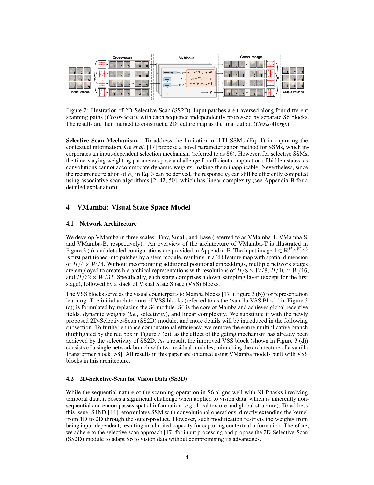
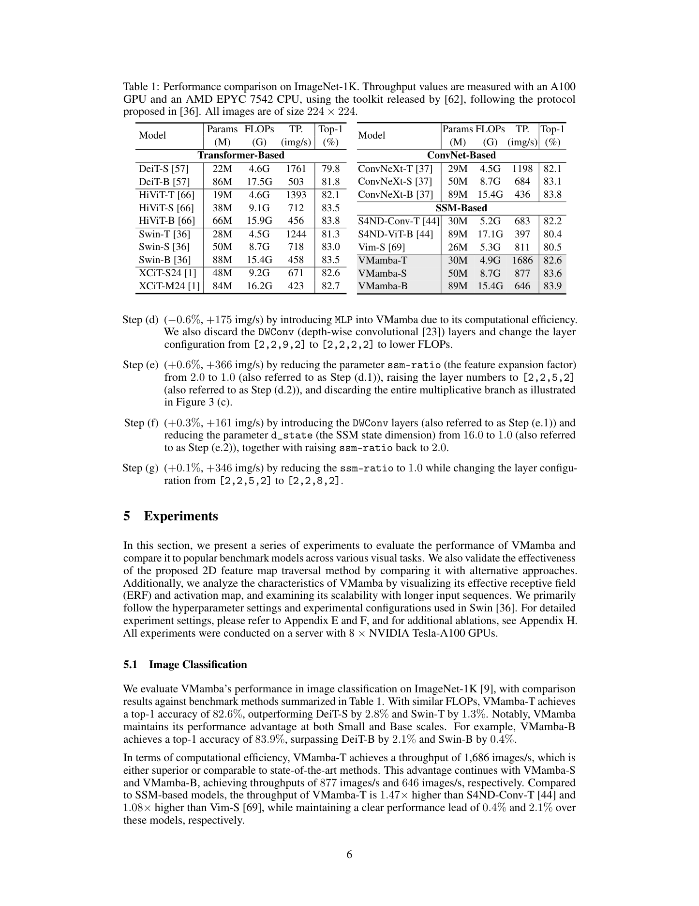
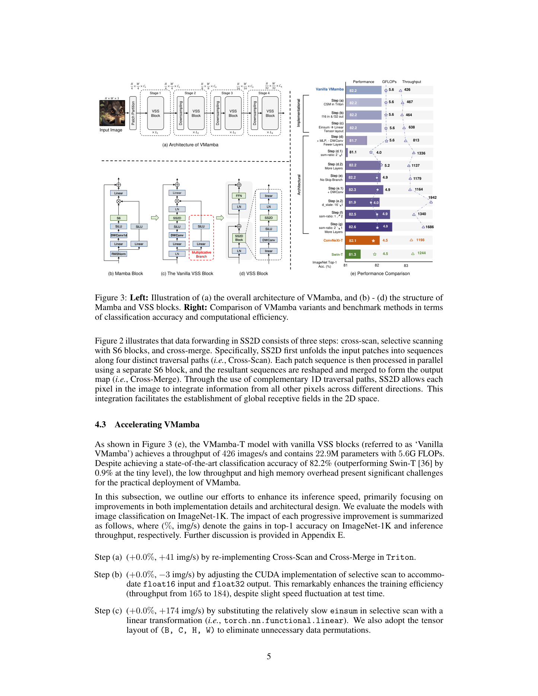

# VMamba（2024）· 精读笔记

- **论文**：VMamba: Visual State Space Model（arXiv:2401.10166v4, 2024-12-29；PDF 首页标注 "Preprint. Under review."）
- **BibTeX 键名**：`liu2024vmamba`
- **作者/单位**：Yue Liu、Yunjie Tian、Yuzhong Zhao、Hongtian Yu、Lingxi Xie（华为）、Yaowei Wang（鹏城实验室）、Qixiang Ye、Jianbin Jiao、Yunfan Liu（‡ 通讯）；主体为中国科学院大学（UCAS）
- **本地 PDF**：`3.科研基本任务/论文/目标检测/Liu 等 - 2024 - VMamba Visual State Space Model.pdf`（共 33 页）
- **任务书条目**：第 3 周 #22｜🟢 AI 辅助读｜阅读要点：2D 选择性扫描、视觉主干、线性复杂度
- **阅读日期**：2026-11-01
- **核对规则**：数字后标「出处」= 原 PDF 的章节 / 表号 / 页码；✅ = 已回原文查证；【待核对】= 原文没写或我读不出来；【我的推断】= 原文没明说、我根据公式或代码常识推的。

> 阅读顺序提醒：这篇必须**紧跟 22a_Mamba** 读。它 80% 的公式（Eq.1 连续 ODE、离散化、递推、关联扫描、下三角掩码）都是 Mamba 那一套；本文真正原创的东西只有两件：**SS2D（怎么把 1D 扫描搬到 2D 平面）** 和 **加速 7 步（怎么把吞吐从 426 拉到 1686）**。把这两件抓住，其余都是 Swin 式的常规设计。

---

## 0. 术语表（≥40 条，按「任务 / 结构 / 训练 / 评估 / 工程」分组）

> 本篇的门槛不是数学（数学比 Mamba 浅），而是**名词密度**：VSS / SS2D / S6 / cross-scan / cross-merge / ssm-ratio / d_state 全是新造的缩写，而且互相套娃（VMamba ⊃ VSS block ⊃ SS2D ⊃ S6）。下面按"从外到里"的顺序排。

### 0.1 任务与范式

| 术语 | 大白话解释（在这篇里的含义） |
|---|---|
| **视觉主干 visual backbone** | 只输出特征图、不直接出任务结果的那部分网络。本文要造的就是它，后面接检测头/分割头。✅（摘要、§1） |
| **ImageNet-1K 分类** | 1000 类、约 128 万张训练图的分类基准，本文用它证明"特征好不好"。✅（Table 1） |
| **COCO 检测 / 实例分割** | 用 Mask R-CNN 在 MSCOCO2017 上微调，看 APb（框）与 APm（掩码）。✅（Table 2 左、§5.2） |
| **ADE20K 语义分割** | 150 类场景解析，用 UperNet 头，指标 mIoU。✅（Table 2 右） |
| **密集预测 dense prediction** | 每个像素都要出结果的任务（检测、分割）。**这类任务最吃分辨率，因此最吃注意力的 O(N²)。**✅（§5.2 "downstream tasks requiring dense predictions"） |
| **归纳偏置 inductive bias** | 网络"天生假设"的东西（卷积假设局部性/平移不变）。ViT 缺这个所以要大数据；SS2D 靠"四方向扫描"塞进一个 2D 偏置。✅（§2 提到 DeiT 强调 inductive bias） |
| **有效感受野 ERF** | 不是理论感受野，而是**真正对输出有贡献的输入区域**（用梯度可视化）。本文靠它论证"我的感受野是全局的"。✅（§5.3、Figure 7） |
| **全局感受野** | 输出单元能看到整张图。原文把它列为要保住的两大性质之一。✅（§1） |
| **动态权重 dynamic weighting** | 权重随输入变（对比卷积的固定核）。原文同样列为要保住的性质。✅（§1） |
| **线性复杂度 linear complexity** | 计算量随 token 数 N **一次方**增长（注意力是 N²）。**注意：只有在 N 很大时才兑现成实际速度**（见 §5 我的思考）。✅（摘要、§4.2） |
| **输入可扩展性 input scaling** | 换更大分辨率输入时，精度掉得少、算力涨得慢。本文的核心卖点之一。✅（摘要、§5.2 Discussion、Table 9） |
| **自监督预训练缺口** | 本文 Limitation 第一条：MAE/BEiT 那套预训练能不能用在 SSM 主干，**没试**。✅（§6 Limitations） |

### 0.2 结构与模型（从外到内）

| 术语 | 大白话解释 |
|---|---|
| **VMamba** | 整篇的名字，也是主干家族名（T/S/B 三个尺寸）。 |
| **VSS block（Visual State Space block）** | 视觉版 Mamba block，是 VMamba 的重复单元。**内部流水 = Linear(升维) → DWConv3×3 → SS2D → Linear(降维) → 残差；再加一条 FFN 残差。**✅（Figure 3(d)、Table 4） |
| **vanilla VSS block** | 最初的版本：直接把 Mamba block 的 S6 换成 SS2D，**保留乘性分支（门控）、不带 FFN**。✅（Figure 3(c)、Appendix E） |
| **乘性分支 multiplicative branch** | Mamba 里那条 `SiLU(Linear(x)) ⊙ 主路` 的门控分支。本文**把它整条删掉**，理由是"门控的效果已经被 SS2D 的选择性实现过了"。✅（§4.1） |
| **S6 block** | Mamba 的"选择性 SSM"算子（S4 + 输入依赖参数）。本文在 SS2D 里**每条扫描路径各配一个**，共 4 个。✅（Figure 2 说明） |
| **SS2D（2D Selective Scan）** | 本文唯一的原创模块。三步：cross-scan → 4 个 S6 并行扫 → cross-merge。✅（§4.2、Figure 2） |
| **cross-scan** | 把 2D 特征图按**四条不同遍历路径**各自展平成一条 1D 序列。✅（Figure 2） |
| **cross-merge** | 把四条扫描结果 reshape 回 2D 再"合并"成一张输出图。**具体是逐元素相加还是拼接，正文只写 "merged"，我按官方代码推断是相加【我的推断】**。✅/【我的推断】 |
| **Unidi-Scan / Bidi-Scan / Cascade-Scan** | 三个对照扫描方式：单方向、双向、先行后列级联。✅（§5.3、Figure 8、Table 10、Figure 12） |
| **层级结构 hierarchical** | 四个 stage，分辨率 H/4→H/8→H/16→H/32，通道 96→192→384→768 级别。和 Swin 同构，为了下游密集预测。✅（§4.1、Figure 3(a)） |
| **stem** | 入口降采样。VMamba 用 `conv3×3 s2 + LN + GeLU + conv3×3 s2 + LN`；vanilla 用 `conv4×4 s4`。✅（Table 3 vs Table 4） |
| **patch merging / downsampling** | stage 之间的 2× 降采样（Swin 的 patch merging 或 conv3×3 s2）。✅（Table 3 脚注、Table 4） |
| **DWConv 3×3** | 深度可分离卷积，插在 Linear 之后、SS2D 之前。**作用是给 SS2D 注入局部 2D 先验**（去掉它精度掉 0.35）。✅（§5.3 末、Table 10） |
| **FFN** | 前馈层（mlp-ratio × C）。vanilla 版没有，正式版加上。✅（Table 4） |
| **无位置编码** | 全文不加 position embedding / 不加 window 的相对位置偏置。✅（§4.1 "Without incorporating additional positional embeddings"） |
| **d_state** | SSM 状态维度 N。Mamba 默认 16，**本文主配置压到 1**。✅（§4.3 Step f、Table 12） |
| **ssm-ratio** | VSS block 里"升维倍数"（通道扩展因子）。2.0 表示 Linear 把 C 升到 2C 给 SS2D 用。✅（§4.3 Step e） |
| **mlp-ratio** | FFN 的扩张倍数，默认 4。✅（Table 4、Table 14） |
| **sxly 记法** | `VMamba-S[s2l15]` = ssm-ratio 2、stage3 层数 15。Table 1 里的正式款就是这一档。✅（Appendix E） |

### 0.3 训练与数学（把 Mamba 的公式搬进 2D）

| 术语 | 大白话解释 |
|---|---|
| **SSM（状态空间模型）** | 用一个隐状态 h 把历史压起来、再读出的线性系统。本文只用到 S4/S6 这一支。✅（§3） |
| **连续 ODE（Eq.1）** | `h'(t)=A h(t)+B u(t)`，`y=C h(t)+D u(t)`。A∈R^{N×N}、B∈R^{N×1}、C∈R^{1×N}、D∈R^{1}。✅（§3 Eq.1） |
| **离散化 discretization** | 用步长 Δ 采样，把微分方程变成递推。✅（§3 Eq.3） |
| **ZOH（零阶保持）** | 一种离散化假设："两个采样点之间输入不变"。✅（§3 末、Appendix A） |
| **Ā（离散化后的 A）** | 本文 Appendix A Eq.7：`Ā := e^{AΔ}`，**是 ZOH 的精确解**。✅ |
| **B̄（离散化后的 B）** | 本文 Eq.7：`B̄ := BΔ`，**只是一阶泰勒近似**，不是 ZOH 精确式。✅（Appendix A 原话 "first-order Taylor expansion"） |
| **递推 recurrence** | `h_t = Ā h_{t-1} + B̄ x_t`，`y_t = C h_t + D x_t`。✅（Appendix A Eq.7、Figure 2 左） |
| **LTI（线性时不变）** | 参数不随输入变。**LTI 才能用卷积算**。✅（§3） |
| **选择机制 selection** | 让 Δ、B、C 变成输入的函数（S6）。✅（§3 "Selective Scan Mechanism"） |
| **时变权重** | 选择机制的代价：卷积核不再是常数，**卷积失效，只能扫描**。✅（§3） |
| **关联扫描 associative scan** | 一种并行前缀和，把串行递推变成 O(log T) 深度的并行。✅（§3 末、Appendix B） |
| **w（累积衰减权重）** | `w_i = ∏_{j=1..i} e^{AΔ}`，即第 i 步对第 1 步信息的累积"保留率"。✅（§5.3、Appendix C Eq.14） |
| **M（时序掩码矩阵）** | T×T 的下三角全 1 矩阵，模拟注意力的因果掩码。**有了它，SS2D 就可以写成注意力形式**。✅（§5.3、Appendix C Eq.21） |
| **GLA 特例** | 若 w 形状从 (T,Dk,Dv) 退化成 (T,Dk)，Eq.21 就变成 Gated Linear Attention，所以"GLA 是 Mamba 的特例"。✅（Appendix C 末） |
| **HiPPO / S4D 初始化** | SSM 参数 A 的经典初始化方案。本文沿用 S4D 版；Appendix H.2 证明**换成零初始化也几乎不掉点**（82.67 vs 82.60）。✅（Appendix H.2、Table 11） |
| **log(A) 初始化** | 不直接初始化 A，而初始化 log(A)，使参数≈0 时 A≈全 1 矩阵，训练更稳。✅（Appendix H.2） |
| **训练配方** | 300 epoch、20 warmup、bs 1024、AdamW(0.9,0.999)、lr 1e-3、wd 0.05、cosine、label smoothing 0.1、EMA 0.9999、drop_path 0.2/0.3/0.6。✅（Appendix E） |

### 0.4 评估

| 术语 | 大白话解释 |
|---|---|
| **Top-1 acc.** | ImageNet 单标签分类首选命中率。 |
| **APb / APm** | COCO 的框 AP / 掩码 AP（IoU 0.5:0.95 平均）。✅（Table 2 说明） |
| **APb50 / APb75** | 固定 IoU 阈值 0.5 / 0.75 的 AP。✅（Appendix Table 7） |
| **mIoU (SS) / (MS)** | 单尺度 / 多尺度测试的语义分割平均 IoU。✅（Table 2 右） |
| **FLOPs (G)** | 前向浮点运算量，**衡量"理论算力"，不等于速度**。 |
| **TP.（吞吐 img/s）** | 推理吞吐，Table 1/6 用 **bs=128**，Table 9 用 **bs=32**（同一模型 1686 vs 1490，口径不同）。✅ |
| **Train TP.（训练吞吐 img/s）** | 含前向+loss+反向、混合精度、不含优化器时间。✅（Appendix E、Table 6） |
| **1× / 3×MS 日程** | 检测微调 12 epoch / 36 epoch + 多尺度训练。✅（Table 2 说明） |
| **linear tuning（线性探测）** | 冻结主干，只训练一个线性分类头。✅（Appendix G） |

### 0.5 工程（每个都写「朴素做法 → 优化做法 → 为什么有效」）

| 术语 | 朴素做法 | 优化做法（本文采用） | 为什么有效 |
|---|---|---|---|
| **cross-scan / cross-merge 实现** | 用 PyTorch 的 reshape/permute/transpose 拼出来 | **用 Triton 写专用 kernel** | 四次 permute 会触发大量不连续访存与拷贝；融合后只做一次索引映射。收益 +41 img/s、精度不变✅（§4.3 Step a） |
| **选择性扫描的精度** | 全程 float32 | **输入 float16、输出 float32** | 前向省一半带宽；把累积误差留在 f32 输出端。训练吞吐 165→184（测试吞吐 −3）✅（Step b） |
| **`einsum` 做逐通道变换** | `torch.einsum` 走通用路径，慢 | **换成 `torch.nn.functional.linear`** | einsum 不保证融合成高效矩阵乘；linear 直接吃 cuBLAS。+174 img/s✅（Step c） |
| **张量布局** | 各步在 (B,H,W,C)/(B,C,H,W) 之间来回 permute | **全程固定 (B,C,H,W)** | 消灭"只为对齐布局"的数据搬运✅（Step c） |
| **门控分支** | Mamba 式"两条分支相乘" | **整条删掉，单分支双残差** | 门控≈选择性，SS2D 已有选择性；删掉省一半通道运算。+366 img/s（与升维/层数同批）✅（Step e） |
| **状态维度 d_state** | 16（Mamba 默认） | **1** | 隐状态张量从 (B,L,D,16) 缩到 (B,L,D,1)，显存/带宽降一个量级。1942 img/s，代价 −0.44 点✅（Step e.2） |
| **通道-层数权衡 ssm-ratio / layers** | ssm-ratio 2.0 + [2,2,9,2] | **ssm-ratio 1.0 + [2,2,8,2]** | 同一 FLOPs 预算下，"多叠几层×窄通道"比"少层×宽通道"更划算（token-mixing vs channel-mixing）✅（Step g、Table 13） |
| **重算/融合** | 把中间态写回显存再读 | 沿用 Mamba 的硬件感知扫描实现（kernel 内算完不落盘） | GPU 上多数逐元素算子受带宽限制，少一次读写就快✅（§3 末引用 [17]） |

---

## 1. 论文定位

```
【ViT / Swin（#18）的成就与代价】
 自注意力 = 全局感受野 + 动态权重 → 表达力强
   代价：O(N²)，N = token 数 = (H/p)×(W/p)
   检测/分割常用 1280×800、512×2048 → N 上千 → 平方爆炸
        ▼
【已有"效率改造"的两难】（§1 原话）
 · Swin 类：窗口化省算力，但 "restrict the size of the effective receptive field"
 · Linformer / 线性注意力类：全局但 "notable performance degradation"
 → 想同时保住「全局感受野 + 动态权重」很难
        ▼
【Mamba（#22a）给出第三条路】选择性 SSM：全局 + 动态 + O(L)
   但它的 selective scan 是 **1D 因果扫描**：一条线、只能往一个方向记住历史
        ▼
【视觉数据没有顺序】
 图像是 2D 平面，谁在"第 1 个"、谁在"第 100 个"没有天然定义；
 按行展平 → 只沿行扫，竖着的关系要"绕一大圈"才传得到；方向单一 = 因果偏置错位
        ▼
【本文两步】
 ① SS2D：cross-scan（四方向各展平一条）→ 4 个独立 S6 并行扫 → cross-merge 合回 2D
       ⇒ 每个像素都能从四个方向收到全图信息，得到全局 ERF + 线性复杂度
 ② 工程加速 7 步：Triton 重写扫描 / einsum→linear / 固定布局 / 加 FFN 去 DWConv /
       去乘性分支 / d_state 16→1 / ssm-ratio 与层数再平衡
       ⇒ 吞吐 426 → 1686 img/s（3.96×），精度 82.17 → 82.60
        ▼
【结果】ImageNet 82.6/83.6/83.9；COCO 47.3/48.7/49.2 APb；ADE20K 47.9/50.6/51.0 mIoU
        768² 输入：FLOPs 57.66G（Swin-T 70.72G）、吞吐 149 vs 53 img/s
```

**上一篇（Mamba，#22a）留下什么坑**：
1. **扫描是 1D 因果的**：`h_t` 只看 `x_{≤t}`，语言里"下一个 token"有定义，图像里没有；
2. **架构是为离散 token 设计的**：Mamba block 是 H3 + MLP 合并的"单 branch"，没有 FFN、没有层级、没有下采样 → 直接拿来当视觉主干，检测/分割的结构对不上；
3. **直接 2D 化的现成方案有缺陷**：S4ND 用"卷积核外积"扩到 2D，但**卷积核必须是时不变的**，于是丢掉了输入依赖（§4.2 原话："restricts the weights from being input-dependent"）；
4. **速度还没准备好**：vanilla 版本只有 426 img/s，比同精度 CNN/Transformer 慢，没法实用。

**本篇填什么**：用一个"四方向 + 四份 S6 + 合并"的模块（SS2D）在不牺牲选择性的前提下把 1D 扫描搬到 2D；用 Swin 式层级主干 + 7 步工程优化把吞吐拉到同档第一；再用 ERF、激活图、扫描方式消融把"为什么四方向有用"讲清楚。

**一句话**：**VMamba = 「把 Mamba 那条只能单向往前扫的 1D 选择性扫描，改成"从四个角各扫一遍、四份结果合起来"的 2D 选择性扫描，再塞进 Swin 式层级主干并逐项抠吞吐」——代价是同一张图要扫 4 遍，收益是全局感受野 + 线性复杂度 + 高分辨率友好。**

---

## 2. 逐节导读（严格按原文章节顺序）

### 2.1 Abstract（p.1）

- **想解决什么**：视觉主干要"算得省"，但现有高效方案都不理想。
- **动机**：Mamba 在语言上已经证明"线性复杂度 + 强表达力"可以兼得，视觉还没人做成主干。
- **关键句**："By traversing along four scanning routes, SS2D bridges the gap between the ordered nature of 1D selective scan and the non-sequential structure of 2D vision data." ✅
- **关键句**："a family of VMamba architectures" + "accelerate them through a succession of architectural and implementation enhancements" ✅
- **【批注】**：摘要里**没有出现任何具体数字**（不像 MAE 摘要直接抛 87.8%）。这说明作者想把"数字"留到 §1 的贡献清单里，也说明本文的卖点被定位成"结构 + 效率"，而不是"某一榜的 SOTA 点"。

### 2.2 §1 Introduction（p.1–2）

- **想解决什么**：为什么非要另造一个主干，而不是继续在注意力上做效率改造？
- **动机链**（原文三段式）：
  1. CNN vs ViT：ViT 靠自注意力在大数据上更强，**但 O(N²) 在大分辨率下游任务上开销巨大**✅；
  2. 已有高效注意力"要么限感受野、要么掉点"✅（引 [36] Swin、[30] 线性注意力、[60] Linformer）；
  3. 因此目标被显式写成两条：保住 **global receptive fields** 与 **dynamic weighting parameters**✅；
  4. Mamba 在 NLP 上"linear complexity + long-sequence"很有希望，但它的并行选择扫描**本质是为 1D 序列设计的**✅。
- **关键句**："This presents a challenge when adapting it for processing vision data, which lacks an inherent sequential arrangement of visual components." ✅
- **贡献 3 条**（原文 bullet）：① 线性复杂度的 SSM 视觉主干 + 结构与实现改进；② SS2D 桥接 1D 扫描与 2D 平面遍历；③ 分类/检测/分割三项任务都验证，且"输入长度增加时 FLOPs 线性增长"✅。
- **【批注】**：注意 §1 里给的三组数字（83.9% / 47.3-48.7-49.2 AP / 47.9-50.6-51.0 mIoU）和后面 Table 1/2 **完全对得上**，这说明作者的"正文数字 = 表格数字"纪律不错；但有两个例外，我在 §7 的记录里点了出来（吞吐倍数、ADE20K 的 47.9 vs 48.0）。

### 2.3 §2 Related Work（p.2–3）

- **想解决什么**：把"我站在谁肩膀上、和谁不同"讲清。
- **三条线**：
  - **CNN**：depth-wise conv [28]、deformable conv [5,70] 提升灵活性；现代 CNN（ConvNeXt [37]）把长程依赖和动态权重搬进卷积 → **本文的直接竞争对手之一**✅；
  - **ViT 与高效注意力**：DeiT 蒸馏补归纳偏置；层级 ViT 一大串 [36,12,61,39,66,55,6,10,67,1]；效率侧有 Linear Attention、GLA、RWKV、RetNet、RMT✅；
  - **SSM**：HiPPO 初始化 → S4 对角化 → 复数对角/多输入多输出/对角+低秩/选择机制✅。
- **关键句**（本节的"开洞"句）："While these models primarily target long-range and sequential data such as text and speech, **limited research has explored applying SSMs to vision data with two-dimensional structures**." ✅
- **【批注】**：这句话就是本篇存在的合法性。它同时暗示了两件事：（a）视觉 SSM 是空白地带；（b）空白的原因不是没人想到，而是**1D→2D 这一步不好走**——下一节 §3 只给数学，§4.2 才给出解法。

### 2.4 §3 Preliminaries（p.3–4 + Appendix A）

- **想解决什么**：把 Mamba 的连续系统 / 离散化写成本文的记号，后面好推 SS2D。
- **动机**：SS2D 的一切都建立在"递推式"上，所以必须先把"连续 → 离散"讲明白。
- **关键公式**：
  - **Eq.1**：`h'(t) = A h(t) + B u(t)`，`y(t) = C h(t) + D u(t)`；`A∈R^{N×N}, B∈R^{N×1}, C∈R^{1×N}, D∈R^{1}`✅
  - **Eq.2**：隐状态解析解 `h(t_b) = e^{A(t_b−t_a)}h(t_a) + e^{A(t_b−t_a)}∫ B(τ)u(τ)e^{−A(τ−t_a)}dτ`✅
  - **Eq.3**：按步长 Δ 采样后 `h_b = e^{A(Δ_a+…+Δ_{b−1})}( h_a + Σ_i B_i u_i e^{−A(Δ_a+…+Δ_i)}Δ_i )`✅
  - **Appendix A Eq.7**：取 b=a+1 化简为 `h_{a+1} = e^{AΔ_a}h_a + B_aΔ_a u_a`，即 `Ā = e^{AΔ}`、`B̄ = BΔ`✅
- **关键句**（关于 B̄）："B_a := B_aΔ_a represents the **first-order Taylor expansion** of the discretized B acquired through ZOH." ✅
- **选择机制的定位**（§3 末）：S6 让权重时变 → "convolutions cannot accommodate dynamic weights, making them inapplicable" → 只能用 associative scan✅。
- **【批注·必须记住的一处坑】**：**VMamba 的 `B̄ = BΔ` 和 Mamba 的 `B̄ = (ΔA)^{-1}(e^{ΔA}−I)·ΔB` 不是同一个东西**——前者是一阶泰勒近似，后者是 ZOH 精确式。两篇论文写同一个符号 `B̄`，含义不同。看代码时若发现 `deltaB` 就直接 `B * delta`，那是在走 VMamba 的近似路线，不要拿 Mamba 的公式去对，会对不上。

### 2.5 §4.1 Network Architecture（p.4–5）

- **想解决什么**：把 SS2D 装成一个能用于检测/分割的层级主干。
- **动机**：下游要 4 个尺度的特征图（Swin 已经证明了这条路），所以没必要发明新的宏观结构。
- **结构**（Figure 3(a)，也就是本笔记的第一张图）：
  - 输入 `I ∈ R^{H×W×3}` → stem → `H/4×W/4`；
  - 4 个 stage：`H/8, H/16, H/32` 分辨率段（对应 stage1 到 stage3 的输出）＋ stage4 的 `H/32`；每 stage 前置降采样（stage1 除外），后接 L 个 VSS block；
  - **不加任何位置编码**✅。
- **block 演化**（Figure 3(b)(c)(d)）：
  - (b) Mamba block：`Linear → S6 → Linear`＋一条 `SiLU ⊙` 的门控分支；
  - (c) vanilla VSS block：把 S6 换成 SS2D，**保留门控分支，不带 FFN**；
  - (d) VSS block（最终版）：**删掉整条乘性分支，加 FFN**，变成"单分支 + 两个残差"，模仿 vanilla Transformer block✅。
- **关键句**："we remove the entire multiplicative branch … as the effect of the gating mechanism has already been achieved by the selectivity of SS2D." ✅
- **【批注】**：这句是全文最"不讲道理"的一句话——它是一个**断言**，没有配消融（Table 10–15 里都没有"保留门控分支"的对比）。我能给的间接证据是 Table 5：Step(e) 删掉乘性分支后 **吞吐 +366 img/s、精度 81.65→82.17 反而升了**，所以"删了不掉点"至少在这组配置下是真的，但"因为 SS2D 已有选择性所以门控冗余"这个**因果解释**属于作者判断，不是实验结论。

### 2.6 §4.2 2D-Selective-Scan for Vision Data（p.4–5）

- **想解决什么**：怎么让"只能沿一条线扫"的 S6 处理 2D 图。
- **动机（为什么要自己造，而不是用 S4ND）**：S4ND 把 SSM 写成卷积、把核从 1D 外积到 2D，**代价是核必须时不变 → 权重不能依赖输入 → 丢掉了 selectivity**✅。
- **解法（三步）**：
  1. **Cross-Scan**：把输入 patch 沿**四条不同遍历路径**各自展平成序列；
  2. **Selective Scanning**：每条序列**各用一个独立的 S6 block** 并行处理；
  3. **Cross-Merge**：把四条输出 reshape 回 2D 再合并成输出特征图✅。
- **关键句**："Through the use of complementary 1D traversal paths, SS2D allows each pixel in the image to integrate information from all other pixels across different directions. This integration facilitates the establishment of global receptive fields in the 2D space." ✅
- **【批注·我的推断】**：原文只写 "four distinct traversal paths"，没逐条说明是哪四条。按 Figure 2 的编号（1→2→3…→9 的四种排列）和官方代码，**是"行优先正序、行优先逆序、列优先正序、列优先逆序"，即从四个角出发**。这一点很重要：它意味着 **扫描路径本身是固定的、不可学的**，可学的只有 Δ/B/C 的幅度——所以 SS2D ≠ deformable（后者能学"往哪儿看"）。



### 2.7 §4.3 Accelerating VMamba（p.5–6）

- **想解决什么**：vanilla 版本精度已经赢了（82.2 > Swin-T 81.3），但**吞吐只有 426 img/s、显存开销大**，没法落地。
- **动机**：作者把这件事拆成"实现细节"和"架构设计"两条线，**一次只改一处、记一次账**（这张账就是 Appendix Table 5）。
- **关键数据（7 步，出处 §4.3 + Table 5）**：

| 步 | 改了什么 | 精度变化 | 吞吐变化 | 累计吞吐 | 累计 Top-1 |
|---|---|---|---|---|---|
| 起点 Vanilla | d_state16 / ssm2.0 / DWConv✓ / 门控✓ / [2,2,9,2] / 无FFN | — | — | 426 | 82.17 |
| (a) | cross-scan/merge 用 **Triton** 重写 | +0.0% | +41 | 467 | 82.17 |
| (b) | 扫描 kernel 支持 **f16 入 / f32 出** | +0.0% | −3 | 464 | 82.17 |
| (c) | **einsum → linear**，布局固定 (B,C,H,W) | +0.0% | +174 | 638 | 82.17 |
| (d) | 加 **MLP**、**去掉 DWConv**、层数 [2,2,9,2]→[2,2,2,2] | −0.6% | +175 | 813 | 81.65 |
| (e) | ssm-ratio 2.0→1.0（d.1）、层数→[2,2,5,2]（d.2）、**删乘性分支** | +0.6% | +366 | 1179 | 82.17 |
| (f) | **加回 DWConv**（e.1）、**d_state 16→1**（e.2）、ssm-ratio 回 2.0 | +0.3% | +161 | 1340 | 82.49 |
| (g) | ssm-ratio →1.0、层数 [2,2,5,2]→[2,2,8,2] | +0.1% | +346 | **1686** | **82.60** |

- **关键句**："Despite achieving a state-of-the-art classification accuracy of 82.2% (outperforming Swin-T by 0.9% at the tiny level), the low throughput and high memory overhead present significant challenges for the practical deployment of VMamba." ✅
- **【批注·必须自己算一遍】**：这 7 步不是"每步都变好"。中间 Step(d) **掉了 0.6 点**、Step(e.2) 那一小步掉到 81.87（Table 5），说明这是**手工爬山**而不是自动搜索：作者先为了吞吐接受掉点，再靠"加回 DWConv + 调 ssm-ratio + 加层数"把点补回来。最终 82.60 比起点 82.17 高 0.43，吞吐 ×3.96。**这就是"工程优化也能顺便提点"的完整证据链**，比只报终点数字有信息量得多。

### 2.8 §5 Experiments（p.6–10）

**§5.1 Image Classification（Table 1，p.6）**
- 结论：VMamba-T 82.6%（比 DeiT-S +2.8、比 Swin-T +1.3）；VMamba-B 83.9%（比 DeiT-B +2.1、比 Swin-B +0.4）✅；吞吐 1686 / 877 / 646。
- **【批注】**：和 SSM 阵营比更直观——S4ND-Conv-T 82.2 @ 683 img/s、Vim-S 80.5 @ 811 img/s，而 VMamba-T 82.6 @ 1686。**但注意 Vim-S 只有 26M/5.3G，VMamba-T 是 30M/4.9G，参数与 FLOPs 不同档，标题式的"赢 2.1 点"不是同预算对比**。



**§5.2 Downstream Tasks（Table 2，p.7）**
- COCO（Mask R-CNN，1×）：VMamba-T/S/B = 47.3/48.7/49.2 APb、42.7/43.7/44.1 APm；对 Swin +4.6/3.9/2.3 APb、+3.4/2.8/1.8 APm；对 ConvNeXt +3.1/3.3/2.2 APb、+2.6/1.9/1.4 APm✅（我在 §7 逐项重算过，全部吻合）。
- 3×MS：VMamba-T 48.8/43.7、VMamba-S 49.9/44.2✅（只报了 T/S 两档）。
- ADE20K：SS 47.9/50.6/51.0、MS 48.8/51.2/51.6✅。
- **【批注】**：检测/分割上对 Swin 的领先（+4.6 APb）**比分类上的领先（+1.3 Top-1）大得多**。这不是巧合：密集预测要"每个位置都能看到全局"，正好是 SS2D 的长处；分类只需要"整图一个标签"，全局信息本来就不缺。**这条经验值得记住：换主干的收益要看任务，不要只看 ImageNet。**

**§5.3 Analysis（p.8–10）**
1. **SS2D 与自注意力的关系**（Eq.4/5）：把 `u_i ⊙ Δ_i` 记为 V、`B_i` 记为 K、`C_i` 记为 Q、把累积衰减 `w_i = ∏_{j≤i} e^{AΔ}` 当成"位置相关的衰减"，则 `Y(j) = [Q⊙w(j)] h_a(j) + [( Q⊙w(j) )(K/w(j))^T ⊙ M] V(j)`✅，其中 **M 是下三角掩码**。
2. **激活图**（Figure 6）：`QK^T` 的激活图能把前景里"已经扫过的"token 全亮起来；乘上 w 之后**更聚焦邻域**（时间衰减效应）；红框里"很远左边的羊"仍被激活 → 长程依赖确实建立了✅。
3. **ERF**（Figure 7）：只有 DeiT、HiViT、Vim、VMamba 是**全局 ERF**；VMamba 的 ERF 比 Vim "更均匀、更有 2D 感"✅。
4. **扫描方式消融**（Figure 8 = Table 10）：Unidi 82.26 / Bidi 82.49 / Cascade 82.42 / **Cross 82.60**；吞吐 1682/1687/998/1686；去掉 DWConv 后 80.88/81.80/81.71/82.25（Cross 只剩 +1.37 优势）✅。
- **【批注】**：Figure 8 里 Cascade 吞吐只有 998（其余三个都 1680 上下），原文解释是"selective scan 与高维数据兼容性差 + 多步扫描"，这是**实现层面的代价，不是算法层面的**——换句话说，Cross 的胜出有一半是"因为它和 Unidi/Bidi 一样走单次扫描实现"。

### 2.9 §6 Conclusion + Limitations（p.10）

- **Limitations 三条**（原文明确列出，值得背）：
  1. **自监督预训练没做**：既有预训练方法（如 ImageNet-21K 上的无监督预训练）与 SSM 主干的兼容性"remain unexplored"；针对 SSM 的预训练技术也"remain unexplored"✅ → 直接对应我们读的 #21 MAE；
  2. **规模与调参受限**：算力不够，没做 **Large** 档，也没做细粒度超参搜索✅；
  3. **通用扫描模式未探索**：SS2D 对输入布局/模态没有硬假设，但"接入更通用任务、提出更通用的视觉扫描模式"仍待研究✅。
- **【批注】**：三条 limitation 里有两条（预训练、更大规模）**两年内就被后续工作填掉了**（这属于课外信息，我这里只做方向判断，不给具体论文号【待核对】）。第三条最"值钱"：它其实承认了"四方向固定路径"只是权宜方案。

### 2.10 Appendix A–H（p.15–26，读代码前必看）

- **A（p.15）**：把 §3 的离散解化简成 `h_{a+1}=e^{AΔ_a}h_a + B_aΔ_a u_a`，**明确 Ā 精确、B̄ 一阶泰勒**✅。
- **B（p.15）**：把递推拆成 `p^i_{A,a}` 与 `p^i_{B,a}` 两条可结合的式子（Eq.8–10），从而能用 associative scan 并行化✅。
- **C（p.15–16）**：SS2D ↔ 自注意力的完整推导（Eq.11–21），并在末尾给了一个狠话："**若 w 是 (T,Dk) 而不是 (T,Dk,Dv)，Eq.21 就退化成 GLA，所以 GLA 也是 Mamba 的特例**"✅。
- **D（p.16–17）**：注意力/激活图可视化（Figure 9/10）。
- **E（p.18–21）**：**结构表 + 训练配方 + 加速明细**——Table 3（vanilla 三档：22.9/44.4/76.3M）、Table 4（正式三档：30.2/50.1/88.6M）、Table 5（加速 11 行全过程）、Table 6（含训练吞吐的完整对比）。
- **F（p.22–23）**：Table 7（vanilla 的 COCO）、Table 8（vanilla 的 ADE20K）。
- **G（p.19–20, 25）**：Table 9 输入分辨率扩展实验（224²→768²）。
- **H（p.21–26）**：Table 10 扫描方式、Table 11 初始化、Table 12 d_state、Table 13 ssm-ratio×层数、Table 14 mlp-ratio×ssm-ratio、Table 15 激活函数。
- **【批注】**：Appendix E 里有一句很反常的话："**With a learning rate of 2 × 10⁻³, the Top-1 accuracy of VMamba-T can reach 80.7%**"✅。Table 1 用的是 lr=1e-3 得到的 82.60——**"更大学习率反而更低 1.9 点"**，这在正常训练里很罕见，我把它记为🟥（见 §7 第 5 条），怀疑是早期版本/别的配置的残留数字。

---

## 3. 核心图 / 公式深读

### 3.1 Figure 1（p.2）：自注意力 vs SS2D 的"信息流向图"

- 左（a）：红框是 query patch，**所有其它 patch 都直接连到它**，透明度表示"信息损耗"——但**没有损耗**（都是 1 跳），代价是 O(N²) 条边。
- 右（b）：同一个红框，**只有沿扫描路径"排在它前面"的 patch 能通过压缩隐状态传给它**；透明度表示损耗（越远越淡）。
- **【我的推断】**：这张图其实是在"自曝短板"——SS2D 的信息传递是**有方向的、会衰减的**，全局性来自"四条路径 + 合并"，而不是"一步到位"。所以 Figure 1(b) 里那个红框 patch 的左侧/上方信息，是靠**其它三条路径**才补进来的。看懂这一点，后面 Figure 6(d) 的"红框里羊还亮着"就不奇怪了。

### 3.2 Figure 2（p.4）：SS2D 三步拆解

上图已放。要点三句话：
1. **cross-scan 不改数据，只改"顺序"**：同一批 patch 被排成 4 条索引序列（图中 1→9 的四组不同排列）；
2. **4 个 S6 是独立的**（原文 "a separate S6 block"），不是共享一个；
3. **cross-merge 是把 4 个 1D 结果重新摊回 2D 并合并**。

**为什么必须四条路径？** 因为单条路径下每个像素只"看得见前面"，图像又是 2D 的：按行扫，竖直接关系要绕一整个宽度。四条路径（行正/行反/列正/列反）使任意两点至少在其中一条路径上**顺序可达**【我的推断：这是"任意两点可达"的最小充分构造，两条（Bidi）只能覆盖同一行/同一列方向】。Table 10 的区别也印证：Bidi 82.49 < Cross 82.60。

**代价**：同一份特征要过 4 个 S6 → 4 倍扫描计算。本文的处理是**把通道维度摊给 4 条路径**（ssm-ratio 那条通道被四等分）【我的推断，按官方实现】；所以总 FLOPs 并没有 ×4，这也是 VMamba-T 只有 4.9G 的原因。

### 3.3 Figure 3（p.5）：结构 + 加速阶梯（本笔记第二张图）

左半是 (a) 主干、(b) Mamba block、(c) vanilla VSS block、(d) VSS block；右半是 (e) 把 7 步加速画成一条"折线"，横轴是 GFLOPs、纵轴是吞吐与 Top-1。



**读图要点（这张图信息密度最高，逐条看）**：
- (b) Mamba block 有**两条分支**（一条过 S6、一条过 SiLU 做门控），最后相乘；
- (c) vanilla VSS 就是"把 S6 换成 SS2D"，红框标出的正是**要被删掉的乘性分支**；
- (d) 最终 VSS：`LN → Linear → DWConv → SiLU → SS2D → Linear → 残差`，再加 `LN → FFN → 残差`；
- 右侧折线里的数字（1340/1179/813/638/464/426/467…、82.2/82.5/81.7）就是 Table 5 的吞吐与精度，**注意有一条明显"往下掉"的段（Step d，81.7）**。

### 3.4 核心公式串（一条链背下来）

```
① 连续系统（§3 Eq.1）
   h'(t) = A h(t) + B u(t)          ← 这是"物理世界"的写法
   y(t) = C h(t) + D u(t)
        ▼ 用步长 Δ 采样（§3 Eq.2→3）
② 离散递推（Appendix A Eq.7）
   h_t = Ā h_{t-1} + B̄ x_t
   y_t = C h_t + D x_t
   其中 Ā = e^{AΔ}（ZOH 精确）  B̄ = BΔ（一阶泰勒，注意与 Mamba 不同）
        ▼ 让 Δ,B,C 变成输入的函数（S6，来自 #22a）
③ 卷积失效 → 只能 scan（§3 末）
   4 条路径 × 各自 S6 × 合并（SS2D）
        ▼ 把递推"展开"成注意力形式（§5.3 Eq.4/5、Appendix C Eq.21）
④ Y(j) = [Q⊙w(j)] h_a(j) + [ (Q⊙w(j))(K/w(j))^T ⊙ M ] V(j)
   Q=C, K=B, V=u⊙Δ, w=∏ e^{AΔ}（累积衰减）, M=下三角全 1（因果掩码）
        ▼ 若 w 退化成 (T,Dk) 形状
⑤ 变成 GLA（门控线性注意力）
```

**这条链的用途**：面试/组会被问"SS2D 和注意力什么关系"，答案就是第 ④ 行——**它是"带位置相关衰减、带因果掩码的线性注意力"**，衰减因子 w 就是"越远越记不住"。而"因果掩码 M"在 2D 里被 cross-scan 的"四条路径"补成了"准双向"。

### 3.5 Figure 7（p.9）：ERF 对比（未渲染，文字解读）

- 布局：8 个模型 × before/after training，中心像素的梯度热力图，越亮越"在乎"。
- 原文结论：**只有 DeiT、HiViT、Vim、VMamba 是全局 ERF**；ResNet-50/ConvNeXt-T/Swin-T 训练后仍是局部✅。
- 关键句："VMamba's ERF is more uniform and 2D-aware than that of Vim"✅。
- **【批注】**：Swin-T 是"局部 ERF"这件事值得单独记一笔——它的窗口是 7×7，靠 shifted window 让信息"跳"出去，但**梯度意义上的有效范围仍然是局部**。这正是 §1 里 "restrict the size of the effective receptive field" 的实验证据。

### 3.6 Figure 8（p.10）：扫描方式诊断（未渲染，用 Table 10 数字）

- 四组柱：Unidi 1682/82.26、Bidi 1687/82.49、Cascade 998/82.42、Cross 1686/82.60（带 DWConv）；不带 DWConv 时 1716/80.88、1719/81.80、1007/81.71、1717/82.25。
- **【批注·本节最值得记的一条】**：Cross 对 Unidi 的优势 = 0.34 点（带 DWConv）、1.37 点（不带 DWConv）。**"去掉 DWConv 后优势变大"意味着 DWConv 和 Cross 提供的是部分重叠的能力**（都是给模型 2D 局部性），所以 Cross 的价值在"没有别的 2D 先验时"才充分发挥。这是一个非常漂亮的"消融 × 消融"交叉证据。

---

## 4. 实验逐表解读

### 4.1 每张表回答什么问题

| 表 | 页 | 回答什么问题 | 我该记住的关键数字 |
|---|---|---|---|
| **Table 1** | p.6 | 分类上打不打得过 Transformer/CNN/SSM 三阵营？ | VMamba-T 30M/4.9G/**1686**/**82.6**；S 50M/8.7G/877/83.6；B 89M/15.4G/646/83.9；对手 Swin-T 28M/4.5G/1244/81.3、ConvNeXt-T 29M/4.5G/1198/82.1、DeiT-S 22M/4.6G/1761/79.8、S4ND-Conv-T 30M/5.2G/683/82.2、Vim-S 26M/5.3G/811/80.5✅ |
| **Table 2 左** | p.7 | 检测/实例分割能不能打？ | 1×：VMamba-T/S/B APb 47.3/48.7/49.2、APm 42.7/43.7/44.1；3×MS：T 48.8/43.7、S 49.9/44.2；FLOPs 271/349/485G（1280×800）✅ |
| **Table 2 右** | p.7 | 语义分割能不能打？ | SS 47.9/50.6/51.0，MS 48.8/51.2/51.6；FLOPs 949/1028/1170G（512×2048）✅ |
| **Table 5** | p.20 | 7 步加速每步值多少？ | 426→467→464→638→813→1179→1340→**1686**；精度 82.17→…→81.65→…→**82.60**；参数 22.9→30.2M；FLOPs 5.63→4.91G✅ |
| **Table 6** | p.21 | 加"训练吞吐"后的完整对比 | DeiT-S 训练吞吐 2404、Swin-T 987、VMamba-T **571**（训练吞吐不如 Transformer，因为 scan 是串行前缀和）✅ |
| **Table 9** | p.25 | 换成 768² 输入会怎样？ | VMamba-T 57.66G / 149 img/s / 74.66%（linear tuning 79.22）；Swin-T 70.72G / 53 / 73.06%；ConvNeXt-T 52.49G / 103 / **69.50%**；DeiT-S 98.70G / 90 / **60.98%**✅ |
| **Table 10** | p.26 | 扫描方式值多少？ | Cross 82.60 vs Unidi 82.26 / Bidi 82.49 / Cascade 82.42；Cascade 吞吐仅 998✅ |
| **Table 11** | p.26 | 初始化重要吗？ | mamba 82.60 / rand 82.58 / **zero 82.67**→ 不重要✅ |
| **Table 12** | p.26 | d_state 要多大？ | N=1:82.49(1340)、N=2:82.50、N=4:82.51、N=8(ssm1.5):**82.69**、N=16(ssm1.0):82.31✅ |
| **Table 13** | p.26 | ssm-ratio 与层数怎么配？ | ssm2.0+[2,2,5,2]:82.49；ssm1.0+[2,2,5,2]:81.87(1942)；ssm1.0+[2,2,8,2]:82.60✅ |
| **Table 14** | p.26 | mlp-ratio 与 ssm-ratio 怎么配？ | mlp4/ssm1:82.60；mlp3/ssm1.5:82.75；**mlp2/ssm2.5:82.86**（吞吐 1075）✅ |
| **Table 15** | p.26 | 激活函数敏感吗？ | SiLU 82.60 / GELU 82.53 / ReLU 82.65 → 不敏感✅ |
| **Table 7/8** | p.22–23 | vanilla（未加速）版本的下游表现 | Vanilla-T COCO 46.5/42.1、ADE 47.3/48.3 → **已经打赢 Swin-T（42.7 / 44.5）**✅ |

### 4.2 最易误读的 3 处

1. **1686 img/s 不是"线性复杂度"带来的**。Table 5 明确：起点 Vanilla 也是线性复杂度，但只有 426。**从 426 到 1686 的 4 倍里，0 倍来自复杂度、4 倍来自工程**（Triton、einsum→linear、布局、去门控、d_state）。混淆这两件事是最常见的误读。
2. **Vim-S 的 80.5% 不等于"VMamba 赢 Vim 6 个点"**。Vim-S 26M/5.3G，VMamba-T 30M/4.9G，**不是一个预算档**；能比的是"同为 SSM 家族、VMamba 的吞吐与精度同时更高"。
3. **Table 1 的 1686 与 Table 9 的 1490 是同一个模型**。差别只在 **batch size**（Table 1 用 128、Table 9 用 32）。做速度对比时这两张表的数不能混着引用。

### 4.3 三个"数字背后"的细节

- **COCO 上 +4.6 APb 是怎么来的**：Vanilla-T 已经是 46.5，再加加速改造只涨到 47.3。**也就是说 83% 的下游增益来自 SS2D 本身，17% 来自其余改造**。这反过来说明：§4.3 那 7 步主要在买速度，不是在买精度。
- **ADE20K 上 VMamba-T 的 62M/949G 比 Swin-T 的 60M/945G 略贵**，但 mIoU 高 3.4；这是"同等算力、更好结果"，而不是"更省"。
- **768² 时 DeiT-S 从 80.69% 崩到 60.98%**（Table 9）：原文归因于"绝对位置编码需要插值"。这条正好和 VMamba "不用位置编码"形成对照——**不插值就没有插值误差**，这是 VMamba 高分辨率鲁棒性的一个隐性来源。

---

## 5. 我的思考（4 点）

**① 线性复杂度的收益是"分期付款"，不是"当场兑现"。**
【原文结论】Table 1 里 VMamba-T 与 Swin-T 的 FLOPs 是 4.9G vs 4.5G（**同级甚至略贵**），精度 82.6 vs 81.3，吞吐 1686 vs 1244。只有在 Table 9 的 768² 才出现分水岭：57.66G vs 70.72G、149 vs 53 img/s。
【我的推断】所以对"224 分类"这种短序列任务，VMamba 的价值主要是**同等算力下更好的精度**（SS2D 的全局建模），而不是省算力；真正该请它出场的场景是**高分辨率密集预测**（检测 1280×800、分割 512×2048、遥感/医学大图）。这也解释了为什么它把检测/分割的 table 放在正文同等位置：**那才是它的主场。**

**② 加速 7 步是一次"手工爬山"，而且爬的路径暴露了设计取舍。**
【原文结论】Table 5 里 Step(d) 掉 0.6 点、Step(e.2) 掉到 81.87，随后靠 (f)(g) 补回到 82.60；Table 14 里 mlp-ratio 2 + ssm-ratio 2.5 能到 **82.86**（比默认 82.60 高 0.26），但吞吐只有 1075（默认 1686）。
【我的推断】作者的优化目标函数里"吞吐"的权重明显高于"0.2 个点"。这对做工程复现的人是重要提示：**如果你不在乎吞吐，Table 14 那行（mlp2/ssm2.5）是免费的精度**；如果要在 Jetson/边缘设备上跑，就照抄默认配置。

**③ d_state=1 让 SS2D 更像"带方向路由的全局卷积"，而不是"记忆容量大的 RNN"。**
【原文结论】d_state 从 16 压到 1，精度只掉 0.44 点却换来 1.45× 吞吐（Table 12 的 16 vs 1 行对比要小心口径：16 那行 ssm-ratio=1.0、1 那行 ssm-ratio=2.0，不完全可比）；Table 11 显示三种初始化都差不多。
【我的推断】当 N=1 时，每个通道的隐状态就是一个标量，`h_t = e^{ΔA}h_{t-1}+ΔB x_t` 退化成"**一个可学习的、内容相关的衰减系数 + 一次加权写入**"。此时模型的表达力主要来自：(a) 通道间 Linear 投影，(b) DWConv 的局部 2D 先验，(c) 四方向路径让"谁的信息先到"不同。**这也是为什么去掉 DWConv 会掉 0.7 点（82.60→82.25）——N=1 时它承担了大量局部建模工作。**

**④ 与 MAE（#21）拼起来看，这篇缺的正好是"预训练"那一环。**
【原文结论】§6 Limitations 第一条：既有自监督预训练方法与 SSM 主干的兼容性"remain unexplored"。
【课外补充·待核实】据我所知，后续确实出现了把 MAE 式掩码重建套到 Mamba/VSS 主干上的工作（如 MambaMAE / 类似思路），但**具体论文与数字我无法从这篇 PDF 里核实**，标【待核实】。
【我的推断】方法论上二者是互补的：MAE 证明"ViT + 高掩码率 + 非对称编解码"能靠无标签数据涨点；VMamba 证明"SSM 主干有全局 ERF 且线性复杂度"。把 MAE 的 mask-token 塞进 SS2D 会**破坏扫描顺序**（被 mask 的 patch 不存在，路径就断了），这大概正是"兼容性未被验证"的技术原因——这是我自己的猜测，原文没写。

---

## 6. 与前后论文的衔接

**上游（直接依赖）**
- **#22a Mamba**：Eq.1 连续 ODE、Eq.2–3 离散化、S6 选择机制、associative scan、硬件感知实现，**全部照搬**。本文唯一的改动是把 `Δ,B,C` 的"输入依赖"保留下来，同时把"1D 顺序"换成"4 条 2D 路径"。
- **#17 Transformer / #18 ViT**：`O(N²)` 的痛点、全局感受野 + 动态权重这两个"要保住的性质"、`Q/K/V` 的注意力形式（本文用 Eq.4/5 证明 SS2D 是它的"线性 + 衰减"变体）。
- **Swin（本文最重要的结构对手）**：层级 4 stage、patch merging、`[2,2,6,2]` 式层数配置、以及**几乎整套训练配方与下游实验设置**（§5 明说 "primarily follow the hyperparameter settings ... used in Swin"）。
- **S4ND**：它证明"SSM 可以处理图像"，但用卷积式 2D 核**丢掉输入依赖**——本文用它做"错误示范"。

**旁系（同期/竞争）**
- **Vim（Vision Mamba，ICML 2024，本文引用 [69]）**：双向（bidirectional）SSM。本文认为差别在"四方向 vs 双向"与"是否 2D-aware"：Table 1 的 Vim-S 80.5、Figure 7 的 ERF 对比、Table 10 的 Bidi 82.49 < Cross 82.60 都是在和它划界。

**下游（可延伸）**
- **检测/分割主干替换**：Table 2 说明它可以直接替 Swin 当 Mask R-CNN / UperNet 的骨干；对我们课题的自动驾驶感知（多尺度、高分辨率）是"即插即用"的候选。
- **预训练缺口 ↔ #21 MAE**：见 §5 第 ④ 点。
- **更大的扫描空间**：Limitations 第 3 条自己承认"通用扫描模式未探索"，即 "四方向固定路径"还有优化空间（例如内容自适应路径、可学偏移）。

---

## 7. 回原文核对记录（≥6 条，含纠偏）

| # | 我要核的点 | 回原文查到的 | 结论 |
|---|---|---|---|
| 1 | VMamba-T/S/B 的四大指标 | Table 1（p.6）：30M/4.9G/1686/82.6；50M/8.7G/877/83.6；89M/15.4G/646/83.9 | 🟩 完全一致 |
| 2 | 7 步加速的"账"是否对得上 | §4.3 文字 + Table 5（p.20）逐行比对：426→467(+41)→464(−3)→638(+174)→813(+175)→1179(+366)→1340(+161)→1686(+346) | 🟩 每一步的增减都能在 Table 5 找到对应行；"总计 426→1686≈3.96×"是我自己算的 |
| 3 | 正文"VMamba-T 吞吐比 S4ND-Conv-T 高 **1.47×**、比 Vim-S 高 **1.08×**" | §5.1 原文确实这么写；但 Table 1 给的是 S4ND-Conv-T 683、Vim-S 811、VMamba-T 1686 → 1686/683≈2.47、1686/811≈2.08 | 🟥 **纠偏**：正文两个倍数与 Table 1 自相矛盾，按表格算应是 ~2.47× / ~2.08×。正文的 1.47/1.08 疑为笔误或另一口径（【待核对】） |
| 4 | ADE20K 上 VMamba-T 的 SS mIoU | 正文 §5.2 与 Table 2（p.7）都是 **47.9**；但 Appendix Table 8（p.23）同一行是 **48.0**（MS 都是 48.8） | 🟨 0.1 的内部不一致，以正文/主表 47.9 为准，记下差异 |
| 5 | 训练超参"lr 更大精度更高"？ | Appendix E（p.18）写 "With a learning rate of 2×10⁻³, the Top-1 accuracy of VMamba-T can reach **80.7%**"，而 Table 1（lr=1×10⁻³）是 82.60 | 🟥 **纠偏**：这句与主表方向相反（更大 lr 反而低 1.9 点），我认为是早期配置/vanilla 的残留数字，【待核对】；引用超参时不要把这句当"调参建议" |
| 6 | `B̄` 到底是 ZOH 精确式还是一阶近似 | Appendix A（p.15）原文：`Ā := e^{AΔ_a}` is the **exact** discretized form；`B̄ := B_aΔ_a` represents the **first-order Taylor expansion** | 🟨 与 Mamba（#22a Eq.4）的 `B̄=(ΔA)^{-1}(e^{ΔA}−I)ΔB` **不同**。同名符号不同义，看代码时必须区分 |
| 7 | SS2D 是不是"注意力" | §5.3 Eq.4/5（p.8）+ Appendix C Eq.11–21（p.16）：`Y(j)=[Q⊙w(j)]h_a(j)+[(Q⊙w(j))(K/w(j))^T⊙M]V(j)`，M 为下三角 | 🟩 成立；附录还明说"若 w 为 (T,Dk) 则退化成 GLA，故 GLA 是 Mamba 的特例" |
| 8 | 论文到底发在哪 | PDF 首页只有 "Preprint. Under review."（arXiv:2401.10166v4, 2024-12-29），正文/致谢无会议名 | 🟨 正式发表处【待核对】；引用时按 arXiv 标 |
| 9 | d_state=1 与 ssm-ratio=2.0 的重量级数字 | Table 5 的 Step(f) 行：30.7M / 4.86G / 1340 / 82.49；Table 12 第 1 行（d_state=1, ssm=2.0）：30.7M / 4.86G / 1340 / 82.49 | 🟩 两张表一致，说明 Table 12 的基准行就是 Table 5 的 Step(f) |
| 10 | 768² 的"掉点"幅度 | Table 9（p.25）：VMamba-T 82.60→**74.66**（linear 79.22）；DeiT-S 80.69→**60.98**；Swin-T 81.19→73.06；ConvNeXt-T 82.05→69.50 | 🟩 与 §5.2 Discussion 的 "74.7%（79.2% linear）" 一致（正文用一位小数） |

---

## 8. 自测题 5 题 + 常见误解 5 条

### 8.1 自测题

1. **SS2D 的三步叫什么？每一步"不做会怎样"？**
   （提示：不做 cross-scan → 只有单向因果；不做"每路一个独立 S6" → 四条路径被迫共享参数，方向性被平均掉；不做 cross-merge → 得到 4 条 1D 序列，无法回到 2D 特征图。）

2. **为什么 S4ND 的"2D 卷积核外积"方案不行？用原文的一句话回答。**
   （答案：`restricts the weights from being input-dependent`——核必须是时不变的，因此丢掉选择性。）

3. **写 Eq.7：`h_{a+1}=?`，并说明 Ā 与 B̄ 各是什么近似。**
   （答案：`h_{a+1}=e^{AΔ_a}h_a + B_aΔ_a u_a`；Ā 是 ZOH 精确解，B̄ 是一阶泰勒。）

4. **7 步加速里掉点最多的是哪一步？为什么作者仍然保留它？**
   （答案：Step(d)，−0.6%（82.17→81.65），因为它换来 +175 img/s（638→813），后续靠加回 DWConv、调 ssm-ratio、加层数补回来。）

5. **为什么 768² 输入时 VMamba-T 只掉 8 个点（82.6→74.7），DeiT-S 掉 20 个点（80.7→61.0）？**
   （答案：DeiT 用绝对位置编码，换分辨率要插值、引入误差；VMamba 不依赖位置编码，SS2D 靠扫描顺序 + DWConv 提供 2D 先验，天然对分辨率不敏感；且 FLOPs 线性增长。）

### 8.2 常见误解（每条给"为什么错"）

1. **"SS2D 就是把图像拉平成一条序列再跑 Mamba。"**
   错。拉平只有 1 条路径、方向单一；SS2D 是**四条路径 × 四个独立 S6 × 再合并**，Table 10 显示 Unidi 82.26 比 Cross 82.60 低 0.34（无 DWConv 时低 1.37）。

2. **"线性复杂度意味着 VMamba 在 224 上比 Swin 更省更快。"**
   错。Table 1：4.9G vs 4.5G，**FLOPs 反而略高**；1686 vs 1244 的速度优势来自 §4.3 的工程优化（Triton/linear/布局/d_state），不是来自复杂度阶数。阶数的好处只在 Table 9 的 768² 兑现。

3. **"d_state=1 说明 VMamba 不是真正的状态空间模型。"**
   错。状态维 N 仍是 1 维的隐状态，递推式 `h_t=Āh_{t-1}+B̄x_t` 一样成立；只是**记忆容量被压到标量**，模型转而在通道投影、DWConv、四路径上找表达力。

4. **"四个方向 = 双向扫描（Bidi）换个名字。"**
   错。Bidi 是 2 条路径（正/反），Cross 是 4 条（行正/行反/列正/列反）。Table 10 里 Bidi 82.49 vs Cross 82.60，且 Figure 13 显示 Cascade/Cross 才有 2D 先验。

5. **"VMamba 和 Vim 是同一类工作，性能差不多。"**
   错。Vim 是双向 SSM、非层级；VMamba 是四方向 + 层级 + 大幅工程优化。Table 1 里 Vim-S 是 26M/5.3G/811/80.5，VMamba-T 是 30M/4.9G/1686/82.6，**两者预算不同档，不能直接说"赢 2 个点"**；能说的是"VMamba 在吞吐与精度上同时更高"。

---

## 9. 读到这里最容易产生的疑问（5 组 Q&A）

**Q1：删掉 Mamba 的乘性分支（门控），为什么精度不掉反而升？**
A：本文给的理由是"门控的效果已经被 SS2D 的选择性实现了"。可查的间接证据是 Table 5：Step(e) 删掉后 81.65→82.17（+0.52）、吞吐 +366。我的解释（推断）：删掉一条分支后，**同样的通道预算被集中到主分支**（ssm-ratio 从 2.0 调到 1.0 只影响 SS2D 内部宽度），参数从 28.2M 降到 26.2M 却精度更高，说明那条门控分支在此配置下是"冗余参数 + 额外访存"。【我的推断，原文没做"保留门控"的对照实验】

**Q2：为什么 d_state 从 16 降到 1，还能不掉点？那 SSM 的"记忆"去哪了？**
A：两点。① Table 12 显示从 1 到 4（同 ssm-ratio=2.0）精度几乎不动（82.49/82.50/82.51），说明**在这套结构里 N 不是瓶颈**；② 真正干活的可能是：通道方向的 Linear（跨通道混合）、DWConv（局部 2D）、四方向扫描（谁先到谁的信息）。注意 Table 12 的 N=8/N=16 行换了 ssm-ratio，**不能直接读成"N 越大越好"或"N 越小越好"**（N=8 的 82.69 最高但吞吐掉到 1148）。

**Q3：不加位置编码，模型怎么知道"这是左上角、那是右下角"？**
A：三条隐性来源：① **stem 和 patch merging 是卷积/池化结构**，本身带平移与局部顺序信息；② **扫描顺序本身就是位置信号**——同一个 patch 在四条路径里的"第几个"不同，隐状态累积到它身上时已经带上了"它前面有哪些 patch"；③ **DWConv 提供局部邻接**。这也解释了为什么去掉 DWConv 会掉 0.35–1.37 点（Table 10）：2D 先验少了一条腿。

**Q4：四条路径要扫 4 遍，为什么 FLOPs 只有 4.9G，没比 Swin 贵？**
A：因为通道被摊分了。ssm-ratio=1 时 SS2D 内部宽度就是 C，四条路径各自拿到 C/4 宽度的子通道【我的推断，按官方实现；论文正文没写清"怎么分"】。所以"4 条路径"换的是**同一份算力下的重新分配**，不是 ×4 的开销。这也是 Table 13 里 ssm-ratio 与层数需要重新平衡（1.0+[2,2,8,2] 才回到 82.60）的原因。

**Q5：既然 MAE 那么成功，为什么不给 VMamba 也来个"掩码预训练"？**
A：原文 Limitations 明说"兼容性未探索 + 针对 SSM 的预训练技术未探索"。技术上难的地方（我的推断）：MAE 会把 75% 的 patch 拿掉，而 SS2D 的全局性**依赖"路径连续"**——中间的 patch 一旦消失，那条扫描路径就被截断，cross-scan 的"任意两点可达"前提被破坏。要么保留占位 token（那就失去了 MAE 省算力的意义），要么改成"每段内部扫描 + 段间跨接"，两者都不是免费的。**这是我读两篇论文后自己的判断，原文没有任何相关实验。**

---

## 附：本篇一句话总结（给自己背的）

**VMamba 干了两件事：① 把 Mamba 的 1D 因果扫描改成"四方向扫描 + 四份 S6 + 合并"（SS2D），用 4 份分摊的算力换全局 2D 感受野；② 用 Triton/linear/布局/去门控/d_state=1/调 ssm-ratio 六类手段把吞吐从 426 拉到 1686 img/s。结果是：分类 82.6/83.6/83.9，检测 47.3/48.7/49.2 APb，分割 47.9/50.6/51.0 mIoU，768² 时 FLOPs 57.66G、149 img/s（Swin-T 70.72G、53 img/s）。真正的价值不在"同分辨率更省"，而在"高分辨率不掉点"。**
