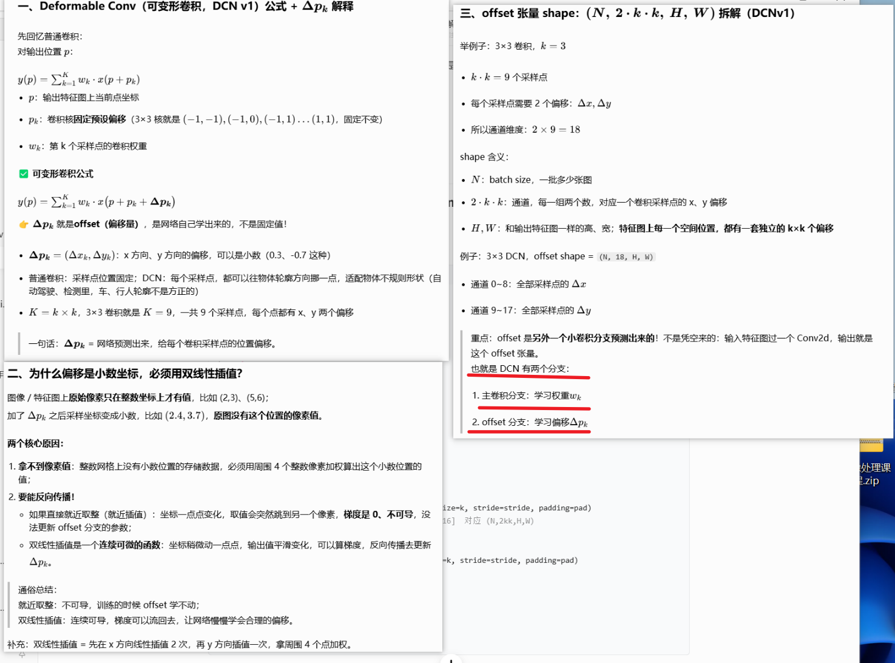

# 论文脉络：22 篇的顺序、前提与"到底新在哪"

> **这份文件怎么用**：它不是单篇笔记（单篇在 `W2/`、`W3/`），而是把 22 篇论文按"时间 + 逻辑"串成一条能讲通的线。每篇都用同一个模板：
>
> **前提**（它出现时，世界上已有什么、缺什么）→ **它提出**（一句话）→ **性质**（新概念 / 新组合 / 新方法 / 新证据）→ **为什么是它**（别人没想到？想到了做不出？做出来了但没系统证明？竞赛赢？）→ **纠正**（常见说错的地方）→ **发布后**（谁直接拿去用）→ **留给下一篇的坑**。
>
> 读的时候不要跳：**上一篇的"坑"就是下一篇的"前提"**，这条链断了就变成背名词。

---

## 0. 先分清三个词（不然一定会说错）

| 词                     | 含义                             | 用在谁身上                                      |
| --------------------- | ------------------------------ | ------------------------------------------ |
| **奠基（foundation）**    | 从零建立一套新范式，后面所有人都在它的框架里         | 1943 神经元模型、1958 感知机、1986 反向传播、1998 LeNet-5 |
| **引爆点（breakthrough）** | 范式早就有了，但它第一次在大规模真实任务上证明"这条路能赢" | **AlexNet（2012）**                          |
| **新组合 / 新方法 / 新证据**   | 零件不新，但拼法新、训练方法新，或第一次给出系统证据     | VGG、BN、YOLO、FPN 等绝大多数论文                    |

一句话：**AlexNet 不是"神经网络的奠基"，是"深度学习的引爆点"。** 你原话说"AlexNet 就是奠基"，这是最容易被导师纠正的一句。

---

## 1. 前史（1943–2011）：零件不是一天发明的

很多人以为"2012 年之前只有 CNN、深度、GPU、ReLU、Dropout 这几个概念"，实际时间跨度是 60 多年：

| 年份        | 事件                              | 意义                      |
| --------- | ------------------------------- | ----------------------- |
| 1943      | McCulloch-Pitts 神经元模型           | "人工神经元"概念               |
| 1958      | Rosenblatt 感知机                  | 第一个可学习的单层网络             |
| 1986      | 反向传播（Rumelhart/Hinton/Williams） | 多层网络终于能训练               |
| 1989/1998 | LeCun 把卷积 + 反向传播做成 LeNet-5      | **CNN 的雏形**（识别手写数字）     |
| 2006      | Hinton 深度信念网络 + 逐层预训练           | "深"网络第一次能堆起来            |
| 2009      | ImageNet 数据集发布                  | **数据**到位                |
| 2009      | Raina & Ng 用 GPU 训练深度网络         | **GPU 跑神经网络早于 AlexNet** |
| 2010      | ILSVRC 竞赛开始                     | 有了统一赛场                  |
| 2010      | ReLU（Nair & Hinton）             | 解决饱和/梯度消失               |
| 2012      | Dropout（Hinton 等）               | 防过拟合                    |

所以准确说法是：**2012 年前"零件基本齐了"，缺的是"把它们拼到足够大、足够快，并在真实任务上验证"。** 不是"没人想到"，是"没人凑齐 + 没人证明"。

---

## 2. 2012–2015：分类主干的四级跳

### 2.1 AlexNet（2012，NIPS）

- **前提**：CNN（1998）有了、ReLU（2010）有了、Dropout（2012）有了、GPU 训练（2009）也有人试过；但**没人把 8 层 CNN 放到 120 万张图的 ImageNet 上跑通过**。
- **它提出**：8 层 CNN（5 卷积 + 3 全连接，60 M 参数）+ 双 GTX 580（3 GB，装不下才拆两张卡）+ ReLU + Dropout + 数据增强 + 重叠池化 + LRN，端到端训练。
- **性质**：【新组合】+【新证据】+【工程实现】。**没有一个是它发明的零件**；新的是"规模 + 拼法 + 自己写的 CUDA 卷积（cuda-convnet）"。
- **为什么是它（而不是别人）**：三件事同时做到——① 敢用 8 层 + 60 M 参数；② 自己写高度优化的 GPU 卷积，5–6 天能训完；③ 直接上 ILSVRC 竞赛，top-5 15.3%（7 模型），第二名 26.2%，**领先 10 个百分点**。同期不是没人做 CNN，是没人同时满足这三点。
- **纠正**：① 它不是"奠基"，是"引爆点"；② 不是"效果可能更好"，是**碾压式领先 10 个点**；③ 15.3% 是**集成**成绩，单模型 18.2%。
- **发布后**：所有人开始用"CNN + GPU + ReLU + Dropout"这套配方；LRN 后来被证明没用（VGG 的 A vs A-LRN 只差 0.1%）。
- **局限与边界**：**局限**：结构是手工试出来的（11×11 大核、双 GPU 是显存妥协），60 M 参数几乎全在 FC 层，LRN 后被证明基本无用，对学习率/初始化敏感。**边界**：成立前提是「百万级标注数据 + GPU」；在小数据集或非自然图像上，这套配方的优势会大幅缩水。
- **留给下一篇的坑**：结构是**手工试出来的**——11×11 大核、双 GPU 是显存妥协，没有设计原则。

### 2.2 ZFNet（2013，ECCV；不在你的清单里，但必须知道）

- **前提**：AlexNet 赢了，但没人说得清"它为什么有效、每一层到底在学什么"。
- **它提出**：把 11×11 核换成 7×7、步长改小，并用"反卷积可视化"逐层看特征。
- **性质**：【新证据】+【结构微调】。
- **为什么是它**：它是 ILSVRC-2013 冠军，第一个把"黑箱"打开给所有人看。
- **发布后**：确立了"小核 + 可视化"的研究习惯，直接为 VGG 的 3×3 铺路。
- **局限与边界**：**局限**：本质是「换小核 + 可视化」，没有新方法，精度提升有限，可视化结论是定性的。**边界**：结论依赖 ImageNet 这种规模的数据；换到小数据或非自然图像，特征可视化所揭示的规律不一定成立。
- **留给下一篇的坑**：只是"改小了一点"，**深度到底值多少，没人系统回答**。

### 2.3 VGG（2014，ICLR 2015）

- **前提**：ZFNet 证明小核有效，但"加深到底会不会一直涨"没有答案；AlexNet 的结构太随意。
- **它提出**：**全网只用 3×3 卷积**（配 padding=1 保持尺寸），每池化一次通道翻倍，堆出 11/13/16/19 层共 6 个配置（A–E）。
- **性质**：【新证据】+【设计原则】。3×3 不是它发明的，**"控制变量证明深度"才是它的贡献**。
- **为什么是它**：① Oxford VGG 组本来就在做 CNN，不是"刚听说 AlexNet"；② 4 张 Titan Black，单模型能训 2–3 周；③ 实验设计干净——固定核大小、步长、池化，只动深度，A→E 每档回答一个问题。
- **纠正**：① VGG **不是"想到更小核"**，小核 ZFNet 已经在用；② VGG 在 ILSVRC-2014 分类是**亚军**（7.3% vs GoogLeNet 6.67%），但**单模型更强**（约 7.0% vs 7.9%）；③ "16 层"是 13 卷积 + 3 全连接，不是 16 个卷积。
- **发布后**：3×3 堆叠成为标准写法；预训练 VGG 被拿去当检测/分割的骨干（Faster R-CNN、FPN 都用过）。
- **局限与边界**：**局限**：138 M 参数几乎全在三个全连接层，单模型训练 2–3 周，显存/部署代价高；深层配置必须靠浅网预初始化才训得动。**边界**：16–19 层是当时算力的上限，结论建立在 ImageNet 分类任务上；小数据集上这种容量极易过拟合。
- **留给下一篇的坑**：**20 层以上靠随机初始化训不动**，VGG 自己都得用浅网 A 预初始化深网；参数 138 M 几乎全在 FC 层，部署很重。

### 2.4 GoogLeNet / Inception（2014，CVPR 2015；与 VGG 同年并行）

- **前提**：VGG 在"加深"，另一条路是"加宽 + 多尺度"；同时算力有限，参数不能无限涨。
- **它提出**：Inception 模块（同一层并行 1×1/3×3/5×5 卷积 + 池化，再拼接），22 层但只有约 5 M 参数；全局平均池化替代大 FC。
- **性质**：【新概念】（多尺度并行模块）+【新组合】。
- **为什么是它**：ILSVRC-2014 冠军（6.67%），**用 1/20 的参数量赢了 VGG**。
- **纠正**：它和 VGG **不是"相似走法"**，是两条不同路线：VGG 走"深度 + 统一小核"，GoogLeNet 走"宽度 + 多尺度 + 省参数"。
- **发布后**：Inception 成为 BN 论文的实验床（见下一条）。
- **局限与边界**：**局限**：Inception 模块的「几路、核多大」全是手工设计，结构复杂、改动困难；辅助分类器只是训练技巧。**边界**：依赖大规模数据与精细的训练配方；参数少不等于通用，换任务往往要重新设计模块。
- **留给下一篇的坑**：结构再精巧，**训练仍然慢、对学习率和初始化极敏感**。

### 2.5 BN（2015，ICML；Sergey Ioffe & Christian Szegedy，Google）

- **前提**：2015 年前，**"归一化"只以三种形态存在**——① 输入归一化/中心化（LeCun 1998 的建议，只是预处理）；② 白化（去相关，要算协方差矩阵的逆，代价大）；③ LRN（AlexNet 2012，只是相邻通道互相压制，不看 batch 统计）。**没有公开、可复现的"逐层归一化"成功方案**。
- **它提出**：对**每一层的预激活**，在一个 mini-batch 内、按通道做"减均值、除标准差"，再乘可学习 γ、加 β，并**让梯度穿过这一步反传**。
- **性质**：【新方法】。概念有前身，但"把标准化做成层 + batch 统计 + γ/β + 可反传"这个**具体形式是它第一次给出**。
- **为什么是它**：它解决的是当时最痛的问题——**深层网络训得慢、对学习率/初始化极敏感**；并且它不是"改改白化"，而是**主动放弃白化（不做去相关），只保留逐通道标准化**，因为完整白化算不起。这是"降级到够用"，不是"白化的升级版"。证据：同精度 2.1×10⁶ 步 vs 31.0×10⁶ 步（约 1/14），学习率可 ×5/×30，原网络用 0.045 直接发散。
- **纠正**：① 不是"2015 年前没人想到归一化"——**输入归一化 1998 就有，LRN 2012 就有**；② 不是"有人试了逐层白化效果差所以没发"——更准确是**完整白化代价高、没有可复现的成功方案**，作者在 §2 明确说此前对激活归一化的研究很少；③ 第一作者是 **Ioffe**，Szegedy 是第二作者；④ 不是"突然想到"，而是把已有归一化思想**工程化成一个层**；⑤ "奠基"过重，它是**训练技术的里程碑/标准组件**。
- **发布后**：几乎所有 CNN 默认加 BN；ResNet 能把 152 层训通，BN 是关键前提之一。后续 LayerNorm/GroupNorm/WeightNorm 都是针对它"依赖 batch"的缺陷提出的替代。
- **局限与边界**：**局限**：统计量来自 mini-batch，batch 很小（1–2）时估计不准；训练用 batch 统计、推理用滑动平均，两者不一致；对 RNN/变长序列不友好；「减少内部协变量偏移」这一解释后来受到质疑。**边界**：需要足够大的 batch；对训练/测试分布不一致（domain shift）无解；它是「训练加速器」，不是精度万能药。
- **留给下一篇的坑**：BN 治的是"**训不动**"，治不了"**更深反而更差**"。

### 2.6 ResNet（2015，CVPR 2016）在VGG网络上，结合BN

（ResNet‑50/101/152 就是不断堆叠 bottleneck 瓶颈块；）

- **前提**：VGG 说"越深越好"，BN 让深网训得动，但作者发现一个反例：**56 层 plain 网络的训练误差反而比 20 层大**——不是过拟合，是"退化"。
- **它提出**：残差块 `y = F(x) + x`，让网络学"残差"而不是"完整映射"；shortcut 可以是恒等（维度一致）或 1×1 投影（维度变化）。
- **性质**：【新概念】（残差学习/恒等映射）。
- **为什么是它**：它先**定义清楚问题**（退化 ≠ 过拟合），再给出一个极简解；152 层 ResNet 集成 top-5 3.57%，相对提升 28%。
- **纠正**：ResNet 不是为了"再加深"而加深，**是为了解决"加深反而变差"这个反例**。
- **发布后**：残差连接成为所有深网的标准结构；检测/分割骨干全部换成 ResNet。
- **局限与边界**：**局限**：残差解决的是「退化」，但加深仍有收益递减；维度不匹配时 shortcut 仍需 1×1 投影；没有 BN 时极深网络照样难训。**边界**：需要归一化配合；深度到几百层后精度饱和；检测/分割还需要 FPN 等结构补多尺度。
- **留给下一篇的坑**：残差解决了"能不能更深"，但**同等算力下怎么更强**、**通道之间要不要加权**、**检测任务的多尺度怎么办**，都没回答。

---

## 3. 2016–2019（一）：主干网的分支

> 这一组不再是"同一条主线"，而是从 ResNet 这棵树分出的四个方向：**分组卷积（ResNeXt）、通道注意力（SENet）、膨胀卷积（Dilated）、可变形采样（Deformable）**。

### 3.1 Dilated Convolution（2016，ICLR）利用分类网络VGG改善---主要解决语义分割问题（大感受野 + 不丢分辨率”）

- **前提**：语义分割要"大感受野"，但池化/下采样会丢分辨率；FCN 的 8s 版本已经到瓶颈。
- **它提出**：在卷积核元素之间插入空洞（dilation rate=1,2,4,8…），**不增加参数、不降分辨率**就能指数级扩大感受野；用"前端 + 上下文模块"两级结构聚合多尺度。
- **性质**：【新用法】+【新证据】。膨胀卷积本身在 1980s–90s 的信号处理里就有（à trous 算法），**新的是把它系统用于分割上下文**。
- **为什么是它**：VOC2012 test 上，前端 67.6% → 上下文模块 73.5% → 加 CRF-RNN 75.3%，证明"不池化也能扩感受野"。
- **纠正**：不是"发明了膨胀卷积"，是"证明了它在分割上有效、并给出可复现的上下文模块"。
- **发布后**：DeepLab 系列（ASPP）、实时分割、检测中的空洞卷积全部沿用。
- **局限与边界**：**局限**：采样仍是固定网格，大 dilation 会产生「网格伪影」（gridding），对小物体不友好；不降分辨率意味着高分辨率下算力仍然很贵。**边界**：适合语义分割/密集预测；实时高分辨率场景需要额外裁剪或轻量骨干；需配合多尺度才能覆盖大小目标。
- **留给下一篇的坑**：固定网格采样，**遇到形变/非刚性物体仍然不准**。

### 3.1b Wide ResNet（2016，BMVC）· ResNeXt 的直接前身

- **前提**：ResNet 证明"深能更好"，但 1001 层反而不如更浅的；作者归因为 diminishing feature reuse（深层反复复用旧特征，新增层贡献变小）。
- **它提出**：少堆层、把每层通道乘 widening factor k；块内用 B(3×3)-B(3×3) + pre-activation，dropout 只夹在两个 3×3 之间。
- **性质**：【新证据】+【新方法（把"宽度"当成独立设计维度）】。
- **为什么是它**：WRN-40-4（8.9 M）CIFAR-10 错误率 4.53%，优于 1001 层 ResNet（10.2 M、4.92%），且快 8 倍；WRN-28-10 到 3.8%。
- **纠正**："ResNet 越深越好"不成立——深度收益会饱和，宽度更划算。
- **发布后**：WRN 成为 CIFAR 标准基线；"深度-宽度 trade-off"成为结构设计的必谈维度。
- **局限与边界**：**局限**：宽度代价随 k 平方增长（8.9 M → 36.5 M）；均匀加宽没有选择性；ImageNet 上收益不如 CIFAR 明显；dropout 位置/比例要重调。**边界**：适合"层数太多、算力有限"的中小数据集场景；部署受显存限制；换任务要重新平衡深度与宽度。
- **留给下一篇的坑**：这是"均匀加宽"，能不能分组、让不同组学不同东西？——这正是 ResNeXt 的 cardinality。

### 3.2 ResNeXt（2017，CVPR） 2016年提出Wide ResNet基础上对比，该架构 采用了VGG/ResNets重复层的策略

- **前提**：ResNet 定了"深"，Inception 定了"宽/多分支"，但**同等算力下哪种更好没有统一答案**；分组卷积在 AlexNet 时代就有（双 GPU 分组），但没被系统研究。
- **它提出**：把残差块里的 3×3 卷积分成 **cardinality=32 组**（grouped conv），三条等价实现（A/B/C），在不显著增加算力的前提下提升精度。
- **性质**：【新组合】+【新概念（cardinality 作为第三维度）】。
- **为什么是它**：101 层 32×4d 在**相近算力**下优于更深的 ResNet-200，说明"分组"是比"单纯加深"更划算的维度。
- **纠正**：它没有发明分组卷积，新的是**把 cardinality 当成和深度/宽度并列的设计维度**，并给出等价变换证明。
- **发布后**：分组卷积成为 MobileNet/ShuffleNet 等轻量网络的基础。
- **局限与边界**：**局限**：分组是「均分」，不区分哪些通道更重要；cardinality 和每组宽度都是手工超参；分组卷积在部分硬件/框架上效率不佳。**边界**：在同等算力下才体现优势；需要底层 grouped conv 支持；分类以外的任务收益需重新验证。
- **留给下一篇的坑**：分组是"均分"，**哪些通道更重要，网络自己不知道**。

### 3.3 SENet（2017，CVPR 2018）

- **前提**：ResNeXt 证明"通道分组"有用，但**通道之间的关系是固定的、手工设计的**；没人让网络自己学"每个通道该放大多少"。
- **它提出**：SE block 三步——**squeeze**（全局平均池化把每个通道压成一个数）→ **excitation**（两层小 MLP + sigmoid 学出一组权重）→ **reweight**（按权重缩放通道）。
- **性质**：【新概念】（通道注意力）。
- **为什么是它**：即插即用、代价极小（SE-ResNet-50 参数 +2.5 M、算力 +0.26%），但 top-5 从 7.48% 降到 6.62%；ILSVRC-2017 冠军。
- **纠正**：注意力不是它发明的（视觉注意力早就有），**"通道维度的 SE 结构 + 极低代价"是它的贡献**。
- **发布后**：SE 模块被广泛嵌入 ResNet/ResNeXt/检测网络；后续 ECA、CBAM 都是它的变体。
- **局限与边界**：**局限**：只建模通道、不建模空间；压缩比 r 是手工超参；全局平均池化会丢掉空间位置信息。**边界**：即插即用但收益随任务/数据变化；极小模型上增益有限；需要空间关系时得配 CBAM 等空间注意力。
- **留给下一篇的坑**：只调通道，**没解决空间上的形变**。

### 3.4 Deformable Conv v1（2017，ICCV）（**采样点可以脱离整齐网格，自由偏移，自适应贴合物体实际轮廓**。空洞卷积属于 DCN 的特殊情况（偏移固定））

- **前提**：卷积的采样点是**固定网格**（3×3 就是 9 个固定位置），物体一旦旋转/形变/尺度变化，固定网格就对不上；Dilated 只是"把网格拉大"，形状仍固定。
- **它提出**：给每个采样点学一个**偏移量 (Δx, Δy)**，在偏移后的位置用**双线性插值**取值；偏移量由另一个卷积从特征上预测，可端到端反传。还配套 deformable RoI pooling。
- **性质**：【新概念】（可学习采样几何）。
- **为什么是它**：在 Faster R-CNN 上 VOC 2007 mAP 78.1→79.3，高 IoU 提升更大；COCO AP 29.4→33.1，证明"几何要跟着物体走"。
- **纠正**：它不是"注意力"，也不是"空洞卷积的变体"——**它改的是采样位置，不是权重或通道**。
- **发布后**：检测/分割的形变建模标准工具；后续 v2 继续改进。
- **局限与边界**：**局限**：偏移量无约束，可能采样到背景/越界；双线性插值需要自定义算子，部署不友好；训练收敛偏慢。**边界**：对形变/非刚性目标收益大，规则物体收益小；必须有 GPU 算子实现，否则速度优势消失。
- **留给下一篇的坑**：偏移量**没有约束**，容易跑到无关区域（v2 要治这个）。

### 3.5 Deformable Conv v2（2018，CVPR 2019）

- **前提**：v1 的偏移是自由的，**可能越界、覆盖到背景**，而且不同采样点的贡献没有被区分。
- **它提出**：给每个采样点再加一个 **modulated 标量 Δm（0–1）**，让网络自己决定"这个点要不要看、看多少"；并用 **R-CNN 特征模仿**（feature mimicry）把蒸馏思想引入检测。
- **性质**：【新方法】（对 v1 的约束 + 训练技巧）。
- **为什么是它**：COCO val 从 34.7 一路提到 41.7（加 tricks 到 43.1），证明"约束偏移 + 蒸馏"有效。
- **纠正**：不要把它说成"v1 的简单加深"，**核心是给偏移加调制、并改训练目标**。
- **发布后**：成为可变形卷积的默认版本。
- **局限与边界**：**局限**：调制标量 + 特征模仿增加了实现与调参复杂度；采样点数 K 敏感；仍需自定义算子。**边界**：检测/分割受益明显，分类收益有限；部署端需要专用 kernel；小模型上收益可能被开销抵消。
- **留给下一篇的坑**：算子级改进到这儿基本封顶，**检测流程本身还有 NMS、anchor 等手工件**。

# ResNet（改深度）→ ResNeXt（改分支）→ Dilated（改视野）→ **DeformConv（改采样几何）**

---

## 4. 2015–2019（二）：检测的独立赛道

> 检测和分类不是同一条线：分类回答"是什么"，检测要回答"**有什么、在哪、有几个**"。它有自己的四个难点：候选框、正负样本不平衡、多尺度、后处理（NMS）。下面按时间顺着讲。

### 4.1 Faster R-CNN（2015 预印本 / 2016 TPAMI，NIPS 2015）

- **前提**：R-CNN → SPPnet → Fast R-CNN 已经把"分类 + 回归"做进一个网络，但**候选框仍由外部算法（Selective Search）生成**，占掉大部分时间，没法端到端。
- **它提出**：**RPN**（Region Proposal Network）——在共享卷积特征图上用 anchor 直接回归"有没有物体 + 框偏移"，让候选框生成几乎零成本；再用 RoI Pooling 把不同大小的框变成固定尺寸送分类头。
- **性质**：【新概念】（RPN 与检测共享卷积）。
- **为什么是它**：把候选框从"外部算法"变成"网络的一层"，**首次真正做到端到端**；VOC 2007 73.2 mAP，VGG 上 5 fps。
- **纠正**：5 fps 是 **VGG + 全流程**，ZF 版本约 17 fps；"实时"是相对当时而言，不是今天的实时。
- **发布后**：两阶段检测的标准框架，后续所有 two-stage 论文都以它为基线。
- **局限与边界**：**局限**：两阶段结构速度受限；anchor 的尺度/比例/数量是手工超参；RoI Pooling 有量化误差；仍依赖 NMS 后处理。**边界**：需要较强骨干和充足训练数据；小物体要靠 FPN 补；实时场景（>30 FPS）基本不适用。
- **留给下一篇的坑**：**高 IoU 阈值下质量不够**（分类头只在一个 IoU 上训练）。

### 4.2 YOLOv1（2016，CVPR）

- **前提**：两阶段太慢（候选框 + 逐框分类），无法实时；检测被拆成"提框"和"分类"两件事。
- **它提出**：把图像切成 7×7 网格，每个格子直接回归 2 个框（坐标 + confidence）和类别概率，**一次前向出结果**；检测 = 回归问题。
- **性质**：【新概念】（单阶段、统一回归）。
- **为什么是它**：45 FPS（Fast YOLO 155 FPS），VOC 2007 mAP 63.4，第一次证明"不用候选框也能做检测"。
- **纠正**：YOLOv1 的精度**低于两阶段**（63.4 vs Fast R-CNN 70.0），它赢的是速度；"实时检测"这条线是它开的。
- **发布后**：单阶段成为实时检测主线；SSD、RetinaNet、YOLOv2/v3 全部继承。
- **局限与边界**：**局限**：7×7 网格太粗，小物体和密集物体差；每格只预测 2 个框，拥挤场景容易漏；定位误差大；没有多尺度。**边界**：适合实时、目标较大的场景；高精度需求不如两阶段；密集/小目标场景要等 v2/v3。
- **留给下一篇的坑**：**小物体和密集物体差**（7×7 网格太粗）；定位误差大；没有多尺度。

### 4.3 FPN（2017，CVPR）

- **前提**：检测里的"多尺度"要么用图像金字塔（算力爆炸），要么只用最深层的单尺度特征（小物体信息在深层已经丢了）。
- **它提出**：**自顶向下 + 横向连接**——把深层语义上采样，与浅层高分辨率特征逐层相加融合，得到 P2–P5 四个尺度的特征图，每个尺度都既有语义又有分辨率。
- **性质**：【新结构】（融合方式新，组件都是现成的）。
- **为什么是它**：接在 Faster R-CNN 上，COCO AP 36.2；小物体 AR 从 32.0 提到 44.9，证明"多尺度融合"是检测的必需件。
- **纠正**：FPN 不是"图像金字塔的替代品"这么简单，它解决的是**语义与分辨率的矛盾**；也不是所有检测都必须用，单阶段后来也用了类似结构。
- **发布后**：几乎所有检测器（Faster R-CNN、RetinaNet、YOLOv3、Mask R-CNN）都加 FPN。
- **局限与边界**：**局限**：自顶向下用「相加」融合，深浅层语义可能冲突；多尺度特征带来显存/算力开销；P2 高分辨率分支很贵。**边界**：检测/分割的多尺度几乎必需，纯分类不用；极大或极小目标仍受骨干感受野限制。
- **留给下一篇的坑**：多尺度有了，**正负样本不平衡仍然是单阶段的死穴**。

### 4.4 Focal Loss / RetinaNet（2017，ICCV）

- **前提**：单阶段精度差，作者诊断出根因不是"结构不行"，而是**正负样本极度不平衡**——一张图几万个 anchor，绝大多数是容易的背景，它们的 loss 把少量难样本淹没了。
- **它提出**：**Focal Loss** `FL = -α(1-p_t)^γ log(p_t)`——用 `(1-p_t)^γ` 把"已经分对的容易样本"的权重压下去，让训练聚焦难样本；配 RetinaNet（ResNet-FPN + 两个子网络）。
- **性质**：【新方法】（损失函数设计）。
- **为什么是它**：单阶段第一次超过两阶段——RetinaNet R-101-FPN COCO AP 39.1，且速度更快；消融显示 CE 30.2 → α-CE 31.1 → FL 34.0。
- **纠正**：**不是"单阶段结构不行"，是"loss 不行"**；γ 的作用是"相对放大难样本"，不是"只学难样本"。
- **发布后**：Focal Loss 成为密集检测的标准损失；YOLOv3 的置信度损失、后续很多变体都受它影响。
- **局限与边界**：**局限**：γ/α 需调；只处理分类的正负不平衡，回归的难易不平衡没解决；anchor 仍手工；训练轮次长。**边界**：在「密集检测、正负极度不平衡」时最有效；类别均衡的任务收益很小；它不能替代结构改进。
- **留给下一篇的坑**：anchor 的尺度/比例仍是手工超参，**能不能不要 anchor？**

### 4.5 Cascade R-CNN（2018，CVPR）

- **前提**：Faster R-CNN 的分类头只在**一个 IoU（如 0.5）**上训练，但推理时 proposal 的质量分布很宽；**高质量框在训练时样本很少**，导致"高 IoU 下反而变差"。
- **它提出**：**级联多个检测头**，IoU 阈值逐级提高（0.5 → 0.6 → 0.7）；每一级的输入是上一级**重新回归后**的框，训练时也按对应阈值重采样。
- **性质**：【新方法】（级联 + 递增 IoU 训练/推理匹配）。
- **为什么是它**：COCO AP 42.8，且提升主要集中在**高 IoU 区间**；不改骨干、不改 RPN，即插即用。
- **纠正**：它的提升**不是全面的**，低 IoU 区间提升很小；"级联"不是简单堆三个头，**训练/推理的 IoU 匹配必须一致**。
- **发布后**：高精度检测的标准技巧；后续很多竞赛方案用它。
- **局限与边界**：**局限**：级联增加推理开销；IoU 阈值序列是手工设定；提升主要集中在高 IoU 区间，低 IoU 提升很小。**边界**：适合「高质量检测」需求；实时场景代价高；效果依赖第一阶段 proposal 的质量。
- **留给下一篇的坑**：两阶段依然依赖 anchor + NMS，流程仍重。

### 4.6 YOLOv3（2018）

- **前提**：YOLOv1 小物体差、YOLOv2 已经补了一些；ResNet/FPN 证明"多尺度 + 残差"有效。
- **它提出**：Darknet-53 骨干（残差 + 3×3/1×1）+ **三个尺度预测**（13/26/52）+ 每个框用 **logistic 分类**（不用 softmax，支持多标签）+ 9 个聚类 anchor。
- **性质**：【工程整合】+【新证据】。几乎没有新概念，是把当时有效的东西拼得最好。
- **为什么是它**：COCO AP 33.0 / AP50 57.9，608 输入 51 ms（Titan X），在"速度-精度"曲线上明显优于同期。
- **纠正**：YOLOv3 的 AP50 很高但 **AP75 低**（34.4），说明定位仍粗；它不是"全面超越两阶段"。
- **发布后**：工业界实时检测的主力，直到 YOLOv4/v5/v8。
- **局限与边界**：**局限**：AP75 明显偏低（定位仍粗）；anchor 要靠聚类；NMS 仍是手工后处理；本质是工程整合，没有新概念。**边界**：实时场景的最优选择之一；小物体/高精度要求仍不如「两阶段 + FPN」；换数据集要重聚类 anchor。
- **留给下一篇的坑**：anchor 仍需聚类，NMS 仍需手工，**端到端仍不彻底**。

### 4.7 CornerNet（2018，ECCV）

- **前提**：anchor-based 方法超参多（尺度、比例、数量），且正负样本定义依赖 IoU。
- **它提出**：把物体表示成**左上 + 右下两个角点**，用 heatmap 预测角点、用 **associative embedding** 把同一物体的两个角点配对；配套 **corner pooling**（沿边方向池化，给角点提供上下文）。
- **性质**：【新表示】（keypoint-based，无 anchor）。
- **为什么是它**：COCO AP 40.6，证明"不用 anchor 也能打"。
- **纠正**：无 anchor ≠ 无后处理，CornerNet 仍要做角点配对和 NMS 类操作；它的**配对错误**是新问题。
- **发布后**：开启 anchor-free 路线，CenterNet、FCOS、ATSS 跟进。
- **局限与边界**：**局限**：角点配对容易错（同物体/不同物体的角点混在一起）；对遮挡或截断的角点敏感；corner pooling 计算量大；后处理仍复杂。**边界**：适合无 anchor 的检测；密集/遮挡场景弱；训练和推理都比 YOLO 慢。
- **留给下一篇的坑**：两个角点配对容易错（同物体/不同物体的角点混在一起）。

### 4.8 CenterNet（2019，ICCV；Duan 等 "Keypoint Triplets"）

- **前提**：CornerNet 只靠两个角点配对，**没有物体内部信息**，错配就错检。
- **它提出**：在角点之外再加**中心点**，用"中心点是否落在框内"做**三元组校验**；配套 **center pooling**（中心点沿水平/垂直方向取最大响应）。
- **性质**：【新组合】（triplet 校验 + 两种 pooling）。
- **为什么是它**：COCO AP 47.0（多尺度），比 CornerNet 明显提升，证明"加一个中心点约束"能显著降错配。
- **纠正**：**这个 CenterNet 不是 Zhou 2019 的 "Objects as Points"**，两者同名但方法不同（后者是中心点 + 尺寸回归），读的时候必须区分。
- **发布后**：关键点检测路线继续演化；"中心点校验"的思想被后续沿用。
- **局限与边界**：**局限**：三元组校验增加计算；中心点可能漏检（遮挡、小目标）；仍需后处理；与 Zhou 2019 的同名 CenterNet 极易混淆。**边界**：关键点检测路线内有效；密集场景有限；极端小目标不如 anchor-based + FPN。
- **留给下一篇的坑**：关键点方法后处理仍复杂，**能不能用集合预测一把出结果？**

---

## 5. 2017–2024：Transformer 与新架构

### 5.1 Transformer（2017，NIPS）

- **前提**：NLP 主流是 RNN/LSTM——**不能并行**（必须按时间步算）、长距离依赖要一步步传；CNN 做序列又受限于局部感受野。
- **它提出**：**纯注意力**架构：scaled dot-product attention、多头注意力、位置编码、残差 + LayerNorm、encoder-decoder，完全不用循环和卷积。
- **性质**：【新概念】（self-attention 替代循环）。
- **为什么是它**：WMT 英德 28.4 / 英法 41.8 BLEU，训练并行度高、长程依赖好；8 卡 3.5 天训完 big 模型。
- **纠正**：注意力机制不是它发明的（Bahdanau 2014 就有），**"完全去掉 RNN/CNN、只留注意力"是它的贡献**；位置编码是必要的，否则注意力对顺序无感知。
- **发布后**：NLP 全面转向 Transformer；CV 开始"引进门"（下一篇 ViT）。
- **局限与边界**：**局限**：注意力是 O(L²) 复杂度，长序列显存/算力爆；位置编码外推能力差；训练需要大量数据与算力。**边界**：适合中等长度序列；超长序列/超高分辨率不适用（这正是 Mamba 的出发点）；小数据上不如 RNN/CNN。
- **留给下一篇的坑**：**图像不是序列**，怎么把图变成 token？

### 5.2 ViT（2020，ICLR 2021）

- **前提**：CNN 有强归纳偏置（局部性、平移等变），在中小数据上很强；但**规模化到超大数据时，这些偏置反而限制表达**；Transformer 在 NLP 已经证明"大模型 + 大数据"能赢。
- **它提出**：把图像切成 16×16 的 patch，每个 patch 线性投影成一个 token，加位置嵌入和 CLS token，直接送标准 Transformer encoder。
- **性质**：【新应用】+【新证据】。结构几乎照搬 Transformer，**"把图像当词序列"是它的关键动作**。
- **为什么是它**：在 JFT-300M 预训练后，ViT-H/14 ImageNet 88.55%，超过同期 CNN；但在中小数据上不如 ResNet（Table 5 里 76.53 < 77.91）。
- **纠正**：ViT **不是"全面取代 CNN"**，它的前提是**大规模预训练**；小数据上 CNN 的归纳偏置仍是优势。
- **发布后**：视觉 backbone 开始转向 Transformer（Swin、DeiT、MAE 都基于它）。
- **局限与边界**：**局限**：缺少 CNN 的归纳偏置，中小数据上不如 ResNet；大 patch 丢细节；需要大规模预训练；高分辨率要插值位置嵌入。**边界**：成立前提是「大数据 + 大算力」；中小数据应用 CNN 或混合结构；密集预测需要层级式 Transformer（如 Swin）。
- **留给下一篇的坑**：分类有了，**检测怎么用 Transformer 做端到端？**

### 5.3 DETR（2020，ECCV）

- **前提**：检测流程里全是手工件——anchor 设计、NMS 后处理、标签分配规则；这些既难调又不可微。
- **它提出**：把检测当成**集合预测**：Transformer encoder-decoder 输出固定数量的预测（object queries），用**匈牙利算法做二分匹配**，一对一分配 GT，**不需要 NMS、不需要 anchor**。
- **性质**：【新概念】（端到端集合预测）。
- **为什么是它**：COCO 42.0 AP，与调好的 Faster R-CNN 打平，但流程极简；证明"去手工件"可行。
- **纠正**：① object query 不是"随机初始化"，实际初始化为 0（学习位置嵌入）；② DETR 训练要 **500 epoch**，收敛极慢；③ 小物体 AP 明显差（AP_S 20.5）。
- **发布后**：端到端检测成为新赛道，后续 Deformable DETR、DINO、RT-DETR 都沿这条线。
- **局限与边界**：**局限**：500 epoch 才收敛；小物体 AP 明显差；全局注意力显存占用高；object query 数量固定，限制最大检测数。**边界**：适合中等分辨率、非极端实时的场景；实时/小物体需求要靠 Deformable DETR 等改进。
- **留给下一篇的坑**：**收敛慢 + 小物体差**，根因是全局注意力的计算量和初始化。

### 5.4 Deformable DETR（2020，ICLR 2021）

- **前提**：DETR 的注意力是**全局**的（每个 query 看整张特征图），收敛慢、小物体差、高分辨率下算不动。
- **它提出**：**Deformable Attention**——每个 query 只在一小撮**可学习采样点**上做注意力（采样点位置由 query 预测），并扩展到**多尺度**；再加 iterative refinement 和 two-stage 变体。
- **性质**：【新方法】（把可变形卷积的思想搬进注意力）。
- **为什么是它**：**50 epoch 就到 43.8 AP**（DETR 要 500 epoch 才 43.3），训练成本降一个量级；小物体 AP 26.4 明显改善。
- **纠正**：① 并非"FLOPs 更低"——173 GFLOPs 比 DETR 的 86 G 更高，省的是**收敛轮次和显存**；② 不是"所有注意力都换成可变形"（encoder 里只对部分层做）；③ two-stage 的第一阶段是 **encoder-only**，不是 decoder。
- **发布后**：成为 DETR 系列的标准改进，DINO 等继续用。
- **局限与边界**：**局限**：50 epoch 仍比 CNN 检测器训练久；采样点数 K 是手工超参；需要自定义算子；两阶段变体增加开销。**边界**：端到端检测的首选改进；极高分辨率仍受显存限制；部署端需要算子支持。
- **留给下一篇的坑**：检测的"端到端"基本打通，**预训练怎么让 ViT 更强？**

### 5.5 MAE（2021，CVPR 2022）

- **前提**：ViT 需要大量标注数据；NLP 的 BERT 式"掩码预测"自监督很成功，但**搬到视觉效果不好**——图像信息密度低，遮一小块几乎可以靠邻域补出来。
- **它提出**：**遮掉 75% 的 patch**（高掩码率），只把可见 patch 送进 encoder（**非对称**），再用一个轻量 decoder 重建被遮的像素。
- **性质**：【新方法】（非对称编解码 + 高掩码率）。
- **为什么是它**：ViT-H 微调后 ImageNet 87.8%，训练比对比学习快 2.8–3.7 倍；证明"视觉自监督也能 scale"。
- **纠正**：MAE 不是"BERT 照搬"，**高掩码率 + 非对称结构是针对图像特性做的改造**；linear probing 与 fine-tuning 差距大，说明表征不是纯线性的。
- **发布后**：视觉自监督成为 ViT 预训练主流（SimMIM、BEiT 等）。
- **局限与边界**：**局限**：重建像素目标偏重低频信息；fine-tuning 与 linear probing 差距大，说明表征不是线性的；掩码率固定；预训练算力需求大。**边界**：需要大数据才能体现优势；小数据上不如监督预训练；检测/分割要做适配。
- **留给下一篇的坑**：Transformer 的注意力是**二次复杂度**，长序列/高分辨率仍然贵。

### 5.6 Mamba（2023/2024）

- **前提**：Transformer 的注意力对序列长度是 O(L²)；RNN 是线性但**不能并行、长程遗忘**；SSM（状态空间模型）理论上有线性复杂度，但**参数是固定的，不能按输入选择**。
- **它提出**：**选择性状态空间模型（S6）**——让 Δ、B、C 随输入变化（input-dependent），从而"有选择地记住/遗忘"；配 **hardware-aware scan** 算法，把理论线性复杂度做成实际速度。
- **性质**：【新概念】（选择性 SSM）。
- **为什么是它**：语言建模上匹配或超过同规模 Transformer，长序列吞吐随长度**线性**增长。
- **纠正**：Mamba 不是"RNN 复活"，**关键是"参数随输入变"**，这正是它和传统 SSM/RNN 的区别。
- **发布后**：成为"线性复杂度"的新主线，视觉领域开始适配（下一篇）。
- **局限与边界**：**局限**：选择性扫描依赖高效的自定义 kernel，硬件/框架支持不如注意力成熟；在需要「精确检索任意位置」的任务上不如注意力；生态与预训练权重仍少。**边界**：长序列/线性复杂度场景优势明显；短序列上 Transformer 仍强；迁移到新任务需要重训配方。
- **留给下一篇的坑**：Mamba 是 **1D 序列**模型，图像是 2D，**怎么扫？**

### 5.7 VMamba（2024）

- **前提**：Mamba 在 1D 上有效，但图像有 2D 空间结构；直接把图像拉成一条线会破坏邻域关系。
- **它提出**：**2D Selective Scan（SS2D）**——沿四个方向（左上→右下、右下→左上、右上→左下、左下→右上）分别扫描再融合，让每个像素都能获得全局上下文；构成 VSS block 与 VMamba 骨干。
- **性质**：【新适配】（把 1D SSM 变成 2D 视觉骨干）。
- **为什么是它**：ImageNet 82.6%（T 规模），COCO 检测 47.3 APb，ADE20K 47.9 mIoU，吞吐随分辨率线性增长。
- **纠正**：不是"Mamba 直接拿来用"，**四方向交叉扫描是专门为 2D 设计的**；和 ViT 比，优势在**高分辨率/线性复杂度**，不是全面碾压。
- **发布后**：视觉 SSM 分支开始与 Transformer 并行发展。
- **局限与边界**：**局限**：四方向扫描增加计算与内存；2D 适配仍在早期，训练配方不成熟；高分辨率下的收益与开销要权衡。**边界**：高分辨率视觉任务有优势；小数据/小模型未必强于 CNN 或 ViT；部署需要自定义 kernel。
- **留给下一篇的坑**：这条线才刚开始，**训练配方、预训练、检测适配都还没定型**。

---

## 6. 把 22 篇压成 3 句话

1. **2012–2015（主干）**：AlexNet 证明"深 CNN 能赢"→ VGG 证明"深度值多少"→ BN 解决"训得动"→ ResNet 解决"更深反而更差"。
2. **2016–2019（分叉）**：主干上分出四个零件（分组卷积、通道注意力、膨胀卷积、可变形采样）；检测另开一条线，依次解决**候选框（Faster）、不平衡（Focal）、多尺度（FPN）、高质量（Cascade）、anchor（CornerNet/CenterNet）**。
3. **2017–2024（范式）**：Transformer 证明"纯注意力可行"→ ViT 把它搬进视觉 → DETR 把检测变成集合预测 → Deformable DETR 解决收敛 → MAE 解决预训练 → Mamba/VMamba 用线性复杂度挑战注意力。

---

## 7. 最容易被说错的 8 句（考前自查）

| 错误说法                                | 正确说法                                                      |
| ----------------------------------- | --------------------------------------------------------- |
| "AlexNet 是神经网络奠基"                   | 奠基是 1943/1958/1986/1998；AlexNet 是**引爆点**                  |
| "2012 年前只有 CNN、深度、GPU、ReLU、Dropout" | 这些横跨 60 年；2012 年前**零件基本齐了，缺规模和验证**                        |
| "AlexNet 只是把旧东西拼起来，效果可能好一点"         | 是**新组合 + 新证据 + 自写 GPU 实现**，且**领先 10 个点**                  |
| "VGG 想到用小卷积核"                       | 小核 ZFNet 已在用；VGG 的贡献是**控制变量证明深度**                         |
| "VGG 是冠军"                           | 分类**亚军**（7.3% vs GoogLeNet 6.67%），但**单模型更强**              |
| "BN 之前没人做归一化"                       | 输入归一化 1998、LRN 2012 都有；BN 新在**逐层 + batch 统计 + γ/β + 可反传** |
| "BN 是把白化改得更好"                       | 相反：**放弃白化（不去相关），只做逐通道标准化**，因为完整白化算不起                      |
| "BN 之后没人再想归一化"                      | LayerNorm/GroupNorm/WeightNorm 都是针对它"依赖 batch"的替代         |

---

## 8. 追问积累区（新问题往这里加）

> 格式：`### 日期 · 问题` → 结论 → 依据。每次只追加，不改旧条目。

### 2026-10-31 · AlexNet 算不算"奠基作"？

**结论：不算奠基，算"引爆点/分水岭"。**
依据：奠基链条是 1943 McCulloch-Pitts → 1958 感知机 → 1986 反向传播 → 1998 LeNet-5；AlexNet 的价值是"第一个在大规模真实数据上证明深 CNN 可行"。

### 2026-10-31 · 同期别人是不是"也能做到、只是没测"？

**结论：不是。** 差距是 10 个百分点（26.2% vs 15.3%），不是"差不多"；且竞赛每年办，2013 ZFNet 夺冠、2014 GoogLeNet 反超。真实动机是竞赛排名、资源、声望，以及"现有方法有明显缺陷"。

### 2026-10-31 · VGG 是不是"手快抢先"？

**结论：不是。** Oxford VGG 组有长期 CNN 积累 + 4 张 Titan Black；单模型训练 2–3 周。赢在控制变量的实验设计，不是速度。

### 2026-10-31 · 这几篇是"线性继承"吗？

**结论：是"问题接力 + 并行赛道"。** 佐证：VGG 与 GoogLeNet 同年（2014）；BN 的实验床是 Inception；ResNet 的动机是 VGG 留下的"更深反而更差"反例。

### 2026-11-01 · BN 是不是"之前没人想到"？归一化的创新边界在哪？

**结论：归一化思想早就有，但"把激活值按 batch 统计做成可训练的一层"是 BN 的新。**
前史：输入归一化（LeCun 1998）→ LRN（AlexNet 2012）→ BN（2015）→ LN/IN/WN（2016）→ GN（2018）。
BN 新增：① 归一化对象从"输入"变成"每一层激活"；② 统计量用 mini-batch 现算；③ γ/β 保住表达力；④ 让梯度穿过归一化（能反传才叫层）；⑤ 系统证明学习率可放大 5–30 倍。

### 2026-11-01 · BN 的卖点是"错误率低"还是"训练快"？

**结论：主卖点是"训得快、训得稳"，精度是顺带的。**
依据：同精度 2.1×10⁶ 步 vs 31.0×10⁶ 步（约 1/14）；BN-x30 最终 74.8%（vs 72.2%）；4.9%/4.82% 是 6 模型集成 + 144 crops。

### 2026-11-01 · 为什么 BN 拿 Inception 做实验床？VGG 只拿亚军为什么还能发论文？

**结论：** ① BN 是架构无关的通用层，选当时最强、最省算力的 Inception 才能跑大量对照【我的推断】；② VGG 论文价值在"控制变量研究深度"，arXiv 2014-09 就挂出，不是"拿了亚军才补写"；**贡献是设计原则，不是 SOTA**。

### 2026-11-01 · 这份文件为什么要重写？

**结论：** 原版是"问答拼贴"，缺少"每篇的前提→提出→性质→为什么是它→影响→遗留"的统一逻辑，读起来像名词表。本版按时间顺序逐篇铺开，并把 4 处常见误判（AlexNet 奠基、BN 改良白化、VGG 小核首创、归一化前无古人）在对应论文里直接改正。

---

## 9. 笔记索引

**第 2 周（分类主干 / 算子）**

- [01_AlexNet.md](W2/01_AlexNet.md)
- [02_VGG.md](W2/02_VGG.md)
- [03_BatchNorm.md](W2/03_BatchNorm.md)
- [04_ResNet.md](W2/04_ResNet.md)（🔴 第 4 节留空）
- [05_ResNeXt.md](W2/05_ResNeXt.md)
- [05b_WideResNet.md](W2/05b_WideResNet.md)
- [06_DilatedConv.md](W2/06_DilatedConv.md)
- [07_DeformableConv_v1.md](W2/07_DeformableConv_v1.md)（🔴 第 4 节留空）
- [07_DeformableConv_v2.md](W2/07_DeformableConv_v2.md)（🔴 第 4 节留空）
- [08_FPN.md](W2/08_FPN.md)
- [09_SENet.md](W2/09_SENet.md)

**第 3 周（检测 & 新范式）**

- [10_FasterRCNN.md](W3/10_FasterRCNN.md)（🔴 第 5 节留空）
- [11_CascadeRCNN.md](W3/11_CascadeRCNN.md)
- [12_YOLOv1.md](W3/12_YOLOv1.md)（🔴 第 5 节留空）
- [13_YOLOv3.md](W3/13_YOLOv3.md)
- [15_FocalLoss_RetinaNet.md](W3/15_FocalLoss_RetinaNet.md)（🔴 第 5 节留空）
- [16a_CornerNet.md](W3/16a_CornerNet.md)
- [16b_CenterNet.md](W3/16b_CenterNet.md)
- [17_Transformer.md](W3/17_Transformer.md)（🔴 第 5 节留空）
- [18_ViT.md](W3/18_ViT.md)（🔴 第 5 节留空）
- [19_DETR.md](W3/19_DETR.md)（🔴 第 5 节留空）
- [20_DeformableDETR.md](W3/20_DeformableDETR.md)
- [21_MAE.md](W3/21_MAE.md)
- [22a_Mamba.md](W3/22a_Mamba.md)
- [22b_VMamba.md](W3/22b_VMamba.md)
- ⚠️ 任务书 #14 **YOLOv8** 文件夹里没有 PDF，尚未生成
